# Chapter 1 — Systems Analysis and Consistency Requirements of Long-Horizon Video Prediction

The Introduction identified three resource bottlenecks, but it left two terms deliberately informal: *the state that should be remembered* and *the consistency that should be preserved*. Both must be defined before selecting a model. This chapter establishes the system boundary, turns consistency into a set of observable criteria, and derives the requirements used by the methods and experiments that follow.

## 1.1 Video prediction as a partially observed dynamic system

### 1.1.1 System boundary, state, observations, and controls

Consider an evolving scene whose complete physical and semantic state at discrete time $t$ is denoted by $x_t$. It may include object geometry, identity, pose, velocity, lighting, camera state, and variables that never appear directly in the image. An optional control $u_t$ represents a camera action, an agent action, or another measured input. Process disturbance $w_t$ covers stochastic dynamics and unmodelled influences. The video frame is an observation of the world state, not the state itself. With observation operator $h$, sensor or rendering noise $v_t$, and viewport parameters included either in $x_t$ or $u_t$, the transition–observation pair is

The same boundary appears outside benchmark video generation. Remote-sensing sequences and physics-informed wildfire forecasts combine incomplete observations with latent spatial evolution, so plausible imagery cannot substitute for state-relevant prediction [47–49].

$$
\begin{aligned}
x_{t+1}&=f(x_t,u_t,w_t),\\
y_t&=h(x_t,v_t), \qquad y_t\in\mathbb{R}^{H\times W\times C}.
\end{aligned}
\tag{1.1}
$$

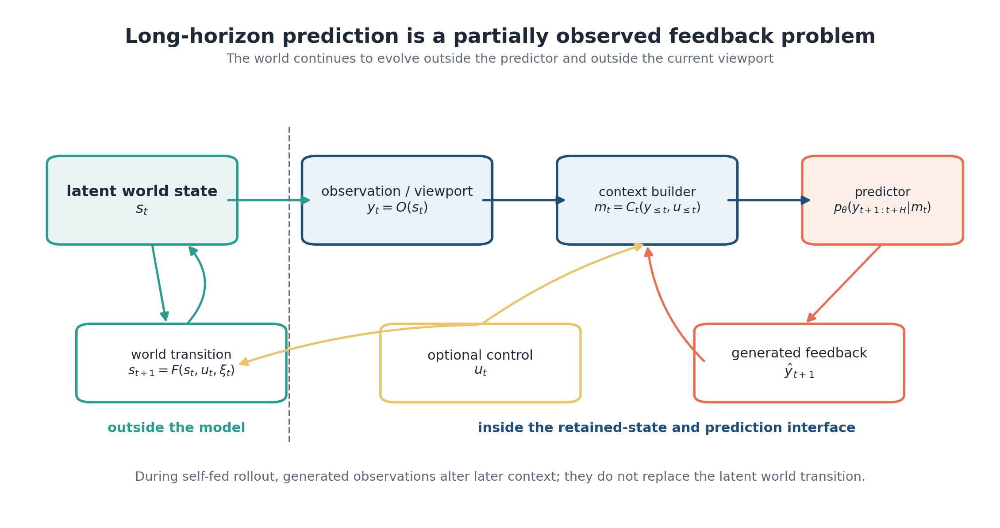

**Figure 1.1 — System boundary for long-horizon video prediction.** *Source: dissertation-native systems schematic; routing verified for this revision.*

Figure 1.1 places the predictor inside the observation loop. A context-construction operator $C_t$ selects or compresses past observations into a model state $m_t=C_t(y_{\leq t},u_{\leq t})$. The predictor with parameters $\theta$ produces a distribution over a future window,

$$
p_{\theta}\!\left(\widehat y_{t+1:t+K}\mid m_t,u_{t:t+K-1}\right).
\tag{1.2}
$$

For a task loss $\mathcal{L}$, multi-step prediction seeks parameters and a context policy that reduce expected risk across horizons,

$$
\min_{\theta,C}\;\mathbb{E}\!\left[
\sum_{k=1}^{K}\lambda_k
\mathcal{L}\!\left(\widehat y_{t+k},y_{t+k};x_{t+k}\right)
\right],
\tag{1.3}
$$

where the semicolon emphasizes that the endpoint can depend on latent task properties—identity or true support, for example—even though the predictor sees only images. The weights $\lambda_k$ need not be uniform. A short controller may care most about immediate error, whereas a memory study intentionally upweights events whose relevant evidence lies in the distant past.

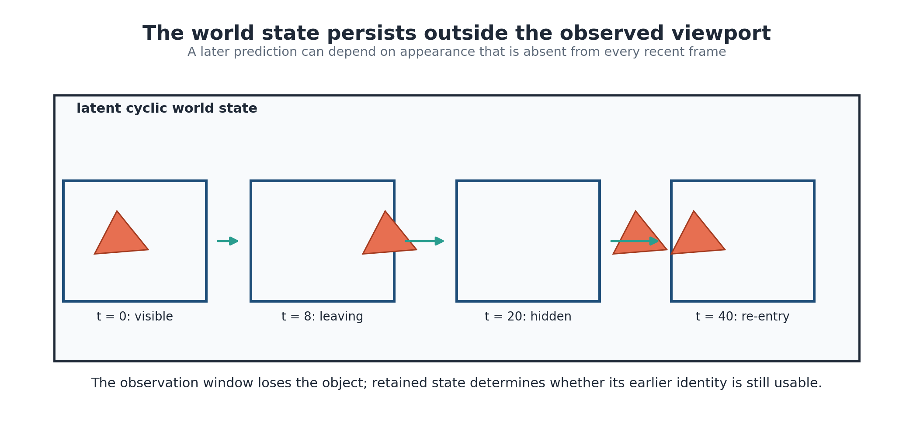

**Figure 1.2 — Hidden state versus viewport observation.** *Source: dissertation-native conceptual storyboard.*

Figure 1.2 illustrates why “previous frames” and “system state” are not interchangeable. The camera sees a rectangular crop of a larger cyclic world. When an object leaves that crop, its latent position and appearance persist. A model with a short flat window may infer plausible motion but cannot recover an earlier appearance that is no longer represented. A model with a long low-resolution stream can still address the event, although it may have discarded identity detail. In later chapters, this simple geometry becomes an exact experimental instrument rather than serving only as an analogy.

### 1.1.2 Self-fed prediction and the growth of uncertainty

Training commonly conditions on ground-truth history. Autoregressive evaluation does not. Once the first prediction is generated, later contexts contain model output, and the recurrence becomes

$$
\widehat y_{t+k}
\sim p_{\theta}\!\left(
\widehat y_{t+k}\mid
C_{t+k-1}(y_{\leq t},\widehat y_{t+1:t+k-1}),
u_{\leq t+k-1}
\right).
\tag{1.4}
$$

The change is deeper than accumulating numerical error. Exposure bias and scheduled or self-conditioned training address related sequence-level mismatches [25–29], but they cannot restore past information absent from the retained context. If a deterministic recurrence is written as $\widehat s_{t+1}=F_\theta(\widehat s_t)$, a perturbation evolves approximately under the product of Jacobians along the generated trajectory [93]. An average error-versus-horizon curve can therefore mix qualitatively different phases. The registered self-fed analysis later separates an early interval from the proposed late boundary, and replication shows that the apparent late inversion is not stable across seeds.

Error can also appear deceptively stable. A predictor that gradually removes uncertain foreground may converge to an easy background state. Pixel error then stops growing rapidly, but the sequence has lost the object. Conversely, a stochastic model can maintain multiple plausible futures and score poorly under a pointwise metric even when one sample is valid [130, 131, 155]. Complete endpoints and explicit candidate-count rules are required to distinguish these cases.

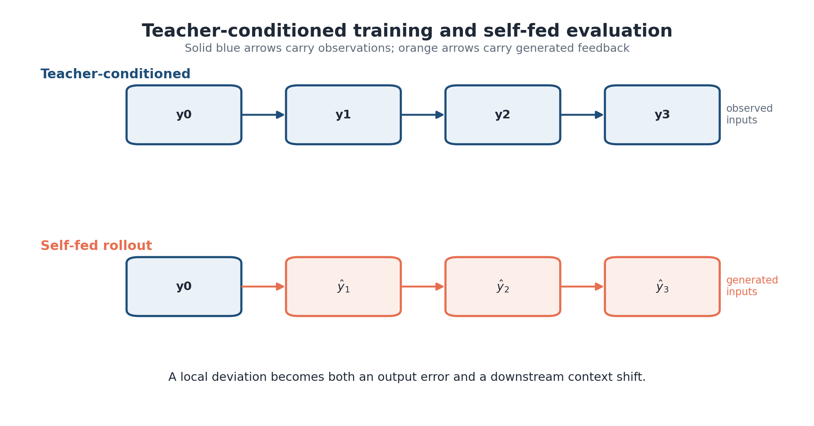

**Figure 1.3 — Teacher-conditioned training and self-fed rollout.** *Source: dissertation-native conceptual schematic.*

### 1.1.3 Resource-constrained multi-criteria formulation

The predictor is constrained by several memory terms that occur at different times and locations. A useful accounting identity is

$$
M_{\mathrm{total}}
=M_{\mathrm{parameters}}
+M_{\mathrm{optimizer}}
+M_{\mathrm{activations}}
+M_{\mathrm{context/state}}
+M_{\mathrm{transient}}.
\tag{1.5}
$$

Parameter and optimizer terms depend mainly on model size, precision, and training algorithm [108]. Activation memory stores or reconstructs intermediate values required for gradients. Context or state memory holds historical information used by prediction. Transient memory includes attention workspaces, sampler buffers, decoded candidates, and framework allocations. Summing them is useful for hardware feasibility; treating them as one design variable is not.

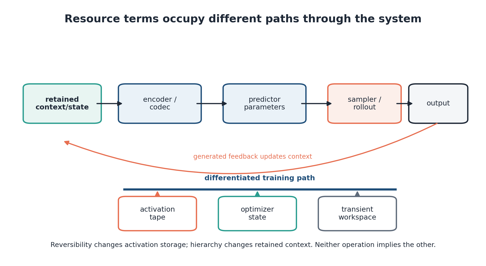

**Figure 1.4 — Locations of system memory costs.** *Source: dissertation-native systems schematic.*

Figure 1.4 explains why the methods in this dissertation are related without forming one inseparable model. Reversible temporal replay modifies the activation term inside a differentiable chain. Hierarchical context packaging modifies the retained-state term by changing how much history is represented at each resolution. V-BLT changes the spatial unit processed by local and global modules. Their costs could interact in a future integrated system, but the reported experiments measure them separately.

$$
\boldsymbol{\ell}(\widehat Y,Y)
=\bigl(
\ell_{\mathrm{frame}},
\ell_{\mathrm{support}},
\ell_{\mathrm{identity}},
\ell_{\mathrm{trajectory}},
\ell_{\mathrm{extra}},
\ell_{\mathrm{cross}}
\bigr).
\tag{1.6}
$$

$$
\begin{aligned}
\min_{\theta,C,a}\quad &
\mathbb{E}\!\left[\boldsymbol{\alpha}^{\mathsf T}
\boldsymbol{\ell}(\widehat Y,Y)\right] \\
\text{subject to}\quad &
M_{\mathrm{context/state}}(C)\leq B_{\mathrm{ctx}},\\
&M_{\mathrm{activations}}(\theta,a,K)\leq B_{\mathrm{act}},\\
&\operatorname{Work}(\theta,C,a,K)\leq B_{\mathrm{work}}.
\end{aligned}
\tag{1.7}
$$

Resource constraints also have different scaling variables. Parameter memory grows with model size, activation memory with the differentiated graph, context memory with the retained package, and attention work with the sequence presented to a block. IO-aware kernels such as FlashAttention can reduce the transient cost of exact attention without changing which history the model retains [13]. A context intervention may reduce both state storage and attention work, but only if token representations, precision, batch size, and target length are held comparable. Reporting “tokens” alone is incomplete when a coarse token and a fine latent carry different payloads, so Chapter 3 records token count and byte payload separately. Pareto reasoning must likewise remain discrete. The tested packages sample only a handful of budgets, leaving a continuous curve unidentified. In particular, the unresolved 1,792-token point prevents coloring an interpolated interval as a confirmed hierarchical region. Here, “frontier” denotes simultaneous comparisons at tested points, not a fitted phase transition.

| Resource term | Stored object | Dominant phase | Intervention examined here | Common confound |
|---|---|---|---|---|
| Parameters | learned weights | training and inference | capacity held fixed within matched comparisons | architecture changes with budget |
| Optimizer | moments and gradients | training | accounted but not directly optimized | precision and sharding |
| Activations | intermediate differentiated states | training | checkpointing or reversible replay | extra recomputation omitted |
| Context/state | retained observations or latent state | training and inference | flat, hierarchical, or subsampled packages | reach and fidelity co-change |
| Transient | attention and sampler workspaces | both | measured through total work/NFE where relevant | peak allocation mistaken for persistent state |

**Table 1.1 — Resource terms and their control interfaces.** The table distinguishes the quantity an intervention changes from nearby costs that may remain unchanged.

## 1.2 Consistency as a multi-criteria property

### 1.2.1 Why one quality score is insufficient

“Consistency” is sometimes used as a synonym for visual quality, temporal smoothness, or agreement with a prompt. A blurred object can follow the correct path. Sharpness offers no protection against a smooth identity change. Even low average error can conceal the disappearance of the only moving object when the background dominates. The metric should follow the failure, not the other way around.

Mean squared error measures pointwise deviation and remains valuable when pixels are aligned. SSIM adds local luminance, contrast, and structural terms [127]. LPIPS compares deep features [128], while FID and FVD summarize distribution-level feature statistics [94, 129]. Each compresses information differently. None directly states whether a particular object survived an occlusion, whether foreground was hallucinated, or whether the model recovered the appearance that was visible forty frames earlier.

**Figure 1.5 — Conceptual multi-step consistency landscape.** *Source: dissertation-native conceptual figure.*

Figure 1.5 should be read horizontally and vertically. Along the horizon, self-fed errors accumulate and the available context changes. Across criteria, image fidelity can decline independently of support, identity, or trajectory. The central empirical result later follows the same logic: hierarchical context can improve *where* an object is supported while dense context better preserves *what* the object is. Calling one arm simply “more consistent” would lose that boundary. Background imbalance makes the issue measurable. In a sparse scene, most pixels are easy background, so predicting empty space can achieve a respectable full-frame MSE while failing on every object pixel. Foreground-only MSE corrects the weighting but can still ignore hallucinated objects outside the ground-truth mask [46, 51]. Union-mask error includes both regions but changes its denominator with the prediction. Precision, recall, miss, and extra rates expose different directions of failure. Their empty cases must be defined before evaluation because a rollout may contain frames with no visible object.

**Figure 1.6 — Illustrative SDXL outputs and the limits of single-image inspection.** *Source: Kulyk and Mokin [133], original Figure 1; artwork assembled by L. Kulyk from locally generated SDXL outputs; reused under CC BY 4.0. Non-evidentiary illustration.*

$$
\mathbf q_{ik}
=\left(
q^{\mathrm{frame}}_{ik},
q^{\mathrm{support}}_{ik},
q^{\mathrm{identity}}_{ik},
q^{\mathrm{trajectory}}_{ik},
q^{\mathrm{extra}}_{ik}
\right).
\tag{1.8}
$$

### 1.2.2 Appearance, object, and conceptual consistency

The earlier analysis of diffusion-based image generation distinguished style or appearance, object identity, shape or geometry, and a proposed category called conceptual consistency [133]. Geometry concerns contour, spatial arrangement, and structural relations. Conceptual consistency, as proposed in [133], refers to preservation of a higher-level semantic idea across outputs that may vary in surface appearance. Classical accounts of visual representation and later vision-language evaluation show why semantic agreement cannot be inferred from pixels alone [100–104]. The dimensions overlap. A face identity depends partly on geometry and texture; a stylized sequence can preserve concept while changing both.

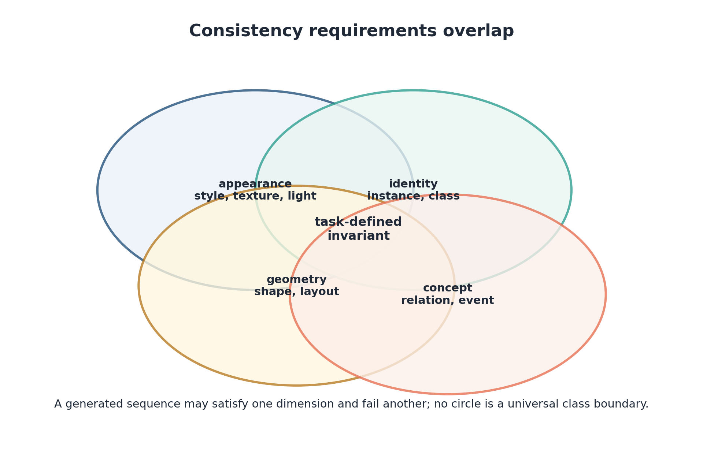

**Figure 1.7 — Overlapping consistency criteria.** *Source: dissertation-native synthesis informed by [133].*

**Figure 1.8 — Local visual input and integrated scene understanding.** *Source: Kulyk and Mokin [133], original Figure 5; artwork by L. Kulyk, conceptually informed by Hertzmann [174]; reused under CC BY 4.0. Heuristic illustration.*

| Criterion | Typical failure in generated video | Representative endpoint | What the endpoint can miss |
|---|---|---|---|
| Appearance/style | color, texture, or illumination drifts | feature or style similarity | correct score with wrong object identity |
| Identity | object changes class or instance after occlusion | assignment-based identity accuracy | spatial support may still be wrong |
| Geometry/support | contour collapses, object disappears, or extra foreground appears | overlap, coverage, precision/recall, miss and extra rates | fine attributes inside support |
| Concept/semantics | sequence contradicts the intended relation or event | task classifier, structured relation, or human protocol | temporal continuity and localization |
| Trajectory | motion is smooth but follows the wrong path | centroid or pose error over time | appearance and internal structure |
| Cross-level agreement | coarse state and fine prediction describe different events | decoded cross-level discrepancy | both levels may be jointly wrong |

**Table 1.2 — Consistency criteria, observable failures, and metric blind spots.** No endpoint is treated as a complete substitute for the others.

The control interface changes the cost of consistency. Image-to-image conditioning supplies a reference each time and is simple to deploy when such a reference exists [95]. DreamBooth and LoRA store a subject or style in adapted parameters [96, 97]; repeated identities can then be generated without sending the full reference, but adaptation consumes data and optimization. Structural control supplies edges, depth, pose, or segmentation [98]. Inversion methods estimate a latent or noise state for an existing image, providing strong edit control at additional inference cost [114, 115]. Shared-attention methods couple features among samples [99]. None is universally strongest because each assumes different information at the system boundary.

### 1.2.3 Temporal and trajectory consistency

Adding time changes the criteria in two ways. First, values should remain coherent between adjacent frames. Second, the sequence should follow a valid long-range process. Local smoothness addresses the former but can fail the latter: a vehicle may drift smoothly off its road, or a rotating object may decelerate continuously when the true dynamics require acceleration. Temporal consistency is thus necessary and insufficient.

$$
L_{\mathrm{traj}}^{(i)}
=\frac{1}{|\mathcal T_i|}
\sum_{t\in\mathcal T_i}
\left\|\widehat c_{it}-c_{it}\right\|_2.
\tag{1.9}
$$

This error detects displacement but not an identity swap between nearby objects. Assignment must be persistent or identity-aware, and unmatched predictions need an explicit penalty. Conversely, an identity classifier can recognize a digit whose predicted position is badly wrong. The combination of support, assignment, identity, and trajectory endpoints is what makes the persistent-object boundary interpretable.

Identity across time also requires an assignment rule. Hungarian assignment solves the per-frame minimum-cost correspondence [125]; the persistent-object evaluation augments it with metadata and declared penalties so that disappearing predictions do not receive a favorable identity score simply by remaining unassigned. Before disappearance, the context contains direct appearance evidence. Paired populations and multiple seeds reduce that alternative explanation; the privileged raw-memory reference clarifies the upper bound on access.

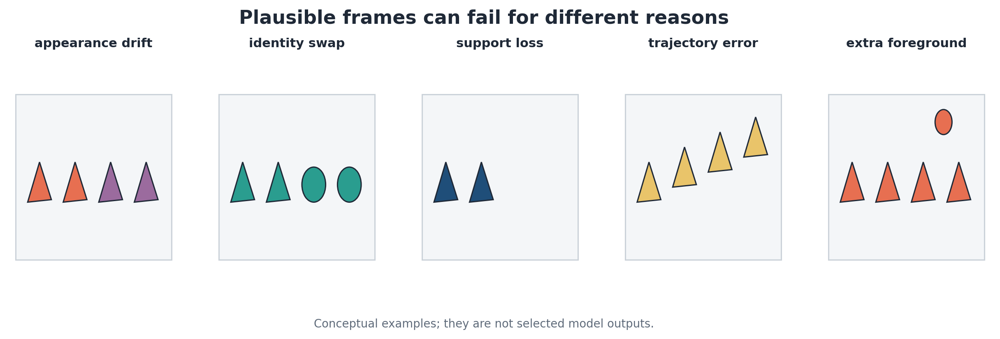

**Figure 1.9 — Distinct failures with superficially plausible frames.** Appearance drift, identity substitution, support loss, trajectory deviation, and extra foreground require different endpoints; the montage is conceptual rather than model evidence. *Source: dissertation-native examples.*

For a binary ground-truth foreground mask $G_t$ and predicted mask $P_t$, overlap alone can be misleading when both are empty. The later endpoint suite therefore includes the ground-truth-normalized miss and extra fractions

$$
r_{\mathrm{miss}}(t)=\frac{|G_t\setminus P_t|}{|G_t|},
\qquad
r_{\mathrm{extra}}(t)=\frac{|P_t\setminus G_t|}{|G_t|},
\tag{1.10}
$$

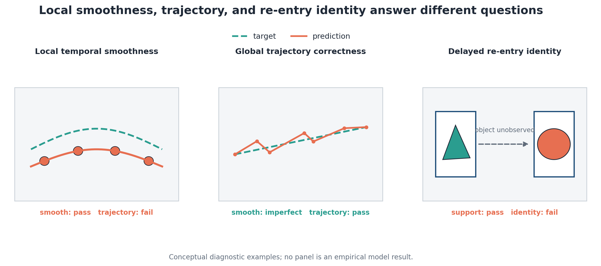

**Figure 1.10 — Operational separation of temporal smoothness, trajectory correctness, and re-entry identity.** *Source: dissertation-native conceptual figure.*

### 1.2.4 Hierarchical and cross-level consistency

Hierarchy introduces another relation to evaluate, but only for a system that exposes distinct levels with a defined correspondence. Cross-level consistency therefore begins with an alignment contract: which levels describe the same event, how their coordinates map, and what information survives the projection used for comparison. Multiscale architectures have demonstrated the value of slow and fast or coarse and fine representations [20, 35–37, 150], yet the presence of such levels supplies no automatic consistency guarantee.

$$
L_{\mathrm{cross}}(t)
=d\!\left(
D_c(z_t^c),
\mathcal S\bigl(D_f(z_t^f)\bigr)
\right),
\tag{1.11}
$$

Three checks follow for a hierarchical predictor. First, each level should be evaluated for the property it is expected to preserve; a coarse occupancy map should not be penalized for absent texture. Agreement is then tested only over their shared information. Finally, the fine output must still be compared with ground truth, because perfect internal coherence can describe the wrong future. In the present experiments, hierarchy is judged primarily through observable decoded endpoints and package-level effects. Equation (1.11) formalizes the additional cross-level criterion but is not promoted to a headline result without a registered empirical test.

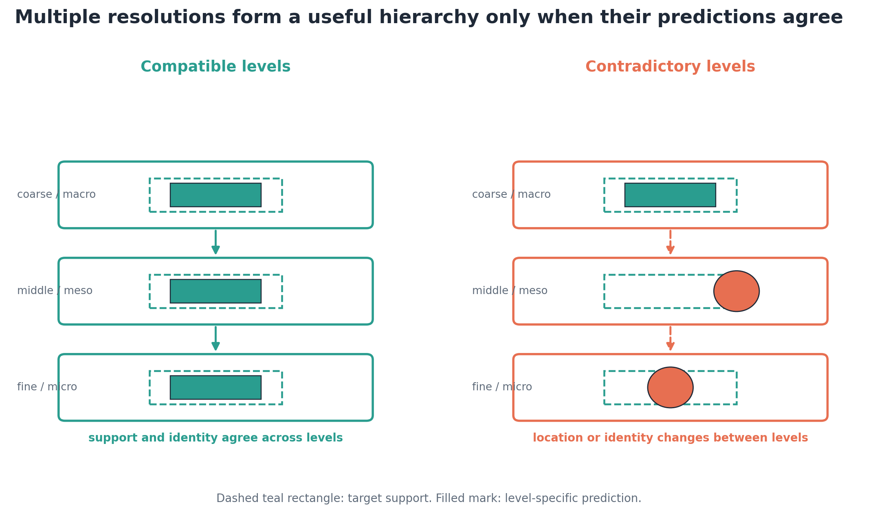

**Figure 1.11 — Consistent and contradictory predictions across representational levels.** Multiple resolutions create an alignment problem; they do not guarantee that coarse and fine outputs describe the same event. *Source: dissertation-native conceptual figure.*

V-BLT and the final predictor instantiate different hierarchies. V-BLT organizes local and global processing inside one representation, whereas Chapter 3 retains coarse and fine histories across time. Their shared principle is scale-dependent capacity, not a shared tensor path or empirical result.

### 1.2.5 From static control criteria to video requirements

The static criteria survive in video, but their observability changes. Appearance and identity must be checked across time and after occlusion. Geometry becomes support and motion as well as contour. Concept becomes an event or relation that unfolds over a sequence. Structure supplied at every frame can prevent one class of error, whereas a predictor with no future condition must infer structure from dynamics and retained state.

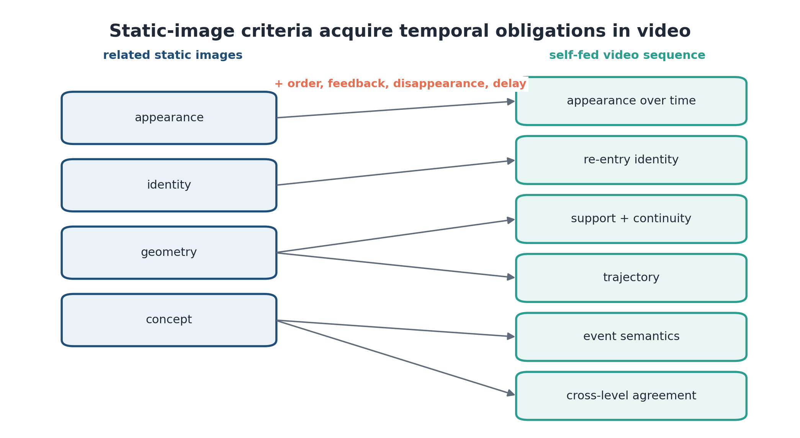

**Figure 1.12 — From static-image invariants to video requirements.** *Source: dissertation-native synthesis.*

Figure 1.12 distinguishes inheritance from extension. A reference image can establish appearance or identity at one instant, but video introduces ordering and delayed verification: the object observed at $t=3$ may not be judged again until $t=40$. During that interval, the predictor receives its own outputs and the evidence available to its context changes. Trajectory and re-entry criteria are therefore temporal constructs, while cross-level agreement applies only when a model exposes more than one representational level. The figure transfers a vocabulary, not empirical results from static generation.

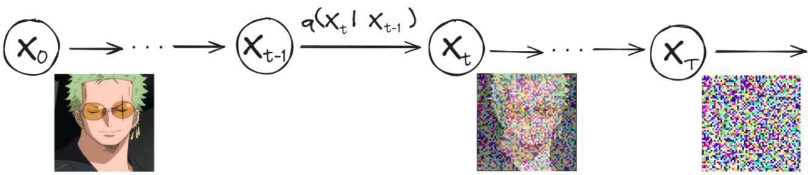

**Figure 1.13 — Forward diffusion as progressive corruption.** *Source: Kulyk and Mokin [133], original Figure 2; author-created schematic based on the DDPM formulation [3]; reused under CC BY 4.0.*

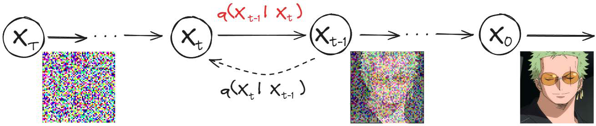

**Figure 1.14 — Reverse diffusion as iterative denoising.** The historical drawing communicates progressive refinement; the formal learned transition is $p_\theta(x_{s-1}\mid x_s)$, distinct from the forward and posterior $q$-distributions. *Source: Kulyk and Mokin [133], original Figure 3; author-created artwork reused unchanged under CC BY 4.0.*

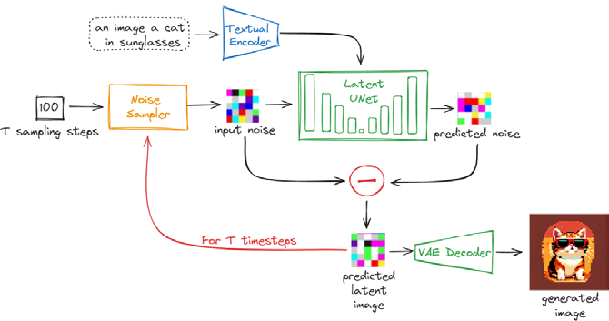

**Figure 1.15 — Generic latent diffusion generation pipeline.** Text conditioning, iterative latent denoising and image decoding illustrate the static-generation background; this is not the architecture of the Chapter 3 predictor. *Source: Kulyk and Mokin [133], original Figure 4; author-created artwork reused unchanged under CC BY 4.0.*

Diffusion time and video time are different coordinates. The former indexes noise levels used to refine one target sample; the latter indexes successive states of an evolving scene. A video diffusion model contains both, so convergence of its denoising loop cannot establish temporal consistency by itself.

> **Reserved author-supplied video-generation example.** Insert a short fixed sequence only when its clip or prompt, model and checkpoint, seed, sampler, frame indices, and output hashes are available. The example should illustrate one declared temporal invariant or failure and be captioned “qualitative illustration; not used for inference.” It remains unnumbered and is not counted as evidence until populated.

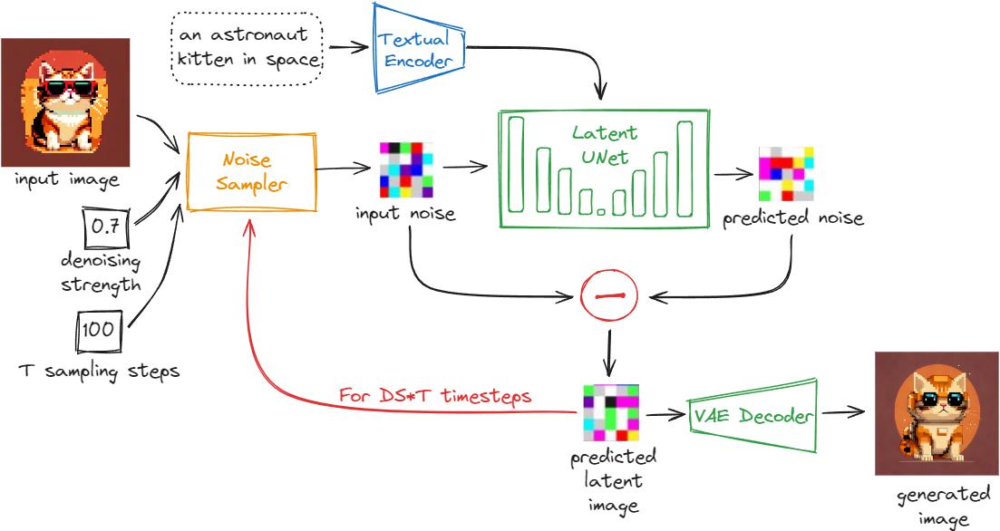

**Figure 1.16 — Image-to-image generation from a reference and noise level.** Direct reference conditioning can preserve local appearance when the source is available, but stronger perturbation permits greater change and does not guarantee identity or temporal memory. *Source: Kulyk and Mokin [133], original Figure 6; author-created artwork reused unchanged under CC BY 4.0.*

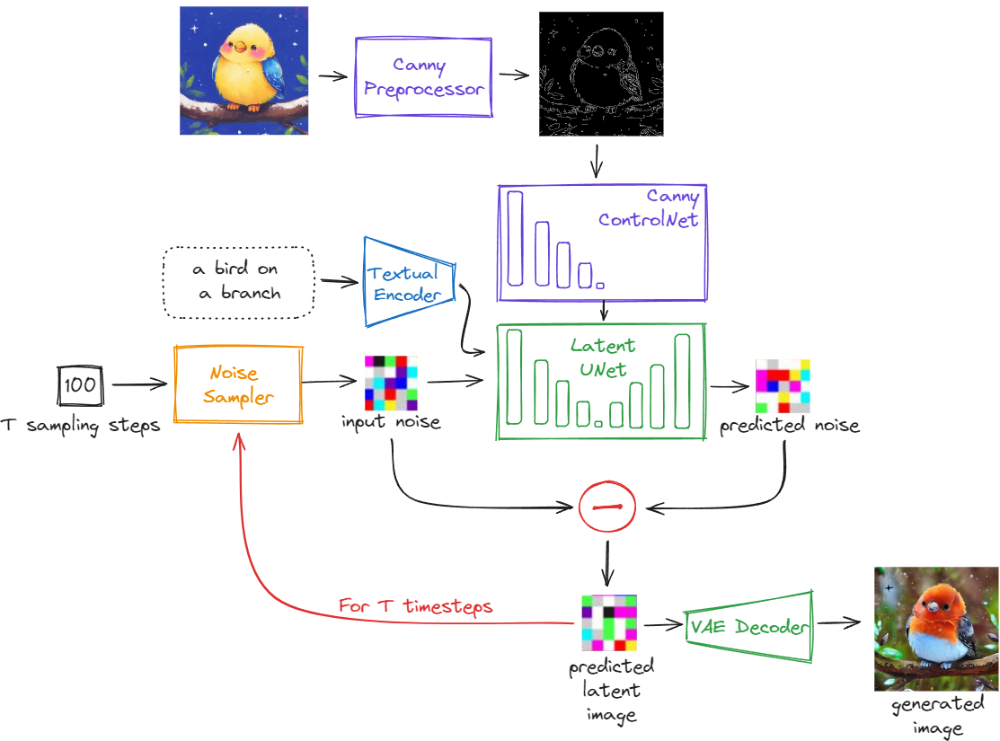

**Figure 1.17 — Structural conditioning controls geometry more directly than identity.** *Source: Kulyk and Mokin [133], original Figure 7; artwork and locally generated examples by L. Kulyk; ControlNet method from Zhang et al. [98]; reused under CC BY 4.0.*

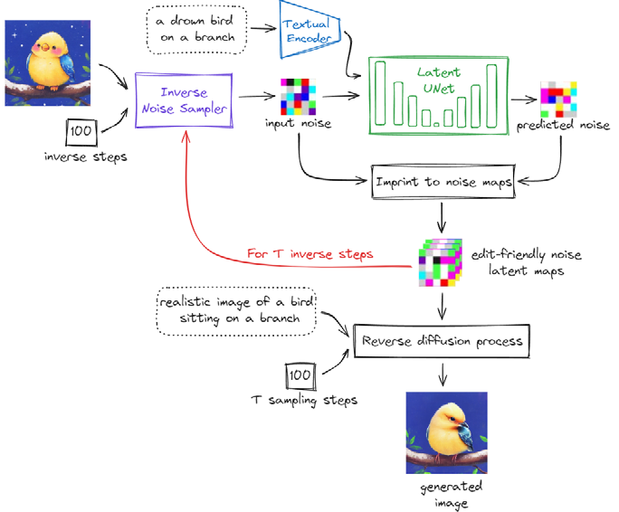

**Figure 1.18 — Inversion-based control through a recovered latent trajectory.** Inversion can anchor edits to a specific source more tightly than free sampling, at the cost of reconstruction error and additional optimization or inversion work [114, 115]. *Source: Kulyk and Mokin [133], original Figure 8; author-created artwork reused unchanged under CC BY 4.0.*

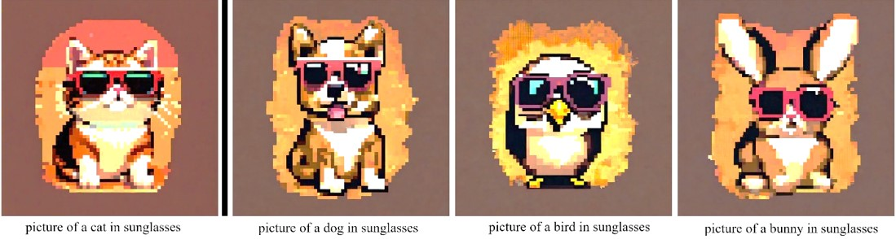

**Figure 1.19 — Shared style across changing subjects.** *Source: Kulyk and Mokin [133], original Figure 9; locally generated and assembled by L. Kulyk; StyleAligned method from Hertz et al. [99]; reused under CC BY 4.0.*

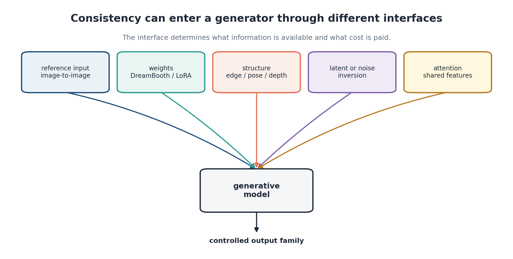

**Figure 1.20 — Five interfaces for controlling related generations.** Reference input, parameter adaptation, structural conditioning, inversion, and shared attention preserve different information and incur different update or inference costs. *Source: dissertation-native synthesis of [95–99, 133].*

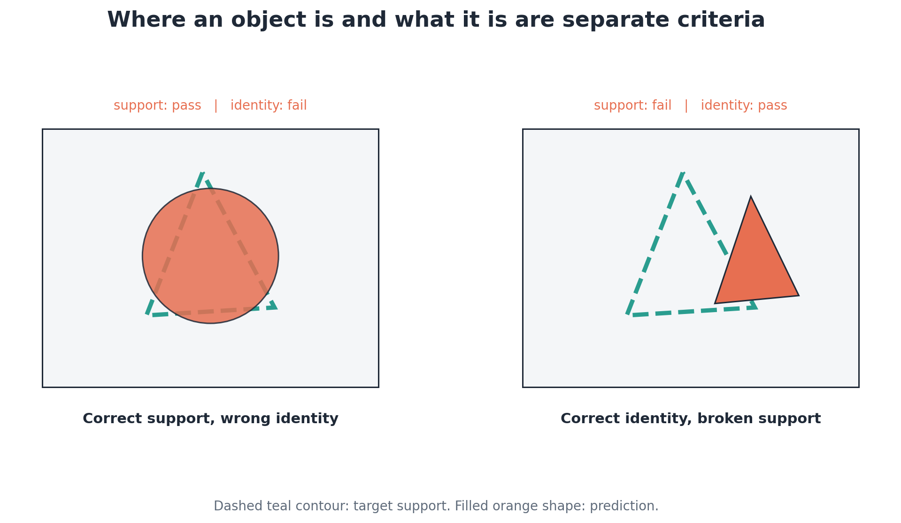

**Figure 1.21 — Support and identity as independent axes.** Correct location can coexist with incorrect identity, while identity can survive despite poor spatial continuity. This distinction motivates the persistent-object endpoints in Chapter 4 without implying a shared causal mechanism. *Source: dissertation-native conceptual figure.*

These interfaces also set a fairness boundary. Future structure supplied to a controlled generator is privileged information unavailable to an autonomous rollout; parameter and latent adaptation store information at different system locations. Every comparison must therefore name both the invariant and the information legally available at prediction time.

A useful evaluation order follows. First establish whether the event was observable to each package. Then measure support and false foreground, because a missing object makes identity and trajectory conditional. Next evaluate assigned identity and motion. Finally inspect full-frame and perceptual quality as complementary summaries. Reversing this order encourages a high aggregate score to dominate the interpretation before the memory-dependent criterion is tested. Interpretability critiques make the same general point: an explanation is useful only when its construct and decision role are explicit [39, 40].

## 1.3 Three bottlenecks behind long-horizon inconsistency

### 1.3.1 Activation growth during temporal learning

Backpropagation through time expands a recurrent computation into a directed acyclic graph [28, 29, 105]. If one temporal step creates activations of size $A$, retaining every intermediate value for a horizon $K$ gives the leading-order relation

$$
M_{\mathrm{act}}^{\mathrm{BPTT}}(K)=\Theta(KA),
\tag{1.12}
$$

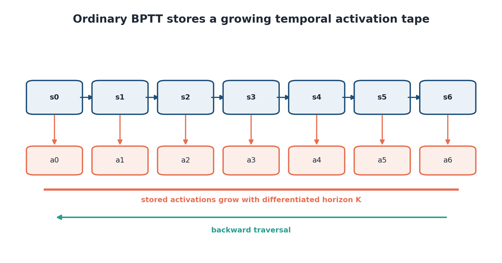

**Figure 1.22 — Activation-tape growth under ordinary temporal backpropagation.** *Source: dissertation-native conceptual schematic.*

Checkpointing stores selected boundary states and recomputes missing segments during the backward pass [30, 31, 108, 109]. Reversible coupling takes another route: if a block input can be reconstructed from its output, the block need not retain the same activation tape [32, 92]. Chapter 2 verifies this exchange and the TempVerseFormer state boundary. Chapter 3 uses windowed training for the final predictor, with ordinary gradient flow confined to each training window.

The differentiated horizon, rather than the deployed rollout length by itself, is the controlling variable. Truncating the graph changes which delayed dependencies receive gradient. Checkpointing can preserve the objective while selecting a storage–recomputation schedule, whereas a reversible core reconstructs compatible internal states and still retains non-invertible boundaries, parameters, gradients, and replay metadata. Their asymptotic descriptions therefore apply to scoped components. A practical comparison must report peak memory and time at the same horizon, batch, precision, and model interface; otherwise a smaller activation term can be hidden by unrelated constant allocations.

### 1.3.2 Uniform spatial allocation

A fixed patch grid is simple, parallel, and easy to batch [69–71]. Its token count for a video with $T$ frames and non-overlapping spatial patches $p_h\times p_w$ is

$$
N_{\mathrm{fixed}}
=T\left\lceil\frac{H}{p_h}\right\rceil
\left\lceil\frac{W}{p_w}\right\rceil.
\tag{1.13}
$$

**Figure 1.23 — Uniform spatial allocation on a nonuniform scene.** *Source: dissertation-native conceptual figure.*

Information density offers a possible signal for allocation. A categorical predictor that is confident about a constant region has a concentrated distribution; a moving edge can produce a broader one. Predictive entropy, however, also changes with model misspecification, limited context, and multimodal futures. It provides neither calibrated uncertainty [44, 45] nor proof that changing token sizes will improve a compute–quality frontier. A dynamic allocator would need a causal aggregation rule, a fixed compute budget, routing and merge operations, and an end-to-end comparison against the same fixed-grid model. The V-BLT experiment in Chapter 2 stops earlier: it validates fixed raster-byte packages, multidimensional positions, and entropy maps. Those maps motivate adaptive regioning but do not validate the controller.

There is a second allocation issue inside the hierarchy. That lowers global sequence length without requiring every byte to become one global token. Whether this saves wall-clock time depends on local work, memory movement, hardware utilization, and batch shape—not GFLOPs alone. The published point estimates support a proof of concept, not a scaling law.

### 1.3.3 Limited retained-context reach

Let a context package at decision time $t$ expose a set of source anchors $\mathcal A_t$. Its nominal reach is the age of the earliest addressable anchor,

$$
R(C_t)=t-\min_{\tau\in\mathcal A_t}\tau.
\tag{1.14}
$$

**Figure 1.24 — A relevant appearance outside a dense fine-context window.** *Source: dissertation-native schematic; temporal scale is explanatory.*

At a fixed token budget, increasing reach usually changes fidelity or sampling density. A flat fine stream allocates all tokens to recent high-resolution frames. Even with similar token counts, the packages expose different events because their anchor geometry differs. If an object never leaves the recent window, a long memory may be unused; if the relevant evidence predates both packages, neither arm has an access advantage. Aggregate performance remains supporting evidence, not the primary mechanism test.

### 1.3.4 Causal map from bottlenecks to interventions

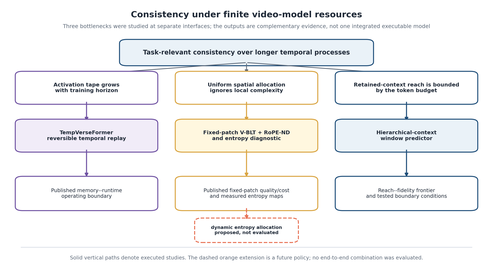

**Figure 1.25 — Causal map of the dissertation.** Activation replay, spatial representation, and retained context act at different interfaces; Chapter 4 combines their evidence as a selection rule, not as one executed pipeline. *Source: dissertation-native systems synthesis.*

Figure 1.25 connects the developed works by system interface without presenting an untested end-to-end architecture. The left branch changes how gradients are computed through a temporal state; the middle branch changes how visual bytes are represented and how positional structure is encoded; the right branch changes which coarse and fine histories enter prediction. All three are judged against the consistency criteria above, and only the right branch is integrated into the final matched-budget model. This relation is familiar in systems engineering: compatible interventions can address separate constraints even when their combinations remain untested. Explicit interfaces and evidence levels then allow the final chapter to select a method after diagnosing the binding resource. Compatibility here concerns interfaces; compounded savings remain unmeasured. Activation and context costs were obtained in separate systems and therefore stay on separate axes. Any future integration would need its own end-to-end memory, computation, quality, and causal-attribution tests before the separate effects could be combined.

The map is causal in the sense of a diagnosis–intervention–measurement chain. Activation growth is diagnosed by scaling the differentiated horizon and measured through memory and replay time. Spatial allocation is examined through fixed local/global processing and entropy structure, while retained reach is identified through package anchors and re-entry populations. A gain at one branch cannot validate another branch because the manipulated variable, resource account, and endpoint differ. This separation also explains the chapter order: the first two interventions can be validated independently, after which the final model isolates the context decision that remains unresolved.

## 1.4 Existing methods and unresolved gap

### 1.4.1 Long-horizon temporal modelling and memory-efficient training

Recurrent video predictors compress the past into a hidden state. ConvLSTM introduced convolutional gates for spatio-temporal forecasting [137], and later models such as PredRNN, PredRNN++, E3D-LSTM, and PhyDNet added memory pathways, three-dimensional recurrence, or physics-informed decomposition [138–140, 152]. Feed-forward predictors provide an important counterpoint. SimVP shows that strong spatio-temporal prediction can emerge from an encoder–translator–decoder without recurrent rollout inside the training window [141]. The Temporal Attention Unit combines spatial attention with temporal differential modelling [153], while Earthformer structures space–time interactions through cuboid attention [142].

World-model research provides a complementary perspective. Latent imagination models learn compact recurrent dynamics for control [64–67, 132]; generative video models use adversarial, latent-variable, autoregressive, diffusion, or masked objectives [38, 42, 43, 50, 53–63, 74, 151, 156–158]. Their main result is often prediction or control quality, while activation-memory measurements are secondary or absent. Differentiable-reward fine-tuning changes the objective again, but does not by itself solve temporal state storage or context reach [117, 118]. One-step or short-window objectives offer another practical choice: they train a transition locally and rely on repeated inference, as the final predictor does, but leave the complete rollout loss outside optimization. Reversible replay matters only when the research or application requires gradients through that longer chain. The unresolved training question is therefore conditional: when such an objective is required and activation storage binds, what is the measured exchange among storage, replay, and predictive quality?

### 1.4.2 Adaptive and hierarchical visual representation

Patch tokenization makes images compatible with transformers by mapping regular regions to a sequence [69], and video transformers extend the operation in space and time [70, 71]. Dynamic pruning removes tokens judged unimportant; TokenLearner constructs a compact learned set; adaptive-depth transformers stop examples or tokens early; token merging combines similar representations [143–146]. NaViT and FlexiViT vary aspect ratio or patch size across training and inference [147, 148].

Byte-level models avoid a fixed semantic vocabulary and predict elementary discrete values [72, 73]. BLT groups text bytes into latent patches so that a global model operates at a lower rate [72]. V-BLT adapts a local–global–local pattern to raster pixel-channel bytes and adds multidimensional positional coordinates [134]. The resulting categorical distribution at each output byte supports direct entropy calculation. Absolute embeddings can bind a model to trained sizes; relative attention and rotary embeddings encode relations more directly [106, 107]. It preserves relative phase differences within each axis and supplies coordinate structure to attention, without guaranteeing correct routing or hierarchy.

### 1.4.3 Context memory, retrieval, and multirate hierarchy

Long context can be obtained by enlarging a dense window, compressing old states, retrieving selected memories, or updating a recurrent summary. Transformer-XL caches earlier hidden states [14]; Compressive Transformer adds a lower-rate compressed memory [15]; Memorizing Transformers retrieve approximate nearest-neighbour values [16]. Hierarchical temporal models add multiple update rates: Clockwork RNN partitions hidden units by clock [33], Variational Temporal Abstraction learns temporal segments [34], and Clockwork VAE represents video at nested temporal scales [20].

Recent video world models make memory an explicit subsystem. Long-context state-space video models extend the sequential backbone [22]; WorldPack compresses spatial memory [23]; long-term spatial memory, compression-and-retrieval, learned context querying, and geometry-aware memory propose different storage or retrieval interfaces [24, 79–81]. Multiscale recurrent prediction also predates the present package intervention, including explicitly hierarchical spatio-temporal scales in MSPred [150]. Memory Maze, MBench, and MemoBench evaluate memory capability across different scenarios [68, 82, 83]. MilliVid is the closest architectural comparator because it uses hierarchical coarse-to-fine latents to maintain long-range consistency [37]. The contribution of Chapters 3–4 is the controlled package intervention, exact analytic observability, registered pair-derived populations, and measured lower and upper inversions.

| Bottleneck | Representative approaches | Resource directly controlled | Typical evidence | Unresolved issue addressed here |
|---|---|---|---|---|
| Activation growth | truncation, checkpointing, reversible residual or transformer blocks [28–32, 92] | retained differentiated activations | peak memory, replay cost, gradient agreement | verified temporal-state boundary and applicability |
| Uniform spatial allocation | multiscale encoders, pruning, learned tokens, merging, variable patches [71, 72, 143–148] | spatial/global token work | accuracy or quality versus tokens/FLOPs | raster-byte entropy signal separated from untested adaptive policy |
| Limited retained reach | cached, compressed, retrieved, recurrent, or hierarchical memory [14–24, 33–37, 79–83] | addressable history and representation detail | benchmark quality or memory recall | matched-budget reach population and reach–fidelity inversion |
| Rollout inconsistency | scheduled sampling, self-forcing, rollout objectives [25–29] | train–test exposure and differentiated horizon | self-fed quality | distinguish objective exposure from context reach and activation cost |
| Metric blindness | frame, perceptual, distributional, object, and benchmark suites [94, 120–131] | evaluation construct | aggregate scores and task endpoints | complete false-positive-sensitive and clip-cluster protocol |

**Table 1.3 — Literature organized by the resource or construct it controls.** Grouping by bottleneck exposes where methods are complementary and where apparently similar “memory” claims refer to different quantities.

## 1.5 Problem decomposition and requirements for the developed methods

### 1.5.1 Derived design requirements

Across model families, the analysis yields the following requirements.

1. **Causal semantics must be explicit.** Each token or latent may use only the observations, controls, and generated states allowed at its prediction time. A diagram is insufficient; masks and anchor mappings require mathematical or code-level definitions.
2. **Resources must be accounted at their interface.** Context, target, payload, total sequence length, activation storage, and transient sampler work should not be collapsed into one token or memory number.
3. **Consistency must be evaluated by failure type.** Frame fidelity, missing support, extra foreground, identity, trajectory, and cross-level disagreement require separate endpoints with declared empty cases.
4. **A long-memory claim requires a reach-identifying population.** The relevant evidence should be within one compared package and outside another, or the analysis must be labelled aggregate rather than mechanistic.
5. **Comparisons must state what co-changes.** Matched capacity, near-matched package shape, whole-configuration interfaces, and privileged references answer different questions.
6. **Uncertainty must preserve dependence.** Rollout frames remain within resampled clips; training seeds are reported separately; registered families receive simultaneous inference.
7. **Measured and proposed components must be visually and verbally distinct.** This applies especially to adaptive entropy regioning and any future combination of reversibility with the hierarchical predictor.

Together, the requirements turn broad ambitions into reviewable contracts and prevent a seemingly unified architecture from masking several untested links. They also impose an order: causality and resource accounting define admissible systems; endpoint completeness defines success; the reach population and uncertainty model determine whether a mechanism is identifiable. Only after those conditions are fixed can a package comparison support a design rule.

Documentation follows the same contract. Random-number state, sampler steps, codec identity, dataset purpose, and checkpoint hash are part of the experiment definition when they can change a conclusion. Evidence figures should be generated from the same frozen tables used for inference; hand-entered headline values create a second, drift-prone source of truth. Protected datasets need purpose and access logs so that an untouched label remains meaningful.

### 1.5.2 Research hypotheses

The hypotheses arise from the bottlenecks, independent of publication order.

Each hypothesis links one proposed mechanism to an observation that could limit it. A lower memory reading alone is insufficient for H1 unless reconstruction and gradient behavior remain acceptable. Comparisons at different reach conditions are required for H3 and H4 because the same package may be favored for distant support and disfavored for fine identity. Robustness under H5 asks whether those directions survive interface changes; it is not a request that every interval reach significance.

| Hypothesis | Mechanism prediction | Evidence required | Falsifying or limiting result |
|---|---|---|---|
| H1: reversible temporal replay reduces activation growth | intermediate doubled states can be reconstructed instead of stored | inverse and gradient checks; memory and time versus horizon | non-reversible interfaces dominate, instability, or replay cost outweighs storage |
| H2: raster-byte hierarchy exposes nonuniform predictive complexity | local/global processing predicts categorical bytes and entropy varies spatially | fixed-patch quality/cost and faithfully rendered entropy | no useful spatial structure or no advantage over comparators |
| H3: hierarchy buys reach under a fixed context budget | coarse frames preserve addressable distant evidence beyond a short fine window | pair-specific population with matched/declared budget | no benefit where reach differs |
| H4: flat context recovers when fidelity binds | once both packages reach the event, dense fine history preserves more detail | upper tested budget comparisons and identity-sensitive boundary | hierarchy remains superior across all sampled fidelity regimes |
| H5: principal directions are not artifacts of one sampler or codec | reach/fidelity pattern persists under controlled interface changes | registered sampler/NFE and independent-codec studies | sign reversal or loss of precision sufficient to leave the claim unresolved |

**Table 1.4 — Research hypotheses and their evidence conditions.** The hypotheses are independent mechanism tests: H2 does not claim an executed adaptive allocator, while H3–H4 describe sampled reach–fidelity operating regions rather than a continuous law.

### 1.5.3 Chapter conclusions and transition

Long-horizon video prediction is a partially observed, self-fed system. The predictor sees frames rather than complete world state, and its own outputs alter later inputs. Consistency must therefore be specified across appearance, identity, geometry, support, trajectory, false foreground, and cross-level agreement. Aggregate frame quality is necessary evidence, but it cannot identify every failure that matters after disappearance and re-entry.

Three resource constraints were separated. Activation memory grows along a differentiated temporal chain, uniform spatial tokens can misallocate capacity inside a scene, and retained context limits which earlier observations remain addressable at inference. The literature offers an intervention at each interface: reversible and checkpointed computation exchange storage for replay; adaptive or hierarchical representations alter spatial tokenization and global work; compressed, retrieved, recurrent, and multirate memories extend temporal access. Their coexistence supports a method-selection framework whose claims are tied to the tested interface, not a claim of one integrated model.
