# Chapter 2 — Methods for Feasible Temporal Training and Adaptive Spatial Representation

Chapter 1 separated three resource constraints that are often collapsed into the single phrase
"long-horizon video modelling." One arises from the activation tape retained while gradients pass
through a long temporal process. Another concerns how representational capacity is distributed
across the visual field. The third is the history available when a trained predictor runs
autonomously. Here, the first two become the subjects of analysis; retained history becomes the central model
problem in Chapter 3.

At the system level, the methods occupy different interfaces. Reversible temporal computation changes how
intermediate states are supplied to reverse-mode differentiation, exchanging storage for
reconstruction. Vision Byte Latent Transformer (V-BLT), together with multidimensional rotary
positional encoding, changes how raster information is transformed around a global temporal model;
it studies local-global processing and a model-internal signal of spatial complexity. These are
sibling interventions, not stages of one network, and neither appears inside the later
hierarchical-context predictor. Their common design question is nevertheless concrete: under a
bounded capacity, which information must stay explicit, and which can be reconstructed or
represented more compactly?

## 2.1 Shared controlled experimental foundation

### 2.1.1 Why controlled procedural video is used

A prediction error in natural video can have several causes at once: an object may be occluded,
the camera may move, illumination may change, or the future may genuinely be multimodal. Such
variation is essential for external validation, but it is awkward when the immediate question is
whether a model has learned a particular temporal transformation. Procedural video narrows that
question. The generator exposes the state variables that determine each frame, and a new sequence
can be sampled without collecting another recording.

Let a procedural scene state be $s_t$, let $u_t$ contain the chosen motion parameters, and let
$\mathcal R$ denote the renderer. A deterministic sequence has the form

$$
s_{t+1}=f(s_t,u_t),
\qquad
x_t=\mathcal R(s_t),
\tag{2.1}
$$

That control is the point.

The gain in control carries a cost. Black backgrounds, isolated objects, and prescribed motion
laws simplify segmentation and reduce the diversity of textures, interactions, and camera effects.
A model may therefore perform well by exploiting regularities that would fail in natural video.
These data can show whether a mechanism works under controlled conditions; general video
competence requires a broader test. That distinction determines the dataset ladder used throughout
the dissertation: simple rotations are followed by OpenSTL tasks, then by purpose-built long-memory
tests whose difficulty comes from loss of observable history rather than visual clutter [1].

### 2.1.2 Rotating two-dimensional shapes

The common procedural idea in the temporal and byte-level studies is a rotating triangle rendered
at $64\times64$ pixels. Each sequence starts from a randomly generated triangular geometry and a
random initial orientation. The object is centred, the camera remains fixed, and the angle evolves
at discrete frame times. For a constant-velocity sequence,

$$
\theta_{t+1}=\theta_t+\omega,
\tag{2.2}
$$

with direction sampled clockwise or counter-clockwise. In the temporal-modelling experiments,
$\lvert\omega\rvert$ was sampled between $5^\circ$ and $20^\circ$ per step. Additional regimes
changed $\omega_t$ by acceleration or deceleration, reversed its sign periodically, interrupted it
for a sampled interval, or combined these patterns. Frames were rendered as $64\times64$ RGB
images for that study; the context contained 12 frames, the training curriculum increased the
prediction depth from one to five, and evaluation extended to 12 predicted steps [135]. The public
simple-shape toolbox supplies the two- and three-dimensional procedural generators, metadata
records, and command-line entry points needed to regenerate this dataset family [171].

**Figure 2.1 - Procedurally generated rotating two-dimensional triangle.**

### 2.1.3 Rotating three-dimensional polycubes

The three-dimensional testbed increases structural variation without giving up procedural control.
A polycube is assembled from $n\in\{2,\ldots,6\}$ face-connected unit cubes selected from canonical
forms. The object is centred in a fixed-camera scene and assigned random initial rotations about all
three axes. A sampled angular-velocity vector then updates orientation:

$$
\boldsymbol\theta_{t+1}
=\boldsymbol\theta_t+\boldsymbol\omega,
\qquad
\boldsymbol\theta_t=(\theta^x_t,\theta^y_t,\theta^z_t).
\tag{2.3}
$$

Unlike the planar silhouette, a polycube reveals and hides surfaces as it rotates. The predictor
must preserve the arrangement of constituent cubes while accounting for self-occlusion, projected
geometry, and changes in shading. These properties make the sequence a more demanding test of
local-global visual representation, even though its background and motion law remain simple.

Occlusion gives this testbed a second role. Hidden object
structure constrains what should reappear. Even so, the tested clips are short and their rotation
rule is regular. They lack the long unobserved interval later used to identify context reach. Polycubes increase spatial and view-dependent difficulty without substituting for LoopMom or
persistent long Moving-MNIST.

**Figure 2.2 - Procedurally generated rotating three-dimensional polycube.**

### 2.1.4 Dataset progression across the dissertation

The complete experimental programme moves along two different axes: visual complexity and
identifiability of long-range memory. OpenSTL adds established synthetic and real spatio-temporal
tasks. LoopMom and persistent long Moving-MNIST, introduced in Chapter 3, instead create events for
which the useful observation can leave a short dense context and later become relevant again. The
latter tests are visually simpler than KTH, yet sharper for the question of retained reach.

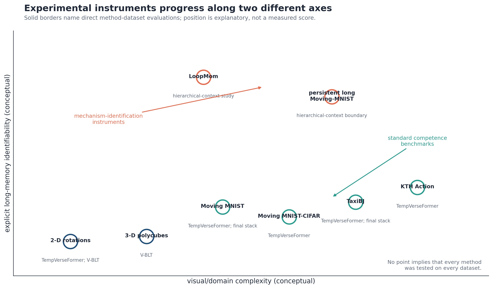

**Figure 2.3 - Progression of experimental instruments.**

| Dataset or family | Controlled phenomenon | Method evaluated | Evidentiary role | Principal limitation |
|---|---|---|---|---|
| Rotating 2-D triangles | constant and variable angular dynamics | TempVerseFormer; V-BLT in separate configurations | mechanism isolation and temporal extrapolation | synthetic silhouettes; cross-paper generator identity is not assumed |
| Rotating 3-D polycubes | three-axis rotation, self-occlusion and shading | V-BLT, ViViT and UNet-3D | harder controlled representation test | fixed-camera synthetic scenes; point estimates only |
| Moving MNIST / Moving MNIST-CIFAR | object translation, collision and textured background | TempVerseFormer and OpenSTL baselines | standard synthetic competence | short protocol does not isolate long-memory reach |
| KTH Action / TaxiBJ | human motion and urban flow fields | TempVerseFormer and OpenSTL baselines | real-data interface boundary | neither supplies object-level re-entry observability |
| LoopMom | disappearance, world-loop re-entry and exact visibility | Chapter 3 model family | causal identification of retained reach | purpose-built synthetic world |
| Persistent long Moving-MNIST | long-lived identity, support and trajectory | flat and hierarchical Chapter 3 configurations | external synthetic reach–fidelity boundary | absolute task performance remains difficult |

**Table 2.1 - Dataset roles and evidence boundaries.** Dataset complexity and mechanism identifiability are separate axes; a visually harder benchmark need not be the sharper memory test.

The studies also differ in their experimental units. Neither early paper reports the seed-level uncertainty that is later required for the central
context-package comparisons. Their numerical results are therefore retained as published point
estimates. Chapters 3 and 4 use clips as resampling clusters and training seeds as a separate
uncertainty level rather than retrofitting confidence intervals onto these earlier data.

## 2.2 Reversible temporal modelling

### 2.2.1 Activation memory in long temporal chains

Consider a parameterized transition $h_t=\Phi_\theta(h_{t-1},c_t)$, where
$h_t\in\mathbb R^{D_s}$ is the temporal state and $c_t$ denotes known conditioning. A loss may
depend on one terminal
state, several decoded states, or the complete trajectory. Standard backpropagation through time
applies reverse-mode differentiation to the unrolled composite map [28]. Its
gradient is not problematic in definition. The practical difficulty is supplying each reverse
step with the forward values needed to evaluate the local vector-Jacobian product.

$$
M_{\mathrm{act}}^{\mathrm{BPTT}}(T)
\approx
T\sum_{l=1}^{L} A_l,
\tag{2.4}
$$

$$
C_{\mathrm{BPTT}}(T)
=T\bigl(C_{\Phi}^{\mathrm{fwd}}+C_{\Phi}^{\mathrm{bwd}}\bigr).
\tag{2.5}
$$

Truncated BPTT reduces both storage and gradient horizon, thereby changing the objective whenever
the omitted dependencies matter [29]. Gradient checkpointing preserves the
full-horizon derivative in exact arithmetic by storing selected boundary states and recomputing
the intervening segments [30, 31]. Reversible replay
uses a more specialized opportunity: if the previous state can be reconstructed from the next
state and replay information, most temporal boundary states need not be stored at all.

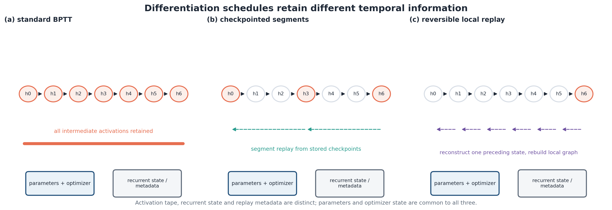

**Figure 2.4 - Storage schedules for differentiation through time.**

$$
M_{\mathrm{peak}}(T)
=M_{\mathrm{param}}+M_{\mathrm{grad}}+M_{\mathrm{opt}}
+M_{\mathrm{input}}+M_{\mathrm{workspace}}(T)+M_{\mathrm{tape}}(T).
\tag{2.5a}
$$

### 2.2.2 Reversible transformer block

An additive-coupling block divides a state into two streams, applies arbitrary differentiable
functions to one stream at a time, and updates the other by addition. In a canonical notation,

$$
y_1=x_1+F_\theta(x_2),
\tag{2.6}
$$

$$
y_2=x_2+G_\theta(y_1).
\tag{2.7}
$$

$$
x_2=y_2-G_\theta(y_1),
\tag{2.8}
$$

$$
x_1=y_1-F_\theta(x_2).
\tag{2.9}
$$

**Figure 2.5 - Additive reversible transformer block.**

$$
\det J_{R_\theta}=1.
\tag{2.9a}
$$

Volume preservation clarifies both the strength and the limitation of additive coupling. The
complete state is recoverable, but the transition cannot simply forget nuisance information as a
many-to-one recurrent gate can [110]. Compression or forgetting must happen at
a non-reversible boundary or be represented with explicit side information. Dynamic stability must therefore be tested independently.

The reversible-state boundary is especially important in TempVerseFormer. The published diagram
contains a variational encoder and decoder, linear projections, duplication of a projected stream,
normalization, and output fusion. Those operations are useful interfaces, but they are not all
bijections. The audited implementation confirms the following contract.

**Table 2.2 - Verified reversible-state contract of the released TempVerseFormer implementation**

| Tensor or operation | Implemented transformation | Algebraically invertible from its output alone? | What reverse differentiation retains or recomputes | Included in the exact state-replay claim? |
|---|---|---:|---|---:|
| Image frame to VAE latent | Convolutional variational encoder, $x\mapsto z$ | No | Ordinary autograd values or frozen/precomputed latent, depending on training mode | No |
| Latent input projection | $256$-dimensional latent to $768$-dimensional embedding plus learned position | Not established as bijective | Boundary input is handled by ordinary autograd in the default mode | No |
| Stream creation | Concatenation $[e,e]$ of two identical $768$-dimensional streams | No; duplication is injective but not a two-stream bijection onto the codomain | Projected embedding exists at the core boundary | No |
| Repeated temporal state | Additive-coupling stack over the doubled embedding | Yes in exact arithmetic for the audited deterministic block; any future stochastic conditioning would also have to be replayed | Terminal doubled state; local block functions are reevaluated | Yes |
| Output normalization and fusion | $2\times768$ state to a $256$-dimensional latent | No | Ordinary autograd boundary values in the default mode; the alternative utility stores non-reversible boundaries | No |
| VAE decoding and image loss | Latent to pixels followed by MSE/LPIPS/KL terms | No | Standard loss graph at the boundary | No |

Table 2.2 narrows the valid claim to the persistent doubled transformer state. The complete
VAE-to-VAE prediction pipeline is non-invertible, yet the repeated core is precisely where a
temporal activation tape would otherwise grow. Its reconstruction therefore supports the measured
activation-memory result without implying that the final image prediction determines every
intermediate operation.

### 2.2.3 Temporal chaining and TempVerseFormer

TempVerseFormer places the reversible stack between a spatial encoder and decoder. In the published
configuration, each $64\times64$ RGB frame is mapped to a 256-dimensional latent state. A learned
linear projection expands each state to 768 features, position embeddings identify the $N$
locations in the window, and the projected sequence is duplicated to form the two coupling streams. The temporal core contains eight reversible transformer blocks with eight attention heads [135].

**Figure 2.6 - Complete TempVerseFormer architecture.** Exact replay applies to the repeated doubled transformer state; the VAE, projections and output fusion remain ordinary non-invertible boundaries. *Source: Kulyk [135], published figure reused unchanged.*

$$
q^{(0)}=P_{\mathrm{in}}(z^{(0)}),
\qquad
q^{(r+1)}=R_\theta(q^{(r)}),\quad r=0,\ldots,T-1,
\tag{2.10}
$$

$$
\widehat z^{(T)}=P_{\mathrm{out}}(q^{(T)}),
\qquad
\widehat x^{(T)}=d_\psi(\widehat z^{(T)}).
\tag{2.11}
$$

The state dimension is held fixed as the shift grows. Temporal depth therefore counts repeated
applications of one window operator, not an ever longer token sequence. Parameter sharing is
complete across those applications. Gradients from the terminal decoded window must nevertheless
traverse every repeated transition, which is why the activation history grows under ordinary
autograd even though the number of learned temporal parameters does not.

**Figure 2.7 - Temporal chaining of a fixed-width latent window.**

Training uses a context of 12 frames and a curriculum in which the shift $T$ increases from one
to five. The decoded output window is compared with the corresponding time-shifted target window.
Equation (16) in the published paper reports a three-term objective [135]:

$$
\mathcal L_{\mathrm{paper}}
=\lambda_{\mathrm{MSE}}\mathcal L_{\mathrm{MSE}}
+\lambda_{\mathrm{LPIPS}}\mathcal L_{\mathrm{LPIPS}}
+\lambda_{\mathrm{KL}}D_{\mathrm{KL}}
\bigl(q_\phi(z\mid x)\,\|\,\mathcal N(0,I)\bigr).
\tag{2.12}
$$

$$
\mathcal L_{\mathrm{code}}
=\mathcal L_{\mathrm{pred\text{-}MSE}}
+\mathcal L_{\mathrm{input\text{-}VAE\text{-}MSE}}
+\lambda_{\mathrm{LPIPS}}\mathcal L_{\mathrm{LPIPS}}
+\lambda_{\mathrm{KL}}D_{\mathrm{KL}}.
\tag{2.12a}
$$

### 2.2.4 Time-agnostic backpropagation

Temporal chaining creates a repeated reversible state, but memory is reduced only if training
actually avoids retaining the ordinary activation graph. The time-agnostic procedure separates
forward prediction from reverse differentiation. During the forward phase, the recurrent core is
evaluated under a no-gradient context, intermediate block activations are discarded, and the
terminal state $q^{(T)}$ is retained. During the backward phase, each preceding state is recovered
algebraically, the corresponding local forward computation is rebuilt with gradient tracking, its
vector-Jacobian products are accumulated, and the local graph is freed.

**Figure 2.8 - Time-agnostic backpropagation through the reversible temporal state.**

$$
a_{t-1}
=\frac{\partial\ell_{t-1}}{\partial q^{(t-1)}}
+\left(\frac{\partial R_\theta(q^{(t-1)})}{\partial q^{(t-1)}}\right)^{\!\top}a_t,
\tag{2.13}
$$

$$
\nabla_\theta\mathcal L
=\sum_{t=1}^{T}
\left(\frac{\partial R_\theta(q^{(t-1)})}{\partial\theta}\right)^{\!\top}a_t.
\tag{2.14}
$$

1. Compute $q^{(0)}=P_{\mathrm{in}}(e_\phi(x_{1:N}))$ with the required boundary graph.
2. For $t=1,\ldots,T$, evaluate $q^{(t)}=R_\theta(q^{(t-1)})$ without retaining the core's
   intermediate activations.
3. Apply $P_{\mathrm{out}}$, decode the terminal prediction, evaluate the loss, and obtain the
   terminal adjoint $a_T$ through the non-reversible output boundary.
4. For $t=T,\ldots,1$, reconstruct $q^{(t-1)}=R_\theta^{-1}(q^{(t)})$.
5. Reevaluate $R_\theta(q^{(t-1)})$ with gradient tracking, accumulate the parameter gradient and
   compute $a_{t-1}$.
6. Release the local graph before processing $t-1$, then propagate the recovered gradient through
   the ordinary input-projection and VAE boundary.

The following result states the memory claim at the level justified by this algorithm.

**Lemma 2.1 (activation-tape complexity).** Let $R_\theta$ be a deterministic reversible
transition consisting of $L$ additive-coupling blocks, and let $D_s$ be the complete state
footprint at one block. Suppose the loss boundary and all conditioning needed for replay occupy
memory independent of $T$. Both bounds are $O(1)$ in temporal depth $T$; a direct BPTT
tape requires $O(TLD_s)$.

$$
C_{\mathrm{rev}}(T)
\approx T\bigl(2C_{R}^{\mathrm{fwd}}+C_{R}^{\mathrm{local-bwd}}\bigr),
\tag{2.15}
$$

### 2.2.5 Controlled temporal-pattern results

The controlled evaluation compared four systems: the reversible TempVerseFormer, a matched
non-reversible TempFormer with temporal chaining, a standard transformer without the same repeated
chaining interface, and an encoder-decoder LSTM. TempFormer and TempVerseFormer both used eight
blocks, eight attention heads, and 768 hidden features. All models shared the VAE interface and
were trained for 30,000 updates on one NVIDIA RTX 4060 Ti. Evaluation used 2,000 procedurally
generated sequences and a fixed generator seed across models [135].

**Table 2.3 - Published predictive point estimates by rotation regime**

| Regime | Model | FID $\downarrow$ | MSE $\downarrow$ | SSIM $\uparrow$ |
|---|---|---:|---:|---:|
| Constant | TempFormer | 103 | 0.023 | 0.84 |
|  | **TempVerseFormer** | **75** | **0.018** | **0.88** |
|  | Standard Transformer | 87 | 0.030 | 0.86 |
|  | LSTM | 157 | 0.080 | 0.76 |
| Accelerated | **TempFormer** | 90 | **0.021** | **0.857** |
|  | TempVerseFormer | 87 | 0.028 | 0.853 |
|  | Standard Transformer | 95 | 0.030 | 0.851 |
|  | **LSTM** | **86** | 0.048 | 0.821 |
| Decelerated | TempFormer | 90 | **0.025** | **0.86** |
|  | TempVerseFormer | 87 | 0.036 | 0.84 |
|  | Standard Transformer | 86 | 0.036 | 0.85 |
|  | **LSTM** | **85** | 0.039 | 0.84 |
| Oscillating | TempFormer | 130 | 0.024 | 0.82 |
|  | TempVerseFormer | 112 | **0.021** | **0.84** |
|  | Standard Transformer | 119 | 0.068 | 0.78 |
|  | **LSTM** | **108** | 0.081 | 0.77 |
| Interrupted | TempFormer | 98 | 0.034 | 0.83 |
|  | **TempVerseFormer** | **91** | **0.032** | **0.84** |
|  | Standard Transformer | 99 | 0.056 | 0.80 |
|  | LSTM | 107 | 0.060 | 0.79 |
| Combined | **TempFormer** | **119** | 0.060 | **0.79** |
|  | TempVerseFormer | 123 | **0.059** | 0.78 |
|  | Standard Transformer | 127 | 0.086 | 0.77 |
|  | LSTM | 156 | 0.089 | 0.74 |

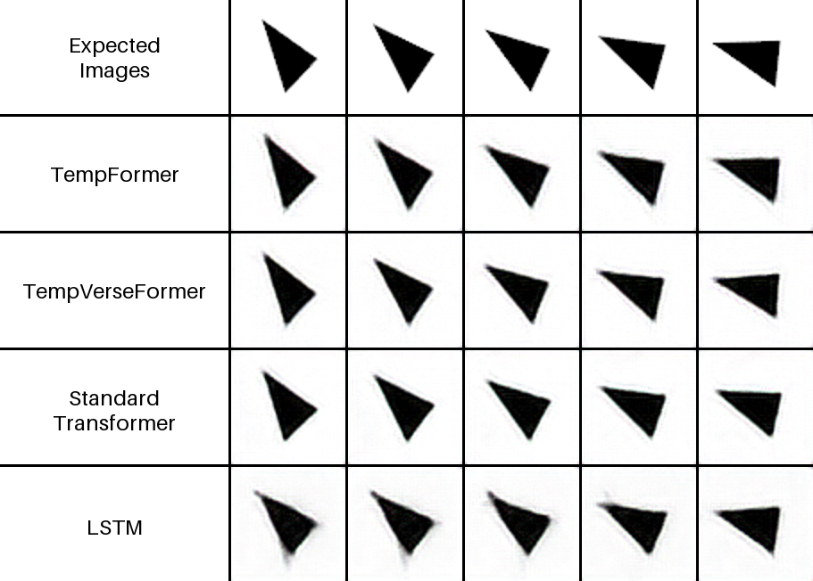

**Figure 2.9 - Five-step predictions for constant rotation.** The unchanged gallery illustrates the regime in which TempVerseFormer has its clearest joint FID, MSE and SSIM result; Table 2.3 remains the quantitative evidence. *Source: Kulyk [135], published figure reused unchanged.*

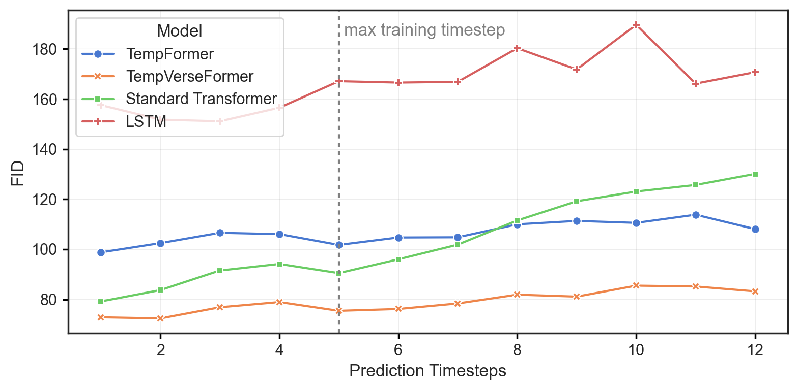

**Figure 2.10 - Constant-rotation FID over prediction depth.** Error accumulation differs among the four temporal models as the prediction index increases. *Source: Kulyk [135], published figure reused unchanged.*

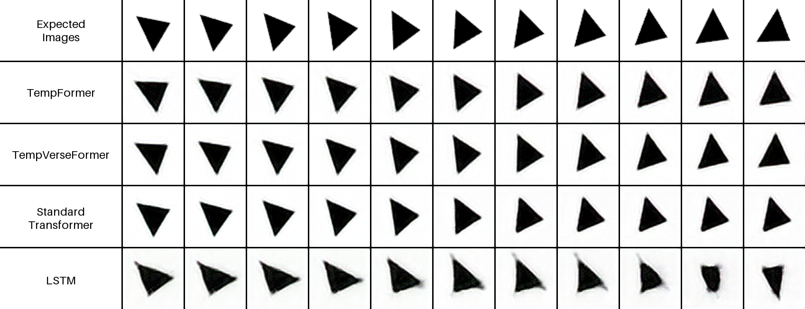

**Figure 2.11 - Eleven-step prediction beyond the training horizon.** The sequence demonstrates operation beyond the five-step training target but is qualitative rather than statistical extrapolation evidence. *Source: Kulyk [135], published figure reused unchanged.*

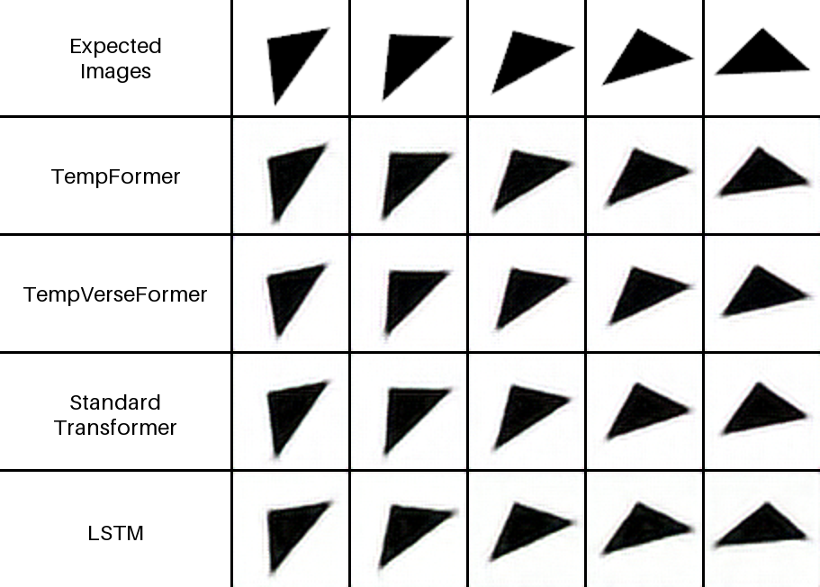

**Figure 2.12 - Predictions under accelerated rotation.** Increasing angular velocity exposes tracking lag and disagreement among metrics. *Source: Kulyk [135], published figure reused unchanged.*

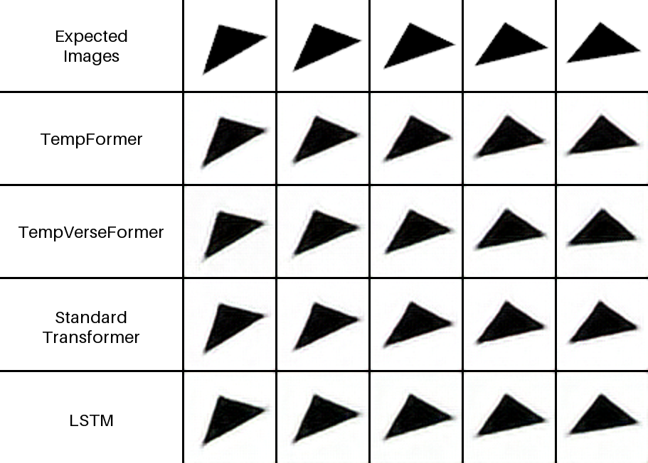

**Figure 2.13 - Predictions under decelerated rotation.** Changing step size tests whether the temporal model follows a nonstationary rule instead of repeating a fixed displacement. *Source: Kulyk [135], published figure reused unchanged.*

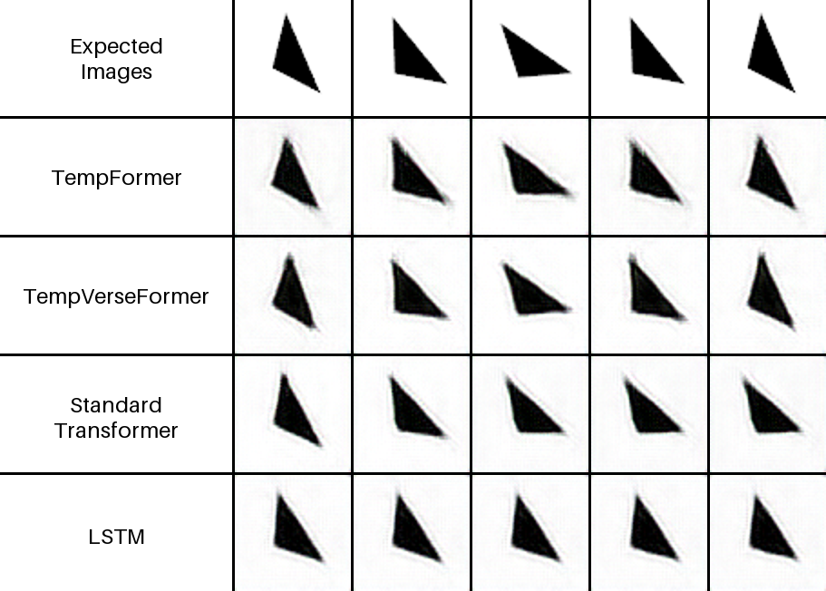

**Figure 2.14 - Predictions under oscillating rotation.** Direction changes reveal failures that constant-motion sequences can hide. *Source: Kulyk [135], published figure reused unchanged.*

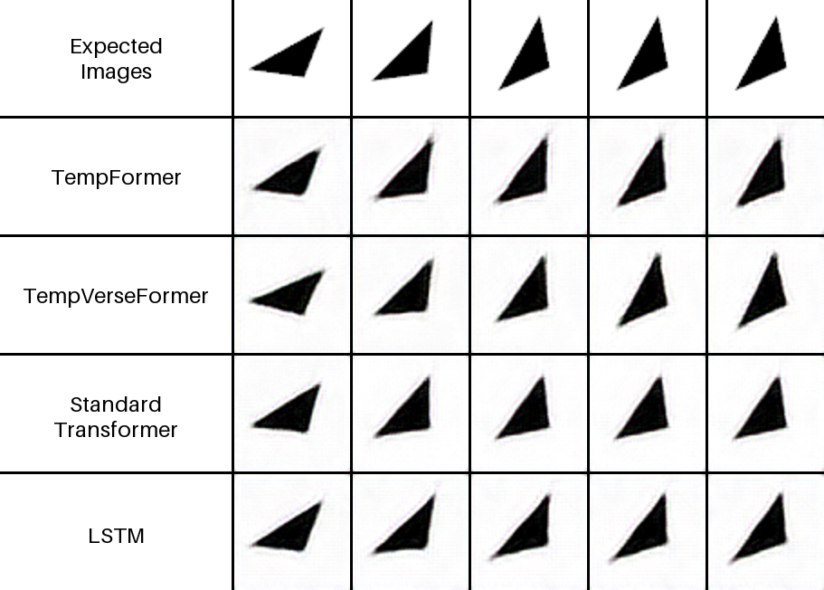

**Figure 2.15 - Predictions under interrupted rotation.** Stop-and-resume dynamics test retention of the motion state across a locally static interval. *Source: Kulyk [135], published figure reused unchanged.*

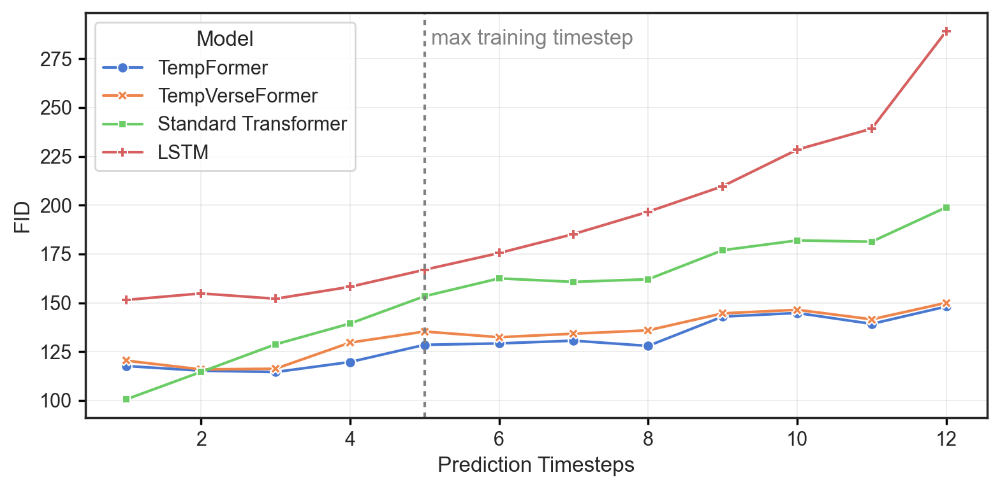

**Figure 2.16 - FID over prediction depth for combined temporal patterns.** The aggregate curve summarizes heterogeneous regimes and must be read with Table 2.3, where no model dominates every metric. *Source: Kulyk [135], published figure reused unchanged.*

Metric disagreement is scientifically informative here. FID compares distributions in a feature
space and can favour a set of diverse samples even when corresponding frames are not close to their
targets [94]. MSE rewards pixel alignment and penalizes a small angular displacement sharply.
SSIM emphasizes local luminance, contrast, and structure [94, 127–129]. An LSTM
can therefore obtain the lowest reported FID for acceleration while having substantially worse MSE
and SSIM. Calling that row the overall winner would conceal the prediction task's paired nature.

### 2.2.6 External OpenSTL validation

Controlled rotation cannot establish competence on textured scenes or real motion. The temporal
model was therefore integrated into OpenSTL and evaluated under its prescribed splits and metrics
on Moving MNIST, Moving MNIST-CIFAR, KTH Action, and TaxiBJ [1, 124, 126, 154]. The reported comparison spans recurrent ConvLSTM and PredRNN++ [137, 152], together with recurrent-free
ViT and Uniformer baselines.

**Table 2.4 - Published OpenSTL comparisons**

| Dataset | Model | SSIM $\uparrow$ | MSE $\downarrow$ | Best reported point in this comparison |
|---|---|---:|---:|---|
| Moving MNIST | ConvLSTM | 0.929 | 29.80 |  |
|  | **PredRNN++** | **0.951** | **22.06** | SSIM and MSE |
|  | TempVerseFormer | 0.932 | 26.08 |  |
|  | ViT | 0.914 | 35.15 |  |
|  | Uniformer | 0.931 | 30.38 |  |
| Moving MNIST-CIFAR | ConvLSTM | 0.920 | 73.31 |  |
|  | **PredRNN++** | **0.957** | **44.19** | SSIM and MSE |
|  | TempVerseFormer | 0.950 | 50.37 |  |
|  | ViT | 0.936 | 64.94 |  |
|  | Uniformer | 0.944 | 56.96 |  |
| KTH Action | ConvLSTM | 0.898 | 47.65 |  |
|  | **PredRNN++** | **0.912** | **39.84** | SSIM and MSE |
|  | TempVerseFormer | 0.898 | 48.97 |  |
|  | ViT | 0.895 | 56.57 |  |
|  | Uniformer | 0.906 | 44.71 |  |
| TaxiBJ | ConvLSTM | 0.9836 | 0.34 |  |
|  | PredRNN++ | 0.9834 | 0.33 |  |
|  | TempVerseFormer | 0.9835 | **0.31** | MSE |
|  | ViT | 0.9841 | 0.32 |  |
|  | **Uniformer** | **0.9844** | 0.34 | SSIM |

This comparison closes an important but limited gap in the controlled-rotation evidence. It shows
that the temporal architecture can be trained through OpenSTL interfaces spanning object rasters,
textured composites, human actions and gridded flow fields without a task-specific claim of
dominance. It does not isolate the effect of reversible replay: Table 2.4 contains no matched
non-reversible TempFormer arm on these datasets. Nor do the benchmark protocols make a uniquely
relevant view disappear beyond the available context before it is needed again. The evidence thus
supports portability and predictive competence, while the activation-memory claim continues to
rest on direct reversible/non-reversible measurements and the reach mechanism remains a separate
question. Its broader value is showing that the controlled result was not confined to one renderer.

The four datasets test different kinds of competence. KTH replaces synthetic digits with articulated human
actions, while TaxiBJ is a gridded flow field rather than an object-rendering problem. Agreement
across all four would be stronger than success on one rotation generator. The published pattern is
more modest: the architecture remains usable across these interfaces, but its relative position
changes with the data.

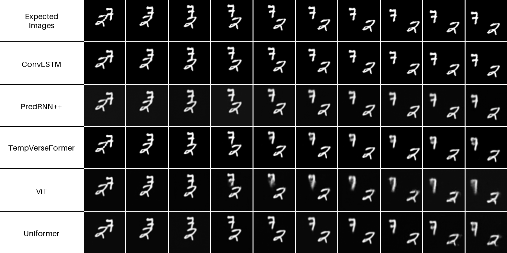

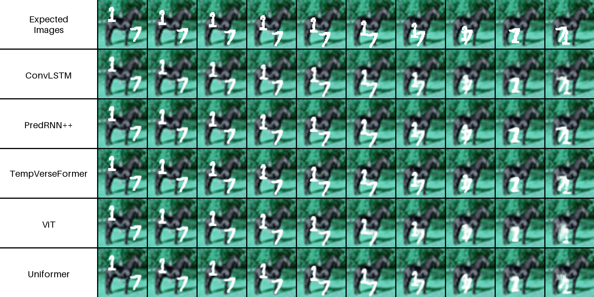

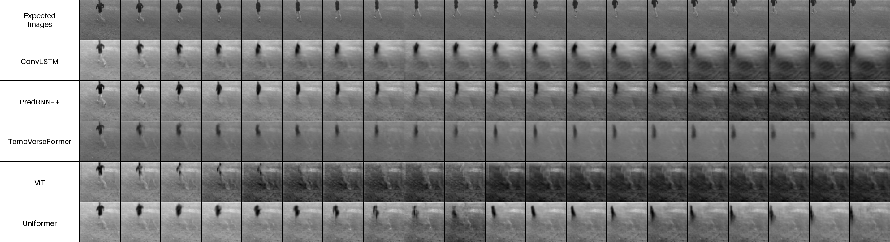

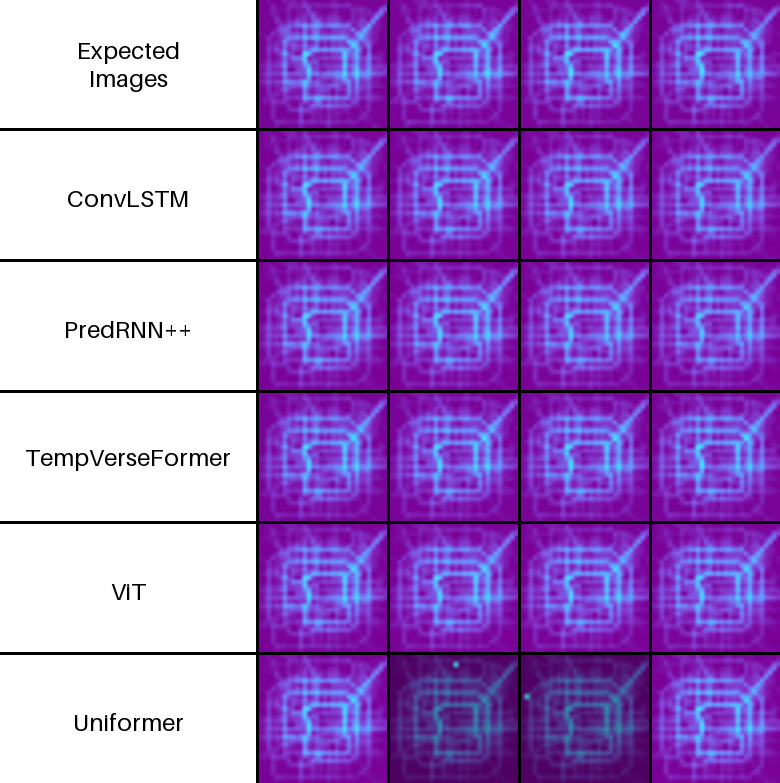

**Figure 2.17 - Qualitative OpenSTL predictions.**

### 2.2.7 Activation-memory and computation frontier

What matters most in the TempVerseFormer measurements is the different scaling of temporal-core memory. Published
measurements separate memory attributed to the temporal model from total pipeline allocation,
which also includes the VAE and common components. This separation prevents a constant core curve
from being misreported as zero growth of every device allocation.

**Table 2.5 - Published GPU-memory measurements at the tabulated horizons, batch size 32**

| Prediction steps | Model | Temporal-model memory (GB) | Total pipeline memory (GB) |
|---:|---|---:|---:|
| 1 | TempFormer | 0.85 | 4.11 |
|  | TempVerseFormer | 0.89 | 3.94 |
|  | Standard Transformer | 0.85 | 4.10 |
|  | LSTM | 1.27 | 4.00 |
| 4 | TempFormer | 0.85 | 4.59 |
|  | TempVerseFormer | 0.89 | 3.95 |
|  | Standard Transformer | 0.86 | 4.58 |
|  | LSTM | 1.28 | 4.03 |
| 16 | TempFormer | 2.61 | 6.50 |
|  | TempVerseFormer | 0.89 | 3.98 |
|  | Standard Transformer | 2.60 | 6.51 |
|  | LSTM | 1.28 | 4.13 |

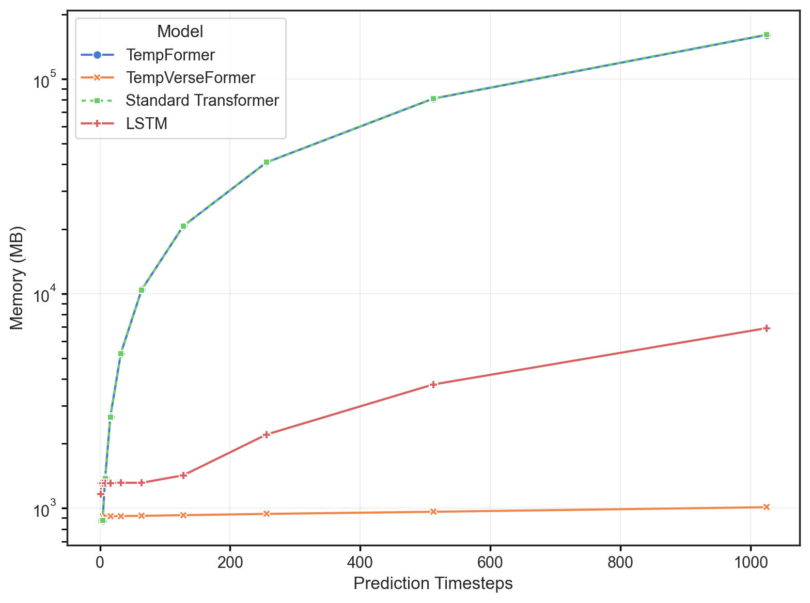

**Figure 2.18 - GPU memory versus prediction depth.** Temporal-core memory remains near its reported baseline as the reversible horizon grows, unlike the matched non-reversible transformer; total pipeline memory includes common components. *Source: Kulyk [135], published figure reused unchanged.*

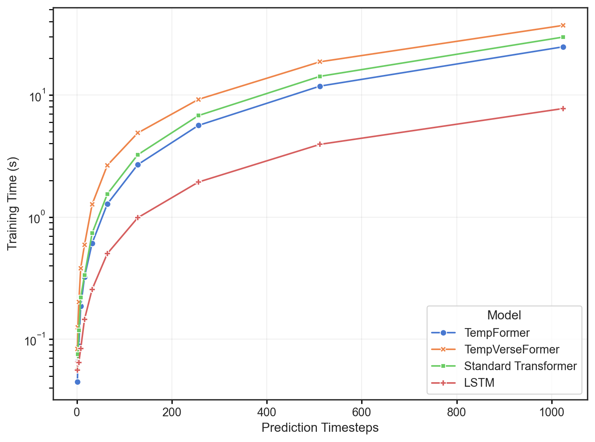

**Figure 2.19 - Training time versus prediction depth.** The flatter activation-memory curve is purchased with replay computation, so feasibility and runtime must be evaluated together. *Source: Kulyk [135], published figure reused unchanged.*

At sixteen steps, the tabulated comparison already demonstrates the operating effect without relying on the
far end of the curve. Relative to TempFormer, TempVerseFormer uses 1.72 GB less reported
temporal-model memory at that point, a reduction of about 66%. At total-pipeline level the
difference is 2.52 GB, or about 39%, because common spatial and training allocations remain. The first isolates the
mechanism; the second is closer to the capacity a practitioner observes.

The published plots extend visually to 1,024 prediction steps and keep the reversible temporal-core
curve near 1 GB. Exact coordinates for those high-horizon points are not available in the retained
results, however. Quantitative comparisons therefore remain anchored to the tabulated one-, four-,
and sixteen-step measurements; the farther range is used only to describe the plotted scaling trend.

### 2.2.8 Stochastic replay extension and separate recurrent-core checks

Inside its reversible stack, the published temporal model is deterministic. Many generative video
transitions are not. They sample a latent innovation, apply stochastic regularization, or receive
a random diffusion state. Discarding that realized input would destroy information required for
reconstruction.

$$
h_t=F_\theta(h_{t-1})+\sigma\epsilon_t,
\qquad
\epsilon_t\sim\mathcal N(0,I),
\tag{2.16}
$$

$$
h_{t-1}=F_\theta^{-1}(h_t-\sigma\epsilon_t).
\tag{2.17}
$$

$$
y_{1,t}=s_{1,t-1}+F_\theta(s_{2,t-1},\epsilon_t),
\qquad
y_{2,t}=s_{2,t-1}+G_\theta(y_{1,t}),
\tag{2.18}
$$

$$
s_{2,t-1}=y_{2,t}-G_\theta(y_{1,t}),
\qquad
s_{1,t-1}=y_{1,t}-F_\theta(s_{2,t-1},\epsilon_t).
\tag{2.19}
$$

$$
M_{\mathrm{replay}}(T)
=M_{\mathrm{anchor}}(T)+M_{\mathrm{rng}}(T)+M_{\mathrm{gates}}(T),
\qquad
M_{\mathrm{rng}}(T)=
\begin{cases}
\dfrac{T D_\epsilon b_\epsilon}{8}, & \text{stored innovations},\\[2mm]
\dfrac{T b_{\mathrm{seed}}}{8}, & \text{one independent seed per step},\\[2mm]
M_{\mathrm{counter}}, & \text{fixed counter-based replay state}.
\end{cases}
\tag{2.20}
$$

$$
M_{\mathrm{anchor}}(T)
\approx \left\lceil\frac{T}{a}\right\rceil\frac{D_s b_s}{8}
=O(\sqrt T\,D_s).
\tag{2.20a}
$$

Consequently, the defensible general claim is constant-in-$T$ **transient local activation memory** plus
the declared anchor and replay metadata. It is not constant total memory for every reversible or
stochastic recurrence.

**Table 2.6 - Measured deterministic multi-level memory and runtime frontier on an RTX 4060 Ti 16 GB**

| Rollout (K) | BPTT peak (MB) | Checkpoint peak (MB) | Reversible peak (MB) | BPTT (ms/step) | Checkpoint (ms/step) | Reversible (ms/step) |
|---:|---:|---:|---:|---:|---:|---:|
| 10 | 3,809 | 1,354 | 1,065 | 549 | 322 | 257 |
| 20 | 6,592 | 1,391 | 1,078 | 399 | 544 | 479 |
| 40 | 12,162 | 1,471 | 1,091 | 740 | 1,028 | 882 |
| 80 | 23,305* | 1,637 | 1,125 | 43,797* | 3,131 | 2,556 |
| 120 | OOM | 1,801 | 1,152 | - | 3,960 | 2,760 |
| 160 | OOM | 1,967 | 1,176 | - | 4,066 | 3,362 |

*The $K=80$ BPTT run exceeded physical GPU memory and spilled into shared host memory under
WDDM; it completed but no longer represented practical device-resident training.*

Measured totals include the encoder, deterministic three-level recurrent core, decoder, Adam state,
batch 32, and $64\times64$ inputs. Vanilla BPTT becomes infeasible before $K=120$. Both
checkpointing and reversible replay reach $K=160$, with the measured replay implementation using
less peak memory and time than the checkpoint implementation at the shown points. These configuration-specific measurements cannot establish that reversible
replay dominates an optimally scheduled or kernel-tuned checkpointing system.

$$
\operatorname{Lip}(I+F)\le 1+\operatorname{Lip}(F)
\tag{2.21}
$$

### 2.2.9 Applicability relative to BPTT and checkpointing

No single reverse-computation schedule is best for every model. Vanilla BPTT is attractive when
the required horizon fits comfortably, because it avoids reconstruction logic. Truncation is a
legitimate modelling choice when dependencies beyond the truncation boundary are intentionally
excluded. Checkpointing works with arbitrary differentiable modules and offers a tunable
storage-recomputation schedule. Reversible replay requires a carefully delimited invertible state,
stable numerical reconstruction, and exact reproduction of stochastic inputs [30, 32, 91, 110, 113, 116].

What matters is the fraction of memory that an inverse can remove. Along the published temporal
core and the deterministic multi-level recurrent frontier, repeated activations are large enough for
reconstruction to change feasibility. In the tested inner optimization loop, second-order local
graphs and common model state dominate, so checkpointing is the better practical choice. Chapter 4
returns to this binding-constraint rule without treating reversibility as a universal architectural
preference.

| Method | Horizon-dependent storage | Extra computation | Architectural condition | Appropriate use |
|---|---|---|---|---|
| Vanilla BPTT | full activation tape, typically $O(TLD_s)$ | baseline | none | the complete horizon fits comfortably |
| Truncated BPTT | bounded by the chosen segment | baseline over the segment | none | earlier dependencies are intentionally excluded |
| Gradient checkpointing | schedule-dependent | recomputes omitted segments | ordinary differentiable modules | a general, tunable storage–time trade-off is needed |
| Reversible replay | local graph plus boundary state, anchors and replay metadata | inverse and local-forward reevaluation | stable inverse over the retained state | repeated reversible activations dominate a long training graph |

**Table 2.7 - Selection of a temporal differentiation strategy by binding constraint.** Reversibility is selected by the training graph and resource profile, not by a presumption of predictive superiority.

## 2.3 Hierarchical spatial representation and entropy estimation

### 2.3.1 Fixed-patch allocation problem

Making a longer temporal chain differentiable solves only the storage schedule. The next bottleneck
is spatial: where should a visual model spend its representation capacity? A conventional video
transformer partitions a clip into a regular grid of spatio-temporal tubes or cubes, embeds every
cell, and processes the resulting sequence [70, 71]. Regular patching is easy to batch and gives
each token a clear geometric support. Its cost, however, depends on the number of patches rather
than on how much unpredictable content each patch contains.

$$
N_{\mathrm{patch}}
=\left\lceil\frac{T}{\tau}\right\rceil
 \left\lceil\frac{H}{p_h}\right\rceil
 \left\lceil\frac{W}{p_w}\right\rceil.
\tag{2.22}
$$

An identical count is allocated to a static black region and to a moving, newly exposed contour. This
is not automatically inefficient: regularity may be valuable, and the learned encoder can suppress
redundant content. The allocation becomes questionable when the global model is the expensive
component and local information density is highly non-uniform.

**Figure 2.20 - Fixed-patch tensor and local-global-local processing path.**

### 2.3.2 V-BLT architecture

V-BLT operates on **uncompressed raster pixel-channel bytes**. A byte target $x_{t,c,y,x}$ is an
integer in $\{0,\ldots,255\}$. This target interface avoids committing the output to a learned
discrete codebook, as a VQ-VAE would [73]. Nevertheless, the hidden representation remains lossy: convolutions,
projections, attention, and finite latent width still form a learned information bottleneck.

$$
u_m=E_\alpha\bigl(\mathcal P_m(X)\bigr),
\qquad m=1,\ldots,N_{\mathrm{patch}}.
\tag{2.23}
$$

$$
g_{1:N_{\mathrm{patch}}}
=G_\beta\bigl(u_{1:N_{\mathrm{patch}}};M_{\mathrm{causal}},R_{\mathrm{ND}}\bigr),
\tag{2.24}
$$

$$
\ell_{t,c,y,x}
=D_\gamma\bigl(r_{t,c,y,x},g_{\pi(t,y,x)}\bigr)
\in\mathbb R^{256}.
\tag{2.25}
$$

Here $r_{t,c,y,x}$ is a local decoder feature and $\pi(t,y,x)$ maps a raster coordinate to its
global support. Cross-attention transmits information between local and patch representations. The
global transformer therefore performs the broad spatio-temporal reasoning, while the local stages
retain and restore spatial detail.

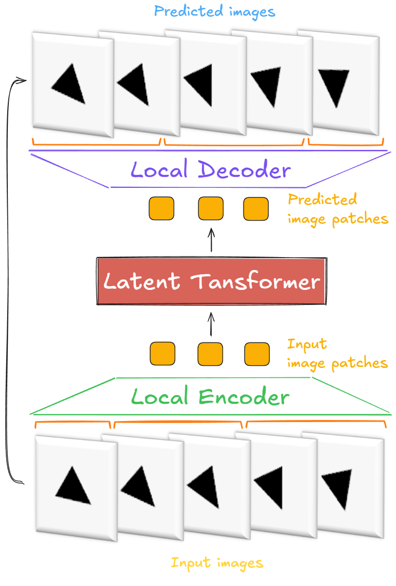

**Figure 2.21 - Published Vision Byte Latent Transformer architecture.**

The architectural evidence supports a hierarchical representation method. It does not establish
that the model learned semantic patches, that the latent sequence is optimal, or that the same
design scales unchanged to compressed natural video.

| Component | Function | Published status | Evidence boundary |
|---|---|---|---|
| Raster-byte interface and local encoder | preserve categorical targets and aggregate short-range structure | implemented | hidden features remain learned and lossy |
| Fixed $4\times4\times4$ package assignment | define global computational units | reported | exact historical run configuration is not fully archived |
| Global latent transformer and local decoder | exchange broad context and restore local detail | implemented | component-wise causal credit is not isolated |
| RoPE-ND | retain separate temporal, row and column coordinates | implemented | mathematical divisibility contract is stronger than the current assertion |
| Categorical byte head | predict 256 logits per byte location | implemented | probabilities are not shown to be calibrated |
| Entropy map | diagnose spatial predictive dispersion | measured and visualized | association with error is descriptive |
| Dynamic region controller | resize regions or route computation | not implemented | proposed extension only |

**Table 2.8 - V-BLT component contract and evidence level.** The executed fixed-patch system and the proposed adaptive allocator are kept on opposite sides of the evidence boundary.

### 2.3.3 Causal attention and categorical byte objective

Flattening a clip converts time and space into a single token index, so causal permission must be
defined by frame coordinate rather than by an undifferentiated lower-triangular sequence. If token
$i$ belongs to frame $t_i$ and token $j$ to $t_j$, the global attention mask is

$$
M_{ij}=
\begin{cases}
0, & t_j\le t_i,\\
-\infty, & t_j>t_i.
\end{cases}
\tag{2.26}
$$

Tokens within the same observed frame may attend to one another. Tokens in earlier frames are also
visible, while future-frame tokens are suppressed before softmax. The resulting matrix has dense
diagonal frame blocks and a block-lower-triangular temporal structure. Direct future information
leakage is blocked at the global attention layer; physical plausibility and autoregressive stability
remain learned properties [12].

**Figure 2.22 - Causal spatio-temporal attention mask.**

$$
p_\Theta(x_i=k\mid X_{<t})
=\frac{\exp(\ell_{i,k})}
{\sum_{r=0}^{255}\exp(\ell_{i,r})},
\qquad k\in\{0,\ldots,255\}.
\tag{2.27}
$$

$$
\mathcal L_{\mathrm{byte}}(\Theta)
=-\frac{1}{|\mathcal I|}
\sum_{i\in\mathcal I}
\log p_\Theta(x_i=x_i^{\star}\mid X_{<t_i}),
\tag{2.28}
$$

where $\mathcal I$ contains the target byte locations and $x_i^{\star}$ is the ground-truth
integer. Unlike a scalar MSE head, this interface can represent several plausible byte values at
one location. That modelling flexibility does not guarantee that the probabilities are calibrated,
and it does not remove spatial dependence between neighbouring bytes that are predicted through a
factorized output head.

### 2.3.4 Multidimensional rotary positional encoding

Self-attention is permutation-equivariant before positional information is introduced. Once a
spatio-temporal grid is flattened, a token's order alone does not reveal whether a neighbour lies
one column away, one row away, or one frame away. Absolute embeddings can label each index, while
relative biases can parameterize pairwise displacement [12, 71, 106]. Rotary positional embedding takes
a different route: it rotates query and key feature pairs by a position-dependent phase so their
inner product depends on relative displacement [107].

For one real feature pair $(v_{2j},v_{2j+1})$, define the complex coordinate
$\widetilde v_j=v_{2j}+\mathrm i v_{2j+1}$. At scalar position $p$, one-dimensional RoPE applies

$$
\rho_p(\widetilde v_j)
=\widetilde v_j\exp(\mathrm i p\omega_j),
\qquad
\omega_j=\beta^{-j/K},\quad j=0,\ldots,K-1,
\tag{2.29}
$$

$$
\rho_p(\widetilde q_j)
\overline{\rho_q(\widetilde k_j)}
=\widetilde q_j\overline{\widetilde k_j}
 \exp\bigl(\mathrm i(p-q)\omega_j\bigr).
\tag{2.30}
$$

$$
\mathbf R_j(p)=
\begin{bmatrix}
\cos(p\omega_j) & -\sin(p\omega_j)\\
\sin(p\omega_j) & \cos(p\omega_j)
\end{bmatrix},
\qquad
\mathbf R_j(p)^\top\mathbf R_j(q)=\mathbf R_j(q-p).
\tag{2.30a}
$$

$$
R_{\mathrm{ND}}(p)q
=R_t(p_t)q_t\;\|\;R_y(p_y)q_y\;\|\;R_x(p_x)q_x.
\tag{2.31}
$$

The corresponding attention logit decomposes into axis-specific terms:

$$
s(q,k;p,r)
=\frac{1}{\sqrt{d_h}}
\sum_{a\in\{t,y,x\}}
q_a^{\top}R_a(r_a-p_a)k_a.
\tag{2.32}
$$

For multiresolution tokens, integer row and column indices from two grids should not be compared
without a coordinate convention. A coarse token at index one may cover the same physical region as
several fine indices. V-BLT uses one latent geometry, so this mapping is not tested there. The issue becomes
relevant to hierarchical context, but the final predictor resolves it through explicit learned
level and frame embeddings rather than importing RoPE-ND.

**Figure 2.23 - Disjoint coordinate subspaces in RoPE-ND.**

### 2.3.5 Predictive entropy as a spatial-complexity signal

A categorical byte head yields a complete distribution rather than only a point prediction. Its
dispersion can be summarized locally with Shannon entropy. In bits,

$$
H_i^{(2)}
=-\sum_{k=0}^{255}p_{i,k}\log_2 p_{i,k},
\qquad 0\le H_i^{(2)}\le 8.
\tag{2.33}
$$

At the lower bound lies a point mass; a uniform 256-way distribution attains the upper one.
The audited visualization code uses the natural logarithm, producing entropy in nats:

$$
H_i^{(e)}=-\sum_{k=0}^{255}p_{i,k}\ln p_{i,k}
=(\ln2)H_i^{(2)}.
\tag{2.34}
$$

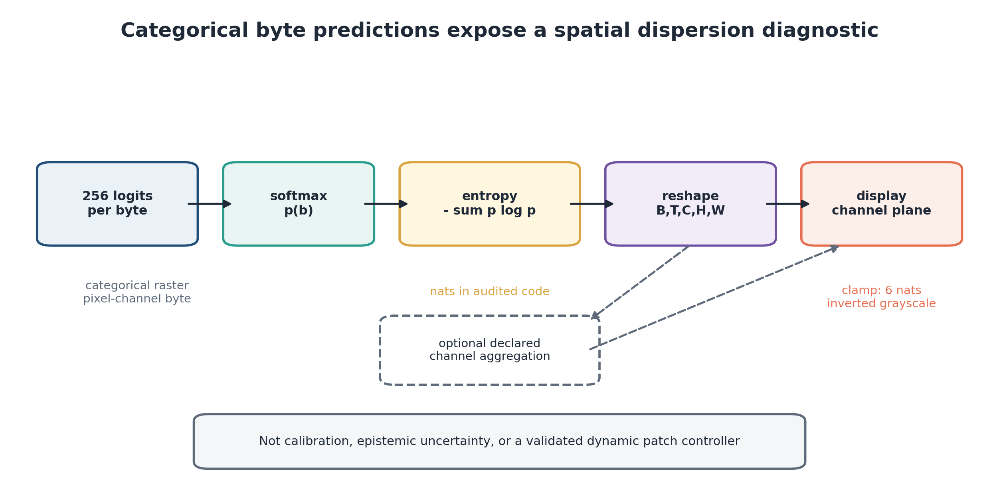

**Figure 2.24 - From categorical logits to a spatial entropy map.**

Turning that map into a controller would require more than visual structure. Calibration could be checked by
binning predicted byte probabilities or entropy values and measuring realized error; spatial
utility would require comparing allocations induced by entropy with random, motion-based, and
oracle policies at the same token budget. Temporal smoothing might also be necessary, because a
patch boundary that changes every frame introduces overhead and unstable token identities. None of
these controller tests is part of the fixed-patch study.

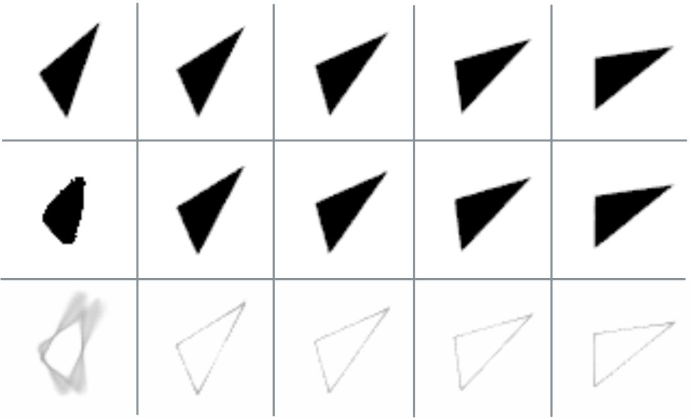

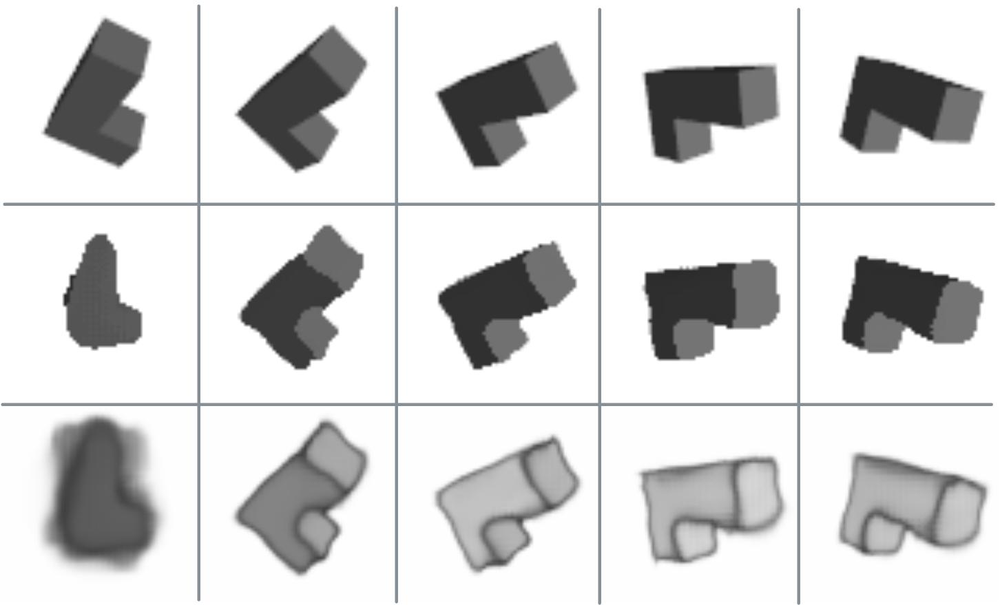

**Figure 2.25 - V-BLT predictions and entropy maps for two-dimensional and three-dimensional rotation.** Entropy is spatially concentrated in these selected examples, but the figure demonstrates neither calibration nor an executed adaptive-region controller. *Source: Kulyk and Mokin [134], published panels reused unchanged.*

### 2.3.6 Experimental results on two-dimensional and three-dimensional rotations

The fixed-patch V-BLT study compared V-BLT with ViViT and UNet-3D on the two procedural rotation
datasets. Model size and GFLOPs describe the reported computational configuration. MSE, SSIM, and
PSNR summarize prediction quality. All are point estimates; the paper gives neither training-seed
variation nor confidence intervals.

**Table 2.9 - Published V-BLT cost and quality point estimates**

| Evidence group | Dataset | Model | Model size (MB) | GFLOPs | MSE $\downarrow$ | SSIM $\uparrow$ | PSNR dB $\uparrow$ |
|---|---|---|---:|---:|---:|---:|---:|
| Computational | - | V-BLT | 6.5 | 51.2 | - | - | - |
|  | - | ViViT | 6.5 | 59.3 | - | - | - |
|  | - | UNet-3D | 24.0 | 70.4 | - | - | - |
| Quality | 2-D shapes | **V-BLT** | - | - | **0.039** | **0.98** | **32.3** |
|  | 2-D shapes | ViViT | - | - | 0.181 | 0.87 | 20.7 |
|  | 2-D shapes | UNet-3D | - | - | 0.125 | 0.88 | 21.8 |
| Quality | 3-D polycubes | V-BLT | - | - | **0.11** | **0.91** | 23.4 |
|  | 3-D polycubes | ViViT | - | - | 0.19 | 0.83 | **24.8** |
|  | 3-D polycubes | UNet-3D | - | - | 0.20 | 0.75 | 20.3 |

V-BLT uses $13.7\%$ fewer reported GFLOPs than ViViT and $27.3\%$ fewer than UNet-3D. The two
6.5 MB entries are equal reported model-size figures. The paper does not state enough about
serialization format or precision to infer identical parameter counts from them. GFLOPs likewise
do not measure latency, throughput, activation memory, or energy on a specific device.

What the comparison establishes is the viability of the complete V-BLT configuration, not causal
credit for one component. Lower reported GFLOPs and favourable
two-dimensional metrics therefore support the system as tested; they do not isolate the positional
encoding or the byte interface. The mixed three-dimensional ranking is useful precisely because it
prevents configuration-level evidence from being recast as uniform metric dominance.

**Figure 2.26 - Published V-BLT cost and quality point estimates (derived).**

### 2.3.7 Measured method versus proposed dynamic regioning

The fixed-patch study supports a clear set of claims. V-BLT demonstrates a hierarchical
local-global-local architecture over direct byte targets, fixed spatio-temporal patching, causal
global attention, RoPE-ND, categorical prediction, and spatially structured entropy maps. Each
item was either implemented or reported in that experiment.

Dynamic regioning is a next step. One possible policy would choose a partition
$\Pi_t=\{R_{t,1},\ldots,R_{t,m_t}\}$ under a token budget $B_t$ by minimizing expected predictive
loss plus computation:

$$
\Pi_t^{\star}
\in\arg\min_{\Pi_t:\,|\Pi_t|\le B_t}
\mathbb E\!\left[\mathcal L_{t+1}(\Pi_t)\right]
+\lambda C(\Pi_t),
\tag{2.35}
$$

with entropy used as one input to the policy. The experiment did not instantiate this optimization,
train a boundary predictor, vary patch sizes online, or measure its effect on speed and quality.
Equation (2.35) is consequently a design proposal, not the objective optimized by the reported
model.

**Figure 2.27 - Implemented V-BLT method and proposed adaptive extension.** The solid path is the measured fixed-patch system; the adaptive routing branch is a design candidate whose quality–cost effect remains untested. *Source: dissertation-native evidence-boundary schematic.*

## 2.4 Design implications for the hierarchical-context model

The executable implementations corresponding to the two published enabling methods are available in the TempVerseFormer and visionBLT repositories [172, 173]. Repository availability supports reproduction of the released configurations; it does not replace the evidence qualifications stated in this chapter.

### 2.4.1 Results that transfer conceptually

The temporal and spatial methods do not form a serial architecture, yet three lessons carry into
the final model design. V-BLT reduces the burden on a global processor by surrounding it with local
transformations, and its entropy maps show that predictive difficulty is spatially uneven in the
controlled examples. Both methods ask which values require expensive persistent representation.

$$
M_{\mathrm{total}}
=M_{\mathrm{parameters}}+M_{\mathrm{optimizer}}
+M_{\mathrm{activations}}+M_{\mathrm{context/state}}+M_{\mathrm{transient}},
\tag{2.36}
$$

Coordinate structure supplies the third lesson. V-BLT shows why time, row, and column should not be
silently collapsed into one index when token geometry changes. Chapter 3 does not adopt RoPE-ND,
but it makes level, frame, role, and anchor geometry explicit through its own embeddings and stream
construction. The transferred principle is explicit geometry, not a claim of shared weights or an
inherited positional module.

### 2.4.2 Components not executed in Chapter 3

Table 2.10 records the integration status once so later chapters can describe the final predictor
directly. "Possible interface" indicates an engineering location, not a demonstrated benefit.

**Table 2.10 - Validated methods, possible interfaces, and integration status**

| Method or result | Bottleneck addressed | Validated result | Possible interface to a future integrated system | Status in the Chapter 3 predictor |
|---|---|---|---|---|
| Reversible transformer coupling | Layer and temporal-core activation storage | Algebraic state reconstruction; published near-constant temporal-core memory | Replace a deep transition whose activation history binds | Not used |
| Time-agnostic reverse replay | Long differentiated temporal chain | Full reverse-mode traversal with local graph rebuilding; separate deterministic multi-level gradient-direction and memory/runtime checks | Train through a longer self-fed recurrence | Not used; Chapter 3 trains clean individual windows |
| Stochastic store-the-noise extension | Replay of stochastic recurrent transitions | Single-stage, 40-step reconstruction check with correct versus wrong conditioning; explicit metadata accounting; no stochastic multi-level gradient or memory frontier | Replay stochastic latent innovations during long-rollout training | Not used |
| V-BLT local-global-local representation | Uniform expensive processing of raster bytes | Competitive fixed-patch prediction and lower reported GFLOPs in controlled rotations | Produce compact local/global visual tokens before context storage | Not used; Chapter 3 has a separate frozen two-level codec |
| RoPE-ND | Loss of explicit multi-axis coordinates after flattening | Verified axis-disjoint positional transform | Encode physical coordinates for variable-resolution tokens | Not used; learned level/role/frame embeddings are used |
| Predictive byte entropy | Lack of a local model-internal complexity signal | Structured entropy maps in controlled sequences | Input to a future spatial allocation controller | Entropy controller not implemented |
| Dynamic entropy regioning | Content-adaptive spatial computation | No end-to-end result in the reported study | Select variable patch support under a budget | Proposed future work only |

This table also explains why adding familiar module names to the Chapter 3 architecture would make
the dissertation weaker rather than stronger. It would turn separately measured methods into an
unmeasured composite and obscure which experiment supports which claim.

### 2.4.3 Chapter conclusions and transition

The first method in this chapter addresses the activation cost of temporal learning. A reversible
transformer block uses triangular additive coupling, so its two input streams can be recovered from
its outputs without inverting either attention or the MLP. When the block stack is repeated through
time, reverse replay reconstructs one preceding state, rebuilds one local differentiation graph,
accumulates its gradient, and releases the graph. Under the stated deterministic conditions, the
transient recurrent-core activation term is $O(1)$ in temporal depth rather than $O(T)$.

Implementation inspection narrows that result to the correct state. This boundary is sufficient to explain the published memory
curve: temporal-model memory remains near $0.89$ GB at the tabulated 1-, 4-, and 16-step points,
while the matched non-reversible transformer reaches $2.61$ GB at 16 steps. Predictive results are also mixed. TempVerseFormer leads all
reported metrics for constant and interrupted rotations and remains competitive elsewhere, but
TempFormer or LSTM leads several variable-motion endpoints. OpenSTL provides competence evidence,
including the lowest reported TaxiBJ MSE in that comparison, not a universal benchmark win.

Per-byte entropy is the most useful bridge from that experiment to resource allocation. It
concentrates around changing contours, occlusions, and low-context predictions in the published
examples. Still, entropy maps were observed, not used to drive variable patch sizes. The measured
model used the paper's fixed $4\times4\times4$ specification; dynamic entropy-guided regioning
remains a proposal whose computational and predictive benefit has not been tested.
