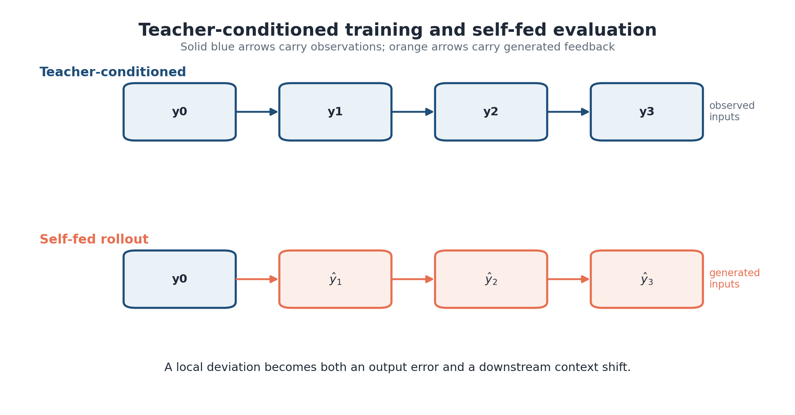
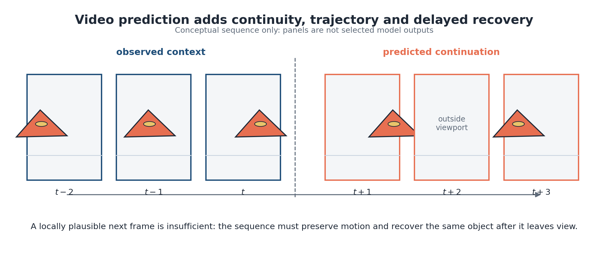
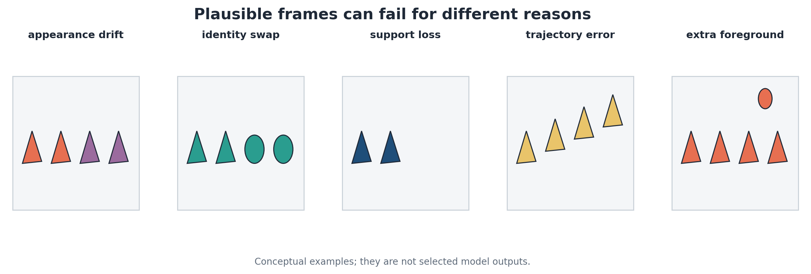
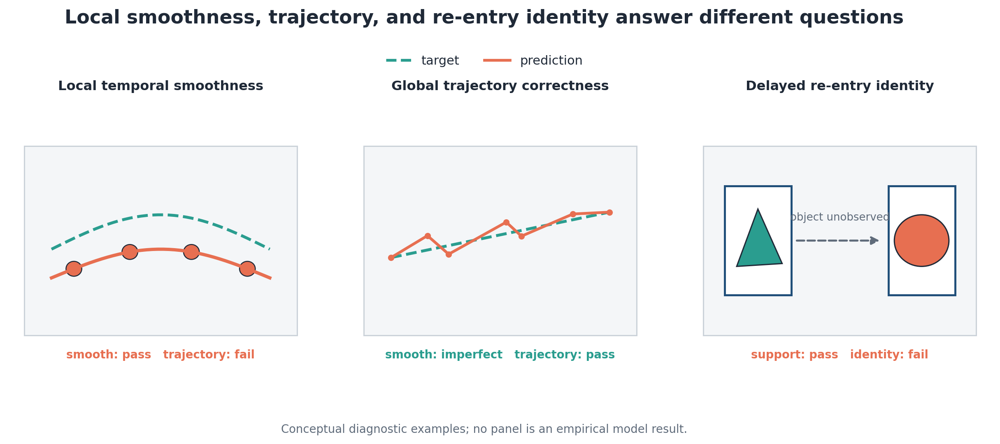
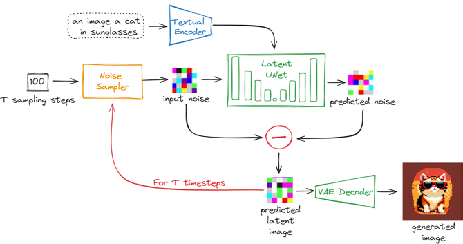
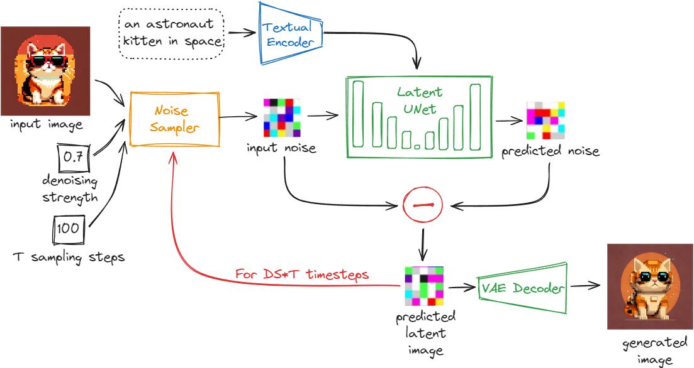
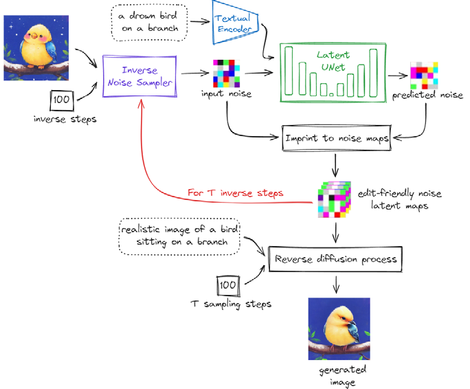
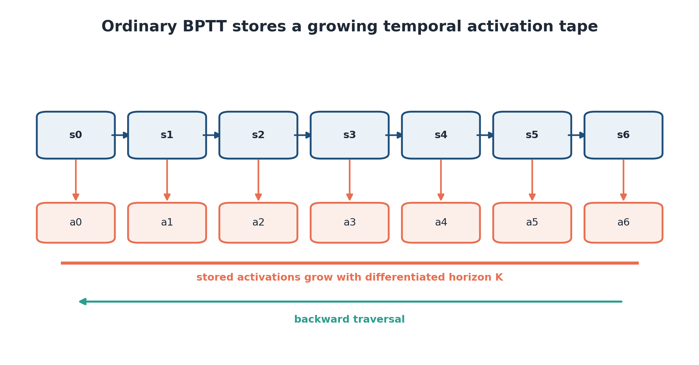

# Розділ 1 – Системний аналіз і вимоги до консистентності довгогоризонтного прогнозування відео

У вступі центральну проблему сформульовано як збереження довгогоризонтної консистентності ієрархічного прогнозу за обмеженої пам’яті. Щоб перейти від цього формулювання до архітектури, потрібно уточнити, який стан система має пам’ятати, яку саме консистентність треба зберігати і чому одного ресурсу «пам’ять» для опису задачі недостатньо. Тому прогнозування відео спочатку розглядається як частково спостережувана динамічна система, далі консистентність розкладається на спостережувані критерії, а три ресурсні обмеження виводяться як наслідки однієї задачі, а не як три незалежні теми.

## 1.1 Прогнозування відео як частково спостережувана динамічна система

### 1.1.1 Межі системи, стан, спостереження та керування
Розглянемо сцену, що розвивається, повний фізичний і семантичний стан якої у дискретний момент часу $t$ позначено через $x_t$. До нього можуть належати геометрія та ідентичність об’єктів, їхні пози, швидкості, освітлення, положення камери й інші змінні, які не спостерігаються безпосередньо, але впливають на наступний кадр. Керувальний сигнал $u_t$ представляє дію камери, агента або інший вимірюваний вплив. Збурення $w_t$ охоплює стохастичну динаміку й невраховані чинники. Кадр $y_t$ є не повним станом світу, а його спостереженням, сформованим оператором $h$ за наявності шуму датчика або синтетичного рендерингу $v_t$. За такої постановки перехід стану та формування спостереження мають вигляд:

$$
\begin{aligned}
x_{t+1}&=f(x_t,u_t,w_t),\\
y_t&=h(x_t,v_t), \qquad y_t\in\mathbb{R}^{H\times W\times C}.
\end{aligned}
\tag{1.1}
$$

Розмежування стану та спостереження потрібне не лише для синтетичних відео. У дистанційному зондуванні або фізично обґрунтованому прогнозуванні поширення лісових пожеж датчик охоплює лише частину процесу, тоді як істотні просторові зміни залишаються прихованими. Тому візуально правдоподібний кадр ще не є достатнім: прогноз має відповідати стану й динаміці системи [47–49].

**Рисунок 1.1 – Межі системи довгогоризонтного прогнозування відео.** *Джерело: авторська схема системи; маршрутизацію перевірено для цієї редакції.*

На рис. 1.1 прогнозувач розміщено всередині контуру спостереження. Оператор побудови контексту $C_t$ відбирає або стискає минулі спостереження у стан моделі $m_t=C_t(y_{\leq t},u_{\leq t})$. Прогнозувач із параметрами $\theta$ генерує розподіл для майбутнього вікна,

$$
p_{\theta}\!\left(\widehat y_{t+1:t+K}\mid m_t,u_{t:t+K-1}\right).
\tag{1.2}
$$

Параметри моделі та правило побудови контексту обираються так, щоб зменшити очікувані втрати $\mathcal L$ не на одному кадрі, а в усьому прогнозованому вікні:

$$
\min_{\theta,C}\;\mathbb{E}\!\left[
\sum_{k=1}^{K}\lambda_k
\mathcal{L}\!\left(\widehat y_{t+k},y_{t+k};x_{t+k}\right)
\right],
\tag{1.3}
$$

де крапка з комою підкреслює, що показник може залежати від прихованих властивостей задачі, наприклад ідентичності або істинної області просторового покриття, хоча предиктор приймає на вхід лише серію зображень. Ваги $\lambda_k$ не обов’язково мають бути рівномірними. Для короткогоризонтного контролера найбільшу вагу може мати безпосередня похибка; у дослідженні пам’яті навмисно сильніше зважуються події, докази яких містяться у віддаленому минулому.

**Рисунок 1.2 – Прихований стан проти спостереження у вікні перегляду.** *Джерело: концептуальний сторіборд, створений для дисертації.*

Рисунок 1.2 пояснює, чому поняття «попередні кадри» і «стан системи» не є взаємозамінними. Камера спостерігає лише прямокутний фрагмент більшого циклічного світу. Коли об’єкт залишає поле зору, його положення та зовнішній вигляд продовжують існувати в прихованому стані, хоча в поточних кадрах їх уже немає. Коротке детальне вікно поступово втрачає прямі свідчення про такий об’єкт; довший потік нижчої роздільної здатності може зберегти відомості про його траєкторію, але втратити частину ознак ідентичності. У розділах 3 і 4 ця різниця стане основою контрольованої перевірки досяжності контексту.

### 1.1.2 Проблематика зростання невизначеності при авторегресивній генерації

Під час навчання модель часто отримує еталонну послідовність, тоді як під час авторегресивного застосування її власний прогноз повертається на вхід. Після кожного кроку контекстне вікно зсувається: найдавніші елементи вилучаються, а новий прогноз займає їхнє місце [25–29]. Отже, починаючи з другого прогнозованого кадру, вхід уже залежить від попередніх виходів самої моделі. Цю самоподачу можна записати як рекурсію:

$$
\widehat y_{t+k}
\sim p_{\theta}\!\left(
\widehat y_{t+k}\mid
C_{t+k-1}(y_{\leq t},\widehat y_{t+1:t+k-1}),
u_{\leq t+k-1}
\right).
\tag{1.4}
$$

У цьому процесі потрібно розділяти рішення, які впливають на різні ланки причинного ланцюга:

1. Учительська подача визначає, які кадри надходять до моделі під час навчання.
2. Цільова функція та обчислювальний граф визначають, через скільки кроків передається градієнт і скільки активацій потрібно зберігати або відтворювати.
3. Політика контексту визначає, які давні спостереження залишаються доступними під час прогнозування і з якою деталізацією вони представлені.

Зміна режиму подачі може послабити розбіжність між навчанням і застосуванням, але не повертає подію, яку вже вилучено з пам’яті. Реверсивний часовий перехід змінює вартість передавання градієнта, але так само не збільшує досяжність збереженого стану. Саме політика контексту є центральною для ієрархічного пакета в розділі 3; просторова одиниця представлення визначає, якою ціною деталізації цю досяжність отримано.

Накопичення помилки в самоподаваному процесі не зводиться до додавання незалежних числових відхилень. Планове підмішування прогнозів під час навчання (*scheduled sampling*) і самокондиціювання зменшують розбіжність між еталонними та згенерованими входами [25–29], проте не відновлюють інформацію, якої вже немає у збереженому контексті. Якщо рекурентний перехід подано як $\widehat s_{t+1}=F_\theta(\widehat s_t)$, то мале збурення на ранньому кроці переноситься наступними переходами. У лінійному наближенні його масштаб визначається послідовним добутком матриць похідних, тобто якобіанів, уздовж згенерованої траєкторії [93]. Через це середня залежність похибки від горизонту може поєднувати якісно різні фази. У подальшому аналізі ранній інтервал авторегресії відокремлюється від можливої пізньої межі.

Похибка може виглядати оманливо стабільною. Якщо модель поступово усуває невизначені деталі переднього плану, її вихід здатний збігтися до простого фонового стану. Після цього середня піксельна похибка майже не зростає, хоча об’єкт уже втрачено. Стохастична модель створює іншу складність: вона може представляти кілька допустимих майбутніх станів, але отримати несприятливу оцінку точковою метрикою навіть тоді, коли один зі зразків є коректним. Для розмежування таких випадків потрібні явні показники та правила врахування кандидатів [130, 131, 155].

**Рисунок 1.3 – Умовна рекурсія з учительською подачею та із самоподачею.** За учительської подачі кожний перехід отримує еталонний попередній кадр; під час самоподачі прогноз повертається на вхід, тому його похибка впливає на всі наступні кроки. Схема пояснює різницю режимів, але не є кількісним результатом. *Джерело: концептуальна схема дисертації.*

### 1.1.3 Формулювання передбачення як багатокритеріальної задачі з обмеженими ресурсами

Модель машинного навчання працює за скінченних обчислювальних і апаратних ресурсів. Обчислювальний бюджет визначає тривалість навчання й застосування, тоді як доступна пам’ять додатково обмежує розмір моделі, пакет паралельного навчання, довжину диференційованого графа та обсяг історії, доступної моделі прогнозування. Ці обмеження взаємодіють, але не є взаємозамінними. Для подальшого аналізу загальне використання пам’яті розкладається на п’ять складників:

$$
M_{\mathrm{total}}
=M_{\mathrm{parameters}}
+M_{\mathrm{optimizer}}
+M_{\mathrm{activations}}
+M_{\mathrm{context/state}}
+M_{\mathrm{transient}}.
\tag{1.5}
$$

Пам’ять параметрів і станів оптимізатора визначається переважно розміром моделі, точністю обчислень та алгоритмом навчання. Пам’ять активацій зберігає або відтворює проміжні значення, потрібні для градієнтів. Контекстна пам’ять чи пам’ять стану утримує історичну інформацію для прогнозування, а тимчасова пам’ять охоплює робочі області уваги, буфери алгоритму вибірки, декодовані кандидати та резервування фреймворку. Сума цих складників показує, чи достатньо апаратного ресурсу, але вони не є однією змінною проєктування [108].

На рисунку 1.4 показано, де саме виникають три обмеження центральної задачі. Ієрархічне пакування безпосередньо змінює збережений стан і часову досяжність історії. Реверсивне відтворення діє на активаціях диференційованого ланцюга, а V-BLT змінює просторову одиницю локальної та глобальної обробки. Опубліковані ефекти цих втручань виміряно окремо, що зберігає їхню причинну інтерпретацію. Пізніший інтеграційний прототип перевіряє технічну сумісність принципів у спільному тракті; однак його результат не дає підстав автоматично перемножувати окремі коефіцієнти економії.

**Рисунок 1.4 – Розташування витрат системної пам’яті.** *Джерело: авторська схема, створена для дисертації.*

Оскільки кожне ресурсне втручання може змінювати інший прояв консистентності, результат описується не одним балом, а вектором втрат. Для прогнозованого відео $\widehat Y$ та еталонного відео $Y$ він має вигляд:

$$
\boldsymbol{\ell}(\widehat Y,Y)
=\bigl(
\ell_{\mathrm{frame}},
\ell_{\mathrm{support}},
\ell_{\mathrm{identity}},
\ell_{\mathrm{trajectory}},
\ell_{\mathrm{extra}},
\ell_{\mathrm{cross}}
\bigr).
\tag{1.6}
$$

Компоненти $\ell_{\mathrm{frame}}$, $\ell_{\mathrm{support}}$, $\ell_{\mathrm{identity}}$, $\ell_{\mathrm{trajectory}}$, $\ell_{\mathrm{extra}}$ та $\ell_{\mathrm{cross}}$ відповідають відповідно за кадрову якість, просторове покриття, ідентичність, траєкторію, зайвий передній план і міжрівневу відповідність. Вектор ваг $\boldsymbol\alpha$ задає важливість цих критеріїв для конкретної задачі. Тоді спільну задачу оптимізації можна записати з явними обмеженнями на контекстну пам’ять, пам’ять активацій та обчислювальну роботу:

$$
\begin{aligned}
\min_{\theta,C,a}\quad &
\mathbb{E}\!\left[\boldsymbol{\alpha}^{\mathsf T}
\boldsymbol{\ell}(\widehat Y,Y)\right] \\
\text{за умови, що}\quad &
M_{\mathrm{context/state}}(C)\leq B_{\mathrm{ctx}},\\
&M_{\mathrm{activations}}(\theta,a,K)\leq B_{\mathrm{act}},\\
&\operatorname{Work}(\theta,C,a,K)\leq B_{\mathrm{work}}.
\end{aligned}
\tag{1.7}
$$

У формулі (1.7) $\theta$ позначає параметри моделі, $C$ – політику формування контексту, а $a$ – спосіб організації обчислень, зокрема збереження або відтворення активацій. Величини $B_{\mathrm{ctx}}$, $B_{\mathrm{act}}$ і $B_{\mathrm{work}}$ є відповідними бюджетами. Запис задає спільну систему обмежень. У розділах 2–4 спочатку ізольовано оцінено кожне втручання, а згодом у §3.7 і §4.8 виконано обмежену перевірку їхньої композиції.

Ресурсні складники мають різні змінні масштабування. Пам’ять параметрів зростає разом із розміром моделі, пам’ять активацій – разом із диференційованим графом, а пам’ять контексту – разом з обсягом збереженої історії. Обчислювальна робота уваги залежить від довжини послідовності, що надходить до блока. Алгоритми уваги, оптимізовані з урахуванням обміну даними між рівнями пам’яті, зокрема FlashAttention [13], зменшують тимчасові витрати точної уваги, але не змінюють того, яку історію зберігає модель. Політика контексту може впливати і на збережений стан, і на навантаження уваги, тому коректне порівняння додатково фіксує представлення токенів, точність обчислень, розмір пакета та довжину цілі.

Токенний бюджет описує довжину інтерфейсу моделі, тоді як байтовий бюджет – фізичний обсяг збереженого стану. Авторське розрізнення цих величин потрібне тому, що в ієрархічних підходах грубий токен і детальний вектор прихованого простору можуть мати різну розмірність і нести різний корисний обсяг даних. Тому в розділі 3 окремо фіксуються кількість токенів і корисний обсяг у байтах.

Інтерпретація за принципом Парето також має залишатися дискретною. Перевірені пакети охоплюють лише скінченний набір бюджетів, тому за ними не можна відновити повну неперервну криву без додаткових припущень.

| Термін ресурсу | Збережений об’єкт | Домінуюча фаза | Втручання, що досліджується тут | Поширений фактор змішування |
|---|---|---|---|---|
| Параметри | навчені ваги | навчання та застосування | ємність залишається фіксованою в рамках зіставлених порівнянь | архітектура змінюється залежно від бюджету |
| Оптимізатор | моменти та градієнти | навчання | враховуються, але не оптимізуються безпосередньо | числова точність і розподілене зберігання стану |
| Активації | проміжні диференційовані стани | навчання | створення контрольних точок або реверсивне відтворення | додаткові перерахунки опущені |
| Контекст/стан | збережені спостереження або стан у прихованому просторі | навчання та застосування | плоскі, ієрархічні або піддискретизовані пакети | спільна зміна досяжності й точності відтворення |
| Тимчасова пам’ять | робочі буфери уваги та формування вибірки | обидві фази | вимірюється через загальну обчислювальну роботу/NFE, де це доречно | пікове виділення пам’яті, помилково прийняте за збережений стан |

**Таблиця 1.1 – Терміни, пов’язані з ресурсами, та їхні інтерфейси керування.** У таблиці розрізняються величини, які змінюються внаслідок втручання, та супутні витрати, що можуть залишатися незмінними.

Облік ресурсів відповідає на питання, скільки історичної інформації система здатна утримати, але ще не визначає, яку властивість прогнозу потрібно зберегти. Тому наступний крок аналізу пов’язує кожен ресурсний дефіцит із конкретною спостережуваною відмовою консистентності.

## 1.2 Консистентність як багатокритеріальна властивість

### 1.2.1 Чому одного показника якості недостатньо

Консистентність не можна зводити до загальної візуальної якості. Об’єкт може рухатися правильною траєкторією й водночас втрачати ознаки ідентичності через розмиття або злиття з фоном. Можлива й протилежна ситуація: зовнішній вигляд залишається впізнаваним, але положення чи напрям руху стають помилковими. У сцені з домінантним фоном низька середня похибка здатна приховати навіть повне зникнення об’єкта переднього плану. Отже, показник має відповідати визначеному типу відмови, а не встановлювати саму її семантику.

Обмеження єдиного показника видно на прикладі поширених метрик. MSE вимірює поточкове відхилення, SSIM – локальну структуру [127], LPIPS – відстань у просторі глибоких ознак [128], а FID і FVD – статистичну відмінність розподілів [94, 129]. Кожне агрегування відкидає іншу частину інформації. Жоден із цих показників самостійно не встановлює, чи досі присутній конкретний об’єкт, чи виник зайвий передній план і чи відновлено вигляд, спостережений у віддаленому минулому.

**Рисунок 1.5 – Концептуальне уточнення кандидата до області багатокритеріальної консистентності.** Траєкторія на схемі є умовною ілюстрацією послідовного уточнення, а вкладені області позначають сукупності критеріїв різної строгості; осі не є емпіричними шкалами. *Джерело: концептуальний рисунок із дисертації.*

Рисунок 1.5 не задає залежності консистентності від довжини горизонту. Його функція інша: показати, що прийнятний прогноз має одночасно потрапити в область кількох критеріїв, а поліпшення одного з них не гарантує поліпшення решти. Наприклад, просторове покриття, ідентичність і траєкторія можуть змінюватися незалежно. Саме тому подальший емпіричний аналіз не називає один контекст загалом «більш консистентним», а встановлює, яку властивість він зберігає краще.

Найвиразніше обмеження агрегованого показника проявляється в розріджених сценах. Якщо більшість пікселів належить до однорідного фону, прогноз порожнього простору може мати прийнятне значення MSE для всього кадру, хоча рухомий об’єкт втрачено повністю. MSE, обчислена лише на еталонному передньому плані, підвищує вагу об’єкта, але може ігнорувати галюциновані області поза еталонною маскою [46, 51]. Помилка на об’єднаній масці охоплює обидві області, проте її знаменник уже залежить від прогнозу. Тому кадрові метрики надалі доповнюються прецизійністю, повнотою, частками пропущеного й зайвого переднього плану та кількістю зв’язних компонентів. Випадки з порожньою маскою визначаються до оцінювання.

Для кліпу $i$ та кандидата прогнозу $k$ незалежні аспекти подано вектором показників:

$$
\mathbf q_{ik}
=\left(
q^{\mathrm{frame}}_{ik},
q^{\mathrm{support}}_{ik},
q^{\mathrm{identity}}_{ik},
q^{\mathrm{trajectory}}_{ik},
q^{\mathrm{extra}}_{ik}
\right)
\tag{1.8}
$$

Тут $q^{\mathrm{frame}}_{ik}$ характеризує кадрову якість, $q^{\mathrm{support}}_{ik}$ – просторове покриття, $q^{\mathrm{identity}}_{ik}$ – збереження ідентичності, $q^{\mathrm{trajectory}}_{ik}$ – правильність руху, а $q^{\mathrm{extra}}_{ik}$ – появу зайвого переднього плану. Склад вектора залежить від задачі, але його принцип залишається незмінним: різні типи помилок не згортаються в один бал до того, як буде встановлено їхній зміст. Далі ці критерії вводяться від статичного зображення до часової послідовності.

### 1.2.2 Зовнішній вигляд, об’єкт та концептуальна консистентність

Сучасні дифузійні моделі здатні створювати окремі зображення високої візуальної якості, однак правдоподібність одного результату ще не показує, чи збережено потрібний об’єкт, стиль або геометричну умову між кількома генераціями. Рисунок 1.6 зіставляє ці два рівні задачі. Статична панель демонструє різноманіття окремих результатів, а умовна відеопослідовність показує додаткову вимогу: властивості мають залишатися простежуваними між кадрами, зокрема після виходу об’єкта з поля зору.

**Рисунок 1.6 – Від якості окремого зображення до консистентності відеопослідовності:** а – ілюстративні результати SDXL; б – концептуальний приклад прогнозування руху, зникнення та повторної появи об’єкта. Панель а відтворено з Kulyk та Mokin [133], оригінальний рисунок 1, створений Л. Куликом із локально згенерованих результатів SDXL і використаний за ліцензією CC BY 4.0; панель б створено для дисертації. Обидві панелі мають пояснювальне, а не доказове значення.

Попередній аналіз генерації зображень на основі дифузії відокремлював стиль або зовнішній вигляд, ідентичність об’єкта, форму або геометрію та запропоновану категорію концептуальної консистентності [133]. Геометрія стосується контуру, просторового розташування й структурних відношень. Концептуальна консистентність у значенні, запропонованому в [133], описує збереження семантичної ідеї вищого рівня між результатами, поверхневий вигляд яких може змінюватися. Класичні дослідження візуального представлення та пізніші оцінки моделей зору й мови показують, чому семантичну консистентність не можна встановити лише з пікселів [100–104]. Критерії перетинаються: ідентичність обличчя частково залежить від геометрії та текстури, а стилізована послідовність може зберігати концепцію попри зміну обох ознак.

**Рисунок 1.7 – Критерії консистентності, що перекриваються.** *Джерело: синтез, розроблений на основі дисертації з урахуванням [133].*

**Рисунок 1.8 – Локальний візуальний вхід та інтегроване розуміння сцени.** *Джерело: Кулик та Мокін [133], оригінальний рисунок 5; ілюстрація виконана Л. Куликом, концептуально заснована на роботі Герцмана [174]; використано за ліцензією CC BY 4.0. Евристична ілюстрація.*

| Критерій | Типова помилка у згенерованому відео | Типовий показник | Що може пропустити показник |
|---|---|---|---|
| Зовнішній вигляд/стиль | відхилення кольору, текстури або освітлення | схожість ознак або стилю | правильний результат з неправильною ідентифікацією об’єкта |
| Ідентичність | об’єкт змінює клас або екземпляр після оклюзії | точність ідентифікації на основі зіставлення | просторове покриття може залишатися неправильним |
| Геометрія/просторове покриття | контур руйнується, об’єкт зникає або з’являється зайвий передній план | перекриття, покриття, прецизійність/повнота, частки пропусків і зайвого переднього плану | дрібні атрибути всередині області об’єкта |
| Поняття/семантика | послідовність суперечить передбачуваному відношенню або події | класифікатор завдань, структуроване відношення або протокол людини | часова безперервність та локалізація |
| Траєкторія | рух плавний, але проходить неправильним шляхом | похибка центроїда або пози з часом | зовнішній вигляд та внутрішня структура |
| Міжрівнева консистентність | грубий стан і детальний прогноз описують різні події | декодована міжрівнева розбіжність | обидва рівні можуть бути помилковими одночасно |

**Таблиця 1.2 – Критерії консистентності, спостережувані помилки та «сліпі зони» метрик.** Жоден показник не розглядається як повна заміна інших.

Інтерфейси керування відрізняються моментом і способом внесення зовнішньої інформації контролю: через вхід, внутрішній стан або адаптацію параметрів. У режимі «зображення-до-зображення» еталон подається під час кожної генерації [95]. DreamBooth і LoRA натомість кодують об’єкт або стиль за рахунок адаптації параметрів моделі напряму [96, 97], тому повторювану ідентичність можна генерувати без передавання повного еталону, але ціною додаткових даних та ресурсів на оптимізацію. ControlNet дає змогу вносити в модель керуючий сигнал країв, глибину, позу або сегментацію [98], а методи інверсії оцінюють стан у прихованому просторі або шумовий стан прихованого простору наявного зображення та дають можливість реалізувати керуючий сигнал виходячи з цього простору як з відправної точки [114, 115]. Методи спільної уваги, як StyleAligned, пов’язують ознаки в механізмі уваги між зразками та дають можливість комбінувати їх з керуючими сигналами [99]. Для довгогоризонтного прогнозування визначальним є не загальний рейтинг цих підходів, а те, чи залишається їхнє свідчення доступним після виходу відповідного кадру з поточного вікна.

### 1.2.3 Часова та траєкторна консистентність

Розглянуті вище критерії сформовано переважно для статичних зображень. У відео до них додаються дві часові вимоги. По-перше, зміни між сусідніми кадрами мають бути неперервними. По-друге, вся послідовність повинна відтворювати очікувану динаміку: напрям і швидкість руху, збереження стану під час оклюзії та правильну повторну появу на довгому горизонті.

Локальна плавність не гарантує правильності довгої траєкторії. Невелике зміщення на кожному кадрі може не створювати помітного стрибка, але поступово відвести об’єкт від еталонного шляху. Так само об’єкт може зникнути й плавно з’явитися знову, проте вже з іншими ознаками ідентичності. Отже, часова неперервність є необхідною, але недостатньою умовою консистентного прогнозу.

Щоб відокремити правильність руху від плавності зображення, для кожного об’єкта $i$ розглядається множина моментів $\mathcal T_i$, у яких еталонний і прогнозований об’єкти можна зіставити. Нехай $c_{it}$ і $\widehat c_{it}$ позначають їхні еталонний та прогнозований центроїди в момент $t$. Середня похибка траєкторії визначається як:

$$
L_{\mathrm{traj}}^{(i)}
=\frac{1}{|\mathcal T_i|}
\sum_{t\in\mathcal T_i}
\left\|\widehat c_{it}-c_{it}\right\|_2.
\tag{1.9}
$$

Формула (1.9) враховує просторове зміщення між зіставленими об’єктами, але сама не виявляє підміни їхніх ідентичностей. Тому правило зіставлення має бути стабільним у часі або явно враховувати ідентичність. Класифікатор ідентичності розв’язує іншу частину задачі: він може правильно розпізнати цифру, навіть якщо її положення суттєво помилкове. Лише спільне використання показників покриття, зіставлення, ідентичності та траєкторії дає змогу інтерпретувати поведінку об’єкта, що зберігається в часі.

Окреме правило потрібне для зниклого або незіставленого об’єкта. Якщо такі випадки просто вилучати з підрахунку, модель може отримати сприятливу оцінку ідентичності саме тоді, коли вона втратила об’єкт. У подальшому протоколі для них наперед задаються штрафи, а метадані генератора зберігають справжню ідентичність упродовж кліпу. Контекст до моменту зникнення містить прямі свідчення зовнішнього вигляду; тому повторна поява перевіряє, чи зберегла й використала їх модель. Парні порівняння та кілька початкових значень генератора випадкових чисел оцінюють стійкість результату, а еталон із прямим доступом до необробленої історії задає верхню межу доступності інформації [125].

Рисунок 1.9 узагальнює п’ять типових відмов: зміну зовнішнього вигляду, підміну ідентичності, втрату просторового покриття, відхилення траєкторії та появу зайвого переднього плану. Кожна з них може виникнути за поверхнево плавної послідовності, тому потребує окремого показника.

**Рисунок 1.9 – Різні типи відмов із поверхнево правдоподібними кадрами.**

Для бінарної еталонної маски переднього плану $G_t$ та прогнозованої маски $P_t$ одного показника перекриття недостатньо. Зокрема, порожні маски потребують окремого правила, а зайвий прогноз поза еталонною областю має штрафуватися так само явно, як пропущений об’єкт. Для непорожньої еталонної маски використовуються нормовані відносно її площі частки пропущеного й зайвого переднього плану:

$$
r_{\mathrm{miss}}(t)=\frac{|G_t\setminus P_t|}{|G_t|},
\qquad
r_{\mathrm{extra}}(t)=\frac{|P_t\setminus G_t|}{|G_t|},
\tag{1.10}
$$

У формулі (1.10) множина $G_t\setminus P_t$ містить еталонні пікселі, які модель пропустила, а $P_t\setminus G_t$ – передбачені пікселі без еталонного відповідника. Обидві частки дорівнюють нулю лише тоді, коли відповідної помилки немає; $r_{\mathrm{extra}}$ може перевищувати одиницю, якщо зайва область більша за еталонний об’єкт. Рисунок 1.10 показує, як ці просторові показники доповнюють, але не замінюють оцінювання траєкторії та ідентичності.

**Рисунок 1.10 – Операціональне розмежування часової плавності, правильності траєкторії та ідентичності повторного входу.** *Джерело: концептуальний рисунок з дисертації.*

Отже, довга часова консистентність потребує не лише плавного декодування кадрів, а й доступу до свідчень, які могли зникнути з недавнього вікна. Ієрархічний контекст може розширити такий доступ за обмеженого бюджету, зберігаючи давні кадри у грубішому представленні. Водночас поява кількох рівнів породжує нову вимогу: грубий стан і детальний прогноз мають описувати ту саму подію.

### 1.2.4 Ієрархічна та міжрівнева консистентність

Ієрархія додає до оцінювання ще один вимір, але лише тоді, коли система має чітко визначені рівні та відоме відображення між ними. Потрібно встановити, які рівні представляють ту саму подію, як співвідносяться їхні часові й просторові координати та яку інформацію зберігає проєкція для порівняння. Багатомасштабні архітектури демонструють користь повільних і швидких або грубих і детальних представлень [20, 35–37, 150], проте сама наявність цих рівнів не гарантує їхньої взаємної консистентності.

Нехай $z_t^c$ і $z_t^f$ є станами грубого та детального рівнів у момент $t$, а $D_c$ і $D_f$ – відповідними декодерами. Оскільки їхні просторові розміри можуть відрізнятися, оператор $\mathcal S$ приводить детальний результат до масштабу грубого рівня. Тоді міжрівневу розбіжність можна записати через функцію відстані $d$:

$$
L_{\mathrm{cross}}(t)
=d\!\left(
D_c(z_t^c),
\mathcal S\bigl(D_f(z_t^f)\bigr)
\right)
\tag{1.11}
$$

Найпростіша ієрархія має два рівні: грубий рівень зберігає структуру сцени або давнішу історію, а детальний уточнює локальні ознаки. Трирівнева схема додає проміжне представлення, яке може пом’якшити різкий перехід між масштабами, але водночас збільшує кількість інтерфейсів, на яких можлива суперечність. Формула (1.11) безпосередньо описує дві шкали; для трьох і більше рівнів аналогічні розбіжності обчислюються між сусідніми або наперед визначеними парами.

Для ієрархічної моделі в роботі визначено три перевірки. Спочатку кожен рівень оцінюється за властивістю, яку він має зберігати: грубу карту заповнення, наприклад, не можна штрафувати за відсутність дрібної текстури. Далі перевіряється інформація, спільна для рівнів. Нарешті, детальний вихід порівнюється з еталонними даними, адже внутрішньо консистентна ієрархія все одно може описувати неправильне майбутнє. У завершених експериментах основний висновок спирається на декодовані показники та ефекти для конкретних пар пакетів. Формула (1.11) задає можливий міжрівневий критерій, але без окремого зареєстрованого тесту він не подається як емпіричний результат.

**Рисунок 1.11 – Консистентні та суперечливі прогнози на різних рівнях представлення.** Наявність кількох рівнів деталізації створює проблему відповідності; вона не гарантує, що грубі й детальні результати описують ту саму подію. *Джерело: концептуальний рисунок із дисертації.*

У дисертації досліджено дві різні реалізації ієрархічного принципу. V-BLT у розділі 2 розподіляє обробку одного растрово-байтового представлення між локальним і глобальним рівнями. Модель розділу 3 натомість зберігає грубу й детальну часові історії для розширення досяжності контексту. Їх поєднує залежність розподілу ємності від масштабу, але вони не мають спільного тензорного шляху й не перевірялися як одна наскрізна архітектура.

### 1.2.5 Від статичних критеріїв контролю до вимог до відео

Критерії статичного зображення зберігають значення у відео, але змінюється спосіб їх перевірки. Зовнішній вигляд та ідентичність оцінюються в часі, зокрема після оклюзії або повторної появи. Геометричний критерій поширюється на просторове покриття, контур і рух. Семантична ідея вже не обмежується одним кадром, а набуває форми події чи відношення, що розгортається в послідовності. Модель автономного прогнозування не отримує структуру майбутнього наперед і має вивести її з динаміки та збереженого стану.

На рисунку 1.12 показано, як критерії статичних зображень розширюються на відео. Еталонний кадр визначає зовнішній вигляд або ідентичність у певний момент, але перевірка може відбутися значно пізніше, після авторегресивного розгортання. Упродовж цього інтервалу модель отримує власні виходи, а доступні свідчення послідовно входять до контексту й залишають його. Тому траєкторія та повторна поява є часовими конструкціями. Міжрівнева консистентність додається лише для моделей із кількома явно визначеними рівнями представлення.

**Рисунок 1.12 – Від інваріантів статичних зображень до вимог до відео.** *Джерело: синтез на основі дисертації.*

У дифузійній моделі виникає ще одна координата, яку не можна ототожнювати з фізичним часом відео. Рисунки 1.13–1.15 послідовно показують зашумлення навчального зразка, ітеративне усунення шуму та загальну схему генерації у прихованому просторі. На рисунку 1.15 текст задає умову, процес дифузії уточнює один стан прихованого простору, а декодер перетворює його на статичне зображення.

**Рисунок 1.13 – Пряма дифузія як прогресивне спотворення.** *Джерело: Кулик та Мокін [133], оригінальний рисунок 2; відтворено без змін.*

**Рисунок 1.14 – Зворотна дифузія як ітеративне усунення шуму.** *Джерело: Кулик та Мокін [133], оригінальний рисунок 3; відтворено без змін.*

**Рисунок 1.15 – Загальний обчислювальний тракт генерації на основі дифузії у прихованому просторі.** *Джерело: Кулик та Мокін [133], оригінальний рисунок 4; відтворено без змін.*

Отже, крок дифузії та момент фізичного часу відео є різними сутностями. Перший індексує рівень шуму під час уточнення одного зразка, а другий – послідовні стани сцени. Модель відеодифузії містить обидві координати, тому збіжність циклу усунення шуму сама по собі не забезпечує часової консистентності між кадрами.

У статичній керованій генерації потрібне свідчення часто залишається доступним під час кожного запуску: це може бути еталонне зображення, текст, поза, контур або відновлений стан у прихованому просторі. В автономному відеопрогнозуванні майбутній кадр такої умови не надає. Тому статичні методи корисні тут не як готові розв’язки часової пам’яті, а як класифікація місць, де система може зберігати інформацію про бажаний результат: на вході, у параметрах, у структурній умові, у траєкторії прихованого простору або в механізмі уваги.

Рисунки 1.16–1.20 показують ці інтерфейси не як послідовні етапи одного методу, а як альтернативні способи передавання різних типів свідчень.

У підході «зображення-до-зображення» на рисунку 1.16 еталон безпосередньо задає вихідну структуру. Менше зашумлення сильніше прив’язує результат до джерела, тоді як більше допускає ширші зміни; жоден режим сам по собі не створює довготривалої пам’яті.

**Рисунок 1.16 – Генерація «зображення-до-зображення» на основі еталону та рівня шуму.** *Джерело: Кулик та Мокін [133], оригінальний рисунок 6; відтворено без змін.*

ControlNet переносить керувальний сигнал в окрему структурну гілку. Контур, карта глибини або поза безпосередньо обмежують геометрію результату, але не визначають усі ознаки конкретного об’єкта. Ця різниця між відповіддю на питання «де і якої форми?» та «що саме?» згодом використовується для тлумачення межі між просторовим покриттям та ідентичністю.

**Рисунок 1.17 – Структурне обумовлення контролює геометрію більш безпосередньо, ніж ідентичність.** *Джерело: Кулик та Мокін [133], оригінальний рисунок 7; відтворено без змін.*

Метод інверсії, зображений на рисунку 1.18, прив’язує редагування до конкретного джерела сильніше, ніж вільне генерування. За це доводиться сплачувати похибкою реконструкції та додатковою роботою з оптимізації або відновлення шумового стану [114, 115].

**Рисунок 1.18 – Управління на основі інверсії через відновлену траєкторію у прихованому просторі.** *Джерело: Кулик та Мокін [133], оригінальний рисунок 8; відтворено без змін.*

Інший інтерфейс керування не фіксує геометрію конкретного зразка, а пов’язує ознаки між кількома генераціями. У StyleAligned спільна увага підтримує подібність стилю для різних об’єктів, що показано на рисунку 1.19. Такий механізм зберігає вибрану інваріантну властивість, але не гарантує тотожності змісту або траєкторії.

**Рисунок 1.19 – Спільний стиль для різних суб’єктів.** *Джерело: Кулик та Мокін [133], оригінальний рисунок 9; відтворено без змін.*

Порівняння цих прикладів виявляє принципову межу. Контур або поза можуть бути задані точно, тоді як ідентичність усередині заданої області може змінитись. І навпаки, адаптовані параметри можуть зберігати зовнішній вигляд об’єкта, не визначаючи його майбутнього положення.

Для відеопрогнозування ця відмінність переходить у пару «просторове покриття – точність ідентичності», яку надалі оцінено окремими показниками. Еталонний вхід, адаптація параметрів, структурна умова, інверсія та спільна увага зберігають різну інформацію й потребують різних витрат під час налаштування або застосування.

**Рисунок 1.20 – П’ять інтерфейсів для контролю пов’язаних генерацій.**

Схема на рисунку 1.20 узагальнює не назви моделей, а п’ять місць внесення керувальної інформації. Вона дає змогу поставити однакове запитання до кожного методу: яке свідчення доступне під час генерації, де воно зберігається і яку властивість може підтримати? Відповідь не завжди охоплює весь об’єкт. Правильне розташування може співіснувати з неправильною ідентичністю, тоді як ідентичність може зберігатися попри порушену просторову неперервність. Це розрізнення мотивує показники для об’єктів, що зберігаються в часі, не приписуючи статичним і часовим методам спільного причинного механізму.

**Рисунок 1.21 – Просторове покриття та ідентичність як незалежні осі.**

Порівняння методів має враховувати не лише збережену властивість, а й доступну інформацію. Якщо генератор отримує майбутню позу або контур, він використовує привілейоване свідчення, якого немає в автономному прогнозі. Адаптація параметрів та інверсія також зберігають відомості в різних частинах системи й потребують різних обчислень. Тому висновок про пам’ять є коректним лише тоді, коли явно зафіксовано, що модель знала на момент прогнозування.

Оцінювання починається з перевірки доступності потрібного свідчення; лише після цього помилку можна пов’язувати з пам’яттю пакета. Просторове покриття та зайвий передній план показують, чи збережено область об’єкта, а зіставлена ідентичність і траєкторія – чи збережено саме той об’єкт і його рух. Кадрові та перцептивні показники залишаються доповнювальними. Такий порядок не дозволяє високому агрегованому балу наперед визначити інтерпретацію результату. Подібна вимога діє й для пояснюваності: пояснення має цінність лише тоді, коли його структура та роль у рішенні задані явно [39, 40].

## 1.3 Вузькі місця довгогоризонтної неконсистентності

### 1.3.1 Зростання памʼяті під час навчання часових моделей

Часову модель можна навчати щонайменше у двох режимах. Трансформер здатний одночасно опрацювати все навчальне вікно з каузальною маскою; тоді часові позиції утворюють широку послідовність у межах одного прямого проходу. Інший режим відтворює сам процес застосування: вихід одного кроку переходить на вхід наступного, а повторне використання модуля створює довгий рекурентний граф. TempVerseFormer використовує трансформерні блоки всередині часової моделі, але його реверсивне відтворення стосується саме повторюваного стану, через який передається градієнт.

Зворотне поширення в часі (BPTT, *backpropagation through time*) розгортає рекурентний процес у спрямований ациклічний граф [28, 29, 105]. Нехай один часовий крок створює набір активацій обсягом $A$, потрібний для локального обчислення градієнта, а $K$ позначає кількість диференційованих кроків. Якщо всі такі набори зберігаються до зворотного проходу, їхня пам’ять зростає у першому наближенні як:

$$
M_{\mathrm{act}}^{\mathrm{BPTT}}(K)=\Theta(KA),
\tag{1.12}
$$

Формула (1.12) описує лише часову стрічку активацій: параметри, градієнти, стан оптимізатора та робочі буфери залишаються окремими складниками. Рисунок 1.22 показує, як кожен новий крок додає до стрічки ще один набір проміжних значень, якщо їх не відтворювати повторно.

**Рисунок 1.22 – Зростання стрічки активацій під час часового зворотного поширення.**

Найпростіший спосіб обмежити пам’ять полягає в усіченні BPTT: стан між сегментами передається вперед, але градієнт зупиняється на їхніх межах. Це зменшує довжину графа, проте віддалені залежності вже не впливають на ранні кроки оптимізації. Збереження контрольних точок має інший компроміс. У пам’яті залишаються лише вибрані граничні стани, а внутрішні ділянки графа повторно обчислюються під час зворотного проходу [30, 31, 108, 109]. За незмінного графа та детермінованого відтворення цільова функція не змінюється, але зростає обчислювальна робота.

Реверсивне з’єднання використовує структуру самого блока. Якщо його вхід можна відновити з виходу, проміжні активації не потрібно зберігати впродовж усього прямого проходу [32, 92]. Під час зворотного поширення вони реконструюються безпосередньо перед обчисленням локального градієнта, а потім звільняються. Такий механізм не робить увесь обчислювальний тракт оберненим: нереверсивні проєкції, кодер, декодер і межі функції втрат усе одно потребують окремого обліку. У розділі 2 цей компроміс досліджено на прикладі TempVerseFormer.

Контрольною змінною в такому порівнянні є диференційований горизонт, а не лише кількість згенерованих кадрів. Усічення змінює шлях градієнта, контрольні точки змінюють правило зберігання й повторного обчислення, а реверсивне ядро відновлює лише стани в межах заявленого оборотного інтерфейсу. Тому практичне порівняння має вимірювати пікову пам’ять і час за однакових горизонту, розміру пакета, числової точності та інтерфейсу моделі. Інакше скорочення часової стрічки може бути приховане сталими витратами, які не залежать від досліджуваного механізму.

### 1.3.2 Просторовий розподіл токенів у кадрі

Більшість візуальних трансформерів перетворює кадр на регулярну сітку прямокутних, часто квадратних, фрагментів. Вони можуть не перекриватися або частково перекриватися; у відео до просторових розмірів іноді додається часовий розмір. Фіксована сітка проста, придатна до паралельної обробки й забезпечує передбачувану довжину послідовності [69–71]. Для $T$ кадрів розміру $H\times W$ і неперекривних просторових патчів $p_h\times p_w$ кількість токенів становить:

$$
N_{\mathrm{fixed}}
=T\left\lceil\frac{H}{p_h}\right\rceil
\left\lceil\frac{W}{p_w}\right\rceil.
\tag{1.13}
$$

Округлення вгору враховує крайові області, розмір яких не кратний розміру патча. Формула (1.13) також показує обмеження фіксованої сітки: кількість токенів визначається геометрією кадру, а не інформаційною складністю окремих областей.

**Рисунок 1.23 – Рівномірний просторовий розподіл на нерівномірній сцені.**

Рисунок 1.23 ілюструє цю невідповідність. Однорідний фон може займати більшу частину кадру й отримувати більшість токенів, хоча складна межа рухомого об’єкта потребує детальнішої обробки. Отже, просторова щільність інформації потенційно може керувати розподілом як пам’яті, так і обчислень. У цій роботі як сигнал локальної складності розглянуто прогнозну ентропію V-BLT; вона може керувати вибором розміру регіонів або частоти їх обробки, але динамічний розподіл не належить до підтверджених результатів опублікованого методу.

У категоріальній моделі таким сигналом може бути прогностична ентропія. Для сталої й добре передбачуваної області розподіл вихідного байта концентрується, тоді як біля рухомої межі або за кількох можливих майбутніх станів він стає ширшим. Проте висока ентропія може виникати також через недостатню модель, обмежений контекст або мультимодальність. Тому вона не є автоматично каліброваною невизначеністю і сама по собі не доводить, що адаптивна сітка поліпшить співвідношення між якістю та вартістю.

Динамічний розподільник додатково потребує правил причинного агрегування, фіксованого обчислювального бюджету, операцій маршрутизації та об’єднання, а також наскрізного порівняння з тією самою моделлю на фіксованій сітці. У V-BLT цей етап не реалізовано. Перевірено фіксовані пакети растрових байтів, багатовимірне позиційне кодування та відтворювані карти ентропії. Ці карти мотивують майбутню адаптацію, але поки що залишаються виміряним сигналом, а не доведеною політикою розподілу.

У локально–глобальній ієрархії V-BLT є й другий розподіл: локальні модулі обробляють детальні байти, а глобальний модуль працює зі стислим набором представлень патчів. Це скорочує глобальну послідовність, але реальна економія залежить також від локальної роботи, переміщення даних, використання апаратних ресурсів і форми пакета, а не лише від заявлених GFLOPs. Опубліковані точкові оцінки підтверджують працездатність архітектури, але не встановлюють універсального закону масштабування [44, 45].

### 1.3.3 Обмежена досяжність збереженого контексту

Просторова ієрархія визначає, скільки деталей обробляється всередині кадру. Для довгогоризонтного прогнозування постає інше питання: наскільки давню подію взагалі може адресувати збережений контекст. Нехай у момент прогнозування $t$ пакет $C_t$ містить кадри або рівні, прив’язані до множини початкових моментів $\mathcal A_t$. Номінальна досяжність пакета визначається віком найдавнішої з цих прив’язок:

$$
R(C_t)=t-\min_{\tau\in\mathcal A_t}\tau.
\tag{1.14}
$$

Формула (1.14) описує геометричну можливість доступу, а не якість збережених даних. Якщо подія відбулася раніше за $t-R(C_t)$, пакет не містить прямої прив’язки до неї. Якщо вона входить у цей інтервал, модель усе одно може втратити потрібні деталі під час стискання або не використати доступне свідчення. Рисунок 1.24 показує перший, найпростіший випадок: релевантний кадр уже залишив коротке щільне вікно.

**Рисунок 1.24 – Релевантне спостереження поза щільним вікном детального контексту.**

За фіксованої кількості токенів досяжність і деталізація конкурують. Пакет може зберігати більше давніх кадрів у грубому масштабі або менше недавніх кадрів у детальному масштабі; часовий відбір також може бути рідшим. Тому два пакети однакового розміру здатні адресувати різні події через різну геометрію прив’язок. Якщо об’єкт залишається в межах недавнього вікна, довший контекст може не давати користі. Якщо релевантна подія передує досяжності обох пакетів, жоден із них не має інформаційної переваги. Саме тому агрегована якість є допоміжним доказом, а причинний тест потребує популяції, де досяжність пакетів справді відрізняється.

Сам факт зберігання даних ще не означає, що модель здатна їх використати. У межах авторської методики твердження про довготривалу пам’ять розкладається на три умови. Перша – **досяжність**: релевантне спостереження входить до фактичних прив’язок пакета. Друга – **точність відтворення**: грубий або розріджений рівень зберіг потрібну інформацію. Третя – **повторне використання**: модель застосувала доступне свідчення в прогнозі. Геометрія встановлює лише першу можливість і не доводить безвтратного кодування чи успішного вилучення.

Звідси випливає умовний характер переваги ієрархії. Коли щільне вікно не досягає потрібної події, довгий грубий потік може зберегти її положення або загальний рух. Якщо обидва пакети вже охоплюють подію, визначальним стає обсяг збережених деталей. Тому дослідження не шукає універсальну архітектуру-переможця, а перевіряє окремі точки межі «досяжність–точність відтворення».

### 1.3.4 Системна карта вузьких місць і втручань

Попередні підрозділи виявили одну проблему та три обмеження її масштабування. Головним є дефіцит досяжності збереженого контексту: без доступу до віддаленої події неможливо підтримати її стан і траєкторію. Довше навчальне розгортання додатково збільшує стрічку активацій, а рівномірна просторова сітка витрачає детальну ємність без урахування локальної складності. Рисунок 1.25 зводить цей причинний порядок в одну карту.

**Рисунок 1.25 – Карта причинно-наслідкових зв’язків дисертації.**

Центральна гілка рисунка показує, які грубі та детальні фрагменти історії доступні під час прогнозування. Дві допоміжні гілки відображають спосіб передавання градієнта через часовий стан і локально–глобальне представлення растрових байтів із просторово-часовими координатами. У кожному випадку ланцюг проходить від діагностованого обмеження через відповідне втручання до вимірюваного результату.

Основна доказова програма навмисно перевіряє втручання окремо: так перевагу форми контексту не можна сплутати зі зміною часового блока або просторового кодування. Після її завершення виконано обмежену інтеграційну перевірку, описану в §3.7 і §4.8. Вона показує, що ієрархічний стан сталої ширини, просторове агрегування та реверсивне розгортання можуть працювати в одному прототипі, але не перетворює окремі оцінки витрат на автоматично мультиплікативну загальну економію.

Карта є причинною в методичному сенсі ланцюга «діагностика – втручання – вимірювання». Зростання пам’яті активацій перевіряється зі збільшенням диференційованого горизонту й вимірюється через пам’ять та час відтворення. Просторовий розподіл досліджується через фіксовану локально-глобальну обробку і структуру прогностичної ентропії. Досяжність контексту визначається геометрією прив’язок пакетів та популяціями повторної появи. Результат однієї гілки не підтверджує іншу, бо відрізняються змінна втручання, облік ресурсу й показник. Після незалежного аналізу перших двох гілок розділи 3 і 4 ізольовано перевіряють центральне питання: коли ієрархічне пакування контексту виправдовує втрату деталізації.

## 1.4 Аналіз існуючих методів

### 1.4.1 Моделювання в часі з довгим горизонтом та навчання з ефективним використанням ресурсів

Методи прогнозування відео відрізняються не лише типом блока, а й способом організації часу. Рекурентні моделі послідовно оновлюють прихований стан, моделі з прямим просторово-часовим перетворенням обробляють навчальне вікно як один тензор, а трансформери представляють кадри або їхні фрагменти як послідовність з каузальними обмеженнями. Для довгого горизонту важливо розділяти два питання: яку історію зберігає модель під час прогнозування і через яку частину часового процесу проходить градієнт під час навчання.

Рекурентні відеопредиктори стискають попередні спостереження у прихований стан. ConvLSTM переніс операції LSTM у згортковий простір і дав змогу зберігати просторову структуру в часовому переході [137]. PredRNN і PredRNN++ розвинули окремі шляхи просторової та часової пам’яті, E3D-LSTM використав тривимірну рекурентну обробку, а PhyDNet розділив фізично інтерпретовану й залишкову динаміку [138–140, 152]. Спільною перевагою цього сімейства є компактний стан; спільним ризиком – поступова втрата конкретної давньої події всередині такого стискання.

Нерекурентні моделі показали, що сильний прогноз усередині фіксованого вікна не обов’язково потребує покрокового оновлення прихованого стану. SimVP використовує схему «кодер–часовий транслятор–декодер» [141], TAU поєднує просторову увагу з моделюванням часових змін [153], а Earthformer організовує взаємодії за допомогою кубоїдної уваги [142]. Трансформер відрізняється від класичної рекурентної моделі можливістю паралельно зіставляти позиції в навчальному вікні. Водночас той самий трансформерний модуль можна застосовувати рекурентно між послідовними станами або вікнами; саме така межа між трансформерним блоком і часовим ланцюгом мотивує TempVerseFormer у розділі 2.

Моделі світу розширюють це завдання від прогнозування кадрів до навчання внутрішньої динаміки, придатної для уявного розгортання й керування. Частина таких моделей підтримує компактний рекурентний стан [64–67, 132], тоді як генеративні відеомоделі використовують варіаційні приховані змінні, авторегресію, дифузію або маскування [38, 42, 43, 50, 53–63, 74, 151, 156–158]. Їх зазвичай порівнюють за якістю прогнозу або керування. Пам’ять активацій і точна досяжність конкретної давньої події часто залишаються супутніми, а не центральними показниками.

Коротковіконне навчання обмежує диференційований граф, але не оптимізує повну багатокрокову втрату. Навчання за винагородою або її диференційованим наближенням змінює цільову функцію, проте саме по собі не визначає, як зберігати часові активації чи контекст [117, 118]. Якщо градієнт має проходити через довший ланцюг, виникає окремий системний вибір між збереженням, повторним обчисленням і реверсивним відтворенням станів. Отже, дослідницька прогалина полягає не у відсутності ще одного часового блока, а у вимірюванні того, який ресурс обмежує обраний режим і якою є ціна його зменшення.

### 1.4.2 Адаптивне та ієрархічне візуальне представлення

Токенізація фрагментів перетворює регулярні області зображення на послідовність, придатну для трансформера [69]; у відео патч додатково може охоплювати часовий інтервал [70, 71]. Фіксована сітка передбачувана за вартістю, але однаково обробляє інформативні й однорідні області. Тому адаптивні методи змінюють різні частини цього процесу. Динамічне обрізання вилучає токени після оцінювання їхньої важливості, TokenLearner формує компактний набір навчених токенів, адаптивна глибина припиняє обробку окремих прикладів або токенів, а об’єднання зливає подібні представлення [143–146]. NaViT підтримує різні співвідношення сторін у спільній послідовності, тоді як FlexiViT навчає модель працювати з кількома розмірами патчів [147, 148]. Ці підходи демонструють різні способи перерозподілу обчислень, але не дають автоматичного причинного правила для поділу конкретного відеокадру.

У мовних моделях дискретні одиниці зазвичай визначає словник токенізатора. Для зображень і відео аналогічну роль часто виконує кодова книга векторного квантування: кодер відображає локальну область у найближчий дискретний код, а трансформер прогнозує послідовність таких кодів [73]. Перевагою є коротша послідовність; обмеженням – залежність від навченої кодової книги та її похибки реконструкції. Байтова модель обирає іншу крайність і прогнозує елементарні дискретні значення без окремого семантичного словника.

У BLT текстові байти спочатку групуються локальним модулем у патчі зі змінним інформаційним навантаженням. Глобальний трансформер працює з коротшою послідовністю представлень патчів, після чого локальний декодер повертає передбачення на рівень байтів [72]. V-BLT переносить схему «локальний–глобальний–локальний» на байти каналів растрових пікселів і додає багатовимірні координати простору та часу [134]. Категоріальний розподіл для кожного вихідного байта дає змогу безпосередньо обчислювати прогностичну ентропію. Багатовимірне ротаційне кодування зберігає відносні фазові відношення вздовж кожної осі [106, 107], проте саме по собі не визначає оптимального поділу на регіони.

Отже, V-BLT мотивується двома окремими питаннями. Перше стосується того, чи може локально-глобальна байтова ієрархія прогнозувати відео без навченої візуальної кодової книги. Друге – чи містить вихідний категоріальний розподіл просторово структурований сигнал складності, придатний для майбутнього адаптивного поділу. Архітектуру та межі цих тверджень докладно розглянуто в §2.3; у цьому розділі вони потрібні лише для постановки просторової ресурсної задачі.

### 1.4.3 Довгий контекст і багатошвидкісна пам’ять

Довгий контекст можна підтримувати чотирма базовими способами: розширювати щільне вікно, стискати давні стани, знаходити вибрані спогади за запитом або оновлювати частину пам’яті повільніше. Transformer-XL реалізує перший крок до явної пам’яті, кешуючи приховані стани попередніх сегментів [14]. Compressive Transformer додає до недавнього кешу стиснену давню пам’ять [15]. Memorizing Transformers змінює не форму зберігання, а правило доступу: потрібні ключі й значення знаходяться за наближеною близькістю [16]. Ці механізми збільшують доступний горизонт різними шляхами, тому однакова назва «довгий контекст» не означає однакової інформації чи вартості.

Багатошвидкісні моделі заздалегідь розподіляють стан між часовими масштабами. Clockwork RNN оновлює групи прихованих одиниць із різними періодами [33], Variational Temporal Abstraction навчає приховані сегменти змінної тривалості [34], а Clockwork VAE представляє відео на вкладених часових рівнях [20]. MSPred також використовує явні просторово-часові масштаби в рекурентному прогнозуванні [150]. Спільна ідея полягає в тому, що не вся інформація потребує однакової частоти оновлення.

У сучасних моделях відеосвіту пам’ять дедалі частіше стає окремою підсистемою. Одні підходи подовжують послідовну модель простором станів [22], інші стискають просторову пам’ять світу [23] або додають вилучення, опорні стани, навчувані запити й геометрично організований доступ [24, 79–81]. Memory Maze, MBench і MemoBench оцінюють різні прояви пам’яті [68, 82, 83], але їхні задачі не завжди дають точну відповідь, чи входила конкретна давня подія до контексту конкретної моделі.

Найближчим архітектурним аналогом до грубо-детального принципу є MilliVid, де ієрархічні представлення у прихованому просторі підтримують довгогоризонтну консистентність [37]. Водночас WorldPack переважно стискає просторову пам’ять [23], а методи з вилученням або опорними станами змінюють правило доступу [24, 79–81]. Отже, архітектурна новизна не може формулюватися як сам факт існування ієрархії. Невирішеним залишається контрольоване зіставлення пакетів за бюджетом і точна перевірка режиму, у якому додаткова досяжність справді визначає результат.

Звичайна оцінка якості не показує, чи перевага довгого контексту виникла саме через доступ до давнішої події. Для причинного зіставлення потрібні сцена з відомою історією, точні часові прив’язки та пара пакетів, один із яких бачить подію, а інший – ні. Протокол розділів 3–4 будується навколо цієї умови й додатково перевіряє зворотну межу: що відбувається після того, як обидва пакети вже мають достатню досяжність.

| Вузьке місце | Типові підходи | Ресурс, що безпосередньо контролюється | Типові докази | Невирішена проблема, що розглядається тут |
|---|---|---|---|---|
| Зростання активацій | обрізання, створення контрольних точок, реверсивні залишкові блоки або блоки трансформера [28–32, 92] | збережені диференційовані активації | пікова пам’ять, вартість відтворення, консистентність градієнтів | перевірена межа часового стану та застосовність |
| Рівномірний просторовий розподіл | багатомасштабні кодери, обрізання, навчені токени, об’єднання, змінні патчі [71, 72, 143–148] | робота з просторовими/глобальними токенами | точність або якість проти токенів/FLOP | сигнал ентропії растрових байтів, відокремлений від неперевіреної адаптивної політики |
| Обмежена досяжність збереженого контексту | кешована, стиснута, вибірково отримана, рекурентна або ієрархічна пам’ять [14–24, 33–37, 79–83] | адресована історія та деталізація представлення | якість на тестових наборах або відтворення з пам’яті | популяція різниці досяжності за зіставленого бюджету та інверсія «досяжність–точність відтворення» |
| Неконсистентність розгортання | планове підмішування прогнозів, самокондиціювання, цілі на розгортанні [25–29] | розбіжність між режимами навчання й тестування та диференційований горизонт | якість розгортання із самоподачею | відокремлення експозиції цільової функції від досяжності контексту й вартості активацій |
| Сліпота показників | покадрові, перцептивні, розподільчі, об’єктні та спеціалізовані набори показників [94, 120–131] | конструкт оцінювання | агреговані бали та показники завдання | протокол, чутливий до хибнопозитивних результатів, і статистичне виведення з урахуванням кластеризації за кліпами |

**Таблиця 1.3 – Література, упорядкована за ресурсом або конструктом, який вона контролює.**

Таблиця 1.3 завершує огляд не рейтингом архітектур, а зіставленням керованих величин. Зростання активацій потребує доказів пам’яті та відтворення градієнта; просторова токенізація – зіставлення якості з реальною вартістю; досяжність контексту – популяції, де пакети мають різний доступ до минулого; оцінювання консистентності – показників, чутливих до конкретної відмови. Саме ця відмінність визначає структуру наступних розділів і не дозволяє підмінити одну проблему результатом з іншої гілки.

## 1.5 Декомпозиція проблеми та вимоги до розроблених методів

### 1.5.1 Виведені вимоги до проєктування

Попередній аналіз виявив сім умов, без яких порівняння довгої пам’яті легко сплутати зі зміною моделі або метрики:
1. Причинно-наслідкова семантика має бути явною;
2. Ресурси потрібно обліковувати на рівні їхнього інтерфейсу;
3. Консистентність потрібно оцінювати за типом помилки;
4. Твердження про довготривалу пам’ять потребує популяції, що ідентифікує різницю досяжності;
5. Порівняння мають вказувати, що саме змінюється одночасно;
6. Оцінювання невизначеності має зберігати залежність;
7. Виміряні та запропоновані компоненти повинні візуально та вербально відрізнятися.

У сукупності ці вимоги задають порядок аналізу. Причинна семантика й облік ресурсів визначають допустимі порівняння; повнота показників визначає, що саме вважається успіхом; цільова популяція та модель невизначеності показують, чи ідентифіковано механізм. Лише після фіксації цих умов порівняння пакетів може обґрунтувати правило проєктування.

Остання вимога стосується не лише рисунків у рукописі, а й доказового запису. Стан генератора випадкових чисел, кроки вибірки, ідентичність кодека, призначення набору даних та хеш контрольної точки є частиною визначення експерименту, якщо вони можуть змінити висновок. Таблиці й рисунки, на яких ґрунтуються твердження, мають генеруватися із заморожених артефактів. Захищені набори даних потребують журналів призначення та доступу, щоб статус незміненої контрольної вибірки залишався перевірним.

### 1.5.2 Дослідницькі гіпотези

Одна центральна проблема породжує кілька перевірних гіпотез про її обмеження. Межа «досяжність–точність відтворення» утворює головну пару протилежних прогнозів для нижніх і верхніх бюджетів; гіпотези щодо активацій і просторового представлення пояснюють, як таку систему можна масштабувати. П’ята гіпотеза перевіряє, чи не зникають основні напрями після контрольованої зміни алгоритму вибірки або кодека. Таблиця 1.4 фіксує для кожної гіпотези не лише очікуваний результат, а й спостереження, яке її спростовує або обмежує.

| Гіпотеза | Прогноз механізму | Необхідні докази | Результат, що спростовує або обмежує гіпотезу |
|---|---|---|---|
| Г1: реверсивне часове відтворення зменшує зростання пам’яті активацій | проміжні подвоєні стани можна реконструювати замість зберігання | перевірки реверсивності та градієнта; пам’ять і час залежно від горизонту | домінують нереверсивні інтерфейси, нестабільність або вартість відтворення переважає вартість зберігання |
| Г2: ієрархія растрових байтів виявляє неоднорідну прогностичну складність | локальна/глобальна обробка передбачає категоріальні байти, а ентропія варіюється у просторі | фіксована якість/вартість фрагментів та точно відтворена ентропія | відсутність корисної просторової структури або переваги над порівняльними моделями |
| Г3: ієрархія забезпечує досяжність за фіксованого бюджету контексту | грубі кадри зберігають доступні віддалені свідчення за межами короткого детального вікна | специфічна для пари популяція за зіставленого або задекларованого бюджету | відсутність переваги там, де досяжність відрізняється |
| Г4: плоский контекст відновлює перевагу, коли обмежувальним чинником стає точність відтворення | коли обидва пакети досягають події, щільна детальна історія зберігає більше подробиць | порівняння за верхніх перевірених бюджетів і межа, чутлива до ідентичності | ієрархія залишається кращою в усіх досліджених режимах точності відтворення |
| Г5: основні напрями не є артефактами одного алгоритму вибірки чи кодека | закономірність «досяжність–точність відтворення» зберігається після контрольованих змін інтерфейсу | зареєстровані дослідження алгоритму вибірки/NFE та незалежного кодека | зміна знака або втрата визначеності, достатня для того, щоб залишити твердження невирішеним |

**Таблиця 1.4 – Дослідницькі гіпотези та умови їх підтвердження.**

Гіпотези перевіряють різні механізми однієї системної задачі. Кожна з них пов’язує запропонований механізм зі спостереженням, яке здатне його обмежити. Для Г1 самого зменшення пам’яті недостатньо, якщо реконструкція та поведінка градієнта не залишаються прийнятними. Г3 і Г4 потребують порівнянь за різної досяжності, оскільки той самий пакет може краще зберігати віддалене просторове покриття, але гірше відтворювати точну ідентичність. У Г5 робастність означає збереження напрямів ефектів після зміни інтерфейсу; вона не вимагає, щоб кожен інтервал був статистично значущим.

Г2 має іншу доказову межу. Просторова структура ентропії та працездатність фіксованих блоків можуть показати, що модель розрізняє локальну прогностичну складність. Вони не доводять, що зміна розміру регіонів за цією ентропією вже поліпшує якість або швидкість. Через це Г2 залишається незалежною від Г3–Г4: просторова ієрархія V-BLT та часова досяжність контекстного пакета мають спільний принцип багатомасштабності, але різні змінні, реалізації й експерименти.

Разом гіпотези утворюють карту перевірних рішень. Г3–Г4 задають центральну межу контексту; Г1 стосується пам’яті навчання, Г2 – просторового представлення, а Г5 – стійкості головного висновку до зміни допоміжних інтерфейсів. Окреме оцінювання зберігає причинність, а інтеграційний прототип у наступних розділах перевіряє вже не кожний ефект заново, а технічну сумісність принципів.

### 1.5.3 Висновки до розділу

Довгогоризонтне прогнозування відео є частково спостережуваним процесом із самоподачею. Модель бачить кадри, а не повний стан світу, і її власні виходи стають частиною наступних входів. Тому консистентність визначається окремо для зовнішнього вигляду, ідентичності, геометрії, просторового покриття, траєкторії, зайвого переднього плану та відповідності між рівнями. Агрегована якість кадрів залишається потрібним показником, але не виявляє кожної помилки, важливої після зникнення й повторної появи об’єкта.

Для центральної проблеми довгогоризонтної консистентності виокремлено три ресурсні обмеження. Пам’ять активацій зростає вздовж диференційованого часового ланцюга, рівномірна просторова токенізація може нераціонально розподіляти ємність усередині сцени, а збережений контекст обмежує доступні минулі спостереження. Для цих інтерфейсів у літературі запропоновано різні рішення: контрольні точки й реверсивні обчислення обмінюють збереження активацій на повторне обчислення; адаптивні або ієрархічні представлення змінюють просторову токенізацію та обсяг глобальної обробки; стиснена, доступна за запитом, рекурентна та багатошвидкісна пам’ять розширює часовий доступ. У дисертації головним архітектурним рішенням є грубий і детальний контекст, а два інші методи знімають обмеження його можливого масштабування.

Для подальших розділів зафіксовано чотири робочі поняття. **Досяжність** визначає, чи входить потрібне минуле до фактичних часових прив’язок. **Точність відтворення** характеризує деталі, що збереглися в доступному представленні. **Повторне використання** означає, що модель справді застосувала доступні свідчення у прогнозі. **Консистентність** оцінюється за конкретною властивістю задачі, а не одним універсальним балом. Лише спільне виконання цих умов дозволяє пов’язати результат з механізмом пам’яті.

Наступний розділ розглядає два допоміжні напрями в межах цієї системної логіки. TempVerseFormer відповідає на питання, як зменшити зберігання активацій, коли градієнт має пройти через довгий часовий ланцюг. V-BLT досліджує ієрархічне байтове представлення та сигнал просторової складності. Після цього розділ 3 переходить до центральної архітектурної задачі: як сформувати грубий і детальний контекст, щоб за фіксованого бюджету зберегти давнішу історію й водночас виміряти ціну втраченої деталізації.

У розділі використано положення оглядової публікації автора про критерії та інтерфейси забезпечення консистентності генерації [133]. Інші праці автора згадано лише настільки, наскільки це потрібно для постановки задач наступних розділів; їхні методи й експериментальні результати тут не переказуються.
