# Розділ 2 – Методи усунення обмежень масштабування ієрархічного прогнозування

У першому розділі довгогоризонтну консистентність за обмеженої пам’яті визначено як одну проблему з трьома обмеженнями. Центральне з них стосується історії, доступної навченому предиктору під час автономного застосування; його безпосередньо розв’язує ієрархічний контекст розділу 3. Тут досліджено два чинники, здатні обмежити масштабування такого рішення: стрічку активацій під час передавання градієнта через тривалий часовий процес і розподіл ємності представлення в межах кадру.

На системному рівні методи діють на різних інтерфейсах. Реверсивні часові обчислення замінюють зберігання частини проміжних станів їхнім відкладеним відтворенням під час зворотного проходу. Vision Byte Latent Transformer (V-BLT) із багатовимірним ротаційним позиційним кодуванням реалізує локально–глобальну ієрархію, а прогнозна ентропія надає внутрішній сигнал просторової складності. У центральному порівнянні пакетів ці компоненти не змінюють предиктор, щоб не змішувати причинні ефекти. Їхні сумісні принципи пізніше перевірено у спрощеному інтеграційному прототипі, чітко відокремленому від опублікованих експериментів.

## 2.1 Контрольована експериментальна основа

Підрозділ визначає дані, на яких можна окремо спостерігати часову закономірність, просторову складність і похибку представлення. Спочатку описується процедурне формування послідовностей, потім два класи контрольованого обертання, а наприкінці – роль кожного набору даних і межа допустимого узагальнення.

### 2.1.1 Controlled procedural generation

The procedural toolkit defines object geometry, motion, visibility, and rendering conditions so that controlled 2-D rotations and 3-D polycube sequences can test published methods [171]. These datasets form a ladder of representation and motion difficulty rather than interchangeable samples from natural video. The representative sequences and dataset-ladder figure remain below; exhaustive generator equations, parameters, and the secondary gallery are preserved in Appendix Е/В. The published numerical comparisons retain their original protocol and cannot be retroactively pooled with TRB or OpenSTL integration results.

### 2.1.2 Обертання двовимірних фігур

Спільним процедурним прикладом у дослідженнях часової динаміки та байтового представлення є двовимірна фігура, що обертається у кадрі. Кожна послідовність починається з випадково згенерованої геометрії об’єкта та початкової орієнтації. Об’єкт залишається в центрі, камера нерухома, а орієнтація змінюється у дискретні моменти часу. Нехай $\theta_t$ позначає кут повороту на кроці $t$, а $\omega$ – сталий кутовий приріст за один кадр. Тоді для режиму з постійною швидкістю

$$
\theta_{t+1}=\theta_t+\omega,
\tag{2.2}
$$

Знак $\omega$ визначає напрямок обертання. В експериментах із часовим моделюванням його модуль $\lvert\omega\rvert$ випадково обирався в діапазоні від $5^\circ$ до $20^\circ$ за крок. Додаткові режими змінювали величину або знак $\omega_t$: фігура прискорювалася, уповільнювалася, коливалася між напрямками, тимчасово зупинялася або поєднувала ці зміни. Кадри мали формат RGB і розмір $64\times64$; контекст містив 12 кадрів, навчальний горизонт поступово зростав від одного до п’яти кроків, а оцінювання охоплювало 12 прогнозованих кадрів [135]. Публічний набір інструментів для простих фігур містить дво- та тривимірні процедурні генератори, метадані й команди для відтворення цієї родини наборів даних [171]. Рисунок 2.1 показує один із двовимірних прикладів.

**Рисунок 2.1 – Процедурно згенерована обертова двовимірна фігура.**

### 2.1.3 Обертові тривимірні полікуби

Тривимірна тестова модель збільшує структурну варіативність, не відмовляючись від процедурного контролю.
Полікуб складається з $n\in\{2,\ldots,6\}$ з’єднаних гранями одиничних кубів, обраних із канонічних форм. Об’єкт центрується у сцені з фіксованою камерою та отримує випадкові початкові обертання навколо всіх трьох осей. Орієнтацію позначено вектором $\boldsymbol\theta_t=(\theta^x_t,\theta^y_t,\theta^z_t)$, а випадково вибрану кутову швидкість — $\boldsymbol\omega$. Її оновлення має вигляд

$$
\boldsymbol\theta_{t+1}=\boldsymbol\theta_t+\boldsymbol\omega.
\tag{2.3}
$$

На відміну від плоского силуету, полікуб під час обертання почергово відкриває та приховує частини поверхні. Для правильного прогнозу модель має зберігати інформацію про взаємне розташування кубів, одночасно враховуючи самоперекриття, проєкцію та зміни затінення. Тому послідовність є складнішим тестом локально-глобального візуального представлення, хоча фон і закон руху залишаються простими.

Самоперекриття додає перевірку просторової пам’яті. Частина полікуба тимчасово зникає за видимими гранями, однак після зміни ракурсу модель має відтворити її у положенні, сумісному з цілісною геометрією об’єкта. Водночас цей тест навмисно обмежений. Закон обертання регулярний, кліпи короткі, а центрований об’єкт не залишає поле зору повністю. Тому полікуби перевіряють залежне від ракурсу представлення та короткочасне відновлення прихованих поверхонь, але не ізолюють доступ до далекої історії. Для останньої мети у розділах 3 і 4 використовуються LoopMom і довготривалий Moving-MNIST.

See Appendix Е, source Figure 2.2, for the supporting illustration.

### 2.1.4 Набори даних у дисертації

Набори даних відрізняються не одним рівнем «складності», а доказовою роллю. Обертання потрібні для контрольованої перевірки окремого механізму. Moving MNIST, Moving MNIST-CIFAR, KTH Action і TaxiBJ у середовищі OpenSTL перевіряють стандартну прогнозну спроможність на синтетичних та реальних даних [1, 124, 126, 154]. LoopMom і довготривалий Moving-MNIST з ідентифікаторами об’єктів відповідають на інше питання: чи доступне конкретне давнє спостереження, коли воно знову стає потрібним. На рисунку 2.3 розміщено ці набори не на умовній числовій шкалі, а в категоріях за типом сцени та роллю експерименту. Стовпці розрізняють перевірку окремого механізму, стандартну прогностичну компетентність і цільову ідентифікацію довготривалої пам’яті; рядки відокремлюють процедурні та реальні або складені сцени.

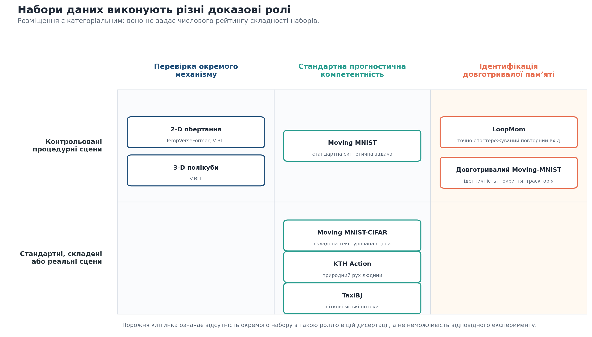
**Рисунок 2.3 – Категоріальна карта експериментальних наборів даних.**

Категоріальна карта пояснює послідовність перевірок, але не містить деталей протоколів. Таблиця 2.1 (source; Appendix В) доповнює рисунок 2.3: для кожного набору вказано контрольоване явище, модель, доказову роль і межу висновку. Такий поділ потрібний, оскільки візуально складніший набір не обов’язково точніше виявляє втрату давньої історії.

The method/configuration record is preserved in Appendix В (source Table 2.1).
Експериментальна одиниця залежить від задачі та досліджуваного механізму. Для ранніх робіт опубліковано точкові оцінки без достатніх даних для ретроспективного відновлення невизначеності, тому в цьому розділі вони подаються саме в такому вигляді. У центральних порівняннях розділів 3 і 4 невизначеність оцінюється інакше: під час кластерної бутстреп-передискретизації повторно відбираються цілі відеокліпи, а всі їхні кадри залишаються разом. Це запобігає хибному трактуванню сусідніх кадрів як незалежних спостережень. Окремі ініціалізації навчання утворюють другий рівень варіативності моделі. Довірчі інтервали до ранніх результатів штучно не добудовуються.

## 2.2 Моделювання реверсивних часових процесів

Тут розглядається перше ресурсне обмеження – зростання пам’яті активацій зі збільшенням диференційованого горизонту. Виклад переходить від механізму цього зростання до реверсивного блока й часового ланцюга, після чого окремо перевіряє реконструкцію станів, градієнти, пам’ять, зовнішню працездатність і межі застосовності.

### 2.2.1 Активаційна пам’ять у довгих часових ланцюгах

Розглянемо параметризований перехід $h_t=\Phi_\theta(h_{t-1},c_t)$, де $h_t\in\mathbb R^{D_s}$ є часовим станом, $c_t$ позначає відомі умовні дані, а $\theta$ – параметри моделі переходу. Втрата може залежати від кінцевого стану, кількох декодованих станів або повної траєкторії. Стандартне зворотне поширення через час застосовує диференціювання у зворотному режимі до розгорнутого композиційного відображення [28]. Градієнт такого відображення визначений однозначно, проблема полягає у зберіганні проміжних значень, потрібних для кожного локального зворотного кроку.

Нехай процес розгорнуто на $T$ часових кроків і він містить $L$ шарів. Через $A_l$ позначимо обсяг активацій шару $l$, які необхідно зберегти для його зворотного проходу. Тоді домінантну часову складову пам’яті стандартного BPTT та відповідний обсяг обчислень можна наближено записати як

$$
M_{\mathrm{act}}^{\mathrm{BPTT}}(T)
\approx
T\sum_{l=1}^{L} A_l,
\tag{2.4}
$$

Відповідну обчислювальну роботу $C_{\mathrm{BPTT}}(T)$ визначимо через вартість прямого й зворотного обчислення одного переходу:

$C_{\mathrm{BPTT}}(T) =T\bigl(C_{\Phi}^{\mathrm{fwd}}+C_{\Phi}^{\mathrm{bwd}}\bigr).$

Тут $C_{\Phi}^{\mathrm{fwd}}$ і $C_{\Phi}^{\mathrm{bwd}}$ означають вартість прямого та зворотного обчислення одного переходу. Рівняння (2.4) показує лінійне зростання збереженої стрічки активацій за $T$, а рівняння ([source 2.5](08_APPENDICES.md#eq-source-2-5)) визначає обчислювальну роботу. Водночас $M_{\mathrm{act}}^{\mathrm{BPTT}}$ не є повною пам’яттю пристрою: параметри, градієнти, стан оптимізатора, вхідні дані та робочі буфери є окремими складниками. Отже, реверсивний блок може усунути саме часову стрічку ядра, обсяг якої лінійно зростає під час навчання авторегресивного прогнозування, але не всі витрати обчислювального тракту.

Альтернативним методом є усічення BPTT, що зменшує використання пам’яті, але водночас скорочує горизонт градієнта [29]. Якщо пропущені залежності важливі, цільова функція фактично змінюється. Збереження контрольних точок градієнта застосовує інший підхід: вибрані граничні стани зберігаються, а проміжні сегменти повторно обчислюються, що в точній арифметиці зберігає похідну на всьому горизонті [30, 31]. Реверсивне відтворення є більш спеціалізованим. Якщо попередній стан відновлюється з наступного стану, то більшість часових граничних станів можна відкинути.

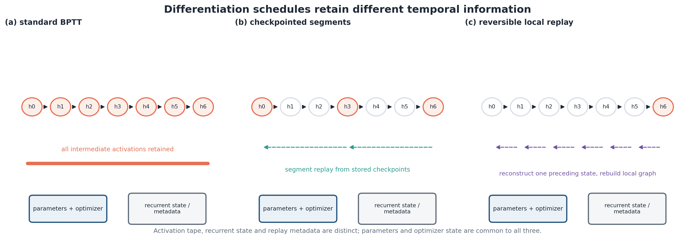
**Рисунок 2.4 – Схеми зберігання для диференціювання в часі.**

Щоб не ототожнювати стрічку активацій із усією пам’яттю пристрою, пікове використання доцільно подати окремим розкладом:
$M_{\mathrm{peak}}(T) =M_{\mathrm{param}}+M_{\mathrm{grad}}+M_{\mathrm{opt}} +M_{\mathrm{input}}+M_{\mathrm{workspace}}(T)+M_{\mathrm{tape}}(T).$

У рівнянні ([source 2.6](08_APPENDICES.md#eq-source-2-6)) $M_{\mathrm{param}}$, $M_{\mathrm{grad}}$ і $M_{\mathrm{opt}}$ відповідають параметрам, їхнім градієнтам та стану оптимізатора; $M_{\mathrm{input}}$ охоплює вхідні дані; $M_{\mathrm{workspace}}(T)$ – тимчасові робочі буфери; $M_{\mathrm{tape}}(T)$ – збережену стрічку активацій. Реверсивне відтворення безпосередньо зменшує останній складник. Для цього часовий перехід має бути побудований так, щоб попередній стан можна було відновити без збереження всіх його проміжних значень.

### 2.2.2 Reversible transformation and its exact boundary

TempVerseFormer's additive-coupling block reconstructs its complete two-stream internal input, not an arbitrary image or a compressed projection. For fixed conditions and deterministic modules, forward and inverse relations form one scientific object:

$$
\begin{aligned}
y_1=x_1+F_\theta(x_2),&\quad y_2=x_2+G_\theta(y_1),\\
x_2=y_2-G_\theta(y_1),&\quad x_1=y_1-F_\theta(x_2).
\end{aligned}
\tag{2.R1}
$$

The left-hand quantities are the paired block states; $F$ and $G$ themselves need not be invertible. The inverse is exact in real arithmetic, with finite-precision error checked separately. The VAE encoder/decoder, projections, normalization/merge boundaries, and loss are not made bijective by this construction. They retain ordinary differentiation or separately stored boundary information. The published architecture in the next subsection is the main diagram; the redundant block schematic and detailed state-boundary table are in Appendix Е/В.

Unit Jacobian determinant and the full algebraic expansion are supporting derivations, not an independent empirical contribution. If compression or forgetting is required, it must occur outside the reversible state or be represented by additional retained information. Algebraic reversibility alone does not guarantee stable repeated temporal prediction. The published measurements below determine the actual memory–compute and quality boundary [A2].

### 2.2.3 Часове ланцюгове з’єднання

Один реверсивний блок зменшує потребу зберігати внутрішні активації за глибиною мережі, але довгий відеопрогноз потребує ще й повторного переходу в часі. Часове ланцюгове з’єднання означає, що оператор фіксованої ширини багаторазово застосовується до вікна прихованих представлень: вихід одного зсуву стає входом наступного. Кількість параметрів при цьому не зростає з горизонтом, однак звичайне навчання все одно утворює дедалі довший диференційований ланцюг. Саме тут оборотність ядра дає змогу замінити збереження попередніх станів їхнім відтворенням.

TempVerseFormer розміщує реверсивний стек між просторовим кодером та декодером. В опублікованій конфігурації кожен RGB-кадр розміром $64\times64$ відображається на 256-вимірний стан у прихованому просторі. Навчена лінійна проєкція розширює кожен стан до 768 ознак, ротаційні позиційні вбудовування RoPE ідентифікують $N$ позицій у вікні [107], а спроєктована послідовність дублюється для формування двох потоків зв’язку. Часове ядро містить вісім реверсивних блоків трансформера з вісьмома головками уваги [135]. Повну схему зображено на рисунку 2.6. Кодер переводить кадри до прихованого простору, вхідна проєкція формує два потоки реверсивного ядра, а вихідна проєкція та декодер повертають прогноз до простору зображення. Точне відтворення застосовується лише до повторюваного подвоєного стану трансформера; VAE, проєкції та злиття виходу залишаються нереверсивними межами.

**Рисунок 2.6 – Повна архітектура TempVerseFormer.**

Позначимо кодер і декодер через $e_\phi$ та $d_\psi$, вхідну й вихідну проєкції через $P_{\mathrm{in}}$ і $P_{\mathrm{out}}$, а один перехід реверсивного ядра через $R_\theta$. Початкове представлення дорівнює $z^{(0)}=e_\phi(x)$, а початковий стан ядра — $q^{(0)}=P_{\mathrm{in}}(z^{(0)})$. Для $r=0,\ldots,T-1$ стан після наступного часового зсуву оновлюється як

$$
q^{(r+1)}=R_\theta(q^{(r)}).
\tag{2.12}
$$

Після $T$ переходів декодований прогноз $\widehat x^{(T)}$ формується вихідною проєкцією та декодером:

$$
\widehat x^{(T)}=d_\psi\!\left(P_{\mathrm{out}}(q^{(T)})\right).
\tag{2.13}
$$

Розмірність стану не змінюється зі збільшенням зсуву. Отже, часова глибина означає повторне застосування одного віконного оператора, а не дедалі довшу послідовність токенів. Параметри спільні між усіма застосуваннями. Водночас градієнти від кінцевого декодованого вікна мають пройти через кожен повторний перехід. Саме тому стандартне автоматичне диференціювання накопичує довшу історію активацій, хоча кількість навчених часових параметрів залишається сталою. Цей процес схематично показано на рисунку 2.7 (source; Appendix Е).

See Appendix Е, source Figure 2.7, for the supporting illustration.

Під час навчання використовується контекст із 12 кадрів та навчальна програма, в якій зсув $T$ збільшується від одиниці
до п’яти. Декодоване вихідне вікно порівнюється з відповідним цільовим вікном, зміщеним у часі.
Для відтворення опублікованого протоколу важливо розділити заявлену ціль і фактичну реалізацію. У рівнянні (16) статті наведено функцію втрат із трьома членами [135]:

$\mathcal L_{\mathrm{paper}} =\lambda_{\mathrm{MSE}}\mathcal L_{\mathrm{MSE}} +\lambda_{\mathrm{LPIPS}}\mathcal L_{\mathrm{LPIPS}} +\lambda_{\mathrm{KL}}D_{\mathrm{KL}} \bigl(q_\phi(z\mid x)\,\|\,\mathcal N(0,I)\bigr).$

Аудит реалізації дає окрему ціль $\mathcal L_{\mathrm{code}}$, у якій явно наявна реконструкційна похибка входу VAE:

$$
\mathcal L_{\mathrm{code}}
=\mathcal L_{\mathrm{pred-MSE}}
+\mathcal L_{\mathrm{input-VAE-MSE}}
+\lambda_{\mathrm{LPIPS}}\mathcal L_{\mathrm{LPIPS}}
+\lambda_{\mathrm{KL}}D_{\mathrm{KL}}.
\tag{2.15}
$$

Рівняння ([source 2.14](08_APPENDICES.md#eq-source-2-14)) відтворює формулу, наведену в публікації. Рівняння (2.15) фіксує фактичний склад перевіреної реалізації, де додатково присутня похибка реконструкції входу VAE, а коефіцієнт KL відрізняється від описаного в статті. Це розходження не змінює алгебру реверсивного ядра, але має значення для точного відтворення навчання. Тому опис публікації та аудит коду подано окремо.

### 2.2.4 Reverse replay and gradient accumulation

Reverse replay reconstructs the preceding complete state, rebuilds one local differentiable transition, accumulates its parameter gradient and state adjoint, and releases that local graph. The final state, required boundary conditions, and any deterministic replay information remain available. The standard chain-rule expansion is preserved in Appendix Е with the original formulas and implementation references.

$$
\bar h_{t-1}=(\partial\Phi_\theta/\partial h_{t-1})^\top\bar h_t+\partial\ell_{t-1}/\partial h_{t-1},\qquad
g_\theta\mathrel{+}=(\partial\Phi_\theta/\partial\theta)^\top\bar h_t.
\tag{2.R2}
$$

The quantities are the state adjoint and accumulated parameter gradient for the executed temporal objective. The relation is exact differentiation for the specified replayed function; its practical validity depends on reconstruction and gradient parity within the tested tolerance. A compact replay timeline replaces separate forward-chain and backward-storage diagrams. The published quality, memory, and runtime evidence remains three distinct objects because the same horizon can improve one endpoint and worsen another.

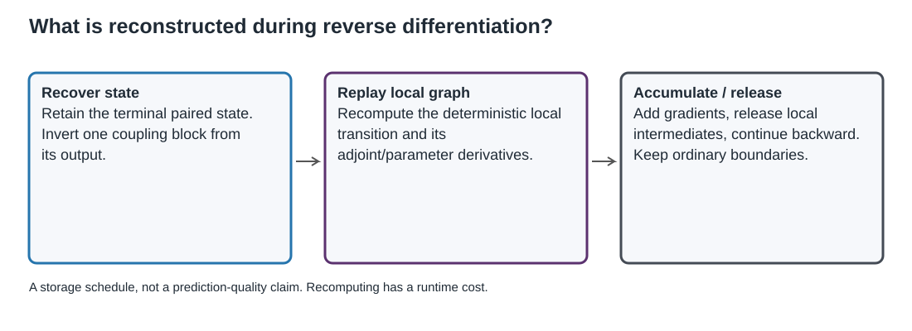

Figure D2-replay — Reconstruct one prior state, replay one local graph, accumulate its gradient, then release it. Ordinary encoder/decoder/loss boundaries remain outside this storage schedule. This is a mechanism diagram, not a GPU profile.

### 2.2.5 Результати контрольованого аналізу часових закономірностей

У контрольованому оцінюванні порівнювали чотири системи: реверсивний TempVerseFormer; зіставлений нереверсивний, але ідентичний архітектурно TempFormer із часовим ланцюгуванням; стандартний трансформер без такого самого інтерфейсу реверсивного ланцюгування; та LSTM [137]. TempFormer і TempVerseFormer мали по вісім блоків, вісім голів уваги та 768 прихованих ознак. Усі моделі використовували спільний інтерфейс VAE й навчалися протягом 30 000 кроків на одній відеокарті NVIDIA RTX 4060 Ti. Оцінювання охоплювало 2 000 процедурно згенерованих послідовностей з однаковою фіксованою ініціалізацією генератора даних для всіх моделей [135].

Контрольоване порівняння не виявило універсального переможця за якістю. TempVerseFormer має найкращу сукупність FID, MSE та SSIM для постійного й перерваного обертання, тоді як за прискорення, уповільнення, коливання або комбінованого руху окремі показники віддають перевагу TempFormer чи LSTM. Отже, головним результатом є працездатність реверсивного часового ядра без систематичної втрати прогнозної спроможності.

**Таблиця 2.3 – Опубліковані прогнозні точкові оцінки за режимами обертання**

| Режим | Модель | FID $\downarrow$ | MSE $\downarrow$ | SSIM $\uparrow$ |
|---|---|---:|---:|---:|
| Постійний | TempFormer | 103 | 0,023 | 0,84 |
| Постійний | TempVerseFormer | 75 | 0,018 | 0,88 |
| Постійний | Стандартний Transformer | 87 | 0,030 | 0,86 |
| Постійний | LSTM | 157 | 0,080 | 0,76 |
| Прискорений | TempFormer | 90 | 0,021 | 0,857 |
| Прискорений | TempVerseFormer | 87 | 0,028 | 0,853 |
| Прискорений | Стандартний Transformer | 95 | 0,030 | 0,851 |
| Прискорений | LSTM | 86 | 0,048 | 0,821 |
| Уповільнений | TempFormer | 90 | 0,025 | 0,86 |
| Уповільнений | TempVerseFormer | 87 | 0,036 | 0,84 |
| Уповільнений | Стандартний Transformer | 86 | 0,036 | 0,85 |
| Уповільнений | LSTM | 85 | 0,039 | 0,84 |
| Коливальний | TempFormer | 130 | 0,024 | 0,82 |
| Коливальний | TempVerseFormer | 112 | 0,021 | 0,84 |
| Коливальний | Стандартний Transformer | 119 | 0,068 | 0,78 |
| Коливальний | LSTM | 108 | 0,081 | 0,77 |
| Перерваний | TempFormer | 98 | 0,034 | 0,83 |
| Перерваний | TempVerseFormer | 91 | 0,032 | 0,84 |
| Перерваний | Стандартний Transformer | 99 | 0,056 | 0,80 |
| Перерваний | LSTM | 107 | 0,060 | 0,79 |
| Комбінований | TempFormer | 119 | 0,060 | 0,79 |
| Комбінований | TempVerseFormer | 123 | 0,059 | 0,78 |
| Комбінований | Стандартний трансформер | 127 | 0,086 | 0,77 |
| Комбінований | LSTM | 156 | 0,089 | 0,74 |
Повна галерея прогнозів для постійного, прискореного, уповільненого, коливального та перерваного обертання наведена в додатку Е. В основному тексті залишено графік для комбінованої динаміки, оскільки саме він показує зміну відносного результату зі збільшенням глибини прогнозування, а не лише окремі зображення. Публікація наводить точкові оцінки без панелі незалежних навчань і довірчих інтервалів, тому невизначеність до цих результатів ретроспективно не додається.

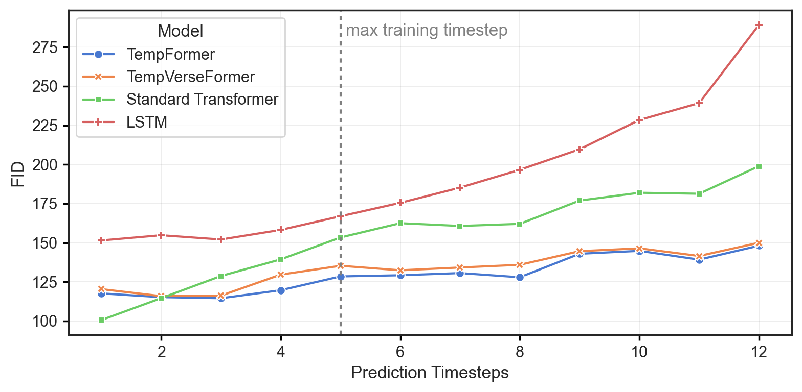
**Рисунок 2.9 – FID залежно від глибини прогнозування для комбінованих часових закономірностей.**

Розбіжність показників у цьому випадку є науково інформативною. FID порівнює розподіли в просторі ознак і може віддавати перевагу набору різноманітних зразків, навіть якщо відповідні кадри не наближені до своїх цільових значень [94]. MSE винагороджує вирівнювання пікселів і різко штрафує навіть невелике кутове зміщення. SSIM акцентує увагу на локальній яскравості, контрасті та структурі [94, 127–129]. Отже, LSTM може отримати найнижчий зафіксований показник FID за прискорення, маючи при цьому значно гірші показники MSE та SSIM. Визнання цього рядка загальним переможцем приховало б парний характер завдання прогнозування.

### 2.2.6 Зовнішня валідація OpenSTL

Контрольоване обертання не встановлює здатності моделі працювати з текстурованими сценами або природним рухом. Тому часову модель інтегровано в OpenSTL та оцінено за визначеними в ньому розбиттями й метриками на Moving MNIST, Moving MNIST-CIFAR, KTH Action і TaxiBJ [1, 124, 126, 154]. Опубліковане порівняння охоплює рекурентні ConvLSTM і PredRNN++ [137, 152], а також нерекурентні схожі архітектурно базові моделі ViT та Uniformer.

Table 2.4a — Published point estimates: Moving MNIST. Original metric scale; no retrospectively invented seed uncertainty. Source Table 2.4.

| Модель | SSIM $\uparrow$ | MSE $\downarrow$ |
|---|---|---|
| ConvLSTM | 0,929 | 29,80 |
| PredRNN++ | 0,951 | 22,06 |
| TempVerseFormer | 0,932 | 26,08 |
| ViT | 0,914 | 35,15 |
| Uniformer | 0,931 | 30,38 |

Table 2.4b — Published point estimates: Moving MNIST-CIFAR. Original metric scale; no retrospectively invented seed uncertainty. Source Table 2.4.

| Модель | SSIM $\uparrow$ | MSE $\downarrow$ |
|---|---|---|
| ConvLSTM | 0,920 | 73,31 |
| PredRNN++ | 0,957 | 44,19 |
| TempVerseFormer | 0,950 | 50,37 |
| ViT | 0,936 | 64,94 |
| Uniformer | 0,944 | 56,96 |

Table 2.4c — Published point estimates: KTH Action. Original metric scale; no retrospectively invented seed uncertainty. Source Table 2.4.

| Модель | SSIM $\uparrow$ | MSE $\downarrow$ |
|---|---|---|
| ConvLSTM | 0,898 | 47,65 |
| PredRNN++ | 0,912 | 39,84 |
| TempVerseFormer | 0,898 | 48,97 |
| ViT | 0,895 | 56,57 |
| Uniformer | 0,906 | 44,71 |

Table 2.4d — Published point estimates: TaxiBJ. Original metric scale; no retrospectively invented seed uncertainty. Source Table 2.4.

| Модель | SSIM $\uparrow$ | MSE $\downarrow$ |
|---|---|---|
| ConvLSTM | 0,9836 | 0,34 |
| PredRNN++ | 0,9834 | 0,33 |
| TempVerseFormer | 0,9835 | 0,31 |
| ViT | 0,9841 | 0,32 |
| Uniformer | 0,9844 | 0,34 |
Це порівняння закриває важливу, але обмежену прогалину в доказах на контрольованих обертаннях. Воно показує, що часову архітектуру можна навчати для растрових об’єктів, текстурованих композицій, дій людей і сіткових полів потоків, не заявляючи домінування на окремому завданні. Протоколи також не приховують унікально релевантне спостереження за межами доступного контексту до моменту, коли воно знову стане потрібним. Отже, докази підтверджують переносимість і прогностичну спроможність; твердження про пам’ять активацій спирається на прямі вимірювання реверсивних і нереверсивних процесів, а механізм досяжності залишається окремим питанням. Ширше значення результату полягає в тому, що контрольована перевірка не обмежилася одним рендерером.

Чотири набори даних перевіряють різні види компетентності. KTH замінює синтетичні цифри на артикульовані рухи людей, тоді як TaxiBJ є сітковим полем потоку, а не задачею візуалізації об’єктів. Однаково сильний результат у всіх чотирьох випадках був би переконливішим за успіх на одному генераторі обертання. Опублікована закономірність скромніша: архітектура залишається придатною до цих інтерфейсів, але її відносна позиція залежить від даних. Якісні панелі Moving-MNIST, Moving-MNIST-CIFAR, KTH і TaxiBJ перенесено до додатка Е; кількісний висновок визначає таблиця 2.4.

### 2.2.7 Межа активаційної пам’яті та обчислювальної потужності

Центральною особливістю вимірювань TempVerseFormer є те, як по-різному масштабується пам’ять часового ядра. Опубліковані результати відокремлюють пам’ять, зарезервовану для часової моделі, від загальної виділеної пам’яті обчислювального тракту, яка також охоплює VAE та спільні компоненти. Без цього розмежування криву постійного ядра можна було б помилково прийняти за нульове зростання при кожному розподілі пам’яті на рівні пристрою.

**Таблиця 2.5 – Опубліковані вимірювання пам’яті GPU для зазначених у таблиці горизонтів, розмір пакета 32**

| Кроки прогнозування | Модель | Пам’ять часової моделі (ГБ) | Загальна пам’ять обчислювального тракту (ГБ) |
|---:|---|---:|---:|
| 1 | TempFormer | 0,85 | 4,11 |
|  | TempVerseFormer | 0,89 | 3,94 |
|  | Стандартний Transformer | 0,85 | 4,10 |
|  | LSTM | 1,27 | 4,00 |
| 4 | TempFormer | 0,85 | 4,59 |
|  | TempVerseFormer | 0,89 | 3,95 |
|  | Стандартний трансформер | 0,86 | 4,58 |
|  | LSTM | 1,28 | 4,03 |
| 16 | TempFormer | 2,61 | 6,50 |
|  | TempVerseFormer | 0,89 | 3,98 |
|  | Стандартний трансформер | 2,60 | 6,51 |
|  | LSTM | 1,28 | 4,13 |

Обсяг пам’яті часового ядра залишається близьким до заявленого базового значення в міру зростання реверсивного горизонту, на відміну від відповідного нереверсивного трансформера; загальний обсяг пам’яті обчислювального тракту включає спільні компоненти. Прогнозований графік зростання памʼяті зображено на рисунку 2.10.

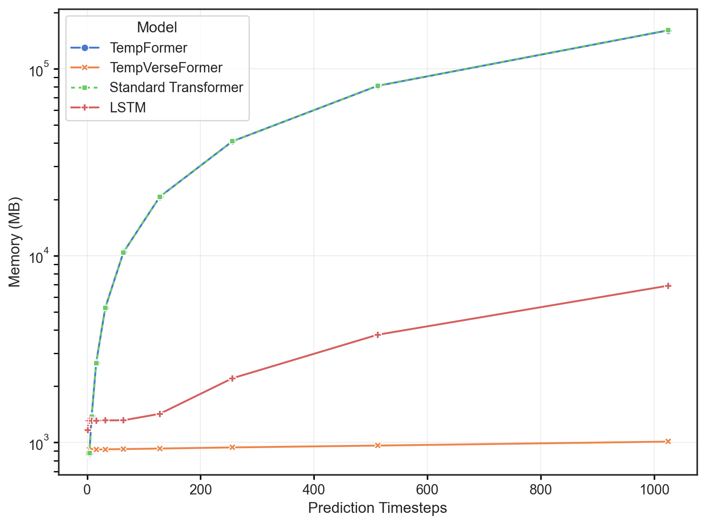
**Рисунок 2.10 – Обсяг пам’яті GPU у порівнянні з глибиною прогнозування.**

Пологіша крива пам’яті активацій досягається ціною обчислень для відтворення, тому здійсненність і час виконання потрібно оцінювати разом. Залежність часу одного кроку навчання від кількості кроків прогнозування показано на рисунку 2.11.

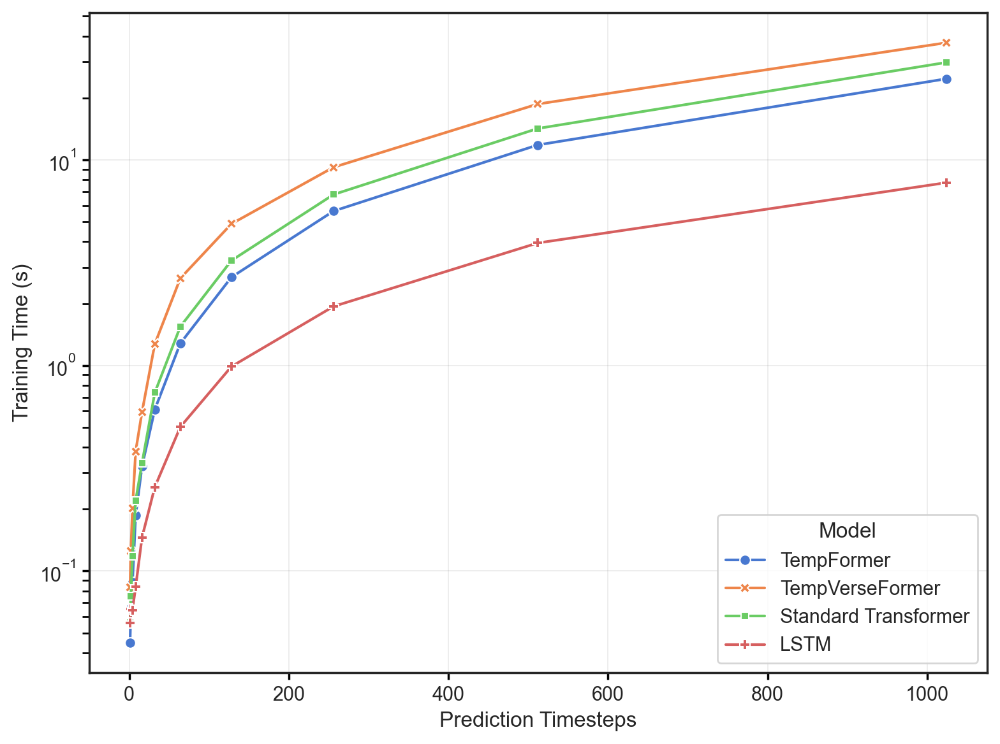
**Рисунок 2.11 – Час навчання залежно від глибини прогнозування.**

Уже на шістнадцятому кроці порівняння показує робочий ефект без опори на дальню частину кривої. TempVerseFormer використовує на 1,72 ГБ менше заявленої пам’яті часової моделі, ніж TempFormer, тобто приблизно на 66%. Для повного обчислювального тракту різниця становить 2,52 ГБ, або близько 39%, оскільки спільні просторові й навчальні витрати пам’яті залишаються. Перший показник краще ізолює механізм, другий ближчий до обсягу, який спостерігає користувач на практиці.

Опубліковані графіки візуально поширюються на 1024 кроки прогнозування, при цьому реверсивна крива часового ядра залишається приблизно на рівні 1 ГБ. Однак збережені результати не містять точних координат для цих точок широкого горизонту. Тому кількісні порівняння обмежуються табличними вимірюваннями на одному, чотирьох та шістнадцяти кроках. Більш віддалена частина використовується лише для опису тенденції масштабування, показаної на графіку.

### 2.2.8 Stochastic replay and numerical extensions

The deterministic published boundary must not be enlarged by a general derivation. Stochastic transitions additionally require reproducible random draws or saved generator state; nondeterministic recomputation can change the function being differentiated. Anchor checkpoints can limit accumulated reconstruction drift, but consume memory and change the recomputation schedule. The original replay, Lipschitz, anchor, and error-propagation derivations are preserved in Appendix Е as extensions with their own implementation status.

These extensions do not establish that every stochastic component of a video pipeline is reversible. Nor is a theoretical stability bound a measured rollout-quality result. The later integrated core disables dropout and keeps routing outside its inverse boundary; CPU bfloat16 checks and future CUDA checks are reported separately rather than using this discussion as a blanket guarantee.

### 2.2.9 Застосовність щодо BPTT та системи контрольних точок

Жодна схема зворотного обчислення не є найкращою для кожної моделі. Стандартний BPTT привабливий, коли потрібний горизонт легко вміщується в пам’ять, оскільки не потребує реконструкції проміжних станів. Обрізання є обґрунтованим вибором моделі, якщо залежності за межею сегмента вилучаються навмисно. Збереження контрольних точок працює з довільними диференційовними модулями й дає змогу налаштувати співвідношення між зберіганням і повторним обчисленням. Реверсивне відтворення вимагає чітко окресленого реверсивного стану, стабільної числової реконструкції та точного повторення стохастичних входів [30, 32, 91, 110, 113, 116].

Вирішальним є те, яку частку пам’яті може звільнити обернене відтворення. В опублікованому часовому ядрі та на детермінованому багаторівневому рекурентному межі повторні активації займають достатньо пам’яті, щоб реконструкція могла змінити здійсненність обчислення. У перевіреному внутрішньому циклі оптимізації натомість домінують локальні графи другого порядку й спільний стан моделі, тому практичнішим вибором є збереження контрольних точок. У розділі 4 це правило вибору за обмежувальним ресурсом використано без трактування реверсивності як універсальної архітектурної переваги.

The method/configuration record is preserved in Appendix В (source Table 2.7).
Реверсивність усуває зростання стрічки активацій у перевіреному часовому ядрі, але не стискає сам вхідний контекст. Якби кадр $64\times64$ подавався до глобальної уваги по одному токену на піксель, 12 кадрів утворили б послідовність із 49 152 токенів. Одна матеріалізована матриця уваги для одного прикладу й однієї голови тоді містила б $49\,152^2=2\,415\,919\,104$ елементи: приблизно 9,0 ГіБ у fp32 або 4,5 ГіБ у fp16/bf16, без урахування інших активацій. Це не означає, що ієрархія є єдиним способом зменшення вартості: можливі локальна чи розріджена увага, пошук у пам’яті, рекурентний стан, часове піддискретизування, об’єднання токенів, лінійна увага та моделі простору станів. У цій дисертації обрано багаторівневий шлях: давня історія зберігається грубо, недавня – детально, а локально однорідні просторові значення можуть агрегуватися перед глобальною обробкою. Наступний підрозділ розглядає останню ідею на прикладі V-BLT.

## 2.3 Ієрархічне просторове представлення та оцінка ентропії

Ця частина переходить від пам’яті навчального графа до просторової ціни детального контексту. Ієрархія V-BLT є локально–глобальною ієрархією всередині одного представлення: локальні байти агрегуються до коротшої глобальної послідовності, після чого деталь відновлюється. Вона не тотожна грубій і детальній історії розділу 3, де змінюються роздільна здатність і часова досяжність, але обидві конструкції спираються на той самий принцип – не всі рівні опису потрібно зберігати й обробляти з однаковою щільністю.

### 2.3.1 Проблема розподілу фіксованих патчів

У цьому розділі **патч** означає фіксовану просторово-часову область растрових байтів, яку локальний кодер V-BLT перетворює на певне приховане представлення; **токен** є вектором, що надходить до трансформера; **пакет контексту** в розділах 3–4 є окремим поняттям і задає сукупність збережених кадрів, рівнів та часових прив’язок.

Диференційованість довшого часового ланцюга розв’язує лише проблему пам’яті під час навчання довгострокового прогнозування. Наступне вузьке місце є просторовим: воно визначається тим, як візуальна модель розподіляє ємність представлення. Типовий механізм попередньої обробки у відеотрансформерах розбиває кліп на регулярну сітку просторово-часових патчів, вбудовує кожну комірку як вектор і обробляє отриману послідовність [70, 71]. Повторювані патчі можна об’єднувати в регіональні пакети, де кожному токену відповідає чітко визначена геометрична область. Проте вартість визначається кількістю патчів, а не обсягом непередбачуваного вмісту всередині них. Для кліпу з $T$ кадрів висоти $H$ і ширини $W$, поділеного на блоки розміром $\tau\times p_h\times p_w$, кількість областей дорівнює

$$
N_{\mathrm{patch}}
=\left\lceil\frac{T}{\tau}\right\rceil
 \left\lceil\frac{H}{p_h}\right\rceil
 \left\lceil\frac{W}{p_w}\right\rceil.
\tag{2.28}
$$

Статична чорна область і рухомий контур отримують однакову кількість токенів. Це не означає автоматичної неефективності: регулярність може бути корисною, а навчений кодер здатний пригнічувати надлишковий вміст. Сумнів виникає тоді, коли глобальна модель є найдорожчим компонентом архітектури, а щільність локальної інформації різко неоднорідна. За таких умов значна частина обчислень припадає на області, малорелевантні для конкретного завдання прогнозування руху об’єкта.

See Appendix Е, source Figure 2.12, for the supporting illustration.

Як зображено на рисунку 2.12 (source; Appendix Е), просторово-часовий блок спочатку стискається локальним кодером до одного глобального представлення. Трансформер обмінюється інформацією між такими представленнями, після чого локальний декодер відновлює розподіли байтів у кожній растровій позиції.

### 2.3.2 Архітектура V-BLT

V-BLT оперує на рівні **байт-каналу пікселів растрового зображення**. Цільовий байт $x_{t,c,y,x}$ є цілим числом із множини $\{0,\ldots,255\}$. Такий вихідний інтерфейс дає змогу реалізувати нерегресійний вихідний модуль, не прив’язуючи результат безпосередньо до навченої дискретної кодової книги, як у VQ-VAE [73]. Водночас приховане представлення залишається оптимізованим: згортки, проєкції, увага та скінченна ширина прихованого простору утворюють навчуване інформаційне поле.

Нехай $X$ є вхідним кліпом, $\mathcal P_m(X)$ – його $m$-й фіксований просторово-часовий блок, де $m=1,\ldots,N_{\mathrm{patch}}$, а $E_\alpha$, $G_\beta$ і $D_\gamma$ – локальний кодер, глобальний трансформер та локальний декодер. Індекси $\alpha$, $\beta$ і $\gamma$ позначають три окремі набори навчуваних параметрів, щоб не змішувати локальне кодування, глобальну обробку та локальне декодування. Маска $M_{\mathrm{causal}}$ робить доступ до майбутніх кадрів неможливим, а $R_{\mathrm{ND}}$ вносить окремі часові й просторові координати в послідовність даних. Тоді послідовність перетворень має вигляд:

$u_m=E_\alpha\bigl(\mathcal P_m(X)\bigr).$

Послідовність глобально контекстуалізованих ознак $g_{1:N_{\mathrm{patch}}}$ утворює трансформер $G_\beta$:

$g_{1:N_{\mathrm{patch}}} =G_\beta\bigl(u_{1:N_{\mathrm{patch}}};M_{\mathrm{causal}},R_{\mathrm{ND}}\bigr),$

Локальний декодер повертає для кожної растрової позиції вектор логітів $\ell_{t,c,y,x}\in\mathbb R^{256}$:

$$
\ell_{t,c,y,x}
=D_\gamma\bigl(r_{t,c,y,x},g_{\pi(t,y,x)}\bigr)
\in\mathbb R^{256}.
\tag{2.31}
$$

де $u_m$ є представленням блока, $g_m$ – його глобально контекстуалізованою ознакою, $r_{t,c,y,x}$ – локальною ознакою декодера, а $\pi(t,y,x)$ відображає растрову координату на відповідну глобальну область.

Вектор $\ell_{t,c,y,x}\in\mathbb R^{256}$ містить логіти всіх можливих значень байта. Перехресна увага передає інформацію між локальними та блоковими представленнями. Отже, глобальний трансформер виконує широке просторово-часове моделювання, тоді як локальні етапи зберігають і відновлюють деталі.

У прямому проході локальний кодер спочатку стискає байти кожного фіксованого просторово-часового блока до представлення $u_m$. Глобальний модуль обмінює інформацію між такими представленнями за причинної маски. Локальний декодер поєднує глобальний контекст з ознакою конкретної растрової позиції й повертає 256 логітів для її байта. Таким чином, глобальна послідовність коротша за послідовність усіх байтів, але детальне відновлення залишається локальною обчислювальною роботою.

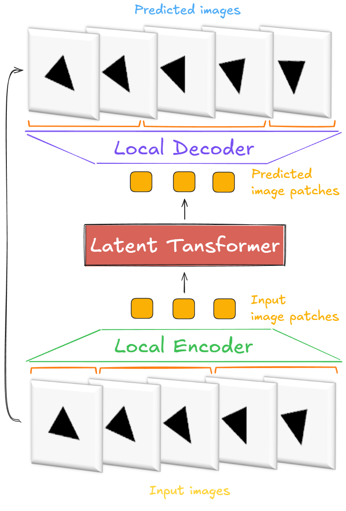
**Рисунок 2.13 – Опублікована архітектура Vision Byte Latent Transformer.**

На схемі, зображеній на рисунку 2.13, центральний глобальний трансформер працює не з усіма байтами безпосередньо, а з локально агрегованими представленнями. Кодер і декодер утворюють два боки локально-глобально-локального тракту.

Архітектурні дані підтверджують ієрархічний метод представлення. Вони не доводять, що модель сформувала семантично змістовні патчі, що послідовність прихованих представлень є оптимальною або що та сама конструкція без змін масштабується на стиснене відео природного походження.

The method/configuration record is preserved in Appendix В (source Table 2.8).
### 2.3.3 Причинна увага та категоріальна байтова ціль

Після визначення просторових одиниць потрібно задати, які з них можуть обмінюватися інформацією. Повністю двонапрямлена увага допустила б витік із майбутніх кадрів, тоді як суто послідовна маска штучно заборонила б взаємодію між пікселями одного вже спостережуваного кадру. Тому каузальність тут має дві шкали: вільний обмін інформацією всередині доступного кадру та заборону доступу до наступних кадрів. Сплющення кліпу перетворює час і простір на єдиний індекс токена, тому дозвільну маску визначено через часові координати. Якщо токен $i$ належить до кадру $t_i$, а токен $j$ – до $t_j$, глобальна маска уваги має вигляд:

$M_{ij}= \begin{cases} 0, & t_j\le t_i,\\ -\infty, & t_j>t_i. \end{cases}$

Нерівність $t_j\le t_i$ дозволяє обмін усередині поточного та з усіма попередніми кадрами, тоді як $t_j>t_i$ додає $-\infty$ до відповідного логіту перед застосуванням функції softmax [12]. Отримана матрична маска містить щільні діагональні блоки кадрів у блочно-нижньотрикутній часовій структурі. На рівні глобальної уваги прямий витік майбутньої інформації заблоковано, тоді як фізична правдоподібність і авторегресивна стійкість залишаються властивостями, які модель має вивчити.

See Appendix Е, source Figure 2.14, for the supporting illustration.

Діагональні блоки дозволяють взаємодію між просторовими позиціями одного кадру, нижні блоки відкривають попередні кадри, а верхня частина матриці блокує майбутнє. Цю структуру безпосередньо показано на рисунку 2.14 (source; Appendix Е).

Після визначення доступної історії кожна цільова позиція прогнозується як категоріальний розподіл за 256 значеннями байта $k\in\{0,\ldots,255\}$, а навчальна ціль усереднює від’ємну логарифмічну правдоподібність за цільовими позиціями.

$p_\Theta(x_i=k\mid X_{<t}) =\frac{\exp(\ell_{i,k})} {\sum_{r=0}^{255}\exp(\ell_{i,r})}.$

Використовуючи цей розподіл, байтова втрата $\mathcal L_{\mathrm{byte}}(\Theta)$ усереднює від’ємну логарифмічну правдоподібність за множиною цільових позицій $\mathcal I$:

$$
\mathcal L_{\mathrm{byte}}(\Theta)
=-\frac{1}{|\mathcal I|}
\sum_{i\in\mathcal I}
\log p_\Theta(x_i=x_i^{\star}\mid X_{<t_i}),
\tag{2.34}
$$

де $\mathcal I$ містить цільові позиції байтів, а $x_i^{\star}$ – еталонне ціле значення. На відміну від скалярного регресивного виходу, який повертає одне значення, категоріальний інтерфейс може представляти кілька правдоподібних значень байта в одній позиції та безпосередньо надає розподіл для обчислення прогностичної ентропії. Це корисно для виявлення локально неоднозначних ділянок. Водночас сам розподіл не гарантує каліброваності ймовірностей і не усуває залежність між сусідніми байтами, якщо вихідний модуль прогнозує їх факторизовано.

### 2.3.4 RoPE-ND and physical axes

V-BLT's raster-byte sequence preserves time, row, and column identities through multi-axis rotary position encoding rather than treating linear sequence rank as the only coordinate. With channel pairs allocated to physical axes, the rotation can be written compactly as

$$
R(p)=\operatorname{blockdiag}_{a,k}\operatorname{Rot}(p_a\omega_{a,k}),\qquad
\langle R(p)q,R(p')k\rangle=\langle q,R(p'-p)k\rangle.
\tag{2.R3}
$$

The relation describes the relative-phase property for the declared axis decomposition, not a measured isolated gain of RoPE-ND. Elementary sine/cosine derivations and the original coordinate examples remain in Appendix Е. The V-BLT result compares complete configurations; it does not disentangle positional encoding from the byte interface and hierarchy.

**Рисунок 2.15 – Неперетинні координатні підпростори в RoPE-ND.**

The integrated model in Section 3.7 uses continuous Fourier features plus a level embedding, not this rotary operator. What transfers is the requirement to preserve physical identity after packing, not identical positional code or pretrained weights.

### 2.3.5 Прогностична ентропія як сигнал просторової складності

Категоріальний байтовий вихід задає повний розподіл, а не лише точковий прогноз. Його локальну невизначеність можна узагальнити ентропією Шеннона [9], виміряною в бітах:

$$
H_i^{(2)}
=-\sum_{k=0}^{255}p_{i,k}\log_2 p_{i,k}.
\tag{2.40}
$$

Для категоріального розподілу за 256 значеннями виконується $0\le H_i^{(2)}\le8$: точкова маса відповідає нижній межі, тоді як рівномірний розподіл досягає верхньої.

Тестований код візуалізації обчислює ентропію в натах, використовуючи натуральний логарифм:

$H_i^{(e)}=-\sum_{k=0}^{255}p_{i,k}\ln p_{i,k} =(\ln2)H_i^{(2)}.$

Величини (2.40) і ([source 2.41](08_APPENDICES.md#eq-source-2-41)) відрізняються лише постійним множником $\ln 2$, тому просторове ранжування областей не змінюється.

На рисунку 2.16 показано весь шлях від 256 логітів у кожній позиції до нормованої карти, яку можна накласти на кадр. Після перетворення логітів функцією softmax ентропія обчислюється для кожного байта, агрегується за каналами та візуалізується у координатах кадру. Через інвертовану шкалу сірого темніша область відповідає вищій невизначеності прогнозу, але ще не доводить, що саме їй слід виділити більше токенів.

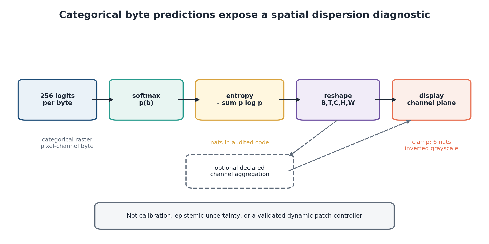
**Рисунок 2.16 – Від категоріальних логітів до карти просторової ентропії.**

Щоб перетворити цю карту на контролер, самої візуальної структури недостатньо. Калібрування можна перевірити, згрупувавши прогнозовані ймовірності байтів або значення ентропії та вимірявши фактичну помилку. Просторову корисність потрібно встановлювати порівнянням ентропійного розподілу ресурсів із випадковою, заснованою на русі та політиками передбачення за однакового бюджету токенів. Може знадобитися й часове згладжування: зміна межі патча в кожному кадрі створює накладні витрати та нестабільні ідентифікатори токенів. Дослідження проводилося на фіксованих патчах і не містить перевірок зазначених вище гіпотез контролера.

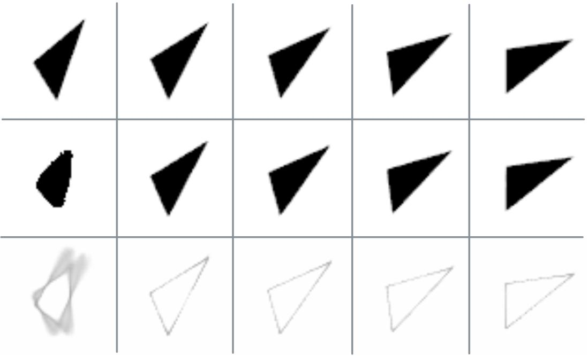

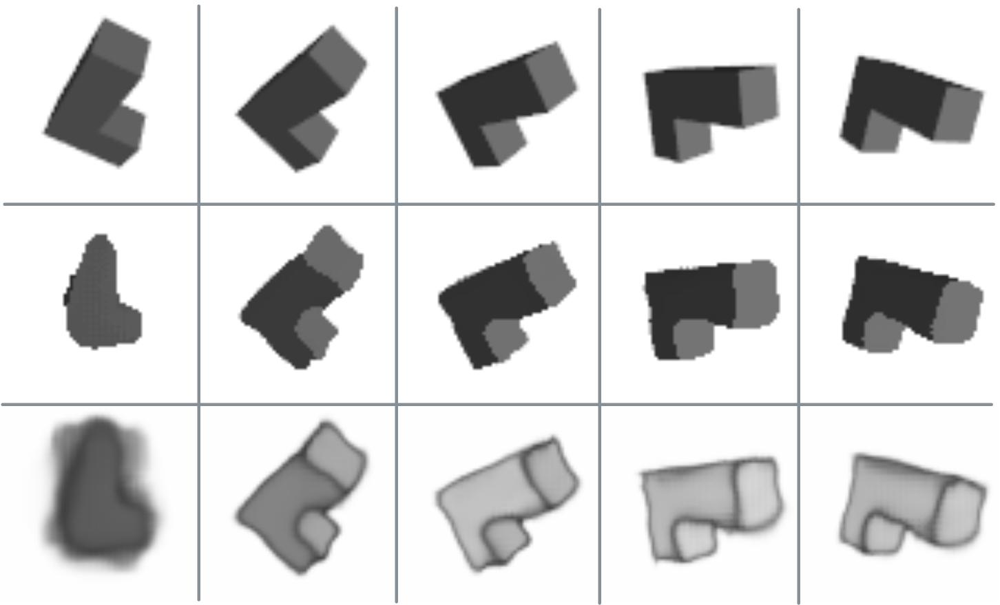

**Рисунок 2.17 – Прогнози V-BLT та карти ентропії для двовимірного та тривимірного обертання.**

У вибраних прикладах на рисунку 2.17 ентропія просторово зосереджена переважно біля контуру рухомого обʼєкта. Така локалізація мотивує виділення більшої детальної ємності інформаційно насиченим ділянкам, але сама по собі не доводить переваги динамічного розподілу.

### 2.3.6 Експериментальні результати для двовимірних та тривимірних обертань

У дослідженні V-BLT з фіксованими ділянками модель порівнюється з ViViT [70] та UNet-3D [134] на двох наборах даних процедурного обертання. Зазначені розмір моделі та кількість GFLOPs належать до заданої обчислювальної конфігурації, а MSE, SSIM та PSNR є точковими оцінками якості прогнозування.

Спочатку порівнюється вартість заданих конфігурацій. Ці числа не є вимірюванням якості й тому подані окремо.

**Таблиця 2.9 – Опубліковані точкові оцінки вартості конфігурацій V-BLT та базових моделей.**

| Модель | Розмір моделі (МБ) | GFLOPs |
|---|---:|---:|
| V-BLT | 6,5 | 51,2 |
| ViViT | 6,5 | 59,3 |
| UNet-3D | 24,0 | 70,4 |

Якість оцінювалась на двох процедурних наборах. Тут моделі зіставлено лише в межах кожного набору.

Table 2.10a — Published point estimates: 2-D фігури. Original metric scale; no retrospectively invented seed uncertainty. Source Table 2.10.

| Модель | MSE $\downarrow$ | SSIM $\uparrow$ | PSNR, дБ $\uparrow$ |
|---|---|---|---|
| V-BLT | 0,039 | 0,98 | 32,3 |
| ViViT | 0,181 | 0,87 | 20,7 |
| UNet-3D | 0,125 | 0,88 | 21,8 |

Table 2.10b — Published point estimates: 3-D полікуби. Original metric scale; no retrospectively invented seed uncertainty. Source Table 2.10.

| Модель | MSE $\downarrow$ | SSIM $\uparrow$ | PSNR, дБ $\uparrow$ |
|---|---|---|---|
| V-BLT | 0,11 | 0,91 | 23,4 |
| ViViT | 0,19 | 0,83 | 24,8 |
| UNet-3D | 0,20 | 0,75 | 20,3 |
V-BLT використовує на $13{,}7\%$ менше заявлених GFLOPs, ніж ViViT, і на $27{,}3\%$ менше, ніж UNet-3D. Два записи розміром 6,5 МБ мають однакові значення розміру моделі.

Це порівняння підтверджує життєздатність повної конфігурації V-BLT, а не причинно-наслідковий внесок окремого компонента. Отже, нижчі заявлені показники GFLOP та сприятливі двовимірні метрики підтверджують ефективність протестованої системи; вони не виділяють позиційне кодування чи байтовий інтерфейс. Змішаний тривимірний рейтинг є корисним саме тому, що він запобігає перетворенню доказів на рівні конфігурації на домінування єдиної метрики.

See Appendix Е, source Figure 2.18, for the supporting illustration.

Отже, у двовимірній задачі V-BLT має найкращі три наведені показники, а в тривимірній – найкращі MSE та SSIM, але поступається ViViT за PSNR. Такий результат підтримує працездатність локально–глобальної байтової ієрархії, не доводячи перевагу кожного її компонента окремо.

### 2.3.7 Measured V-BLT evidence and the later routing hypothesis

V-BLT implements fixed hierarchical patches and measures predictive byte entropy. Its local–global–local architecture, causal objective, RoPE-ND, categorical output, and published 2-D/3-D results remain part of the dissertation's main evidence. Predictive entropy shows spatially uneven uncertainty in the tested representation; it does not demonstrate an executed dynamic partition controller.

The later integrated router is independently specified. It scores fine–coarse residual and temporal change, optionally adding a learned correction, then gathers a real fixed quota with physical metadata. It does not consume the V-BLT entropy map. Equal-quota routing is an allocation-quality comparison; memory benefit requires a smaller real retained tensor at acceptable quality. A static-only checkpoint cannot be assumed robust to changed membership without route-aware exposure and a switch evaluation.

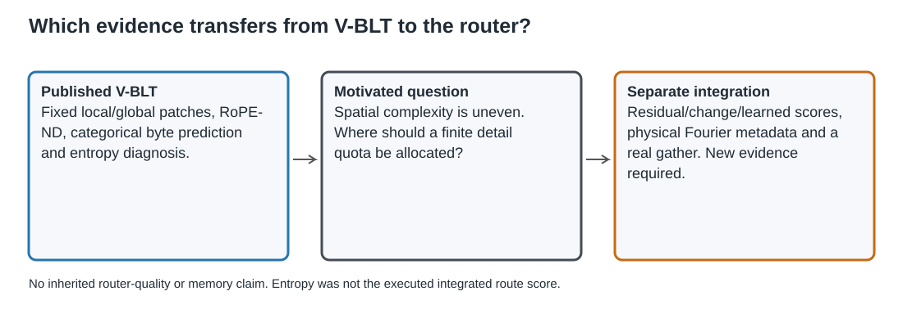

Figure D2-boundary — Published fixed-patch processing and entropy diagnosis motivate an allocation question. The implemented integrated router and its future quality/memory measurements are separate evidence, not retroactive V-BLT results. The old hypothetical dynamic-partition formula (source 2.42) is retained only as a historical design proposal in Appendix Е.

## 2.4 Наслідки для проєктування ієрархічно-контекстної моделі

### 2.4.1 What transfers across the methods

The published methods solve adjacent scaling constraints, not the entire retained-context question. TempVerseFormer provides a specified reconstructed state and reverse differentiation schedule. The changed resource is the stored activation tape of its temporal core; the unchanged resource is the content and age of the observations available to the predictor. A compact derivative computation cannot retrieve an observation that has already left the context.

V-BLT provides a local–global–local byte hierarchy and a physical-axis position contract. The changed interface is the spatial representation presented to a global processor; the diagnostic is predictive entropy. The unchanged boundary is that patch membership in the published experiments is fixed. Entropy concentration near difficult boundaries motivates further allocation work but is not an adaptive-router ablation.

The retained-context predictor asks a different question: which ages and levels should be present in a finite package? Spatial reduction can finance older coarse evidence, but identity may depend on detail that the same reduction discards. This makes coverage, trajectory, appearance, and identity separate endpoints rather than interchangeable descriptions of consistency. The new space–time study explicitly tests redistribution of detail over ages at fixed payload; it does not learn content-dependent membership.

The integrated model then tests composition, using an end-to-end encoder rather than the frozen controlled codec. Real fine-token gathering changes the core input length; physical metadata preserves position after membership changes; internal reversibility changes activation storage for the same forward computation. Encoder candidates, routing, decoder, parameters, optimizer state, and workspace remain outside that reversible saving. This boundary explains why component ratios cannot be multiplied and why a token-count ratio is insufficient evidence for total-memory superiority.

### 2.4.2 Published findings retained and new claims deferred

The published TempVerseFormer quality, memory, runtime, and OpenSTL results remain in Sections 2.2.5–2.2.7 with their original configurations. Favorable quality in several motion regimes does not establish dominance on every metric or dataset. The published V-BLT 2-D/3-D results remain in Section 2.3.6: they support feasibility and the reported configuration-level trade-offs, not isolated causal gains from every component. Article [A3]'s static-consistency taxonomy remains in Chapter 1, while exhaustive tutorial assets and standard derivations are preserved in the appendices.

Conceptually, the mechanism/resource map has three columns expressed in prose. Reversible replay changes internal stored activations and leaves retained evidence unchanged. Spatial hierarchy changes the units processed globally and does not guarantee useful temporal reach. Retained-context allocation changes which past evidence is available and leaves the numerical differentiation method unchanged. Dynamic routing adds a fourth conditional intervention: it changes membership at a fixed quota, and only a validated smaller quota changes the retained cost.

These distinctions lead to Chapter 3's method contract and Chapter 4's operating-region analysis. Legacy E5/E6 test self-fed accumulation and identity boundaries. The new TRB matrix tests distant observed context at a four-frame endpoint. The combined manuscript in preparation [A4] connects that matrix to separately measured OpenSTL composition without erasing the published contributions or assuming the integrated hypothesis succeeds.
