# Розділ 3 – Ієрархічна контекстна модель довгогоризонтного прогнозування відео

У розділі 2 розглянуто два обмеження, що постають до оцінювання довгогоризонтного прогнозування: зберігання активацій під час часового диференціювання та просторовий розподіл репрезентативної ємності. Одне питання залишилося відкритим: яка інформація доступна після того, як прогнозування виходить за межі початкових входів? Це питання про стан під час інференсу. Модель може бути навчуваною, демонструвати просторову чутливість і досягати локальної точності, але все одно помилятися, коли відомості про об’єкт, що з’являється знову, вже вийшли за межі контекстного вікна.

Архітектурно розділення чітке. Остаточний предиктор не містить ні реверсивної часової моделі, ні V-BLT та RoPE-ND; ці компоненти працюють через інші системні інтерфейси. Натомість він використовує «заморожений» дворівневий безперервний кодек. Його ядро ​​прогнозування є або віконним дифузійним трансформатором, або регресійним керуванням, тоді як контекстні буфери фіксованого розміру оновлюються з власного виходу моделі. Оскільки ці частини зберігаються окремо, спостережуваний ефект можна віднести до збереженого контексту, не стверджуючи, що дисертація продемонструвала ефективність однієї спільно навченої архітектури «від початку до кінця».

## 3.1 Збережений контекст як проблема кінцевої моделі

### 3.1.1 Від вимог до консистентності до досяжності пам'яті

Довгогоризонтна консистентність вимагає більше, ніж правдоподібне продовження останнього кадру. Уявімо фігуру або об'єкт, текстура якого продовжується поза межами видимого поля. Поки він перебуває поза полем зору, кілька візуально допустимих версій світу можуть залишатися консистентними з поточним спостереженням. Після повернення попереднє зображення вже обмежує положення, розмір та ідентичність об'єкта. Якщо воно залишається доступним, прогноз може спиратися на збережені відомості. Коли ж спостереження виходить із пам'яті, відновлення того самого об'єкта дедалі більше залежить від вивченого апріорного розподілу.

Повторний вхід стає визначальним, коли відповідне спостереження виходить за межі щільного вікна високої роздільної здатності. Плоска модель може збільшити це вікно, але кожен доданий детальний кадр має фіксовану токенну вартість. Багатороздільний пакет діє інакше: зберігає багато старіших кадрів з нижчою просторовою роздільною здатністю, а детальні токени відводить недавньому минулому. Груба історія тоді може містити свідчення, яких зіставлене за токенами плоске вікно не досягає. Водночас стиснення вилучає частину інформації, тому саме включення давнішої історії не гарантує кращого прогнозу. Перевірка має охоплювати режими, у яких нестача історії та втрата деталей утворюють конкуруючі обмеження.
Повторний вхід після останнього детального спостереження створює коротке, щільне вікно.

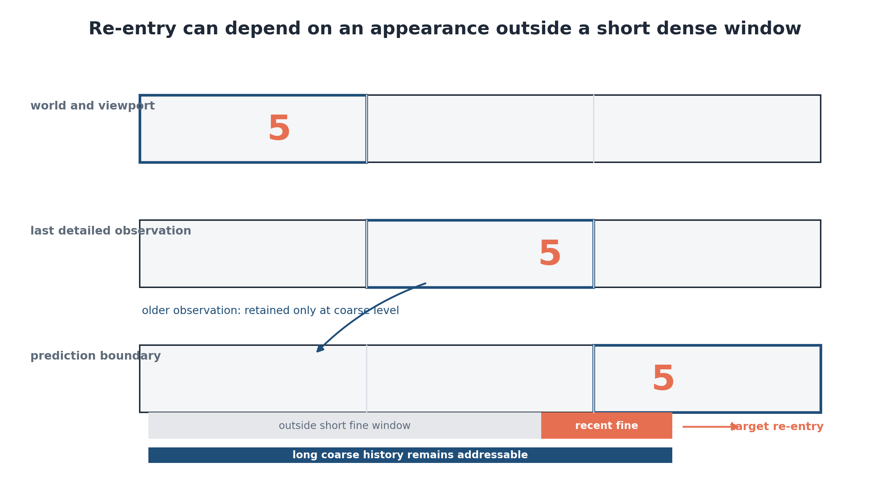

**Рисунок 3.1 – Повторний вхід після останнього визначального спостереження залишає коротке щільне контекстне вікно.** *Джерело: авторська концептуальна схема на основі геометрії LoopMom, описаної в підрозділі 3.5.*

### 3.1.2 Простір проєктування контекстного пакета

Нехай $t$ позначає перший кадр цільового вікна. Контекстний пакет на цій межі – це скінченна множина потоків

$$
\mathcal P_t=\left\{\mathcal S_i\right\}_{i=1}^{L},
\qquad
\mathcal S_i=(\ell_i,s_i,n_i,a_i),
\tag{3.1}
$$

$$
K_i=\{a_i+j s_i\mid j=0,\ldots,n_i-1\},
\qquad
A_i(t)=\{t-k\mid k\in K_i\}.
\tag{3.2}
$$

$$
B_{\mathrm{ctx}}(\mathcal P_t)=\sum_{i=1}^{L}n_i q_{\ell_i}.
\tag{3.3}
$$

$$
B_{\mathrm{tgt}}=\sum_j m_jq_j,
\qquad
B_{\mathrm{total}}=B_{\mathrm{ctx}}+B_{\mathrm{tgt}}.
\tag{3.4}
$$

Ці величини відповідають на різні питання. Контекстні токени представляють збережений стан, доступний під час прогнозування, а цільові токени рахують невідомі латентні комірки, оцінювані спільно. Загальна кількість токенів визначає довжину послідовності трансформера, що впливає і на навчання, і на інференс. Сама ефективність контексту не визначає підсумкове використання пам’яті, час виконання чи обчислювальну вартість уваги.

$$
R(\mathcal P_t)=\max_i\max K_i
=\max_i\bigl[a_i+(n_i-1)s_i\bigr].
\tag{3.5}
$$

Досяжність є номінальною: вона визначає найстарішу задану позицію, але не показує, чи достатній її вміст і чи модель фактично його використовує. У реалізованих щільних ієрархічних пакетах грубий потік охоплює 48 попередніх позицій кадрів. Часово розріджений контроль натомість поєднує найновіші детальні кадри зі старішими прив’язками повної роздільної здатності. Зареєстрована мітка «48 кадрів» позначає запланований клас часового інтервалу; перевірка конфігурації спирається на записані прив’язки.

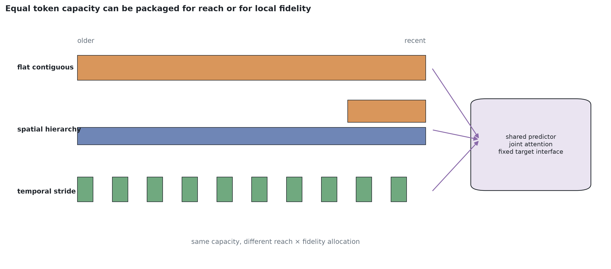

**Рисунок 3.2 – Три способи пакетування збереженого відеоконтексту.** Щільна плоска історія зберігає деталі, просторова ієрархія забезпечує щільне часове покриття з меншою вартістю кадру, а розріджені прив’язки зберігають вибрані моменти з повною роздільною здатністю. Ці пакети відповідають на різні інформаційні запити. *Джерело: авторська схема на основі реєстру заморожених пакетів та інтерфейсу предиктора.*

У таблиці 3.1 визначено величини, використані в описі моделі та результатів. «Рівень» позначає представлення без припущення про семантичну абстракцію, а «крок» – відстань між прив’язками, не стверджуючи, що токен узагальнює рух між ними. Тому повнороздільні прив’язки, збережені через кожні чотири кадри, не еквівалентні грубому токену, спостережуваному в кожному кадрі. Обидва варіанти розширюють часовий доступ, але відкидають різну інформацію.

**Таблиця 3.1 – Поля контекстного пакета та їх інтерпретація.**

| Поле | Символ | Операційне значення | Що це не означає |
|---|---:|---|---|
| Рівень представлення | $\ell_i$ | Зафіксований рівень кодека та його просторова сітка токенів | Семантична коректність або гарантована консистентність між рівнями |
| Часовий крок | $s_i$ | Відстань між регулярними прив’язками потоку | Часове усереднення, якщо кодер явно його не виконує |
| Збережені слоти | $n_i$ | Кількість збережених латентних карт у потоці | Однаковий корисний обсяг даних на всіх рівнях |
| Лаг найновішої прив’язки | $a_i$ | Відстань від першої цільової позиції до найновішої збереженої прив’язки | Наявність усіх проміжних кадрів |
| Набір прив’язок | $A_i(t)$ | Точні історичні кадри, представлені потоком | Успішне отримання інформації з цих кадрів |
| Кількість токенів на слот | $q_{\ell_i}$ | Кількість просторових комірок на вибраному рівні | Байти, ширина трансформера або повна пам’ять активації |
| Вартість контексту | $B_{\mathrm{ctx}}$ | Сума збережених токенів контексту | Загальна довжина послідовності або рівноцінний обчислювальний обсяг |
| Досяжність | $R$ | Найстаріше надане відставання в геометрії пакета | Точність відтворення, інформаційно-теоретична необхідність або надійне повторне використання |

### 3.1.3 Гіпотеза «досяжність–точність відтворення»

Як тільки пакети стають явними, центральне передбачення можна сформулювати, не припускаючи, що ієрархія загалом є кращою. Нехай $Z_t^\star$ – це історичні докази, що стосуються цілі в момент часу $t$, а $I_t(\mathcal P)$ вказує, чи лежать ці докази всередині наданих опорних точок. Нехай $Q_t(\mathcal P)$ позначає інформацію, що стосується завдання, збережену після кодування та пакетування. Очікувану похибку можна концептуально організувати так:

$$
\mathcal R(\mathcal P)
=\mathbb E\!\left[
\mathcal L\mid I_t(\mathcal P)=0
\right]\Pr[I_t(\mathcal P)=0]
+\mathbb E\!\left[
\mathcal L\mid I_t(\mathcal P)=1,Q_t(\mathcal P)
\right]\Pr[I_t(\mathcal P)=1].
\tag{3.6}
$$

Рівняння (3.6) є пояснювальною декомпозицією, а не підігнаною ймовірнісною моделлю. Коли релевантна історія недоступна, перший член за означенням активний. Другий відображає втрату репрезентативності, похибку моделі та деградацію із самопідсиленням після того, як релевантна історія номінально стала доступною. Більша досяжність може зменшити першу складову, а збереження просторової деталізації – частину другої. Жодна зі змін не гарантує переваги на всіх завданнях.

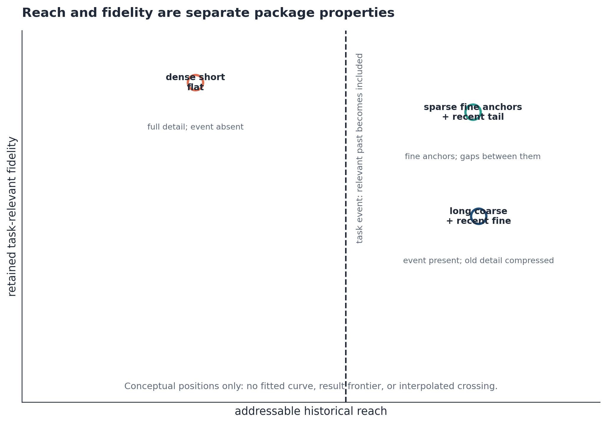

**Рисунок 3.3 – Досяжність і точність відтворення є окремими властивостями контекстного пакета.** *Джерело: авторська концептуальна схема; емпіричний перетин не припускається.*

## 3.2 Ієрархічний прихований стан

### 3.2.1 Дворівневий заморожений автоенкодер

Арифметика пакетів набуває сенсу лише після фіксації рівнів представлення. Реалізовані пакети працюють у безперервному латентному просторі, який формує згортковий автоенкодер. Для вхідного кадру $x_t\in[-1,1]^{1\times64\times64}$ спільний стовбур енкодера генерує карту ознак розміром $8\times8$. Одна проєкція розміром $1\times1$ дає детальний код; наступний етап енкодера з кроком два та ще одна проєкція формують грубий код:

$$
\mathcal E(x_t)=\left(z_t^{\mathrm c},z_t^{\mathrm f}\right),
\qquad
z_t^{\mathrm c}\in[-1,1]^{16\times4\times4},
\qquad
z_t^{\mathrm f}\in[-1,1]^{16\times8\times8}.
\tag{3.7}
$$

Обидві проєкції використовують гіперболічний тангенс, тому вихідні латентні координати обмежені. Грубий кадр містить $16\times4\times4=256$ коефіцієнтів, організованих у 16 просторових токенів; детальний кадр містить $16\times8\times8=1{,}024$ коефіцієнти, організовані в 64 токени. З цього не випливає, що грубий код у загальному сенсі вчетверо менш інформативний.

Кожен рівень має власний декодер для відтворення повного зображення:

$$
\hat x_t^{\mathrm c}=\mathcal D_{\mathrm c}(z_t^{\mathrm c}),
\qquad
\hat x_t^{\mathrm f}=\mathcal D_{\mathrm f}(z_t^{\mathrm f}).
\tag{3.8}
$$

$$
\mathcal L_{\mathrm{AE}}=
\begin{cases}
4\bigl(\operatorname{MAE}(x,\hat x^{\mathrm c})+
\operatorname{MSE}(x,\hat x^{\mathrm c})\bigr), & b=\mathrm c,\\[2mm]
\operatorname{MAE}(x,\hat x^{\mathrm f})+
\operatorname{MSE}(x,\hat x^{\mathrm f}), & b=\mathrm f,
\end{cases}
\qquad \Pr(b=\mathrm c)=\Pr(b=\mathrm f)=\tfrac12.
\tag{3.9}
$$

Завдання вимагає, щоб обидва рівні реконструювали повний кадр. Терміни «композиція» і «деталізація» лише узагальнюють різницю роздільної здатності; це не семантичні мітки, нав’язані моделі. Грубий код може зберігати відомості про ідентичність, а детальний – кодувати глобальне положення. Фактичний розподіл ролей є емпіричною властивістю, яку згодом можна дослідити за допомогою об’єктно-орієнтованих показників.

$$
\tilde z_t^{\ell}[c]=
\frac{z_t^{\ell}[c]-\mu_c^{\ell}}
{\max(\sigma_c^{\ell},10^{-4})},
\qquad \ell\in\{\mathrm c,\mathrm f\}.
\tag{3.10}
$$

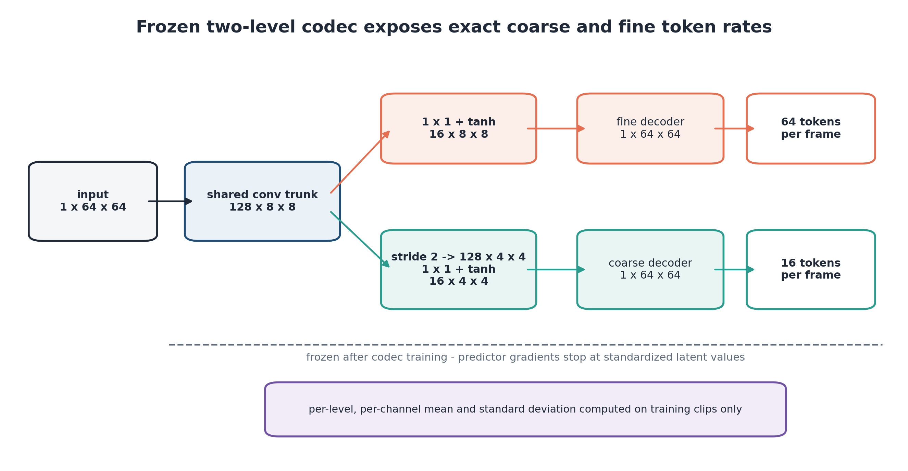

**Рисунок 3.4 – Фіксовані розміри дворівневого кодека та латентного тензора.** *Джерело: схема, створена в рамках дисертації, що ілюструє реалізовану архітектуру `HierConvAE`.*

**Таблиця 3.2 – Специфікація зафіксованого латентного інтерфейсу.**

| Властивість | Грубий рівень | Точний рівень | Наслідки для предиктора |
|---|---:|---:|---|
| Форма латентного простору на кадр | $16\times4\times4$ | $16\times8\times8$ | Та сама ширина каналу, різна просторова сітка |
| Просторові токени на кадр | 16 | 64 | Детальна історія вимагає вчетверо більше контекстних токенів на кадр |
| Скалярні коефіцієнти на кадр | 256 | 1 024 | Корисне навантаження відрізняється ще до проекції на ширину трансформера |
| Піксельний декодер | Незалежний грубий декодер | Незалежний детальний декодер | Кожен код можна перевірити як реконструкцію повного кадру |
| Масштабування вхідних даних предиктора | z-стандартизація за кожним каналом навчального набору | z-стандартизація за кожним каналом навчального набору | Шкала шуму та втрати за рівнями використовують порівнянні стандартизовані координати |
| Навчання після заморожування кодека | Немає | Немає | Порівняння пакетів не можуть змінювати латентний інтерфейс |
| Основний шлях декодування під час розгортання | Лише для діагностики | Заморожений декодер детального рівня | Основні кадрові показники мають один вихідний шлях |

### 3.2.2 Побудова потоку та вбудовування

Латентна карта перетворюється на послідовність токенів, якщо кожну просторову комірку розглядати як один токен. Якщо $z_{t,h,w}^{\ell}\in\mathbb R^{16}$ – вектор каналу на рівні $\ell$ та просторовій позиції $(h,w)$, то проекція спільного вмісту дорівнює

$$
e_{t,h,w}^{\ell}=W_{\mathrm{in}}z_{t,h,w}^{\ell}+b_{\mathrm{in}}+p_{h,w}^{\ell},
\qquad e_{t,h,w}^{\ell}\in\mathbb R^d,
\tag{3.11}
$$

$$
S_t=
\mathop{\Vert}_{i=1}^{L}
\mathop{\Vert}_{k\in K_i}
\operatorname{Tok}_{\ell_i}(\tilde z_{t-k}^{\ell_i})
\;\Vert\;
\mathop{\Vert}_{j=0}^{W-1}
\left[
\operatorname{Tok}_{\mathrm c}(y_{t+j}^{\mathrm c})
\Vert
\operatorname{Tok}_{\mathrm f}(y_{t+j}^{\mathrm f})
\right].
\tag{3.12}
$$

$$
h^{(0)}_r=e_r+e_{\mathrm{level}}(\ell_r)+e_{\mathrm{role}}(r_r)
+e_{\mathrm{frame}}(f_r),
\qquad r_r\in\{\mathrm{context},\mathrm{target}\}.
\tag{3.13}
$$

Для стандартної конфігурації з $48$ грубими та $6$ детальними кадрами арифметика є безпосередньою. Груба історія дає $48\times16=768$ токенів. Недавній детальний хвіст додає $6\times64=384$. Кожна з чотирьох цілей містить $16+64=80$ токенів. Отже

$$
|S_t|=
\underbrace{768+384}_{B_{\mathrm{ctx}}=1{,}152}
+\underbrace{4(16+64)}_{B_{\mathrm{tgt}}=320}
=1{,}472.
\tag{3.14}
$$

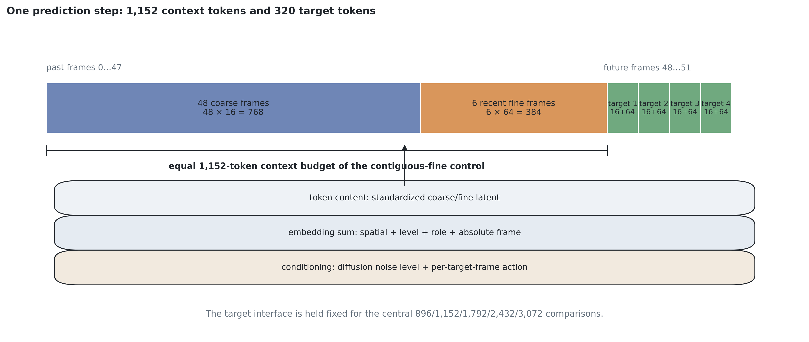

**Рисунок 3.5 – Збірка токенів перед спільним фокусом уваги.** *Джерело: діаграма, створена автором на основі реалізованого шляху токенізації.*

$$
c_r=e_{\mathrm{level}}(\ell_r)+e_{\mathrm{role}}(r_r)+e_{\mathrm{frame}}(f_r)
+
\begin{cases}
e_\tau(0), & r_r=\mathrm{context},\\
e_\tau(\tau)+e_a(u_{t+j}), & r_r=\mathrm{target\ at\ frame}\ t+j.
\end{cases}
\tag{3.15}
$$

У зареєстрованих дворівневих гілках заповнення не потрібне, оскільки довжину кожного потоку фіксує пакет. Роль токена й мітку кадру неможливо вивести з домовленості про заповнення або маски уваги: це явні вхідні дані. Така властивість важлива, коли одна базова мережа використовується для різних сімейств пакетів. Детальний токен із лагом 47 у розрідженому потоці та детальний токен із лагом 6 у недавньому хвості мають спільну проєкцію вмісту, але різні кадрові вбудовування. Тому предиктор може навчитися розрізняти їхню часову релевантність без призначення різної семантики каналів.

### 3.2.3 Передавання контексту за допомогою спільної уваги

Грубі й детальні токени входять до однієї послідовності трансформера та обробляються спільно. Грубий прогноз не завершується перед окремим етапом детального прогнозування. У кожному блоці одночасно присутні грубий і детальний контекст, а також зашумлені грубі й детальні цілі. Тому кожен шар може обмінюватися інформацією між рівнями й ролями до застосування будь-якої вихідної голови.

$$
Q=\operatorname{RMSNorm}(HW_Q),\quad
K=\operatorname{RMSNorm}(HW_K),\quad
V=HW_V,
\qquad
\operatorname{Attn}(H)=
\operatorname{softmax}\!\left(\frac{QK^\top}{\sqrt{d_h}}\right)V.
\tag{3.16}
$$

Запити та ключі нормалізуються для кожної головки перед застосуванням уважності зі скальованим скалярним добутком [161]. Кілька голів об'єднуються та проєктуються звичайним чином [12]. Важливо, що увага всередині поточного кроку прогнозування чотирьох кадрів є повною. Немає ні трикутної маски, яка змушує генерувати цільовий кадр $t+1$ перед $t+2$, ні маски «батько-дитина», яка обмежує дрібні комірки заздалегідь визначеною грубою коміркою. Прогнозувач навчається міжрівневим та внутрішньовіконним залежностям на основі ідентичності токенів, умов та даних.

$$
M^{\mathrm{roll}}_{nm}=
\begin{cases}
0, & m\le n,\\
-\infty, & m>n,
\end{cases}
\tag{3.17}
$$

Спільне усунення шуму все ще виявляє лише пошкоджені кандидати-цілі. Кожен токен-ціль, що подається до виклику дифузії, належить до поточного зашумленого блоку; під час регресії відповідна позиція дорівнює нулю. Чотири кандидати координуються одночасно, тоді як уся спостережувана інформація залишається обумовленою минулим. Тому називати цей інтерфейс «некаузальним у межах блоку» було б оманливим.

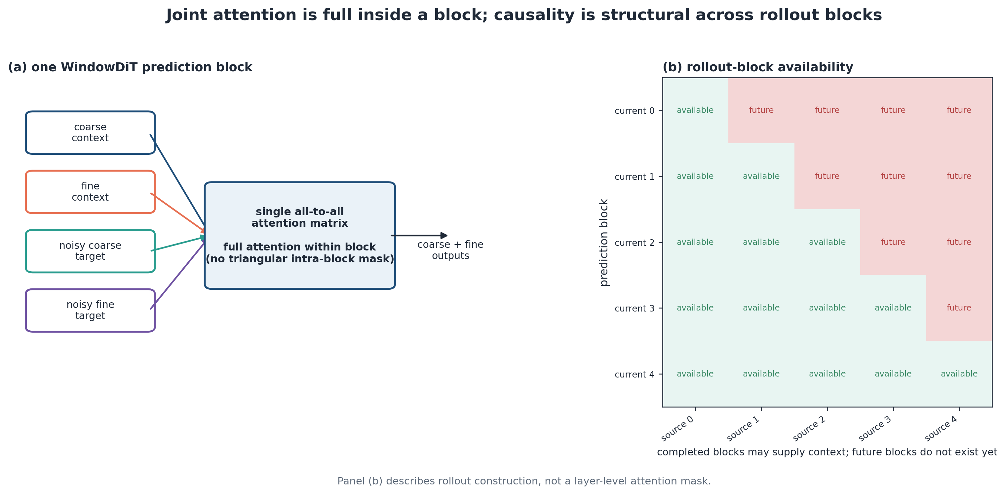

**Рисунок 3.6 – Спільна увага в межах блоку прогнозування та структурна причинність між блоками.** *Джерело: схема з дисертації, перевірена на відповідність реалізованому прямому шляху `WindowDiT`.*

### 3.2.4 Межі градієнта та інформаційна асиметрія

Три межі визначають, які величини можуть змінюватися під час навчання предиктора. Параметри кодека є фіксованими; латентні величини контексту є відокремленими спостереженнями; а граф навчання закінчується на поточному цільовому вікні. Якщо $\theta$ позначає параметри предиктора, а $\phi$ – параметри кодека, то

$$
\nabla_\phi\mathcal L_{\mathrm{pred}}=0,
\qquad
\frac{\partial\mathcal L_{n}}{\partial \hat z_{m}}=0
\quad\text{для }m<n,
\qquad
\nabla_\theta\mathcal L_n\ne0.
\tag{3.18}
$$

Під час навчання предиктора не використовується ні втрата декодованих пікселів, ні допоміжне навчання грубого декодера. Як результат, пакет, що містить більше грубих слотів, не отримує інший сигнал навчання реконструкції просто тому, що він частіше відкриває цей шлях.

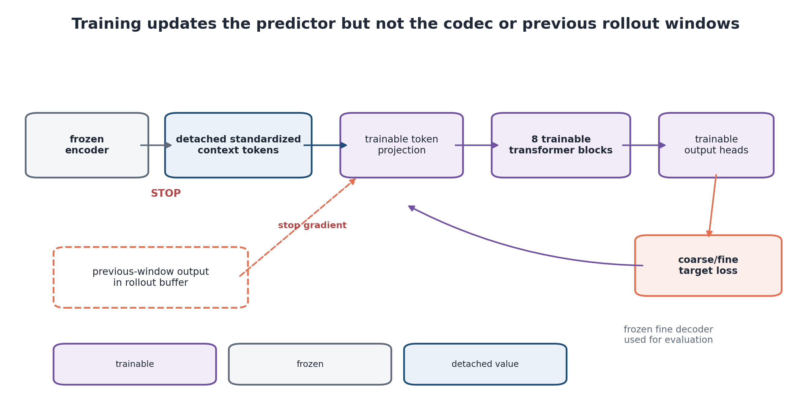

**Рисунок 3.7 – Заморожені, відокремлені та треновані шляхи.** Градієнти предиктора оновлюють проекції токенів, вбудовування, блоки трансформера та вихідні головки; вони не оновлюють кодек і не перетинають попередні авторегресійні вікна. *Джерело: схема реалізованого графа оптимізації, взята з дисертації.*

Ці межі уточнюють порівняння пакетів, але не усувають зміщення експозиції. Із часом довший пакет може заповнюватися пошкодженими значеннями, згенерованими самою системою. Тому стійкість розгортання потрібно перевіряти в режимі самоподачі та з різними сідами навчання. Майбутня цільова функція для кількох вікон могла б використовувати контрольні точки або реверсивне відтворення для керування пам’яттю активацій. Така інтеграція залишається майбутньою роботою й не є доказом у цьому дослідженні моделі. [25, 26]

## 3.3 Ядро генеративного прогнозування

### 3.3.1 Віконна цільова функція латентної дифузії

З фіксованим пакетом та латентним інтерфейсом, залишається вирішити задачу прогнозування наступного вікна. Прогнозувач оцінює блок послідовних майбутніх латентних величин, обумовлених історією пакетів та записаними керуючими сигналами. При $W=4$ його умовний розподіл має вигляд

$$
p_\theta\!\left(
z^{\mathrm c}_{t:t+W-1},z^{\mathrm f}_{t:t+W-1}
\mid \mathcal P_t,u_{t:t+W-1}
\right).
\tag{3.19}
$$

$$
y_\tau^{\ell}=\alpha_\tau z_0^{\ell}+\sigma_\tau\varepsilon^{\ell},
\qquad
\varepsilon^{\ell}\sim\mathcal N(0,I),
\qquad
\alpha_\tau=\sqrt{\bar\alpha_\tau},\quad
\sigma_\tau=\sqrt{1-\bar\alpha_\tau}.
\tag{3.20}
$$

Коефіцієнти розкладу відповідають усіченій косинусній схемі Нікола та Дхарівала [149]:

$$
\bar\alpha_\tau=
\operatorname{clip}\!\left[
\frac{\cos^2\!\left(\frac{\tau/T+s}{1+s}\frac{\pi}{2}\right)}
{\cos^2\!\left(\frac{s}{1+s}\frac{\pi}{2}\right)},
10^{-4},0.9999
\right],
\qquad s=0.008.
\tag{3.21}
$$

$$
v_\tau^{\ell}=\alpha_\tau\varepsilon^{\ell}-\sigma_\tau z_0^{\ell},
\qquad \ell\in\{\mathrm c,\mathrm f\}.
\tag{3.22}
$$

Оскільки шум присутній на обох цільових рівнях, трансформатору також надається «чистий» контекстний пакет, нормалізований часовий крок та дії для кожного кадру. Він зчитує лише цільові токени. Втрата становить

$$
\mathcal L_v(\theta)=
\mathbb E\left[
\operatorname{MSE}\!\left(v_\theta^{\mathrm c},v_\tau^{\mathrm c}\right)
+
\operatorname{MSE}\!\left(v_\theta^{\mathrm f},v_\tau^{\mathrm f}\right)
\right].
\tag{3.23}
$$

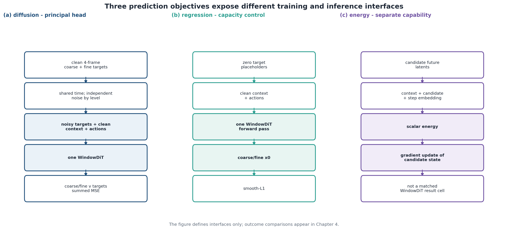

**Рисунок 3.8 – Інтерфейси «прогноз-ціль».** *Джерело: діаграма з дисертації, що ілюструє реалізовані цілі навчання; формулювання дифузії відповідає [2, 119, 149].*

Для оптимізації використовується алгоритм AdamW [159] зі швидкістю навчання $3\times10^{-4}$, затуханням ваг $10^{-4}$, лінійним розігрівом протягом 2 000 оновлень, обмеженням норми градієнта на рівні 1,0 та експоненційним затуханням ковзного середнього 0,999. Основний режим використовує розмір пакета 16 для 30 000 оновлень; оприлюднений режим із розміром пакета 8 та 60 000 оновлень обробляє приблизно таку саму кількість прикладів, але не є ідентичним за рівнем шуму градієнта, кількістю оновлень або ефективним горизонтом EMA. Під час навчання використовується bfloat16 там, де це підтримується, відповідно до принципу змішаної точності, що передбачає збереження вищої точності для чутливих операцій [162]. Контрольні точки містять стан моделі, оптимізатора та EMA; контрольні точки пізнішого формату також зберігають стан генератора випадкових чисел.

### 3.3.2 Базова мережа Transformer та кондиціонування

Базова структура WindowDiT містить вісім попередньо нормалізованих блоків трансформера, шириною $d=384$, шість голівок уваги та коефіцієнт розширення MLP, що дорівнює чотирьом. Її дворівневі варіанти містять приблизно 22,18–22,19 мільйона параметрів, що підлягають навчанню; невелика різниця зумовлена специфічними для кожного пакета інтерфейсами входу та виходу. У кожному порівнянні пакетів глибина та ширина базової структури залишаються фіксованими. Таким чином, масштаб моделі контролюється, тоді як вплив контексту залишається помітним.

Кожен блок використовує адаптивну обробку LayerNorm-Zero з сімейства DiT [4], що ґрунтується на нормалізації ознак у межах кожного зразка [160]. Мережа модуляції відображає $c_r$ з (3.15) на вектори зсуву, масштабування та гейту для механізму уваги та MLP. Для прихованого токена $h$,

$$
\operatorname{mod}(h;\beta,\gamma)=h\odot(1+\gamma)+\beta,
\tag{3.24}
$$

оновлення для одного блоку записується як

$$
\begin{aligned}
h'&=h+g_1\odot
\operatorname{Attn}\!\left(
\operatorname{mod}(\operatorname{LN}(h);\beta_1,\gamma_1)
\right),\\
h^{+}&=h'+g_2\odot
\operatorname{MLP}\!\left(
\operatorname{mod}(\operatorname{LN}(h');\beta_2,\gamma_2)
\right).
\end{aligned}
\tag{3.25}
$$

Для дифузійної голови проєкції модуляції блоків ініціалізуються нулями, тому залишкові блоки починають роботу як тотожні відображення відповідно до схеми adaLN-Zero. Регресійний контроль використовує звичайно ініціалізовану модуляцію блоків, а не специфічне для денойзера нульове гейтування. В обох режимах кінцеві адаптивні проєкції та вихідні голови спочатку нульові. Після восьмого блока відбираються лише цільові позиції. Окремі адаптивні нормалізації й лінійні голови відображають грубі та детальні цільові токени назад у 16 каналів кодека та формують латентні карти $4\times4$ і $8\times8$.

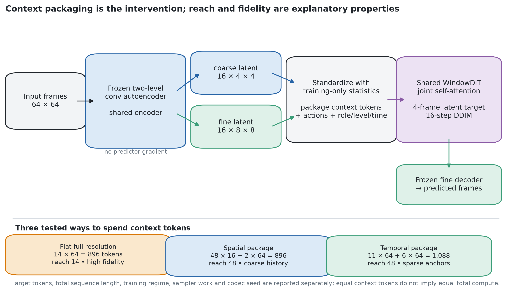

**Рисунок 3.9 – Повний предиктор від заморожених кодів до латентної цілі з чотирма кадрами.** Кодек, WindowDiT та інтерфейс цілі залишаються фіксованими, тоді як у порівняннях на головній межі змінюється лише збережений контекстний пакет. *Джерело: схема, створена автором на основі реалізації замороженого кодека та предиктора.*

### 3.3.3 Робота з вибіркою та інференцією DDIM

Інференція починається з гауссового шуму для кожного грубого й детального цільового латентного представлення в чотирикадровому блоці. Детермінований семплер DDIM [52] обчислює денойзер у точках округленої лінійної підсітки навчального розкладу. Для поточної ітерації $y_i$ у точці розкладу $\tau_i$ вихід швидкісної параметризації перетворюється на оцінки чистих даних і шуму:

$$
\hat z_{0,i}=\alpha_{\tau_i}y_i-\sigma_{\tau_i}v_\theta(y_i,\mathcal P_t,u,\tau_i),
\qquad
\hat\varepsilon_i=\sigma_{\tau_i}y_i+\alpha_{\tau_i}v_\theta(y_i,\mathcal P_t,u,\tau_i).
\tag{3.26}
$$

$$
y_{i+1}=\alpha_{\tau_{i+1}}\hat z_{0,i}
+\sigma_{\tau_{i+1}}\hat\varepsilon_i,
\qquad i=1,\ldots,N_{\mathrm{DDIM}}-1,
\tag{3.27}
$$

За замовчуванням для обчислення встановлено $N_{\mathrm{DDIM}}=16$. Отже, один блок із чотирьох кадрів вимагає 16 обчислень мережевої функції, або чотири обчислення на кожен згенерований кадр. Для розгортання з $N_{\mathrm{blk}}$ прогнозованих блоків,

$$
\mathrm{NFE}_{\mathrm{roll}}=N_{\mathrm{DDIM}}N_{\mathrm{blk}}.
\tag{3.28}
$$

Кількість кандидатів розглядається окремо. В основних порівняннях пакетів виконується один цикл семплювання для кожного зареєстрованого сіда семплера. Діагностика механізму натомість застосовує критерій «найкращий із восьми» й перевіряє, чи принаймні один кандидат добре відтворює ціль. Це оракульна статистика охоплення множини кандидатів, а не звичайна помилка розгортання. Генерація восьми дифузійних кандидатів по 16 кроків DDIM потребує 128 обчислень предиктора на запис; регресійна діагностика використовує вісім проходів із MC-dropout. Звітуються і NFE на кандидата, і загальна робота генерації, оскільки «найкращий із восьми» не робить механізми обчислювально еквівалентними.

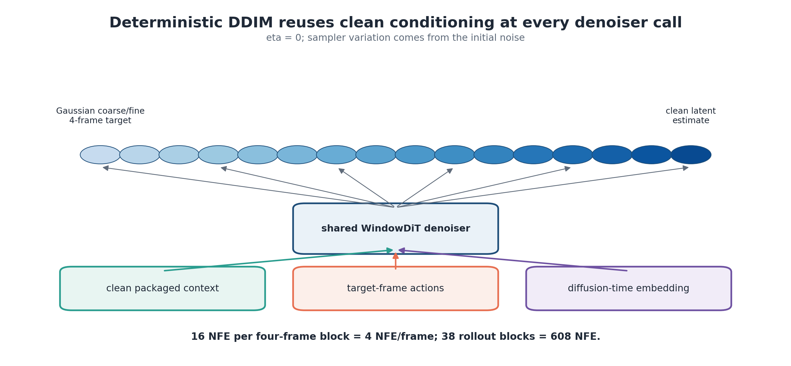

**Рисунок 3.10 – Хронологія детермінованого DDIM та підрахунок обчислень функції.** *Джерело: авторська схема реалізованого семплера.*

### 3.3.4 Регресійна контрольна голова

Варіант регресії зберігає ту саму токенізацію, базові розміри мережі, контекстний пакет та геометрію цілі. Замість шумних цілей він використовує нулі, фіксує вхідний час на нулі, розглядає два вихідні блоки як прямі приховані передбачення та мінімізує

$$
\mathcal L_{\mathrm{reg}}(\theta)=
\operatorname{SmoothL1}(\hat z^{\mathrm c},z^{\mathrm c})
+\operatorname{SmoothL1}(\hat z^{\mathrm f},z^{\mathrm f}).
\tag{3.29}
$$

При звичайній оцінці траєкторія регресії є детермінованою для фіксованих ваг, вхідних даних та арифметики. Отже, окрему траєкторію регресії не слід описувати як вибірку з того самого генеративного сімейства, що й DDIM. Контроль з’ясовує, чи може однопрохідна умовна оцінка використовувати ту саму упаковану історію, тоді як дифузійна головка з’ясовує, чи ітеративні стохастичні уточнення змінюють це використання.

Ця відмінність запобігає поширеному неправильному тлумаченню: перевага дифузії над регресією за статистикою «найкращий із восьми» може бути наслідком мультимодального охоплення, ітеративного обчислення, стохастичного бюджету кандидатів або їх поєднання. Якщо регресія сильніша в однотраєкторному розгортанні, це не заперечує дифузію. Висновок залежить від задекларованого режиму, розподілу кандидатів і показника.

## 3.4 Авторегресійне розгортання та оновлення пам’яті

### 3.4.1 Рекурентність кільцевого буфера

Одноблочний предиктор стає довгогоризонтною системою завдяки рекурентному оновленню. Кожен завершений чотирикадровий блок надходить до наступного контексту, після чого цикл повторюється. Між викликами зберігаються латентні буфери фіксованого розміру, визначені активним пакетом; граф активацій трансформера завершується разом із поточним викликом.

$$
B_{n+1}^{\ell}=
\operatorname{tail}_{N_\ell}\!\left(B_n^{\ell}\Vert\hat Z_n^{\ell}\right),
\qquad
t_{n+1}=t_n+W,
\qquad
(N_{\mathrm c},N_{\mathrm f})=(48,6).
\tag{3.30}
$$

Оператор $\operatorname{tail}_{N}$ після конкатенації зберігає $N$ найновіших позицій. За $W=4$ детальний буфер відкидає чотири із шести старих значень і додає чотири прогнози; грубий буфер так само оновлює 48 позицій. Часово розріджені конфігурації та конфігурації зі зменшеним кроком використовують задекларований планувальник прив’язок, тому до потоку повертаються лише цільові позиції, вирівняні з його часовою сіткою. Щільні пари, на яких ґрунтується основне твердження про досяжність і точність відтворення, оновлюють по чотири грубі й детальні цілі на блок і не змінюють цільового інтерфейсу.

**Алгоритм 3.1 – Чотирикадрове розгортання із самоподачею та пакетованою латентною пам’яттю**

> **Вхідні дані:** кадри розігріву $x_{0:47}$; керуючі сигнали $u_{48:T-1}$; заморожений кодек; нормалізація навчального набору; предиктор EMA; пакет $\mathcal P$; розподіл вибірки.
> **Вихідні дані:** декодовані прогнози $\hat x_{48:T-1}$ та вирівняні записи оцінки.
> 1. Закодувати й стандартизувати початкові кадри, потім ініціалізувати кожен потік за задекларованими прив’язками.
> 2. На межі $t_n$ зібрати впорядковані контекстні токени та зчитати керуючі сигнали $u_{t_n:t_n+3}$.
> 3. Згенерувати чотири пари грубих/детальних латентних представлень за допомогою DDIM або регресійної голови.
> 4. Зафіксувати згенеровані слоти через планувальник пакетів і видалити застарілі прив'язки; не зберігати міжвіконний градієнтний граф.
> 5. Скасувати стандартизацію та декодувати детальні латентні вектори, зберігаючи геометричні мітки й вхідні дані показників для кожного кадру.
> 6. Встановити $t_{n+1}=t_n+4$ та повторювати до заявленого горизонту.

Для стандартного 200-кадрового кліпу LoopMom процес починається з 48 початкових кадрів, після чого 38 блоків розгортання створюють 152 прогнозовані кадри. Пізніші контексти на цьому етапі повністю складаються з виходів моделі. Ємність буфера залишається фіксованою, але його вміст старіє, а якість змінюється. Тому модель може номінально мати доступ до довгого горизонту й водночас втрачати надійну інформацію зі збільшенням розгортання.

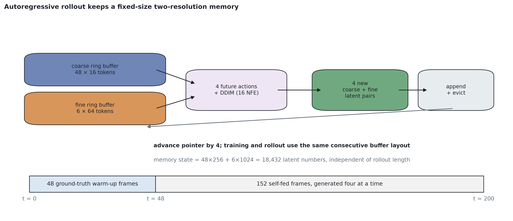

**Рисунок 3.11 – Оновлення грубого й детального кільцевих буферів під час розгортання із самоподачею.** *Джерело: авторська схема, що ілюструє алгоритм 3.1 та реалізований шлях розгортання.*

### 3.4.2 Геометрія прив’язки та причинно-наслідкова семантика

Довжини буфера недостатньо для відтворення історичного значення. Кожен збережений слот повинен містити або детерміновано отримувати кадр, який він представляє. Для потоку $i$ слот $k$ на цільовій межі $t$ закріплений за адресою

$$
\alpha_{i,k}(t)=t-a_i-k s_i,
\qquad
\lambda_{i,k}(t)=t-\alpha_{i,k}(t),
\qquad k=0,\ldots,n_i-1.
\tag{3.31}
$$

Та сама домовленість стосується грубого контексту з кроком 2. `hier-s2-min` зберігає $t-47,t-45,\ldots,t-1$: 24 прив’язки кінця блока, розподілені на 48 позиціях кадрів, із найдавнішим лагом 47. Протокол із фіксованою ціллю використовує зареєстровану позначку номінальної досяжності 48 та заздалегідь визначений діапазон $8<\Delta t\le48$. Порівняння залишається тестом усієї конфігурації; його не можна використовувати для визначення верхнього порога досяжності з точністю до одного кадру.

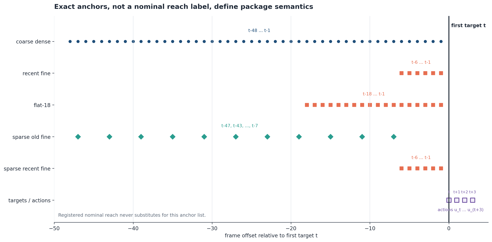

**Рисунок 3.12 – Геометрія потокової прив’язки на межі прогнозування з чотирма кадрами.** *Джерело: схема з дисертації, створена на основі реєстру пакетів та конструктора пакетів.*

Геометрія прив’язок уточнює й межі конфігурації B1 з кроком 2. Її контекст містить 24 грубі позиції з кроком 2 та два найновіші детальні кадри. Проте реалізований цільовий інтерфейс повертає дві грубі цільові позиції, а не чотири. Отже, разом із кроком контексту змінюються і кількість цільових токенів, і спосіб агрегування дій для грубих позицій. Варіант із фіксованою ціллю існує лише як підготовлена специфікація. Оскільки його не виконано, у розділі 4 зберігається формулювання на рівні повної конфігурації.

### 3.4.3 Контекст, ціль та загальна вартість

Фіксовані буфери роблять пам'ять збереженого стану незалежною від тривалості розгортання. Для пакета $\mathcal P$ із $C_\ell=16$ коефіцієнтами кодека на токен і розміром елемента $b$ байтів суцільний корисний обсяг латентних даних становить

$$
M_{\mathrm{payload}}(\mathcal P)=
bC_\ell B_{\mathrm{ctx}}(\mathcal P).
\tag{3.32}
$$

У float32 кожен токен займає 64 байти, а у float16 чи bfloat16 – 32 байти. Основний стан містить 48 грубих і 6 детальних кадрів, тобто 18 432 латентні коефіцієнти: 72 КіБ у float32 та 36 КіБ у 16-бітному форматі. Для порівняння, щільна детальна історія з 48 кадрів містить 49 152 коефіцієнти, або 192 КіБ у float32. Це точні розміри масивів, а не вимірювання контейнерів Python, поведінки алокатора чи пікової пам’яті пристрою.

**Таблиця 3.3 – Точний облік пакетів, токенів і корисного обсягу контекстних даних для основного фронтиру та інтерфейсів B1.**

| Пакет | Точний опис контексту | Номінальна досяжність | Токени контексту / цілі / загальні | Корисний обсяг латентних даних, fp32 / bf16 | Вбудовування контексту шириною 384, bf16 | Роль порівняння |
|---|---|---:|---:|---:|---:|---|
| `flat-short` | 8 суцільних точних кадрів | 8 | 512 / 320 / 832 | 32 / 16 КБ | 0,375 МБ | Компаратор плоских кадрів B1 |
| `hier-s2-min` | 24 грубих кадри з кроком 2 + 2 останніх точних | 48 | 512 / 288 / 800 | 32 / 16 КБ | 0,375 МБ | Повна конфігурація B1; ціль відрізняється |
| `flat-min` | 14 суцільних детальних кадрів | 14 | 896 / 320 / 1 216 | 56 / 28 КіБ | 0,656 МіБ | зіставлений нижній плоский контроль |
| `hier-min` | 48 щільних грубих кадрів + 2 останніх детальних | 48 | 896 / 320 / 1 216 | 56 / 28 КіБ | 0,656 МіБ | зіставлена нижня ієрархія |
| `flat-budget` | 18 суцільних детальних кадрів | 18 | 1 152 / 320 / 1 472 | 72 / 36 КБ | 0,844 МБ | зіставлений центральний плоский контроль |
| `hier-long` | 48 щільних грубих + 6 останніх точних | 48 | 1 152 / 320 / 1 472 | 72 / 36 КБ | 0,844 МБ | основна просторова ієрархія |
| `strided-flat` | 11 старих детальних прив’язок + 6 недавніх детальних кадрів | зареєстрований клас з інтервалом 48 кадрів | 1 088 / 320 / 1 408 | 68 / 34 КіБ | 0,797 МіБ | майже зіставлений часовий пакет |
| `flat-c1` | 28 суміжних детальних кадрів | 28 | 1 792 / 320 / 2 112 | 112 / 56 КБ | 1,313 МБ | зіставлений проміжний плоский контроль |
| `hier-c1` | 48 щільних грубих + 16 останніх детальних | 48 | 1 792 / 320 / 2 112 | 112 / 56 КіБ | 1,313 МіБ | зіставлена проміжна ієрархія |
| `flat-c2` | 38 суцільних детальних кадрів | 38 | 2 432 / 320 / 2 752 | 152 / 76 КіБ | 1,781 МіБ | зіставлений верхній плоский контроль |
| `hier-c2` | 48 щільних грубих + 26 останніх детальних | 48 | 2 432 / 320 / 2 752 | 152 / 76 КіБ | 1,781 МіБ | зіставлена верхня ієрархія |
| `flat-long` | 48 суміжних детальних кадрів | 48 | 3 072 / 320 / 3 392 | 192 / 96 КіБ | 2,250 МіБ | щільний еталон з однаковою досяжністю |
| `hier-rich` | 48 щільних грубих + 36 останніх точних | 48 | 3 072 / 320 / 3 392 | 192 / 96 КіБ | 2,250 МіБ | відповідна ієрархія з максимальним бюджетом |

Самоувага ефективна лише стосовно загальної довжини послідовності.Якщо константи ядра ігноруються, член уваги для одного блоку масштабується як

$$
\mathcal C_{\mathrm{attn}}(S,d)=O(S^2d),
\qquad
\frac{\mathcal C_{\mathrm{attn}}(S_1,d)}
{\mathcal C_{\mathrm{attn}}(S_2,d)}
\approx\left(\frac{S_1}{S_2}\right)^2.
\tag{3.33}
$$

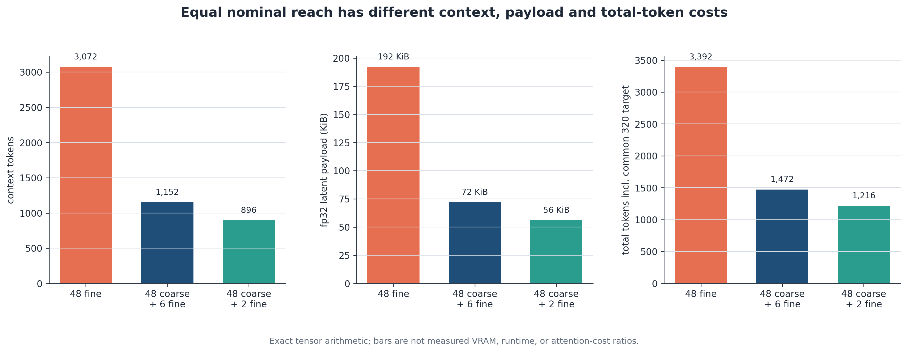

**Рисунок 3.13 – Арифметика контексту, корисного навантаження та загальної кількості токенів за однакової номінальної досяжності 48 кадрів.** Ієрархічні пакети зменшують збережений контекст і загальну довжину послідовності, залишаючи спільну ціль видимою; стовпчики показують точні кількості на інтерфейсі, а не продуктивність. *Джерело: розраховано за реєстром заморожених кодеків і пакетів.*

Ресурсами тут є контекстна/станова пам'ять, відмінна від пам'яті активації, обговорюваної в розділі 2. Під час навчання в одному вікні пам'ять активації визначається заявленою довжиною послідовності гілок, яка коливалася від 800 до 3392 токенів у спостережуваних дворівневих конфігураціях, і не залежить від того, скільки блоків розгортання оцінюється пізніше. Тому будь-яку спільну економію потрібно вимірювати безпосередньо.

## 3.5 Інструменти оцінювання та естиманди

### 3.5.1 Чому короткі тести не можуть виявити механізм досяжності

Явні пакети в принципі роблять досяжність вимірюваною, однак звичайний бенчмарк може не ідентифікувати цей механізм. У канонічному Moving-MNIST цифри рухаються й зіштовхуються в межах зображення $64\times64$, але генератор зазвичай утримує їх у кадрі, відбиваючи траєкторії від меж [124]. Невизначеність майбутнього та похибка довгого розгортання присутні, проте немає чіткої популяції, в якій спостережуваний об'єкт залишає короткий контекст, а згодом повертається за геометрією, що дає змогу обчислити доступність довшої історії.

Короткі тестові набори не слід відкидати: вони допомагають оцінити працездатність і встановити межі. Канонічний Moving-MNIST та TaxiBJ показують, чи працює часовий предиктор за відомими зовнішніми протоколами. Варіант довгого Moving-MNIST із персистентними об’єктами додає сталі ідентичності та 300-кадровий горизонт із самоподачею. Проте жоден із цих наборів не має точної геометрії видимості, потрібної для перевірки центрального механізму. Для цього створено генератор LoopMom [1, 124, 126].

Розмежування ролей запобігає двом протилежним помилкам. Синтетичний набір для дослідження механізму не замінює доказів на усталених задачах прогнозування. Водночас стандартний бенчмарк не ідентифікує перевагу пам'яті лише тому, що його тестова послідовність є довгою. Тому кожна таблиця й кожне твердження називають властивість, на якій вони ґрунтуються. Інструмент побудовано навколо однієї вимоги: записи мають бути складними для коротшого пакета, доступними для відповіді за довшого пакета та придатними до маркування без перегляду виходу моделі. Для цього потрібен контроль світу, поля огляду й траєкторії, а не більша візуальна реалістичність. Синтетична природа інструмента посилює ідентифікацію механізму, але обмежує зовнішню застосовність результату.

### 3.5.2 Генератор LoopMom та геометрія повторного входу

Кожен кліп LoopMom починається зі статичного світу $\mathcal W\in[0,1]^{64\times192}$ з тороїдальним горизонтальним виміром. Плавний фон утворюють чотири синусоїдальні компоненти з цілочисельними горизонтальними частотами, нормалізовані й масштабовані до інтервалу інтенсивності $[0.15,0.50]$. Потім три символи MNIST розміщують за фіксованими координатами світу шляхом попіксельного взяття максимуму. Горизонтальне розміщення символів огинає тор; вертикальне утримує вихідний 28-піксельний фрагмент у межах висоти 64 пікселі. Обраний світ залишається незмінним упродовж усього кліпу.

Спостережуваний кадр – це вікно перегляду розміром $64\times64$. Нехай $r_t\in\{0,\ldots,191\}$ – збережена координата лівого краю, а $a_t\in\{-1,0,+1\}$ – записана дія камери. Виконані рівняння руху та спостереження мають вигляд

$$
r_t=(r_{t-1}+4a_t)\bmod192,
\qquad
x_t(y,x)=\mathcal W\!\left(y,(r_t+x)\bmod192\right).
\tag{3.34}
$$

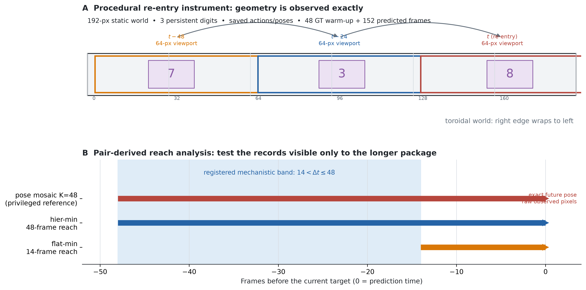

**Рисунок 3.14 – Геометрія світу LoopMom та порівняння аналітичного діапазону досяжності.** Збережені позиції вікна перегляду дають змогу обчислювати історичну видимість, що дозволяє проводити тестування конкретних пар замість загального порівняння на пізньому горизонті. *Джерело: схема, створена автором на основі конфігурації «замороженого» генератора та E2.*

Розробка й захищене оцінювання спираються на два шари даних. Основний навчальний набір містить 3 000 кліпів по 100 кадрів. Навчальні й валідаційні індекси розділені на рівні кліпів. Для оцінювання окремо згенеровано п’ять наборів по 500 кліпів і 200 кадрів: дані розробки, незаймане підтвердження, перевірка робастності семплера, перевірка робастності кодека та аналіз явного доступу. У кожному маніфесті зафіксовано призначення, ревізію генератора, випадковий сід, файл вихідних гліфів, конфігурацію та хеші SHA-256 відповідно до практик документування наборів даних [165].

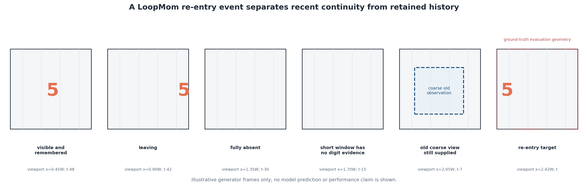

**Рисунок 3.15 – Подія зникнення та повторного входу, що охоплює кілька кадрів.** Сюжетна схема показує, чому одного лише пізнього горизонту недостатньо: оцінювач повинен знати, коли цільовий контент був видимий востаннє та чи потрапляє це спостереження в межі кожного пакета. *Джерело: ілюстрація, створена автором дисертації на основі геометрії LoopMom; не є емпіричним розгортанням.*

### 3.5.3 Точна спостережуваність та популяції досяжності для конкретних пар

Оцінювач визначає видимість на основі збережених координат вікна перегляду. Для $m$ кадрів, що передують цільовому моменту часу $t$, визначимо множину стовпців світової системи координат, що охоплюються вікном перегляду, та цільових стовпців переднього плану як

$$
\begin{aligned}
\operatorname{cov}_m(t)
&=\bigcup_{u=t-m}^{t-1}
\{(r_u+x)\bmod192\mid x=0,\ldots,63\},\\
F(t)&=\{(r_t+x)\bmod192\mid \max_y x_t(y,x)>0.5\},\\
N_m(t)&=F(t)\setminus\operatorname{cov}_m(t),
\qquad
\nu_m(t)=\frac{|N_m(t)|}{|F(t)|}.
\end{aligned}
\tag{3.35}
$$

Самої складності запису недостатньо, щоб визначити попередню спостережуваність. Нехай $v_t(c)$ – найпізніший момент часу до $t$, коли стовпець світу $c$ перебував у полі огляду, а $A_t=\{c\in N_6(t):v_t(c)\text{ існує}\}$. Частка доступних для відповіді стовпців і мітка «час від останньої видимості» дорівнюють

$$
\rho_t=\frac{|A_t|}{|N_6(t)|},
\qquad
\Delta t_t=
\operatorname*{median}_{c\in A_t}\bigl[t-v_t(c)\bigr].
\tag{3.36}
$$

Явно задано $\rho_t=0$, коли $N_6(t)=\varnothing$, і $\Delta t_t=0$, коли $A_t=\varnothing$. Запис вважається придатним для оцінювання, якщо $|N_6(t)|>0$ та $\rho_t\ge0.5$. Тому кадр, що містить лише недавні свідчення, не може потрапити до смуги позитивної різниці досяжності, а справді небачена повторна поява реєструється окремо й не враховується як доказ проти пакета пам'яті.

$$
\mathcal D_{l:s}^{\mathrm{reach}}=
\left\{(c,t):
R(\mathcal P_s)<\Delta t_t\le R(\mathcal P_l),
\ \rho_t\ge0.5,
\ |F(t)|>0
\right\}.
\tag{3.37}
$$

Для `hier-min` порівняно з `flat-min` зареєстрований діапазон становить $14<\Delta t\le48$. Порівняння всієї конфігурації B1 з `flat-short` використовує діапазон $8<\Delta t\le48$. Ці діапазони були отримані на інструменті розробки та зафіксовані до відкриття незайманого набору підтвердження. Інші пари отримують власні межі; загальна позначка «hard» ніколи не замінює різницю в досяжності фактичних гілок.

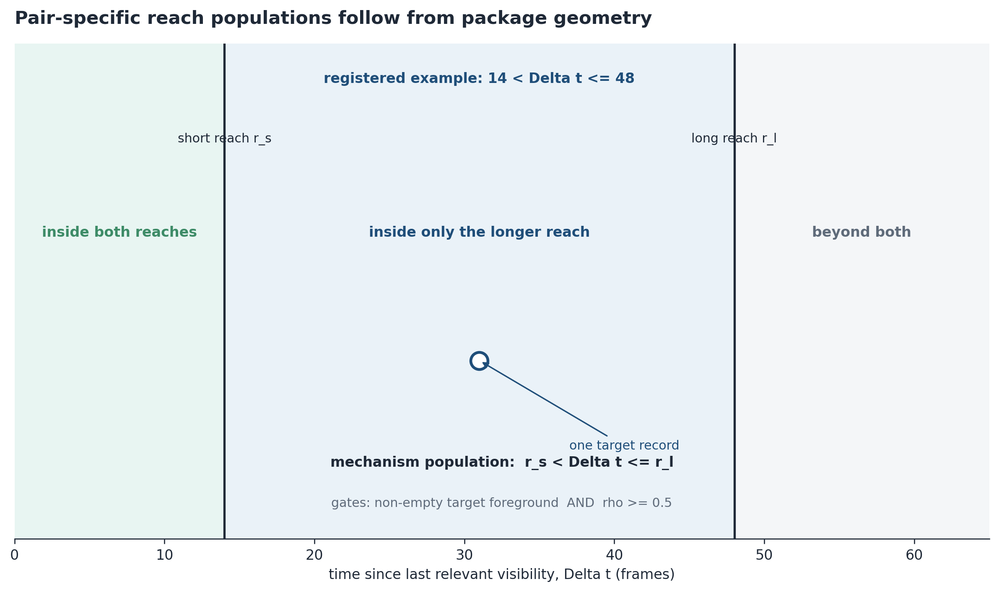

**Рисунок 3.16 – Специфічна для кожної пари популяція різниці досяжності.** Лише записи, релевантні свідчення для яких лежать поза межами коротшого пакета, але всередині довшого, ідентифікують запропонований механізм досяжності. *Джерело: авторська схема зареєстрованого геометричного естиманда.*

### 3.5.4 Повні метрики кадру та об’єкта

Жоден окремий показник не охоплює всі форми консистентності. Нехай $p,g\in[0,1]^{H\times W}$ – декодовані прогноз і ціль, а $\tau$ – поріг, визначений для популяції. Позначимо прогнозовану, еталонну та об’єднану маски як $P_\tau=\{p>\tau\}$, $G_\tau=\{g>\tau\}$ і $U_\tau=P_\tau\cup G_\tau$. Для квадратичної похибки $e=(p-g)^2$ чотири піксельні втрати мають вигляд

$$
\begin{aligned}
\operatorname{MSE}_{\mathrm{full}}&=\frac{\sum e}{HW},
&
\operatorname{MSE}_{\mathrm{fg}}&=\frac{\sum e\mathbf 1_{G_\tau}}{|G_\tau|},\\
\operatorname{MSE}_{\mathrm{bg}}&=\frac{\sum e\mathbf 1_{\neg G_\tau}}{|\neg G_\tau|},
&
\operatorname{MSE}_{\mathrm{union}}&=\frac{\sum e\mathbf 1_{U_\tau}}{|U_\tau|}.
\end{aligned}
\tag{3.38}
$$

Чіткість переднього плану вимірюється як енергія лапласіана з маскуванням для кожного зображення окремо, з використанням сімейства мір фокусування лапласіана [163]. SSIM та PSNR залишаються традиційними діагностичними показниками реконструкції [127]. Візуальний огляд також є обов’язковим: панелі декодованого прогнозу, цільового зображення та останнього контексту зберігаються з тих самих записів, що використовуються для чисельного аналізу. Ці панелі дозволяють діагностувати зникнення об’єктів та якісну невідповідність; вони відбираються за заздалегідь визначеним правилом і не замінюють інференцію.

Зв’язні компоненти додають до покадрових показників інформацію про наявність об’єктів [164]. Для LoopMom прогнозовані й цільові компоненти зіставляються угорським алгоритмом із вартістю $1-\operatorname{IoU}$ [125]. Зіставлення з нульовим перекриттям відхиляються. Якщо залишається $M$ пар, кількість пропущених об’єктів дорівнює $n_{\mathrm{GT}}-M$, а зайвих – $n_{\mathrm{pred}}-M$. Середнє перекриття й відстань між центроїдами обчислюються лише для прийнятих пар і завжди подаються разом із частками пропущених, зайвих об’єктів та покриття. Інакше модель могла б поліпшити оцінку лише на зіставлених парах, генеруючи менше об’єктів.

**Таблиця 3.4 – Повний набір показників, популяція та чутливість до помилок.** Стрілки позначають сприятливий напрям; знаки ефектів окремо гармонізуються для парного статистичного виведення.

| Показник | Популяція оцінювання | Напрям | Правило порожнього випадку | Основна виявлена помилка | Основне обмеження |
|---|---|---:|---|---|---|
| MSE для повного кадру | кожен декодований кадр | ↓ | завжди визначено | глобальна похибка пікселів | фон може домінувати |
| MSE переднього плану GT | непусте $G_\tau$ | ↓ | невизначено для порожнього GT | пропущений або спотворений вміст цілі | ігнорує помилковий передній план в інших місцях |
| MSE фону відносно GT | кожен кадр | ↓ | нуль лише за порожнього знаменника | галюцинації поза еталонним просторовим покриттям | може недооцінювати неправильно локалізований передній план |
| MSE на об’єднанні масок | кожен кадр | ↓ | нуль лише за порожнього об’єднання | пропуски та надлишки в спільній області | залежить від порога |
| Прецизійність / повнота / F1 переднього плану | кожен кадр із явними ознаками маски | ↑ | правила знаменника наведено вище | хибні спрацьовування / пропуски / баланс | піксельне перекриття не встановлює ідентичності об’єкта |
| Енергія маскованого лапласіана | непорожній передній план GT | ↑, інтерпретується відносно еталону кодека | не визначено для порожнього GT | розмиття або злиття | може винагороджувати високочастотні артефакти |
| Кількість компонентів GT / передбачених | кожен кадр | рівність | нуль є допустимим | виживання об’єктів та галюцинації | зв’язані компоненти можуть розділятися або зливатися |
| Пропущені / зайві компоненти | кожен кадр | ↓ | явні підрахунки | пропуски / хибні об’єкти | відсутність персистентної ідентичності |
| IoU зіставлених компонентів | прийняті пари | ↑ | діагностичний показник за відсутності пар | форма та перекриття | вибір на основі виживання, якщо не показано покриття |
| Відстань до центроїда зіставлених об’єктів | прийняті пари | ↓ | діагностичний показник за відсутності пар | локалізація | вибір на основі виживання, якщо пропуски не караються |
| Покриття об’єкта | видимі об’єкти GT | ↑ | дорівнює одиниці, якщо об’єкта GT немає | виживання виявлення | не дає інформації про ідентичність класу |
| Ідентичність із штрафом за пропуск | видимі марковані еталонні об’єкти | ↑ | невизначена, коли немає видимих об’єктів | ідентичність персистентних об’єктів з урахуванням пропусків | залежить від класифікатора та зіставлення |
| Похибка траєкторії зі штрафом за пропуск | видимі еталонні об’єкти | ↓ | нуль, коли еталонних об’єктів немає | локалізація та пропущені об’єкти | штраф за пропуск, рівний діагоналі кадру, визначається завданням |

### 3.5.5 Межі персистентних об’єктів і бенчмарків

LoopMom надає точні мітки видимості, але самі компоненти переднього плану не встановлюють ідентичність персистентних гліфів після зіткнень і тривалого руху із самоподачею. Навчальні кліпи містять 100 кадрів, а кліпи розробки й захищені кліпи – 348. Після 48 початкових кадрів кожна модель прогнозує 300 кадрів. Плоскі й ієрархічні пакети мають по 1 152 контекстні токени; оцінюються три сіди навчання.

$$
\begin{aligned}
c_{gd}&=\tfrac12\min\!\left(\frac{\lVert q_g-q_d\rVert_2}{D},1\right)
+\tfrac12(1-\operatorname{IoU}_{gd}),\qquad c_{gd}\le0.65,\\
\operatorname{coverage}&=\frac{M}{n_{\mathrm{GT}}},\\
\operatorname{traj}&=
\frac{\sum_{(g,d)\in\mathcal M}\lVert q_g-q_d\rVert_2+(n_{\mathrm{GT}}-M)D}
{n_{\mathrm{GT}}},\\
\operatorname{identity}&=
\frac{\#\{(g,d)\in\mathcal M:\operatorname{class}(g)=\operatorname{class}(d)\}}
{n_{\mathrm{GT,labelled}}}.
\end{aligned}
\tag{3.39}
$$

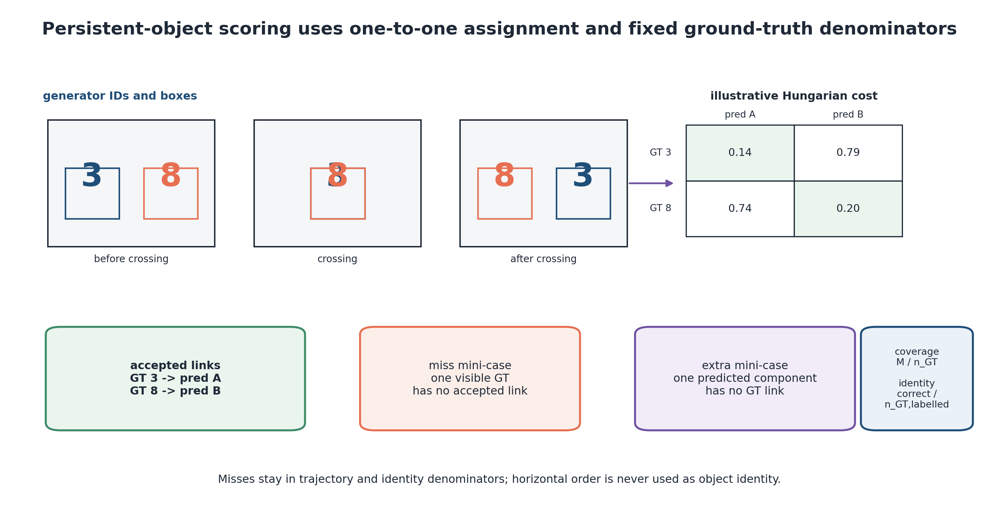

**Рисунок 3.17 – Зіставлення персистентних об’єктів і відстеження ідентичності.** *Джерело: авторська схема замороженого оцінювача E6.*

| Інструмент | Контекст → прогноз | Досліджувана властивість | Чинна роль | Твердження, яке він не може підтвердити |
|---|---:|---|---|---|
| Розробка LoopMom | 48 → 152 | проєктування пакетів і страт, виведених із геометрії | формування гіпотез і діагностика | незаймане підтвердження |
| Незаймані/захищені набори LoopMom | 48 → 152 | точні смуги досяжності, фронтир і заздалегідь визначені дослідження робастності | підтвердження контрольованого механізму | перевага над природним відео |
| Persistent long Moving-MNIST | 48 → 300 | просторове покриття, неперервність, ідентичність і траєкторія | зовнішня синтетична межа | відтворення геометричного механізму досяжності LoopMom |
| Канонічний Moving-MNIST | короткий горизонт, специфічний для протоколу | здатність до прогнозування руху | перевірка за еталонними даними та негативний контроль | еквівалентність ієрархій або перевага повторного входу |
| TaxiBJ | протокол OpenSTL | прогнозування просторово-часового поля | зовнішня компетентність | консистентність об’єктів з довготривалою пам’яттю |

**Таблиця 3.5 – Набори даних для оцінювання та їхня доказова роль.** Зміна набору даних змінює наукове питання; компетентність еталону не перетворюється автоматично на підтвердження механізму.

Зміна набору даних змінює наукове питання. Дослідження персистентних об’єктів перевіряє, чи залишається інтерпретація «досяжність–точність відтворення» корисною за явної ідентичності, але все одно утворює лише зовнішню синтетичну межу. Валідація на природному відео потребуватиме рухомих камер, прихованого вмісту, який змінюється в часі, та міток контрольованих повторних спостережень або еталонів з анотаціями, придатними для порівнянного оцінювання.

### 3.5.6 Статистичний протокол

Спарювання виконується до передискретизації. Обидві гілки використовують той самий кліп і цільовий горизонт, а стохастичні семплери – спільні випадкові числа в зареєстрованих парних комірках. Для показника «менше – краще» ефект обчислюється як «компаратор мінус кандидат», а для показника «більше – краще» – як «кандидат мінус компаратор». Тому позитивний знак завжди сприяє зареєстрованому кандидатові. Спарювання зменшує шум, але не змінює ліцензії порівняння: майже зіставлений пакет залишається майже зіставленим, а конфаунди повної конфігурації не розкладаються на окремі компоненти. [169]

$$
\begin{aligned}
\widehat\Delta_j
&=\frac{\sum_c\sum_{i\in c}d_{jci}}{\sum_c n_c},\\
\widehat\Delta_j^{*(b)}
&=\frac{\sum_{c\in C_b}\sum_{i\in c}d_{jci}}{\sum_{c\in C_b}n_c},\\
T_b^{\max}
&=\max_j\left|
\frac{\widehat\Delta_j^{*(b)}-\widehat\Delta_j}{\widehat s_j^*}
\right|,
\qquad
\mathrm{CI}_j^{\mathrm{sim}}
=\left[
\widehat\Delta_j-q_{0.95}(T^{\max})\widehat s_j^*,
\widehat\Delta_j+q_{0.95}(T^{\max})\widehat s_j^*
\right].
\end{aligned}
\tag{3.40}
$$

Вердикт визначається знаком одночасного інтервалу та заздалегідь заданим напрямом показника. Інтервал, що повністю лежить вище нуля, підтримує зареєстрованого кандидата; інтервал повністю нижче нуля підтримує компаратор. Перетин нуля залишає результат невирішеним. Реплікація за сідами може посилити або обмежити цей вердикт, але тисячі кадрів у межах одного кліпу не створюють реплікації за сідами навчання. Тому в розділі 4 кількість кліпів, записів і сідів моделі подано окремо.

Еквівалентність не виводиться лише з того, що інтервал перетинає нуль. Для цього потрібні обґрунтований найменший ефект, що становить інтерес, у власних одиницях показника та надійне вимірювання в межах цієї границі. Для центральної програми таку границю не було заморожено, тому «невирішено» означає саме невирішений результат. Негативні й змішані результати залишаються завершальними доказами, якщо задовольняють зареєстровані правила рішень; вони не виправдовують незапланований пошук сприятливішої популяції.

## 3.6 Дослідницькі гіпотези та висновки розділу

### 3.6.1 Зареєстровані гіпотези та очікувані напрямки

Модель та інструменти, описані вище, призводять до п'яти груп гіпотез. Вони викладені до отримання результатів, тому подальші спостереження не можуть переосмислити очікувані дії пакета.

**H2 – Відновлення точності відтворення.** Коли досяжність щільного плоского пакета наближається до досяжності ієрархічного, збереження повнороздільних свідчень має ставати ціннішим. Тому досліджені бюджетні точки можуть переходити від переваги ієрархії через невирішену область до переваги плоского пакета. Гіпотеза не вимагає монотонності, єдиного перетину чи будь-якого висновку між дослідженими бюджетами.

**H5 – Надійність самоподачі та зовнішня межа.** Номінальний доступ може не залишатися надійним протягом довгого розгортання. Тому ранньо-пізня закономірність для одного сіда не може стати твердженням про межу без незалежної від результату реплікації. На Persistent long Moving-MNIST показники просторового покриття/траєкторії та ідентичності можуть розділитися: грубий потік здатний зберігати відомості про те, *де* перебуває об’єкт, втрачаючи деталі про те, *що* це за об’єкт.

**Таблиця 3.6 – Відповідність між гіпотезами та естимандами, зафіксована для розділу 4.**

| Гіпотеза | Основне втручання | Основна популяція або родина | Очікувана інформативна закономірність | Інтерпретація у разі відсутності спостереження |
|---|---|---|---|---|
| H1 Різниця досяжності | зіставлена довга ієрархія проти коротшого плоского пакета | відповідна непорожня специфічна для пари смуга різниці досяжності | позитивний ефект кандидата, зосереджений між межами досяжності | пояснення через досяжність для цієї пари послаблюється |
| H2 Відновлення точності відтворення | зіставлені пари пакетів у досліджених точках токенного бюджету | одна одночасна родина фронтиру | нижня область переваги ієрархії, можлива невирішена середня точка й верхнє відновлення переваги плоского пакета | не інтерполювати; повідомляти лише результати в досліджених точках |
| H3 Форма пакета | розріджені детальні прив’язки проти щільної грубої історії | контраст майже зіставлених пакетів, перехрещений із головою та сідом | стабільний напрям лише тоді, коли його підтримують докази за сідами й головами | використання пакета є умовним або неоднорідним |
| H4 Робастність | сітка семплер/NFE та незалежний кодек | окремо заморожені одночасні сімейства | зареєстровані напрями зберігаються з явно наведеною точністю | чутливість локалізується на зміненому інтерфейсі |
| H5 Межа самоподачі/зовнішня межа | повторені сіди довгого циклу й персистентні об’єкти | фіксовані ранньо-пізні контрасти; п’ять об’єктних показників | для межі надійності потрібна реплікація; просторове покриття може відрізнятися від ідентичності | негативний або змішаний вердикт зберігається без постфактумного «порятунку» |

Ці гіпотези за своєю конструкцією є умовними. Вони визначають робочі області для конкретного замороженого кодека, сімейства предикторів і набору контрольованих завдань. Розділ 4 може посилити впевненість завдяки кільком сідам і захищеним наборам даних, але не може перетворити цю конструкцію на універсальне ранжування ієрархічних і плоских відеомоделей.

### 3.6.2 Висновки розділу

У розділі 3 збережена історія стала явною змінною моделі, а не неформальною архітектурною інтуїцією. Пакет визначається рівнями представлення, часовими кроками, збереженими позиціями та геометрією прив’язок. Контекстні, цільові й загальні токени рахуються окремо. Досяжність визначає, які минулі спостереження можуть увійти до прогнозу; точність відтворення описує релевантну до завдання інформацію, що збереглася після представлення й семплювання. Звідси випливає умовне очікування: ієрархія може допомагати там, де лише вона містить релевантне минуле, тоді як щільний детальний контекст здатний відновити перевагу, коли обидва пакети досягають події, а обмежувальним чинником стає деталізація.

На системному рівні попередні методи залишаються взаємодоповнювальними: просторовий розподіл і зберігання активацій контролюються на інтерфейсах поза цим експериментом. Після фіксації інтерфейсів, гіпотез та естимандів розділ 4 відповідає на емпіричне питання, що мотивувало конструкцію: де більша ієрархічна досяжність виправдовує свою ціну, а де ціннішою стає точність відтворення, збережена плоским контекстом?
