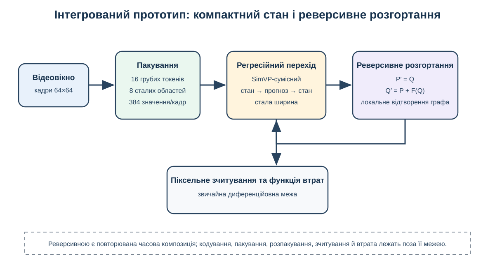
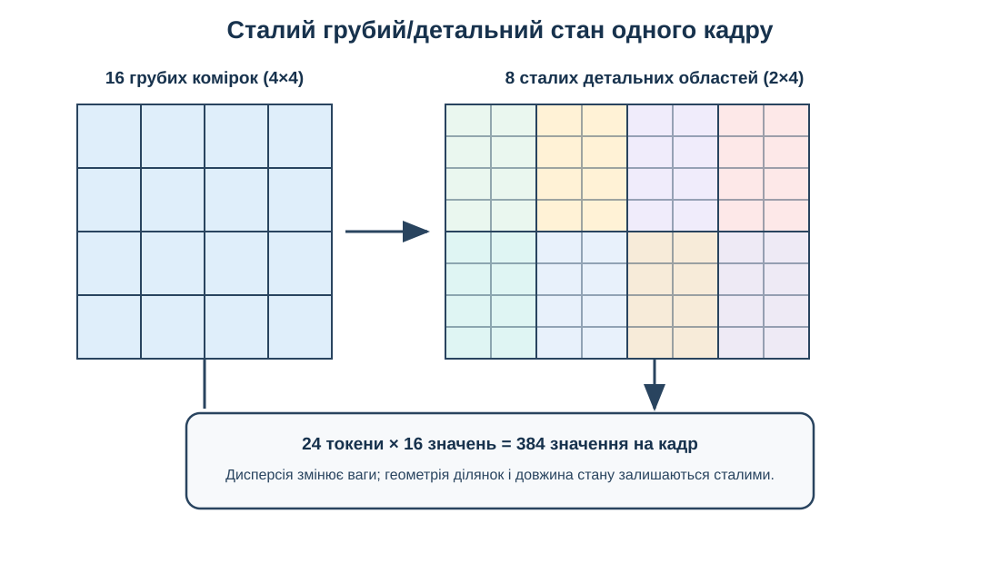

# Розділ 3 – Ієрархічна контекстна модель довгогоризонтного прогнозування відео

У розділі 2 розглянуто два обмеження, що постають під час масштабування відеомоделі: зберігання активацій у довгому диференційованому ланцюзі та розподіл ємності просторового представлення. Центральне питання дисертації залишається іншим: яка історична інформація доступна моделі після того, як останнє релевантне спостереження залишило коротке контекстне вікно. Модель може точно передбачати найближчий кадр, але втратити об’єкт, його траєкторію або ідентичність на довшому горизонті. Тому цей розділ переходить від допоміжних ресурсних методів до головного архітектурного дослідження – побудови ієрархічного збереженого контексту та визначення меж його доцільності.

Архітектурну межу основного дослідження задано явно. Заморожений дворівневий кодувальник перетворює кожний кадр на грубу сітку $4\times4$ і детальну сітку $8\times8$. Один спільний предиктор отримує вибрані грубі й детальні карти минулого та одночасно прогнозує обидва рівні наступного чотирикадрового вікна. Після декодування ці прогнози повертаються до буферів і стають контекстом наступного виклику. Реверсивне часове ядро та байтова токенізація V-BLT у причинне порівняння пакетів не входять, щоб спостережуваний ефект можна було пов’язати саме з формою збереженого контексту. Їхня композиція перевіряється пізніше в окремому розширенні для оцінювання технічної здійсненності.

## 3.1 Збережений контекст як проблема кінцевої моделі

Збережений контекст є станом, який предиктор переносить між послідовними вікнами. Його структура визначає не лише обсяг пам’яті, а й множину минулих подій, до яких модель може звернутися. Спочатку уточнимо цю вимогу через повторний вхід об’єкта, а далі формалізуємо пакет, його вартість і досяжність.

### 3.1.1 Консистентність як вимога до досяжності пам’яті

Розділ 1 показав, що консистентність має кілька критеріїв. Для відео особливо важлива неперервність стану й траєкторії між віддаленими кадрами; для ієрархічної моделі до неї додається ціна стиснення. Грубий потік може зберегти, *де* перебував об’єкт і як він рухався, але втратити ознаки, потрібні для точного відновлення того, *що* це був за об’єкт.
Довгогоризонтна консистентність вимагає більше, ніж правдоподібне продовження останнього кадру. Уявімо фігуру або об’єкт, текстура якого продовжується поза межами видимого поля. Поки він перебуває поза полем зору, кілька візуально допустимих версій світу можуть залишатися консистентними з поточним спостереженням. Після повернення попереднє зображення має обмежене положення, розмір та ідентичність об’єкта. Якщо воно залишається доступним, прогноз може спиратися на збережені відомості. Коли ж спостереження виходить із пам’яті, відновлення того самого об’єкта дедалі більше залежить від вивченого апріорного розподілу та можливості моделі до збереження, компонування та роботи з памʼяттю.

Повторний вхід стає визначальним, коли відповідне спостереження виходить за межі щільного вікна високої роздільної здатності. Плоска модель може збільшити це вікно, але кожен доданий детальний кадр має фіксовану токенну вартість. У багатороздільному пакеті старіші кадри зберігаються з нижчою просторовою роздільною здатністю, а детальні токени відводяться переважно для недавнього минулого [20, 35–37]. Груба історія тоді може містити свідчення, яких зіставлене за токенами плоске вікно фізично не досягає. Водночас стиснення вилучає частину інформації, тому давніша історія сама по собі не гарантує кращого прогнозу. Перевірка має охоплювати режими, у яких нестача історії та втрата деталей утворюють конкуруючі обмеження.

**Рисунок 3.1 – Повторний вхід після останнього визначального спостереження залишає коротке щільне контекстне вікно.**

Для аналізу потрібні три послідовні умови:
1. Спостереження має фізично зберігатися в одному з потоків;
2. Часова прив’язка повинна робити цей стан доступним поточному прогнозу;
3. Генератор має мати можливість утримувати та використовувати потрібну властивість.

Отже, йдеться про зберігання, досяжність і повторне використання. Результат на виході перевіряє всі три умови разом, тоді як геометрія пакета встановлює лише можливість доступу.

### 3.1.2 Простір проєктування контекстного пакета

Нехай $t$ позначає перший кадр цільового вікна. Контекстний пакет на цій межі є скінченною множиною потоків. Кожний потік визначається рівнем представлення $\ell_i$, часовим кроком $s_i$, кількістю збережених слотів $n_i$ та відстанню $a_i$ від цілі до найновішої прив’язки:

$$
\mathcal P_t=\left\{\mathcal S_i\right\}_{i=1}^{L},
\qquad
\mathcal S_i=(\ell_i,s_i,n_i,a_i).
\tag{3.1}
$$

Ці чотири поля однозначно задають часову геометрію потоку. Множина $K_i$ містить відстані до цілі, а $A_i(t)$ переводить їх у фактичні індекси кадрів:

$$
K_i=\{a_i+j s_i\mid j=0,\ldots,n_i-1\},
\qquad
A_i(t)=\{t-k\mid k\in K_i\}.
\tag{3.2}
$$

Якщо один слот рівня $\ell_i$ містить $q_{\ell_i}$ просторових токенів, то вартість збереженої історії дорівнює сумі за потоками:

$$
B_{\mathrm{ctx}}(\mathcal P_t)=\sum_{i=1}^{L}n_i q_{\ell_i}.
\tag{3.3}
$$

Контекст і ціль виконують різні функції. Нехай $m_j$ – кількість цільових слотів рівня $j$, а $q_j$ – число токенів у кожному з них. Тоді цільова та повна довжини послідовності мають вигляд:

$$
B_{\mathrm{tgt}}=\sum_j m_jq_j,
\qquad
B_{\mathrm{total}}=B_{\mathrm{ctx}}+B_{\mathrm{tgt}}.
\tag{3.4}
$$

Ці величини відповідають на різні питання. Контекстні токени представляють збережений стан, доступний під час прогнозування, а цільові токени рахують невідомі комірки прихованого простору, оцінювані спільно. Загальна кількість токенів визначає довжину послідовності трансформера, що впливає і на навчання, і на застосування. Сама ефективність контексту не визначає підсумкове використання пам’яті, час виконання чи обчислювальну вартість уваги. Окремо потрібно знати, наскільки давню позицію пакет здатний адресувати. Номінальна досяжність дорівнює найбільшій часовій відстані серед усіх потоків:

$$
R(\mathcal P_t)=\max_i\max K_i
=\max_i\bigl[a_i+(n_i-1)s_i\bigr].
\tag{3.5}
$$

Досяжність є номінальною: вона визначає найстарішу задану позицію, але не показує, чи достатній її вміст і чи модель фактично його використовує. У реалізованих щільних ієрархічних пакетах потік на рівні грубого представлення охоплює 48 попередніх позицій кадрів. Часово розріджений контроль натомість поєднує найновіші детальні кадри зі старішими прив’язками повної роздільної здатності. Зареєстрована мітка «48 кадрів» позначає запланований клас часового інтервалу, таким чином перевірка конфігурації спирається на записані прив’язки.

Однакову номінальну досяжність можна отримати різними способами. Рисунок 3.2 зіставляє щільний плоский контекст, щільну грубу історію з детальним хвостом і часово розріджені детальні прив’язки. Перший зберігає кожний кадр із високою деталізацією, другий – кожний часовий момент у грубішому масштабі, а третій – лише вибрані моменти з повною просторовою роздільною здатністю.

**Рисунок 3.2 – Три способи пакетування збереженого відеоконтексту.**

Однакова позначка «досяжність 48» на різних рівнях представлення не робить ці пакети інформаційно рівними. Щільний грубий потік представляє кожну часову позицію, але з меншою просторовою частотою та сіткою відповідно. Розріджений детальний потік зберігає повну роздільну здатність лише у вибрані моменти. Наприклад, прив’язки $t-47,t-43,\ldots$ не містять кадрів між ними, тоді як 48 грубих слотів утворюють щільну часову послідовність. Через це порівняння форми пакета перевіряє не лише дальність, а й спосіб втрати інформації.

У таблиці 3.1 визначено величини, використані в описі моделі та результатів. «Рівень» позначає представлення без припущення про семантичну абстракцію, а «крок» – відстань між прив’язками, не стверджуючи, що токен узагальнює рух між ними. Тому повнороздільні прив’язки, збережені через кожні чотири кадри, не еквівалентні грубому токену, спостережуваному в кожному кадрі. Обидва варіанти розширюють часовий доступ, але відкидають різну інформацію.

**Таблиця 3.1 – Поля контекстного пакета та їх інтерпретація.**

| Поле | Символ | Операційне значення | Що це не означає |
|---|---:|---|---|
| Рівень представлення | $\ell_i$ | Зафіксований рівень кодека та його просторова сітка токенів | Семантична коректність або гарантована консистентність між рівнями |
| Часовий крок | $s_i$ | Відстань між регулярними прив’язками потоку | Часове усереднення, якщо кодер явно його не виконує |
| Збережені слоти | $n_i$ | Кількість збережених карт прихованого простору у потоці | Однаковий корисний обсяг даних на всіх рівнях |
| Лаг найновішої прив’язки | $a_i$ | Відстань від першої цільової позиції до найновішої збереженої прив’язки | Наявність усіх проміжних кадрів |
| Набір прив’язок | $A_i(t)$ | Точні історичні кадри, представлені потоком | Успішне отримання інформації з цих кадрів |
| Кількість токенів на слот | $q_{\ell_i}$ | Кількість просторових комірок на вибраному рівні | Байти, ширина трансформера або повна пам’ять активації |
| Вартість контексту | $B_{\mathrm{ctx}}$ | Сума збережених токенів контексту | Загальна довжина послідовності або рівноцінний обчислювальний обсяг |
| Досяжність | $R$ | Найстаріше надане відставання в геометрії пакета | Точність відтворення, інформаційно-теоретична необхідність або надійне повторне використання |

Таблиця 3.1 фіксує межу кожного терміна: токенна вартість не дорівнює байтовій пам’яті, а досяжність не означає успішного відтворення. Саме розрив між геометрично доступним минулим і збереженою в ньому інформацією утворює центральну гіпотезу наступного підрозділу.

### 3.1.3 Гіпотеза «досяжність–точність відтворення»

Перевага пакета залежить від того, чого саме бракує прогнозу: доступу до давнього свідчення чи його детального вмісту. Нехай $Z_t^\star$ – історичні докази, що стосуються цілі в момент часу $t$, а $I_t(\mathcal P)$ вказує, чи лежать вони всередині наданих прив’язок. Величина $Q_t(\mathcal P)$ позначає релевантну до задачі інформацію, збережену після кодування та пакетування. Очікувану похибку можна концептуально організувати так:

$$
\mathcal R(\mathcal P)
=\mathbb E\!\left[
\mathcal L\mid I_t(\mathcal P)=0
\right]\Pr[I_t(\mathcal P)=0]
+\mathbb E_{Q_t\mid I_t=1}\!\left[
\mathbb E\!\left[
\mathcal L\mid I_t(\mathcal P)=1,Q_t(\mathcal P)
\right]
\right]\Pr[I_t(\mathcal P)=1].
\tag{3.6}
$$

Рівняння (3.6) є пояснювальною декомпозицією, а не окремою ймовірнісною моделлю. Коли релевантна історія недоступна, перший член за означенням активний. Зовнішнє математичне сподівання в другому члені усереднює умовну втрату за розподілом фактично збереженої інформації $Q_t$ серед випадків, у яких потрібна подія геометрично доступна. Цей член охоплює втрату здатності до представлення, похибку моделі та деградацію із самопідсиленням. Більша досяжність може зменшити першу складову, а збереження просторової деталізації – частину другої, але жодна зі змін не гарантує переваги на всіх типах завдань.

Звідси випливають три твердження:
1. За малого бюджету, коли плоске вікно не охоплює релевантну подію, ієрархічний пакет має перевагу через більшу досяжність;
2. У проміжному режимі обидва чинники можуть компенсувати один одного, тому результат може залишитися невизначеним та мати розкид відносно задачі;
3. За великого бюджету пакети детального рівня починають досягати події, що раніше була контекстно недоступна, і результат для щільного детального контексту може стати навіть кращим завдяки збереженню ідентичності та текстури в повному обсязі.

Ці режими перевіряються лише в досліджених умовах роботи; поріг і проміжні переходи між ними не оцінюються.

**Рисунок 3.3 – Робочі області пакетів на осях досяжності та точності відтворення.** Горизонтальна вісь відповідає часовій відстані до найдавнішого доступного свідчення, вертикальна – повноті збереженої просторової інформації. Рисунок не задає неперервної емпіричної межі; він лише пояснює, чому два пакети однакового бюджету можуть бути корисними в різних режимах.

## 3.2 Ієрархічний прихований стан

Щоб порівнювати форми контексту, саме представлення кадру має залишатися незмінним. Для цього спочатку визначається дворівневий кодувальний інтерфейс, потім карти прихованого простору перетворюються на токени спільного предиктора. Такий порядок відокремлює втрати стискання від ефекту часової геометрії пакета.

### 3.2.1 Дворівневий заморожений автоенкодер

Арифметика пакетів набуває сенсу лише при фіксованих рівнях представлення. Реалізовані пакети працюють у безперервному прихованому просторі, який формує згортковий автоенкодер. Для вхідного кадру $x_t\in[-1,1]^{1\times64\times64}$ спільний стовбур енкодера генерує карту ознак розміром $8\times8$. Одна проєкція розміром $1\times1$ дає детальний код; наступний етап енкодера з кроком два та ще одна проєкція формують грубий код:

$$
\mathcal E(x_t)=\left(z_t^{\mathrm c},z_t^{\mathrm f}\right),
\qquad
z_t^{\mathrm c}\in[-1,1]^{16\times4\times4},
\qquad
z_t^{\mathrm f}\in[-1,1]^{16\times8\times8}.
\tag{3.7}
$$

Обидві проєкції використовують гіперболічний тангенс як функцію активації, тому вихідні координати прихованого простору обмежені граничними значеннями цієї функції. Грубий кадр містить $16\times4\times4=256$ коефіцієнтів, організованих у 16 просторових токенів, а детальний кадр містить $16\times8\times8=1{,}024$ коефіцієнти, організовані в 64 токени. З цього не випливає, що грубий код у загальному сенсі вчетверо менш інформативний.

Кожен рівень має власний декодувальник для відтворення повного зображення. Це дає змогу оцінити грубу й детальну реконструкції незалежно:

$$
\hat x_t^{\mathrm c}=\mathcal D_{\mathrm c}(z_t^{\mathrm c}),
\qquad
\hat x_t^{\mathrm f}=\mathcal D_{\mathrm f}(z_t^{\mathrm f}).
\tag{3.8}
$$

Під час одного кроку навчання випадково обирається одна з двох гілок $b$. Для грубої гілки суму MAE та MSE множать на чотири, компенсуючи меншу просторову сітку; детальна гілка використовує ту саму пару втрат без множника:

$$
\mathcal L_{\mathrm{AE}}=
\begin{cases}
4\bigl(\operatorname{MAE}(x,\hat x^{\mathrm c})+
\operatorname{MSE}(x,\hat x^{\mathrm c})\bigr), & b=\mathrm c,\\[2mm]
\operatorname{MAE}(x,\hat x^{\mathrm f})+
\operatorname{MSE}(x,\hat x^{\mathrm f}), & b=\mathrm f,
\end{cases}
\qquad \Pr(b=\mathrm c)=\Pr(b=\mathrm f)=\tfrac12.
\tag{3.9}
$$

Обидва рівні реконструюють повний кадр, але з різною просторовою місткістю. У предикторі детальна гілка не отримує вже завершеного грубого прогнозу: грубі й детальні токени взаємодіють усередині спільної уваги, а окремі результати зчитуються лише наприкінці. Назви «композиція» і «деталізація» описують очікувану функцію роздільної здатності, а не жорстко задану семантику каналів. Грубий код передусім придатний для глобального положення, форми й траєкторії, тоді як детальний має більшу ємність для текстури та ознак ідентичності. Фактичний розподіл ролей перевіряється об’єктними показниками, а не припускається з назв рівнів.

Окремий декодувальник кожного рівня потрібний для перевірки того, що зберігається у відповідній карті прихованого простору. Грубий стан можна оцінити без участі детального виходу. Після навчання кодувальник і обидва декодувальники заморожуються, інакше кожен пакет міг би змінити власний спосіб стискання, а різниця між моделями змішувала б організацію контексту з повторним навчанням представлення. Заморожування не усуває втрат кодування, але робить їх спільною умовою порівняння.

$$
\tilde z_t^{\ell}[c]=
\frac{z_t^{\ell}[c]-\mu_c^{\ell}}
{\max(\sigma_c^{\ell},10^{-4})},
\qquad \ell\in\{\mathrm c,\mathrm f\}.
\tag{3.10}
$$

Перед поданням карт до предиктора кожний канал стандартизується за статистиками навчального набору згідно з формулою (3.10). Рисунок 3.4 показує, як один кадр переходить у дві сітки з однаковою шириною каналу, а таблиця 3.2 фіксує цей інтерфейс як незмінну умову всіх порівнянь.

**Рисунок 3.4 – Фіксовані розміри дворівневого кодувальника та тензорів прихованого простору.**

**Таблиця 3.2 – Специфікація зафіксованого інтерфейсу прихованого простору.**

| Властивість | Грубий рівень | Детальний рівень | Наслідки для предиктора |
|---|---:|---:|---|
| Форма прихованого простору на кадр | $16\times4\times4$ | $16\times8\times8$ | Та сама ширина каналу, різна просторова сітка |
| Просторові токени на кадр | 16 | 64 | Детальна історія вимагає вчетверо більше контекстних токенів на кадр |
| Скалярні коефіцієнти на кадр | 256 | 1 024 | Корисне навантаження відрізняється ще до проекції на ширину трансформера |
| Піксельний декодер | Незалежний грубий декодер | Незалежний детальний декодер | Кожен код можна перевірити як реконструкцію повного кадру |
| Масштабування вхідних даних предиктора | z-стандартизація за кожним каналом навчального набору | z-стандартизація за кожним каналом навчального набору | Шкала шуму та втрати за рівнями використовують порівнянні стандартизовані координати |
| Навчання після заморожування кодека | Немає | Немає | Порівняння пакетів не можуть змінювати інтерфейс прихованого простору |
| Основний шлях декодування під час розгортання | Лише для діагностики | Заморожений декодер детального рівня | Основні кадрові показники мають один вихідний шлях |

Таблицю збережено, оскільки вона є контрактом порівняння: з неї безпосередньо випливають токенна арифметика й спільний шлях декодування. Далі ці фіксовані карти перетворюються на одну послідовність токенів.

### 3.2.2 Побудова потоку та векторів вбудовування

Кожна просторова комірка карти стає одним токеном. Нехай $z_{t,h,w}^{\ell}\in\mathbb R^{16}$ – вектор каналів на рівні $\ell$ у позиції $(h,w)$. Спільна лінійна проєкція $W_{\mathrm{in}}$ переводить його до ширини трансформера $d$, а $p_{h,w}^{\ell}$ додає просторову позицію відповідного рівня:

$$
e_{t,h,w}^{\ell}=W_{\mathrm{in}}z_{t,h,w}^{\ell}+b_{\mathrm{in}}+p_{h,w}^{\ell},
\qquad e_{t,h,w}^{\ell}\in\mathbb R^d,
\tag{3.11}
$$

Функція $\operatorname{Tok}_{\ell}$ застосовує це перетворення до всієї карти. Послідовність $S_t$ спочатку містить контекстні потоки у визначеному пакетом порядку, а потім грубі й детальні токени кожного кадру цільового вікна:

$$
S_t=
\mathop{\Vert}_{i=1}^{L}
\mathop{\Vert}_{k\in K_i}
\operatorname{Tok}_{\ell_i}(\tilde z_{t-k}^{\ell_i})
\;\Vert\;
\mathop{\Vert}_{j=0}^{W-1}
\left[
\operatorname{Tok}_{\mathrm c}(y_{t+j}^{\mathrm c})
\Vert
\operatorname{Tok}_{\mathrm f}(y_{t+j}^{\mathrm f})
\right].
\tag{3.12}
$$

Самого порядку недостатньо, щоб одна мережа відрізнила рівень, роль і часову позицію. Тому до вмісту кожного токена додаються окремі вбудовування рівня, ролі та кадру:

$$
h^{(0)}_r=e_r+e_{\mathrm{level}}(\ell_r)+e_{\mathrm{role}}(r_r)
+e_{\mathrm{frame}}(f_r),
\qquad r_r\in\{\mathrm{context},\mathrm{target}\}.
\tag{3.13}
$$

Після визначення геометрії можна перевірити, чи справді пакет реалізує заявлену досяжність у межах бюджету. Для стандартної конфігурації з $48$ грубими та $6$ детальними кадрами груба історія дає $48\times16=768$ токенів, а недавній детальний хвіст додає $6\times64=384$. Кожна з чотирьох цілей містить $16+64=80$ токенів. Отже

$$
|S_t|=
\underbrace{768+384}_{B_{\mathrm{ctx}}=1{,}152}
+\underbrace{4(16+64)}_{B_{\mathrm{tgt}}=320}
=1{,}472.
\tag{3.14}
$$

Перші 1 152 токени є збереженим контекстом, тоді як останні 320 належать цільовому вікну й не збільшують часової досяжності пакета. На рисунку 3.5 зображена схема збірки токенів. На схемі контекстні токени залишаються відомими, а цільові грубі й детальні токени містять зашумлені представлення одного прогнозованого вікна. Колір і порядок потоків показують рівень, роль та часову позицію до їх об’єднання.

**Рисунок 3.5 – Збірка токенів перед спільним механізмом уваги.**

Так, грубий і детальний рівні обробляє один спільний трансформер, а не дві послідовні моделі. Щоб він розрізняв функції токенів, для кожної позиції $r$ формується умовний вектор $c_r$: $e_{\mathrm{level}}$, $e_{\mathrm{role}}$ і $e_{\mathrm{frame}}$ задають рівень, роль та кадр; $e_\tau$ кодує крок дифузії $\tau$; $e_a$ вносить керувальну дію $u_{t+j}$ лише для цільового кадру $t+j$. Тоді

$$
c_r=e_{\mathrm{level}}(\ell_r)+e_{\mathrm{role}}(r_r)+e_{\mathrm{frame}}(f_r)
+
\begin{cases}
e_\tau(0), & r_r=\mathrm{context},\\
e_\tau(\tau)+e_a(u_{t+j}), & r_r=\mathrm{target\ at\ frame}\ t+j.
\end{cases}
\tag{3.15}
$$

Для контексту крок дифузії фіксується нулем, оскільки ці токени не зашумлюються. Цільові токени отримують поточний крок $\tau$ і дію відповідного майбутнього кадру. Отже, формула (3.15) описує не новий потік даних, а службові ознаки, які дають змогу одній мережі правильно інтерпретувати вже зібрану послідовність.

Довжину кожного потоку фіксує специфікація пакета, тому додаткове заповнення в межах однієї конфігурації не потрібне. Водночас позиція токена у зібраній послідовності не є достатньою міткою його змісту: рівень, роль і кадр подаються явно. Це важливо, коли одна базова мережа використовується для різних сімейств пакетів. Детальний токен із часовою відстанню 47 у розрідженому потоці та детальний токен із відстанню 6 у недавньому хвості мають спільну проєкцію вмісту, але різні кадрові вбудовування. Тому предиктор може розрізняти їхню часову релевантність без призначення різної семантики каналів.

Послідовність збирається в наперед визначеному порядку: спочатку контекстні потоки за рівнями й прив’язками, потім грубі та детальні цілі кожного кадру вікна.

Порядок сам по собі не кодує причинність. Вбудовування ролі відрізняє відоме спостереження від зашумленої або нульової цілі, кадрове вбудовування зберігає часову позицію, а вбудовування рівня відокремлює просторові сітки. Дії додаються лише до відповідних цільових кадрів. В окремій конфігурації з кроком грубого потоку 2 разом із контекстом змінюється й грубий цільовий інтерфейс, тому в розділі 4 цей варіант трактується як порівняння повних конфігурацій, а не як чистий ефект кроку.

### 3.2.3 Передавання контексту за допомогою спільної уваги

Грубі й детальні токени справді входять до однієї послідовності та обробляються спільним WindowDiT. Грубий прогноз не завершується перед окремим етапом деталізації. У кожному блоці одночасно присутні грубий і детальний контекст, а також зашумлені грубі й детальні цілі; тому кожен шар може обмінюватися інформацією між рівнями й ролями до застосування вихідних модулів прогнозування. Така спільна увага не дублює параметри моделі, але й не є новим твердженням про першу багаторівневу увагу у відео: новизна роботи полягає у зіставленому за бюджетом втручанні та вимірюванні межі досяжності. Часове перекриття рівнів існує навмисно: у стандартному пакеті останні шість кадрів представлені одночасно грубо й детально, тоді як старіша частина доступна лише на грубому рівні.

$$
Q=\operatorname{RMSNorm}(HW_Q),\quad
K=\operatorname{RMSNorm}(HW_K),\quad
V=HW_V,
\qquad
\operatorname{Attn}(H)=
\operatorname{softmax}\!\left(\frac{QK^\top}{\sqrt{d_h}}\right)V.
\tag{3.16}
$$

Запити та ключі нормалізуються окремо в кожній голові уваги перед обчисленням масштабованого скалярного добутку [161]. Результати кількох голів конкатенуються й лінійно проєктуються за стандартною схемою багатоголової уваги [12]. Усередині поточного чотирикадрового вікна увага є повною: немає ні трикутної маски, яка змушувала б генерувати $t+1$ перед $t+2$, ні міжрівневої маски, що заздалегідь прив’язувала б детальну комірку до однієї грубої. Міжрівневі та внутрішньовіконні залежності вивчаються зі службових вбудовувань і даних.

Спільна увага архітектурно відкриває чотири інформаційні шляхи: грубий контекст до грубої цілі, грубий контекст до детальної цілі, детальний контекст до обох цільових рівнів і взаємодію між зашумленими грубими та детальними цілями одного вікна. Жоден шлях не маршрутизується вручну, тому архітектура не є послідовною схемою «спочатку спрогнозувати грубе, потім уточнити детальне». Обидва рівні формуються спільно, а їхня фактична спеціалізація визначається при навчанні та відповідно до задачі.

Структурну причинність між послідовними блоками розгортання можна подати як окрему маску. Нехай $n$ – індекс блока, який формує запит, а $m$ – індекс блока, з якого надходять ключі та значення. Тоді

$$
M^{\mathrm{roll}}_{nm}=
\begin{cases}
0, & m\le n,\\
-\infty, & m>n,
\end{cases}
\tag{3.17}
$$

Це не маска внутрішньоблокової уваги WindowDiT, а схематичний запис міжблокового порядку: блок $n$ може залежати від уже наявних блоків $m\le n$, але не від майбутніх $m>n$.

Спільне усунення шуму бачить лише зашумлені цілі поточного блока, а регресійний режим – порожні цільові позиції. Чотири майбутні кадри координуються одночасно, тоді як спостережувана інформація надходить лише з минулого. Отже, інтерфейс є каузальним **між блоками**, але не авторегресивним усередині чотирикадрового блока.

**Рисунок 3.6 – Спільна увага в межах блоку прогнозування та структурна причинність між блоками.**

Рисунок 3.6 розділяє ці два поняття. Суцільні зв’язки всередині блока показують повний обмін між рівнями й чотирма цільовими позиціями; стрілки між блоками спрямовані лише вперед у часі. Це розмежування потрібне перед визначенням межі градієнта, яка є ще вужчою за межу доступної інформації.

### 3.2.4 Межі градієнта та інформаційна асиметрія

Доступність інформації під час прямого проходу не означає, що градієнт проходить тим самим шляхом. Три межі визначають, які величини можуть змінюватися під час навчання предиктора. Першою є фіксовані параметри кодувальника й декодувальників; другою – відокремлені від графа значення контексту; третьою – завершення графа на поточному цільовому вікні. Якщо $\theta$ позначає параметри предиктора, а $\phi$ – параметри кодувального інтерфейсу, то

$$
\nabla_\phi\mathcal L_{\mathrm{pred}}=0,
\qquad
\frac{\partial\mathcal L_{n}}{\partial \hat z_{m}}=0
\quad\text{для }m<n,
\qquad
\nabla_\theta\mathcal L_n\ne0.
\tag{3.18}
$$

Предиктор навчається безпосередньо у стандартизованому прихованому просторі: дифузійний варіант мінімізує суму MSE для швидкісної параметризації двох рівнів за формулою (3.23), а регресійний контроль – суму SmoothL1 за формулою (3.29). Втрата декодованих пікселів і допоміжне донавчання грубого декодувальника не використовуються. Тому пакет із більшою кількістю грубих слотів не отримує додаткового реконструкційного сигналу лише через частіше використання цього шляху.

Рисунок 3.7 узагальнює межу: градієнти оновлюють проєкції токенів, службові вбудовування, блоки трансформера та вихідні модулі прогнозування, але не змінюють заморожені кодувальник і декодувальники та не перетинають попередні авторегресійні вікна.

**Рисунок 3.7 – Заморожені, відокремлені та треновані шляхи.**

Ці межі уточнюють порівняння пакетів, але не усувають зміщення експозиції. Із часом контекст може заповнюватися пошкодженими значеннями, згенерованими самою системою. Тому стійкість розгортання перевіряється в режимі самоподачі та з різними ініціалізаціями навчання [25, 26]. Повне багатовіконне навчання WindowDiT із реверсивним відтворенням не виконувалося. Натомість у §3.7 окремий компактний регресійний прототип перевіряє, чи працює сам принцип реверсивного розгортання разом зі станом сталої ширини.

Предиктор оптимізується на чистих чотирикадрових вікнах, а попередні прогнозовані вікна не входять до того самого графа градієнта. Отже, довгої диференційованої часової стрічки, яку мало б сенс реконструювати, тут немає. Реверсивність стала б релевантною після зміни цільової функції на багатовіконне навчання.

## 3.3 Ядро генеративного прогнозування

### 3.3.1 Цільова функція дифузії у прихованому просторі

Після визначення контексту та інтерфейсу прихованого простору залишається встановити випадкову величину, яку прогнозує модель. Предиктор оцінює блок послідовних майбутніх величин у прихованому просторі, обумовлених історією пакетів і записаними керувальними сигналами. За $W=4$ його умовний розподіл має вигляд

$$
p_\theta\!\left(
z^{\mathrm c}_{t:t+W-1},z^{\mathrm f}_{t:t+W-1}
\mid \mathcal P_t,u_{t:t+W-1}
\right).
\tag{3.19}
$$

Вікно з чотирьох кадрів узгоджує навчальний інтерфейс з одиницею авторегресивного оновлення: після одного виклику всі чотири прогнози додаються до буферів грубої й детальної історії, а найстаріші елементи вилучаються, щоб місткість лишалася сталою. Грубі й детальні цілі одного кадру отримують однаковий рівень дифузійного часу $\tau$, щоб описувати той самий ступінь зашумлення, але їхні тензори шуму генеруються незалежно. Така конструкція координує рівні через увагу без штучного копіювання одного шумового тензора між різними сітками.

$$
y_\tau^{\ell}=\alpha_\tau z_0^{\ell}+\sigma_\tau\varepsilon^{\ell},
\qquad
\varepsilon^{\ell}\sim\mathcal N(0,I),
\qquad
\alpha_\tau=\sqrt{\bar\alpha_\tau},\quad
\sigma_\tau=\sqrt{1-\bar\alpha_\tau}.
\tag{3.20}
$$

Коефіцієнти розкладу відповідають усіченій косинусній схемі Нікола та Дхарівала [149]:

$$
\bar\alpha_\tau=
\operatorname{clip}\!\left[
\frac{\cos^2\!\left(\frac{\tau/T+s}{1+s}\frac{\pi}{2}\right)}
{\cos^2\!\left(\frac{s}{1+s}\frac{\pi}{2}\right)},
10^{-4},0.9999
\right],
\qquad s=0.008.
\tag{3.21}
$$

$$
v_\tau^{\ell}=\alpha_\tau\varepsilon^{\ell}-\sigma_\tau z_0^{\ell},
\qquad \ell\in\{\mathrm c,\mathrm f\}.
\tag{3.22}
$$

Оскільки шум присутній на обох цільових рівнях, трансформеру також надається незашумлений контекстний пакет, нормалізований часовий крок та дії для кожного кадру. Спільна увага охоплює контекстні й цільові позиції, але вихідні модулі використовують лише цільові токени. Функція втрат має вигляд

$$
\mathcal L_v(\theta)=
\mathbb E\left[
\operatorname{MSE}\!\left(v_\theta^{\mathrm c},v_\tau^{\mathrm c}\right)
+
\operatorname{MSE}\!\left(v_\theta^{\mathrm f},v_\tau^{\mathrm f}\right)
\right].
\tag{3.23}
$$

**Рисунок 3.8 – Інтерфейси «прогноз-ціль».**

Рисунок 3.8 розділяє три інтерфейси «прогноз–ціль». Основний дифузійний модуль оцінює швидкісну параметризацію шуму й чистого коду. Регресійний контроль одразу повертає грубі та детальні карти прихованого простору; він потрібний, щоб перевірити, чи закономірність пакетів не залежить лише від ітеративного знешумлення. Енергетичний механізм оцінює сумісність кандидата з контекстом і застосовується як окрема діагностика, а не як третій взаємозамінний генератор. Тому результати цих модулів порівнюються лише за заздалегідь визначеними ролями й однаковими пакетами.

Для оптимізації використовується алгоритм AdamW [159] зі швидкістю навчання $3\times10^{-4}$, коефіцієнтом затуханням ваг $10^{-4}$, лінійним розігрівом протягом 2 000 кроків оновлення, обмеженням норми градієнта на рівні 1,0 та експоненційним затуханням ковзного середнього 0,999. Основний режим використовує розмір пакета 16 для 30 000 оновлень, альтернативний оприлюднений режим із розміром пакета 8 та 60 000 оновлень обробляє приблизно таку саму кількість прикладів, але не є ідентичним за рівнем шуму градієнта, кількістю оновлень або ефективним горизонтом EMA. Під час навчання використовується bfloat16 там, де це підтримується, відповідно до принципу змішаної точності, що передбачає збереження вищої точності для чутливих операцій [162].

### 3.3.2 Базова мережа Transformer

WindowDiT – авторська назва спільного віконного трансформера, який обробляє зібрану послідовність контекстних і цільових токенів. Це не окрема зовнішня архітектура. Базова структура містить вісім попередньо нормалізованих блоків розмірністю $d=384$. Її дворівневі варіанти мають приблизно 22 мільйони параметрів, що підлягають навчанню. У кожному порівнянні пакетів глибина та ширина залишаються фіксованими. Таким чином, масштаб моделі контролюється, а змінною втручання лишається контекст.

Кількість токенів не залежить від кількості параметрів моделі. Збільшення пакета подовжує послідовність і змінює обсяг доступної історії, але не додає нових блоків трансформера чи інших складників її обробки. Майже однакова кількість параметрів у гілках потрібна саме для того, щоб перевагу більшого або інакше організованого контексту не пояснювати більшою мережею.

Кожен блок використовує адаптивну обробку LayerNorm-Zero з сімейства DiT [4], що ґрунтується на нормалізації ознак у межах кожного зразка [160]. Мережа модуляції відображає $c_r$ з (3.15) на вектори зсуву, масштабування та гейту для механізму уваги та MLP. Для прихованого токена $h$,

$$
\operatorname{mod}(h;\beta,\gamma)=h\odot(1+\gamma)+\beta,
\tag{3.24}
$$

оновлення для одного блоку записується як

$$
\begin{aligned}
h'&=h+g_1\odot
\operatorname{Attn}\!\left(
\operatorname{mod}(\operatorname{LN}(h);\beta_1,\gamma_1)
\right),\\
h^{+}&=h'+g_2\odot
\operatorname{MLP}\!\left(
\operatorname{mod}(\operatorname{LN}(h');\beta_2,\gamma_2)
\right).
\end{aligned}
\tag{3.25}
$$

У дифузійному режимі проєкції модуляції блоків ініціалізуються нулями, тому залишкові гілки починають роботу близько до тотожного відображення за схемою adaLN-Zero [4]. Для регресійного контролю модуляція ініціалізується звичайним способом: пряме передбачення прихованого коду не потребує спеціального нульового старту знешумлювача. Після восьмого блока відбираються лише цільові позиції. Окремі адаптивні нормалізації та лінійні вихідні модулі грубого й детального прогнозування повертають токени до 16 каналів і формують карти $4\times4$ та $8\times8$. Термін «голова уваги» надалі використовується лише для складника багатоголової уваги.

**Рисунок 3.9 – Повний предиктор від заморожених кодів до цілі у прихованому просторі з чотирма кадрами.** 

Кодувальник, декодувальники, WindowDiT та інтерфейс цілі залишаються фіксованими, тоді як у порівняннях на головній межі змінюється лише збережений контекстний пакет. Повний шлях від кадру до двох рівнів цілі показано на рисунку 3.9.

### 3.3.3 Формування вибірки за допомогою DDIM

Генерування починається з гаусівського шуму для кожного грубого й детального цільового представлення чотирикадрового блока. Детермінований алгоритм вибірки DDIM [52] виконує знешумлення у вибраних точках навчального розкладу зашумлення, тобто послідовності рівнів $\bar\alpha_\tau$, використаних під час навчання. Для поточної ітерації $y_i$ у точці $\tau_i$ вихід швидкісної параметризації перетворюється на оцінки чистих даних і шуму:

$$
\hat z_{0,i}=\alpha_{\tau_i}y_i-\sigma_{\tau_i}v_\theta(y_i,\mathcal P_t,u,\tau_i),
\qquad
\hat\varepsilon_i=\sigma_{\tau_i}y_i+\alpha_{\tau_i}v_\theta(y_i,\mathcal P_t,u,\tau_i).
\tag{3.26}
$$

$$
y_{i+1}=\alpha_{\tau_{i+1}}\hat z_{0,i}
+\sigma_{\tau_{i+1}}\hat\varepsilon_i,
\qquad i=1,\ldots,N_{\mathrm{DDIM}}-1,
\tag{3.27}
$$

За замовчуванням для обчислення встановлено $N_{\mathrm{DDIM}}=16$. Отже, один блок із чотирьох кадрів вимагає 16 обчислень мережевої функції, або чотири обчислення на кожен згенерований кадр. Для розгортання з $N_{\mathrm{blk}}$ прогнозованих блоків,

$$
\mathrm{NFE}_{\mathrm{roll}}=N_{\mathrm{DDIM}}N_{\mathrm{blk}}.
\tag{3.28}
$$

За фіксованого початкового шуму, ваг, контексту та числового середовища цей варіант DDIM формує детерміновану траєкторію. Різні початкові шуми породжують різних кандидатів. Тому спільний початковий шум у парному порівнянні зменшує випадкову різницю між пакетами, але не робить незалежні навчання однаковими й не замінює перевірку за кількома ініціалізаціями моделі.

Кандидатом тут називається одне згенероване майбутнє, отримане з окремої ініціалізації початкового шуму. В основних порівняннях пакетів для кожної зареєстрованої ініціалізації алгоритму вибірки оцінюється один такий прогноз. Діагностика механізму окремо застосовує критерій «найкращий із восьми» й перевіряє, чи принаймні один із восьми кандидатів добре відтворює ціль. Це умовна верхня оцінка охоплення множини кандидатів, а не звичайна помилка одного розгортання. Вісім дифузійних кандидатів по 16 кроків DDIM потребують 128 обчислень предиктора на запис, тоді як регресійна діагностика використовує вісім проходів із MC-dropout. Тому звітуються і NFE на кандидата, і загальна робота генерації.

**Рисунок 3.10 – Хронологія детермінованого DDIM та підрахунок обчислень функції.**

Рисунок 3.10 показує цю різницю в обчислювальному бюджеті: один кандидат проходить усі 16 точок розкладу, а «найкращий із восьми» повторює повну траєкторію вісім разів. Щоб відділити користь контексту від цієї ітеративної процедури, вводиться однопрохідний регресійний контроль.

### 3.3.4 Регресійний контрольний модуль прогнозування

Регресійний контроль перевіряє найпростіше пояснення: чи може одна умовна оцінка використати той самий пакет без ітеративного уточнення DDIM. Він зберігає токенізацію, ширину й глибину мережі, контекст і геометрію цілі. На місця майбутніх карт подаються нульові початкові токени з окремою роллю «ціль», дифузійний час фіксується на нулі, а два вихідні модулі безпосередньо прогнозують грубий і детальний приховані коди. Оптимізується така втрата:

$$
\mathcal L_{\mathrm{reg}}(\theta)=
\operatorname{SmoothL1}(\hat z^{\mathrm c},z^{\mathrm c})
+\operatorname{SmoothL1}(\hat z^{\mathrm f},z^{\mathrm f}).
\tag{3.29}
$$

При звичайній оцінці регресійна траєкторія є детермінованою для фіксованих ваг, вхідних даних та числового середовища. Її не можна описувати як вибірку з того самого генеративного сімейства, що й DDIM. Контроль з’ясовує, чи може однопрохідна умовна оцінка використати ту саму упаковану історію, тоді як дифузійний модуль показує результат з ітеративним стохастичним уточненням.

Ця відмінність запобігає неправильному тлумаченню: перевага дифузії над регресією за статистикою «найкращий із восьми» може бути наслідком мультимодального охоплення, ітеративного обчислення, більшого бюджету кандидатів або їх поєднання. Тому висновок завжди прив’язується до конкретного режиму оцінювання та показника якості.

## 3.4 Авторегресивне розгортання та оновлення пам’яті

### 3.4.1 Рекурентність кільцевого буфера

Після навчання той самий предиктор багаторазово застосовується до власних виходів. Щоб довжина збереженого стану не зростала з кожним блоком, для грубого й детального потоків використовуються буфери фіксованої місткості: нові карти додаються, а найстаріші вилучаються за правилами пакета.
Предиктор стає довгогоризонтною системою завдяки рекурентному оновленню. Кожен завершений чотирикадровий блок надходить до наступного контексту, після чого цикл передбачення повторюється. Між викликами зберігаються буфери прихованого простору фіксованого розміру, визначені активним пакетом, а граф активацій трансформера завершується разом із поточним викликом.

$$
B_{n+1}^{\ell}=
\operatorname{tail}_{N_\ell}\!\left(B_n^{\ell}\Vert\hat Z_n^{\ell}\right),
\qquad
t_{n+1}=t_n+W,
\qquad
(N_{\mathrm c},N_{\mathrm f})=(48,6).
\tag{3.30}
$$

Оператор $\operatorname{tail}_{N}$ після конкатенації зберігає $N$ найновіших позицій. Детальний буфер відкидає чотири із шести старих значень і додає чотири прогнози, грубий буфер так само оновлює залишкові позиції. Часово розріджені конфігурації та конфігурації зі зменшеним кроком використовують задекларований планувальник прив’язок, тому до потоку повертаються лише цільові позиції, вирівняні з його часовою сіткою. Щільні пари, на яких ґрунтується основне твердження про досяжність і точність відтворення, оновлюють по чотири грубі й детальні цілі на блок і не змінюють цільового інтерфейсу.

Вхідними даними є кадри розігріву $x_{0:47}$, керувальні сигнали $u_{48:T-1}$, заморожений кодек, нормалізація навчального набору, предиктор EMA, пакет $\mathcal P$ і розподіл вибірки. Виходами є прогнози у просторі пікселів $\hat x_{48:T-1}$ та вирівняні записи оцінювання. Нижче наведено алгоритм розгортання із самоподачею та пакетованою пам’яттю прихованого простору:
1. Закодувати й стандартизувати початкові кадри, потім ініціалізувати кожен потік за задекларованими прив’язками.
2. На межі $t_n$ зібрати впорядковані контекстні токени та зчитати керувальні сигнали $u_{t_n:t_n+3}$.
3. Згенерувати пари грубих і детальних представлень у прихованому просторі за допомогою DDIM або регресійного вихідного модуля.
4. Зафіксувати згенеровані слоти через планувальник пакетів і видалити застарілі прив’язки, не зберігаючи міжвіконний градієнтний граф.
5. Скасувати стандартизацію та декодувати детальні вектори прихованого простору, зберігаючи геометричні мітки й вхідні дані показників для кожного кадру.
6. Встановити $t_{n+1}=t_n+4$ та повторювати до заявленого горизонту.

Для стандартного 200-кадрового кліпу LoopMom, генератор якого докладно визначено в §3.5.2, процес починається з 48 початкових кадрів, після чого 38 блоків розгортання створюють 152 прогнозовані кадри. Пізніші контексти повністю складаються з виходів моделі. Ємність буфера залишається фіксованою, але його вміст поступово оновлюється, а якість змінюється. Тому модель може номінально мати доступ до довгого горизонту й водночас втрачати надійну інформацію зі збільшенням розгортання.

**Рисунок 3.11 – Оновлення грубого й детального кільцевих буферів під час розгортання із самоподачею.**

### 3.4.2 Геометрія прив’язки та причинно-наслідкова семантика

Довжини буфера недостатньо для відтворення історичного значення. Кожен збережений слот повинен містити або детерміновано отримувати кадр, який він представляє. Для потоку $i$ слот $k$ на цільовій межі $t$ закріплений за адресою

$$
\alpha_{i,k}(t)=t-a_i-k s_i,
\qquad
\lambda_{i,k}(t)=t-\alpha_{i,k}(t),
\qquad k=0,\ldots,n_i-1.
\tag{3.31}
$$

Та сама домовленість стосується грубого контексту з кроком 2. Конфігурація `hier-s2-min` зберігає $t-47,t-45,\ldots,t-1$: 24 прив’язки, розподілені на інтервалі 48 позицій, із найдавнішою часовою відстанню 47. Протокол із фіксованою ціллю використовує зареєстровану позначку номінальної досяжності 48 та заздалегідь визначений діапазон $8<\Delta t\le48$. Порівняння залишається тестом усієї конфігурації; його не можна використовувати для визначення верхнього порога досяжності з точністю до одного кадру.

**Рисунок 3.12 – Геометрія потокової прив’язки на межі прогнозування з чотирма кадрами.**

Рисунок 3.12 має показувати перекриття рівнів, а не їхній взаємовиключний поділ у часі. У `hier-long` останні шість кадрів представлені і грубо, і детально; попередні 42 кадри – лише грубо. В інших щільних парах перекриття становить відповідно 2, 16, 26 і 36 кадрів для `hier-min`, `hier-c1`, `hier-c2` та `hier-rich`. Подання двох рівнів у спільній послідовності є архітектурною реалізацією цієї роботи, але не підставою заявляти першу багаторівневу відеомодель: близькі грубо-детальні та багатомасштабні конструкції існують у попередніх працях [20, 35–37, 150]. Науковий внесок тут полягає у точному контракті пакетів, зіставленому бюджеті та причинному тесті межі «досяжність–точність відтворення».

Геометрія прив’язок уточнює й межі конфігурації B1 з кроком 2. Її контекст містить 24 грубі позиції з кроком 2 та два найновіші детальні кадри. Проте реалізований цільовий інтерфейс повертає дві грубі цільові позиції, а не чотири. Отже, разом із кроком контексту змінюються і кількість цільових токенів, і спосіб агрегування дій для грубих позицій. Варіант із фіксованою ціллю існує лише як підготовлена специфікація. Оскільки його не виконано, у розділі 4 зберігається формулювання на рівні повної конфігурації.

### 3.4.3 Контекст, ціль та загальна вартість

Фіксовані буфери роблять пам’ять збереженого стану незалежною від тривалості розгортання. Для пакета $\mathcal P$ із $C_\ell=16$ коефіцієнтами кодека на токен і розміром елемента $b$ байтів суцільний корисний обсяг даних прихованого простору становить

$$
M_{\mathrm{payload}}(\mathcal P)=
bC_\ell B_{\mathrm{ctx}}(\mathcal P).
\tag{3.32}
$$

У float32 кожен токен займає 64 байти, а у float16 чи bfloat16 – 32 байти. Основний стан містить 48 грубих і 6 детальних кадрів, тобто 18 432 коефіцієнти прихованого простору: 72 КіБ у float32 та 36 КіБ у 16-бітному форматі. Для порівняння, щільна детальна історія з 48 кадрів містить 49 152 коефіцієнти, або 192 КіБ у float32.

**Таблиця 3.3 – Точний облік пакетів, токенів і корисного обсягу контекстних даних для основного межі та інтерфейсів B1.**

| Пакет | Точний опис контексту | Номінальна досяжність | Токени контексту / цілі / загальні | Корисний обсяг даних прихованого простору, fp32 / bf16 | Вбудовування контексту шириною 384, bf16 | Роль порівняння |
|---|---|---:|---:|---:|---:|---|
| `flat-short` | 8 суцільних детальних кадрів | 8 | 512 / 320 / 832 | 32 / 16 КіБ | 0,375 МіБ | Базова плоска конфігурація B1 |
| `hier-s2-min` | 24 грубих кадри з кроком 2 + 2 останніх детальних | 48 | 512 / 288 / 800 | 32 / 16 КіБ | 0,375 МіБ | Повна конфігурація B1; ціль відрізняється |
| `flat-min` | 14 суцільних детальних кадрів | 14 | 896 / 320 / 1 216 | 56 / 28 КіБ | 0,656 МіБ | зіставлений нижній плоский контроль |
| `hier-min` | 48 щільних грубих кадрів + 2 останніх детальних | 48 | 896 / 320 / 1 216 | 56 / 28 КіБ | 0,656 МіБ | зіставлена нижня ієрархія |
| `flat-budget` | 18 суцільних детальних кадрів | 18 | 1 152 / 320 / 1 472 | 72 / 36 КіБ | 0,844 МіБ | зіставлений центральний плоский контроль |
| `hier-long` | 48 щільних грубих + 6 останніх детальних | 48 | 1 152 / 320 / 1 472 | 72 / 36 КіБ | 0,844 МіБ | основна просторова ієрархія |
| `strided-flat` | 11 старих детальних прив’язок + 6 недавніх детальних кадрів | зареєстрований клас з інтервалом 48 кадрів | 1 088 / 320 / 1 408 | 68 / 34 КіБ | 0,797 МіБ | майже зіставлений часовий пакет |
| `flat-c1` | 28 суміжних детальних кадрів | 28 | 1 792 / 320 / 2 112 | 112 / 56 КіБ | 1,313 МіБ | зіставлений проміжний плоский контроль |
| `hier-c1` | 48 щільних грубих + 16 останніх детальних | 48 | 1 792 / 320 / 2 112 | 112 / 56 КіБ | 1,313 МіБ | зіставлена проміжна ієрархія |
| `flat-c2` | 38 суцільних детальних кадрів | 38 | 2 432 / 320 / 2 752 | 152 / 76 КіБ | 1,781 МіБ | зіставлений верхній плоский контроль |
| `hier-c2` | 48 щільних грубих + 26 останніх детальних | 48 | 2 432 / 320 / 2 752 | 152 / 76 КіБ | 1,781 МіБ | зіставлена верхня ієрархія |
| `flat-long` | 48 суміжних детальних кадрів | 48 | 3 072 / 320 / 3 392 | 192 / 96 КіБ | 2,250 МіБ | щільний еталон з однаковою досяжністю |
| `hier-rich` | 48 щільних грубих + 36 останніх детальних | 48 | 3 072 / 320 / 3 392 | 192 / 96 КіБ | 2,250 МіБ | відповідна ієрархія з максимальним бюджетом |

Самоувага залежить від загальної довжини послідовності. Якщо константи ядра ігноруються, член уваги для одного блоку масштабується як

$$
\mathcal C_{\mathrm{attn}}(S,d)=O(S^2d),
\qquad
\frac{\mathcal C_{\mathrm{attn}}(S_1,d)}
{\mathcal C_{\mathrm{attn}}(S_2,d)}
\approx\left(\frac{S_1}{S_2}\right)^2.
\tag{3.33}
$$

На рисунку 3.13 показано, як пам’ять залежить від розподілу токенів між рівнями. Ієрархічні пакети зменшують збережений контекст і загальну довжину послідовності, залишаючи спільну ціль видимою. Стовпчики відображають точну кількість токенів на інтерфейсі, а не продуктивність моделі.

**Рисунок 3.13 – Арифметика контексту, корисного навантаження та загальної кількості токенів за однакової номінальної досяжності 48 кадрів.**

Ресурсом тут є пам’ять стану, відмінна від пам’яті активацій, обговореної в розділі 2. Під час навчання в одному вікні пам’ять активацій визначається довжиною обчислювального графа, яка становить від 800 до 3 392 токенів у досліджених дворівневих конфігураціях, і не залежить від кількості блоків, що згодом оцінюються під час розгортання. Тому будь-яку спільну економію потрібно вимірювати безпосередньо.

У таблиці 3.3 встановлено арифметику інтерфейсу, а не апаратне прискорення. Однакова кількість контекстних токенів робить зіставлені пари коректними на вході трансформера, а однакові загальні токени додатково контролюють довжину послідовності. Проте фактичні час і пікова пам’ять залежать від розміру навчального пакету, точності, реалізації уваги та робочих буферів. Тому в розділі 4 токенна ефективність подається окремо від будь-якого твердження про повну VRAM.

## 3.5 Інструменти оцінювання та оцінювані ефекти

### 3.5.1 Чому короткі тести не можуть виявити механізм досяжності

Формула пакета дає змогу обчислити номінальну досяжність, але звичайний стандартний набір може не ідентифікувати її вплив на прогноз. У канонічному Moving-MNIST цифри рухаються й зіштовхуються в межах зображення $64\times64$, а відбиття від меж утримує їх у кадрі [124]. Невизначеність майбутнього та похибка довгого розгортання присутні, проте немає чіткої популяції, в якій об’єкт залишає короткий контекст, а згодом повертається за геометрією, що дає змогу обчислити доступність довшої історії.

Короткі тестові набори не варто відкидати: вони допомагають оцінити працездатність і встановити межі. Канонічний Moving-MNIST та TaxiBJ показують, чи працює часовий предиктор за відомими зовнішніми протоколами. Варіант довгого Moving-MNIST зі сталими ідентичностями додає 300-кадровий горизонт із самоподачею. Проте жоден із цих наборів не має точної геометрії видимості, потрібної для перевірки центрального механізму. Саме ця прогалина мотивує генератор LoopMom, визначений у §3.5.2 [1, 124, 126].

Розмежування ролей запобігає двом протилежним помилкам і робить дослідження прозорішим. Синтетичний набір для дослідження механізму не замінює доказів на усталених задачах прогнозування. Водночас стандартний набір оцінювання не ідентифікує перевагу пам’яті лише тому, що його тестова послідовність є довгою. Тому кожна таблиця й кожне твердження називають властивість, на якій вони ґрунтуються. Інструмент побудовано навколо однієї вимоги: записи мають бути складними для коротшого пакета, доступними для відповіді за довшого пакета та придатними до маркування без перегляду виходу моделі. Для цього потрібен контроль світу, поля огляду й траєкторії, а не більша візуальна реалістичність. Синтетична природа інструмента посилює ідентифікацію механізму, але обмежує зовнішню застосовність результату.

### 3.5.2 Генератор LoopMom та геометрія повторного входу

Кожен кліп LoopMom починається зі статичного світу $\mathcal W\in[0,1]^{64\times192}$ з тороїдальним горизонтальним виміром. Плавний фон утворюють чотири синусоїдальні компоненти з цілочисельними горизонтальними частотами, нормалізовані й масштабовані до інтервалу інтенсивності $[0.15,0.50]$. Потім три символи MNIST розміщують за фіксованими координатами світу шляхом попіксельного взяття максимуму. Горизонтальне розміщення символів огинає тор, а вертикальне утримує вихідний 28-піксельний фрагмент у межах висоти 64 пікселі. Обраний світ залишається незмінним упродовж усього кліпу.

Спостережуваний кадр – це вікно перегляду розміром $64\times64$. Нехай $r_t\in\{0,\ldots,191\}$ – збережена координата лівого краю, а $a_t\in\{-1,0,+1\}$ – записана дія камери. Виконані рівняння руху та спостереження мають вигляд

$$
r_t=(r_{t-1}+4a_t)\bmod192,
\qquad
x_t(y,x)=\mathcal W\!\left(y,(r_t+x)\bmod192\right).
\tag{3.34}
$$

На рисунку 3.14 показано, як зі збережених позицій вікна перегляду визначають події, доступні ієрархічному пакету, але недоступні короткому плоскому вікну, де для верхніх бюджетів окремо порівнюють пакети, що вже охоплюють потрібну історію. Це дає змогу перевіряти конкретні пари замість загального зіставлення на пізньому горизонті.

**Рисунок 3.14 – Геометрія світу LoopMom і смуги різниці досяжності для порівнюваних пакетів.**

Розроблення й контрольне оцінювання спираються на два шари даних. Основний навчальний набір містить 3 000 кліпів по 100 кадрів. Навчальні й валідаційні індекси розділені на рівні кліпів. Для оцінювання окремо згенеровано п’ять наборів по 500 кліпів і 200 кадрів: дані розроблення, відкладене підтвердження, перевірка стійкості до параметрів алгоритму вибірки, перевірка з незалежним кодеком та аналіз прямого доступу до історії. У кожному маніфесті зафіксовано призначення, ревізію генератора, випадкову ініціалізацію, файл вихідних гліфів, конфігурацію та хеші SHA-256 відповідно до практик документування наборів даних [165].

Сюжетна схема на рисунку 3.15 демонструє, чому одного лише пізнього горизонту недостатньо: оцінювач повинен знати, коли цільовий контент був видимий востаннє та чи потрапляє це спостереження в межі кожного пакета.

**Рисунок 3.15 – Подія зникнення та повторного входу, що охоплює кілька кадрів.**

LoopMom дає точні координати світу й камери для кожного кадру. На їхній основі можна визначити не лише факт повторної появи, а й те, чи потрапляє останнє релевантне спостереження до конкретного пакета. Наступний підрозділ формалізує цю перевірку без використання прогнозів моделі.

### 3.5.3 Аналітична видимість і популяції різниці досяжності

Аналітичний модуль видимості використовує лише збережені координати вікна перегляду й еталонний світ; виходи моделі до нього не надходять. Для $m$ кадрів перед цільовим моментом $t$ множина охоплених стовпців світу дорівнює

$$
\operatorname{cov}_m(t)=\bigcup_{u=t-m}^{t-1}
\{(r_u+x)\bmod192\mid x=0,\ldots,63\}.
\tag{3.35a}
$$

Стовпці переднього плану, видимі в цільовому кадрі, визначаються за порогом 0,5:

$$
F(t)=\{(r_t+x)\bmod192\mid \max_y x_t(y,x)>0.5\}.
\tag{3.35b}
$$

Різниця $N_m(t)$ містить частину поточного переднього плану, якої не було у вікні останніх $m$ кадрів; $\nu_m(t)$ показує її частку:

$$
N_m(t)=F(t)\setminus\operatorname{cov}_m(t),
\qquad
\nu_m(t)=\frac{|N_m(t)|}{|F(t)|}.
\tag{3.35c}
$$

Самої складності запису недостатньо, щоб визначити попередню спостережуваність. Нехай $v_t(c)$ – найпізніший момент часу до $t$, коли стовпець світу $c$ перебував у полі огляду, а $A_t=\{c\in N_6(t):v_t(c)\text{ існує}\}$. Частка доступних для відповіді стовпців і мітка «час від останньої видимості» дорівнюють

$$
\rho_t=\frac{|A_t|}{|N_6(t)|},
\qquad
\Delta t_t=
\operatorname*{median}_{c\in A_t}\bigl[t-v_t(c)\bigr].
\tag{3.36}
$$

Явно задано $\rho_t=0$, коли $N_6(t)=\varnothing$, і $\Delta t_t=0$, коли $A_t=\varnothing$. Запис вважається придатним для оцінювання, якщо $|N_6(t)|>0$ та $\rho_t\ge0.5$. Тому кадр, що містить лише недавні свідчення, не може потрапити до смуги позитивної різниці досяжності, а справді небачена повторна поява реєструється окремо й не враховується як доказ проти пакета пам’яті.

$$
\mathcal D_{l:s}^{\mathrm{reach}}=
\left\{(c,t):
R(\mathcal P_s)<\Delta t_t\le R(\mathcal P_l),
\ \rho_t\ge0.5,
\ |F(t)|>0
\right\}.
\tag{3.37}
$$

Для `hier-min` порівняно з `flat-min` зареєстрований діапазон становить $14<\Delta t\le48$. Порівняння всієї конфігурації B1 з `flat-short` використовує діапазон $8<\Delta t\le48$. Ці діапазони були отримані за допомогою інструмента розроблення та зафіксовані до відкриття відкладеного набору підтвердження. Інші пари отримують власні межі; загальна позначка «складна вибірка» ніколи не замінює різницю в досяжності фактичних гілок.

**Рисунок 3.16 – Специфічна для кожної пари популяція різниці досяжності.**

Лише записи, релевантні свідчення для яких лежать поза межами коротшого пакета, але всередині довшого, ідентифікують запропонований механізм досяжності.

### 3.5.4 Повні метрики кадру та об’єкта

Як було визначено в першому розділі, жоден окремий показник не охоплює всі форми консистентності. Тому доцільно зосередитися на конкретній проблемі та вибрати показник, чутливий саме до неї. У цій роботі такою проблемою є довгострокове прогнозування з тимчасовим виходом об’єкта за межі поля огляду. Нехай $p,g\in[0,1]^{H\times W}$ – декодовані прогноз і ціль, а $\tau$ – поріг, визначений для популяції. Позначимо прогнозовану, еталонну та об’єднану маски як $P_\tau=\{p>\tau\}$, $G_\tau=\{g>\tau\}$ і $U_\tau=P_\tau\cup G_\tau$. Для квадратичної похибки $e=(p-g)^2$ чотири піксельні втрати мають вигляд

$$
\begin{aligned}
\operatorname{MSE}_{\mathrm{full}}&=\frac{\sum e}{HW},
&
\operatorname{MSE}_{\mathrm{fg}}&=\frac{\sum e\mathbf 1_{G_\tau}}{|G_\tau|},\\
\operatorname{MSE}_{\mathrm{bg}}&=\frac{\sum e\mathbf 1_{\neg G_\tau}}{|\neg G_\tau|},
&
\operatorname{MSE}_{\mathrm{union}}&=\frac{\sum e\mathbf 1_{U_\tau}}{|U_\tau|}.
\end{aligned}
\tag{3.38}
$$

Чіткість переднього плану вимірюється як енергія лапласіана з маскуванням для кожного зображення окремо, з використанням сімейства мір фокусування лапласіана [163]. SSIM та PSNR залишаються традиційними діагностичними показниками реконструкції [127]. Візуальний огляд також є обов’язковим: панелі декодованого прогнозу, цільового зображення та останнього контексту зберігаються з тих самих записів, що використовуються для чисельного аналізу. Вони допомагають діагностувати зникнення об’єктів і якісну невідповідність, але відбираються за заздалегідь визначеним правилом і не замінюють статистичного оцінювання.

Зв’язні компоненти додають до покадрових показників інформацію про наявність об’єктів [164]. Для LoopMom прогнозовані й цільові компоненти зіставляються угорським алгоритмом із вартістю $1-\operatorname{IoU}$ [125]. Зіставлення з нульовим перекриттям відхиляються. Якщо залишається $M$ пар, кількість пропущених об’єктів дорівнює $n_{\mathrm{GT}}-M$, а зайвих – $n_{\mathrm{pred}}-M$. Середнє перекриття й відстань між центроїдами обчислюються лише для прийнятих пар і завжди подаються разом із частками пропущених, зайвих об’єктів та покриття. Інакше модель могла б поліпшити оцінку лише на зіставлених парах, генеруючи менше об’єктів.

В таблиці 3.4 наведений набір метрик оцінювання, обрані для дослідження. Стрілки позначають сприятливий напрям, а знаки ефектів окремо гармонізуються для парного статистичного виведення.

**Таблиця 3.4 – Повний набір метрик, популяцій та чутливості до помилок.**

| Метрика | Популяція оцінювання | Напрям | Правило порожнього випадку | Основна виявлена помилка | Основне обмеження |
|---|---|---:|---|---|---|
| MSE для повного кадру | кожен декодований кадр | ↓ | завжди визначено | глобальна похибка пікселів | фон може домінувати |
| MSE переднього плану GT | непусте $G_\tau$ | ↓ | невизначено для порожнього GT | пропущений або спотворений вміст цілі | ігнорує помилковий передній план в інших місцях |
| MSE фону відносно GT | кожен кадр | ↓ | нуль лише за порожнього знаменника | галюцинації поза еталонним просторовим покриттям | може недооцінювати неправильно локалізований передній план |
| MSE на об’єднанні масок | кожен кадр | ↓ | нуль лише за порожнього об’єднання | пропуски та надлишки в спільній області | залежить від порога |
| Прецизійність / повнота / F1 переднього плану | кожен кадр із явними ознаками маски | ↑ | правила знаменника наведено вище | хибні спрацьовування / пропуски / баланс | піксельне перекриття не встановлює ідентичності об’єкта |
| Енергія маскованого лапласіана | непорожній передній план GT | ↑, інтерпретується відносно еталону кодека | не визначено для порожнього GT | розмиття або злиття | може винагороджувати високочастотні артефакти |
| Кількість компонентів GT / передбачених | кожен кадр | рівність | нуль є допустимим | виживання об’єктів та галюцинації | зв’язані компоненти можуть розділятися або зливатися |
| Пропущені / зайві компоненти | кожен кадр | ↓ | явні підрахунки | пропуски / хибні об’єкти | відсутність сталої ідентичності в часі |
| IoU зіставлених компонентів | прийняті пари | ↑ | діагностичний показник за відсутності пар | форма та перекриття | вибір на основі виживання, якщо не показано покриття |
| Відстань до центроїда зіставлених об’єктів | прийняті пари | ↓ | діагностичний показник за відсутності пар | локалізація | вибір на основі виживання, якщо пропуски не караються |
| Покриття об’єкта | видимі об’єкти GT | ↑ | дорівнює одиниці, якщо об’єкта GT немає | виживання виявлення | не дає інформації про ідентичність класу |
| Ідентичність із штрафом за пропуск | видимі марковані еталонні об’єкти | ↑ | невизначена, коли немає видимих об’єктів | ідентичність об’єктів, що зберігаються в часі, з урахуванням пропусків | залежить від класифікатора та зіставлення |
| Похибка траєкторії зі штрафом за пропуск | видимі еталонні об’єкти | ↓ | нуль, коли еталонних об’єктів немає | локалізація та пропущені об’єкти | штраф за пропуск, рівний діагоналі кадру, визначається завданням |

### 3.5.5 Межі оцінювання об’єктів зі сталою ідентичністю та стандартних наборів

LoopMom надає точні мітки видимості, але самі компоненти переднього плану не встановлюють ідентичність об’єктів упродовж кліпу після зіткнень і тривалого руху із самоподачею. Тому зовнішня синтетична межа використовує довгий Moving-MNIST зі збереженими в метаданих ідентифікаторами. Навчальні кліпи містять 100 кадрів, а кліпи розробки й захищені кліпи – 348. Після 48 початкових кадрів кожна модель прогнозує 300 кадрів. Плоскі й ієрархічні пакети мають по 1 152 контекстні токени та оцінюються для трьох ініціалізацій навчання.

Оцінювання цих кліпів потребує взаємно однозначного зіставлення, що зберігає ідентичність. Вартість пари поєднує нормовану відстань між центроїдами та IoU, після чого окремо обчислюються покриття, похибка траєкторії зі штрафом за пропуск та точність ідентичності

$$
\begin{aligned}
c_{gd}&=\tfrac12\min\!\left(\frac{\lVert q_g-q_d\rVert_2}{D},1\right)
+\tfrac12(1-\operatorname{IoU}_{gd}),\qquad c_{gd}\le0.65,\\
\operatorname{coverage}&=\frac{M}{n_{\mathrm{GT}}},\\
\operatorname{traj}&=
\frac{\sum_{(g,d)\in\mathcal M}\lVert q_g-q_d\rVert_2+(n_{\mathrm{GT}}-M)D}
{n_{\mathrm{GT}}},\\
\operatorname{identity}&=
\frac{\#\{(g,d)\in\mathcal M:\operatorname{class}(g)=\operatorname{class}(d)\}}
{n_{\mathrm{GT,labelled}}}.
\end{aligned}
\tag{3.39}
$$

**Рисунок 3.17 – Зіставлення об’єктів зі сталою ідентичністю та їх відстеження.**

У кожному кадрі угорський алгоритм зіставляє виявлені компоненти з еталонними об’єктами, після чого сталі ідентифікатори дають змогу окремо виміряти покриття, неперервність, ідентичність і похибку траєкторії.

Рисунок 3.17 показує, як зіставлення відокремлює сам факт виявлення від правильної ідентичності та траєкторії. Таблиця 3.5 після нього розміщує цей тест поруч із LoopMom і стандартними наборами, щоб жоден результат не переносився на іншу експериментальну популяцію без окремого обґрунтування.

**Таблиця 3.5 – Набори даних для оцінювання та їхня доказова роль.** Зміна набору даних змінює наукове питання; компетентність еталону не перетворюється автоматично на підтвердження механізму.

| Інструмент | Контекст → прогноз | Досліджувана властивість | Чинна роль | Твердження, яке він не може підтвердити |
|---|---:|---|---|---|
| Розробка LoopMom | 48 → 152 | проєктування пакетів і страт, виведених із геометрії | формування гіпотез і діагностика | відкладене підтвердження |
| Відкладені й захищені набори LoopMom | 48 → 152 | точні смуги досяжності, межа і заздалегідь визначені дослідження робастності | підтвердження контрольованого механізму | перевага над природним відео |
| Довгий Moving-MNIST зі сталою ідентичністю об’єктів | 48 → 300 | просторове покриття, неперервність, ідентичність і траєкторія | зовнішня синтетична межа | відтворення геометричного механізму досяжності LoopMom |
| Канонічний Moving-MNIST | короткий горизонт, специфічний для протоколу | здатність до прогнозування руху | перевірка за еталонними даними та негативний контроль | еквівалентність ієрархій або перевага повторного входу |
| TaxiBJ | протокол OpenSTL | прогнозування просторово-часового поля | зовнішня компетентність | консистентність об’єктів з довготривалою пам’яттю |

Зміна набору даних змінює наукове питання. Дослідження об’єктів зі сталою ідентичністю перевіряє, чи залишається інтерпретація «досяжність–точність відтворення» корисною за явної ідентичності, але все одно утворює лише зовнішню синтетичну межу. У розділі 4 цей тест розглядається як перевірка переносності інтерпретації, а не як реплікація геометричного механізму LoopMom. Валідація на природному відео потребуватиме рухомих камер, прихованого вмісту, що змінюється в часі, та анотацій контрольованих повторних спостережень.

### 3.5.6 Статистичний протокол

Статистичний протокол починається з парного вирівнювання експериментальних записів. Обидві гілки використовують той самий кліп і цільовий горизонт, а стохастичні алгоритми вибірки – спільні випадкові числа в зареєстрованих парних комірках. Для показника «менше – краще» ефект обчислюється як значення базової порівнюваної конфігурації мінус значення кандидата; для показника «більше – краще» порядок віднімання змінюється. Тому позитивний знак завжди сприяє зареєстрованому кандидатові. Парне вирівнювання зменшує шум, але не змінює межі порівняння: майже зіставлений пакет лишається майже зіставленим, а супутні зміни повної конфігурації не розкладаються на окремі компоненти [169].

Одиницею повторної вибірки є кліп. Якщо один ранній прогноз зміщує об’єкт, кілька наступних кадрових помилок успадковують те саме збурення й не є незалежними доказами. Тому під час передискретизації всі записи вибраного кліпу залишаються разом. ініціалізації навчання не вкладаються до цього самого циклу: кожне незалежне навчання показується окремо, щоб велика кількість кадрів не створювала хибного враження реплікації моделі.

Для показника $j$ величина $d_{jci}$ є парною різницею запису $i$ у кліпі $c$, а $n_c$ – кількістю таких записів. Зважена за записами оцінка середнього ефекту дорівнює

$$
\widehat\Delta_j=\frac{\sum_c\sum_{i\in c}d_{jci}}{\sum_c n_c}.
\tag{3.40a}
$$

У бутстреп-повторі $b$ повторно відбирається множина цілих кліпів $C_b$, після чого ефект обчислюється тією самою формулою:

$$
\widehat\Delta_j^{*(b)}=
\frac{\sum_{c\in C_b}\sum_{i\in c}d_{jci}}{\sum_{c\in C_b}n_c}.
\tag{3.40b}
$$

Для кожного показника спочатку обчислюються середнє бутстреп-ефектів і фіксована бутстреп-оцінка стандартної похибки:

$$
\overline\Delta_j^*=\frac{1}{B}\sum_{b=1}^{B}\widehat\Delta_j^{*(b)},
\qquad
\widehat s_j^{\mathrm{boot}}=
\left[
\frac{1}{B-1}\sum_{b=1}^{B}
\left(\widehat\Delta_j^{*(b)}-\overline\Delta_j^*\right)^2
\right]^{1/2}.
\tag{3.40c}
$$

Для одночасного контролю зареєстрованої родини показників у кожному повторі береться найбільше відхилення, стандартизоване цією фіксованою оцінкою:

$$
T_b^{\max}=\max_j\left|
\frac{\widehat\Delta_j^{*(b)}-\widehat\Delta_j}{\widehat s_j^{\mathrm{boot}}}
\right|.
\tag{3.40d}
$$

Квантиль 0,95 розподілу $T^{\max}$ визначає одночасний інтервал для кожного показника:

$$
\mathrm{CI}_j^{\mathrm{sim}}=\left[
\widehat\Delta_j-q_{0.95}(T^{\max})\widehat s_j^{\mathrm{boot}},
\widehat\Delta_j+q_{0.95}(T^{\max})\widehat s_j^{\mathrm{boot}}
\right].
\tag{3.40e}
$$

Вердикт визначається знаком одночасного інтервалу та заздалегідь заданим напрямом показника. Інтервал, що повністю лежить вище нуля, підтримує зареєстрованого кандидата; інтервал повністю нижче нуля підтримує базову порівнювану конфігурацію. Перетин нуля залишає результат невирішеним. Реплікація за ініціалізаціями може посилити або обмежити цей вердикт, але тисячі кадрів у межах одного кліпу не створюють реплікації за ініціалізаціями навчання. Тому в розділі 4 кількість кліпів, записів і ініціалізацій моделі подано окремо.

Еквівалентність не виводиться лише з того, що інтервал перетинає нуль. Для цього потрібні обґрунтований найменший ефект, що становить інтерес, у власних одиницях показника та надійне вимірювання в межах цієї границі. Для центральної програми таку границю не було заморожено, тому «невирішено» означає саме невирішений результат. Негативні й змішані результати залишаються завершальними доказами, якщо задовольняють зареєстровані правила рішень; вони не виправдовують незапланований пошук сприятливішої популяції.

## 3.6 Дослідницькі гіпотези основного контекстного дослідження

### 3.6.1 Зареєстровані гіпотези та очікувані напрямки

Модель та інструменти, описані вище, призводять до п’яти груп гіпотез. Вони викладені до отримання результатів, тому подальші спостереження не можуть переосмислити очікувані дії пакета.

Щоб уникнути повторення, повні гіпотези подано один раз у таблиці 3.6. Для кожної вказано втручання, популяцію, очікувану закономірність і висновок у разі її відсутності.

**Таблиця 3.6 – Відповідність між гіпотезами та оцінюваними ефектами, зафіксована для розділу 4.**

| Гіпотеза | Основне втручання | Основна популяція або родина | Очікувана інформативна закономірність | Інтерпретація у разі відсутності спостереження |
|---|---|---|---|---|
| H1 Різниця досяжності | зіставлена довга ієрархія проти коротшого плоского пакета | відповідна непорожня специфічна для пари смуга різниці досяжності | позитивний ефект кандидата, зосереджений між межами досяжності | пояснення через досяжність для цієї пари послаблюється |
| H2 Відновлення точності відтворення | зіставлені пари пакетів у досліджених точках токенного бюджету | одна одночасна родина межі | нижня область переваги ієрархії, можлива невирішена середня точка й верхнє відновлення переваги плоского пакета | не інтерполювати; повідомляти лише результати в досліджених точках |
| H3 Форма пакета | розріджені детальні прив’язки проти щільної грубої історії | контраст майже зіставлених пакетів, перехрещений із вихідним модулем та ініціалізацією | стабільний напрям лише тоді, коли його підтримують докази за ініціалізаціями й вихідними модулями | використання пакета є умовним або неоднорідним |
| H4 Робастність | сітка алгоритмів вибірки/NFE та незалежний кодек | окремо заморожені одночасні сімейства | зареєстровані напрями зберігаються з явно наведеною точністю | чутливість локалізується на зміненому інтерфейсі |
| H5 Межа самоподачі/зовнішня межа | повторені ініціалізації довгого циклу й об’єкти, що зберігаються в часі | фіксовані ранньо-пізні контрасти; п’ять об’єктних показників | для межі надійності потрібна реплікація; просторове покриття може відрізнятися від ідентичності | негативний або змішаний вердикт зберігається без «порятунку» після отримання результату |

Ці гіпотези за своєю конструкцією є умовними. Вони визначають робочі області для конкретного замороженого кодека, сімейства предикторів і набору контрольованих завдань. Розділ 4 може посилити впевненість завдяки кільком ініціалізаціям і захищеним наборам даних, але не може перетворити цю конструкцію на універсальне ранжування ієрархічних і плоских відеомоделей.

## 3.7 Контрольоване інтеграційне розширення ієрархічної моделі

### 3.7.1 Мета інтеграції та межа архітектури

Основне порівняння WindowDiT навмисно не змінювало часовий механізм, кодування простору або вихідний модуль одночасно з пакетом. Після фіксації цієї програми було поставлено окреме питання здійсненності: чи можуть компактний ієрархічний стан, нерівномірне просторове агрегування та реверсивне навчальне розгортання співіснувати в одному виконуваному прототипі. Мета цього досліду – перевірити сумісність інтерфейсів і виміряти пам’ять, а не повторно довести межу «досяжність–точність відтворення».

Прототип не є механічним об’єднанням коду WindowDiT, TempVerseFormer і V-BLT. Від першої лінії він успадковує поділ стану на грубий і детальний складники, а від TempVerseFormer – відтворення проміжних часових станів під час зворотного проходу. З V-BLT його пов’язує лише загальна ідея локального агрегування та нерівномірного розподілу деталізації перед глобальним часовим модулем. Категоріальну ентропію і RoPE-ND до прототипу не перенесено: фактичні м’які ваги обчислюються за дисперсією каналів у фіксованих областях. Для стабільного тесту дифузійний вихід замінено однопрохідним регресійним переходом, сумісним із протоколом OpenSTL. Це зменшує кількість змінних і дає змогу зіставити якість та пам’ять з відомими базовими моделями.

Рисунок 3.18 показує межі прототипу. Звичайними диференційовними операціями залишаються кодування кадру, пакування та розпакування стану, піксельне зчитування й функція втрат. Реверсивною є лише повторювана часова композиція переходу зі станом сталої ширини.

**Рисунок 3.18 – Межі інтегрованого прототипу для перевірки технічної здійсненності.**

### 3.7.2 Ієрархічний стан зі сталими просторовими областями

Кожний кадр кодується у ті самі карти $z_t^{\mathrm c}\in\mathbb R^{16\times4\times4}$ і $z_t^{\mathrm f}\in\mathbb R^{16\times8\times8}$. Груба карта дає 16 токенів. Детальна сітка розбивається на вісім незмінних областей $R_r$ за схемою $2\times4$; кожна область містить вісім комірок $8\times8$. Належність комірки до області не змінюється між кадрами.

Усередині області просторова дисперсія визначає лише м’яку вагу. Для детальної комірки $k\in R_r$ з вектором $z_{t,k}^{\mathrm f}$ використовується

$$
d_{t,r,k}=\operatorname{Var}_{c}\!\left(z_{t,k,c}^{\mathrm f}\right),
\qquad
w_{t,r,k}=\frac{\exp(d_{t,r,k}/\tau_d)}
{\sum_{j\in R_r}\exp(d_{t,r,j}/\tau_d)}.
\tag{3.41}
$$

Регіональний опис поєднує звичайне середнє та зважене значення, після чого навчена проєкція $E_r$ повертає його до 16 координат:

$$
g_{t,r}=E_r\!\left(
\frac{1}{|R_r|}\sum_{k\in R_r}z_{t,k}^{\mathrm f}
\;\Vert\;
\sum_{k\in R_r}w_{t,r,k}z_{t,k}^{\mathrm f}
\right),
\qquad r=1,\ldots,8.
\tag{3.42}
$$

Отже, збережений стан кадру містить 16 грубих токенів і вісім детальних регіональних токенів, по 16 скалярних значень у кожному:

$$
S_t=\operatorname{Pack}(x_t)\in\mathbb R^{24\times16},
\qquad |S_t|=24\cdot16=384.
\tag{3.43}
$$

Після пакування вихідні 64 детальні комірки можуть бути звільнені. Порівняно з необробленим кадром $64\times64$ та щільним одночасним зберіганням грубої й детальної карт корисне навантаження становить відповідно

$$
\frac{4096}{384}=10{,}67,
\qquad
\frac{16(4\cdot4+8\cdot8)}{384}=\frac{1280}{384}=3{,}33.
\tag{3.44}
$$

Ці коефіцієнти описують лише корисне навантаження за однакової числової точності. Вони не є коефіцієнтами повної VRAM і не перемножуються автоматично з виграшем реверсивного зворотного проходу. Для проєктного 48-кадрового контексту стан містив би $48\cdot24=1\,152$ токени. Фактичний тест якості нижче використовує протокол 10 вхідних і 10 прогнозованих кадрів, тобто 240 вхідних токенів; він не підтверджує 48-кадрової досяжності.

**Рисунок 3.19 – Сталий поділ кадру на 16 грубих комірок і вісім детальних регіонів.** Усередині регіону змінюються ваги, але не належність комірок і не довжина стану.

Щоб межі окремих складників не загубилися в загальній схемі, таблиця 3.7 фіксує їхній збережений стан та допустимий рівень тверджень.

**Таблиця 3.7 – Контракт компонентів інтеграційного прототипу та межі доказів.**

| Компонент | Реалізація | Збережений стан | Межа твердження |
|---|---|---:|---|
| Грубий рівень | сітка $4\times4$, 16 каналів | 16 токенів | зберігає компактну глобальну основу, але не гарантує ідентичності |
| Детальний рівень | вісім сталих областей сітки $2\times4$ | 8 токенів | усі комірки впливають на м’який опис; динамічний поділ не перевірено |
| Пакувальник/відновлювач | навчена проєкція середнього та зваженого опису; відновлення через грубу основу й залишкову поправку | 384 значення на кадр | реконструкція має втрати |
| Часовий перехід | однопрохідний SimVP-сумісний регресійний предиктор | ширина стану не змінюється | не є WindowDiT або дифузійною вибіркою |
| Реверсивне розгортання | другопорядкове адитивне зв’язування | кінцева пара станів і метадані відтворення | не робить реверсивними пакування, зчитування та втрату |

Таблиця відокремлює дві властивості, які легко змішати. Стала ширина описує формат часового стану, тоді як реверсивність визначає спосіб проходження градієнта крізь повторюваний перехід; жодна з них не робить безвтратним просторове відновлення.

### 3.7.3 Регресійний перехід і реверсивне розгортання

Однопрохідний перехід $F_\theta$ спочатку відновлює зі стану відеовікно, застосовує піксельний SimVP-сумісний предиктор і пакує прогноз назад у той самий формат:

$$
F_\theta(S)=\operatorname{Pack}\!\left(
\operatorname{Predictor}_\theta(\operatorname{Unpack}(S))
\right),
\qquad F_\theta(S)\in\mathbb R^{T\times24\times16}.
\tag{3.45}
$$

Однакова форма входу й виходу дає змогу застосувати оборотний другопорядковий крок до пари станів $(P_k,Q_k)$:

$$
P_{k+1}=Q_k,
\qquad
Q_{k+1}=P_k+F_\theta(Q_k).
\tag{3.46}
$$

Попередню пару можна точно відновити в межах числової точності:

$$
Q_k=P_{k+1},
\qquad
P_k=Q_{k+1}-F_\theta(P_{k+1}).
\tag{3.47}
$$

Для першого кроку використовується $P_0=0$, тому $Q_1=F_\theta(Q_0)$ і однокроковий прогноз не змінюється через реверсивну оболонку. Під час зворотного проходу локальний граф переходу відтворюється по одному кроку, а не зберігається для всієї часової послідовності. Порівняння реверсивного й звичайного режимів використовує той самий $F_\theta$, ваги, пакет, пакетний розмір і горизонт; змінюється лише стратегія зберігання активацій.

### 3.7.4 Протокол перевірки та допустимі висновки

Якість оцінюється на канонічному Moving-MNIST за протоколом OpenSTL 10→10 і повному тестовому наборі з 10 000 кліпів. Порівняння охоплює відібраний предиктор упакованого стану, заморожений варіант з адаптером, локально відтворений SimVP-gSTA без пакування та опубліковані рядки ConvLSTM-S, E3D-LSTM, SimVP-IncepU і TAU [1, 137, 141, 153]. Зовнішні рядки не є апаратно зіставленими вимірюваннями пам’яті; їхня роль – межа прогнозної компетентності.

Пам’ять профілюється двома способами. Перший є причинним зіставленням тієї самої моделі: реверсивний і звичайний BPTT запускають той самий упакований перехід на 10, 20 і 40 прогнозованих кадрах. Другий зіставляє локальні профілі кількох моделей OpenSTL за розміру батча 2 і 20 кадрів, але інтерпретується описово через відмінності реалізацій. Результати належать до однієї ініціалізації навчання й класу «перевірка технічної здійсненності на етапі розроблення». Вони можуть підтвердити технічну композиційність і конкретний виміряний компроміс, але не робастність за кількома ініціалізаціями, 48-кадрову досяжність, природне відео або загальне лідерство.

Перший прототип із динамічним жорстким вибором $K$ найінформативніших областей залишив повні детальні карти для повторної маршрутизації й збільшив частину хибнопозитивних помилок. Тому він не став основою твердження. У головному тексті цей результат потрібний лише для пояснення переходу до фіксованих областей; повні діагностичні дані винесено до додатка Е.

## 3.8 Висновки до розділу

У розділі 3 збережений контекст розглядається як явно визначена змінна моделі, а не неформальна архітектурна одиниця. Пакет задається рівнями представлення, часовими кроками, збереженими позиціями та геометрією прив’язок. Контекстні, цільові й загальні токени рахуються окремо. Досяжність визначає, які минулі спостереження можуть увійти до прогнозу, а точність відтворення описує релевантну до завдання інформацію, що збереглася після представлення й формування вибірки. Звідси випливає умовне очікування: ієрархія може допомагати там, де декомпозиція та ущільнення інформації в грубих шарах дають змогу вмістити релевантне минуле. Щільний детальний контекст здатний відновити перевагу, коли обидва пакети досягають події, а обмежувальним чинником стає деталізація.

Реалізований центральний предиктор використовує заморожений дворівневий кодувальний інтерфейс, спільну увагу для контекстних і цільових токенів та окремі виходи грубого й детального рівнів. Чотирикадрове вікно є одиницею оновлення буфера. Граф градієнта не проходить через попередні вікна, тому довгий горизонт формується повторним застосуванням моделі, а не наскрізним багатовіконним навчанням. Це зберігає чистоту порівняння пакетів.

Методична частина пов’язує архітектуру з перевірним механізмом тестування LoopMom, що надає точну історію видимості. Для кожної пари пакетів будується власна множина випадків із різницею досяжності, де показники окремо штрафують пропущений і зайвий передній план, втрату ідентичності та похибку траєкторії. Повторна вибірка на рівні кліпів зберігає залежність кадрів одного розгортання, а незалежні навчання залишаються окремим рівнем невизначеності.

Окреме інтеграційне розширення переводить системний зв’язок із рівня пропозиції до обмеженої перевірки технічної здійсненності. Воно зберігає 384 скалярні значення на кадр у сталих грубих і детальних областях, застосовує однопрохідний перехід і відтворює проміжні стани реверсивно. Це не змінює доказової ролі основного дослідження й не приписується четвертій статті. Після фіксації інтерфейсів, гіпотез та оцінюваних ефектів розділ 4 встановлює, де ієрархічна досяжність виправдовує втрату деталей, де плоский контекст відновлює перевагу, а також яку межу пам’яті й якості показує пізніший інтегрований прототип.
