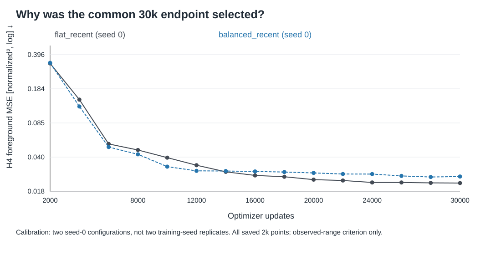
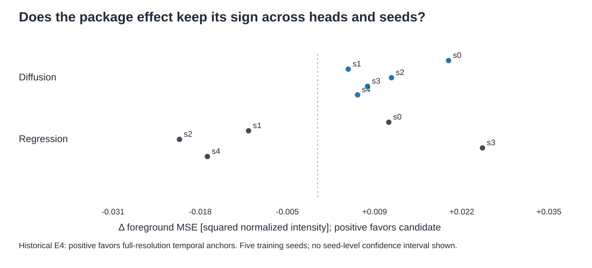
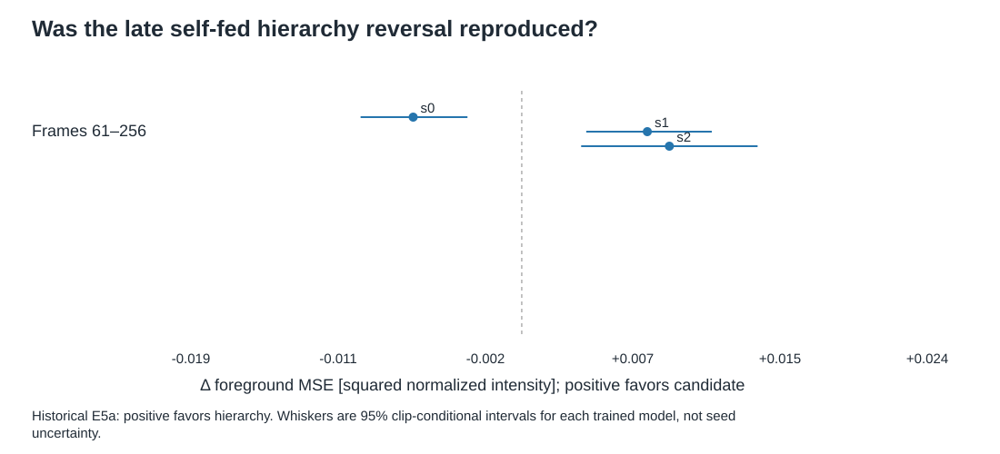
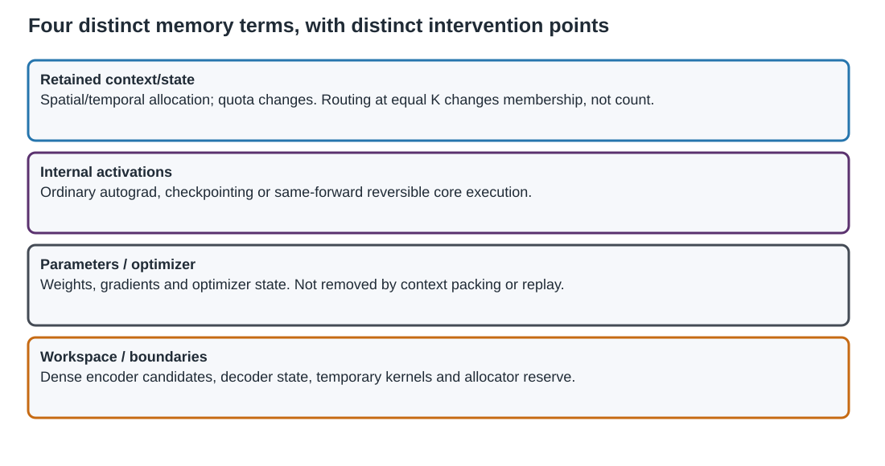
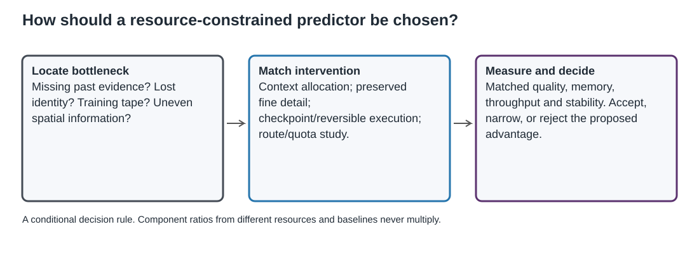

# Розділ 4 – Експериментальна валідація та визначення робочої області

The evidence is organized by the question answered, not by the chronology of scripts. New allocation results take the headline position only when their artifacts are complete. Historical evidence remains visible where it tests a different endpoint, particularly self-fed autoregressive behavior. Pending cells below are editorial placeholders, not simulated observations.

## 4.1 Експериментальна карта та правила порівняння

### 4.1.1 Questions and evidence status

The chapter asks: why use a common 30k endpoint; how does quality respond to retained budget and purchased reach; how do allocation, depth, ownership, and space–time placement matter; which failures persist under self-feedback; and can the integrated model achieve useful matched quality and measured memory on OpenSTL?

The complete 86-run matrix is a **registered development estimate**. A contrast earns **direction reproduced across two training seeds** only when both seed directions agree. **Sealed-holdout confirmation** applies only to the selected roles actually evaluated after the selection ledger is locked. A4-MEC is a **mechanism diagnostic**. E2–E8 are **historical/transfer boundary** evidence in this revised chapter, even where their own original protocol included protected confirmation. These statuses cannot be exchanged because two experiments use the same metric name.

### 4.1.2 Matched quantities and visible uncertainty

Every comparison identifies its invariant: retained payload, shared head, same forward function, detail quota, training schedule, or dataset protocol. Retained tokens, retained bytes, core activation storage, total allocated CUDA peak, reserved allocator peak, and runtime are separate endpoints. Ratios from different baselines are never multiplied.

Two-seed figures show both points and the arithmetic mean. Clip-level intervals are conditional on a trained model and retain the registered clustering and multiplicity correction. They do not represent the distribution of training outcomes. Main result tables contain one population and comparison family; configuration and hash tables reside in Appendices В and Г. All primary claims resolve through the claim registry shared with the abstracts and general conclusions.

## 4.2 Training endpoint and predictor-mechanism controls

### 4.2.1 Common 30k calibration

The archived calibration compares two seed-0 configurations at 1,792 tokens, not a replicated two-seed treatment contrast. The registered 2% rule and ordering condition reject the tested 8k, 12k, 16k, 20k, and 24k endpoints. Flat and Balanced recent exchange order between 12k and 16k. Thirty thousand updates were accepted as the common endpoint after reviewing this evidence; a crossing is an empirical optimization effect, not a rank-reversal feature in the implementation.

Figure D4-calibration — Horizon-4 foreground MSE against optimizer updates for the two seed-0 calibration configurations. Lower is better; points are saved 2k validations, not independent seed replicates. Source: hash-verified archived calibration logs and analysis; observed-range criterion only.

The figure uses every saved 2k validation point, including the earlier region where ranking differs. Its endpoint is horizon-4 foreground MSE, lower being better. The criterion only compares the observed training range. Passing at the terminal checkpoint alone would be tautological; the separate late-window stability check is therefore reported with the calibration artifact. This calibration does not establish that every primary configuration has converged or that the ordering remains unchanged beyond 30k.

### 4.2.2 Bounded regression/diffusion evidence

The historical head control compares a 7.27M-parameter regression predictor and a 7.53M-parameter diffusion predictor with the same width, depth, heads, latent normalization, and six-frame context on both levels. Diffusion improved the single-step candidate-coverage diagnostic, whereas regression had lower error in the reported one-candidate self-fed comparison. A ground-truth-selected best-of-eight result is an oracle diagnostic, not deployable prediction quality. Eight diffusion candidates at 16 NFE cost 128 network evaluations, versus eight for the regression diagnostic.

Table D4-head-single — Historical one-step foreground MSE, lower is better; six fixed evaluation batches. Candidate mean and oracle selection are separate estimands, with no training-seed interval inferred.

| Endpoint | Regression | Diffusion |
|---|---:|---:|
| Oracle best of eight | 0.0664 | 0.0512 |
| Mean of eight candidates | 0.0714 | 0.0640 |

Table D4-head-rollout — Historical single-candidate self-fed foreground MSE, lower is better. These are configuration-specific point estimates, not a ranking over all possible heads.

| Context package | Regression | Diffusion |
|---|---:|---:|
| Hierarchical | 0.1682 | 0.1848 |
| Flat | 0.2015 | 0.2038 |

The full source table, sharpness, persistence comparator, and conditional interval are preserved in Appendix Е. The new campaign fixes WindowDiT rather than selecting a different head for each package. Neither the oracle diagnostic nor the historical single-candidate comparison establishes universal diffusion superiority.

### 4.2.3 EBT as a negative mechanism diagnostic

The adapted Energy-Based Transformer could learn an ordering of some candidate states without demonstrating reliable cold-start descent into a structured prediction. These are distinct requirements. The tested EBT recipes and their energy/sharpness diagnostics are preserved in Appendix Е; they do not serve as competitive baselines for the new allocation matrix. Scaling EBT further would answer a different question and is not part of the current campaign.

## 4.3 Context budget and purchased temporal reach

### 4.3.1 Tenfold context-budget response

The six-point budget frontier compares Flat, Linear-age, and Geometric-age at their exact registered budgets, shared head and schedule, and seeds 0 and 1. Its primary view is horizon-4 foreground MSE against retained tokens. The numeric axis preserves the uneven spacing. No smooth universal crossover is fitted between six discrete interventions.

> [RESULT PENDING: A4_FRT_PRIMARY_FIG; evidence=registered development estimate; source=artifacts/v2/article4_primary_30k/post_training/all_final_development_metrics.json; registry=refactor_v2/registries/placeholders.json. No empirical value inserted.]

> [RESULT PENDING: A4_FRT_RESULTS_TABLE; evidence=registered development estimate; source=artifacts/v2/article4_primary_30k/post_training/all_final_development_metrics.json; registry=refactor_v2/registries/placeholders.json. No empirical value inserted.]

Interpretation is result-gated. If hierarchy improves both seed outcomes at small budgets but loses at larger ones, the conclusion is a bounded allocation regime. If directions disagree, report the disagreement. If Flat remains better, the hypothesis is not supported in this protocol. The plotted development matrix is not a long autoregressive stability curve and is not promoted wholesale to sealed confirmation.

### 4.3.2 Purchased coarse reach with fixed recent detail

The coarse-expansion study retains six recent full fine positions and adds 0, 4, 8, 16, 32, or 64 older coarse positions. Its response curve uses coarse positions on the horizontal axis and identifies the associated budgets. The intervention increases memory payload, attention work, sequence length, and reach together. A favorable result means that this compound purchase is useful; it is not a fixed-cost estimate of reach alone.

> [RESULT PENDING: A4_CEX_PRIMARY_FIG; evidence=registered development estimate; source=artifacts/v2/article4_primary_30k/post_training/all_final_development_metrics.json; registry=refactor_v2/registries/placeholders.json. No empirical value inserted.]

### 4.3.3 Re-entry confirmation and context use

The selected roles and checkpoint/config hashes must be locked before fresh confirmation evaluation. The current v2 finalizer uses the common 96-frame/28-frame frame-level re-entry mask defined in Section 3.5.2, not the historical E2 pair-specific pixel population. It summarizes per-frame foreground error over all four horizons and over flagged re-entry frames. These confirmation summaries differ from the horizon-4 development-selection metric. A favorable comparison licenses only its named selected configurations and this fixed population. Full-population quality remains visible alongside re-entry behavior.

> [RESULT PENDING: A4_CONFIRMATION_TABLE; evidence=sealed-holdout confirmation of selected roles only; source=artifacts/v2/article4_primary_30k/post_training/final_report.json; registry=refactor_v2/registries/placeholders.json. No empirical value inserted.]

> [RESULT PENDING: A4_MEC_DIAGNOSTIC_FIG; evidence=mechanism diagnostic; source=artifacts/v2/article4_primary_30k/post_training/final_report.json; registry=refactor_v2/registries/placeholders.json. No empirical value inserted.]

The current attention output is a one-clip direct denoiser probe at time 0.5 with target-latent inputs, not a sampled-trajectory context-ablation test. Attention concentration alone is not a causal demonstration of useful retrieval. Missing or failed diagnostics are reported rather than replaced with a favorable qualitative example. A richer causal probe would be a separate registered evaluation, not an editorial relabelling of this one.

### 4.3.4 Historical self-fed reach evidence (E2)

Legacy E2 remains substantive because its self-fed protocol is not the new four-frame endpoint. On the protected `hier-min`/`flat-min` reach-difference population, relevant evidence was older than 14 and no older than 48 frames, with the original visibility and nonempty-foreground conditions. The foreground-error advantage was +0.0980 for training seed 0 and +0.0914 for seed 1. Conditional clip-clustered 95% intervals were [0.0788, 0.1179] and [0.0736, 0.1098]. Positive values mean lower error for the hierarchy; these intervals do not quantify variation over training seeds.

**Рисунок 4.4 – Ефекти у визначених для кожної пари вибірках досяжності.** Для обох ініціалізацій перевага ієрархії в зареєстрованій смузі досяжності більша, ніж у повній оцінюваній вибірці, що відповідає механізму, передбаченому геометрією пакета. *Джерело: побудовано автором за замороженими результатами E2.*

**Таблиця 4.2 – Повний набір підтверджувальних показників у відкладеній вибірці $14<\Delta t\le48$.** Кожен рядок містить 1 006 записів кадрів із 96 кліпів. Інтервали отримано парним статистичним виведенням з урахуванням кластеризації за кліпами для названої навченої моделі; два стовпці ініціалізацій не об’єднуються.

| Показник | Ефект для ініціалізації 0 [95 % ДІ] | Ефект для ініціалізації 1 [95 % ДІ] |
|---|---:|---:|
| MSE для непорожнього еталонного переднього плану | +0,0980 [0,0788; 0,1179] | +0,0914 [0,0736; 0,1098] |
| MSE для об’єднаної маски | +0,0808 [0,0632; 0,0987] | +0,0773 [0,0613; 0,0940] |
| MSE для повного кадру | +0,0045 [0,0033; 0,0058] | +0,0042 [0,0032; 0,0052] |
| MSE еталонного фону | +0,0013 [0,0006; 0,0019] | +0,0012 [0,0006; 0,0017] |
| Прецизійність переднього плану | +0,1550 [0,1027; 0,2066] | +0,0691 [0,0051; 0,1317] |
| Повнота переднього плану | +0,2708 [0,2180; 0,3238] | +0,2539 [0,2060; 0,3029] |
| F1-показник для переднього плану | +0,2458 [0,1975; 0,2954] | +0,2342 [0,1893; 0,2801] |
| Уникнення пропущених компонентів | +0,4911 [0,3686; 0,6102] | +0,5527 [0,4315; 0,6699] |
| Уникнення зайвих компонентів | +0,3231 [0,1530; 0,4915] | +0,1968 [0,0334; 0,3701] |
| Покриття компонентів | +0,2622 [0,1968; 0,3264] | +0,2992 [0,2370; 0,3605] |

The accompanying union-mask, false/missed component, and coverage endpoints guard against explaining foreground MSE by simply omitting difficult objects. E2 supports the original configuration and protected population, not every v2 allocation or a universal long-rollout guarantee. Its B1 extension also changes target stride, target tokens, auxiliary loss, and training work; that result belongs to the complete configuration. Full E2 arithmetic and the old frontier remain recoverable in Appendix Е.

## 4.4 Allocation, hierarchy depth, overlap, and space–time placement

### 4.4.1 Allocation policy at 1,792 tokens

The seven-policy allocation study holds retained payload fixed and reuses three frontier pairs. The primary horizontal dot plot orders policies by their two-seed development mean while showing both seed points. Order is descriptive; the selected policy must follow the registered selection rule, including eligibility for dependent constructions.

> [RESULT PENDING: A4_ALC_PRIMARY_FIG; evidence=registered development estimate; source=artifacts/v2/article4_primary_30k/post_training/all_final_development_metrics.json; registry=refactor_v2/registries/placeholders.json. No empirical value inserted.]

### 4.4.2 One, two, or three levels

The level-depth comparison includes reused Flat and two-level checkpoints and the new three-level pair. Its figure reports exact token counts, top-stream presence, and the 1,280-parameter difference in the provenance note. A positive or negative effect concerns these constructions, including payload reallocation and slot rounding. It is not evidence that adding an abstract level necessarily helps or hurts.

> [RESULT PENDING: A4_LVL_PRIMARY_FIG; evidence=registered development estimate; source=artifacts/v2/article4_primary_30k/post_training/all_final_development_metrics.json; registry=refactor_v2/registries/placeholders.json. No empirical value inserted.]

### 4.4.3 Nested, exclusive, and residual packages

The ownership study compares the registered packages at fixed total tokens. Exclusive ownership relocates coarse ages; residual ownership changes the fine representation. Report the dependency-selected base and its feasibility constraint. Avoid the phrase “isolated effect of overlap.”

> [RESULT PENDING: A4_OVR_PRIMARY_FIG; evidence=registered development estimate; source=artifacts/v2/article4_primary_30k/post_training/all_final_development_metrics.json; registry=refactor_v2/registries/placeholders.json. No empirical value inserted.]

### 4.4.4 Fine quota and temporal placement

At budget 1,792, the four fine quotas and three temporal placements define a 4×3 response surface. A mean heat map is accompanied by both seed surfaces, not a hidden average alone. This experiment tests where spatial detail should be retained over time. Its deterministic spatial policy is a bridge to, not empirical proof of, content-adaptive integrated routing.

> [RESULT PENDING: A4_STS_PRIMARY_FIG; evidence=registered development estimate; source=artifacts/v2/article4_primary_30k/post_training/all_final_development_metrics.json; registry=refactor_v2/registries/placeholders.json. No empirical value inserted.]

The token arithmetic belongs to the configuration appendix. Analytic ratios such as those reported for historical packages concern retained tokens or latent payload. They are not measured end-to-end VRAM ratios and do not imply equal-quality savings.

## 4.5 Форма контекстного пакета та взаємодія з моделлю

### 4.5.1 Historical package/head interaction (E4)

The historical five-seed factorial study asks whether temporal subsampling and spatial coarsening have the same ranking under different prediction heads. Diffusion favored full-resolution temporal anchors in all five reported seeds. Regression changed direction across seeds. The comparison is nearly, not exactly, token-matched: `strided-flat` has 1,088 tokens and `hier-long` 1,152.

Figure D4-E4 — Signed foreground-MSE difference, spatial-package error minus temporal-package error, in squared normalized pixel intensity; positive favors full-resolution temporal anchors. Each point is one trained seed's clip-aggregated effect across all 152 self-fed forecast frames in 100 development clips after a 48-frame warmup. Five seeds are shown per prediction head. No clip interval is drawn as training-seed uncertainty. Values are transcribed mechanically from source Table 4.4, not recomputed from raw arrays. The packages contain 1,152 versus 1,088 tokens; this is historical, nearly matched evidence, not the v2 frontier. Full clip-conditional intervals remain in Appendix Е.

### 4.5.2 Implication for the new campaign

E4 motivates a fixed head, common training schedule, and visible seed outcomes. It is not pooled statistically with the new matrix. Regression heterogeneity is not evidence of a stable reversed preference, and a head/package interaction is not isolated by changing several training interfaces at once. The new allocation result therefore stays tied to its WindowDiT contract.

## 4.6 Робастність основних напрямів

### 4.6.1 Replication and immutable configuration

All new primary runs share two training seeds and the final 30k endpoint. Configurations, data, codec, source commit, and completed checkpoint hashes are validated before aggregation. A missing seed is an incomplete comparison, not a one-seed mean. An interrupted/restarted run resumes its saved state and is not counted as an additional independent replicate. The complete matrix remains development evidence even after selected holdout contrasts are confirmed.

### 4.6.2 Historical sampler and codec boundaries

Legacy E7c varies NFE and generator randomness for fixed trained checkpoints. Generator seeds are not training seeds. E7a replaces the codec and retrains predictors; it changes reconstruction, normalization, latent geometry, and optimization jointly. Their full simultaneous intervals are in Appendix Д/Е. The upper-budget flat inversion was less certain than the lower-budget effects, so neither check licenses a universal threshold. The main chapter does not duplicate their composite plots.

## 4.7 Межа та негативні докази

### 4.7.1 Non-replicated late reversal under self-feedback (E5a)

The original seed-0 long-loop run suggested a late hierarchy disadvantage, but two new training seeds did not reproduce it. For forecast frames 61–256 the reported effects were −0.0064 [−0.0095, −0.0032], +0.0074 [0.0038, 0.0112], and +0.0087 [0.0035, 0.0139]. Positive favors the hierarchy; intervals are conditional clip-level intervals for each trained model.

Figure D4-E5 — Signed foreground-MSE difference, contiguous-fine error minus long-reach-hierarchy error, in squared normalized pixel intensity. Positive favors hierarchy. The population is nonempty ground-truth foreground records in forecast frames 61–256 of 100 development clips after a 224-frame warmup. Points show training seeds 0, 1, and 2; whiskers are 95% clip-bootstrap intervals conditional on each trained pair. The configurations have unequal retained budgets (3,072 versus 1,280 tokens), so this is a configuration-level long-rollout boundary, not an equal-memory contrast. The negative seed-0 direction is not reproduced. Source values and interval limits accompany the plot; no raw-array reanalysis or v2 extrapolation is implied.

The correct conclusion is that rollout age is not a calibrated switching rule. Seed 0 does not establish a universal degradation time. Nor do the positive replications prove stable behavior for arbitrary horizons. This negative result remains in the main narrative because it prevents a stronger but unsupported claim.

### 4.7.2 Coverage/trajectory versus persistent identity (E6)

Historical E6 evaluates 300 self-generated frames in 100 protected clips after a 48-frame warmup, using three seeds per package at 1,152 context tokens. The persistent-object assignment is fixed before evaluation. Hierarchy improves the point estimates for coverage and trajectory error, but only seeds 0 and 2 have nonzero simultaneous intervals for those endpoints. Flat preserves digit identity better in all three seeds. Low absolute identity accuracy means neither configuration solves the task.

**Рисунок 4.11 – Просторове покриття й неперервність проти ідентичності у довгому Moving-MNIST з об’єктами, що зберігаються в часі.** Напрям покриття й похибки траєкторії сприяє ієрархії для всіх трьох ініціалізацій, але одночасні інтервали не перетинають нуль лише для ініціалізацій 0 і 2. Плоский контекст краще зберігає ідентичність цифр для всіх трьох ініціалізацій. Низькі абсолютні показники не дають підстав вважати задачу розв’язаною. *Джерело: побудовано автором за замороженими результатами E6.*

The full relative and absolute tables are split in Appendix Е so effect units are not mixed with raw measurements. Long Moving-MNIST is retained here solely as historical/transfer boundary evidence. It is excluded from the new hierarchy campaign and is not the standard Moving MNIST OpenSTL experiment planned below.

### 4.7.3 Privileged access and old external feasibility

E8a's pose-indexed raw memory has privileged camera information and stores observed pixels without the learned token budget. It diagnoses the gap between potential access and learned reuse, not a competitive memory baseline. Its complete plot is moved to Appendix Е. Earlier short Moving-MNIST/TaxiBJ feasibility results are also retained there as historical context while new matched results are pending; they are not relabelled as results of the new integrated architecture.

### 4.7.4 Optional v2 self-fed evaluation

> [RESULT PENDING: A4_SELECTED_ROLLOUT_FIG; evidence=registered development estimate; source=separately authorized sealed rollout bundle (not yet registered); registry=refactor_v2/registries/placeholders.json. No empirical value inserted.]

This placeholder is inactive unless the separate selected-checkpoint rollout is authorized and registered. It requires evaluation, not retraining or relaunch of the 86 runs. If absent, remove this result slot at release and retain E5/E6 as the evidence for long autoregressive behavior.

## 4.8 Integrated model composition and OpenSTL results

This section is an explicit evidence-gated draft. The current architecture is implemented; competitive prediction and measured GPU-memory savings are not inferred from compatibility tests. The old fixed-region/second-order prototype is not used to fill these cells.

### 4.8.1 Correctness and parity gates

The recorded CPU checks establish the bounded quota, coordinate, core inverse/parity, shape, checkpoint, and OpenSTL interface contracts listed in Appendix Ж.v2.1. Dynamic full-model parameter parity and deployed CUDA mixed-precision position/switch checks remain explicit gates. No GPU-memory or competitive-quality result is reported by this summary.

CPU quota, metadata, inverse, core parity, checkpoint, and OpenSTL smoke tests establish bounded compatibility. Full-model dynamic parameter-gradient parity, deployed mixed-precision permutation behavior, route switches under trained weights, and CUDA stability retain their own statuses. A passing CPU gate is not an empirical performance result.

### 4.8.2 Measured component memory and checkpointing

The intended six-component comparison is Flat-Dense, Hier-Static, Flat-Reversible, Hier-Static-Reversible, Hier-Dynamic, and Full. Same-checkpoint ordinary/reversible execution isolates storage in an identical forward function. Flat-versus-hierarchy quality and static-trained versus route-aware quality need separately trained checkpoints; execution toggles do not replace those ablations.

> [RESULT PENDING: INT_COMPONENT_ABLATION_TABLE; evidence=conditional integrated evidence cell; source=integrated accepted evidence bundle (not yet measured/locked); registry=refactor_v2/registries/placeholders.json. No empirical value inserted.]

> [RESULT PENDING: INT_COMPONENT_MEMORY_FIG; evidence=conditional integrated evidence cell; source=integrated accepted evidence bundle (not yet measured/locked); registry=refactor_v2/registries/placeholders.json. No empirical value inserted.]

> [RESULT PENDING: INT_CHECKPOINTING_PROFILE; evidence=conditional integrated evidence cell; source=integrated accepted evidence bundle (not yet measured/locked); registry=refactor_v2/registries/placeholders.json. No empirical value inserted.]

Profiles must pair host, batch, precision, horizon, optimizer state, warmup, and measurement boundaries. Report retained bytes, inference allocated/reserved peak, training allocated/reserved peak, activation increment, throughput, and recomputation. Checkpointing is the practical same-model comparator [30, 175]. If it is absent, the reversible claim is restricted to comparison with ordinary autograd; no best-available memory–compute claim is made.

The default retained-token arithmetic is 2,560 versus 800 on Moving MNIST and 256 versus 80 on TaxiBJ: a 3.2 token-count ratio in each case. These counts exclude several live boundary tensors and do not establish a 3.2× CUDA-memory saving. Dynamic routing at unchanged quota has the same retained-token count; it cannot be counted as another memory multiplier.

### 4.8.3 Routing quality, quota, and stability

> [RESULT PENDING: INT_ROUTING_SWITCH_FIG; evidence=conditional integrated evidence cell; source=integrated accepted evidence bundle (not yet measured/locked); registry=refactor_v2/registries/placeholders.json. No empirical value inserted.]

> [RESULT PENDING: INT_ROUTING_TRAINING_REGIME_FIG; evidence=conditional integrated evidence cell; source=integrated accepted evidence bundle (not yet measured/locked); registry=refactor_v2/registries/placeholders.json. No empirical value inserted.]

> [RESULT PENDING: INT_ROUTING_STABILITY_FIG; evidence=conditional integrated evidence cell; source=integrated accepted evidence bundle (not yet measured/locked); registry=refactor_v2/registries/placeholders.json. No empirical value inserted.]

> [RESULT PENDING: INT_QUOTA_FRONTIER_FIG; evidence=conditional integrated evidence cell; source=integrated accepted evidence bundle (not yet measured/locked); registry=refactor_v2/registries/placeholders.json. No empirical value inserted.]

Static/density/hybrid inference switches on a route-aware checkpoint test robustness to membership and score-feature changes. Static-only versus mixed exposure is a separate training contrast. Report quality together with coverage, score entropy, frame allocation, churn/Jaccard, margin limitations, and seam/flicker diagnostics. A smaller dynamic quota is a memory benefit only when the real packed tensor and measured resource decrease while the declared quality tolerance is met. If no smaller-quota test is completed, describe routing only as an allocation mechanism.

### 4.8.4 Moving MNIST

> [RESULT PENDING: INT_MM_RESULTS_TABLE; evidence=conditional integrated evidence cell; source=integrated accepted evidence bundle (not yet measured/locked); registry=refactor_v2/registries/placeholders.json. No empirical value inserted.]

The full model uses the OpenSTL 10-to-10 protocol, seeds 0 and 1, validation-only checkpoint selection, and one locked test evaluation. Report MSE, MAE, SSIM, and PSNR with the implementation's scaling, test-set size, and channel reduction. Fixed qualitative strips follow aggregate results and use locked clip indices; no best-case selection is allowed. If the model misses the declared quality tolerance, report the miss even if its memory is lower.

### 4.8.5 TaxiBJ

> [RESULT PENDING: INT_TAXIBJ_RESULTS_TABLE; evidence=conditional integrated evidence cell; source=integrated accepted evidence bundle (not yet measured/locked); registry=refactor_v2/registries/placeholders.json. No empirical value inserted.]

TaxiBJ uses the two-channel 4-to-4 32×32 protocol with its original normalization and split. Seed outcomes and matched local baselines are reported independently of Moving MNIST. These two datasets establish bounded synthetic and real-data behavior, not general superiority on natural video.

### 4.8.6 Matched baselines and the claim decision

> [RESULT PENDING: INT_MATCHED_BASELINE_TABLE; evidence=conditional integrated evidence cell; source=integrated accepted evidence bundle (not yet measured/locked); registry=refactor_v2/registries/placeholders.json. No empirical value inserted.]

> [RESULT PENDING: INT_MM_PARETO_FIG; evidence=conditional integrated evidence cell; source=integrated accepted evidence bundle (not yet measured/locked); registry=refactor_v2/registries/placeholders.json. No empirical value inserted.]

> [RESULT PENDING: INT_TAXIBJ_PARETO_FIG; evidence=conditional integrated evidence cell; source=integrated accepted evidence bundle (not yet measured/locked); registry=refactor_v2/registries/placeholders.json. No empirical value inserted.]

> [RESULT PENDING: INT_CROSS_DATASET_SYNTHESIS; evidence=conditional integrated evidence cell; source=integrated accepted evidence bundle (not yet measured/locked); registry=refactor_v2/registries/placeholders.json. No empirical value inserted.]

Published numbers are contextual references unless data, normalization, selection, schedule, metric implementation, precision, hardware, and profiling boundaries match. Existing compatible local checkpoints may avoid retraining; incompatible ones require new authorization and a budget estimate. Four final full-model runs do not include this additional baseline work. A Pareto-improving claim requires measured quality and memory under the matched protocol: no comparator may be both more accurate and lower-memory. Report dataset-specific failure or parity rather than averaging it away. If evidence is absent, this section contracts to architecture/correctness and explicitly untested hypotheses.

## 4.9 Правило вибору методу на системному рівні

### 4.9.1 Four diagnostic questions

First, is useful past evidence outside the flat window? Second, is error dominated by coverage/trajectory or by fine identity? Third, is the limiting resource retained deployment state, training activations, or both? Fourth, is information density sufficiently uneven and stable to justify the router's overhead? These questions identify the intervention and the endpoint needed to test it.

Figure D4-resources — Spatial/temporal allocation changes retained evidence; reversibility changes stored core activations; parameters/optimizer and workspace remain separate accounting terms. No arrow represents multiplication of independently measured ratios.

Figure D4-decision — Inspect the bottleneck, choose a matched comparison, and accept only a quality–resource trade-off supported by that comparison. Routing remains optional if overhead or instability outweighs its benefit.

### 4.9.2 Bounded design rule

The dissertation's outcome is an operating region rather than a universal winner. Coarse older evidence is useful only if it is both relevant and usable. Reversibility is useful only where activation storage matters enough to justify recomputation. Spatial routing is useful only where allocation quality or a smaller viable quota offsets its scoring and boundary costs. Failure of full composition does not invalidate a separately measured component result; it limits the integrated claim.

## 4.10 Набір програмних засобів та практичне застосування

### 4.10.1 Released software and research controllers

Published software for the procedural datasets, TempVerseFormer, and V-BLT is distinguished from later research branches [171–173]. The Article 4 and integrated controllers use immutable configs, checkpoint resume, local-authoritative logs, and W&B mirroring. Exact commands, source hashes, model tests, profile boundaries, and evidence-cell statuses are in Appendix Ж. A W&B chart is a visualization of local artifacts, not an independent result or an alternative source of truth.

### 4.10.2 Institutional use

Інструментарій має дослідницьке й навчальне призначення. Він містить повторно використовувані генератори, інтерфейси пакетів, засоби оцінювання розгортань і статистичні процедури, завдяки чому перевірка механізму не змішується з оцінюванням загальної продуктивності. Перед додаванням нового пакета потрібно визначити геометрію прив’язок, кількість контекстних і цільових токенів, допустимий тип порівняння та оцінювану популяцію. Ця дисципліна є окремим практичним результатом дисертації.

Звіти про впровадження документують використання в ТОВ «ОРНЕТІКА» та в навчальному процесі Вінницького національного технічного університету від 14 жовтня 2025 року та 19 вересня 2025 року. Затверджена сфера застосування охоплює методи реверсивного трансформера та токенізації ентропії. Ці звіти не можна переосмислювати як валідацію розгортання предиктора, описаного в розділі 3. Остаточні адміністративні додатки повинні відтворювати наданий автором підписаний текст та скановані копії.

## 4.11 Обмеження та загрози валідності

### 4.11.1 Internal and construct validity

The frozen head/codec and immutable configurations limit uncontrolled changes but do not turn compound CEX/LVL/OVR interventions into isolated mechanisms. Retained tokens are not total memory; foreground quality is not identity; context reach is not rollout stability. TRB's static toroidal world and action-conditioned viewport make exact observability possible but restrict the ecological scope of the result.

### 4.11.2 Statistical and external validity

Two training seeds show the outcomes of two runs, not a well-estimated seed distribution. Six budgets define discrete observed regimes, not a continuous scaling law. Selection remains development-only; protected evaluation is restricted to its registered roles. Routing and quota selection must not use test data. Same-host profiles and compatible baseline protocols are necessary for memory claims. Moving MNIST and TaxiBJ do not cover natural-video diversity or arbitrary future horizons.

### 4.11.3 Chapter conclusions and release gate

> [RESULT PENDING: CLAIM_A4_SUMMARY; evidence=registered development estimate; source=artifacts/v2/article4_primary_30k/post_training/all_final_development_metrics.json; registry=refactor_v2/registries/placeholders.json. No empirical value inserted.]

> [RESULT PENDING: CLAIM_INT_SUMMARY; evidence=conditional integrated evidence cell; source=integrated accepted evidence bundle (not yet measured/locked); registry=refactor_v2/registries/placeholders.json. No empirical value inserted.]

The final ordering is: registered development allocation results; sealed confirmation of selected contrasts; exact-status allocation diagnostics; historical self-fed and negative boundaries; measured component memory; and the dataset-specific matched OpenSTL position. Until the claim ledger is locked, neither this conclusion nor the abstracts claim a successful new frontier or integrated superiority. Missing, neutral, and negative outcomes remain scientifically valid endpoints of the planned comparisons.
