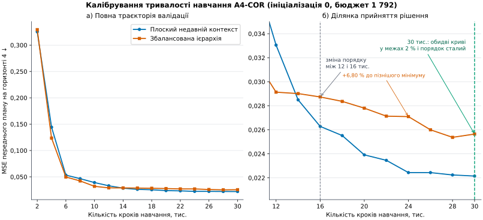
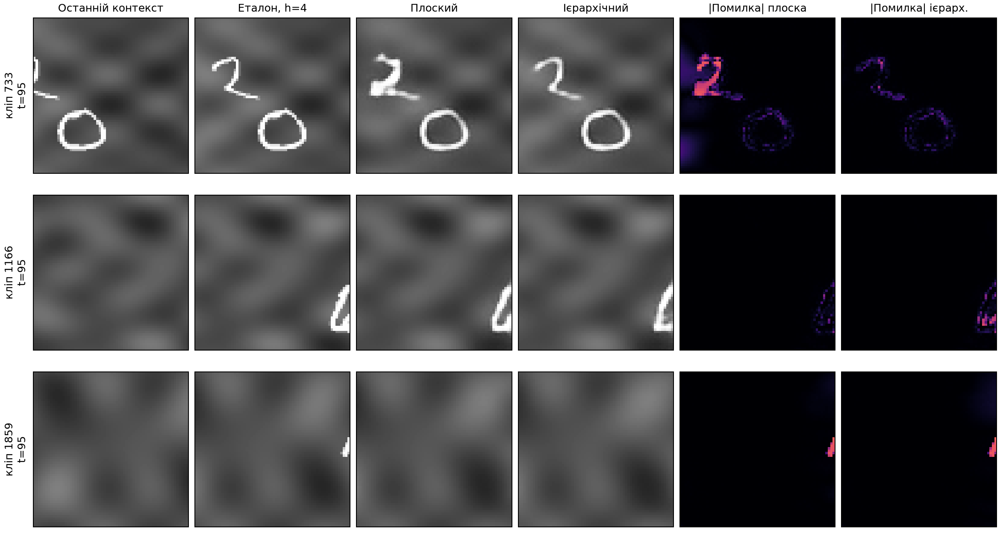
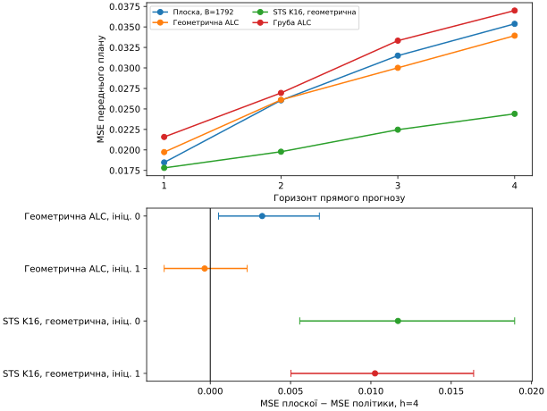
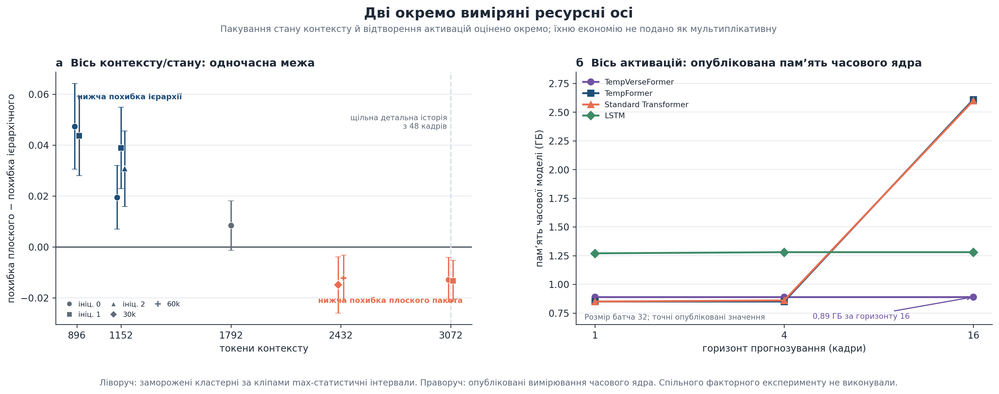
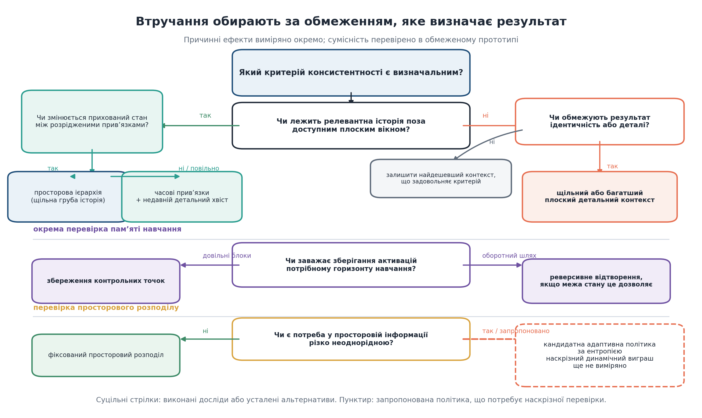

# Розділ 4 – Експериментальна валідація та визначення робочої області

У цьому розділі викладено завершальні докази дослідження ієрархічного контексту, що становить основу рукопису [136]. Виклад підпорядковано дослідницьким питанням і рівням доказовості, а не хронології експериментів. Оскільки модель із розділу 3 залежить від конкретних проєктних рішень, експерименти перевіряють не лише розмір пакета, а й механізм генерації, користь довшої історії, ціну просторової деталізації та робастність висновків до інших джерел варіативності. Структурна матриця контекстів поглиблює цю постановку вздовж осей загального бюджету, розподілу між рівнями, розширення грубого контексту, кількості рівнів, перекриття та просторово-часового розміщення детальної квоти; її протокол відокремлено від наявних E2–E8, щоб не змішувати різні популяції й режими статистичного виведення.

Основний підсумок можна сформулювати одним реченням: ієрархія забезпечує досяжність, коли релевантна історія інакше була б недоступною, тоді як плоский контекст зберігає точність відтворення, коли потрібний часовий інтервал уже доступний. Це твердження стосується виміряних робочих областей, а не загального ранжування архітектур.

## 4.1 Експериментальна карта та правила порівняння

Розділ починається з правил читання доказів, а не з окремих чисел. Цей підрозділ пов’язує дослідницькі питання з експериментальними програмами, розмежовує розроблення, підтвердження, робастність і зовнішні межі, а також установлює єдину орієнтацію знаків та словник бюджетів для подальших порівнянь.

### 4.1.1 Дослідницькі питання, набори даних та рівні доказовості

Послідовність початкових експериментів визначено чотирма питаннями. Перше стосується механізму генерації: чи дає стохастичний дифузійний вихідний модуль корисну перевагу над прямою регресією та чи придатний енергетичний спуск як альтернатива у доступному масштабі? Друге питання перевіряє, чи покращує прогнозування довша доступна історія саме для тих записів, де вона потрібна. Третє з’ясовує, чи змінюється порядок методів після того, як плоске вікно наближається до тієї самої часової протяжності й зберігає повну просторову деталізацію. Четверте питання визначає межі висновків: чи зберігаються основні напрями ефектів для різних ініціалізацій навчання, параметрів генератора, незалежно навченого кодека та задачі з об’єктами, ідентичність яких простежується в часі.

Матриця структурних порівнянь ставить п’ять додаткових питань. По-перше, який спільний фіксований бюджет навчання зменшує ризик раннього хибного ранжування конфігурацій? По-друге, як змінюється компроміс «досяжність–точність відтворення» на широкій числовій шкалі бюджетів? По-третє, як за сталого бюджету впливає розподіл токенів між грубим і детальним рівнями та збільшення кількості рівнів? По-четверте, як часове перекриття і просторово-часове розміщення сталої детальної квоти змінюють використання контексту? По-п’яте, чи утворюють ієрархічне фізичне пакування, маршрутизація та реверсивне ядро коректну композицію, а їхній внесок у збережений стан і пам’ять активацій — вимірювані, але окремі ефекти? У головному тексті використовуються змістові назви сімейств; повні машинні ідентифікатори належать до конфігураційного реєстру.

Тороїдальний тест повторного входу (TRB; внутрішня назва `LoopMom`) слугує інструментом для ідентифікації механізму досяжності. Вікно перегляду розміром $64\times64$ переміщується тороїдальним світом розміром $192\times64$, що містить текстури та спрайти цифр. У кожен момент дві третини світу перебувають поза вікном, а в основній робочій точці релевантний вміст повертається приблизно через 48 кадрів. Збережені координати дають змогу точно визначити останнє спостереження кожного видимого стовпця світу. Йдеться про геометричну спостережуваність, але не про доведену інформаційно-теоретичну необхідність: апріорний розподіл цифр може робити частину неспостережуваного вмісту передбачуваною. Структурна матриця використовує лише TRB, однакову 96-кадрову систему координат контексту та спільну чотирикадрову ціль, тоді як стандартний і довгий Moving-MNIST не входять до цієї матриці.

Для стислого посилання на експериментальні програми далі використано коди E2, E4b, E5a, E6, E7a, E7c та E8a; B1 позначає окреме порівняння повних конфігурацій. Коди є ідентифікаторами доказових програм, а не послідовними етапами однієї траєкторії. Повне зіставлення кодів із питаннями, класами доказів і виконаними варіантами перенесено до таблиці В.7.

Класи доказів залишаються відмінними навіть тоді, коли їхні артефакти входять до одного релізу. Ініціалізації алгоритму вибірки характеризують випадковість генерації для фіксованої моделі й не замінюють незалежних навчань. Еталон E8a отримує прямий доступ і тому не є справедливою базовою моделлю. B1 підтверджує лише виконану конфігурацію, оскільки разом із кроком контексту змінює цільовий інтерфейс.

Цей порядок відокремлює вибір механізму від підтвердження контекстного ефекту. Повну візуальну матрицю виконаних гілок, токенних бюджетів, цільових інтерфейсів, ініціалізацій і структурно відсутніх комірок перенесено на рисунок В.1. Вона залишається частиною доказового реєстру, але не перериває основну аргументацію. Інтегрований предиктор зі сталими ділянками до цієї матриці не входить: він використовує інтерфейс OpenSTL, регресійний SimVP і окремий інженерний профіль пам’яті, тому його протокол подано в §4.9. Інтегрована архітектура з адаптивним пакуванням також оцінюється окремо, оскільки її питання стосуються фізичного пакування, маршрутизації, реверсивного ядра з тотожною прямою функцією та зіставної якості на Moving MNIST і TaxiBJ, а не причинного ефекту TRB-пакета.

### 4.1.2 Словник бюджету та правила порівняння

Порівняння далі називається *зіставленим* лише щодо явно названого ресурсу, а не через повну тотожність конфігурацій. Майже зіставлена пара відрізняється у задекларованому напрямі: `strided-flat` використовує 1 088 токенів контексту, а `hier-long` – 1 152, тому дефіцит у 64 токени надає невелику перевагу контролю з часовим прорідженням. Експеримент B1 належить до іншої категорії. У ньому одночасно змінюються крок контексту, крок цілі, кількість цільових слотів, допоміжна функція втрат, довжина послідовності та обчислювальне навантаження, тому його результат стосується повної конфігурації.

Для показника $m$ через $\bar m_{\mathrm{candidate}}$ позначено середнє значення кандидата, а через $\bar m_{\mathrm{comparator}}$ – середнє значення порівнюваної конфігурації. Введемо коефіцієнт напряму $s_m=+1$ для метрик «менше — краще» і $s_m=-1$ для метрик «більше — краще». Щоб додатний знак завжди означав перевагу кандидата, ефект визначено як

$$
\Delta_m=s_m\left(
\bar m_{\mathrm{comparator}}-\bar m_{\mathrm{candidate}}
\right).
\tag{4.1}
$$

Така орієнтація полегшує читання неоднорідних панелей, однак метрики мають різні шкали й не допускають прямого числового зіставлення. Наприклад, зміну MSE об’єднаної маски на 0,01 не можна прирівняти до зміни точності ідентифікації на 0,01. Для сімейства верхньої межі зареєстрованим кандидатом є плоский пакет. Тому додатний ефект у перевірках робастності свідчить на його користь, хоча в основній таблиці E2 різницю втрат подано як «плоский мінус ієрархічний».

Позначка «очікується» в таблицях означає відсутність перевірених вимірювань. Умови протоколу можна описати до виконання, проте такі місця не підтримують висновку про напрям ефекту. Повний реєстр комірок, залежностей і джерел подано в додатку И.

### 4.1.3 Обґрунтування спільного зрізу 30 000 кроків

Перед відкриттям відкладеної вибірки E2 технічну готовність вихідних модулів перевірено за діагностикою оптимізації; вона не використовується як підтверджувальний доказ. За 6 000 оновлень два предиктори залишаються невирішеними, тоді як незалежно навчені предиктори за 20 000 оновлень дають позитивний напрям. Це окремі графіки, а не контрольні точки однієї траєкторії. Для структурної матриці A4 спільний бюджет обрано за парною діагностикою: плоску недавню та збалансовану ієрархічну конфігурації з однаковим бюджетом 1 792 токени навчено до 30 000 кроків і оцінено через кожні 2 000 кроків на тому самому фіксованому валідаційному наборі. Два типи діагностики показано разом на рисунку 4.1.

**Рисунок 4.1 – Діагностика вибору фіксованого бюджету оптимізації на етапі розроблення.** Верхня ілюстрація зіставляє чотири окремі журнали для 6 000 та 20 000 оновлень. Нижня ілюстрація показує всі 15 валідаційних точок двох калібрувальних траєкторій A4-COR до 30 000 кроків і збільшений фрагмент прийняття рішення. Обидві частини обґрунтовують тривалість навчання, але не є доказом переваги певного розподілу контексту. *Джерело: заморожені журнали розроблення та запечатаний аналіз A4-COR.*

Правило прийняття рішення вимагало, щоб кожна конфігурація перебувала в межах 2 % від свого найкращого пізнішого значення, а знак різниці між конфігураціями більше не змінювався. За основною метрикою MSE переднього плану на четвертому горизонті порядок конфігурацій змінився між 12 000 і 16 000 кроків. На 16 000 кроків плоска й ієрархічна криві ще перевищували свої найкращі пізніші значення відповідно на 18,66 % і 13,25 %. На 24 000 кроків плоска конфігурація вже виконувала двовідсоткову умову, але збалансована ієрархія залишалася на 6,80 % вище свого пізнішого мінімуму. Лише зріз 30 000 кроків одночасно виконав умову для обох кривих і зберіг усталений порядок; найбільша різниця між фінальним і найкращим значенням у вікні 24 000–30 000 становила 1,07 %. Застосування того самого правила до шести метрик також вибрало 30 000 кроків. Однак у кінцевій точці множина значень «на цьому або пізнішому кроці» містить лише поточне значення: відносний розрив автоматично дорівнює нулю, а перевірка подальшого порядку є тривіальною. Узгодження шести метрик не усуває цієї властивості. Отже, 30 000 є спільним фіксованим бюджетом, а не доведеною точкою збіжності; подальше поліпшення залишається можливим.

Обидва калібрувальні запуски використали лише ініціалізацію 0, приблизно 3,79 ГіБ пікової виділеної CUDA-пам’яті та тривали 2,25 і 2,39 год відповідно. Тому вони обґрунтовують спільний навчальний зріз для 86 запусків, але не дають оцінки варіативності між ініціалізаціями й не встановлюють переваги ієрархії. Кінцеве прийняття правила не доводить збіжності; тестову вибірку під час калібрування не відкривали.

## 4.2 Вибір механізму генерації

Перш ніж порівнювати форми контексту, потрібно зафіксувати вихідний механізм, щоб його зміна не змішувалася з ефектом пам’яті. Тут пряма регресія зіставляється з дифузією за спільного кодека й контрольованої ємності, а енергетичний спуск оцінюється як окрема альтернатива. Наприкінці формулюється вибір, який використовується в основній програмі.

### 4.2.1 Регресія та дифузія за контрольованої ємності

Для дослідження контексту потрібний вихідний модуль прогнозування, проте його вибір за звичкою додав би непотрібне припущення до кожного наступного порівняння. Обидва варіанти використовують трансформер шириною 256 із шістьма блоками та вісьмома головами уваги. Регресійна і дифузійна моделі містять відповідно 7,27 та 7,53 млн параметрів. Контекст на обох рівнях прихованого простору складається із шести кадрів, а ціль розташована через чотири дії після останнього кадру контексту. Стандартизація представлень у прихованому просторі за каналами й рівнями є спільною. Відмінність двох шляхів від входу до прогнозу узагальнено на рисунку 4.2.

**Рисунок 4.2 – Цілі генерації в межах задачі спільного контексту.** *Джерело: авторська схема експериментального протоколу.*

«Best-of-$N$» використано лише як діагностику з вибором найкращого кандидата за відомим еталоном. Для кожного запису обирається декодований зразок із найменшою MSE переднього плану відносно еталона. Позначимо кількість обчислень мережі на одного кандидата через $K$: для регресії з MC-dropout $K=1$, а для дифузії $K$ дорівнює кількості кроків DDIM. Для $N$ кандидатів загальна кількість обчислень дорівнює

$$
W(N,K)=NK.
\tag{4.2}
$$

Однакова кількість кандидатів не означає однакового обчислювального навантаження. Зокрема, «best-of-8» за 16 NFE використовує вісім обчислень регресійної мережі та 128 обчислень дифузійної. Тому таблиця 4.1 подає діагностику охоплення, середню поведінку кандидатів і самоподачу окремо; детальну чутливість до NFE перенесено до додатка Е.

**Таблиця 4.1 – Основні докази для вибору механізму генерації.** Для MSE переднього плану менше значення є кращим, для різкості переднього плану – більше. Однокрокові результати усереднено за шістьма пакетами даних фіксованої оцінюваної вибірки.

| Режим і показник | Регресія | Дифузія | Незмінне продовження або 95 % ДІ |
|---|---:|---:|---:|
| Один крок, найкращий із 8, MSE переднього плану | 0,0664 | **0,0512** | 0,2367 |
| Один крок, середнє за 8 кандидатами, MSE переднього плану | 0,0714 | **0,0640** | – |
| Один крок, різкість переднього плану | 0,1591 | **0,1886** | 0,0515 |
| Самоподача, один кандидат, ієрархічний пакет | **0,1682** | 0,1848 | [0,0110; 0,0227] для «дифузія мінус регресія» |
| Самоподача, один кандидат, плоский пакет | **0,2015** | 0,2038 | – |

Дифузія краще охоплює множину однокрокових кандидатів і дає різкіші зразки, але цей результат отримано за більшої кількості обчислень. За самоподачі з одним кандидатом порядок змінюється: регресія має нижчу помилку для обох пакетів. Отже, таблиця не встановлює універсального переможця, а розрізняє режим дослідження розподілу та детерміноване розгортання.

Візуальну різницю між двома вихідними модулями для однакових вхідних даних показано на рисунку Е.1. У кожному рядку повного монтажу стовпці містять останній кадр контексту, прогноз і еталон, а ліва й права панелі відповідають регресії та дифузії. Записи наведено у фіксованому порядку без відбору за помилкою; вони пояснюють характер прогнозів, але рішення про механізм спирається на агреговані значення таблиці 4.1.

### 4.2.2 Перевірка енергетичного спуску як альтернативного механізму

Трансформер на основі енергії пропонує інший шлях до генерації: навчати скалярну енергію замість нормалізованої ймовірності [84, 85]. Для контексту $c$ та кандидата майбутнього $z$ енергія $E_\phi(c,z)$ задає напрям оновлення

$$
z^{(k+1)}=z^{(k)}-\alpha_k\nabla_zE_\phi(c,z^{(k)})+\eta_k,
\tag{4.3}
$$

Тут $k$ є номером ітерації, $\alpha_k$ – кроком спуску, а $\eta_k$ – зареєстрованим ланжевенівським членом, якщо алгоритм використовує шум [89, 90]. Узгодження скорів пов’язує градієнти енергії з градієнтами густини даних [86, 87]. Для корисної генерації енергія має правильно впорядковувати змістовні кандидати, а спуск від заданої початкової точки – досягати структурованої області ландшафту.

У масштабі 14,66 мільйона параметрів адаптовано офіційну реалізацію Energy-Based Transformer [88] та оцінено два опубліковані сімейства рецептів. Рецепт S2 збігається до втрати близько 0,597, але розміщує кандидата, що відповідає середньому значенню пакета даних, нижче цільового значення під час кожного з 21 зафіксованого вимірювання. S1 змінює порядок: від оновлень 6 000 до 20 000 цільове значення має найнижчу енергію під час п’ятнадцяти послідовних проб, при цьому розрив між цільовим значенням та середнім значенням становить від 0,22 до 3,09. Отже, впорядкування можна навчити на цьому рівні, але саме по собі воно не доводить, що спуск досягає структурованого кандидата.

Різницю між навченим упорядкуванням і фактичною досяжністю структурованого стану показано на рисунку 4.3.

**Рисунок 4.3 – Упорядкування за енергією та досяжність спуску.** *Джерело: побудовано автором за журналами навчання й діагностики EBT.*

### 4.2.3 Вибір механізму

Із трьох перевірених механізмів два виявилися придатними для подальших дослідів. Для оцінювання пакетів на відкладених даних обрано дифузію, оскільки вона забезпечила найкращу однокрокову оцінку верхньої межі охоплення. Регресію збережено як контроль: у детермінованому розгортанні із самоподачею та одним кандидатом вона мала нижчу помилку для обох пакетів, як свідчать останні два рядки таблиці 4.1. Енергетичний спуск зафіксовано як негативний результат цієї програми, адже його подальше масштабування перевіряло б розмір моделі, а не гіпотезу пакетування контексту.

Універсального рейтингу вихідних модулів ці результати не встановлюють; вибір залежить від режиму застосування. Ця відмінність визначає межі подальшої інтерпретації. Досліджена межа бюджетів вимірює ефекти пакетів для дифузії із зазначеною кількістю кроків знешумлення, тоді як регресійні комірки перевіряють, чи зберігається напрям ефекту з детермінованим однопрохідним модулем. Це взаємодоповнювальні перевірки, а не взаємозамінні реплікації.

## 4.3 Ієрархічна досяжність за фіксованого бюджету контексту

Цей підрозділ перевіряє центральний механізм у найчистішій умові: релевантна подія входить до довгого ієрархічного пакета, але вже не входить до коротшого плоского пакета зі зіставленим бюджетом. Спочатку аналізується заздалегідь визначена популяція різниці досяжності, потім повний набір показників і, нарешті, межа допустимого причинного тлумачення.

### 4.3.1 Відкладене підтвердження різниці досяжності

Центральний ефект зосереджується там, де релевантний попередній стан уже вийшов за межі короткого плоского вікна, але ще зберігається у грубій історії ієрархічного пакета. Дані розробки вже вплинули на вибір моделі та формулювання цієї гіпотези. Тому коректне підтвердження вимагало нових кліпів. Відкладену вибірку E2 згенеровано й зафіксовано хешем після заморожування контрольних точок, пар пакетів, діапазонів досяжності, показників, макетів таблиць і правил інтерпретації. Точний ідентифікатор наведено в додатку Г. Такий порядок реалізує принцип захищеної вибірки й запобігає її адаптивному повторному використанню [167]. Програмний шлюз забороняв застосовувати E2 для навчання або вибору контрольних точок; кожний дозволений доступ фіксувався разом із його призначенням.

Загальну специфічну для пари популяцію визначено у формулі (3.38). Для пари `hier-min`/`flat-min` вона охоплює записи, у яких останнє релевантне спостереження віддалене більш ніж на 14, але не більш ніж на 48 кадрів. Додатково запис включається лише за скінченного значення $\Delta t_{ci}$, видимості відповідного стовпця не менш як 0,5 та непорожнього переднього плану. Нехай $e_{ci}$ дорівнює одиниці для таких записів і нулю для решти, де $c$ позначає кліп, а $i$ – кадр у ньому. Якщо $d_{ci}=m_{ci}^{\mathrm{flat}}-m_{ci}^{\mathrm{hier}}$ є парною різницею помилок переднього плану, оцінка ефекту досяжності має вигляд

$$
\widehat{\Delta}_{\mathrm{reach}}=
\frac{\sum_c\sum_{i\in c}e_{ci}\,d_{ci}}
{\sum_c\sum_{i\in c}e_{ci}}.
\tag{4.4}
$$

Формула (4.4) усереднює різниці лише всередині визначеної до відкриття даних смуги; кадри, доступні обом пакетам або жодному з них, не розмивають оцінюваний механізм. Ефект обчислено окремо для двох незалежних навчань і зіставлено з результатом на повній оцінюваній популяції. Це порівняння наведено на рисунку 4.4.

**Рисунок 4.4 – Ефекти у визначених для кожної пари вибірках досяжності.** Для обох ініціалізацій перевага ієрархії в зареєстрованій смузі досяжності більша, ніж у повній оцінюваній вибірці, що відповідає механізму, передбаченому геометрією пакета. *Джерело: побудовано автором за замороженими результатами E2.*

Пара B1 надає друге підтвердження з важливим застереженням. Її зареєстрована популяція становить $8<\Delta t_i\le48$, а ефекти двох ініціалізацій дорівнюють +0,0692 [0,0543; 0,0845] та +0,0743 [0,0588; 0,0899]. Для повної популяції ефекти становлять +0,0340 та +0,0381. Однак у B1 разом із досяжністю контексту змінюються цільовий інтерфейс із кроком 2, кількість токенів цілі, допоміжна функція втрат і навчальне навантаження порівняно з `flat-short`. Результат підтверджує повну конфігурацію, але не є ізольованою причинною оцінкою часового кроку.

### 4.3.2 Підтвердження на повній вибірці та за всіма показниками

Помилка переднього плану сама по собі може приховати модель, яка правильно розміщує об’єкт, але водночас створює хибні об’єкти в інших місцях. Тому таблиця 4.2 охоплює весь зареєстрований набір показників, а не показники, вибрані після перегляду результатів. Знаки гармонізовано: додатні значення свідчать на користь `hier-min`; для пропущених і зайвих компонентів подано кількість помилок, яких уникає ієрархічний пакет.

**Таблиця 4.2 – Повний набір підтверджувальних показників у відкладеній вибірці $14<\Delta t\le48$.** Кожен рядок містить 1 006 записів кадрів із 96 кліпів. Інтервали отримано парним статистичним виведенням з урахуванням кластеризації за кліпами для названої навченої моделі; два стовпці ініціалізацій не об’єднуються.

| Показник | Ефект для ініціалізації 0 [95 % ДІ] | Ефект для ініціалізації 1 [95 % ДІ] |
|---|---:|---:|
| MSE для непорожнього еталонного переднього плану | +0,0980 [0,0788; 0,1179] | +0,0914 [0,0736; 0,1098] |
| MSE для об’єднаної маски | +0,0808 [0,0632; 0,0987] | +0,0773 [0,0613; 0,0940] |
| MSE для повного кадру | +0,0045 [0,0033; 0,0058] | +0,0042 [0,0032; 0,0052] |
| MSE еталонного фону | +0,0013 [0,0006; 0,0019] | +0,0012 [0,0006; 0,0017] |
| Прецизійність переднього плану | +0,1550 [0,1027; 0,2066] | +0,0691 [0,0051; 0,1317] |
| Повнота переднього плану | +0,2708 [0,2180; 0,3238] | +0,2539 [0,2060; 0,3029] |
| F1-показник для переднього плану | +0,2458 [0,1975; 0,2954] | +0,2342 [0,1893; 0,2801] |
| Уникнення пропущених компонентів | +0,4911 [0,3686; 0,6102] | +0,5527 [0,4315; 0,6699] |
| Уникнення зайвих компонентів | +0,3231 [0,1530; 0,4915] | +0,1968 [0,0334; 0,3701] |
| Покриття компонентів | +0,2622 [0,1968; 0,3264] | +0,2992 [0,2370; 0,3605] |

Сукупність показників робить результат досяжності переконливішим, ніж сама різниця MSE переднього плану. Об’єднана маска контролює галюциновану опору; показник фону перевіряє, чи не отримано виграш за рахунок його реконструкції; прецизійність, повнота й F1 виявляють дисбаланс масок. Кількість пропущених і зайвих компонентів разом із покриттям показує, що пакет частіше відтворює цілісний об’єкт після того, як коротше вікно втратило релевантний вміст сцени.

### 4.3.3 Інтерпретація досяжності

Визначена для пари смуга є центральною в експерименті. Загальний аналіз наприкінці горизонту поєднував би події, у яких потрібні свідчення доступні обом пакетам, жодному з них або лише одному. Геометрія TRB дає змогу розглянути ці випадки окремо. Більший ефект у смузі спостерігається за обох ініціалізацій навчання й підтверджується показниками, чутливими до хибнопозитивних результатів. Саме цього очікує механізм, передбачений у розділі 3.

Водночас геометрія пакета доводить лише наявність потрібного часового інтервалу у збереженому контексті. Вона не гарантує, що давній стан закодовано без втрат або що предиктор справді його використав. Зв’язок між адресованістю та якістю встановлює парний ефект у визначеній смузі, але навіть він не перетворює грубий потік на повну копію минулого кадру.

Звідси випливає вимога до подальших тестів: пізній кадр є інформативним лише тоді, коли оцінювач може визначити, коли відповідний вміст востаннє спостерігався, і які пакети ще охоплюють це спостереження. Без такого запису ефект, залежний від горизонту, змішує досяжність, точність відтворення, складність сцени та накопичену похибку розгортання. У TRB цю проблему розв’язано аналітично. Матриця FRT розширює числову вісь бюджету, CEX окремо збільшує кількість грубих часових позицій за сталої недавньої деталізації, а підтверджувальна вибірка використовує єдину маску повторного входу; її не об’єднують статистично з історичною парно визначеною популяцією E2. Для природного відео знадобляться відомі траєкторії камер, анотації подій зникнення й повторного входу або контрфактуальні послідовності, що утворюють так само перевірну популяцію.

## 4.4 Межа «досяжність–точність відтворення» та ефективність пам’яті

Перевага досяжності не може зростати безумовно: після включення потрібного минулого важливішою може стати точність збережених деталей. Тому тут зіставляються п’ять дискретних бюджетних областей, перевіряється точна токенна й байтова вартість та формулюється область доцільності без інтерполяції неперервної точки переходу.

### 4.4.1 Одночасно перевірена межа

Досяжність має значення лише тоді, коли вона змінює доступність релевантних спостережень. Щойно плоский пакет охоплює більшу частину або всю потрібну історію, збереження повнороздільних деталей може бути кориснішим за їх стиснення в грубий потік. Сімейство E2 перевіряє це припущення на відкладених даних у п’яти дискретних точках бюджету. Центральний емпіричний синтез цих робочих областей подано на рисунку 4.5.

**Рисунок 4.5 – Перевірена межа «досяжність–точність відтворення».** Ієрархію одночасно підтверджено за 896 та 1 152 токенів, точка 1 792 залишається невизначеною, а плоский контекст підтверджено за 2 432 та 3 072 токенів. Неперервну точку перетину не апроксимували, тому рисунок не можна тлумачити як оцінену безперервну криву. *Джерело: побудовано автором за замороженими результатами одночасного аналізу E2.*

Ліва панель показує не неперервний тренд, а п’ять перевірених бюджетних областей. За 896 та 1 152 токенів одночасні інтервали лежать у напрямі ієрархії. Інтервал у точці 1 792 перетинає нуль, тому вона залишається невизначеною. За 2 432 та 3 072 токенів знак змінюється й одночасні інтервали підтверджують плоский контекст. Різна кількість ініціалізацій не дозволяє оцінювати гладку криву або точний поріг переходу між областями.

Права панель пов’язує цю статистичну картину з геометрією пакета. За однакової номінальної досяжності 48 кадрів пакети з 896 та 1 152 токенами використовують відповідно у 3,43 та 2,67 раза менше контекстних токенів, ніж щільна детальна історія. Таким чином, рисунок 4.5 є головним результатом ієрархічної лінії: він одночасно показує виграш досяжності в обмеженому бюджеті та ціну просторового стискання після насичення досяжності.

Точні ефекти, одночасні інтервали й режими оптимізації перенесено до таблиці Д.3. Кожен інтервал належить до одного зареєстрованого сімейства зі статистичним виведенням з урахуванням кластеризації за кліпами та максимум-статистикою Стьюдента з критичним значенням 2,741. В основному тексті рисунок 4.5 залишає лише результат, потрібний для аргументації: ієрархію підтверджено в двох нижчих зіставлених бюджетах, середня точка невизначена, а плоский пакет підтверджено у двох верхніх областях.

Два нижні за бюджетом порівняння 480 проти 512 токенів у таблиці Д.3 є лише майже зіставленими й не визначають межу за точного бюджету. Серед точно зіставлених пар 1 152 токени є найбільшим підтвердженим бюджетом на рівні сімейства, що сприяє ієрархії; 2 432 токени – найменшим підтвердженим бюджетом, що сприяє плоскому пакету.

### 4.4.2 Точна арифметика токенів та корисного навантаження

Ця межа є значущою, оскільки її контекстна вартість є явною. У кодеку з фіксованою структурою кадр високої роздільної здатності містить $q_{\mathrm f}=64$ токени, а грубий кадр – $q_{\mathrm c}=16$. У пакеті $\mathcal P$ кількість детальних і грубих кадрів позначено відповідно $n_{\mathrm f}$ та $n_{\mathrm c}$. Скорочення кількості токенів відносно 48 щільних детальних кадрів становить

$$
G_{\mathrm{ctx}}(\mathcal P)=
\frac{48q_{\mathrm f}}
{n_{\mathrm c}q_{\mathrm c}+n_{\mathrm f}q_{\mathrm f}}.
\tag{4.5}
$$

Формула (4.5) описує стан контексту, а не повну пам’ять GPU. Для перевірки фізичного масштабу таблиця 4.3 переводить токени в корисний обсяг даних прихованого простору та матеріалізованих вбудовувань. Кожен токен має 16 коефіцієнтів кодека; значення стосуються одного прикладу й не містять цільових токенів, проміжних активацій уваги й MLP, параметрів, стану оптимізатора та накладних витрат розподільника.

**Таблиця 4.3 – Витрати контексту за однакової номінальної досяжності 48 кадрів.**

| Пакет | Контекстні токени | Дані прихованого простору fp32 / fp16 | Вбудовування 384, bf16 | Відносна вартість |
|---|---:|---:|---:|---:|
| 48 щільних детальних кадрів | 3 072 | 192 / 96 КіБ | 2,250 МіБ | 1,00× |
| 48 грубих + 6 останніх детальних | 1 152 | 72 / 36 КіБ | 0,844 МіБ | у 2,67 раза менше |
| 48 грубих + 2 останніх детальних | 896 | 56 / 28 КіБ | 0,656 МіБ | у 3,43 раза менше |

Ця арифметика підтверджує два різні твердження. По-перше, ієрархія робить доступною 48-кадрову історію за бюджетів, із якими плоске вікно детальних кадрів досягає лише 14 або 18 кадрів. По-друге, той самий доступний проміжок потребує у 2,67–3,43 раза менше токенів контексту, ніж 48 детальних кадрів. Однакова якість за меншої кількості токенів не перевірялася. Якість прогнозу залежить від потрібної для задачі інформації, що далі показують верхні точки бюджетної межі та E6.

### 4.4.3 Досяжність і точність відтворення як область доцільності

За 896 та 1 152 токенів плоске вікно не містить релевантної історії повторного входу, яку зберігає грубий потік. Результат для визначеної смуги в підрозділі 4.3 робить цей механізм спостережуваним, а не лише правдоподібним. За 3 072 токенів обидва пакети досягають 48 кадрів. Точка 2 432 розташована між цими двома чистими випадками: плоский пакет досягає 38 кадрів, ієрархічний – 48, однак в основному сімействі E2 підтверджено перевагу плоского пакета. У статичному світі давнє детальне спостереження може краще зберігати вигляд цифри й точну текстуру, ніж щільніша груба історія.

Отже, пріоритет задачі визначає, на що витрачати бюджет. Якщо без давнього кадру неможливо відновити положення або продовжити траєкторію, першою вимогою стає досяжність. Коли потрібна історія вже доступна, додаткові детальні спостереження можуть краще зберегти ідентичність. Загального порога достатності у 38 кадрів із цього не випливає. Перевірки генератора й кодека лише показують, що верхній ефект менший і менш точний, ніж нижні ефекти досяжності.

Характер помилок у двох бюджетних областях додатково ілюструє рисунок Е.2. Для кожного з чотирьох заздалегідь зафіксованих кліпів рядки містять еталон, `hier-long` і `flat-budget`, а стовпці – горизонти 1, 24, 60, 100 і 148 кадрів. Вибір прикладів не залежав від величини контрасту між моделями; якісні розгортки пояснюють типи помилок, тоді як висновок про межу визначають агреговані ефекти рисунка 4.5 і таблиці Д.3.

Наявна межа E2 задає дискретну вихідну карту, але не відповідає окремо на питання про найкращий розподіл сталого бюджету. Для цього в A4 передбачено сім стратегій за 1 792 токени, конструкції з одним, двома й трьома рівнями, вкладене, взаємовиключне та залишкове володіння часовими позиціями, а також матрицю просторово-часового розміщення 256 детальних токенів. Ці порівняння трактуються як ефекти зареєстрованих пакетів: у досліді кількості рівнів і в частині досліду перекриття разом змінюються додаткові властивості конструкції, тому ізольоване причинне тлумачення одного скалярного параметра було б надмірним.

## 4.5 Форма контекстного пакета та взаємодія з моделлю

Однакова або близька кількість токенів ще не робить пакети функціонально однаковими. Цей підрозділ відокремлює просторове огрублення від часового піддискретизування й перевіряє, чи залежить їхній порядок від вихідного модуля та ініціалізації навчання. Отриманий результат визначає межу перенесення висновку про ієрархію між моделями.

### 4.5.1 Просторова ієрархія проти часового піддискретизування

Зіставлена бюджетна межа показує, що дешеві грубі токени можуть забезпечувати корисну досяжність. Окремим залишається питання, чи найкраще витрачати фіксований бюджет саме на просторове огрублення. Детальна часова прив’язка також сягає минулого, але залишає проміжки між збереженими кадрами. Порівняння цих пакетів розділяє два типи втрати: просторове стиснення відкидає деталі на кожному давньому часовому кроці, а часове прорідження зберігає вибрані кадри, проте втрачає проміжну динаміку.

Для дифузії всі п’ять ініціалізацій навчання віддають перевагу часово розрідженому пакету повної роздільної здатності. Таблиця 4.4 показує цей стабільний напрям разом із ширшою факторною перевіркою. Регресійний вихідний модуль змінює картину, тому взаємодію «вихідний модуль × пакет» розглянуто окремо в §4.5.2.

**Таблиця 4.4 – Факторний експеримент «вихідний модуль × пакет» для п’яти ініціалізацій.** Додатні ефекти пакета свідчать на користь часових прив’язок повної роздільної здатності порівняно з просторово грубою щільною історією. Інтервали за кліпами умовні щодо однієї навченої моделі; в останніх трьох рядках одиницями є ініціалізації навчання.

| ініціалізація навчання або підсумок | Ефект пакета для дифузії [95 % ДІ за кліпами] | Ефект пакета для регресії [95 % ДІ за кліпами] | Взаємодія «вихідний модуль × пакет» [95 % ДІ за кліпами] |
|---:|---:|---:|---:|
| 0 | +0,0197 [+0,0143; +0,0252] | +0,0107 [+0,0062; +0,0158] | −0,0089 [−0,0151; −0,0025] |
| 1 | +0,0046 [+0,0007; +0,0084] | −0,0104 [−0,0146; −0,0062] | −0,0150 [−0,0199; −0,0104] |
| 2 | +0,0111 [+0,0070; +0,0151] | −0,0208 [−0,0270; −0,0150] | −0,0319 [−0,0401; −0,0245] |
| 3 | +0,0075 [+0,0037; +0,0114] | +0,0248 [+0,0181; +0,0323] | +0,0173 [+0,0106; +0,0245] |
| 4 | +0,0060 [+0,0027; +0,0092] | −0,0166 [−0,0229; −0,0108] | −0,0226 [−0,0297; −0,0160] |
| Середнє за ініціалізаціями | +0,0098 | −0,0024 | −0,0122 |
| Стандартне відхилення за ініціалізаціями | 0,0060 | 0,0195 | 0,0186 |
| Інтервал t95 за ініціалізаціями | [+0,0023; +0,0173] | [−0,0266; +0,0217] | [−0,0353; +0,0109] |

Розкид ефектів за ініціалізаціями та відмінність між вихідними модулями видно на рисунку 4.6.

**Рисунок 4.6 – Ефекти пакетів для різних вихідних модулів прогнозування та ініціалізацій навчання.** *Джерело: побудовано автором за замороженим факторним дослідженням «вихідний модуль × пакет».*

Таблиця 4.4 та рисунок 4.6 показують залежність форми пакета від вихідного модуля й ініціалізації. Повну карту ліцензій на причинне тлумачення перенесено до таблиці В.5 додатка В. У головному тексті достатньо трьох меж. По-перше, `hier-min` проти `flat-min` є зіставленим відкладеним порівнянням, але досяжність і роздільна здатність давньої історії змінюються разом. По-друге, `strided-flat` проти `hier-long` є майже зіставленим факторним дослідом: часово розріджений пакет має на 64 токени менше. По-третє, B1 і трирівнева гілка змінюють кілька інтерфейсів одночасно, тому їхні результати стосуються повних конфігурацій.

Додана третя глибина зберігає бюджет 1 152 токени, але змінює розподіл втрат, цільові токени та навчальне навантаження. Її гірший результат свідчить проти конкретної повної конфігурації, а не проти ієрархічної глибини як такої. Аналогічно, засліплення потоку може показати його функціональну необхідність, однак не вимірює незалежну інформаційну цінність.

### 4.5.2 Взаємодія з вихідним модулем прогнозування

Стовпець регресії демонструє гетерогенність, а не нічию. Дві ініціалізації істотно віддають перевагу часовим прив’язкам, три – просторовій ієрархії; через зміну напряму інтервал між ініціалізаціями широкий. Коректне формулювання тут – «гетерогенність за ініціалізаціями навчання». Взаємодія поводиться подібно: чотири оцінки для окремих ініціалізацій від’ємні, одна додатна, проте t-інтервал за ініціалізаціями [−0,0353; +0,0109] перетинає нуль. Отже, рання гіпотеза про стабільний зсув регресії до просторового огрублення не підтвердилася. Використання пакета залежить не лише від збережених токенів, а й від цільової функції, правила формування вибірки та траєкторії оптимізації, за якою модель навчається працювати з ними.

Для вибору моделі дифузійний результат дає підстави використовувати часові прив’язки в цьому контрольованому статичному середовищі. Утім, через гетерогенність регресійних результатів такий вибір потребує перевірки за кількома ініціалізаціями перед перенесенням в інше середовище. Вирішальним розширенням був би рухомий прихований світ. Якщо між прив’язками з кроком 4 відбуваються змістовні зміни стану, часове прорідження має втрачати інформацію, яку зберігає щільний грубий потік. Такий перехресний динамічний тест відокремив би перевагу конкретного інструмента від ширшого принципу пакетування, не змінюючи підтвердженої межі просторової ієрархії.

Саме гетерогенність E4 визначає спосіб подання структурної матриці: предиктор і навчальний рецепт фіксуються для всіх сімейств, обидві ініціалізації показуються окремими точками, а середнє не приховує зміни напряму. Дві ініціалізації є узгодженим компромісом охоплення, але не дозволяють оцінювати надійний розподіл між навчаннями; тому інтервали за кліпами та розкид двох ініціалізацій мають різні статистичні значення.

## 4.6 Робастність основних напрямів

Після основного підтвердження перевіряється, чи зберігаються напрями ефектів за змін, що не повинні визначати сам механізм досяжності. Окремо варіюються кількість кроків і випадковість алгоритму вибірки та повністю замінюється кодек прихованого простору. Ці досліди локалізують чутливість, але не створюють нових незалежних навчальних реплік.

### 4.6.1 Бюджет алгоритму вибірки та випадковість

Основна межа E2 використовує детермінований DDIM-16 з однією зареєстрованою ініціалізацією генератора. Тому в E7c до відкриття нового цільового набору зафіксовано чотири контрасти для предикторів із ініціалізацією навчання 0: ефект досяжності за 896 токенів, внутрішній ефект за 1 152 токенів, ефект форми пакета 1 088 проти 1 152 і плоску інверсію точності за 2 432 токенів.

Усього ці контрасти дають 20 парних оцінок, але науковий висновок визначає не їхня кількість, а стабільність зареєстрованого напряму. Усі точкові оцінки цей напрям зберігають, а для перших трьох контрастів кожна одночасна нижня межа перевищує нуль. Інверсія за 2 432 токенів додатна й визначена на рівні сімейства для всіх трьох бюджетів NFE за ініціалізації генератора 0, але інтервали містять нуль для ініціалізацій 1 (+0,0098 [−0,0001; +0,0196]) і 2 (+0,0077 [−0,0013; +0,0167]). Отже, 18 із 20 одночасних інтервалів не перетинають нуль. Зміна ініціалізації DDIM оцінює випадковість генерації для фіксованої контрольної точки; вона не замінює незалежного навчання моделі з іншою ініціалізацією. Розподіл оцінок за NFE та ініціалізаціями алгоритму вибірки наведено на рисунку 4.7.

**Рисунок 4.7 – Робастність до обсягу знешумлення та випадковості алгоритму вибірки.** Напрями всіх точкових оцінок зберігаються для зареєстрованих конфігурацій алгоритму вибірки, хоча два верхні інтервали втрачають одночасну статистичну визначеність. *Джерело: побудовано автором за замороженими результатами E7c.*

### 4.6.2 Незалежно навчений кодек

E7a втручається на більш ранньому етапі обчислювального тракту. Другий кодек навчається незалежно, для нього заново обчислюється нормалізація прихованого простору, після чого перенавчають сім предикторів із ініціалізацією 0. Одночасно змінюються похибка реконструкції, геометрія координат, масштаб і оптимізація предиктора. Тому це перевірка робастності до повної заміни кодека; числові відмінності не можна приписати окремій властивості прихованого простору.

Повні одночасні інтервали E7c та E7a наведено в таблиці Д.1 додатка Д. Для альтернативного кодека сім із восьми інтервалів не перетинають нуль у зареєстрованому напрямі. Винятком є верхня плоска інверсія: її точкова оцінка додатна, але інтервал [−0,0006; 0,0165] містить нуль. Співвідношення ефектів оригінального й незалежно навченого кодеків показано на рисунку 4.8.

**Рисунок 4.8 – Ефекти оригінального та альтернативного кодеків на спільній шкалі.** Панелі А–Г відповідають ефекту досяжності за 896 токенів, внутрішньому ефекту за 1 152 токенів, ефекту форми пакета 1 088 проти 1 152 токенів і верхній інверсії за 2 432 токенів. Квадрати та кола позначають відповідно альтернативний і оригінальний кодеки; відрізки є одночасними 95 % інтервалами, вертикальна лінія – нульовим ефектом. Сім із восьми інтервалів не перетинають нуль у зареєстрованому напрямі; верхній контраст альтернативного кодека залишається невирішеним, а не інвертованим. *Джерело: побудовано автором за замороженими результатами E7a.*

Альтернативний кодек описово посилює нижній і внутрішній ефекти досяжності, тоді як ефекти форми пакета та верхніх бюджетних точок зменшуються. Ініціалізація кодека не є окремою реплікою моделі під час прогнозування, тому ці зміни не можна усереднювати або пояснювати після перегляду результатів. Допустимий висновок вужчий: після повної заміни одного неперервного інтерфейсу прихованого простору чотири основні напрями зберігаються на рівні точкових оцінок, а три залишаються визначеними на рівні сімейства. Верхня плоска інверсія точності є спільною межею статистичної визначеності для обох програм робастності.

## 4.7 Межа та негативні докази

Цей підрозділ навмисно зосереджується на випадках, де сильніше узагальнення не підтверджується. Він охоплює невідтворену пізню інверсію самоподачі, привілейований еталон із прямим доступом, конфлікт між просторовим покриттям та ідентичністю й короткогоризонтні зовнішні набори. Разом вони визначають, чого основна межа не доводить.

### 4.7.1 Невдала реплікація пізньої межі за самоподачі

Доступна історія може бути наявною, але її користь здатна зникнути під час тривалої генерації із самоподачею. Початкове довгоциклове дослідження з ініціалізацією 0 начебто виявило таку межу: спочатку ієрархія допомагала, але приблизно після 24 кадрів ставала гіршою. На горизонтах 61–256 ефект для ініціалізації 0 був від’ємним: −0,0064 [−0,0095; −0,0032]. Дві нові ініціалізації, навпаки, дали перевагу ієрархії: +0,0074 [0,0038; 0,0112] та +0,0087 [0,0035; 0,0139]. Ранній і пізній контрасти для всіх трьох навчань наведено на рисунку 4.9.

**Рисунок 4.9 – Зареєстровані ефекти раннього та пізнього довгоциклового впливу.** *Джерело: побудовано автором за замороженими результатами E5a.*

Невдала реплікація змінює рекомендацію дисертації. Ранню перевагу за самоподачі можна вважати відтвореною, але вік розгортання не можна використовувати як калібровану точку перемикання між ієрархічною та плоскою пам’яттю. Ініціалізація 0 також не доводить існування універсального часу деградації. Щоб пояснити відмінність цього запуску, потрібні нове зареєстроване питання, додаткові ініціалізації та діагностики, обрані до спостереження результатів. Підтверджена бюджетна межа і зовнішня перевірка вже відповідають на проєктні питання дисертації, тому продовження цієї гілки дало б радше дослідницьке пояснення, ніж необхідний доказ.

### 4.7.2 Еталон із прямим доступом до необробленої історії

Навчені моделі поєднують щонайменше три складнощі: стиснення минулого кадру, адресацію потрібного збереженого вмісту та поширення прогнозів без дрейфу. E8a усуває більшу частину перших двох. Варіанти K6, K14, K38 і K48 відрізняються лише обсягом історії прогріву, що формує мозаїку. K6 дає описовий контекст для зберігання та покриття, а зареєстровані одночасні контрасти досяжності порівнюють K14 і K38 з K48 поряд із чотирма нейронними еталонами. Інтерфейс такого прямого доступу показано на рисунку 4.10.

**Рисунок 4.10 – Явне зберігання та доступ, індексовані за позою.** Панель А показує, як зі збільшенням $K\in\{6,14,38,48\}$ кадрів розігріву змінюються медіанна кількість збережених стовпців світу та середня частка майбутнього вікна, вже покрита мозаїкою. Панель Б подає зареєстровані контрасти: два порівняння необробленої пам’яті K14/K38 з K48 і чотири розриви між нейронними моделями та K48; додатне значення означає меншу помилку еталона K48. Цей еталон має привілейований доступ до точних поз і необроблених пікселів та не зіставлений за токенним бюджетом, тому рисунок діагностує розрив доступу, а не ранжує конкурентні моделі. *Джерело: побудовано автором за замороженими результатами E8a.*

Це не конкурентна базова модель. Мозаїка не має обмеження за токенами, отримує майбутню позу, без втрат зберігає спостережувані пікселі, не потребує навченого декодера й не містить прихованого стану із самоподачею. Її призначення діагностичне. Навіть за номінальної геометричної досяжності нейронного пакета залишається значний розрив між потенційним доступом і навченим повторним використанням.

### 4.7.3 Межа просторового покриття та ідентичності об’єктів, що зберігаються в часі

TRB робить досяжність вимірюваною, проте його статичний світ і координати вікна не перевіряють, чи зберігає об’єкт ідентичність після зіткнень і тривалого руху із самоподачею. Три плоскі та три ієрархічні предиктори навчено з однаковими кодеком, вихідним модулем, бюджетом контексту 1 152 токени й 48-кадровим прогрівом. Оцінювання охоплює 300 згенерованих кадрів у 100 захищених кліпах.

Усі виявлені компоненти однозначно зіставляються з видимими еталонними об’єктами за замороженою угорською вартістю. Тому модель не може підвищити точність ідентичності, генеруючи лише прості для підтримання об’єкти. П’ятнадцять співпервинних ефектів, тобто п’ять показників для трьох ініціалізацій, утворюють одне одночасне сімейство максимум-статистики. Відносні ефекти потрібно читати разом з абсолютними значеннями, оскільки жодна гілка не розв’язує задачу повністю. Обидва рівні звітності поєднано в таблиці 4.5.

**Таблиця 4.5 – Відносні ефекти E6 та абсолютні показники.** Таблиця складається з двох явно позначених панелей. Після гармонізації знаків додатні ефекти свідчать на користь ієрархії для кожного показника. В абсолютних комірках значення подано як плоский / ієрархічний. Точність ідентичності та покриття є частками; похибку траєкторії виміряно в пікселях.

**Панель А — одночасні попарні ефекти**

| ініціалізація | MSE переднього плану | MSE об’єднаної маски | Похибка траєкторії | Точність ідентичності | Покриття об’єкта |
|---:|---:|---:|---:|---:|---:|
| 0 | +0,0036 [−0,0074; +0,0146] | +0,0102 [+0,0019; +0,0185] | +2,4786 [+0,2130; +4,7443] | −0,0762 [−0,1106; −0,0418] | +0,0304 [+0,0016; +0,0591] |
| 1 | −0,0031 [−0,0127; +0,0065] | +0,0122 [+0,0052; +0,0192] | +1,4223 [−1,0646; +3,9092] | −0,0561 [−0,0934; −0,0188] | +0,0159 [−0,0163; +0,0482] |
| 2 | −0,0024 [−0,0131; +0,0083] | +0,0169 [+0,0093; +0,0245] | +4,1325 [+1,5271; +6,7380] | −0,0647 [−0,0955; −0,0338] | +0,0498 [+0,0161; +0,0834] |

**Панель Б — абсолютні значення показників**

| ініціалізація | MSE об’єднаної маски, плоска / ієрархічна | Похибка траєкторії, плоска / ієрархічна | Точність ідентичності, плоска / ієрархічна | Покриття, плоска / ієрархічна |
|---:|---:|---:|---:|---:|
| 0 | 0,6861 / 0,6759 | 42,19 / 39,71 | 0,214 / 0,138 | 0,619 / 0,650 |
| 1 | 0,6901 / 0,6779 | 40,20 / 38,77 | 0,244 / 0,188 | 0,646 / 0,662 |
| 2 | 0,6931 / 0,6763 | 43,79 / 39,65 | 0,222 / 0,158 | 0,599 / 0,649 |

Поділ між просторовою неперервністю та збереженням ідентичності узагальнено на рисунку 4.11.

**Рисунок 4.11 – Просторове покриття й неперервність проти ідентичності у довгому Moving-MNIST з об’єктами, що зберігаються в часі.** Напрям покриття й похибки траєкторії сприяє ієрархії для всіх трьох ініціалізацій, але одночасні інтервали не перетинають нуль лише для ініціалізацій 0 і 2. Плоский контекст краще зберігає ідентичність цифр для всіх трьох ініціалізацій. Низькі абсолютні показники не дають підстав вважати задачу розв’язаною. *Джерело: побудовано автором за замороженими результатами E6.*

### 4.7.4 Межі працездатності на короткому горизонті та реальних даних

Канонічна послідовність Moving-MNIST 10→10 не містить повторного входу за межі екрану. У гілці плоскої дифузії використано десять детальних кадрів із 640 контекстними токенами, тоді як ієрархічна гілка має десять грубих та шість детальних кадрів загальним обсягом 544 токени. Їхні MSE OpenSTL становлять 180,91 та 181,29, а SSIM – 0,7625 та 0,7607 відповідно. Обидва варіанти перевершують метод незмінного продовження з MSE 286,28 і SSIM 0,6528. Водночас вони значно поступаються спеціалізованим детермінованим предикторам OpenSTL, для яких автори повідомляють MSE від 22 до 30. Це перевірка працездатності й негативний контроль: коли повторний вхід не потрібен, додавання ієрархічного проміжку не дає виміряної переваги в цьому протоколі.

Жодне порівняння не відтворює умови TRB точно. Пакети Moving-MNIST містять 640 і 544 токени контексту. Ієрархічна гілка TaxiBJ використовує вдвічі менший бюджет контексту, ніж плоска; відрізняються також набір даних, горизонт і семантика задачі. Ці тести описують працездатність, а не встановлюють перевагу ієрархії для природного відео. Для такого твердження потрібна спеціально сформована популяція з віддаленою історією, зіставлені інтерфейси та статистичне виведення з урахуванням кластеризації за кліпами, як у TRB.

Довгий Moving-MNIST у E6 збережено саме через іншу доказову роль: він показує накопичення помилки, покриття, траєкторію та ідентичність у тривалому самоподаваному розгортанні. Структурна матриця A4 прогнозує спільне чотирикадрове вікно і тому вимірює досяжність контексту, але не доводить довготривалої авторегресивної стійкості. Нові запуски довгого Moving-MNIST до A4 не додаються; наявний E6 залишається стислою другорядною межею робастності.

## 4.8 Вплив структури ієрархії на якість і ресурси

Досліди досяжності та межі деталізації визначають, коли потрібна історія доступна предиктору. Структурні порівняння далі пояснюють, як витратити доступний ресурс: збільшити місткість, змінити частку рівнів, додати підтримку чи перерозподілити деталі. Кожна група відповідає методиці §3.6. У таблицях структурних порівнянь MSE означає помилку переднього плану на горизонті 4 за валідаційною агрегацією; метрики відкладеної перевірки визначаються окремо. Результати різних протоколів не зливаються в один рейтинг; відсутні вимірювання позначено без передбачення їхнього напряму.

### 4.8.1 Загальний бюджет і розподіл між рівнями

<!-- evidence:FRT -->

Бюджетний контраст перевіряє, чи однакова місткість дає різну якість за різного використання деталей і часової підтримки (§3.6.3). Таблиця нижче містить усі 18 комірок трьох політик за двома ініціалізаціями. Це описове валідаційне оцінювання при 30 000 оновлень; відкладені висновки розглядаються окремо. Датований зріз та хеші джерел збережено у реєстрі відтворення.

**Таблиця 4.6 – Якість політик контексту за спільного бюджету 30 000 кроків.** Менша MSE краща; дві ініціалізації наведено окремо. Оцінка використовує фіксовані 64 вибірки з поверненням, а не всі 300 валідаційних кліпів.

| Бюджет | Політика | MSE переднього плану h=4, ініц. 0 | Ініц. 1 |
|---:|---|---:|---:|
| 320 | плоска недавня | 0,05437 | 0,04587 |
| 320 | геометрична за віком | 0,05138 | 0,04695 |
| 320 | лінійна за віком | 0,04530 | 0,04399 |
| 768 | плоска недавня | 0,02931 | 0,03684 |
| 768 | геометрична за віком | 0,02676 | 0,02896 |
| 768 | лінійна за віком | 0,02817 | 0,02812 |
| 1152 | плоска недавня | 0,02434 | 0,02448 |
| 1152 | геометрична за віком | 0,02619 | 0,02484 |
| 1152 | лінійна за віком | 0,02605 | 0,02585 |
| 1792 | плоска недавня | 0,02225 | 0,02084 |
| 1792 | геометрична за віком | 0,01957 | 0,01967 |
| 1792 | лінійна за віком | 0,02027 | 0,02215 |
| 2432 | плоска недавня | 0,02095 | 0,02160 |
| 2432 | геометрична за віком | 0,01780 | 0,01864 |
| 2432 | лінійна за віком | 0,01893 | 0,01719 |
| 3072 | плоска недавня | 0,01839 | 0,01764 |
| 3072 | геометрична за віком | 0,01884 | 0,01726 |
| 3072 | лінійна за віком | 0,01834 | 0,01776 |

Залежність якості від бюджету не утворює монотонної бюджетної межі: геометрична політика має нижчу помилку за обох ініціалізацій на 768, 1 792 і 2 432 токенах, а на 1 152 токенах нижчу помилку має плоска політика. На 320 і 3 072 токенах напрям для цієї пари залежить від ініціалізації. Це описове порівняння фіксованих траєкторій без підтверджувального інтервалу. Політики, тривалість навчання та оцінювана популяція відрізняються від контрасту досяжності §4.4; його висновки не переносяться на FRT автоматично.

Первинне ранжування використовує MSE переднього плану на четвертому горизонті: усередині пакета сума квадратичних помилок ділиться на число еталонних пікселів переднього плану, після чого усереднюються чотири пакети. Натомість підтверджувальний оцінювач зберігає окремі помилки кліпів і горизонтів. Ці агрегації не тотожні за різної площі об’єктів. Порожня маска в наявному оцінювачі дає нуль через знаменник, обмежений знизу одиницею; кількість таких випадків слід подавати окремо. Парний аналіз вирівнює ідентифікатори кліпів, використовує лише горизонт 4 для основної оцінки та повторно вибирає цілі кліпи. Позитивна різниця «плоска мінус ієрархічна» сприятлива для ієрархії. Інтервали для зафіксованих моделей не оцінюють розподіл між навчаннями; без заздалегідь визначеного допуску висновок про не-гіршість не формується.

**Рисунок 4.12 – Діагностичні приклади двох завершених FRT-моделей за бюджету 1 152 токени, ініціалізації 0 та 30 000 кроків.** Показано останнє спостереження й четвертий прогнозований кадр. Рядки вибрано серед 16 збережених валідаційних прикладів за найбільшою перевагою ієрархії, найбільшою перевагою плоского пакета та найбільшою спільною помилкою без повторення рядків. Це навмисно вибрані випадки, а не оцінка їхньої частоти. Яскравість кадрів і абсолютних помилок має спільний діапазон [0; 1]. Ідентифікатори кліпів і часу подано на рисунку; склад давнішої історії задає відповідний план пакета, а не лише зображений останній кадр.

Залежність від загального бюджету ще не визначає його найкращого розподілу. Наступне зіставлення фіксує 1 792 токени й порівнює сім політик (§3.6.3). Воно показує, чи важливіша частка грубої підтримки, частка деталей або їхній вік. Обидві ініціалізації подаються окремо; результат розвитку визначає опорні ролі, але не замінює відкладеного підтвердження.

<!-- evidence:ALC -->

**Таблиця 4.7 – Розподіл 1 792 контекстних токенів.**

| Політика | MSE h=4, ініц. 0 | Ініц. 1 |
| --- | --- | --- |
| Плоска недавня | 0,02225 | 0,02084 |
| Перевага деталей | 0,02333 | 0,02411 |
| Збалансована недавня | 0,02480 | 0,02262 |
| Перевага грубого рівня | 0,03060 | 0,03394 |
| Лінійна за віком | 0,02027 | 0,02215 |
| Геометрична за віком | 0,01957 | 0,01967 |
| Орієнтована на досяжність | 0,02941 | 0,02177 |

Серед семи політик ALC найменшу середню помилку має геометричний розподіл за віком (0,01962), тоді як перевага грубого рівня дає 0,03227. Отже, сама широка підтримка не компенсує невдалого розподілу деталей. Для плоскої, лінійної та геометричної політик повторно використано контрольні точки FRT; вони не є додатковими незалежними навчаннями.

### 4.8.2 Часова підтримка та просторово-часова деталізація

Щоб інтерпретувати розподіл бюджету, спочатку потрібно відокремити користь доданої давньої інформації від втрати недавніх деталей. У CEX шість детальних моментів незмінні, а груба підтримка поширюється за їхні межі (§3.6.4). У цьому досліді більша досяжність має більшу токенну й обчислювальну ціну; зменшення помилки слід читати разом із цією ціною.

<!-- evidence:CEX -->

**Таблиця 4.8 – Якість за розширення грубої підтримки.**

| Грубих позицій | Токени / досяжність | MSE h=4, 0 | Ініц. 1 |
| --- | --- | --- | --- |
| 0 | 384 / 6 | 0,04577 | 0,04479 |
| 4 | 448 / 10 | 0,04578 | 0,04560 |
| 8 | 512 / 14 | 0,04687 | 0,04356 |
| 16 | 640 / 22 | 0,04519 | 0,04423 |
| 32 | 896 / 38 | 0,04528 | 0,04382 |
| 64 | 1408 / 70 | 0,04365 | 0,04060 |

Розширення до 64 грубих позицій знижує середню помилку з 0,04528 до 0,04213, приблизно на 7%, за зростання пакета з 384 до 1 408 токенів. На проміжних розмірах зміни малі та не монотонні. Це обмежена користь доданої підтримки за її явної ресурсної ціни, а не доведена універсальна перевага довшого контексту.

Просторово-часовий контраст утримує 96 грубих моментів і 256 детальних токенів. Змінюється число деталей на момент і розклад моментів. Він відповідає на інше питання: чи потрібні повні детальні кадри, чи достатні часткові ознаки в більшій кількості моментів.

<!-- evidence:STS -->

**Таблиця 4.9 – Розміщення глобальної квоти 256 деталей.**

| K / моментів | Недавнє, 0 / 1 | Рівномірне, 0 / 1 | Геометричне, 0 / 1 |
| --- | --- | --- | --- |
| 64 / 4 | 0,02753 / 0,02262 | 0,02989 / 0,02834 | 0,03754 / 0,02670 |
| 32 / 8 | 0,02456 / 0,01921 | 0,01862 / 0,02267 | 0,02055 / 0,02060 |
| 16 / 16 | 0,01919 / 0,01868 | 0,02112 / 0,02307 | 0,01845 / 0,01875 |
| 8 / 32 | 0,01994 / 0,02002 | 0,02136 / 0,02504 | 0,01941 / 0,02057 |

За сталої квоти найменшу середню помилку має K=16 з геометричним розміщенням у 16 моментах (0,01860). Чотири повні детальні моменти K=64 не є найкращими; проте подальше розрідження до K=8 також не покращує результат. План K=64 з недавнім розміщенням семантично збігається з орієнтованим на досяжність ALC; розбіжність повторних виконань не означає іншого механізму. Цей статичний контраст не встановлює переваги навчуваного членства (§4.9).

**Рисунок 4.13 – Залежність помилки від розподілу й геометрії контексту.** ALC і CEX показано для обох ініціалізацій; дві карти STS мають спільну шкалу. K означає число детальних комірок на момент, а число моментів дорівнює 256/K. Це розвиткова MSE переднього плану на горизонті 4 за 30 000 оновлень; вона не є відкладеною оцінкою.

### 4.8.3 Глибина ієрархії та перекриття представлень

За однакового бюджету додатковий масштаб забирає токени в решти рівнів. За замороженим правилом §3.6.5 опорною політикою LVL обрано geometric_age, а для OVR — balanced_recent серед допустимих для всіх схем перекриття. Вибір виконано за розвитком до відкладеної перевірки.

<!-- evidence:LVL -->

**Таблиця 4.10 – Кількість рівнів за бюджету 1 792.**

| Рівні | Фізичний розподіл | MSE h=4, 0 / 1 |
| --- | --- | --- |
| 1 | 28 × 64 деталей | 0,02225 / 0,02084 |
| 2 | Геометрична ALC | 0,01957 / 0,01967 |
| 3 | 384 верхніх + 1 408 решти | 0,02601 / 0,02504 |

Той самий принцип вартості застосовується до перекриття. Вкладена схема зберігає два представлення одного моменту; взаємовиключна використовує звільнену місткість для іншої підтримки; залишкова змінює ознаки деталей. Порівняння характеризує такі пакети цілком, а не чистий ефект «усунення дублювання».

<!-- evidence:OVR -->

**Таблиця 4.11 – Перекриття часових представлень.**

| Представлення | MSE h=4, ініц. 0 | Ініц. 1 |
| --- | --- | --- |
| Вкладене | 0,02480 | 0,02262 |
| Взаємовиключне | 0,02629 | 0,02649 |
| Залишкове | 0,02513 | 0,02774 |

Три рівні дають середню помилку 0,02553 проти 0,01962 у дворівневої опори: додавання масштабу за цього бюджету не допомогло. У OVR вкладена схема (0,02371) краща за взаємовиключну (0,02639) та залишкову (0,02644) у середньому за двома ініціалізаціями. Залишкова схема має змішаний напрям щодо взаємовиключної. Отже, усунення часової повторюваності або додавання масштабу не гарантує виграшу.

### 4.8.4 Незалежна перевірка та діагностика механізму

Результат на розвитку може залежати від вибірки й правила відбору. Тому фіксовані ролі оцінюються на 500 захищених кліпах після валідаційного вибору (§3.6.6). Позитивна парна різниця «плоска мінус ієрархічна» сприятлива для ієрархії. Інтервали повторно вибирають цілі кліпи в межах ініціалізації; вони не є оцінкою розкиду між незалежними навчаннями.

<!-- evidence:CONF -->

**Таблиця 4.12 – Відкладена перевірка вибраних ролей.**

| Роль | MSE h=4, 0 / 1 | Δ плоска − роль, 0 / 1 |
| --- | --- | --- |
| Плоска, B=1792 | 0,03669 / 0,03406 | Опора |
| Геометрична ALC | 0,03346 / 0,03441 | 0,00323 / -0,00035 |
| STS K16, геометрична | 0,02500 / 0,02381 | 0,01169 / 0,01026 |

Для чотирьох описових парних контрастів застосовано 10 000 повторних вибірок кліпів і поправку Бонферроні на сімейний рівень 0,05. Скориговані процентильні інтервали: Геометрична ALC: ініц. 0 [0,00052; 0,00679]; ініц. 1 [-0,00287; 0,00230]. STS K16, геометрична: ініц. 0 [0,00557; 0,01895]; ініц. 1 [0,00503; 0,01640]. Геометрична ALC має додатний інтервал лише за ініціалізації 0; STS K16 — за обох. Ресурсна роль також має B=1792, тому її назва не означає фактичної економії токенів. Допуск відбору 5% не є межею статистичної не-гіршості. Порожні маски оброблялися нульовим чисельником і знаменником не меншим за один; їхній окремий лічильник у первинних підтверджувальних масивах не збережено.

<!-- evidence:VAL300 -->

**Таблиця 4.13 – Чутливість за повного покриття валідації.**

| Фіксована конфігурація | Кліпів | MSE h=4, 0 / 1 |
| --- | --- | --- |
| Плоска, B=1792 | 300 | 0,03836 / 0,03780 |
| Геометрична ALC | 300 | 0,03617 / 0,03647 |
| STS K16, геометрична | 300 | 0,02344 / 0,02428 |

Усі три заморожені конфігурації оцінено без повторного відбору. STS K16 зберігає нижчу помилку за обох ініціалізацій; геометрична ALC також нижча за плоску на цих 300 кліпах, хоча у відкладеній перевірці її напрям не відтворився для ініціалізації 1. Абсолютні значення не ототожнюються з відбірковими: тут використано кожний кліп один раз і середнє покліпових похибок, тоді як розвитковий журнал агрегує пікселі переднього плану в пакетах із 64 вибірками з поверненням.

<!-- evidence:MECH -->

**Таблиця 4.14 – Діагностика поведінки контекстних пакетів.**

| Роль | MSE повторного входу, 0 / 1 | Ентропія уваги, 0 / 1 |
| --- | --- | --- |
| Плоска | 0,10539 / 0,09577 | 0,60453 / 0,62458 |
| Геометрична ALC | 0,09854 / 0,09888 | 0,67073 / 0,64506 |
| Перевага грубого рівня | 0,07751 / 0,07507 | 0,58258 / 0,65470 |

Помилка повторного входу агрегована за 76 позначеними записами «кліп–горизонт» із 2 000; це не 76 незалежних кліпів. Ентропія уваги нормована та усереднена за шарами одного фіксованого пробного вікна, а не за всіма 500 кліпами. Груба політика має меншу помилку повторного входу, але гіршу загальну h=4-помилку за геометричну ALC; це вказує на різні вимоги до підтримки та деталізації. У STS K16 помилка повторного входу становить 0,03690 / 0,04538. Увага є діагностикою, а не причинним доказом використання історії.

<!-- evidence:ROLL64 -->

**Таблиця 4.15 – Умовна перевірка рекурсивного прогнозу.**

| Горизонт | Плоска, 0 / 1 | Ієрархічна, 0 / 1 |
| --- | --- | --- |
| 4 | очікується | очікується |
| 16 | очікується | очікується |
| 32 | очікується | очікується |
| 64 | очікується | очікується |

Цей умовний дослід виконується лише для висновку про самоподачу: 100 фіксованих діагностичних кліпів, одна пара, дві ініціалізації, без додаткового навчання. До виконання таблиця не підтримує довгогоризонтної переваги. Криві помилки за горизонтом та зіставлений приклад траєкторії займають місце лише після отримання справжніх прогнозів.

**Рисунок 4.14 – Помилка за горизонтом і парні відкладені контрасти.** Угорі середні покліпові похибки на 500 захищених кліпах, усереднені за двома ініціалізаціями; внизу окремі парні h=4-різниці та інтервали з поправкою на чотири контрасти. Додатна різниця сприятлива для ієрархічної політики. Горизонти 1–4 є прямим прогнозом, а не 64-кадровою самоподачею.

## 4.9 Якість і ресурсні властивості ієрархічного предиктора

Структура пакета визначає доступну інформацію, але його практична вартість залежить від реалізації предиктора. Тому тут зіставляються три властивості: працездатність компактного просторового подання, витрати диференціювання та якість прогнозу на двох задачах. Експеримент зі сталими ділянками дає виміряний приклад компактного інтерфейсу. Контракт адаптивного пакування й внутрішнього реверсивного ядра (§3.7) потребує окремих числових і ресурсних перевірок; показники різних виконуваних динамік залишаються розділеними.

### 4.9.1 Фізичне пакування та працездатність просторового подання

Можливість зберігати довшу історію та можливість відтворювати активації не гарантують працездатності їх композиції. Просторовий інтерфейс повинен справді обмежувати живий стан і залишати достатньо інформації декодеру. Перевірка зі сталими ділянками ізолює цю вимогу від складності навчання членства деталей. Її результат характеризує компактне подання за заданого протоколу Moving MNIST, тоді як структура тривалого контексту досліджується на TRB.

Варіант із жорсткою маршрутизацією використовував жорсткий вибір $K$ ділянок за інформаційною щільністю. Маршрутизатор знаходив передній план, а варіант із чотирма останніми детальними ділянками наближався до контрольної моделі за MSE та повнотою виявлення. Водночас точність виявлення погіршувалася, жорстка дискретна операція ускладнювала оптимізацію, а повні детальні карти фактично залишалися в стані обчислення. Отже, цей варіант демонстрував роботу сигналу маршрутизації, але не забезпечував доведеного скорочення пам’яті. Фіксована геометрія ділянок дає контрольний спосіб відокремити працездатність подання від навчання політики маршрутизації.

У предикторі зі сталими ділянками кожен кадр $64\times64$ подано 16 грубими токенами та вісьмома токенами фіксованих детальних ділянок. Кожен токен містить 16 скалярних значень, тому пакет має 24 токени, або 384 збережені значення на кадр. Необроблений кадр містить 4 096 значень, а щільне одночасне зберігання грубого й детального рівнів – 1 280. Відповідні коефіцієнти скорочення корисного навантаження становлять $4\,096/384=10{,}67$ і $1\,280/384=3{,}33$. Для проєктної історії з 48 кадрів це дало б 1 152 токени, однак фактичний тест якості Moving-MNIST використовує десять вхідних кадрів, тобто 240 токенів. Проєктну місткість не слід ототожнювати з емпірично перевіреною часовою досяжністю.

Якість перевірено за протоколом Moving-MNIST 10→10 у конвенції показників OpenSTL [1]. Після вибору контрольної точки за останніми 500 згенерованими навчальними кліпами канонічну тестову вибірку з 10 000 кліпів використано один раз. Через одну ініціалізацію та публічний статус набору цей результат є обмеженим доказом технічної здійсненності. Показники прототипу й базових моделей зведено в таблиці 4.16.

**Таблиця 4.16 – Якість інтегрованого прототипу та базових моделей на Moving-MNIST 10→10.** Менше значення є кращим. Офіційні показники OpenSTL наведено за його таблицею моделей [1]; SimVP-gSTA відтворено локально. Різні тренувальні рецепти не дають підстав для причинного ранжування архітектур.

| Модель | Умова | MSE | MAE |
|---|---|---:|---:|
| Інтегрований SimVP із фіксованими ділянками | вибрана контрольна точка, 10 000 кліпів | 28,72 | 80,27 |
| Заморожений SimVP і навчений адаптер ділянок | 10 000 кліпів | 28,87 | 78,74 |
| Локальний SimVP-gSTA без пакування | 200 епох | 26,69 | 77,36 |
| OpenSTL ConvLSTM-S | 200 епох | 29,80 | 90,64 |
| OpenSTL E3D-LSTM | 200 епох | 35,97 | 78,28 |
| OpenSTL SimVP-IncepU | 200 епох | 32,15 | 89,05 |
| OpenSTL TAU | 200 епох | **24,60** | **71,93** |

За MSE інтегрований варіант кращий за наведені ConvLSTM-S, E3D-LSTM і SimVP-IncepU, але поступається локальному SimVP-gSTA та TAU. За MAE він випереджає ConvLSTM-S і SimVP-IncepU, незначно поступається E3D-LSTM та виразніше – SimVP-gSTA і TAU. Результат тому підтверджує працездатність компактного інтерфейсу, а не лідерство за якістю.

### 4.9.2 Часова рекурентність і вимірювання пам’яті

Профіль порівнював звичайне зворотне поширення крізь час із реверсивним відтворенням станів за спільних модулів, початкових параметрів, формату входу та функції втрат. За розміру мініпакета 1 значення втрат збіглися в усіх трьох горизонтах, а норми градієнта першого параметра відрізнялися не більше ніж на $7{,}4\cdot10^{-6}$. Однак реверсивна оболонка реалізує другопорядкове адитивне оновлення: після першого переходу її зовнішня динаміка не тотожна звичайному повторенню однокрокового предиктора. Профіль також обчислював втрату відносно нульових цільових тензорів, а не якість прогнозу майбутніх кадрів. Тому таблиця 4.17 є інженерною характеристикою масштабування пам’яті конкретного прототипу, але не причинно зіставленим доказом економії для тієї самої прямої функції.

**Таблиця 4.17 – Пікова додаткова пам’ять інтегрованого предиктора з часовою рекурентністю за різної довжини ланцюга.** Вимірювання виконано на NVIDIA GeForce RTX 4060 Ti без градієнтних контрольних точок; наведено приріст `max_memory_allocated` відносно стану безпосередньо перед прямим проходом, у десяткових мегабайтах. Режими мають різну зовнішню рекурентну динаміку після першого переходу.

| Прогнозовані кадри | Реверсивний режим, МБ | Звичайний BPTT, МБ | Відношення BPTT / реверсивний |
|---:|---:|---:|---:|
| 10 | 352,15 | 353,06 | 1,003 |
| 20 | 549,73 | 708,74 | 1,29 |
| 40 | 550,86 | 1 418,79 | **2,58** |

Залежність пікової пам’яті від горизонту наочно показано на рисунку 4.15.

**Рисунок 4.15 – Зростання пам’яті інтегрованого предиктора з часовою рекурентністю зі збільшенням довжини ланцюга.** За 10 кроків накладні витрати реверсивного режиму майже дорівнюють BPTT. Між 20 і 40 кроками його пік залишається практично сталим, тоді як пам’ять BPTT майже подвоюється. Це виміряна властивість двох конкретних режимів із різною зовнішньою динамікою, а не порівняння тотожної прямої функції чи асимптотична гарантія для довільної архітектури. *Джерело: побудовано автором за профілем `integrated_reversible_openstl_memory.json`.*

Порівняльний профіль із розміром мініпакета 2 додає зовнішній масштаб, але має неоднакові горизонти для різних моделей. Інтегрований реверсивний варіант і його BPTT-контроль прогнозували 20 кадрів; E3D-LSTM та ConvLSTM обробляли 20-кадрову послідовність, тоді як SimVP-IncepU і SimVP-gSTA прогнозували лише 10 кадрів. Тому повну довідкову таблицю перенесено до таблиці Ж.3 додатка Ж.

Інтегрована модель має нижчі MSE та виміряну пам’ять, ніж E3D-LSTM, хоча її MAE дещо гірша. Рядки SimVP-IncepU та SimVP-gSTA також поєднують нижчі MSE і пам’ять за власного 10-кадрового протоколу, тому зовнішня таблиця не встановлює унікального положення чи спільної межі Парето. ConvLSTM використовує істотно менше абсолютної пам’яті, а SimVP-gSTA та TAU дають кращу якість. Найсильніший допустимий висновок стосується не ранжування зовнішніх моделей і не однакової прямої функції: у предикторі зі сталими ділянками другопорядкове реверсивне виконання мало у 2,58 раза менший виміряний пік на 40 кроках, ніж звичайний BPTT-профіль, за близьких діагностичних втрат і градієнтів. Інтегрована модель з адаптивним пакуванням переносить реверсивність усередину Transformer-ядра саме для того, щоб звичайний і реверсивний режими мали тотожний прямий прохід; її CUDA-пам’ять потребує окремого вимірювання.

### 4.9.3 Рівень доказовості та межі композиційного виграшу

Перевірка технічної здійсненності показує, що три компоненти можуть бути з’єднані на рівні інтерфейсів. Фіксовані ділянки стискають просторовий стан, регресійний декодер повертає прогноз у простір кадрів, а другопорядкова реверсивна оболонка обмежує зростання виміряного піку. Водночас вона встановлює межу такого складання: скорочення корисного навантаження у 10,67 раза та відношення піків 2,58 отримано для різних величин і різних виконуваних динамік, тому їх не можна перемножувати або подавати як загальну економію GPU.

Дослід має одну ініціалізацію, не перевіряє 48-кадрову досяжність, TRB, TaxiBJ чи природне відео та не ізолює перевагу інформаційної щільності над фіксованим просторовим розкладом. Отримані числа не додаються до підтверджувальної сім’ї E2–E8. Їхня роль у дисертації вужча: продемонструвати технічну сумісність інтерфейсів і визначити вимоги до моделі з адаптивним пакуванням — фізичне вилучення токенів, позиційне кодування за координатами, маршрутизатор поза реверсивною межею, тотожну пряму функцію звичайного й реверсивного ядра та дві незалежні ініціалізації на Moving MNIST і TaxiBJ.

### 4.9.4 Числова коректність і ресурсна вартість

Структурні досліди показують поведінку заданого пакета. Для адаптивного предиктора окремо перевіряються членство деталей і реалізація диференціювання (§3.7.7). Копіювання останнього кадру не є достатньою перевіркою ядра: ненульова проєкція має передавати залежність від пам’яті до виходу й градієнтів.

<!-- evidence:PARITY -->

**Таблиця 4.18 – Перевірка однакового обчислення.**

| Умова | Вихід / градієнти | Статус |
| --- | --- | --- |
| CPU FP32 | Ненульова проєкція; залежності | Перевірено |
| CUDA FP32, обидві задачі | atol 3×10⁻⁵; rtol 4×10⁻⁴ | Пройдено |
| CUDA BF16, обидві задачі | atol 0,01; rtol 0,08 | Пройдено |

На CUDA зіставлено звичайне ядро, контрольні точки та реверсивне ядро за однакових ваг і входів, пакетів 8 для Moving MNIST та 16 для TaxiBJ. Виходи, входові й активні параметричні градієнти пройшли перевірку з наведеними допусками. Це допуски тесту, а не виміряні максимальні розбіжності: первинний звіт зберіг факт проходження, але не їхні максимуми. Використано фіксовану ненульову проєкцію для числової проби, а не навчений прогноз як свідчення якості.

<!-- evidence:RESOURCE -->

**Таблиця 4.19 – Повний ресурсний профіль предиктора.** Навчальний крок, адаптивне пакування, BF16-autocast; Moving MNIST: пакет 8, TaxiBJ: пакет 16. Медіани п’яти повторів після двох прогрівань; пам’ять у GiB, час у секундах.

| Задача / режим | Пік allocated / reserved | Додатковий пік / час |
| --- | --- | --- |
| Moving MNIST: звичайний | 0,764 / 0,814 | 0,739 / 0,0670 |
| Moving MNIST: контрольні точки | 0,690 / 0,816 | 0,665 / 0,1034 |
| Moving MNIST: реверсивний | 0,673 / 0,797 | 0,647 / 0,0796 |
| TaxiBJ: звичайний | 0,174 / 0,201 | 0,150 / 0,1155 |
| TaxiBJ: контрольні точки | 0,159 / 0,186 | 0,135 / 0,0508 |
| TaxiBJ: реверсивний | 0,156 / 0,184 | 0,132 / 0,1213 |

Повний профіль охоплює 72 умови: дві задачі, FP32 і BF16, плоске, статичне та адаптивне пакування, три режими ядра, застосування й навчальний крок. Вимірювання виконано на RTX 4060 Ti зі сталими початковими вагами, ненульовою вихідною проєкцією та синтетичним входом. Кожний повтор створює стан AdamW заново з нульовою швидкістю навчання; це контрольований ресурсний зонд, а не час епохи повного навчання з Adam. Діагностичний граф вивільняється до вимірювання; базова allocated-пам’ять між трьома режимами адаптивного пакета однакова: 0,0255 GiB для Moving MNIST і 0,0240 GiB для TaxiBJ.

У BF16 реверсивне ядро зменшує повний allocated-пік відносно звичайного з 0,764 до 0,673 GiB для Moving MNIST і з 0,174 до 0,156 GiB для TaxiBJ — приблизно на 12 % і 10 %. У FP32 відповідні піки становлять 1,106→0,945 та 0,250→0,218 GiB. Отже, виграш внутрішнього ядра зберігається на рівні предиктора, але його обмежують інші активації, декодер і робочі буфери. Це не коефіцієнт скорочення всього навчального процесу за довільного горизонту.

Час має окрему невизначеність: для реверсивного TaxiBJ у BF16 п’ять повторів дали 0,052–0,197 с. За такого розкиду медіани не обґрунтовують стійкого ранжування швидкодії. Реєстр зберігає всі повтори й точні байти; окремі операції ядра цим повним профілем не виміряні. За BF16-autocast упаковані токени залишаються FP32, а груба обхідна карта — BF16. Тому аналітичне скорочення кількості токенів не підміняє вимірювання байтів.

### 4.9.5 Працездатність навчання та якість прогнозу

Короткі траєкторії перевіряють, чи можна навчати конфігурацію та скільки коштуватиме повний протокол. Статичний та адаптивний ієрархічні контролі мають спільні ознаки й змінюють спосіб членства; плоский контроль змінює також склад пакета; їхні короткі втрати не встановлюють переваги за кінцевою якістю.

<!-- evidence:SCREEN -->

**Таблиця 4.20 – Обмежені перевірки навчання.**

| Задача / пакет | Валідаційна MSE / норма градієнта | Оновлень/с / статус |
| --- | --- | --- |
| Moving MNIST, адаптивний | 0,058327 / 0,164 | 6,27 / 200 кроків |
| TaxiBJ, адаптивний | 0,001582 / 0,060 | 11,39 / 200 кроків |
| Moving MNIST, плоский | 0,058286 / 0,240 | 5,19 / 200 кроків |
| Moving MNIST, статичний | 0,058350 / 0,195 | 6,70 / 200 кроків |

Усі чотири короткі траєкторії завершили 200 оновлень із скінченними втратами й ненульовими градієнтами; тестову вибірку не оцінювали. У таблиці наведено повну валідаційну MSE, останню записану норму градієнта та медіанну швидкість без першого інтервалу. Графіки навчання, точність BF16, розбиття й правило вибору контрольної точки зафіксовано для чотирьох повних навчань. Вони перевіряють прогнозну працездатність композиції; близькі втрати коротких контролів не доводять рівності кінцевої якості.

<!-- evidence:QUALITY -->

**Таблиця 4.21 – Якість ієрархічного предиктора.** Тестова вибірка, контрольна точка з мінімальною валідаційною MSE. MSE та MAE усереднено за пікселями й каналами у нормалізованих одиницях завантажувача.

| Задача / горизонт | Ініціалізація | MSE / MAE | SSIM / PSNR, dB |
| --- | --- | --- | --- |
| Moving MNIST, 10→10 | 0 | 0,009894 / 0,028959 | 0,8206 / 20,66 |
| Moving MNIST, 10→10 | 1 | 0,010035 / 0,029246 | 0,8190 / 20,60 |
| TaxiBJ, 4→4 | 0 | 0,000279 / 0,009606 | 0,9652 / 37,69 |
| TaxiBJ, 4→4 | 1 | 0,000276 / 0,009615 | 0,9644 / 37,68 |

Moving MNIST оцінено на 10 000 тестових кліпах, TaxiBJ — на 500; усі прогнозні кадри входять до підсумку. MSE і MAE обчислено без обрізання прогнозу. Для SSIM та PSNR прогноз і ціль обмежено інтервалом [0; 1], після чого показники усереднено за кадрами. Moving MNIST нормалізовано діленням на 255, TaxiBJ — перетворенням (x+1)/2; зворотного переходу до фізичних одиниць потоку немає. Кадрова сума MSE дорівнює піксельній MSE, помноженій на 4096 для Moving MNIST і на 2048 для двоканального TaxiBJ. Їх не слід змішувати з foreground MSE структурної матриці TRB.

Кожна ініціалізація Moving MNIST завершила 200 епох, або 250 000 оновлень; TaxiBJ — 100 епох, або 115 000 оновлень. Вибрано епохи 198 і 199 для Moving MNIST та 55 і 64 для TaxiBJ, рахуючи від одиниці. Відповідні валідаційні мінімуми становлять 0,010104 і 0,010279 та 0,0002652 і 0,0002662. Тест виконано один раз після вибору. Під час навчання змішана політика використовує адаптивний вибір із ймовірністю 0,75 та статичну квоту інакше; під час оцінювання вибір завжди адаптивний.

Близькість двох ініціалізацій підтримує відтворюваність працездатності композиції за цим протоколом, але не встановлює переваги над повністю навченим плоским або статичним контролем. Для Moving MNIST піксельна MSE від першого до десятого кадру зростає з 0,00698 до 0,01279 та з 0,00697 до 0,01329. Це прямий прогноз десяти кадрів, а не довгий рекурсивний прогін. Криві валідації й похибки за горизонтами наведено на рисунку И.1; покліпові тестові похибки не збережено, тому довірчі інтервали з агрегованих чисел не відновлюються.

**Рисунок 4.16 – Прогнозні приклади для двох задач.** Перший кліп фіксованої тестової вибірки, ініціалізація 0, контрольна точка з мінімальною валідаційною втратою; приклади не відбирали за якістю. Угорі Moving MNIST: останній вхідний кадр та горизонти 1, 5 і 10. Унизу TaxiBJ: горизонти 1 та 4 для обох каналів потоку. Для цілі й прогнозу спільна шкала [0; 1]; абсолютна помилка також показана у шкалі [0; 1]. Канали TaxiBJ не є ідентичностями рухомих об’єктів. Приклади ілюструють локалізацію похибки; агреговану оцінку наведено в таблиці 4.21.

<!-- evidence:COMP -->

**Таблиця 4.22 – Сумісність компаратора для твердження про якість.**

| Умова | Контрольна точка / протокол | Результат |
| --- | --- | --- |
| Сумісний незалежний компаратор | очікується | умовний дослід |

Якщо сумісної контрольної точки немає, висновок обмежується працездатністю. Порівняння з опублікованим числом за іншим розбиттям або з коротким контрольним навчанням не замінює повного зіставного досліду.

## 4.10 Правило вибору методу на системному рівні

Синтез поєднує встановлені ефекти з умовами їх застосування. Незаповнені структурні та інтегровані вимірювання не підтримують рекомендації самі по собі: відповідні гілки правила залишаються перевірними кандидатами. Змішані напрями FRT не дозволяють звести всі бюджети до однієї монотонної межі.

Результати попередніх підрозділів описують різні дефіцитні ресурси, тому їх не можна згорнути в один універсальний рейтинг. Цей підрозділ перетворює емпіричні межі на послідовність діагностики: спочатку визначається, чи бракує досяжності, деталізації або пам’яті активацій, а вже потім обирається відповідне втручання.

### 4.10.1 Діагностика обмежувальних умов

Результати не визначають одну модель, яка має замінити всі інші. Натомість вони задають послідовність питань, що повинні передувати вибору архітектури. Спочатку потрібно з’ясувати, яка помилка є найдорожчою для задачі. Система, що має зберігати зайнятість простору, геометрію або траєкторію, допускає інші втрати, ніж система, якій необхідно відтворювати обличчя, клас цифри чи дрібну текстуру. Ця відмінність визначає релевантний критерій консистентності: просторове покриття або ідентичність.

Повна діагностика містить чотири окремі перевірки. Потрібно встановити, чи лежить релевантне спостереження поза доступним плоским вікном; чи в цільовій задачі домінує просторове покриття або точна ідентичність; чи обмеження виникає у збереженому стані під час застосування або в активаціях під час навчання; чи є інформаційна щільність настільки неоднорідною й часово стабільною, щоб динамічне розміщення детальної квоти було кориснішим за детермінований розклад. Відповіді стосуються різних величин, тому одна позитивна перевірка не замінює решту.

Далі потрібно перевірити, чи доступне потрібне минуле. Коли свідчення повторного входження лежать поза поточним плоским вікном, поліпшення локальної точності не поверне їх до контексту. Просторово груба, але часово щільна історія може збільшити досяжність; часово розріджені детальні прив’язки також її збільшують, проте втрачають іншу інформацію. Щільний грубий потік є безпечнішим, коли важливі зміни між прив’язками. Розріджені детальні прив’язки доцільніші, коли старіші стани змінюються повільно, а точний вигляд у вибрані моменти є визначальним.

Окреме питання навчання полягає в тому, чи відповідає диференціація в межах бажаного часового процесу бюджету пам’яті активацій. Коли кінцевий предиктор навчається на обмежених вікнах, описаних у розділі 3, реверсивний часовий ланцюг є непотрібним. Довша часова диференціація може вимагати контрольних точок або реверсивного відтворення, обидва з яких працюють на активаціях, а не на контекстному стані, виміряному в цьому розділі.

Нарешті, просторове пакування має зменшувати фактично збережений стан, а не лише логічну кількість токенів. Жорсткий вибір ділянок не пройшов цю перевірку, бо прототип утримував повні детальні карти. Фіксований пакет із підрозділу 4.9 справді обмежує корисне навантаження до 384 значень на кадр і є прикладом компактного інтерфейсу. Модель з адаптивним пакуванням фізично вилучає детальні токени сталої квоти, але її повний живий стан додатково містить службові індекси, метадані та грубу сітку на межі декодера; отже, аналітичне відношення токенів не замінює end-to-end профілю. Жоден із цих фактів сам по собі не доводить, що динамічне розміщення краще за фіксовану геометрію. Розмежування двох виміряних ресурсних осей узагальнено на рисунку 4.17.

**Рисунок 4.17 – Дві окремо виміряні осі ресурсів.** Пакування контексту зменшує обсяг збереженого стану під час застосування, тоді як реверсивне відтворення зменшує активації під час навчання. Перевірка технічної здійсненності підтвердила сумісність цих механізмів у спільному прототипі, але їхні коефіцієнти не описують одну величину й не перемножуються. *Джерело: авторський синтез вимірювань розділів 2 і 4.*

З цього розмежування випливає послідовність практичного вибору, подана на рисунку 4.18: спочатку визначають дефіцитний ресурс, а вже потім обирають втручання.

**Рисунок 4.18 – Алгоритм вибору методу за обмежувальним ресурсом.** Спочатку визначають дефіцитний ресурс: досяжність, деталізацію або пам’ять активацій. Лише після цього обирають ієрархію, щільний контекст, градієнтні контрольні точки чи реверсивне відтворення. *Джерело: авторська схема за результатами розділів 2–4.*

### 4.10.2 Узагальнене правило застосовності

Вибір методу починається з двох головних запитань: який ресурс обмежує систему та яка властивість прогнозу є критичною. Якщо релевантне минуле не вміщується у плоске вікно, кандидатом для перевірки є просторово ієрархічний або часово проріджений контекст. Перший зберігає щільну часову підтримку ціною деталей, другий – точні прив’язки ціною проміжної динаміки. Коли потрібне минуле вже доступне й критичною стає ідентичність, щільний плоский контекст є важливим контрольним кандидатом.

Пам’ять активацій утворює іншу вісь рішення. Градієнтні контрольні точки підтримують довільні нереверсивні блоки, тоді як реверсивне відтворення замінює збереження частини станів повторним обчисленням. Просторове подання за інформаційною щільністю залишається перспективним розподільником, але динамічна політика не підтверджена інтеграційним дослідом. Повну матрицю втручань, їхню вартість, рівень доказовості та придатну область перенесено до таблиці В.6 додатка В.

Це правило запобігає категоріальним помилкам. Пакування контексту не усуває зростання пам’яті активацій у довгому диференційованому ланцюзі, а реверсивне відтворення не може надати спостереження, відсутні під час застосування. Карта ентропії не стає перевіреним динамічним розподільником без реалізованої політики та виміряного компромісу між обчисленнями і якістю. Нарешті, коефіцієнт скорочення збережених значень не можна подавати як такий самий коефіцієнт зменшення всієї пам’яті GPU.

### 4.10.3 Взаємозв’язок між розробленими методами

Розроблені методи стосуються сусідніх, але різних інтерфейсів однієї системної задачі. Критерії консистентності визначають, яку властивість прогнозу потрібно зберігати. Реверсивне обчислення знижує вартість активацій під час диференціації тривалого процесу. V-BLT та RoPE-ND досліджують просторове представлення, координатну структуру й неоднорідність складності. Кінцевий предиктор, своєю чергою, визначає, які історичні спостереження у прихованому просторі поміщаються в заданий бюджет контексту. Саме для останнього питання розділ 4 встановлює емпіричні області доцільності.

Основні твердження спираються на окремі контрольовані досліди: TempVerseFormer не був компонентом підтверджувальної моделі E2–E8, а V-BLT/RoPE-ND не визначав її позиційне кодування. Водночас підрозділ 4.9 перевіряє технічну здійсненність композиції: компактне просторове представлення та реверсивний часовий блок працювали в одному навченому прототипі. Це не ототожнює протоколи і не дозволяє переносити на цю модель підтверджувальні висновки TRB.

Отже, композиція виконує конкретну, обмежену роль. Основний WindowDiT ізолює причинний ефект контекстного пакета; інтегрований SimVP зі сталими ділянками перевіряє сумісність компактного стану, однопрохідного декодування та реверсивного ланцюга, але змінює зовнішню динаміку. OpenSTL-сумісна модель з реверсивним ядром усуває цю розбіжність: маршрутизація й декодування залишаються поза реверсивною межею, а реверсивність змінює спосіб диференціювання внутрішнього Transformer-ядра, не його пряму функцію. Контрольовані пакети, предиктор зі сталими ділянками й адаптивне ядро досліджують різні інтерфейси спільної задачі. Перенесення висновку між ними потребує відповідного зіставлення, а коректна композиція сама по собі не встановлює переваги якості.

## 4.11 Набір програмних засобів та практичне застосування

Практичне значення результатів залежить від того, чи відтворюються їхні інтерфейси в програмному забезпеченні. Тут коротко описано поділ публічних і заморожених просторів імен, роль конфігурацій, артефактів і тестів, а також межі заявленого впровадження. Детальний реєстр команд і компонентів залишається в додатку Ж.

### 4.11.1 Архітектура програмного забезпечення

Організація програмного забезпечення відтворює логіку наукового аналізу. Підтримуваний пакет `hvp` надає інтерфейси без побічних ефектів для опису контексту й геометрії досяжності, оцінювання повних кадрів і об’єктів, що зберігаються в часі, статистичного виведення з урахуванням кластеризації за кліпами, одночасного аналізу та фіксації походження через контентну адресацію. Опис експерименту відокремлено від його результатів. Імпорт пакета не завантажує набори даних, не ініціалізує CUDA, не під’єднується до сервісу експериментів і не запускає обчислення. У версії 0.3.0 стабільний публічний CLI повідомляє версію та перевіряє шлюз авторизації; навчання й оцінювання залишаються дослідницькими робочими процесами.

Відтворюваність перевіряється на кількох рівнях. Валідатори відхиляють порівняння несумісних пакетів, а тести показників охоплюють порожні маски, хибнопозитивні результати, зіставлення об’єктів у часі, пропуски, зайві компоненти та покриття. Перевірка наукової конфігурації завершується відмовою, якщо дослідження має термінальний стан, пропущене, не зареєстроване або не авторизоване. На момент релізу 0.3.0 десять конфігурацій пройшли перевірку авторизації, 83 CPU-тести завершилися успішно, вихідні файли Python пройшли компіляційну перевірку, а пакет wheel було зібрано й установлено в ізольованому середовищі. Після релізу до робочої гілки додано модулі перевірки предиктора зі сталими ділянками; відповідний стан із 99 CPU-тестами не слід ототожнювати із замороженим релізом 0.3.0.

Дослідження структури контексту використовує окремий manifest-driven контур: 43 записи конфігурацій розв’язуються у 86 запусків, включно із семантичними повторами із двома ініціалізаціями, а залежні LVL/OVR-комірки формуються лише після ALC. Контролер пропускає завершені запуски, відновлює незавершений запуск із останньої контрольної точки, фіксує конфігурацію, хеші, стандартний вивід, помилки, локальні JSONL-показники, валідаційні зображення й дзеркалює дозволені дані у відокремлений проєкт W&B. До запуску кампанії 201 тест, компіляційний контроль, п’ять репрезентативних CUDA-перевірок, fail-closed preflight даних і перевірка відновлення завершилися успішно. Цей контур не змінює заморожених артефактів E2–E8.

Інтегровану модель з адаптивним пакуванням реалізовано в окремій гілці OpenSTL із власними конфігураціями Moving MNIST і TaxiBJ та окремим відновлюваним контролером. Двадцять модельних, контрактних і CLI-тестів OpenSTL та п’ять тестів контролера завершилися на CPU без видимого CUDA-пристрою; перевірено також відновлення до точної запланованої кількості оновлень і паритет прямого виходу та градієнтів звичайного/реверсивного ядра у fp32 і допустимому CPU bf16. Початкові наскрізні тести мали нульову вихідну проєкцію й могли проходити лише завдяки копіюванню останнього кадру. Виправлена перевірка окремо контролює цю ініціалізацію, а паритет перевіряє з ненульовою проєкцією, ненульовими градієнтами кодувальника, маршрутизатора та ядра, порівнянням іменованих градієнтів і негативним контролем пошкодження пам’яті. Це перевіряє конкретні програмні властивості, але не конкурентну якість і не скорочення CUDA-пам’яті. Процес придатний до аудиту, однак великі локальні набори даних і контрольні точки ще не опубліковано для завантаження. Для зовнішнього доступу потрібні адреси архівів, ліцензії, хеші та перевірені інструкції.

### 4.11.2 Впровадження та використання в освітніх цілях

Інструментарій має дослідницьке й навчальне призначення. Він містить повторно використовувані генератори, інтерфейси пакетів, засоби оцінювання розгортань і статистичні процедури, завдяки чому перевірка механізму не змішується з оцінюванням загальної продуктивності. Перед додаванням нового пакета потрібно визначити геометрію прив’язок, кількість контекстних і цільових токенів, допустимий тип порівняння та оцінювану популяцію. Ця дисципліна є окремим практичним результатом дисертації.

Звіти про впровадження документують використання в ТОВ «ОРНЕТІКА» та в навчальному процесі Вінницького національного технічного університету від 14 жовтня 2025 року та 19 вересня 2025 року. Затверджена сфера застосування охоплює методи реверсивного трансформера та токенізації ентропії. Ці звіти не можна переосмислювати як валідацію розгортання предиктора, описаного в розділі 3. Остаточні адміністративні додатки повинні відтворювати наданий автором підписаний текст та скановані копії.

## 4.12 Обмеження та загрози валідності

Завершальний підрозділ збирає обмеження, розподілені між окремими експериментами, і групує їх за внутрішньою, конструктною, статистичною та зовнішньою валідністю. Його мета – відокремити локально підтверджені механізми від тверджень, для яких потрібні нові ініціалізації, природне відео або інший зареєстрований протокол.

### 4.12.1 Внутрішня валідність та валідність конструкту

Специфічний для пари інструмент спостережуваності надає найпереконливіші докази внутрішньої валідності. Навіть у центральній парі просторова роздільна здатність і номінальна досяжність змінюються разом. Щоб відрізнити використання спостережуваної історії від сильного апріорного припущення, яке приводить до того самого прогнозу, потрібні були б контрфактуальні приховані світи. У B1 змішування виражене сильніше: разом із кроком контексту змінюються крок і слоти цілі, допоміжна функція втрат, довжина послідовності та оптимізаційне навантаження. Повна конфігурація є валідною й перевіреною, але приписувати її ефект лише часовому кроку не можна. Зонд глибини має подібне обмеження: глибину представлення, розподіл цілей та навчальне навантаження не розділено.

Якісні докази навмисно залишаються вторинними. Галерея з фіксованим індексом гарантує, що відображену вибірку можна відтворити, проте невизначеність вибору залишається, оскільки не було зареєстровано квантильне правило відбору. У будь-якому разі, невелика галерея не може охопити кумулятивний розподіл помилок. Необроблена мозаїка є інформативною з аналогічної причини: вона видаляє навчену адресацію. Однак прямий доступ до майбутнього положення та зберігання без втрат роблять її непридатною для ранжування моделей.

### 4.12.2 Статистична та зовнішня валідність

Кількість ініціалізацій навчання нерівномірна: дві для основного результату за 896 токенів, три для 1 152 і п’ять для факторного експерименту форми пакета; середні та верхні точки мають одну або дві ініціалізації. Інтервали зі статистичним виведенням з урахуванням кластеризації за кліпами описують невизначеність щодо кліпів для кожної навченої моделі, але не замінюють реплікацію за ініціалізаціями. Тому невирішена точка 1 792 разом із нижчою точністю верхніх ефектів робастності має залишатися видимою в кожному підсумку бюджетної межі. Перевірка генератора використовує фіксовані контрольні точки та ініціалізацію предиктора 0. Перевірка кодека охоплює один незалежно навчений кодек із ініціалізацією предиктора 0 і не встановлює, яка саме його властивість зменшила верхній ефект.

Бюджетна межа є дискретною. Вона визначає перевірені точки та сімейство рішень, але не унікальний перетин, монотонну криву чи асимптотичний закон. Арифметика токенів контексту вимірює безпосереднє зберігання стану та матеріалізовані вбудовування; вона не характеризує швидкодію, FLOP уваги, повну пам’ять GPU або однакову якість. Тесту на еквівалентність не проводили, тому інтервал, що перетинає нуль, не означає «методи однакові».

Матриця структурних порівнянь A4 також має наперед визначені межі. Вона використовує дві ініціалізації на комірку, чого достатньо для показу узгодженості або зміни напряму, але недостатньо для надійного оцінювання розподілу між навчаннями. TRB є контрольованим синтетичним середовищем; стандартний Moving MNIST синтетичний, а TaxiBJ охоплює лише одну реальну двоканальну задачу. Довгий Moving-MNIST не входить до структурної матриці, тому її чотирикадрове цільове вікно не встановлює довготривалої авторегресивної стійкості. Шість бюджетів, сім розподілів і варіанти квоти залишаються дискретними конструкціями, а вибір моделі й маршруту виконується лише на валідаційних даних. Висновки про пам’ять залежать від GPU, типу даних, розміру мініпакета та конкретного профайлера.

Дослідження предиктора зі сталими ділянками має додаткові обмеження: одну ініціалізацію, публічний тестовий набір, короткий протокол 10→10 та незбіг горизонтів у частині зовнішніх профілів пам’яті. Фіксовані ділянки прибрали нестабільність дискретної маршрутизації, але разом із нею усунули прямий тест переваги адаптації до інформаційної щільності. Другопорядкова реверсивна оболонка змінює зовнішню динаміку й тому не дає причинного порівняння тотожної прямої функції зі звичайним BPTT. Через це наявні результати §4.9 підтверджують сумісність інтерфейсів і вимірюють компроміси конкретного прототипу, а не встановлюють нову область переваги.

Для адаптивної інтегрованої архітектури програмний паритет ще не є емпіричним результатом якості чи пам’яті. Співвідношення 800 проти 2 560 токенів для Moving MNIST та 80 проти 256 для TaxiBJ дорівнює 3,2 лише для вхідної послідовності Transformer; воно не охоплює всю структуру `PackedContext`, грубу сітку на межі декодера, параметри, градієнти, стан оптимізатора й тимчасові робочі області. Маршрути `static`, `density` і `hybrid` за однакової фізичної квоти мають однакову форму запакованого тензора, тому їх порівняння перевіряє якість розміщення, а не економію пам’яті. Перевагу пам’яті можна приписувати меншій квоті лише після вимірювання меншого фізичного тензора зі збереженням допустимої якості.

### 4.12.3 Висновки розділу

У сукупності експерименти дають основу для вибору, а не визначають архітектуру-переможця. У контрольованій однокроковій оцінці верхньої межі охоплення дифузія краще відтворює цільовий розподіл, ніж регресійний вихідний модуль із близькою кількістю параметрів, але за нерівного загального обсягу обчислень під час генерування. У детермінованому розгортанні із самоподачею та одним кандидатом кращою є регресія. Енергетичний спуск у перевіреному масштабі не досягає структурованих цілей навіть тоді, коли один із алгоритмів навчається правильного енергетичного порядку. Отже, механізм генерації потрібно обирати відповідно до режиму застосування.

Окреме калібрування тривалості навчання показало, що зріз 16 000 кроків був недостатнім для структурної матриці: порядок двох конфігурацій змінився між 12 000 і 16 000 кроків, а на 24 000 кроків одна з них ще перебувала на 6,80 % вище свого пізнішого мінімуму. Усі шість валідаційних метрик за спільним правилом вибрали 30 000 кроків. Це є обґрунтуванням протоколу, а не висновком про перевагу плоскої чи ієрархічної конфігурації.

Перевірена бюджетна межа містить дві області доцільності. Ієрархію підтверджено за 896 та 1 152 токенів контексту, точка 1 792 залишається невизначеною, а плоский контекст підтверджено за 2 432 і 3 072 токенів. За однакової номінальної досяжності 48 кадрів два ієрархічні пакети використовують у 2,67 та 3,43 раза менше токенів контексту, ніж щільна детальна історія. Це не означає однакової якості, інформаційної місткості, обчислювальних витрат або економії повної пам’яті.

Два граничні результати уточнюють цю картину. У E5a рання перевага ієрархії повторилася за трьома ініціалізаціями, але пізня інверсія, виявлена для ініціалізації 0, не відтворилася й тому не є підтвердженою межею самоподачі. У захищеному E6 напрям покриття та неперервності сприяв ієрархічному контексту в усіх трьох навчаннях, проте одночасні інтервали не перетинали нуль лише для ініціалізацій 0 і 2; перевагу плоского контексту за ідентичністю підтверджено для всіх трьох ініціалізацій. Отже, довша досяжність і детальна ідентичність є різними вимогами, а абсолютні значення E6 не дають підстав вважати задачу розв’язаною.

Результати короткого Moving-MNIST і TaxiBJ дають додаткові свідчення працездатності, але не підтверджують довготривалу пам’ять. Обмежені горизонти та незіставлені бюджети контексту не дають змоги використати ці тести для центрального причинного твердження. Так само TRB і довгий Moving-MNIST не відтворюють різноманітність природного відео: рух камери, оклюзії зі змінною тривалістю, появу нових об’єктів і складну текстуру. Подальшу зовнішню валідність найкраще перевіряти на природному відео з подіями зникнення й повторного входу, ширшій панелі кодеків та необроблених еталонів, а також у зареєстрованому дослідженні поблизу точки 1 792 токени.

Інтегрований предиктор зі сталими ділянками доповнює, але не замінює ці висновки. Він досяг MSE 28,72 на Moving-MNIST за 384 збережених значень на кадр; окремий другопорядковий реверсивний режим мав у 2,58 раза нижчий пік за 40 кроків, ніж його BPTT-профіль, але не зберігав тотожну зовнішню динаміку. Порівняння з OpenSTL показало конкурентну, але не найкращу якість та відсутність універсальної переваги в абсолютній пам’яті. Отже, центральна ієрархічна модель залишається розв’язанням обмеження контекстної досяжності, а фізичне просторове пакування й внутрішня реверсивність є перспективними засобами для двох інших ресурсних меж, перевагу остаточної композиції яких потрібно встановлювати окремим зіставним профілем і навчанням.
