# Розділ 4 – Експериментальна валідація та визначення робочої області

У цьому розділі подано завершальні докази дослідження ієрархічного контексту, що становить основу рукопису [136]. Підрозділи 4.1–4.7 відтворюють заморожену програму четвертої статті, а підрозділ 4.8 окремо описує пізнішу дисертаційну перевірку технічної сумісності компонентів. Виклад підпорядковано дослідницьким питанням і рівням доказовості, а не хронології експериментів. Оскільки модель із розділу 3 залежить від конкретних проєктних рішень, експерименти перевіряють не лише розмір пакета, а й механізм генерації, користь довшої історії, ціну просторової деталізації та робастність висновків до інших джерел варіативності.

Основний підсумок можна сформулювати одним реченням, хоча для його обґрунтування потрібен увесь розділ: ієрархія забезпечує досяжність, коли релевантна історія інакше була б недоступною, тоді як плоский контекст зберігає точність відтворення, коли потрібний часовий інтервал уже доступний. Це твердження стосується виміряних робочих областей, а не загального ранжування архітектур.

## 4.1 Експериментальна карта та логіка порівняння

### 4.1.1 Дослідницькі питання, набори даних та рівні доказовості

Послідовність експериментів визначають чотири питання. Перше стосується механізму генерації: чи дає стохастичний дифузійний вихідний модуль корисну перевагу над прямою регресією і чи можна застосувати енергетичну альтернативу за доступного масштабу? Друге питання перевіряє, чи покращує прогнозування довша доступна історія саме для тих записів, де вона потрібна. Третє з’ясовує, чи змінюється порядок методів після того, як плоске вікно наближається до тієї самої часової протяжності й зберігає повну просторову деталізацію. Нарешті, треба встановити межі висновків: чи зберігаються основні напрями ефектів для різних ініціалізацій навчання, параметрів генератора, незалежно навченого кодека та задачі з об’єктами, ідентичність яких простежується в часі.

LoopMom слугує інструментом для ідентифікації механізму у двох середніх питаннях. Вікно перегляду розміром $64\times64$ переміщується тороїдальним світом розміром $192\times64$, що містить текстури та спрайти цифр. У кожен момент дві третини світу перебувають поза вікном, а в основній робочій точці релевантний вміст повертається приблизно через 48 кадрів. Збережені координати вікна дають змогу точно визначити останнє спостереження кожного видимого стовпця світу. Йдеться про точну геометричну спостережуваність, але не про доведену інформаційно-теоретичну необхідність: апріорний розподіл цифр може робити частину неспостережуваного вмісту передбачуваною. Таблиця 4.1 прив’язує кожне питання до набору даних і рівня доказовості, а рисунок 4.1 показує порядок, у якому ці рівні відкривалися.

**Таблиця 4.1 – Карта дослідницьких питань та доказів.** Класи доказів залишаються відмінними навіть тоді, коли їхні артефакти входять до одного релізу; ініціалізації генератора не є ініціалізаціями навчання, а еталон із прямим доступом не становить справедливу базову модель.

| Дослідження | Наукове питання | Клас доказів | ініціалізації або варіанти | Підсумкова роль |
|---|---|---|---|---|
| Дослідження механізмів | Яке правило генерації є корисним у кожному режимі застосування? | розробка | регресія, дифузія та два енергетичні варіанти | вибрати дифузію для охоплення множини кандидатів; зберегти регресію як контроль; зафіксувати енергетичний спуск як негативний результат |
| E2 та B1 | Чи допомагає ієрархія там, де коротше плоске вікно не містить релевантного минулого? | відкладене підтвердження | парні ініціалізації 0–2; ініціалізації B1 0–1 | підтвердити нижню область переваги ієрархії; трактувати B1 як результат для всієї конфігурації |
| E4b | Чи зберігається перевага пакета після зміни вихідного модуля прогнозування та ініціалізації? | факторний експеримент розробки | п’ять ініціалізацій навчання | встановити стабільність дифузії та неоднорідну взаємодію з регресією |
| E5a | Чи відтворюється пізня інверсія із самоподачею, виявлена для ініціалізації 0? | зареєстрована реплікація | ініціалізації 0–2 | рання перевага повторюється; пізня інверсія не відтворюється |
| E7c | Чи чутливі напрями ефектів до обчислювального бюджету й випадковості алгоритму вибірки? | робастність | NFE 8/16/32; ініціалізації алгоритму вибірки 0–2 | напрями зберігаються; деякі верхні інтервали втрачають точність |
| E7a | Чи зберігаються напрями ефектів за іншого кодека прихованого простору? | робастність | один альтернативний кодек та ініціалізація предиктора | напрямкова робастність; верхній ефект залишається невизначеним |
| E8a | Що залишається, коли історичне зберігання та адресація є явними? | еталон із прямим доступом | K6/K14/K38/K48 | відокремлення потенційного доступу від навченого повторного використання |
| E6 | Чи розділяє форма пакета просторове покриття та ідентичність? | захищена зовнішня межа | ініціалізації навчання 0–2 | напрям покриття й траєкторії сприяє ієрархії для всіх ініціалізацій, але визначений лише для 0 і 2; плоский контекст краще зберігає ідентичність для всіх трьох |
| Дослідження компетентності | Чи працює стек поза межами LoopMom? | описова межа | одна ініціалізація на експериментальну гілку | лише перевірка працездатності, без підтвердження довготривалої пам’яті |

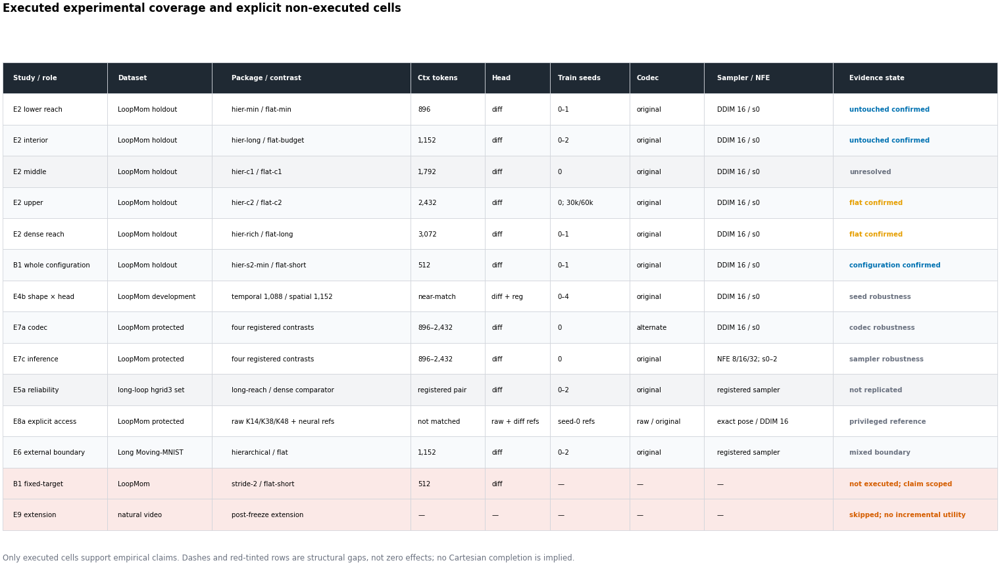

**Рисунок 4.1 – Експериментальне покриття та ролі доказів.** *Джерело: побудовано автором за реєстром виконаних конфігурацій і заморожених доказів.*

Цей порядок відокремлює вибір механізму від підтвердження контекстного ефекту. Наступна таблиця фіксує, які відмінності між гілками допускає кожний тип твердження.

**Таблиця 4.2 – Матриця виконаних компонентів та конфігурацій.** «C/F» позначає кількість грубих і детальних слотів контексту. Число після `s` задає крок контексту, а `d` означає щільне розміщення. Початковий кодек позначено C0, незалежно навчений кодек – C1. Якщо в стовпці алгоритму вибірки не зазначено інше, використано DDIM-16 із ініціалізацією алгоритму вибірки 0. Рядки з позначкою **не виконано** не підтверджують жодного емпіричного твердження.

| Дослідження або група гілок | Кодек | Пакет; C/F; крок; досяжність | Токени контексту / цілі / загалом | Вихідний модуль | Інтерфейс цілі | Алгоритм вибірки / обчислення | Набір даних | ініціалізації навчання | Рівень доказовості та статус |
|---|---|---|---:|---|---|---|---|---|---|
| `hier-short` / `flat-short` | C0 | 6C+6F, d, R6 / 8F, d, R8 | 480/320/800 проти 512/320/832 | дифузія | чотири щільні цілі | DDIM-16 | LoopMom | 0–1 | майже зіставлена нижня діагностика; ініціалізація 1 віддає перевагу плоскому пакету |
| B1 `hier-s2-min` / `flat-short` | C0 | 24C+2F, s2, R48 / 8F, d, R8 | 512/288/800 проти 512/320/832 | дифузія; регресія із ініціалізацією 0 у розробці | B1 використовує цілі з кроком 2 та допоміжний інтерфейс | DDIM-16; однопрохідна регресія | LoopMom | дифузія 0–1; регресія 0 | ефект усієї конфігурації підтверджено для дифузії |
| `spat18` / `flat-budget` | C0 | 18C+6F, d, R18 / 18F, d, R18 | 672/320/992 проти 1 152/320/1 472 | дифузія та регресія | чотири щільні цілі | DDIM-16 / один прохід | LoopMom | 0 | діагностика абстракції з фіксованим проміжком |
| `hier-min` / `flat-min` | C0 | 48C+2F, d, R48 / 14F, d, R14 | по 896/320/1 216 | дифузія | чотири щільні цілі | DDIM-16 | LoopMom | 0–1 | відкладене підтвердження нижньої області переваги ієрархії |
| `hier-long` / `flat-budget` | C0 | 48C+6F, d, R48 / 18F, d, R18 | по 1 152/320/1 472 | дифузія; регресійний контроль | чотири щільні цілі | DDIM-16 / один прохід | LoopMom | дифузія: ієрархія 0–4, плоский 0–2; регресія: ієрархія 0–4, плоский 0–1 | відкладене підтвердження внутрішньої точки та контрольні експерименти розробки |
| `strided-flat` / `hier-long` | C0 | 11 прив’язок F із кроком 4 + 6F, R48 / 48C+6F, d, R48 | 1 088/320/1 408 проти 1 152/320/1 472 | дифузія та регресія | чотири щільні цілі | DDIM-16 / один прохід | LoopMom | 0–4 | майже зіставлений факторний експеримент «вихідний модуль × пакет» для п’яти ініціалізацій |
| `hier3` / `hier-long` | C0 | 48 top+24C+9F / 48C+6F; R48 | 1 152/336/1 488 проти 1 152/320/1 472 | дифузія | різний розподіл цілей на трьох рівнях | DDIM-16 | LoopMom | 0 | діагностика «глибина плюс ціль»/розподіл; гірший результат у трирівневій групі |
| `hier-c1` / `flat-c1` | C0 | 48C+16F, R48 / 28F, R28 | по 1 792/320/2 112 | дифузія | чотири щільні цілі | DDIM-16 | LoopMom | 0 | відкладена точка з невизначеним результатом |
| `hier-c2` / `flat-c2` | C0 | 48C+26F, R48 / 38F, R38 | по 2 432/320/2 752 | дифузія | чотири щільні цілі | DDIM-16 | LoopMom | 0 у B16×30k та B8×60k | перевагу плоского пакета підтверджено в обох режимах оптимізації |
| `hier-rich` / `flat-long` | C0 | 48C+36F, R48 / 48F, R48 | по 3 072/320/3 392 | дифузія | чотири щільні цілі | DDIM-16 | LoopMom | 0–1, B8×60k | перевагу плоского пакета підтверджено за однакової номінальної досяжності |
| довгоциклова пара E5a | C0 | ієрархія з великою досяжністю / щільна базова конфігурація; зареєстрований контраст R224 | зареєстрована пара | дифузія | довгоциклове розгортання | зареєстрований алгоритм вибірки | довгоцикловий LoopMom | 0–2 | ранню перевагу відтворено; пізню інверсію не відтворено |
| сімейство алгоритмів вибірки E7c | C0 | чотири зареєстровані контрасти в діапазоні 896–2 432 | як вище | дифузія | без змін | NFE 8/16/32, ініціалізації алгоритму вибірки 0–2 | захищений LoopMom | ініціалізація предиктора 0 | сімейство з 20 ефектів; напрямкова робастність |
| сімейство кодеків E7a | C1, з контрольними C0 | сім предикторів, що утворюють чотири зареєстровані контрасти | як вище | дифузія | без змін | DDIM-16 | захищений LoopMom | ініціалізація предиктора 0 | сімейство з восьми ефектів для повної заміни кодека; напрямкова робастність |
| необроблений еталон E8a | необроблені пікселі та нейронні еталони C0 | мозаїка з індексацією за позою K6/K14/K38/K48 | без зіставлення за токенами | прямий пошук плюс дифузійні еталони | надано точну майбутню позу | прямий пошук / DDIM-16 | захищений LoopMom | детермінований / ініціалізація нейронної моделі 0 | еталон із прямим доступом, а не абляція моделі |
| E6 плоский / ієрархічний | C0 | 18F, R18 / 48C+6F, R48 | по 1 152 токени контексту | дифузія | 300 кадрів із самоподачею після 48 кадрів прогріву | зареєстрований алгоритм вибірки | довгий Moving-MNIST зі сталою ідентичністю об’єктів | 0–2 | змішана зовнішня межа |
| `mm-flat` / `mm-hier` | новий тестовий кодек | 10F / 10C+6F | 640 проти 544 контекстних токенів | дифузія | OpenSTL 10→10 | best-of-1 | Moving-MNIST | 0 | описовий контроль з коротким горизонтом |
| чотиригілкова комірка TaxiBJ | новий двоканальний кодек | 4F / еквівалент 4C+1F | 256 проти 128 токенів контексту | дифузія та регресія | OpenSTL 4→4 | DDIM / один прохід | TaxiBJ | 0 | описова межа працездатності на реальних даних |
| контроль з фіксованою ціллю B1 | – | крок-2 проти короткого плоского на інтерфейсі з фіксованою ціллю | – | – | ізолював би спільну зміну цілей | – | LoopMom | – | **не виконано; непотрібно за умови збереження формулювання на рівні конфігурації** |
| `flat-320`, `hier-s4-min`, `hier3-reg` | – | запропоновані комірки заповнення сітки | – | – | – | – | LoopMom | – | **не виконано / поза межами сфери застосування** |
| E5b та E9 | – | локалізація після збою / контрфактичне розширення | – | – | – | – | запропоновані розширення | – | **не дозволено; E9 остаточно пропущено після заморожування програми** |

Інтегрований прототип навмисно не додано до таблиці 4.2. Він використовує інтерфейс OpenSTL, регресійний SimVP і окремий профіль пам’яті, тому не є ще однією коміркою причинної матриці LoopMom. Його протокол і допустимі висновки подано окремо в підрозділі 4.8.

### 4.1.2 Словник бюджету та правила порівняння

Тому слово *зіставлена* далі завжди стосується конкретно названого ресурсу, а не повної тотожності конфігурацій. Майже зіставлена пара відрізняється у явно зазначеному напрямі: `strided-flat` використовує 1 088 токенів контексту, а `hier-long` – 1 152, тому дефіцит у 64 токени сприяє контролю з часовим прорідженням. B1 належить до іншої категорії, оскільки в ньому одночасно змінюються крок контексту, крок цілі, кількість цільових слотів, допоміжна функція втрат, довжина послідовності та обчислювальне навантаження.

$$
\Delta_m=
\begin{cases}
\bar m_{\mathrm{comparator}}-\bar m_{\mathrm{candidate}}, & m\text{ – чим менше, тим краще},\\[2mm]
\bar m_{\mathrm{candidate}}-\bar m_{\mathrm{comparator}}, & m\text{ – чим більше, тим краще}.
\end{cases}
\tag{4.1}
$$

Така орієнтація полегшує читання неоднорідних панелей показників, хоча самі метрики залишаються несумірними. Наприклад, зміну MSE об’єднаної маски на 0,01 не можна безпосередньо прирівняти до зміни точності ідентифікації на 0,01. Для сімейства верхньої межі зареєстрованим кандидатом є плоский пакет. Тому додатний ефект у перевірках робастності свідчить на користь плоского пакета, хоча в основній таблиці E2 різницю втрат подано як «плоский мінус ієрархічний».

## 4.2 Вибір механізму генерації

### 4.2.1 Регресія та дифузія за контрольованої ємності

Для дослідження контексту потрібний вихідний модуль прогнозування, проте його вибір за звичкою додав би непотрібне припущення до кожного наступного порівняння. Обидва варіанти використовують трансформер шириною 256 із шістьма блоками та вісьмома головами уваги. Регресійна і дифузійна моделі містять відповідно 7,27 та 7,53 млн параметрів. Контекст на обох рівнях прихованого простору складається із шести кадрів, а ціль розташована через чотири дії після останнього кадру контексту. Стандартизація представлень у прихованому просторі за каналами й рівнями є спільною.

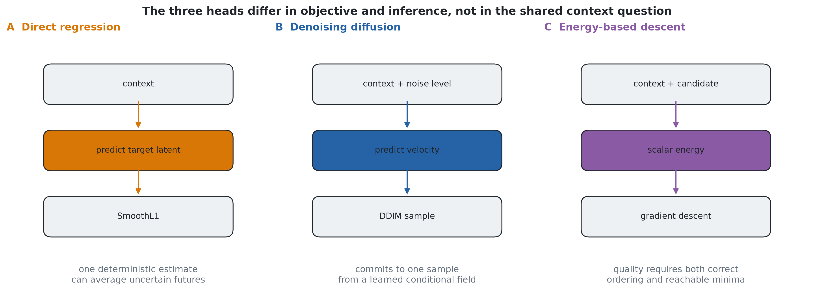

**Рисунок 4.2 – Цілі генерації в межах задачі спільного контексту.** *Джерело: авторська схема експериментального протоколу.*

«Best-of-$N$» використано лише як оракульну діагностику охоплення множини кандидатів. Для кожного запису обирається декодований зразок із найменшою MSE переднього плану відносно еталона. Один регресійний кандидат потребує одного стохастичного обчислення мережі з MC-dropout, тоді як дифузійний кандидат потребує заданої кількості обчислень DDIM. Отже, «best-of-8» за 16 NFE використовує вісім обчислень регресійної мережі та 128 обчислень дифузійної. Загальна кількість обчислень дорівнює

$$
W_{\mathrm{reg}}(N)=N,
\qquad
W_{\mathrm{diff}}(N,K)=NK,
\tag{4.2}
$$

**Таблиця 4.3 – Докази для вибору механізму генерації.** Для MSE переднього плану менше значення є кращим, для різкості переднього плану – більше. Основний рядок усереднено за шістьма батчами оцінювання з фіксованої вибірки. Значення чутливості до NFE походять із меншого замороженого оціночного набору й не об’єднуються з ним.

| Режим | Регресія | Дифузія | Незмінне продовження або еталон | Допустима інтерпретація |
|---|---:|---:|---:|---|
| Один крок, найкращий із 8 значень MSE переднього плану, всі | 0,0664 | **0,0512** | незмінне продовження 0,2367 | дифузія має краще оракульне охоплення за зазначеного нерівного загального обсягу роботи |
| Один крок, проста підмножина | 0,0232 | **0,0120** | – | обидві моделі навчаються обумовленого руху; дифузія залишається нижчою |
| Один крок, складна підмножина нових смуг | 0,1808 | **0,1549** | – | більший розрив спостерігається там, де потрібна чітка гіпотеза |
| Середнє значення за вісьмома кандидатами | 0,0714 | **0,0640** | – | дифузія також покращує середнє значення вибірки в цьому дослідженні |
| Однокроковий, різкість переднього плану | 0,1591 | **0,1886** | незмінне продовження 0,0515 | дифузійні зразки різкіші в режимі охоплення множини кандидатів |
| Найкращий із 8 показників MSE переднього плану, 4 NFE на кожного кандидата з дифузією | 0,0680 | **0,0546** | – | напрямок дифузії зберігається при найменшому перевіреному розподілі дифузії |
| MSE переднього плану «Best-of-8», 8 NFE | 0,0680 | **0,0514** | – | чутливість, порівняння не за рівних умов |
| MSE переднього плану «Best-of-8», 16 NFE | 0,0680 | **0,0503** | – | додаткова робота з усунення шуму дає невеликий додатковий виграш |
| Самоподача, «best-of-1», зіставлений ієрархічний пакет | **0,1682** | 0,1848 | парний інтервал «дифузія мінус регресія» [0,0110, 0,0227] | пряма регресія краща в детермінованому розгортанні |
| Самоподача, «best-of-1», зіставлений плоский пакет | **0,2015** | 0,2038 | – | зміна порядку в розгортанні не обмежується ієрархічною гілкою |

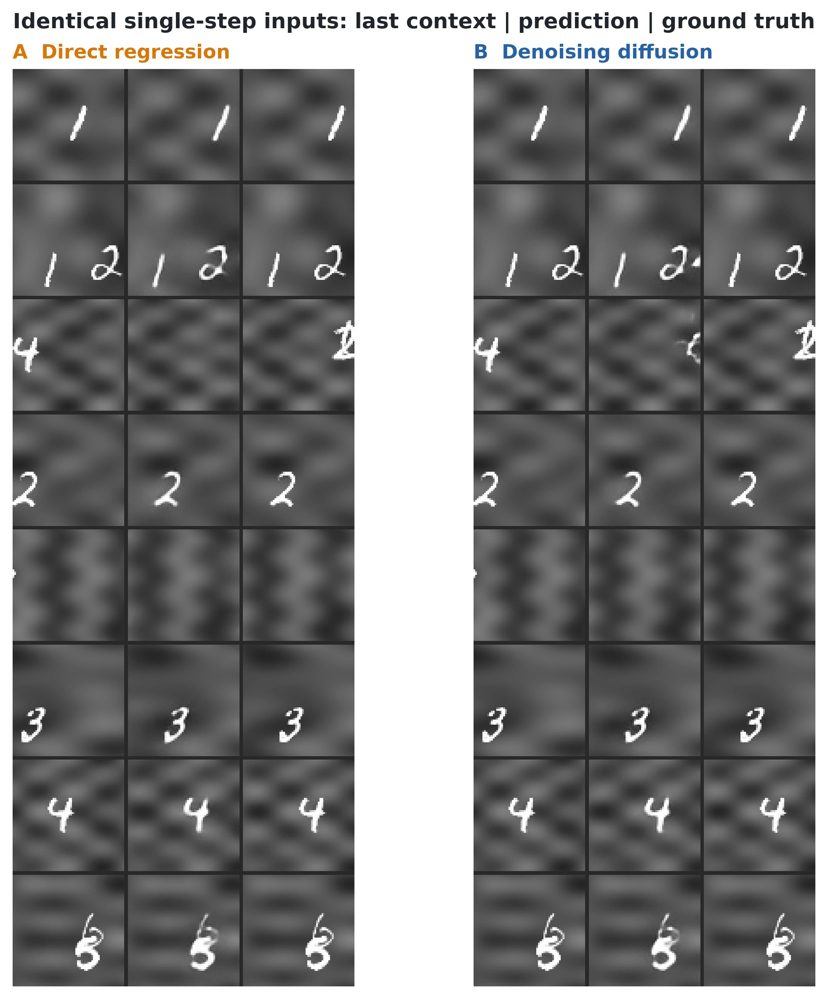

**Рисунок 4.3 – Однокрокові прогнози для ідентичних вхідних даних.** Приклади ілюструють типові відмінності регресійного та дифузійного вихідних модулів, а кількісне рішення спирається на шість батчів оцінювання в таблиці 4.3. Рисунок сам по собі не доводить переваги жодного модуля. *Джерело: побудовано автором із заморожених однокрокових результатів дослідження механізмів генерації.*

### 4.2.2 Енергетичний спуск як охарактеризований негативний результат

Трансформер на основі енергії пропонує інший шлях до генерації: навчати скалярну енергію замість нормалізованої ймовірності [84, 85]. Для контексту $c$ та кандидата майбутнього $z$ енергія $E_\phi(c,z)$ задає напрям оновлення

$$
z^{(k+1)}=z^{(k)}-\alpha_k\nabla_zE_\phi(c,z^{(k)})+\eta_k,
\tag{4.3}
$$

де $\eta_k$ – зареєстрований ланжевенівський член, якщо відповідний алгоритм використовує шум [89, 90]. Узгодження скорів пов’язує градієнти енергії з градієнтами густини даних [86, 87]. Для корисної генерації енергія має правильно впорядковувати змістовні кандидати, а спуск від заданої початкової точки – досягати структурованої області ландшафту.

У масштабі 14,66 мільйона параметрів адаптовано офіційну реалізацію Energy-Based Transformer [88] та оцінено два опубліковані сімейства рецептів. Рецепт S2 збігається до втрати близько 0,597, але розміщує кандидата, що відповідає середньому значенню партії, нижче цільового значення на кожному з 21 зафіксованого зондування. S1 змінює порядок: від оновлень 6 000 до 20 000 цільове значення має найнижчу енергію у п’ятнадцяти послідовних пробах, при цьому розрив між цільовим значенням та середнім значенням становить від 0,22 до 3,09. Отже, впорядкування можна навчити на цьому рівні, але саме по собі воно не доводить, що спуск досягає структурованого кандидата.

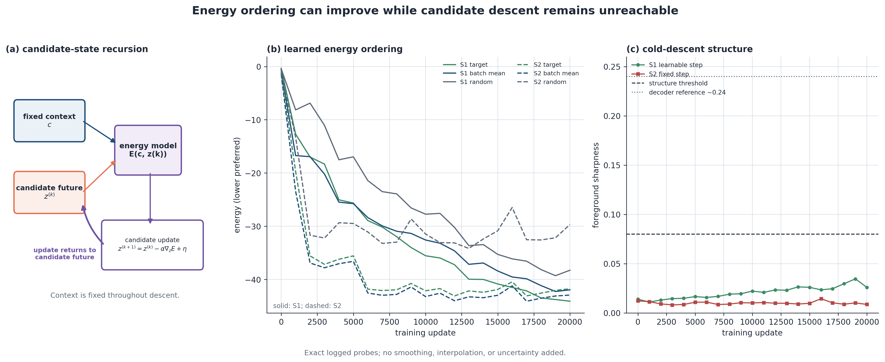

**Рисунок 4.4 – Упорядкування за енергією та досяжність спуску.** *Джерело: побудовано автором за журналами навчання й діагностики EBT.*

### 4.2.3 Вибір механізму

Із трьох механізмів прийнятними залишилися два вихідні модулі. Для перевірки пакетів на відкладених даних обрано дифузію, оскільки в контрольованому дослідженні вона забезпечила найкраще стохастичне однокрокове охоплення. Регресія зберігається як необхідний контроль: у детермінованому розгортанні із самоподачею та одним кандидатом вона працює краще. Енергетичний спуск закрито як охарактеризований негативний результат цієї програми, адже його подальше масштабування перевіряло б розмір моделі, а не гіпотезу пакетування контексту.

Універсального рейтингу вихідних модулів ці результати не встановлюють. Вибір залежить від того, як прогнози генерують і повторно використовують. Він також визначає межі інтерпретації подальших результатів: досліджена межа бюджетів вимірює ефекти пакетів для дифузії із зазначеною кількістю кроків знешумлення, тоді як регресійні комірки перевіряють, чи зберігається напрям ефекту з детермінованим однопрохідним модулем. Це взаємодоповнювальні перевірки, а не взаємозамінні реплікації.

Перед відкриттям відкладеної вибірки E2 технічну готовність вихідних модулів перевірено за діагностикою оптимізації; вона не використовується як підтверджувальний доказ. При 6000 оновленнях два предиктори залишаються невирішеними, тоді як незалежно навчені предиктори при 20 000 оновленнях дають позитивний напрям. Це окремі графіки, а не контрольні точки однієї траєкторії.

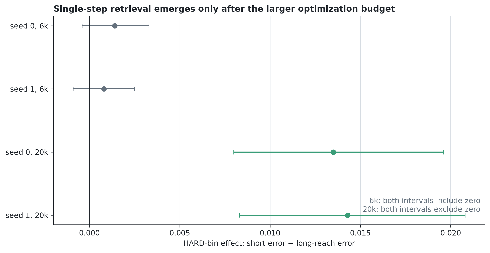

**Рисунок 4.5 – Діагностика достатності оптимізації на етапі розробки.** Контраст стає додатним лише у двох довших графіках навчання. Це обґрунтовує вимогу завершеного навчання, але не використовується як підтверджувальний доказ. *Джерело: чотири заморожені журнали розробки для 6 000 та 20 000 оновлень.*

## 4.3 Ієрархічна досяжність за фіксованого бюджету контексту

### 4.3.1 Відкладене підтвердження різниці досяжності

Центральний ефект зосереджується там, де релевантний попередній стан уже вийшов за межі короткого плоского вікна, але ще зберігається у грубій історії ієрархічного пакета. Дані розробки вже вплинули на вибір моделі та формулювання цієї гіпотези. Тому коректне підтвердження вимагало нових кліпів. Відкладену вибірку E2 `loopmom-confirmation_holdout-20260712-e033abee6e04` згенеровано й зафіксовано хешем після заморожування контрольних точок, пар пакетів, діапазонів досяжності, показників, макетів таблиць і правил інтерпретації. Так реалізовано принцип захищеної вибірки, що запобігає адаптивному повторному використанню [167]. Завантажувачі навчання й моніторингу відхиляють цей розділ, а його відкриття реєструється в журналі із зазначенням мети доступу.

$$
14<\Delta t_i\le48.
\tag{4.4}
$$

$$
e_{ci}=\mathbf 1\!\left(
14<\Delta t_{ci}\le48,\;
\mathrm{seen}_{ci}\ge0{,}5,\;
\mathrm{fg}_{ci}\ne\varnothing,\;
\Delta t_{ci}\text{ скінченне}
\right).
\tag{4.5}
$$

Якщо $d_{ci}=m_{ci}^{\mathrm{flat}}-m_{ci}^{\mathrm{hier}}$ – різниця помилок переднього плану
для кадру $i$ кліпу $c$, то парна оцінка досяжності дорівнює

$$
\widehat{\Delta}_{\mathrm{reach}}=
\frac{\sum_c\sum_{i\in c}e_{ci}\,d_{ci}}
{\sum_c\sum_{i\in c}e_{ci}}.
\tag{4.6}
$$

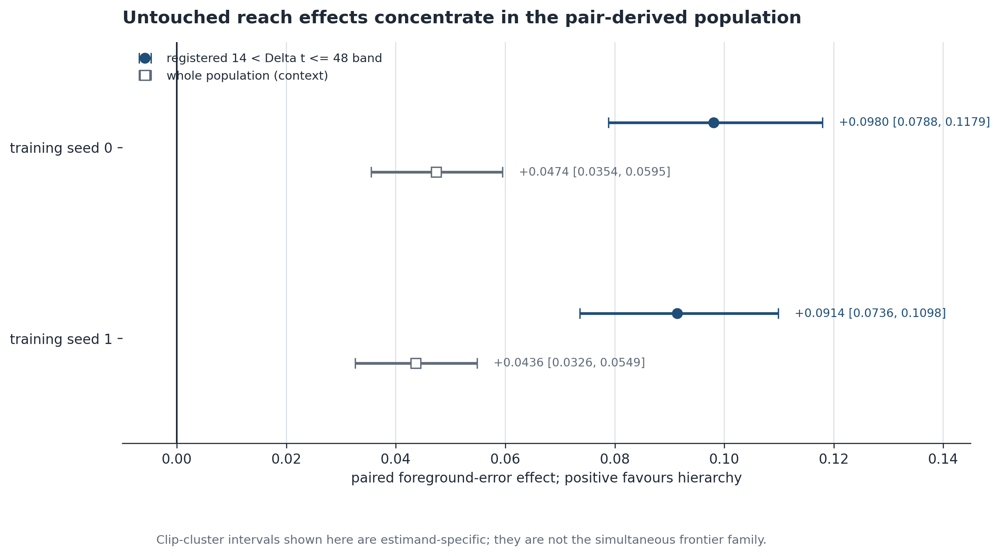

**Рисунок 4.6 – Ефекти у визначених для кожної пари вибірках досяжності.** Для обох ініціалізацій перевага ієрархії в зареєстрованій смузі досяжності більша, ніж у повній оцінюваній вибірці, що відповідає механізму, передбаченому геометрією пакета. *Джерело: побудовано автором за замороженими результатами E2.*

Пара B1 надає друге підтвердження з важливим застереженням. Її зареєстрована популяція становить $8<\Delta t_i\le48$, а ефекти двох ініціалізацій дорівнюють +0,0692 [0,0543; 0,0845] та +0,0743 [0,0588; 0,0899]. Для повної популяції ефекти становлять +0,0340 та +0,0381. Однак у B1 разом із досяжністю контексту змінюються цільовий інтерфейс із кроком 2, кількість токенів цілі, допоміжна функція втрат і навчальне навантаження порівняно з `flat-short`. Результат підтверджує повну конфігурацію, але не є ізольованою причинною оцінкою часового кроку.

### 4.3.2 Підтвердження на повній вибірці та за всіма показниками

Помилка переднього плану сама по собі може приховати модель, яка правильно розміщує об’єкт, але водночас створює хибні об’єкти в інших місцях. У таблиці 4.4 наведено зареєстрований діапазон досяжності, а не показники, вибрані після перегляду результатів. Знаки гармонізовано: додатні значення свідчать на користь `hier-min`; для пропущених і зайвих компонентів подано кількість помилок, яких уникає ієрархічний пакет.

**Таблиця 4.4 – Повний набір підтверджувальних показників у відкладеній вибірці $14<\Delta t\le48$.** Кожен рядок
містить 1006 записів кадрів із 96 кліпів. Інтервали отримано парним статистичним виведенням з урахуванням кластеризації за кліпами для
названої навченої моделі; два стовпці ініціалізацій не об’єднуються.

| Показник | Ефект для ініціалізації 0 [95 % ДІ] | Ефект для ініціалізації 1 [95 % ДІ] | Що виключає цей показник |
|---|---:|---:|---|
| MSE для непорожнього GT-переднього плану | +0,0980 [0,0788; 0,1179] | +0,0914 [0,0736; 0,1098] | помилка щодо самого об’єкта, що знову потрапив у кадр |
| MSE для об’єднаної маски | +0,0808 [0,0632; 0,0987] | +0,0773 [0,0613; 0,0940] | покращення, отримане лише завдяки ігноруванню галюцинованої опори |
| MSE для повного кадру | +0,0045 [0,0033; 0,0058] | +0,0042 [0,0032; 0,0052] | суперечність із сукупною похибкою зображення |
| MSE фону GT | +0,0013 [0,0006; 0,0019] | +0,0012 [0,0006; 0,0017] | покращення переднього плану за рахунок гіршої реконструкції фону |
| Прецизійність переднього плану | +0,1550 [0,1027; 0,2066] | +0,0691 [0,0051; 0,1317] | неконтрольована кількість хибнопозитивних пікселів |
| Повнота переднього плану | +0,2708 [0,2180; 0,3238] | +0,2539 [0,2060; 0,3029] | чіткий результат, що може приховувати пропуск значної частини об’єкта |
| F1-показник для переднього плану | +0,2458 [0,1975; 0,2954] | +0,2342 [0,1893; 0,2801] | дисбаланс прецизійності та повноти |
| Уникнення пропущених компонентів | +0,4911 [0,3686; 0,6102] | +0,5527 [0,4315; 0,6699] | менша піксельна похибка через видалення складних екземплярів |
| Уникнення зайвих компонентів | +0,3231 [0,1530; 0,4915] | +0,1968 [0,0334; 0,3701] | виграш, пов’язаний із дублюванням об’єктів |
| Покриття компонентів | +0,2622 [0,1968; 0,3264] | +0,2992 [0,2370; 0,3605] | вибіркове оцінювання простих компонентів, що збереглися |

Сукупність показників об’єднаної маски, фону, повноти, пропущених і зайвих компонентів та їх покриття робить результат досяжності переконливішим, ніж сама різниця MSE переднього плану. Водночас вона звужує інтерпретацію. Пакет не просто зменшує розмиття в заданій масці: він частіше відтворює цілісний об’єкт після того, як коротше вікно втратило релевантний вміст сцени.

### 4.3.3 Інтерпретація досяжності

Визначена для пари смуга є центральною в експерименті. Загальний аналіз наприкінці горизонту поєднував би події, у яких потрібні свідчення доступні обом пакетам, жодному з них або лише одному. Геометрія LoopMom дає змогу розглянути ці випадки окремо. Більший ефект у смузі спостерігається за обох ініціалізацій навчання й підтверджується показниками, чутливими до хибнопозитивних результатів. Саме цього очікує механізм, передбачений у розділі 3.

Водночас геометрія пакета доводить лише наявність потрібного часового інтервалу у збереженому контексті. Вона не гарантує, що давній стан закодовано без втрат або що предиктор справді його використав. Зв’язок між адресованістю та якістю встановлює парний ефект у визначеній смузі, але навіть він не перетворює грубий потік на повну копію минулого кадру.

Звідси випливає вимога до майбутніх тестів: пізній кадр є інформативним лише тоді, коли оцінювач може визначити, коли відповідний вміст востаннє спостерігався, і які пакети ще охоплюють це спостереження. Без такого запису ефект, залежний від горизонту, змішує досяжність, точність відтворення, складність сцени та накопичену похибку розгортання. У LoopMom цю проблему розв’язано аналітично. Для природного відео знадобляться відомі траєкторії камер, анотації подій зникнення й повторного входу або контрфактуальні послідовності, що утворюють так само перевірну популяцію.

## 4.4 Межа «досяжність–точність відтворення» та ефективність пам’яті

### 4.4.1 Одночасно перевірена межа

Досяжність має значення лише тоді, коли вона змінює доступність релевантних спостережень. Щойно плоский пакет охоплює більшу частину або всю потрібну історію, збереження повнороздільних деталей може бути кориснішим за їх стиснення в грубий потік. Сімейство E2 перевіряє це припущення на відкладених даних у дискретних точках бюджету. Кожен наведений інтервал належить до одного сімейства зі статистичним виведенням з урахуванням кластеризації за кліпами та максимум-статистикою Стьюдента з критичним значенням 2,741. Рішення не ґрунтуються на виборі окремих граничних тестів після перегляду результатів.

**Таблиця 4.5 – Перевірена на відкладених даних межа та облік стану контексту за однакової досяжності.** Панель А
містить повне сімейство одночасних рішень. Панель Б, представлена в розділі 4.4.2, наводить
точну арифметику запам’ятовування, що використовується для інтерпретації точок з нижчим бюджетом.

| Бюджет контексту | Плоский пакет / номінальна досяжність | Ієрархічний пакет / номінальна досяжність | ініціалізація і режим оптимізації | Втрата плоского – втрата ієрархічного | Одночасний 95 % ДІ | Рішення |
|---:|---|---|---|---:|---:|---|
| 480 проти 512 | `flat-short` / 8 | `hier-short` / 6 | ініціалізація 0, B16×30k | −0,0038 | [−0,0081, +0,0005] | невизначене майже зіставлене порівняння |
| 480 проти 512 | `flat-short` / 8 | `hier-short` / 6 | ініціалізація 1, B16×30k | −0,0060 | [−0,0105, −0,0015] | перевага плоского пакета; майже зіставлене порівняння |
| 896 | `flat-min` / 14 | `hier-min` / 48 | ініціалізація 0, B16×30k | +0,0474 | [+0,0305, +0,0642] | ієрархію підтверджено |
| 896 | `flat-min` / 14 | `hier-min` / 48 | ініціалізація 1, B16×30k | +0,0436 | [+0,0280, +0,0592] | ієрархію підтверджено |
| 1 152 | `flat-budget` / 18 | `hier-long` / 48 | ініціалізація 0, B16×30k | +0,0195 | [+0,0070, +0,0320] | ієрархію підтверджено |
| 1 152 | `flat-budget` / 18 | `hier-long` / 48 | ініціалізація 1, B16×30k | +0,0389 | [+0,0228, +0,0549] | ієрархію підтверджено |
| 1 152 | `flat-budget` / 18 | `hier-long` / 48 | ініціалізація 2, B16×30k | +0,0307 | [+0,0159, +0,0455] | ієрархію підтверджено |
| 1 792 | `flat-c1` / 28 | `hier-c1` / 48 | ініціалізація 0, B16×30k | +0,0084 | [−0,0013, +0,0181] | невизначено |
| 2 432 | `flat-c2` / 38 | `hier-c2` / 48 | ініціалізація 0, B16×30k | −0,0150 | [−0,0260, −0,0039] | перевагу плоского пакета підтверджено |
| 2 432 | `flat-c2` / 38 | `hier-c2` / 48 | ініціалізація 0, B8×60k | −0,0122 | [−0,0213, −0,0032] | перевагу плоского пакета підтверджено в іншому режимі оптимізації |
| 3 072 | `flat-long` / 48 | `hier-rich` / 48 | ініціалізація 0, B8×60k | −0,0129 | [−0,0217, −0,0041] | перевагу плоского пакета підтверджено |
| 3 072 | `flat-long` / 48 | `hier-rich` / 48 | ініціалізація 1, B8×60k | −0,0134 | [−0,0215, −0,0053] | перевагу плоского пакета підтверджено |

Два майже зіставлені нижні рядки порівнюють 480 та 512 токенів, але не визначають межу за точного бюджету. Серед пар з однаковими бюджетами 1152 токени є найбільшим підтвердженим бюджетом на рівні сімейства, що сприяє ієрархії; 2432 токени є найменшим підтвердженим бюджетом, що сприяє плоскому пакету. Точка 1792 залишається невирішеною.

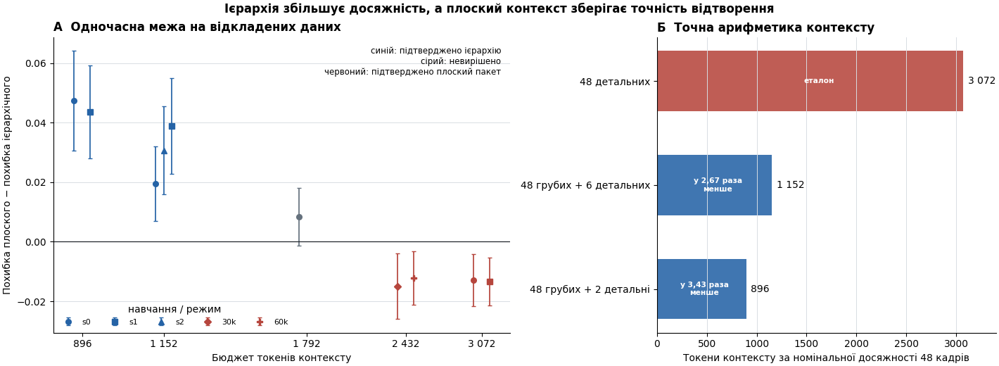

**Рисунок 4.7 – Перевірена межа «досяжність–точність відтворення».** Ієрархію одночасно підтверджено за 896 та 1 152 токенів, точка 1 792 залишається невизначеною, а плоский контекст підтверджено за 2 432 та 3 072 токенів. Неперервну точку перетину не апроксимували, тому рисунок не можна тлумачити як оцінену безперервну криву. *Джерело: побудовано автором за замороженими результатами одночасного аналізу E2.*

### 4.4.2 Точна арифметика токенів та корисного навантаження

Ця межа є значущою, оскільки її контекстна вартість є явною. У кодеку з фіксованою структурою кадр з високою роздільною здатністю
містить $8\times8=64$ токенів, а кадр з низькою роздільною здатністю – $4\times4=16$. Для пакета
$\mathcal P$ скорочення кількості токенів контексту відносно щільного зберігання з високою роздільною здатністю при тому самому номінальному проміжку
становить

$$
G_{\mathrm{ctx}}(\mathcal P)=
\frac{48q_{\mathrm f}}
{n_{\mathrm c}q_{\mathrm c}+n_{\mathrm f}q_{\mathrm f}},
\qquad q_{\mathrm f}=64,\quad q_{\mathrm c}=16.
\tag{4.7}
$$

Панель B: Витрати контексту та стану протягом одного номінального проміжку в 48 кадрів. Кожен токен має 16 коефіцієнтів кодека. Стовпці корисного навантаження показують розміри суцільних масивів для одного прикладу та одного контекстного пакета; розмір пакета виключено. Також виключено цільові токени, проміжну увагу та результати MLP, параметри, стан оптимізатора, накладні витрати розподільника та активації навчання.

| Пакет | Арифметика токенів | Контекстні токени | Корисний обсяг даних прихованого простору fp32 | Корисний обсяг даних прихованого простору fp16/bf16 | Матеріалізовані вбудовування шириною 384, bf16 | Відносна вартість контексту |
|---|---:|---:|---:|---:|---:|---:|
| 48 щільних детальних кадрів | $48\times64$ | 3 072 | 192 КіБ | 96 КіБ | 2,250 МіБ | 1,00× |
| 48 грубих + 6 останніх детальних | $48\times16+6\times64$ | 1 152 | 72 КіБ | 36 КіБ | 0,844 МіБ | у 2,67 раза менше |
| 48 грубих + 2 останніх детальних | $48\times16+2\times64$ | 896 | 56 КіБ | 28 КіБ | 0,656 МіБ | у 3,43 раза менше |

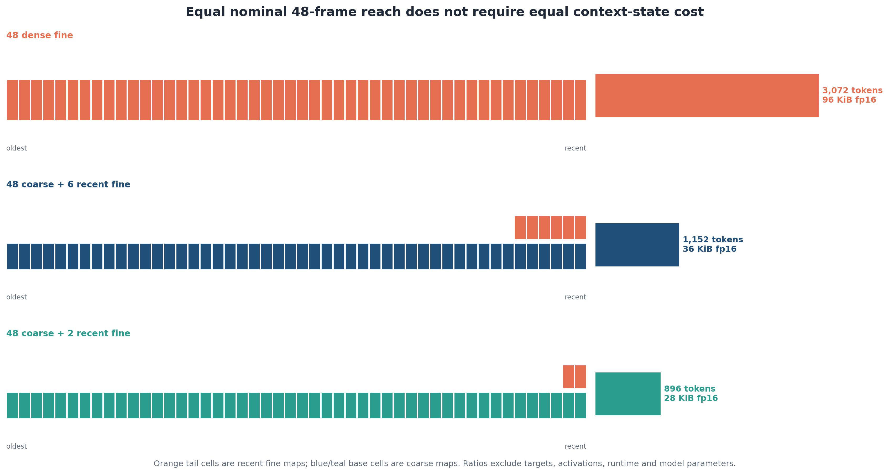

**Рисунок 4.8 – Арифметика стану контексту за однакової досяжності.** За номінальної досяжності 48 кадрів ієрархічні пакети з 896 та 1 152 токенами використовують відповідно у 3,43 та 2,67 раза менше токенів контексту, ніж щільна детальна історія з 3 072 токенами. *Джерело: побудовано автором за зареєстрованими специфікаціями пакетів і таблицею 4.5.*

Ця арифметика підтверджує два різні твердження. По-перше, ієрархія робить доступною 48-кадрову історію за бюджетів, із якими плоске вікно детальних кадрів досягає лише 14 або 18 кадрів. По-друге, той самий доступний проміжок потребує у 2,67–3,43 раза менше токенів контексту, ніж 48 детальних кадрів. Однакова якість за меншої кількості токенів не перевірялася. Якість прогнозу залежить від потрібної для задачі інформації, що далі показують верхні точки бюджетної межі та E6.

### 4.4.3 Досяжність і точність відтворення як область доцільності

За 896 та 1 152 токенів плоске вікно не містить релевантної історії повторного входу, яку зберігає грубий потік. Результат для визначеної смуги в підрозділі 4.3 робить цей механізм спостережуваним, а не лише правдоподібним. За 3 072 токенів обидва пакети досягають 48 кадрів. Точка 2 432 розташована між цими двома чистими випадками: плоский пакет досягає 38 кадрів, ієрархічний – 48, однак в основному сімействі E2 підтверджено перевагу плоского пакета. У статичному світі давнє детальне спостереження може краще зберігати вигляд цифри й точну текстуру, ніж щільніша груба історія.

Отже, пріоритет задачі визначає, на що витрачати бюджет. Якщо без давнього кадру неможливо відновити положення або продовжити траєкторію, першою вимогою стає досяжність. Коли потрібна історія вже доступна, додаткові детальні спостереження можуть краще зберегти ідентичність. Загального порога достатності у 38 кадрів із цього не випливає. Перевірки генератора й кодека лише показують, що верхній ефект менший і менш точний, ніж нижні ефекти досяжності.

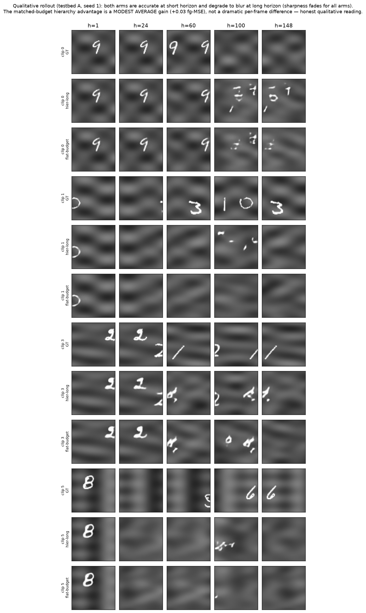

**Рисунок 4.9 – Якісні розгортки з фіксованим індексом.** Кліпи та горизонти вибрано за наперед зафіксованими індексами, а не за величиною контрасту між моделями. Приклади пояснюють характер помилок; висновок про межу визначають агреговані ефекти та одночасні інтервали з таблиці 4.4. *Джерело: побудовано автором із заморожених розгорток E2.*

## 4.5 Форма контекстного пакета та взаємодія з моделлю

### 4.5.1 Просторова ієрархія проти часового піддискретизування

Зіставлена бюджетна межа показує, що дешеві грубі токени можуть забезпечувати корисну досяжність. Окремим залишається питання, чи найкраще витрачати фіксований бюджет саме на просторове огрублення. Детальна часова прив’язка також сягає минулого, але залишає проміжки між збереженими кадрами. Порівняння цих пакетів розділяє два типи втрати: просторове стиснення відкидає деталі на кожному давньому часовому кроці, а часове прорідження зберігає вибрані кадри, проте втрачає проміжну динаміку.

Для дифузії всі п’ять ініціалізацій навчання віддають перевагу часово розрідженому пакету повної роздільної здатності. Таблиця 4.6 показує цей стабільний напрям разом із ширшою факторною перевіркою. Регресійний вихідний модуль змінює картину, тому взаємодію «вихідний модуль × пакет» розглянуто окремо в §4.5.2.

**Таблиця 4.6 – Факторний експеримент «вихідний модуль × пакет» для п’яти ініціалізацій.** Додатні ефекти пакета свідчать на користь часових прив’язок повної роздільної здатності порівняно з просторово грубою щільною історією. Інтервали за кліпами умовні щодо однієї навченої моделі; в останніх трьох рядках одиницями є ініціалізації навчання.

| ініціалізація навчання або підсумок | Ефект пакета для дифузії [95 % ДІ за кліпами] | Ефект пакета для регресії [95 % ДІ за кліпами] | Взаємодія «вихідний модуль × пакет» [95 % ДІ за кліпами] |
|---:|---:|---:|---:|
| 0 | +0,0197 [+0,0143, +0,0252] | +0,0107 [+0,0062, +0,0158] | −0,0089 [−0,0151, −0,0025] |
| 1 | +0,0046 [+0,0007, +0,0084] | −0,0104 [−0,0146, −0,0062] | −0,0150 [−0,0199, −0,0104] |
| 2 | +0,0111 [+0,0070, +0,0151] | −0,0208 [−0,0270, −0,0150] | −0,0319 [−0,0401, −0,0245] |
| 3 | +0,0075 [+0,0037, +0,0114] | +0,0248 [+0,0181, +0,0323] | +0,0173 [+0,0106, +0,0245] |
| 4 | +0,0060 [+0,0027, +0,0092] | −0,0166 [−0,0229, −0,0108] | −0,0226 [−0,0297, −0,0160] |
| Середнє за ініціалізаціями | +0,0098 | −0,0024 | −0,0122 |
| Стандартне відхилення за ініціалізаціями | 0,0060 | 0,0195 | 0,0186 |
| Інтервал t95 за ініціалізаціями | [+0,0023, +0,0173] | [−0,0266, +0,0217] | [−0,0353, +0,0109] |

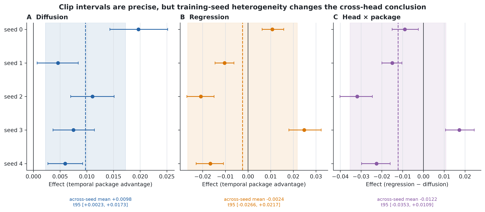

**Рисунок 4.10 – Ефекти пакетів для різних вихідних модулів прогнозування та ініціалізацій навчання.** *Джерело: побудовано автором за замороженим факторним дослідженням «вихідний модуль × пакет».*

Таблиця 4.6 та рисунок 4.10 показують залежність форми пакета від вихідного модуля й ініціалізації, а таблиця 4.7 відокремлює цей факторний результат від порівнянь з іншими рівнями доказовості.

**Таблиця 4.7 – Карта доказів у формі контексту та ліцензії на порівняння.** Рядки дають відповіді на різні питання щодо причинно-наслідкових зв’язків
і не повинні розглядатися як один повністю перехресний факторний експеримент.

| Питання | Проведене порівняння | Що залишається фіксованим або ізольованим | Решта змін, що відбуваються одночасно | Ліцензія та рівень доказів | Підтверджений висновок |
|---|---|---|---|---|---|
| Вихід за межі плоского вікна | `hier-min` проти `flat-min` | токени контексту, цілі та загалом; кодек, вихідний модуль, кліпи; парно визначений діапазон досяжності | номінальна досяжність і роздільна здатність давньої історії змінюються разом | **ЗІСТАВЛЕНО**, відкладене підтвердження E2 | перевага зосереджується там, де лише ієрархія адресує релевантне минуле |
| Просторова абстракція з фіксованим проміжком | `spat18` проти `flat-budget`, окремо для кожного вихідного модуля | проміжок 18 кадрів, недавній детальний хвіст, кодек та оцінювані записи | грубий пакет використовує 672 токени замість 1 152 | **ДІАГНОСТИКА РОЗРОБКИ** | груба історія має невелику ціну для дифузії та невизначений ефект для регресії; внутрішньої переваги абстракції не встановлено |
| Часове проти просторового стиснення | `strided-flat` проти `hier-long` | номінальна досяжність 48 кадрів, детальний хвіст із шести кадрів, основа, кодек, протокол навчання | часове прорідження проти просторового огрублення; 1 088 проти 1 152 токенів | **МАЙЖЕ ЗІСТАВЛЕНИЙ ФАКТОРНИЙ ЕКСПЕРИМЕНТ РОЗРОБКИ**, п’ять ініціалізацій | часові прив’язки стабільні для дифузії; регресія та взаємодія вихідного модуля з пакетом неоднорідні |
| Простір × час, крок 2 | `hier-s2-min` проти `flat-short` | 512 контекстних токенів та спарені записи | цільовий крок, цільові слоти/токенів, допоміжна втрата, загальна довжина послідовності, навантаження оптимізації | **ПОВНА КОНФІГУРАЦІЯ**, незмінений E2 | перемагає повна конфігурація B1; чистий ефект контекстного кроку не визначений |
| Додана глибина представлення | `hier3` проти `hier-long` | 1 152 токени контексту, номінальна досяжність, дифузійна основа | розподіл цілей, навантаження цілі, розподіл грубих/детальних токенів, нижня межа інформації верхнього рівня | **ДІАГНОСТИКА РОЗРОБКИ**, ініціалізація 0 | трирівнева конфігурація гірша на −0,0196 [−0,0248; −0,0146]; загального закону глибини не встановлено |
| Внесок потоку | засліплення грубого або детального потоку та засліплення верхнього рівня `hier3` | навчена модель та записи розгортання | обнулення потоку виходить за межі розподілу | **ДІАГНОСТИКА РОЗРОБКИ** | видалення грубого потоку шкодить повторному входу; видалення детального спричиняє колапс візуалізації; перевірений верхній потік додає мало; величини не вимірюють інформаційну цінність |
| Розподіл бюджету | межа E2 | кодек, вихідний модуль, сімейство показників і дискретні пари пакетів | кількість ініціалізацій залежить від бюджету; неперервної залежності «доза–відгук» немає | **ОДНОЧАСНЕ СІМЕЙСТВО НА ВІДКЛАДЕНИХ ДАНИХ** | витрачати токени на досяжність, поки історія відсутня; зберігати деталі після того, як потрібна історія стала доступною |

Перед переходом до взаємодії з вихідним модулем потрібне ще одне обмеження інтерпретації таблиці. Хоча гілка третього рівня зберігає контекстний бюджет 1 152, вона також змінює розподіл втрат, цільові токени та глибину. Тому її гірший результат свідчить проти такого повного зондування, а не проти самої ієрархічної глибини. Видалення потоку може знищити деякі можливості, але це не означає, що потоку можна приписати інформаційну цінність.

### 4.5.2 Взаємодія з вихідним модулем прогнозування

Стовпець регресії демонструє гетерогенність, а не нічию. Дві ініціалізації істотно віддають перевагу часовим прив’язкам, три – просторовій ієрархії; через зміну напряму інтервал між ініціалізаціями широкий. Коректне формулювання тут – «гетерогенність за ініціалізаціями навчання». Взаємодія поводиться подібно: чотири оцінки для окремих ініціалізацій від’ємні, одна додатна, проте t-інтервал за ініціалізаціями [−0,0353; +0,0109] перетинає нуль. Отже, рання гіпотеза про стабільний зсув регресії до просторового огрублення не підтвердилася. Використання пакета залежить не лише від збережених токенів, а й від цільової функції, правила формування вибірки та траєкторії оптимізації, за якою модель навчається працювати з ними.

Для вибору моделі дифузійний результат дає підстави використовувати часові прив’язки в цьому контрольованому статичному середовищі. Утім, через гетерогенність регресійних результатів такий вибір потребує перевірки за кількома ініціалізаціями перед перенесенням в інше середовище. Вирішальним розширенням був би рухомий прихований світ. Якщо між прив’язками з кроком 4 відбуваються змістовні зміни стану, часове прорідження має втрачати інформацію, яку зберігає щільний грубий потік. Такий перехресний динамічний тест відокремив би перевагу конкретного інструмента від ширшого принципу пакетування, не змінюючи підтвердженого межі просторової ієрархії.

## 4.6 Робастність основних напрямів

### 4.6.1 Бюджет алгоритму вибірки та випадковість

Основна межа E2 використовує детермінований DDIM-16 з однією зареєстрованою ініціалізацією генератора. Тому в E7c до відкриття нового цільового набору зафіксовано чотири контрасти для предикторів із ініціалізацією навчання 0: ефект досяжності за 896 токенів, внутрішній ефект за 1 152 токенів, ефект форми пакета 1 088 проти 1 152 і плоску інверсію точності за 2 432 токенів.

Усього ці контрасти дають 20 парних оцінок, але науковий висновок визначає не їхня кількість, а стабільність зареєстрованого напряму. Усі точкові оцінки цей напрям зберігають, а для перших трьох контрастів кожна одночасна нижня межа перевищує нуль. Інверсія за 2 432 токенів додатна й визначена на рівні сімейства для всіх трьох бюджетів NFE за ініціалізації генератора 0, але інтервали містять нуль для ініціалізацій 1 (+0,0098 [−0,0001; +0,0196]) і 2 (+0,0077 [−0,0013; +0,0167]). Отже, 18 із 20 одночасних інтервалів не перетинають нуль. Зміна ініціалізації DDIM оцінює випадковість генерації для фіксованої контрольної точки; вона не замінює незалежного навчання моделі з іншою ініціалізацією.

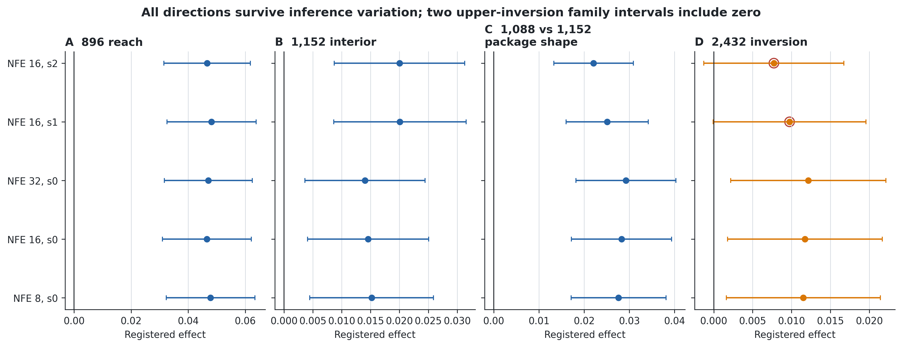

**Рисунок 4.11 – Робастність до обсягу денойзингу та випадковості алгоритму вибірки.** Напрями всіх точкових оцінок зберігаються для зареєстрованих конфігурацій алгоритму вибірки, хоча два верхні інтервали втрачають одночасну статистичну визначеність. *Джерело: побудовано автором за замороженими результатами E7c.*

### 4.6.2 Незалежно навчений кодек

E7a втручається на більш ранньому етапі обчислювального тракту. Другий кодек навчається незалежно, для нього заново обчислюється нормалізація прихованого простору, після чого перенавчають сім предикторів із ініціалізацією 0. Одночасно змінюються похибка реконструкції, геометрія координат, масштаб і оптимізація предиктора. Тому це перевірка робастності до повної заміни кодека; числові відмінності не можна приписати окремій властивості прихованого простору.

**Таблиця 4.8 – Напрямок та одночасний статус для втручань у алгоритмі вибірки та кодеку.** Позитивні ефекти
свідчать на користь зареєстрованого кандидата; для контрасту 2 432 цим кандидатом є плоский контекст.

| Втручання | Досяжність 896 | Внутрішній ефект 1 152 | Часовий 1 088 проти просторового 1 152 | Плоска інверсія 2 432 | Зареєстрована інтерпретація |
|---|---:|---:|---:|---:|---|
| DDIM NFE 8, ініціалізація алгоритму вибірки 0 | +0,0478 [0,0323; 0,0634] | +0,0152 [0,0045; 0,0259] | +0,0276 [0,0171; 0,0381] | +0,0115 [0,0016; 0,0214] | усі визначені на рівні сімейства |
| DDIM NFE 16, ініціалізація алгоритму вибірки 0 | +0,0465 [0,0310; 0,0621] | +0,0146 [0,0041; 0,0251] | +0,0283 [0,0172; 0,0394] | +0,0117 [0,0018; 0,0217] | усі визначені на рівні сімейства |
| DDIM NFE 32, ініціалізація алгоритму вибірки 0 | +0,0471 [0,0317; 0,0625] | +0,0140 [0,0036; 0,0245] | +0,0292 [0,0182; 0,0403] | +0,0122 [0,0022; 0,0221] | усі визначені на рівні сімейства |
| DDIM NFE 16, ініціалізація алгоритму вибірки 1 | +0,0482 [0,0325; 0,0638] | +0,0201 [0,0086; 0,0315] | +0,0251 [0,0160; 0,0342] | +0,0098 [−0,0001; 0,0196] | верхній ефект невизначений |
| DDIM NFE 16, ініціалізація алгоритму вибірки 2 | +0,0466 [0,0314; 0,0618] | +0,0200 [0,0087; 0,0313] | +0,0221 [0,0133; 0,0309] | +0,0077 [−0,0013; 0,0167] | верхній ефект невизначений |
| Налаштування оригінального кодека на наборі E7a | +0,0494 [0,0339; 0,0649] | +0,0283 [0,0169; 0,0397] | +0,0253 [0,0163; 0,0343] | +0,0150 [0,0065; 0,0235] | усі ефекти визначені на рівні сімейства |
| Незалежно навчений кодек | +0,0521 [0,0374; 0,0669] | +0,0439 [0,0310; 0,0569] | +0,0112 [0,0039; 0,0184] | +0,0079 [−0,0006; 0,0165] | верхній ефект не вирішено |

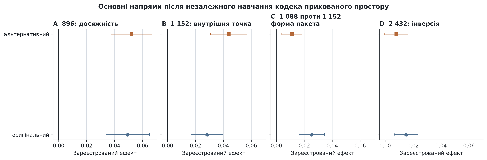

**Рисунок 4.12 – Ефекти оригінального та альтернативного кодеків.** Сім із восьми одночасних інтервалів не перетинають нуль у зареєстрованому напрямі; верхній контраст альтернативного кодека залишається невирішеним, а не інвертованим. *Джерело: побудовано автором за замороженими результатами E7a.*

Альтернативний кодек описово посилює нижній і внутрішній ефекти досяжності, тоді як ефекти форми пакета та верхніх бюджетних точок зменшуються. Ініціалізація кодека не є окремою реплікою моделі під час прогнозування, тому ці зміни не можна усереднювати або пояснювати після перегляду результатів. Допустимий висновок вужчий: після повної заміни одного неперервного інтерфейсу прихованого простору чотири основні напрями зберігаються на рівні точкових оцінок, а три залишаються визначеними на рівні сімейства. Верхня плоска інверсія точності є спільною межею статистичної визначеності для обох програм робастності.

## 4.7 Межа та негативні докази

### 4.7.1 Невдала реплікація пізньої межі за самоподачі

Доступна історія може бути наявною, але її користь здатна зникнути під час тривалої генерації із самоподачею. Початкове довгоциклове дослідження із ініціалізацією 0 начебто виявило таку межу: спочатку ієрархія допомагала, але приблизно після 24 кадрів ставала гіршою. На горизонтах 61–256 ефект для ініціалізації 0 був від’ємним: −0,0064 [−0,0095; −0,0032]. Два нові ініціалізації, навпаки, дали перевагу ієрархії: +0,0074 [0,0038; 0,0112] та +0,0087 [0,0035; 0,0139].

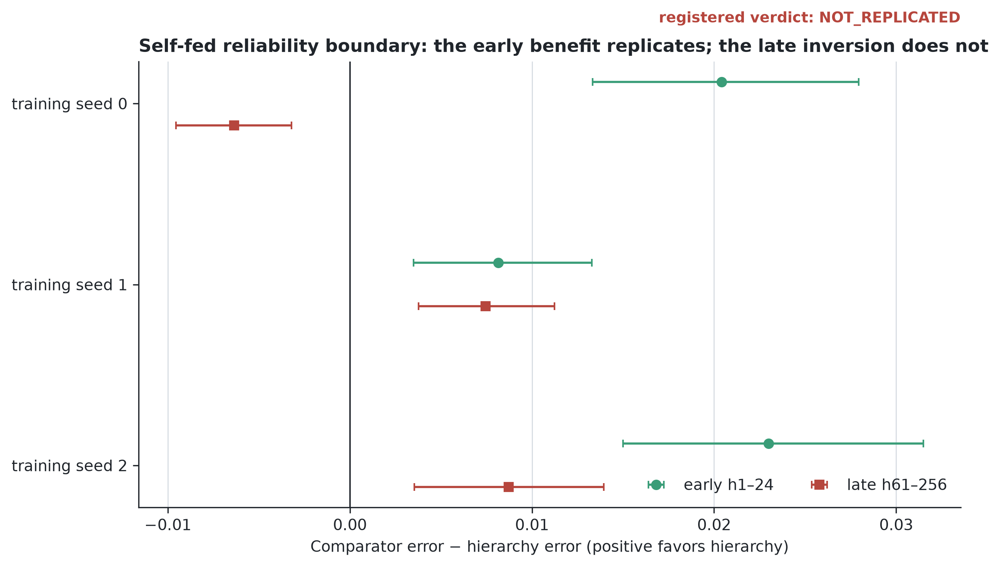

**Рисунок 4.13 – Зареєстровані ефекти раннього та пізнього довгоциклового впливу.** *Джерело: побудовано автором за замороженими результатами E5a.*

Невдала реплікація змінює рекомендацію дисертації. Ранню перевагу за самоподачі можна вважати відтвореною, але вік розгортання не можна використовувати як калібровану точку перемикання між ієрархічною та плоскою пам’яттю. Ініціалізація 0 також не доводить існування універсального часу деградації. Щоб пояснити відмінність цього запуску, потрібні нове зареєстроване питання, додаткові ініціалізації та діагностики, обрані до спостереження результатів. Підтверджена бюджетна межа і зовнішня перевірка вже відповідають на проєктні питання дисертації, тому продовження цієї гілки дало б радше дослідницьке пояснення, ніж необхідний доказ.

### 4.7.2 Еталон із прямим доступом до необробленої історії

Навчені моделі поєднують щонайменше три складнощі: стиснення минулого кадру, адресацію потрібного збереженого вмісту та поширення прогнозів без дрейфу. E8a усуває більшу частину перших двох. Варіанти K6, K14, K38 і K48 відрізняються лише обсягом історії прогріву, що формує мозаїку. K6 дає описовий контекст для зберігання та покриття, а зареєстровані одночасні контрасти досяжності порівнюють K14 і K38 з K48 поряд із чотирма нейронними еталонами.

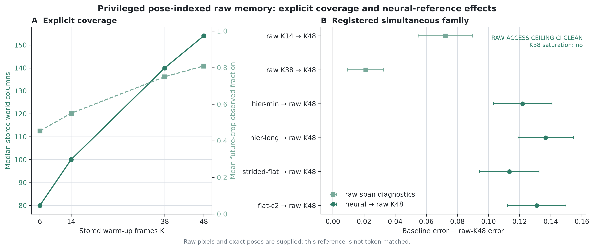

**Рисунок 4.14 – Явне зберігання та доступ, індексовані за позою.** *Джерело: побудовано автором за замороженими результатами E8a.*

Це не конкурентна базова модель. Мозаїка не має обмеження за токенами, отримує майбутню позу, без втрат зберігає спостережувані пікселі, не потребує навченого декодера й не містить прихованого стану із самоподачею. Її призначення діагностичне. Навіть за номінальної геометричної досяжності нейронного пакета залишається значний розрив між потенційним доступом і навченим повторним використанням.

### 4.7.3 Межа просторового покриття та ідентичності об’єктів, що зберігаються в часі

LoopMom робить досяжність вимірюваною, проте його статичний світ і координати вікна не перевіряють, чи зберігає об’єкт ідентичність після зіткнень і тривалого руху із самоподачею. Три плоскі та три ієрархічні предиктори навчено з однаковими кодеком, вихідним модулем, бюджетом контексту 1 152 токени й 48-кадровим прогрівом. Оцінювання охоплює 300 згенерованих кадрів у 100 захищених кліпах.

Усі детекції однозначно зіставляються з видимими еталонними об’єктами за замороженою угорською вартістю. Тому модель не може підвищити точність ідентичності, генеруючи лише прості для підтримання об’єкти. П’ятнадцять співпервинних ефектів, тобто п’ять показників для трьох ініціалізацій, утворюють одне одночасне сімейство max-статистики. Відносні ефекти потрібно читати разом з абсолютними значеннями, оскільки жодна гілка не розв’язує задачу повністю.

**Таблиця 4.9 – Відносні ефекти E6 та абсолютні показники.** Після гармонізації знаків додатні ефекти свідчать на користь ієрархії для кожного показника. В абсолютних комірках значення подано як плоский / ієрархічний. Точність ідентичності та покриття є частками; похибку траєкторії виміряно в пікселях.

Панель A: одночасні попарні ефекти

| ініціалізація | MSE переднього плану | MSE об’єднаної маски | Похибка траєкторії | Точність ідентичності | Покриття об’єкта |
|---:|---:|---:|---:|---:|---:|
| 0 | +0,0036 [−0,0074; +0,0146] | +0,0102 [+0,0019; +0,0185] | +2,4786 [+0,2130; +4,7443] | −0,0762 [−0,1106; −0,0418] | +0,0304 [+0,0016; +0,0591] |
| 1 | −0,0031 [−0,0127; +0,0065] | +0,0122 [+0,0052; +0,0192] | +1,4223 [−1,0646; +3,9092] | −0,0561 [−0,0934; −0,0188] | +0,0159 [−0,0163; +0,0482] |
| 2 | −0,0024 [−0,0131; +0,0083] | +0,0169 [+0,0093; +0,0245] | +4,1325 [+1,5271; +6,7380] | −0,0647 [−0,0955; −0,0338] | +0,0498 [+0,0161; +0,0834] |

Панель B: абсолютні значення показників

| ініціалізація | MSE об’єднаної маски, плоска / ієрархічна | Похибка траєкторії, плоска / ієрархічна | Точність ідентичності, плоска / ієрархічна | Покриття, плоска / ієрархічна |
|---:|---:|---:|---:|---:|
| 0 | 0,6861 / 0,6759 | 42,19 / 39,71 | 0,214 / 0,138 | 0,619 / 0,650 |
| 1 | 0,6901 / 0,6779 | 40,20 / 38,77 | 0,244 / 0,188 | 0,646 / 0,662 |
| 2 | 0,6931 / 0,6763 | 43,79 / 39,65 | 0,222 / 0,158 | 0,599 / 0,649 |

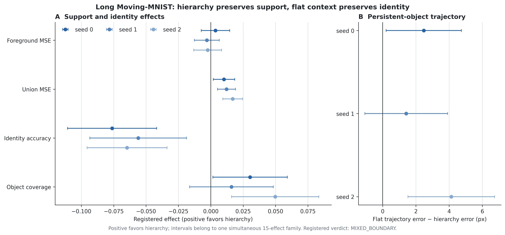

**Рисунок 4.15 – Просторове покриття й неперервність проти ідентичності у довгому Moving-MNIST з об’єктами, що зберігаються в часі.** Напрям покриття й похибки траєкторії сприяє ієрархії для всіх трьох ініціалізацій, але одночасні інтервали не перетинають нуль лише для ініціалізацій 0 і 2. Плоский контекст краще зберігає ідентичність цифр для всіх трьох ініціалізацій. Низькі абсолютні показники не дають підстав вважати задачу розв’язаною. *Джерело: побудовано автором за замороженими результатами E6.*

### 4.7.4 Межі працездатності на короткому горизонті та реальних даних

Канонічна послідовність Moving-MNIST 10-to-10 не містить повторного входу за межі екрану. У гілці плоскої дифузії використовується десять дрібних кадрів з 640 контекстними токенами, тоді як ієрархічна гілка використовує десять грубих кадрів та шість дрібних кадрів розміром 544 токени. Їхні MSE OpenSTL становлять 180,91 та 181,29, а їхні SSIM – 0,7625 та 0,7607 відповідно. Обидва перевершують метод персистенції, MSE якого становить 286,28, а SSIM – 0,6528. Незважаючи на це, вони значно відстають від спеціалізованих детермінованих предикторів OpenSTL, які, за повідомленнями авторів, мають MSE в діапазоні від 22 до 30. Це служить перевіркою на придатність та негативним контролем: коли повторний вхід не потрібен, додавання ієрархічного проміжку навряд чи допоможе.

Жодне порівняння не відтворює умови LoopMom точно. Пакети Moving-MNIST містять 640 і 544 токени контексту. Ієрархічна гілка TaxiBJ використовує вдвічі менший бюджет контексту, ніж плоска; відрізняються також набір даних, горизонт і семантика задачі. Ці тести описують працездатність, а не встановлюють перевагу ієрархії для природного відео. Для такого твердження потрібна спеціально сформована популяція з віддаленою історією, зіставлені інтерфейси та статистичне виведення з урахуванням кластеризації за кліпами, як у LoopMom.

## 4.8 Інтегрована перевірка технічної здійсненності просторового пакування та реверсивного навчання

### 4.8.1 Перехід від динамічної маршрутизації до фіксованих ділянок

Попередні результати відповіли на два окремі запитання: ієрархічний пакет збільшує часову досяжність за обмеженого контексту, а реверсивний часовий блок зменшує пам’ять активацій під час диференціації довгого процесу. Проте їхня сумісність не випливає автоматично з окремих дослідів. Тому після основної експериментальної програми виконано обмежену перевірку технічної здійсненності. Вона встановлює, чи можна поєднати компактне просторове представлення з реверсивним навчальним ланцюгом без негайного руйнування якості. Цей дослід не входить до четвертої статті й не змінює її заявленого внеску.

Перший прототип використовував жорсткий вибір $K$ ділянок за інформаційною щільністю. Маршрутизатор знаходив передній план, а варіант із чотирма останніми детальними ділянками наближався до контрольної моделі за MSE та повнотою виявлення. Водночас точність виявлення погіршувалася, жорстка дискретна операція ускладнювала оптимізацію, а повні детальні карти фактично залишалися в стані обчислення. Отже, цей варіант демонстрував роботу сигналу маршрутизації, але не забезпечував доведеного скорочення пам’яті. Подальший дослід перейшов до фіксованої геометрії ділянок. Такий вибір відокремив перевірку сумісності від невирішеної задачі навчання політики маршрутизації.

У фінальному прототипі кожен кадр $64\times64$ подано 16 грубими токенами та вісьмома токенами фіксованих детальних ділянок. Кожен токен містить 16 скалярних значень, тому пакет має 24 токени, або 384 збережені значення на кадр. Необроблений кадр містить 4096 значень, а щільне одночасне зберігання грубого й детального рівнів – 1280. Відповідні коефіцієнти скорочення корисного навантаження становлять $4096/384=10{,}67$ і $1280/384=3{,}33$. Для проєктної історії з 48 кадрів це дало б 1152 токени, однак фактичний тест якості Moving-MNIST використовує десять вхідних кадрів, тобто 240 токенів. Проєктну місткість не слід ототожнювати з емпірично перевіреною часовою досяжністю.

Якість перевірено за протоколом Moving-MNIST 10→10 у конвенції показників OpenSTL [1]. Після вибору контрольної точки за останніми 500 згенерованими навчальними кліпами канонічну тестову вибірку з 10 000 кліпів використано один раз. Через одну ініціалізацію та публічний статус набору цей результат є обмеженим доказом технічної здійсненності.

**Таблиця 4.10 – Якість інтегрованого прототипу та базових моделей на Moving-MNIST 10→10.** Менше значення є кращим. Офіційні показники OpenSTL наведено за його таблицею моделей [1]; SimVP-gSTA відтворено локально. Різні тренувальні рецепти не дають підстав для причинного ранжування архітектур.

| Модель | Умова | MSE | MAE |
|---|---|---:|---:|
| Інтегрований SimVP із фіксованими ділянками | вибрана контрольна точка, 10 000 кліпів | **28,72** | 80,27 |
| Заморожений SimVP і навчений адаптер ділянок | 10 000 кліпів | 28,87 | 78,74 |
| Локальний SimVP-gSTA без пакування | 200 епох | 26,69 | 77,36 |
| OpenSTL ConvLSTM-S | 200 епох | 29,80 | 90,64 |
| OpenSTL E3D-LSTM | 200 епох | 35,97 | 78,28 |
| OpenSTL SimVP-IncepU | 200 епох | 32,15 | 89,05 |
| OpenSTL TAU | 200 епох | **24,60** | **71,93** |

За MSE інтегрований варіант кращий за наведені ConvLSTM-S, E3D-LSTM і SimVP-IncepU, але поступається локальному SimVP-gSTA та TAU. За MAE він випереджає ConvLSTM-S і SimVP-IncepU, незначно поступається E3D-LSTM та виразніше – SimVP-gSTA і TAU. Результат тому підтверджує працездатність компактного інтерфейсу, а не лідерство за якістю.

### 4.8.2 Реверсивний часовий ланцюг та вимірювання пам’яті

Ту саму модель виконано у двох режимах: зі звичайним зворотним поширенням крізь час і з реверсивним відтворенням станів. Вхід, параметри, функція втрат і порядок операцій залишалися однаковими. За розміру батча 1 значення втрат збіглися в усіх трьох горизонтах, а норми градієнта першого параметра відрізнялися не більше ніж на $7{,}4\cdot10^{-6}$. Це важливо: економію виміряно без заміни предиктора або навчальної цілі.

**Таблиця 4.11 – Пікова додаткова пам’ять інтегрованої моделі за різної довжини прогнозу.** Вимірювання виконано на NVIDIA GeForce RTX 4060 Ti без градієнтних контрольних точок; наведено приріст `max_memory_allocated` відносно стану безпосередньо перед прямим проходом, у десяткових мегабайтах.

| Прогнозовані кадри | Реверсивний режим, МБ | Звичайний BPTT, МБ | Відношення BPTT / реверсивний |
|---:|---:|---:|---:|
| 10 | 352,15 | 353,06 | 1,00 |
| 20 | 549,73 | 708,74 | 1,29 |
| 40 | 550,86 | 1418,79 | **2,58** |

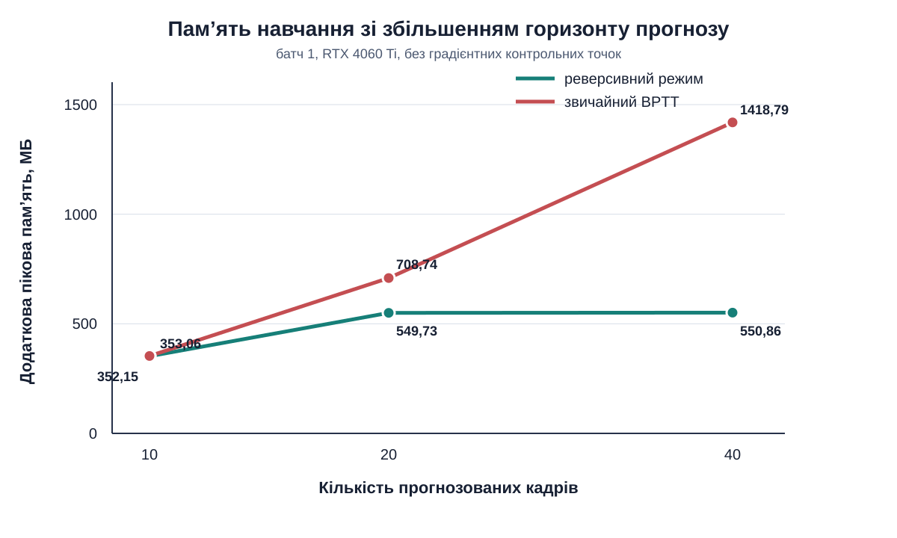

**Рисунок 4.16 – Зростання пам’яті інтегрованої моделі зі збільшенням горизонту прогнозу.** За 10 кадрів накладні витрати реверсивного режиму майже дорівнюють BPTT. Між 20 і 40 кадрами його пік залишається практично сталим, тоді як пам’ять BPTT майже подвоюється. Це виміряна властивість конкретного прототипу, а не асимптотична гарантія для довільної архітектури. *Джерело: побудовано автором за профілем `integrated_reversible_openstl_memory.json`.*

Порівняльний профіль з батчем 2 додає зовнішній масштаб, але має неоднакові горизонти для різних моделей. Інтегрований реверсивний варіант і його BPTT-контроль прогнозували 20 кадрів; E3D-LSTM та ConvLSTM обробляли 20-кадрову послідовність, тоді як SimVP-IncepU і SimVP-gSTA прогнозували лише 10 кадрів. Тому останні два рядки є довідковими, а не зіставленими за горизонтом.

**Таблиця 4.12 – Описове порівняння пікової додаткової пам’яті з базовими моделями OpenSTL.** Усі значення виміряно локально з батчем 2 на одному GPU, без градієнтних контрольних точок.

| Модель | Оброблений або прогнозований горизонт | Пам’ять, МБ | Статус порівняння |
|---|---:|---:|---|
| Інтегрована, реверсивна | 20 прогнозованих кадрів | 904,77 | основний профіль |
| Та сама модель, BPTT | 20 прогнозованих кадрів | 1416,53 | причинно зіставлений контроль |
| OpenSTL E3D-LSTM | 20 кадрів послідовності | 2821,32 | описовий зовнішній базис |
| OpenSTL ConvLSTM | 20 кадрів послідовності | **198,65** | описовий зовнішній базис |
| OpenSTL SimVP-IncepU | 10 прогнозованих кадрів | 453,06 | інший горизонт |
| OpenSTL SimVP-gSTA | 10 прогнозованих кадрів | 616,40 | інший горизонт |

Інтегрована модель має нижчі MSE та виміряну пам’ять, ніж E3D-LSTM, хоча її MAE дещо гірша. Рядки SimVP-IncepU та SimVP-gSTA також поєднують нижчі MSE і пам’ять за власного 10-кадрового протоколу, тому зовнішня таблиця не встановлює унікального положення чи спільної межі Парето. ConvLSTM використовує істотно менше абсолютної пам’яті, а SimVP-gSTA та TAU дають кращу якість. Найсильніший висновок стосується не ранжування зовнішніх моделей, а контролю всередині тієї самої реалізації: реверсивне відтворення знизило пік у 2,58 раза на 40 прогнозованих кадрах за практично однакових втрат і градієнтів.

### 4.8.3 Рівень доказовості та межі композиційного виграшу

Перевірка технічної здійсненності показує, що три компоненти не суперечать один одному на рівні інтерфейсів. Фіксовані ділянки стискають просторовий стан, регресійний декодер повертає прогноз у простір кадрів, а реверсивний часовий ланцюг обмежує зростання пам’яті активацій. Водночас вона встановлює межу такого складання: скорочення корисного навантаження у 10,67 раза та економію активацій у 2,58 раза отримано для різних величин, тому їх не можна перемножувати або подавати як загальну економію GPU.

Дослід має одну ініціалізацію, не перевіряє 48-кадрову досяжність, LoopMom, TaxiBJ, KTH чи природне відео та не ізолює перевагу інформаційної щільності над фіксованим просторовим розкладом. Отримані числа не додаються до підтверджувальної сім’ї E2–E8 і не розширюють твердження четвертої статті. Їхня роль у дисертації вужча: продемонструвати технічну сумісність трьох ресурсних інтерфейсів і визначити протокол майбутнього багатосівного дослідження, який може бути представлений окремою конференційною роботою.

## 4.9 Правило вибору методу на системному рівні

### 4.9.1 Діагностика обмежуючих умов

Результати не визначають одну модель, яка має замінити всі інші. Натомість вони задають послідовність питань, що повинні передувати вибору архітектури. Спочатку потрібно з’ясувати, яка помилка є найдорожчою для задачі. Система, що має зберігати зайнятість простору, геометрію або траєкторію, допускає інші втрати, ніж система, якій необхідно відтворювати обличчя, клас цифри чи дрібну текстуру. Ця відмінність визначає релевантний критерій консистентності: просторове покриття або ідентичність.

Далі потрібно перевірити, чи доступне потрібне минуле. Коли свідчення повторного входження лежать поза поточним плоским вікном, поліпшення локальної точності не поверне їх до контексту. Просторово груба, але часово щільна історія може збільшити досяжність; часово розріджені детальні прив’язки також її збільшують, проте втрачають іншу інформацію. Щільний грубий потік є безпечнішим, коли важливі зміни між прив’язками. Розріджені детальні прив’язки доцільніші, коли старіші стани змінюються повільно, а точний вигляд у вибрані моменти є визначальним.

Окреме питання навчання полягає в тому, чи відповідає диференціація в межах бажаного часового процесу бюджету пам’яті активації. Коли кінцевий предиктор навчається на обмежених вікнах, описаних у розділі 3, реверсивний часовий ланцюг є непотрібним. Довша часова диференціація може вимагати контрольних точок або реверсивного відтворення, обидва з яких працюють на активаціях, а не на контекстному стані, виміряному в цьому розділі.

Нарешті, просторове пакування має зменшувати фактично збережений стан, а не лише логічну кількість токенів. Жорсткий вибір ділянок не пройшов цю перевірку, бо прототип утримував повні детальні карти. Фіксований пакет із підрозділу 4.8 справді обмежує стан до 384 значень на кадр і тому є придатною початковою точкою. Він не доводить, що динамічне ентропійне розміщення краще за фіксовану геометрію.

**Рисунок 4.17 – Дві окремо виміряні осі ресурсів.** Упаковка контексту зменшує обсяг збереженого стану під час застосування, тоді як реверсивне відтворення зменшує активації під час навчання. Перевірка технічної здійсненності підтвердила сумісність цих механізмів у спільному прототипі, але їхні коефіцієнти не описують одну величину й не перемножуються. *Джерело: авторський синтез вимірювань розділів 2 і 4.*

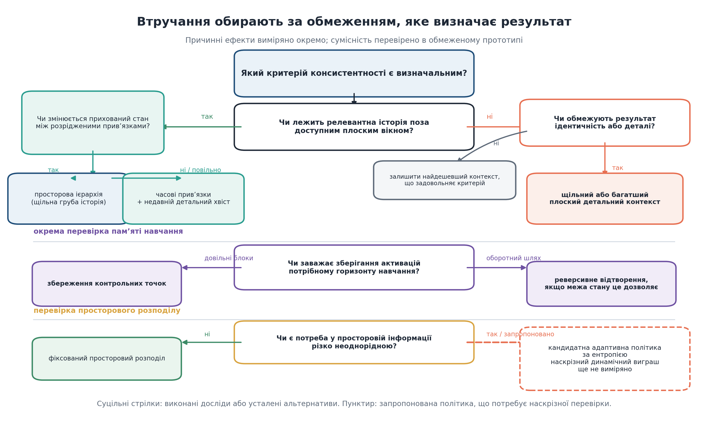

**Рисунок 4.18 – Алгоритм вибору методу за обмежувальним ресурсом.** Спочатку визначають дефіцитний ресурс: досяжність, деталізацію або пам’ять активацій. Лише після цього обирають ієрархію, щільний контекст, градієнтні контрольні точки чи реверсивне відтворення. *Джерело: авторська схема за результатами розділів 2–4.*

### 4.9.2 Матриця застосовності пакетів

Вибір методу починається з двох головних запитань: який ресурс обмежує систему та яка властивість прогнозу є критичною. Далі перевіряють часову досяжність, допустимість просторового стискання й довжину диференційованого ланцюга. Таблиця 4.13 зіставляє ці умови з перевіреними й запропонованими втручаннями.

**Таблиця 4.13 – Застосовність розроблених та порівняльних інтервенцій.** Рівень доказовості
розрізняє виміряні методи та потенційні варіанти. Термін «вартість» позначає основний компроміс, а не
вичерпний бюджет на реалізацію.

| Втручання | Контрольований ресурс або інтерфейс | Основна перевага | Вартість або режим відмови | Рівень доказовості в цій дисертації | Придатна область функціонування |
|---|---|---|---|---|---|
| Щільний плоский контекст | пам’ять контексту/стану | зберігає повну просторову ідентичність та текстуру в кожен збережений момент часу | досяжність зростає лінійно з токенною вартістю високої деталізації | виконана базова порівнювана конфігурація; підтверджено на дослідженій верхній межі та за показником ідентичності E6 | потрібний проміжок доступний, а точна ідентичність або деталізація є обмежувальними |
| Просторовий ієрархічний контекст | пам’ять контексту/стану | щільна довга історія за чверть вартості токенів на кадр у замороженому кодеку | давні деталі стискаються; ціна абстракції виявляється після насичення досяжності | виконано й підтверджено на відкладених даних за 896/1 152; зовнішня межа покриття/неперервності | релевантне минуле лежить поза доступним детальним вікном; важливі просторове покриття або траєкторія |
| Часове прорідження з недавнім детальним хвостом | контекст/пам’ять стану | ефективно зберігає давні прив’язки повної роздільної здатності | створює пропуски змін між прив’язками й не дає щільного декодовного давнього потоку | результат розробки, стабільний для дифузії за п’ятьма ініціалізаціями у статичному світі | прихований стан повільно змінюється між прив’язками, а його точний вигляд у вибрані моменти важливий |
| Просторово-часовий пакет з кроком 2 | контекст і цільова конфігурація | найдешевша перевірена повна конфігурація з номінальною досяжністю 48 кадрів | інтерфейси контексту та цілі змінюються одночасно; чистий ефект кроку не ідентифіковано | відкладене підтвердження всієї конфігурації | використовувати лише як виміряний повний інтерфейс, а не як доказ лише для кроку |
| Просторове представлення за інформаційною щільністю | розподільник кандидатних представлень | може спрямовувати точні ресурси на локально складні регіони | накладні витрати на політику, калібрування та стабільність маршрутизації | прогнозні карти ентропії виміряно; жорстку маршрутизацію перевірено лише як діагностику, а в інтегрованому прототипі використано фіксовані ділянки | майбутні системи з сильно неоднорідним просторовим попитом |
| Фіксований грубо-детальний стан із реверсивним розгортанням | просторовий стан і пам’ять активацій | поєднує 384 значення на кадр із практично сталим піком реверсивного сегмента між 20 і 40 прогнозованими кадрами | фіксована геометрія не адаптується до сцени; одна ініціалізація та короткий синтетичний протокол | виконана перевірка технічної здійсненності; MSE 28,72, зниження пам’яті у 2,58 раза проти BPTT тієї самої моделі на 40 кадрах | дослідницький прототип для перевірки композиційності, а не заміна підтверджувальної моделі [A4] |
| Градієнтні контрольні точки | пам’ять активацій | широко застосовне переобчислення без реверсивних шарів | схема переобчислення та залишкові збережені активації | усталена базова порівнювана конфігурація; прямого факторного порівняння з моделлю розділу 3 немає | потрібно зберігати зв’язки активацій та довільні нереверсивні блоки |
| Реверсивне часове відтворення | пам’ять активацій | реконструює проміжні часові стани замість збереження повної стрічки активацій | інвертованість та чисельні обмеження, додаткові обчислення відтворення й вимоги до детермінованості | опублікований результат TempVerseFormer; у спільному прототипі пік зменшено у 2,58 раза за 40 прогнозованих кадрів порівняно з BPTT тієї самої моделі | потрібне тривале часове диференціювання, і можна забезпечити відтворення станів |
| Явна пам’ять із прямим доступом | інтерфейс зберігання/адресації | демонструє потенціал історії без втрат та точного запиту | переваги необробленого зберігання, точної позиції та інформації, недоступної звичайній моделі розгортання | виконаний діагностичний еталон | аналіз механізмів або верхня межа доступу, а не об’єктивне порівняння моделей |

Матриця також запобігає трьом категоріальним помилкам. Пакування контексту не усуває зростання пам’яті активацій у довгому диференційованому ланцюзі, а реверсивне відтворення не може надати спостереження, відсутні під час застосування. Карта ентропії не стає перевіреним динамічним розподільником без реалізованої політики та виміряного компромісу між обчисленнями і якістю. Нарешті, коефіцієнт скорочення збережених значень не можна подавати як такий самий коефіцієнт зменшення всієї пам’яті GPU.

### 4.9.3 Взаємозв’язок між розробленими методами

Ці методи стосуються сусідніх, але різних інтерфейсів однієї системної задачі. Критерії консистентності визначають, яку властивість прогнозу потрібно зберігати. Реверсивне обчислення знижує вартість активацій під час диференціації тривалого процесу. V-BLT та RoPE-ND досліджують просторове представлення, координатну структуру й неоднорідність складності. Кінцевий предиктор, своєю чергою, визначає, які історичні спостереження у прихованому просторі поміщаються в заданий бюджет контексту. Саме для останнього питання розділ 4 встановлює емпіричні області доцільності.

Основні твердження все ще спираються на окремі контрольовані досліди: TempVerseFormer не був компонентом підтверджувальної моделі E2–E8, а V-BLT/RoPE-ND не визначав її позиційне кодування. Водночас підрозділ 4.8 усуває попередню прогалину на рівні технічної здійсненності: компактне просторове представлення та реверсивний часовий блок працювали в одному навченому прототипі. Це не робить архітектуру єдиною експериментальною лінією і не дозволяє переносити на неї підтверджувальні висновки LoopMom.

Отже, композиція виконує конкретну, обмежену роль. Основний WindowDiT ізолює причинний ефект контекстного пакета; інтегрований SimVP перевіряє, чи сумісні компактний стан, однопрохідне декодування та реверсивне навчання. Саме так зберігається єдина системна історія без удаваного твердження, що всі статті досліджували одну незмінну архітектуру.

## 4.10 Набір програмних засобів та практичне застосування

### 4.10.1 Архітектура програмного забезпечення

Організація програмного забезпечення відтворює логіку наукового аналізу. Підтримуваний пакет `hvp` надає інтерфейси без побічних ефектів для опису контексту й геометрії досяжності, оцінювання повних кадрів і об’єктів, що зберігаються в часі, статистичного виведення з урахуванням кластеризації за кліпами, одночасного аналізу та фіксації походження через контентну адресацію. Опис експерименту відокремлено від його результатів. Імпорт пакета не завантажує набори даних, не ініціалізує CUDA, не під’єднується до сервісу експериментів і не запускає обчислення. У версії 0.3.0 стабільний публічний CLI повідомляє версію та перевіряє шлюз авторизації; навчання й оцінювання залишаються дослідницькими робочими процесами.

Відтворюваність перевіряється на кількох рівнях. Валідатори відхиляють порівняння несумісних пакетів, а тести показників охоплюють порожні маски, хибнопозитивні результати, зіставлення об’єктів у часі, пропуски, зайві компоненти та покриття. Перевірка наукової конфігурації завершується відмовою, якщо дослідження має термінальний стан, пропущене, не зареєстроване або не авторизоване. На момент релізу 0.3.0 десять конфігурацій пройшли перевірку авторизації, 83 CPU-тести завершилися успішно, вихідні файли Python пройшли компіляційну перевірку, а пакет wheel було зібрано й установлено в ізольованому середовищі. Після релізу до робочої гілки додано модулі інтегрованої перевірки технічної здійсненності та відповідні тести; поточний набір містить 99 успішних CPU-тестів. Цей стан не слід ототожнювати із замороженим релізом 0.3.0. Процес придатний до аудиту, однак великі локальні набори даних і контрольні точки ще не опубліковано для завантаження. Для зовнішнього доступу потрібні адреси архівів, ліцензії, хеші та перевірені інструкції.

### 4.10.2 Впровадження та використання в освітніх цілях

Інструментарій має дослідницьке й навчальне призначення. Він містить повторно використовувані генератори, інтерфейси пакетів, засоби оцінювання розгортань і статистичні процедури, завдяки чому перевірка механізму не змішується з оцінюванням загальної продуктивності. Перед додаванням нового пакета потрібно визначити геометрію прив’язок, кількість контекстних і цільових токенів, допустимий тип порівняння та оцінювану популяцію. Ця дисципліна є окремим практичним результатом дисертації.

Звіти про впровадження документують використання в ТОВ «ОРНЕТІКА» та в навчальному процесі Вінницького національного технічного університету від 14 жовтня 2025 року та 19 вересня 2025 року. Затверджена сфера застосування охоплює методи реверсивного трансформера та токенізації ентропії. Ці звіти не можна переосмислювати як валідацію розгортання предиктора, описаного в розділі 3. Остаточні адміністративні додатки повинні відтворювати наданий автором підписаний текст та скановані копії.

## 4.11 Обмеження та загрози валідності

### 4.11.1 Внутрішня валідність та валідність конструкту

Специфічний для пари інструмент спостережуваності надає найпереконливіші докази внутрішньої валідності. Навіть у центральній парі просторова роздільна здатність і номінальна досяжність змінюються разом. Щоб відрізнити використання спостережуваної історії від сильного апріорного припущення, яке приводить до того самого прогнозу, потрібні були б контрфактуальні приховані світи. У B1 змішування виражене сильніше: разом із кроком контексту змінюються крок і слоти цілі, допоміжна функція втрат, довжина послідовності та оптимізаційне навантаження. Повна конфігурація є валідною й перевіреною, але приписувати її ефект лише часовому кроку не можна. Зонд глибини має подібне обмеження: глибину представлення, розподіл цілей та навчальне навантаження не розділено.

Якісні докази навмисно залишаються вторинними. Галерея з фіксованим індексом гарантує, що відображену вибірку можна відтворити, проте невизначеність вибору залишається, оскільки не було зареєстровано квантильне правило відбору. У будь-якому разі, невелика галерея не може охопити кумулятивний розподіл помилок. Необроблена мозаїка є інформативною з аналогічної причини: вона видаляє навчену адресацію. Однак прямий доступ до майбутнього положення та зберігання без втрат роблять її непридатною для ранжування моделей.

### 4.11.2 Статистична та зовнішня валідність

Кількість ініціалізацій навчання нерівномірна: дві для основного результату за 896 токенів, три для 1152 і п’ять для факторного експерименту форми пакета; середні та верхні точки мають одну або дві ініціалізації. Інтервали зі статистичним виведенням з урахуванням кластеризації за кліпами описують невизначеність щодо кліпів для кожної навченої моделі, але не замінюють реплікацію за ініціалізаціями. Тому невирішена точка 1792 разом із нижчою точністю верхніх ефектів робастності має залишатися видимою в кожному підсумку бюджетної межі. Перевірка генератора використовує фіксовані контрольні точки та ініціалізацію предиктора 0. Перевірка кодека охоплює один незалежно навчений кодек із ініціалізацією предиктора 0 і не встановлює, яка саме його властивість зменшила верхній ефект.

Бюджетна межа є дискретною. Вона визначає перевірені точки та сімейство рішень, але не унікальний перетин, монотонну криву чи асимптотичний закон. Арифметика токенів контексту вимірює безпосереднє зберігання стану та матеріалізовані вбудовування; вона не характеризує швидкодію, FLOP уваги, повну пам’ять GPU або однакову якість. Тесту на еквівалентність не проводили, тому інтервал, що перетинає нуль, не означає «методи однакові».

Інтегроване дослідження має додаткові обмеження: одну ініціалізацію, публічний тестовий набір, короткий протокол 10→10 та незбіг горизонтів у частині зовнішніх профілів пам’яті. Фіксовані ділянки прибрали нестабільність дискретної маршрутизації, але разом із нею усунули прямий тест переваги адаптації до інформаційної щільності. Через це підрозділ 4.8 підтверджує сумісність і вимірює компроміси конкретного прототипу, а не встановлює нову область переваги.

### 4.11.3 Висновки розділу

У сукупності експерименти дають основу для вибору, а не визначають архітектуру-переможця. У контрольованому режимі однокрокового оракульного охоплення дифузія краще відтворює цільовий розподіл, ніж регресійний вихідний модуль із близькою кількістю параметрів, але за нерівного загального обсягу обчислень під час генерування. У детермінованому розгортанні із самоподачею та одним кандидатом кращою є регресія. Енергетичний спуск у перевіреному масштабі не досягає структурованих цілей навіть тоді, коли один із алгоритмів навчається правильного енергетичного порядку. Отже, механізм генерації потрібно обирати відповідно до режиму застосування.

Перевірена бюджетна межа містить дві області доцільності. Ієрархію підтверджено за 896 та 1 152 токенів контексту, точка 1 792 залишається невизначеною, а плоский контекст підтверджено за 2 432 і 3 072 токенів. За однакової номінальної досяжності 48 кадрів два ієрархічні пакети використовують у 2,67 та 3,43 раза менше токенів контексту, ніж щільна детальна історія. Це не означає однакової якості, інформаційної місткості, обчислювальних витрат або економії повної пам’яті.

Два граничні результати уточнюють цю картину. У E5a рання перевага ієрархії повторилася за трьома ініціалізаціями, але пізня інверсія, виявлена для ініціалізації 0, не відтворилася й тому не є підтвердженою межею самоподачі. У захищеному E6 напрям покриття та неперервності сприяв ієрархічному контексту в усіх трьох навчаннях, проте одночасні інтервали не перетинали нуль лише для ініціалізацій 0 і 2; перевагу плоского контексту за ідентичністю підтверджено для всіх трьох ініціалізацій. Отже, довша досяжність і детальна ідентичність є різними вимогами, а абсолютні значення E6 не дають підстав вважати задачу розв’язаною.

Результати короткого Moving-MNIST і TaxiBJ дають додаткові свідчення працездатності, але не підтверджують довготривалу пам’ять. Обмежені горизонти та незіставлені бюджети контексту не дають змоги використати ці тести для центрального причинного твердження. Так само LoopMom і довгий Moving-MNIST не відтворюють різноманітність природного відео: рух камери, оклюзії зі змінною тривалістю, появу нових об’єктів і складну текстуру. Подальшу зовнішню валідність найкраще перевіряти на природному відео з подіями зникнення й повторного входу, ширшій панелі кодеків та необроблених еталонів, а також у зареєстрованому дослідженні поблизу точки 1 792 токени.

Інтегрований прототип доповнює, але не замінює ці висновки. Він утримав MSE 28,72 на Moving-MNIST за 384 збережених значень на кадр і зменшив пік пам’яті тієї самої моделі у 2,58 раза на 40-кадровому прогнозі. Порівняння з OpenSTL показало конкурентну, але не найкращу якість та відсутність універсальної переваги в абсолютній пам’яті. Отже, центральна ієрархічна модель залишається розв’язанням обмеження контекстної досяжності, а просторове пакування й реверсивність є сумісними засобами для двох інших ресурсних меж.
