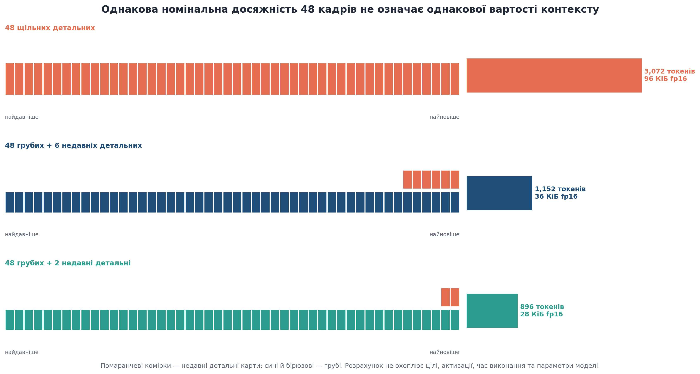
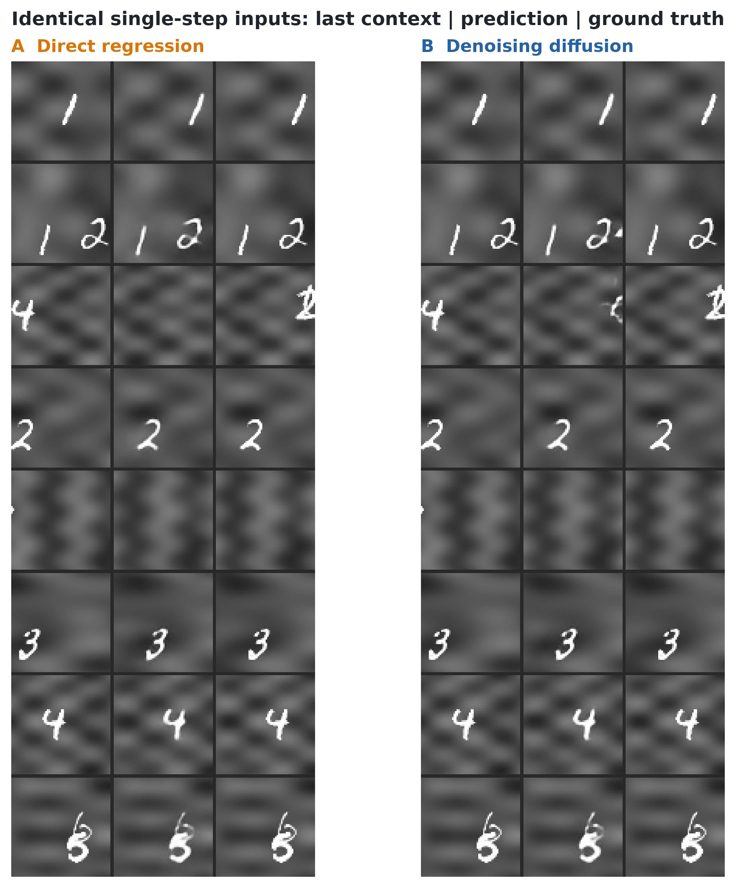
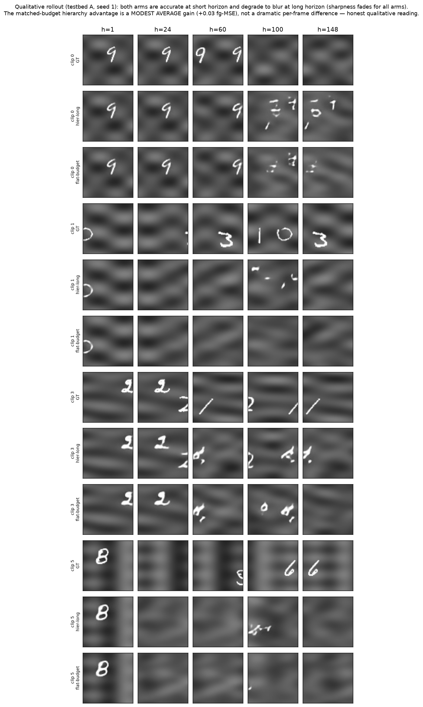

# Додатки

У додатках зібрано матеріали, які перевантажували б основний науковий виклад. Вони не розширюють обсяг виконаних експериментів. Якщо певний пункт залежить від інституційного документа, авторського рішення або остаточного статусу публікації, потрібні дії автора зазначено прямо, а не виведено з вмісту репозиторію.

## Додаток А – Публікації, результати дисертації та особистий внесок

Позначення, що використовуються в цьому додатку, стосуються списку публікацій, представленого у вступі, а не порядку організації наукового розділу. Їхній зв’язок із результатами та особистим внеском подано в таблиці А.1.

**Таблиця А.1 – Публікації, використані результати та особистий внесок здобувача.**

| Публікація | Роль у дисертації | Результати, використані в дисертації | Внесок здобувача | Збережена кваліфікація |
|---|---|---|---|---|
| **[A1]** Кулик і Мокін, *Масштабування прогнозування відео за допомогою просторово-часових патчів* | Розділ 2: метод просторового представлення | фіксовані растрово-байтові патчі `4 × 4 × 4`, локальна–глобальна–локальна обробка V-BLT, RoPE-ND, категоріальне прогнозування, карти ентропії, опубліковані оцінки витрат і якості | розроблення методу та програмного забезпечення, процедурні експерименти, кількісний і якісний аналіз, підготовка рукопису; внесок наукового керівника у формування системної концепції та рецензування | динамічне ентропійне формування областей запропоновано, але не реалізовано; поточна конфігурація репозиторію за замовчуванням сама по собі не встановлює опубліковану довжину часового патча |
| **[A2]** Кулик, *Temporal Modeling with Reversible Transformers* | метод зменшення пам’яті активацій у розділі 2 | ядро реверсивного трансформера, часовий ланцюг, результати контрольованого обертання, порівняння з OpenSTL, вимірювання пам’яті й часу | розроблення, реалізація, експерименти, аналіз і рукопис, виконані автором | точна реконструкція стосується збережуваного подвоєного стану трансформера; кодер/декодер, навчені проєкції, злиття та функція втрат лежать поза реверсивною межею; якість неоднорідна, а відтворення потребує додаткових обчислень |
| **[A3]** Кулик та Мокін, *Методи забезпечення консистентності генерації в дифузійних моделях* | Розділ 1: концептуальна відправна точка | зовнішній вигляд/стиль, ідентичність, геометрія/форма та концептуальна консистентність; порівняння методів керування на основі вхідних даних, ваг, структури, інверсії та уваги | технічний огляд, синтез та пропозиція категорії концептуальної консистентності; внесок наукового керівника у наукове формулювання та редакційну рецензію | якісний огляд статичних зображень, а не систематичний огляд чи часовий експеримент; дисертація поширює свої критерії на відео, замість того щоб розглядати їх як готові часові докази |
| **[A4]** Кулик, підготовлювана стаття про ієрархічну відеопам’ять та інтегровану ресурсоефективну архітектуру | Розділи 3–4: емпірична основа й інтеграція | явні пакети контексту, спостережуваність TRB, перевірену межу «досяжність–точність відтворення», матрицю структурних порівнянь бюджетів і розподілів, а також окремо контрольоване фізичне пакування, маршрутизацію й внутрішньо реверсивне ядро | модель, генератори, програмне забезпечення оцінювання й статистики, проєктування та виконання експериментів, інтеграція OpenSTL, кураторство артефактів, аналіз і рукопис | **[ДАНІ ВІД АВТОРА: перед поданням затвердити назву, остаточний склад авторів, видання, бібліографічний статус і заяву про внесок; незавершені A4 та інтегровані результати не включати як фактичні.]** |
| **Предиктор зі сталими ділянками, не окрема запланована стаття** | Підрозділи 3.7.2 і 4.9.1–4.9.3 | фіксоване грубо-детальне пакування, адаптація SimVP, якість однієї ініціалізації та інженерний профіль другопорядкового реверсивного ланцюга | постановка інтеграційного інтерфейсу, реалізація, профілювання, аналіз і формування маніфесту доказів | обмежена перевірка технічної здійсненності; 2,58× не є порівнянням тотожної прямої функції, а перевірка адаптивної інтеграції входить до підготовлюваної [A4], а не утворює п’яту статтю |

Власне дисертаційний внесок охоплює системний синтез методів, аудит реалізацій TempVerseFormer і V-BLT, явне розмежування пам’яті контексту/стану та активацій, стохастичне розширення реверсивного відтворення, формування правила вибору за робочою областю, предиктор зі сталими ділянками та остаточний фізично запакований OpenSTL-інтерфейс. Ці доповнення не можна ретроактивно приписувати опублікованим статтям незалежно від їхнього бібліографічного статусу.

## Додаток Б – Адміністративні записи та акти про впровадження

Остаточна інституційна версія має містити перевірені відомості про обидві держбюджетні теми, роль здобувача в кожній із них, усі шість конференційних публікацій та повний перелік праць. Потрібно також додати підписані акти впровадження; відновлювати їхній зміст із пам’яті не можна. До основного тексту включаються лише акти та охоплені ними компоненти, підтверджені підписаними інституційними документами. Поточний стан цих записів наведено в таблиці Б.1, а робочий порядок їх завершення — в окремому редакційному чеклісті, який не входить до тексту дисертації.

**Таблиця Б.1 – Адміністративні записи, які потребують остаточного підтвердження.**

| Необхідний запис | Стан у репозитарії | Необхідні дії автора |
|---|---|---|
| УДК та формулювання титульного аркуша | попереднє значення у вступній частині | перевірити на відповідність затвердженому запису ВНТУ; код 124/галузь 12 не замінювати на F4 автоматично, а звірити з документами освітньо-наукової програми й роком вступу |
| Державно-бюджетний проект 1 | відсутній авторитетний номер або підписаний текст у репозитарії | додати назву, номер, дати та роль здобувача |
| Проект державного бюджету 2 | у репозитарії відсутні офіційний номер або підписаний текст | ввести назву, номер, дати та роль здобувача |
| Публікації конференції | неповний адміністративний перелік | заповнити всі шість записів та підтвердити, чи належить до них DSMSI-2023 |
| Статус статті [A4] | спільний рукопис про A4 та інтегровану модель перебуває в підготовці | після завершення експериментів ввести остаточну назву, видання, список авторів, статус і формулювання особистого внеску |
| Акт про впровадження ТОВ «ОРНЕТИКА» | дата та наукова сфера, описані в розділі 4 | ввести скановану копію з підписом та присвоєну літеру додатка; зберегти точний обсяг акту |
| Акт про впровадження ВНТУ | дата та наукова сфера, описані в розділі 4 | ввести скановану копію з підписом та присвоєну літеру додатка; зберегти точний обсяг акту |
| Статистика кінцевого документа | недоступна до інституційного верстання | вставити загальну кількість сторінок та сторінок основного тексту, кількість рисунків/таблиць, кількість посилань та літери додатків |
| Ліцензії на повторно використані рисунки | зафіксована декларація авторських прав та ліцензії джерел | жодних додаткових дій щодо дозволів для збережених рисунків, створених автором під ліцензією CC BY; зберегти вказівку на авторство в кінцевому верстанні |

## Додаток В – Реєстр конфігурацій та правил інтерпретації

Цей додаток містить самодостатню сітку виконаних конфігурацій тороїдального тесту повторного входу (TRB; внутрішня назва `LoopMom`) і правила, за якими їх можна порівнювати. Розширений електронний реєстр із парними ефектами, шляхами артефактів та журналами доступу збережено у файлі [`APPENDIX_CH4_CONFIGURATION_AND_EVIDENCE_REGISTRY.md`](../rewrite/appendices/APPENDIX_CH4_CONFIGURATION_AND_EVIDENCE_REGISTRY.md); він доповнює, але не замінює наведені нижче записи. Базові ліцензії на інтерпретацію визначено в таблиці В.1.

**Таблиця В.1 – Ліцензії на інтерпретацію експериментальних порівнянь.**

| Ліцензія порівняння | Допустиме тлумачення | Заборонений висновок |
|---|---|---|
| **MATCHED** | ефект зареєстрованої пари пакетів за названого зіставленого бюджету й інтерфейсу | універсальна архітектурна перевага |
| **NEAR_MATCHED** | напрям ефекту за розкритої малої різниці бюджетів | точний причинний ефект однакового бюджету |
| **MATCHED_CAPACITY** | порівняння механізмів за близької ємності основи та спільного контексту | тотожність цілей або обчислень під час застосування |
| **WHOLE_CONFIGURATION** | результат повної виконаної конфігурації | ефект одного компонента, що змінювався разом з іншими |
| **DEVELOPMENT_FACTORIAL** | ефект та взаємодія за ініціалізаціями на адаптивно використаній вибірці | відкладене підтвердження |
| **DEVELOPMENT_DIAGNOSTIC** | діагностика механізму зі збереженням названих змішаних чинників | підтверджений причинний закон |
| **ROBUSTNESS_ONLY** | чутливість уже вибраних контрастів до названого втручання | новий вибір моделі або ширше узагальнення |
| **REGISTERED_REPLICATION** | незалежний від результату вердикт щодо замороженого передбачення | переозначення після отримання несприятливого результату |
| **PRIVILEGED_REFERENCE** | діагностична цінність явної адресації або додаткової інформації | токенно зіставлене ранжування моделей |
| **EXTERNAL_BOUNDARY** | поведінка за зміненого завдання та набору кінцевих показників | пряма реплікація геометрії LoopMom |
| **DESCRIPTIVE_BOUNDARY** | компетентність або відмова поза центральним механізмом | еквівалентність, перевага або підтвердження механізму |

У таблиці В.2 досяжність вимірюється у кадрах, а контекстні й загальні витрати – у токенах. Глибина подана як кількість просторових рівнів / часових швидкостей. Повторення назви гілки означає інший режим оптимізації, а не дубль запису.

**Таблиця В.2 – Повний реєстр виконаних гілок LoopMom.**

| ID | Гілка та пакет | Вихід | Досяжність | Контекст | Загалом | Глибина | Ініціалізації | Режим |
|---|---|---|---:|---:|---:|---|---|---|
| LM01 | `hier-short`: 6 грубих + 6 детальних | дифузійний | 6 | 480 | 800 | 2 / 1 | 0–1 | B16×30k |
| LM02 | `flat-short`: 8 детальних | дифузійний | 8 | 512 | 832 | 1 / 1 | 0–1 | B16×30k |
| LM03 | `flat-short-reg`: 8 детальних | регресійний | 8 | 512 | 832 | 1 / 1 | 0 | B16×30k |
| LM04 | `hier-s2-min`: 24 грубі з кроком 2 + 2 детальні | дифузійний | 48 | 512 | 800 | 2 / 2 | 0–1 | B16×30k |
| LM05 | `hier-s2-min-reg` | регресійний | 48 | 512 | 800 | 2 / 2 | 0 | B16×30k |
| LM06 | `spat18`: 18 грубих + 6 детальних | дифузійний | 18 | 672 | 992 | 2 / 1 | 0 | B16×30k |
| LM07 | `spat18-reg` | регресійний | 18 | 672 | 992 | 2 / 1 | 0 | B16×30k |
| LM08 | `flat-min`: 14 детальних | дифузійний | 14 | 896 | 1 216 | 1 / 1 | 0–1 | B16×30k |
| LM09 | `hier-min`: 48 грубих + 2 детальні | дифузійний | 48 | 896 | 1 216 | 2 / 1 | 0–1 | B16×30k |
| LM10 | `strided-flat`: 11 детальних прив’язок із кроком 4 + 6 детальних | дифузійний | 48 | 1 088 | 1 408 | 1 / 2 | 0–4 | B16×30k |
| LM11 | `strided-flat-reg` | регресійний | 48 | 1 088 | 1 408 | 1 / 2 | 0–4 | B16×30k |
| LM12 | `flat-budget`: 18 детальних | дифузійний | 18 | 1 152 | 1 472 | 1 / 1 | 0–2 | B16×30k |
| LM13 | `flat-budget`: 18 детальних | дифузійний | 18 | 1 152 | 1 472 | 1 / 1 | 0 | B8×60k |
| LM14 | `reg-flat`: 18 детальних | регресійний | 18 | 1 152 | 1 472 | 1 / 1 | 0–1 | B16×30k |
| LM15 | `hier-long`: 48 грубих + 6 детальних | дифузійний | 48 | 1 152 | 1 472 | 2 / 1 | 0–4 | B16×30k |
| LM16 | `hier-long`: 48 грубих + 6 детальних | дифузійний | 48 | 1 152 | 1 472 | 2 / 1 | 0 | B8×60k |
| LM17 | `reg-long`: 48 грубих + 6 детальних | регресійний | 48 | 1 152 | 1 472 | 2 / 1 | 0–4 | B16×30k |
| LM18 | `hier3`: 48 верхніх + 24 грубі + 9 детальних | дифузійний | 48 | 1 152 | 1 488 | 3 / 1 | 0 | B16×30k |
| LM19 | `flat-c1`: 28 детальних | дифузійний | 28 | 1 792 | 2 112 | 1 / 1 | 0 | B16×30k |
| LM20 | `hier-c1`: 48 грубих + 16 детальних | дифузійний | 48 | 1 792 | 2 112 | 2 / 1 | 0 | B16×30k |
| LM21 | `flat-c2`: 38 детальних | дифузійний | 38 | 2 432 | 2 752 | 1 / 1 | 0 | B16×30k |
| LM22 | `hier-c2`: 48 грубих + 26 детальних | дифузійний | 48 | 2 432 | 2 752 | 2 / 1 | 0 | B16×30k |
| LM23 | `flat-c2`: 38 детальних | дифузійний | 38 | 2 432 | 2 752 | 1 / 1 | 0 | B8×60k |
| LM24 | `hier-c2`: 48 грубих + 26 детальних | дифузійний | 48 | 2 432 | 2 752 | 2 / 1 | 0 | B8×60k |
| LM25 | `flat-long`: 48 детальних | дифузійний | 48 | 3 072 | 3 392 | 1 / 1 | 0–1 | B8×60k |
| LM26 | `hier-rich`: 48 грубих + 36 детальних | дифузійний | 48 | 3 072 | 3 392 | 2 / 1 | 0–1 | B8×60k |

Сітка є повною щодо виконаної програми, але не прямокутною. Структурно відсутні комірки зафіксовано окремо в таблиці В.3, щоб їх не сприймали як незавершені результати.

**Таблиця В.3 – Структурно відсутні та остаточно закриті експериментальні комірки.**

| Запропонована комірка | Завершальний стан | Наслідок для висновку |
|---|---|---|
| `flat-320` | **NOT_EXECUTED / OUT_OF_SCOPE** | точка межі на 320 токенах не заявляється |
| `hier-s4-min` | **NOT_EXECUTED / OUT_OF_SCOPE** | закон для грубого потоку з кроком 4 не заявляється |
| `hier3-reg` | **NOT_EXECUTED / OUT_OF_SCOPE** | міжмодульний висновок для третього рівня не заявляється |
| E5b/E5c | **NOT_AUTHORIZED after E5a** | невдала реплікація пізньої інверсії є завершальною |
| E9 | **SKIPPED_POST_FREEZE_NO_INCREMENTAL_UTILITY** | додаткові GPU-докази для поточних тверджень не потрібні |
| B1 із фіксованою ціллю | **NOT_EXECUTED / OUT_OF_SCOPE** | B1 назавжди залишається порівнянням повних конфігурацій |

Таблиця В.4 доповнює реєстр гілок групуванням за науковими порівняннями. «C/F» позначає кількість грубих і детальних слотів контексту; C0 є початковим кодеком, C1 – незалежно навченим. Якщо не зазначено інше, використано DDIM-16 з ініціалізацією алгоритму вибірки 0.

**Таблиця В.4 – Повна матриця виконаних компонентів і конфігурацій.**

| Дослідження або група | Кодек | Пакет; досяжність | Токени контексту / цілі / загалом | Вихід | Цільовий інтерфейс | Вибірка | Дані | Ініціалізації | Статус |
|---|---|---|---:|---|---|---|---|---|---|
| `hier-short` / `flat-short` | C0 | 6C+6F, R6 / 8F, R8 | 480/320/800 проти 512/320/832 | дифузія | 4 щільні цілі | DDIM-16 | LoopMom | 0–1 | майже зіставлена нижня діагностика |
| B1 `hier-s2-min` / `flat-short` | C0 | 24C+2F, R48 / 8F, R8 | 512/288/800 проти 512/320/832 | дифузія; регресійний контроль | крок цілі 2 та допоміжний інтерфейс у B1 | DDIM-16 / один прохід | LoopMom | дифузія 0–1; регресія 0 | підтверджено ефект повної конфігурації |
| `spat18` / `flat-budget` | C0 | 18C+6F, R18 / 18F, R18 | 672/320/992 проти 1 152/320/1 472 | дифузія та регресія | 4 щільні цілі | DDIM-16 / один прохід | LoopMom | 0 | діагностика абстракції |
| `hier-min` / `flat-min` | C0 | 48C+2F, R48 / 14F, R14 | по 896/320/1 216 | дифузія | 4 щільні цілі | DDIM-16 | LoopMom | 0–1 | відкладене підтвердження нижньої області |
| `hier-long` / `flat-budget` | C0 | 48C+6F, R48 / 18F, R18 | по 1 152/320/1 472 | дифузія; регресійний контроль | 4 щільні цілі | DDIM-16 / один прохід | LoopMom | дифузія 0–4 / 0–2; регресія 0–4 / 0–1 | підтвердження та факторні контролі |
| `strided-flat` / `hier-long` | C0 | 11F з кроком 4 + 6F, R48 / 48C+6F, R48 | 1 088/320/1 408 проти 1 152/320/1 472 | дифузія та регресія | 4 щільні цілі | DDIM-16 / один прохід | LoopMom | 0–4 | майже зіставлений факторний експеримент |
| `hier3` / `hier-long` | C0 | 48 верхніх+24C+9F / 48C+6F; R48 | 1 152/336/1 488 проти 1 152/320/1 472 | дифузія | різний розподіл цілей | DDIM-16 | LoopMom | 0 | діагностика повної трирівневої конфігурації |
| `hier-c1` / `flat-c1` | C0 | 48C+16F, R48 / 28F, R28 | по 1 792/320/2 112 | дифузія | 4 щільні цілі | DDIM-16 | LoopMom | 0 | невизначена відкладена точка |
| `hier-c2` / `flat-c2` | C0 | 48C+26F, R48 / 38F, R38 | по 2 432/320/2 752 | дифузія | 4 щільні цілі | DDIM-16 | LoopMom | 0, два режими | плоский пакет підтверджено |
| `hier-rich` / `flat-long` | C0 | 48C+36F, R48 / 48F, R48 | по 3 072/320/3 392 | дифузія | 4 щільні цілі | DDIM-16 | LoopMom | 0–1 | плоский пакет підтверджено |
| E5a | C0 | довга ієрархія / щільна база; R224 | зареєстрована пара | дифузія | довгоциклове розгортання | зареєстрована | довгоцикловий LoopMom | 0–2 | ранній ефект відтворено, пізню інверсію не відтворено |
| E7c | C0 | 4 контрасти, 896–2 432 | як вище | дифузія | без змін | NFE 8/16/32; ініціалізації 0–2 | захищений LoopMom | предиктор 0 | 20 ефектів, напрямкова робастність |
| E7a | C1 і контроль C0 | 7 предикторів, 4 контрасти | як вище | дифузія | без змін | DDIM-16 | захищений LoopMom | предиктор 0 | 8 ефектів повної заміни кодека |
| E8a | необроблені пікселі й C0 | K6/K14/K38/K48 | без зіставлення | прямий пошук і дифузійні еталони | точна майбутня поза | прямий пошук / DDIM-16 | захищений LoopMom | детермінований / 0 | еталон із прямим доступом |
| E6 | C0 | 18F, R18 / 48C+6F, R48 | по 1 152 контекстних токенів | дифузія | 300 кадрів після 48 кадрів прогріву | зареєстрована | довгий Moving-MNIST | 0–2 | змішана зовнішня межа |
| `mm-flat` / `mm-hier` | тестовий кодек | 10F / 10C+6F | 640 проти 544 | дифузія | OpenSTL 10→10 | один кандидат | Moving-MNIST | 0 | описовий короткий контроль |
| TaxiBJ, 4 гілки | двоканальний кодек | 4F / 4C+1F | 256 проти 128 | дифузія та регресія | OpenSTL 4→4 | DDIM / один прохід | TaxiBJ | 0 | описова межа на реальних даних |
| B1 із фіксованою ціллю | – | запропонований контроль | – | – | ізолював би зміну цілей | – | LoopMom | – | не виконано; не потрібний для конфігураційного твердження |
| `flat-320`, `hier-s4-min`, `hier3-reg` | – | комірки заповнення сітки | – | – | – | – | LoopMom | – | не виконано / поза сферою |
| E5b та E9 | – | запропоновані розширення | – | – | – | – | – | – | не авторизовано; E9 остаточно пропущено |

Таблиця В.5 відокремлює причинно зіставлені контрасти від діагностик повних конфігурацій. Її рядки не утворюють одного повністю перехресного факторного експерименту.

**Таблиця В.5 – Карта доказів форми контексту та ліцензії на порівняння.**

| Питання | Порівняння | Зафіксовано | Змінюється одночасно | Ліцензія | Допустимий висновок |
|---|---|---|---|---|---|
| Вихід за межі плоского вікна | `hier-min` / `flat-min` | бюджети, кодек, вихід, кліпи, популяція | досяжність і деталізація давньої історії | **MATCHED**, E2 | перевага зосереджується там, де лише ієрархія адресує минуле |
| Абстракція за фіксованого проміжку | `spat18` / `flat-budget` | проміжок 18 кадрів, хвіст, кодек | 672 проти 1 152 токенів | **DEVELOPMENT_DIAGNOSTIC** | внутрішньої переваги абстракції не встановлено |
| Часове проти просторового стиснення | `strided-flat` / `hier-long` | R48, детальний хвіст, модель, кодек | тип стиснення; 1 088 проти 1 152 токенів | **NEAR_MATCHED**, факторний дослід | дифузійний напрям стабільний, регресійний неоднорідний |
| Простір × час, крок 2 | B1 / `flat-short` | 512 контекстних токенів, парні записи | цілі, допоміжна втрата, довжина й навантаження | **WHOLE_CONFIGURATION**, E2 | підтверджено повну B1, не чистий ефект кроку |
| Додана глибина | `hier3` / `hier-long` | 1 152 токени, R48, дифузійна основа | цілі, розподіл токенів і навантаження | **DEVELOPMENT_DIAGNOSTIC** | конкретна трирівнева конфігурація гірша на −0,0196 [−0,0248; −0,0146]; загального закону немає |
| Внесок потоку | засліплення грубого, детального або верхнього потоку | модель і записи | обнулення поза навчальним розподілом | **DEVELOPMENT_DIAGNOSTIC** | функціональна необхідність не дорівнює інформаційній цінності |
| Розподіл бюджету | межа E2 | кодек, вихід, показники, дискретні пари | кількість ініціалізацій за бюджетом | одночасне сімейство E2 | спершу оплачувати досяжність, після її насичення – деталі |

Повну системну матрицю вибору збережено в таблиці В.6, щоб правила застосовності не перевантажували §4.10.

**Таблиця В.6 – Застосовність розроблених і порівняльних втручань.**

| Втручання | Ресурс | Перевага | Вартість або відмова | Доказовість | Придатна область |
|---|---|---|---|---|---|
| Щільний плоский контекст | контекст/стан | повна ідентичність і текстура | лінійна токенна вартість досяжності | верхня межа E2 та ідентичність E6 | потрібна історія вже доступна, деталі критичні |
| Просторовий ієрархічний контекст | контекст/стан | щільна довга груба історія | стиснення давніх деталей | E2 за 896/1 152; межа E6 | минуле поза детальним вікном; важливе покриття |
| Часове прорідження з детальним хвостом | контекст/стан | давні прив’язки повної деталізації | пропуски проміжної динаміки | факторний результат розроблення | стан змінюється повільно між прив’язками |
| Просторово-часовий пакет із кроком 2 | контекст і цілі | дешевша повна конфігурація R48 | кілька інтерфейсів змінено разом | B1 як повна конфігурація | лише як виконаний цілісний інтерфейс |
| Подання за інформаційною щільністю | просторовий розподільник | потенційна локальна деталізація | політика й стабільність маршрутизації не розв’язані | карти ентропії; діагностика маршрутизації | майбутні неоднорідні сцени |
| Фіксований грубо-детальний стан із реверсивністю | просторовий стан та активації | 384 значення на кадр і стабільніший пік | фіксована геометрія; одна ініціалізація | перевірка технічної здійсненності | інтеграційний прототип, не заміна E2 |
| Градієнтні контрольні точки | активації | загальне переобчислення | залишкові активації та схема контрольних точок | відомий базовий підхід; без прямого факторного тесту | довільні нереверсивні блоки |
| Реверсивне часове відтворення | активації | реконструкція проміжних станів | обчислення відтворення й чисельні обмеження | TempVerseFormer та інтеграційний контроль | довге диференціювання з відтворюваним станом |
| Явна пам’ять із прямим доступом | зберігання й адресація | верхня межа використання історії | привілейована поза та необроблені пікселі | E8a, діагностичний еталон | аналіз механізму, не ранжування моделей |

Для довідкового зіставлення ідентифікаторів нижче наведено карту експериментальних програм, вилучену з основного тексту.

**Таблиця В.7 – Коди експериментальних програм, питання та класи доказів.**

| Код або група | Наукове питання | Клас доказів | Варіанти або ініціалізації |
|---|---|---|---|
| Вибір механізму | Який вихідний модуль придатний для подальшого порівняння пакетів? | розроблення | регресія, дифузія, два енергетичні варіанти |
| A4-COR | Яка тривалість навчання стабілізує абсолютні значення й порядок конфігурацій? | калібрування розроблення | плоска недавня та збалансована ієрархічна конфігурації; ініціалізація 0; 15 зрізів до 30 000 кроків |
| A4-FRT/ALC/CEX | Як бюджет, розподіл між рівнями й розширення грубого контексту змінюють компроміс «досяжність–точність відтворення»? | матриця розроблення TRB | шість бюджетів; три FRT-стратегії; сім ALC-розподілів; шість довжин CEX; ініціалізації 0–1 |
| A4-LVL/OVR/STS | Як впливають кількість рівнів, володіння часовими позиціями та просторово-часове розміщення деталізації? | залежна матриця розроблення TRB | 1/2/3 рівні; nested/exclusive/residual; чотири квоти на кадр × три часові стратегії; ініціалізації 0–1 |
| A4-MEC і підтвердження | Чи використовують вибрані моделі давній контекст і чи зберігається результат на свіжих кліпах? | діагностика механізму та одноразове підтвердження | три зафіксовані контрольні точки × дві ініціалізації; 500 нових кліпів |
| E2 | Чи допомагає ієрархія, коли коротше плоске вікно не містить релевантного минулого, і де відновлюється перевага деталей? | відкладене підтвердження | ініціалізації навчання 0–2 залежно від бюджетної точки |
| B1 | Чи працездатна конфігурація з кроком 2 і зміненим цільовим інтерфейсом? | відкладений тест повної конфігурації | ініціалізації навчання 0–1 |
| E4b | Чи залежить ефект форми пакета від вихідного модуля та ініціалізації? | факторний експеримент розроблення | п’ять ініціалізацій навчання |
| E5a | Чи відтворюється пізня інверсія під час самоподачі? | зареєстрована реплікація | ініціалізації навчання 0–2 |
| E7c | Чи чутливі напрями до бюджету й випадковості алгоритму вибірки? | робастність | NFE 8/16/32; ініціалізації алгоритму вибірки 0–2 |
| E7a | Чи зберігаються напрями за іншого кодека прихованого простору? | робастність | один альтернативний кодек; ініціалізація предиктора 0 |
| E8a | Що залишається за явного зберігання та адресації історії? | еталон із прямим доступом | K6, K14, K38 і K48 |
| E6 | Чи розділяє форма пакета просторове покриття та ідентичність? | захищена зовнішня межа | ініціалізації навчання 0–2 |
| Короткі стандартні набори | Чи працює модель поза основною геометрією TRB? | описова межа працездатності | одна ініціалізація на гілку |
| Інтегрована модель з адаптивним пакуванням | Чи сумісні фізичне ієрархічне пакування, маршрутизація та реверсивне ядро і який їхній окремий внесок у якість та пам’ять? | програмна коректність, компонентний профіль і зовнішня перевірка | Moving MNIST 10→10 і TaxiBJ 4→4; повна модель з ініціалізаціями 0–1; короткі контролі працездатності та ресурсний профіль |

Повний числовий контракт пакетів винесено окремо, оскільки він потрібний для відтворення, але надмірно деталізує основну аргументацію §3.4.3.

**Таблиця В.8 – Точний облік пакетів, токенів і корисного обсягу контекстних даних для основної межі та інтерфейсів B1.** Значення описують інтерфейс моделі, а не повну VRAM або час виконання.

| Пакет | Точний опис контексту | Номінальна досяжність | Токени контексту / цілі / загальні | Корисний обсяг даних прихованого простору, fp32 / bf16 | Вбудовування контексту шириною 384, bf16 | Роль порівняння |
|---|---|---:|---:|---:|---:|---|
| `flat-short` | 8 суцільних детальних кадрів | 8 | 512 / 320 / 832 | 32 / 16 КіБ | 0,375 МіБ | Базова плоска конфігурація B1 |
| `hier-s2-min` | 24 грубих кадри з кроком 2 + 2 останніх детальних | 48 | 512 / 288 / 800 | 32 / 16 КіБ | 0,375 МіБ | Повна конфігурація B1; ціль відрізняється |
| `flat-min` | 14 суцільних детальних кадрів | 14 | 896 / 320 / 1 216 | 56 / 28 КіБ | 0,656 МіБ | зіставлений нижній плоский контроль |
| `hier-min` | 48 щільних грубих кадрів + 2 останніх детальних | 48 | 896 / 320 / 1 216 | 56 / 28 КіБ | 0,656 МіБ | зіставлена нижня ієрархія |
| `flat-budget` | 18 суцільних детальних кадрів | 18 | 1 152 / 320 / 1 472 | 72 / 36 КіБ | 0,844 МіБ | зіставлений центральний плоский контроль |
| `hier-long` | 48 щільних грубих + 6 останніх детальних | 48 | 1 152 / 320 / 1 472 | 72 / 36 КіБ | 0,844 МіБ | основна просторова ієрархія |
| `strided-flat` | 11 старих детальних прив’язок + 6 недавніх детальних кадрів | зареєстрований клас з інтервалом 48 кадрів | 1 088 / 320 / 1 408 | 68 / 34 КіБ | 0,797 МіБ | майже зіставлений часовий пакет |
| `flat-c1` | 28 суміжних детальних кадрів | 28 | 1 792 / 320 / 2 112 | 112 / 56 КіБ | 1,313 МіБ | зіставлений проміжний плоский контроль |
| `hier-c1` | 48 щільних грубих + 16 останніх детальних | 48 | 1 792 / 320 / 2 112 | 112 / 56 КіБ | 1,313 МіБ | зіставлена проміжна ієрархія |
| `flat-c2` | 38 суцільних детальних кадрів | 38 | 2 432 / 320 / 2 752 | 152 / 76 КіБ | 1,781 МіБ | зіставлений верхній плоский контроль |
| `hier-c2` | 48 щільних грубих + 26 останніх детальних | 48 | 2 432 / 320 / 2 752 | 152 / 76 КіБ | 1,781 МіБ | зіставлена верхня ієрархія |
| `flat-long` | 48 суміжних детальних кадрів | 48 | 3 072 / 320 / 3 392 | 192 / 96 КіБ | 2,250 МіБ | щільний еталон з однаковою досяжністю |
| `hier-rich` | 48 щільних грубих + 36 останніх детальних | 48 | 3 072 / 320 / 3 392 | 192 / 96 КіБ | 2,250 МіБ | відповідна ієрархія з максимальним бюджетом |

**Рисунок В.1 – Виконане експериментальне покриття та структурно відсутні комірки.** Рядки з кольоровим тлом позначають невиконані або закриті розширення, а не нульові ефекти. Схема є візуальним індексом реєстру, а не окремим емпіричним результатом. *Джерело: побудовано автором за реєстром виконаних конфігурацій і заморожених доказів.*

**Рисунок В.2 – Розподіл контекстного бюджету за однакової номінальної досяжності 48 кадрів.** Помаранчеві комірки позначають детальні карти, сині й бірюзові – грубі; праві смуги показують точну кількість токенів і корисний обсяг fp16 без цілей, активацій і параметрів. Рисунок пояснює арифметику таблиці 4.3, але не є вимірюванням повної VRAM. *Джерело: авторська візуалізація за контрактом пакетів.*

Парні ефекти, одночасні інтервали, факторний експеримент «вихідний модуль × пакет», перевірки алгоритму вибірки та кодека, негативна реплікація E5a, еталон E8a й зовнішня межа E6 наведені в розділі 4. Їхні точні артефактні прив’язки подано в додатку Г та розширеному електронному реєстрі.

## Додаток Г – Індекс доказів та походження

Таблиця Г.1 пов’язує кожну роль доказу з описом для читача та машиночитаним артефактом або журналом доступу.

**Таблиця Г.1 – Зв’язок наукових тверджень із людськими та машиночитаними записами.**

| Роль доказу | Запис, зрозумілий для людини | Запис, зрозумілий для машини, або запис доступу |
|---|---|---|
| Відкладене підтвердження E2 | `docs/confirmation/E2_RESULTS.md` | `artifacts/confirmation_e2/` та його маніфест набору даних |
| Зареєстрована реплікація E5a | `docs/confirmation/E5A_RESULTS.md` | `artifacts/e5a_trust_replication/results.json` та перевірка завершення |
| Межа об’єктів зі сталою ідентичністю E6 | `docs/confirmation/E6_PHASEC_V2_RESULTS.md` | захищені артефакти результатів E6, зазначені в маніфесті релізу |
| Робастність кодека E7a | `docs/confirmation/E7A_RESULTS.md` | маніфест експерименту, перевірка завершення та заморожені артефакти результатів |
| Робастність алгоритму вибірки/NFE E7c | `docs/confirmation/E7C_RESULTS.md` | `artifacts/e7c_sampler_nfe/results.json`, журнал доступу та перевірка завершення |
| Еталон з явним доступом E8a | `docs/confirmation/E8A_RESULTS.md` | маніфест експерименту та заморожені еталонні артефакти |
| Закриття програми | `docs/FINAL_PROGRAMME_REPORT_2026-07-18.md` | `artifacts/release_manifest_2026-07-19.json` та `experiments/authorization.json` |
| Перевірки релізу | `docs/RELEASE_QA_REPORT_2026-07-18.md` | Ревізія вихідного коду та хеші файлів у маніфесті релізу |
| Калібрування A4-COR | підрозділ 4.2.4 і нижня частина рисунка 4.1 | `artifacts/dissertation/a4_cor/article4_schedule_calibration_2026-09-01.json` (SHA-256 `8556E9B07B0E01BB65511F23C075FC96CD5F325483D70F245669B444CF65429B`) та два JSONL-журнали з хешами в локальному `README.md` |
| Матриця A4 | підрозділи 3.6.2–3.6.9 і службовий реєстр внесення результатів | маніфест, конфігурації, контролер, журнал стану й контракт W&B у робочій гілці `hierarchical-video-prediction-path-b`; результат сімейства вноситься лише після штатного завершального аналізу |
| Якість інтегрованого прототипу | підрозділ 4.9.1, таблиця 4.16 | `simvp_packed_pixel_finetune_s0_metrics.json` (SHA-256 `1C36D65632FA46AF0202F080D72CB486D1C0384B426BE0A845E683F6F44E8E8C`), `fixed_region_adapter_blended_mmnist_s0_metrics.json` (SHA-256 `AC9BF2BAA404A023C060434A4C17B99B47F14C9CD7270655DF4062E1A0A3A294`) і `openstl_baseline_comparison.json` (SHA-256 `96E3E6672E9D85A1657DB844175D6426D16EE419CE5F3BA85AD6677DE6C8AB9A`) |
| Пам’ять інтегрованого предиктора зі сталими ділянками | підрозділ 4.9.2, таблиці 4.17 і Ж.3 | `integrated_reversible_openstl_memory.json` (SHA-256 `FEDD7547A4C79BAC61C2E009EE742E27C5CE5A81A698508AC20042C4061B0AC9`), `integrated_reversible_openstl_memory_b2.json` (SHA-256 `F8D6095A4DD70F59B18EC96982BC290030A721C6E4DFBF03C9B34CC7BB7A9997`) і наведений вище `openstl_baseline_comparison.json`; профіль порівнює різну зовнішню динаміку й не є причинним порівнянням тотожної прямої функції |
| Маніфест інтеграційної перевірки | межа класу технічної здійсненності | `integrated_feasibility_manifest_20260823.json` (SHA-256 `32098422B4383F499A8E9101FFD42872CCAAC44DAFF6227FC2FAFBAAAF0B3CDC`) |
| Інтерфейс адаптивного інтегрованого предиктора | підрозділи 3.7.3–3.7.7, рисунок 3.22 і таблиця 3.4 | `OpenSTL-integrated/openstl/models/hvp_integrated_model.py`, `OpenSTL-integrated/tests/test_models/test_hvp_integrated.py` та операційний план; паритет на CPU не є доказом CUDA-пам’яті або якості прогнозу |

Розробка, відкладене підтвердження, зареєстрована реплікація, робастність, привілейований еталон, зовнішня межа та перевірка технічної здійсненності є різними ролями доказів. Їхні артефакти можуть зберігатися разом, але допустимі межі висновків не об’єднуються. Інтеграційні файли архівовано поза репозитарієм через їхній розмір; наведені назви та хеші є стабільними ідентифікаторами, а не публічними адресами завантаження.

## Додаток Д – Договір про статистичну звітність

У кожному парному аналізі одиницею повторної вибірки залишається кліп. Мінімальний звіт для статистичного контрасту містить кандидата й базову порівнювану конфігурацію, допустиму інтерпретацію порівняння, фільтр популяції, кількість кліпів і записів, показник та сприятливий напрям, точкову оцінку, тип інтервалу, зареєстроване сімейство, ініціалізацію навчання, конфігурацію алгоритму вибірки, ідентифікатор кодека й підсумкове рішення. Статистичне виведення враховує кластеризацію за кліпами. Правила для порожніх масок і знаменники зіставлення змінюються разом із визначенням показника. Повні інтервали двох програм робастності зведено в таблиці Д.1.

**Таблиця Д.1 – Повні одночасні інтервали для втручань в алгоритм вибірки та кодек.** Позитивний ефект свідчить на користь зареєстрованого кандидата; для контрасту 2 432 кандидатом є плоский контекст.

| Втручання | Досяжність 896 | Внутрішній ефект 1 152 | Часовий 1 088 проти просторового 1 152 | Плоска інверсія 2 432 | Статус |
|---|---:|---:|---:|---:|---|
| DDIM NFE 8, ініціалізація вибірки 0 | +0,0478 [0,0323; 0,0634] | +0,0152 [0,0045; 0,0259] | +0,0276 [0,0171; 0,0381] | +0,0115 [0,0016; 0,0214] | усі визначені |
| DDIM NFE 16, ініціалізація вибірки 0 | +0,0465 [0,0310; 0,0621] | +0,0146 [0,0041; 0,0251] | +0,0283 [0,0172; 0,0394] | +0,0117 [0,0018; 0,0217] | усі визначені |
| DDIM NFE 32, ініціалізація вибірки 0 | +0,0471 [0,0317; 0,0625] | +0,0140 [0,0036; 0,0245] | +0,0292 [0,0182; 0,0403] | +0,0122 [0,0022; 0,0221] | усі визначені |
| DDIM NFE 16, ініціалізація вибірки 1 | +0,0482 [0,0325; 0,0638] | +0,0201 [0,0086; 0,0315] | +0,0251 [0,0160; 0,0342] | +0,0098 [−0,0001; 0,0196] | верхній ефект невизначений |
| DDIM NFE 16, ініціалізація вибірки 2 | +0,0466 [0,0314; 0,0618] | +0,0200 [0,0087; 0,0313] | +0,0221 [0,0133; 0,0309] | +0,0077 [−0,0013; 0,0167] | верхній ефект невизначений |
| Оригінальний кодек на E7a | +0,0494 [0,0339; 0,0649] | +0,0283 [0,0169; 0,0397] | +0,0253 [0,0163; 0,0343] | +0,0150 [0,0065; 0,0235] | усі визначені |
| Незалежно навчений кодек | +0,0521 [0,0374; 0,0669] | +0,0439 [0,0310; 0,0569] | +0,0112 [0,0039; 0,0184] | +0,0079 [−0,0006; 0,0165] | верхній ефект невизначений |

**Таблиця Д.2 – Повний реєстр метрик, популяцій та чутливості до помилок.** Стрілка показує сприятливий напрям; порожні випадки є частиною контракту показника, а не редакційними винятками.

| Метрика | Популяція оцінювання | Напрям | Правило порожнього випадку | Основна виявлена помилка | Основне обмеження |
|---|---|---:|---|---|---|
| MSE для повного кадру | кожен декодований кадр | ↓ | завжди визначено | глобальна похибка пікселів | фон може домінувати |
| MSE еталонного переднього плану | непусте $G_\tau$ | ↓ | невизначено для порожнього еталона | пропущений або спотворений вміст цілі | ігнорує помилковий передній план в інших місцях |
| MSE фону відносно еталона | кожен кадр | ↓ | нуль лише за порожнього знаменника | галюцинації поза еталонним просторовим покриттям | може недооцінювати неправильно локалізований передній план |
| MSE на об’єднанні масок | кожен кадр | ↓ | нуль лише за порожнього об’єднання | пропуски та надлишки в спільній області | залежить від порога |
| Прецизійність / повнота / F1 переднього плану | кожен кадр із явними ознаками маски | ↑ | 1 для порожнього відповідного класу; F1 = 0 за нульової суми складників | хибні спрацьовування / пропуски / баланс | піксельне перекриття не встановлює ідентичності об’єкта |
| Енергія маскованого лапласіана | непорожній еталонний передній план | ↑, інтерпретується відносно еталону кодека | не визначено для порожнього еталона | розмиття або злиття | може винагороджувати високочастотні артефакти |
| Кількість компонентів GT / передбачених | кожен кадр | рівність | нуль є допустимим | виживання об’єктів та галюцинації | зв’язані компоненти можуть розділятися або зливатися |
| Пропущені / зайві компоненти | кожен кадр | ↓ | явні підрахунки | пропуски / хибні об’єкти | відсутність сталої ідентичності в часі |
| IoU зіставлених компонентів | прийняті пари | ↑ | діагностичний показник за відсутності пар | форма та перекриття | вибір на основі виживання, якщо не показано покриття |
| Відстань до центроїда зіставлених об’єктів | прийняті пари | ↓ | діагностичний показник за відсутності пар | локалізація | вибір на основі виживання, якщо пропуски не караються |
| Покриття об’єкта | видимі еталонні об’єкти | ↑ | дорівнює одиниці, якщо еталонного об’єкта немає | виживання виявлення | не дає інформації про ідентичність класу |
| Ідентичність із штрафом за пропуск | видимі марковані еталонні об’єкти | ↑ | невизначена, коли немає видимих об’єктів | ідентичність об’єктів, що зберігаються в часі, з урахуванням пропусків | залежить від класифікатора та зіставлення |
| Похибка траєкторії зі штрафом за пропуск | видимі еталонні об’єкти | ↓ | нуль, коли еталонних об’єктів немає | локалізація та пропущені об’єкти | штраф за пропуск, рівний діагоналі кадру, визначається завданням |

**Таблиця Д.3 – Точні результати перевіреної межі на відкладених даних.** Додатна різниця втрат «плоский мінус ієрархічний» свідчить на користь ієрархії; усі інтервали належать до одного зареєстрованого одночасного сімейства.

| Бюджет | Плоский / ієрархічний пакет, досяжність | Ініціалізація й режим | Ефект [одночасний 95 % ДІ] | Рішення |
|---:|---|---|---:|---|
| 480 / 512 | `flat-short` 8 / `hier-short` 6 | 0, B16×30k | −0,0038 [−0,0081; +0,0005] | невизначене майже зіставлене порівняння |
| 480 / 512 | `flat-short` 8 / `hier-short` 6 | 1, B16×30k | −0,0060 [−0,0105; −0,0015] | плоский пакет; майже зіставлене порівняння |
| 896 | `flat-min` 14 / `hier-min` 48 | 0, B16×30k | +0,0474 [+0,0305; +0,0642] | ієрархію підтверджено |
| 896 | `flat-min` 14 / `hier-min` 48 | 1, B16×30k | +0,0436 [+0,0280; +0,0592] | ієрархію підтверджено |
| 1 152 | `flat-budget` 18 / `hier-long` 48 | 0, B16×30k | +0,0195 [+0,0070; +0,0320] | ієрархію підтверджено |
| 1 152 | `flat-budget` 18 / `hier-long` 48 | 1, B16×30k | +0,0389 [+0,0228; +0,0549] | ієрархію підтверджено |
| 1 152 | `flat-budget` 18 / `hier-long` 48 | 2, B16×30k | +0,0307 [+0,0159; +0,0455] | ієрархію підтверджено |
| 1 792 | `flat-c1` 28 / `hier-c1` 48 | 0, B16×30k | +0,0084 [−0,0013; +0,0181] | невизначено |
| 2 432 | `flat-c2` 38 / `hier-c2` 48 | 0, B16×30k | −0,0150 [−0,0260; −0,0039] | плоский пакет підтверджено |
| 2 432 | `flat-c2` 38 / `hier-c2` 48 | 0, B8×60k | −0,0122 [−0,0213; −0,0032] | плоский пакет підтверджено |
| 3 072 | `flat-long` 48 / `hier-rich` 48 | 0, B8×60k | −0,0129 [−0,0217; −0,0041] | плоский пакет підтверджено |
| 3 072 | `flat-long` 48 / `hier-rich` 48 | 1, B8×60k | −0,0134 [−0,0215; −0,0053] | плоский пакет підтверджено |

## Додаток Е – Додатковий метод та матеріал щодо негативних результатів

Для повного інституційного додатка або додаткових матеріалів статті доступні такі матеріали. Розширені результати вибору вихідного механізму наведено в таблиці Е.1.

**Таблиця Е.1 – Розширені результати вибору механізму генерації.** Рядки чутливості до NFE походять із меншого замороженого набору й не об’єднуються з основною оцінюваною вибіркою.

| Режим | Регресія | Дифузія | Незмінне продовження або 95 % ДІ |
|---|---:|---:|---:|
| Один крок, найкращий із 8, MSE переднього плану | 0,0664 | **0,0512** | 0,2367 |
| Проста підмножина | 0,0232 | **0,0120** | – |
| Складна підмножина нових смуг | 0,1808 | **0,1549** | – |
| Середнє за 8 кандидатами | 0,0714 | **0,0640** | – |
| Різкість переднього плану | 0,1591 | **0,1886** | 0,0515 |
| Найкращий із 8, 4 NFE | 0,0680 | **0,0546** | – |
| Найкращий із 8, 8 NFE | 0,0680 | **0,0514** | – |
| Найкращий із 8, 16 NFE | 0,0680 | **0,0503** | – |
| Самоподача, один кандидат, ієрархічний пакет | **0,1682** | 0,1848 | [0,0110; 0,0227] для «дифузія мінус регресія» |
| Самоподача, один кандидат, плоский пакет | **0,2015** | 0,2038 | – |

Повні якісні монтажі збережено в додатку, щоб у головному тексті не переривати аргументацію великими багаторядковими зображеннями. Їхній порядок визначено індексами записів до перегляду результатів; вони є ілюстративними, а не статистичними доказами.

**Рисунок Е.1 – Повний монтаж однокрокових прогнозів регресії та дифузії.** Ліва й права панелі відповідають регресії та дифузії. У кожному рядку стовпці містять останній кадр контексту, прогноз і еталон; рядки йдуть у зафіксованому порядку оцінюваних записів. Монтаж має пояснювальне значення, тоді як вибір механізму спирається на агреговані показники таблиці 4.1. *Джерело: заморожені однокрокові результати дослідження механізмів генерації.*

**Рисунок Е.2 – Повний монтаж розгорток для чотирьох фіксованих кліпів.** Для кожного кліпу три послідовні рядки містять еталон, `hier-long` і `flat-budget`; стовпці відповідають горизонтам 1, 24, 60, 100 і 148 кадрів. Використано кліпи з індексами 0, 1, 3 і 5 та ініціалізацію навчання 1; це фіксована підвибірка, а не добір найкращих чи найгірших прикладів. Монтаж показує характер помилок, але не замінює одночасних інтервалів таблиці Д.3. *Джерело: заморожені розгортки E2.*

- шість детальних таблиць метрик контрольованого обертання та чотири незмінені галереї TempVerseFormer зі змінним рухом;
- перевірений контракт реверсивного стану, допуск числової реконструкції, тести відповідності градієнтів, метадані стохастичного відтворення та розмежування виміряних і екстрапольованих точок пам’яті;
- точний тензор V-BLT, маска, RoPE-ND, агрегація за ентропійними каналами, опублікована таблиця та
 квитанції аудиту конфігурації джерела;
- повні журнали впорядкування та спуску трансформера на основі енергії, включаючи виправлену
 діаграму оновлення станів-кандидатів;
- таблиці вторинного алгоритму вибірки, кодека, переднього плану, компонентів та кінцевих точок доступу до необроблених даних;
- додаткові якісні послідовності, обрані за фіксованими індексами або за заявленим правилом агрегату-квантиля;
- діагностики відхиленої жорсткої маршрутизації `routing_*`: варіанти `uniform`, `recent2` і `recent4`, селектори на основі випадкового вибору, руху, дисперсії, ентропії та їх комбінацій, а також результати LoopMom і Moving-MNIST; вони показують здатність знаходити передній план, але не підтверджують скорочення фактичного буфера стану;
- негативні та проміжні адаптери переходу `smoke_*`, `probe_*` і ранні контрольні точки фіксованих ділянок, які не використовуються для вибору підсумкової моделі;
- перший стохастичний профіль `memory_profile_20260823.json`, який не є обов’язковим доказом через невідтворену недетермінованість; основний текст використовує лише детерміновані профілі з явною перевіркою втрат і градієнтів.

## Додаток Ж – Програмне забезпечення та карта відтворення

Публічний простір імен `hvp` визначає стабільні інтерфейси контексту, оцінювання, походження та валідації. Заморожений простір імен `hvp_rev` зберігає реалізації, що породили докази, та шляхи сумісності. Каталог `experiments/` містить конфігурації авторизації й наукових досліджень, `artifacts/` – незмінні докази, `scripts/` – контрольовані засоби запуску та генератори рисунків і таблиць. Джерелом істини є локальні артефакти, а не служба відстеження експериментів.

Три публічні репозиторії зберігають шляхи відтворення за попередніми методами; їхні ролі наведено в таблиці Ж.1.

**Таблиця Ж.1 – Публічні репозиторії попередніх методів і даних.**

| Компонент | Публічне джерело | Роль у відтворенні |
|---|---|---|
| Процедурні дані обертання у 2D/3D | [simple-shape-dataset-toolbox](https://github.com/leo27heady/simple-shape-dataset-toolbox) [171] | генератори, метадані та створення наборів даних із командного рядка |
| Реверсивне часове моделювання | [TempVerseFormer](https://github.com/leo27heady/TempVerseFormer) [172] | код моделі, конфігурації навчання/оцінювання/тестування пам’яті, контрольні точки та посилання на експерименти |
| Візуальне моделювання на рівні байтів | [visionBLT](https://github.com/leo27heady/visionBLT) [173] | реалізація V-BLT та інтерфейс конфігурації виконуваних експериментів |

Доступність репозиторію та історична ідентичність фіксуються окремо. Новий запуск є відтворюваним, якщо зафіксовано коміт, середовище, маніфест даних, конфігурацію, ініціалізації та хеші контрольних точок.
Цей запуск не обов’язково має бути описаний як байтово ідентичний опублікованому запуску, точний історичний маніфест якого
не був заархівований. Таке розмежування захищає опублікований маніфест, водночас надаючи конкретний шлях для
незалежного виконання.

Інтеграційне розширення належить до поточного дослідницького стану, а не до замороженого релізу 0.3.0. Його компоненти й перевірки наведено в таблиці Ж.2.

**Таблиця Ж.2 – Програмні компоненти інтеграційного розширення та їх перевірки.**

| Програмний компонент | Файл | Перевірка |
|---|---|---|
| пакування фіксованих грубих і детальних ділянок предиктора зі сталими ділянками | `hvp_rev/fixed_region_revformer.py` | `tests/test_fixed_region_revformer.py` |
| адаптація упакованого стану предиктора зі сталими ділянками для SimVP | `hvp_rev/packed_simvp.py` | `tests/test_packed_simvp.py` |
| реверсивне відтворення часових переходів предиктора зі сталими ділянками | `hvp_rev/reversible_rollout.py` | `tests/test_reversible_rollout.py` |
| навчання та профілювання предиктора зі сталими ділянками | `scripts/train_fixed_region_adapter.py`, `scripts/run_fixed_region_revformer.py`, `scripts/profile_fixed_region_memory.py` | короткі перевірки та повний CPU-набір попередньої робочої гілки |
| фізична піраміда, пакувальник, розподільник, координати, реверсивне ядро й декодер моделі з адаптивним пакуванням | `OpenSTL-integrated/openstl/models/hvp_integrated_model.py` | `OpenSTL-integrated/tests/test_models/test_hvp_integrated.py` |
| контракти даних і конфігурації моделі з адаптивним пакуванням | `OpenSTL-integrated/configs/mmnist/HVPIntegrated.py`, `OpenSTL-integrated/configs/taxibj/HVPIntegrated.py` | `OpenSTL-integrated/tests/test_hvp_data_contracts.py` |
| контролер і виконавець інтегрованої кампанії | `hierarchical-video-prediction-integration/scripts/v2/run_integrated_openstl_campaign.py`, `hierarchical-video-prediction-integration/scripts/v2/train_integrated_openstl.py` | `hierarchical-video-prediction-integration/tests/test_integrated_openstl_worker.py`, `hierarchical-video-prediction-integration/tests/test_integrated_campaign_controller.py` |

Зовнішній профіль пам’яті предиктора зі сталими ділянками подано окремо в таблиці Ж.3, оскільки горизонти моделей не всюди збігаються. Він надає масштаб витрат. Перші два рядки мають спільні компоненти й початковий стан, однак після першого кроку застосовують різну зовнішню динаміку, тому навіть їх дозволено тлумачити лише як інженерне, а не причинне порівняння.

**Таблиця Ж.3 – Описове порівняння пікової додаткової пам’яті предиктора зі сталими ділянками з моделями OpenSTL.** Усі значення виміряно локально з розміром мініпакета 2 на одному GPU без градієнтних контрольних точок. Реверсивний і BPTT-режими відрізняються зовнішньою динамікою після першого кроку, тому відношення їхніх піків не ізолює причинний ефект реверсивності.

| Модель | Оброблений або прогнозований горизонт | Пам’ять, МБ | Статус |
|---|---:|---:|---|
| Інтегрована, реверсивна | 20 прогнозованих кадрів | 904,77 | попередня другопорядкова динаміка |
| Та сама модель, BPTT | 20 прогнозованих кадрів | 1 416,53 | інша зовнішня динаміка; не причинний контроль |
| OpenSTL E3D-LSTM | 20 кадрів послідовності | 2 821,32 | описовий зовнішній базис |
| OpenSTL ConvLSTM | 20 кадрів послідовності | **198,65** | описовий зовнішній базис |
| OpenSTL SimVP-IncepU | 10 прогнозованих кадрів | 453,06 | інший горизонт |
| OpenSTL SimVP-gSTA | 10 прогнозованих кадрів | 616,40 | інший горизонт |

У релізі 0.3.0 було 83 успішні CPU-тести. Після додавання модулів предиктора зі сталими ділянками відповідна робоча гілка проходила 99 тестів; це число не змінює історичного запису релізу. Остаточний OpenSTL-інтерфейс окремо пройшов 20 CPU-тестів моделі й контрактів даних, а його контролер — 5 CPU-тестів відновлення та виконання. Ці перевірки встановлюють програмну коректність і паритет форм, але не замінюють майбутні вимірювання CUDA-пам’яті та якості прогнозу.

## Додаток И – Походження та дозволи щодо рисунків

Машиночитані записи про ілюстрації розподілені між
[реєстром вилучення та генерації розділу 1](../../figures/restructured/figure_provenance.json),
[реєстром вилучення та генерації розділів 2–4](../../figures/restructured/ch2_ch4_figure_provenance.json),
[реєстром наявних ілюстрацій із репозиторію](../../figures/restructured/existing_figure_provenance.json)
та [реєстром нових інтеграційних рисунків](../../../figures/restructured/integrated_figure_provenance.json). Кожна повторно використана опублікована ілюстрація додатково містить запис про
джерельну статтю, оригінальний номер ілюстрації та сторінку,
метод вилучення, хеш SHA-256, розміри в пікселях, статус модифікації, атрибуцію підпису та
статус дозволу. Вилучена панель джерела зберігає опублікований вигляд. Розташування, навколишні пробіли та
підпис дисертації можуть змінюватися; написи, зміст та доказове значення – ні.

Рисунки 3.20, 3.21, 3.22 і 4.15, а також нижню частину рисунка 4.1 створено автором для пояснення інтеграційних інтерфейсів й калібрування A4. Рисунки 3.20–3.22 відтворюють специфікації інтерфейсів та архітектури з адаптивним пакуванням, рисунок 4.15 побудовано з `integrated_reversible_openstl_memory.json`, а графік калібрування — з артефактів A4-COR. Вони мають біле тло й не змінюють жодної опублікованої ілюстрації TempVerseFormer.

## Додаток И – Покриття експериментальних питань

Реєстр пов’язує методику з місцем результату. Повні комбінації умов та їхній статус збережено у `docs/reviews/hierarchy_integration_2026-09-06/experiment_evidence_inventory.json`. «Очікується» означає відсутність перевіреного вимірювання; умовні досліди не є обіцянкою запуску. Одне навчання може обслуговувати кілька ролей, тому кількість комірок не дорівнює кількості незалежних моделей.

**Таблиця И.1 – Реєстр покриття експериментальних питань.** Основні таблиці компактні; цей реєстр визначає повні виміри для заповнення й не додає навчальних запусків.

| Питання | Методика / результат | Таблиця | Статус |
|---|---|---|---|
| FRT | 3.6.3 / 4.8.1 | 4.6 | перевірено |
| ALC | 3.6.3 / 4.8.1 | 4.7 | частково перевірено: три повторно використані політики FRT |
| CEX | 3.6.4 / 4.8.2 | 4.8 | очікується |
| STS | 3.6.4 / 4.8.2 | 4.9 | очікується |
| LVL | 3.6.5 / 4.8.3 | 4.10 | очікується |
| OVR | 3.6.5 / 4.8.3 | 4.11 | очікується |
| CONF | 3.6.6 / 4.8.4 | 4.12 | очікується |
| MECH | 3.6.6 / 4.8.4 | 4.14 | очікується |
| VAL300 | 3.6.6 / 4.8.4 | 4.13 | очікується |
| ROLL64 | 3.6.6 / 4.8.4 | 4.15 | умовний дослід |
| PARITY | 3.7.7 / 4.9.4 | 4.18 | очікується |
| RESOURCE | 3.7.7 / 4.9.4 | 4.19 | очікується |
| SCREEN | 3.7.7 / 4.9.5 | 4.20 | очікується |
| QUALITY | 3.7.7 / 4.9.5 | 4.21 | очікується |
| COMP | 3.7.7 / 4.9.5 | 4.22 | умовний дослід |

Ресурсний реєстр охоплює обидві задачі, три способи пакування, три режими ядра, FP32 і точність навчання, застосування й навчальний крок, повну модель та операції ядра. Кожний запис передбачає allocated/reserved baseline і peak у байтах, додатковий пік, типи тензорів, унікальні сховища, saved tensors, параметри/градієнти/стан оптимізатора та час повторів. Непідтримувана точність позначається незастосовною з причиною, а не нульовою витратою.
