# Chapter 2 — Mathematical Methods for Uncertainty Estimation and Resource-Efficient Modelling of Multi-Step Video Processes

## 2.1 Entropy-Based Estimation of Spatio-Temporal Video Uncertainty

As established in the previous chapter during the decomposition of the complex system, the
processes of hierarchical video data generation operate under a high level of multidimensional
uncertainty. To build an effective control system for such processes, it is necessary to develop
a mathematical apparatus for resolving the informational, structural-algorithmic, and
computational uncertainty at every stage of information processing. One of the fundamental
problems that generates a significant share of the structural-algorithmic and computational
uncertainty is the problem of inefficient decomposition of the input spatio-temporal data.

The chapter is organized by two resource questions inherited from Chapter 1. **Representation
allocation:** where should a finite token budget preserve more detail, and how should spatial and
temporal coordinates remain visible after linearization? **Activation-tape allocation:** which
intermediate values of a long computation must be stored, and which can be reconstructed during
the reverse pass? Sections 2.1–2.2 answer the first question through the published [A1] methods;
§§2.3–2.4 answer the second through the published [A2] method and the dissertation-level
stochastic extension. These strands share a resource-decision framework but remain separately
implemented and evaluated.

> **Published basis and dissertation-level extension.** Sections 2.1–2.2 reconstruct the [A1]
> contribution (V-BLT and RoPE-ND); §§2.3–2.4 reconstruct the deterministic TempVerseFormer and
> time-agnostic backpropagation contribution of [A2]. The store-the-noise recurrence, explicit
> replay-memory accounting, perturbation study, and three-axis applicability boundary are the
> dissertation-level extension built around those published results. None of these additions is
> attributed to [A4], and the Chapter 3 predictor does not execute them.

In classical systems analysis, the decomposition of a complex system must reflect its internal
information saturation and structure. However, the traditional approaches to the mathematical
modeling of video data, popularized by architectures of the Vision Transformer (ViT) type
[69] and their spatio-temporal extensions ViViT
[70] and Video Swin Transformer [71],
are based on a rigid, a-priori-fixed partition of the image or video stream into a regular grid
of non-overlapping patches of fixed size, e.g., 16×16 pixels.

Fixed patches are simple and effective, but their token allocation is independent of local signal
complexity. In videos with large low-variation regions and small high-detail moving regions, this
can allocate equal token cost to areas with different representational demands. Whether that
trade-off matters is empirical rather than a universal defect of fixed-grid models.

The dissertation investigates adaptive, data-dependent decomposition as one response. The conceptual
foundation for this transition is the new paradigm of byte-level language models that emerged in
natural language processing, in particular the Byte Latent Transformer (BLT)
[72]. These systems abandoned the paradigm of fixed token vocabularies
in favor of dynamic grouping of elementary information units (bytes) into latent patches whose
size is inversely proportional to the local complexity of the signal.

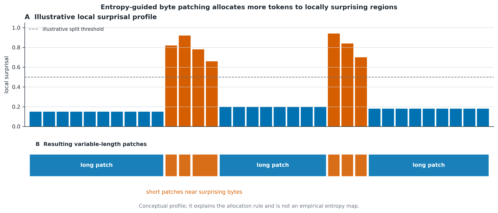

**Figure 2.1 — Conceptual operating principle of entropy-driven byte patching.** Long
low-entropy regions are grouped into larger latent patches, whereas locally surprising regions
receive finer allocation. The values are schematic, not empirical measurements. Source:
author’s schematic after BLT [72].

Within the dissertation research, the results of which are published in **[A1]**, the hypothesis
was put forward that transferring the principles of adaptive entropy-based tokenization to the
visual modality may improve the allocation of
computational resources of a generative system. On the basis of this approach, the author
developed the method for estimating spatio-temporal uncertainty and a new mathematical
architecture — the Vision Byte Latent Transformer (V-BLT).

Working at the input-byte level, where each RGB channel value is represented by an integer from
0 to 255, avoids committing the target interface to a learned discrete visual codebook
[73]. It does not make the learned hidden representation
lossless. The developed V-BLT architecture is
a three-tier hierarchical information-transformation system consisting of a Local Encoder, a
Global Latent Transformer, and a Local Decoder. In the arc of this dissertation, V-BLT is the
author's **first realization of the hierarchical adaptation of video generation** — a two-stage
decomposition in which local byte-level stages surround a global latent stage and an entropy
criterion governs the allocation of capacity between them. Chapter 3 applies the **shared systems
principle** of non-uniform allocation to a different object—the retained context package—but its
continuous two-level autoencoder and predictor are not a mature or executable continuation of
V-BLT.

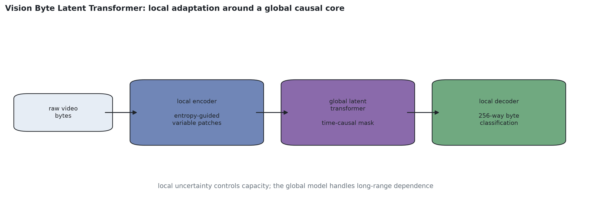

**Figure 2.2 — Vision Byte Latent Transformer architecture.** Local entropy-guided aggregation
and byte classification surround the global time-causal latent transformer. Source: author’s
schematic of the [A1] method.

The first subsystem — the **Local Encoder** — performs the function of primary adaptive
aggregation. The input is a video sequence as a multidimensional tensor of raw bytes. The task of
the Local Encoder is the dynamic grouping of locally correlated bytes into compact latent
representations in the form of spatio-temporal patches $Z = \{z_1, z_2, \dots, z_M\}$.
Mathematically it is realized as a lightweight convolutional-transformer network that predicts
data-dependent boundaries of information aggregation.

The second subsystem — the **Global Latent Transformer** — is the computational core and is
responsible for modeling the long-term dynamics in the compressed space. Since this block
performs autoregressive prediction for time-series modeling, its architecture requires a specific
design of the attention-masking system to prevent information leakage from future frames
[12], while allowing tokens within the current
and preceding frames to interact.

For this purpose, a spatio-temporal attention-masking matrix is used. Let the latent space have
dimensionality $T' \times S'$, where $T'$ is the number of time steps and $S'$ is the number of
spatial patches per frame. The attention matrix $M$ is computed so that for any token $z_i$ from
frame $t_i$, the attention weights toward a token $z_j$ from frame $t_j$ obey the rule:

$$
M_{i,j} =
\begin{cases}
0, & \text{if } t_j \le t_i \\
-\infty, & \text{if } t_j > t_i
\end{cases}
\tag{2.1}
$$

This time-causal, spatially connected mask prevents future-frame attention. It does not by itself
guarantee physical plausibility or accurate dynamics.

The third subsystem — the **Local Decoder** — projects the predicted latent macro-states back
into the micro-space of image bytes. The key mathematical innovation of the developed method,
which distinguishes it from standard pixel-regression approaches of the MSE type, is the use of a
classification model for byte generation. At the output, the decoder forms a tensor that yields,
for each pixel, not a scalar brightness value but a full probability distribution over the 256
possible byte states.

Formally, for each byte (sub-pixel) $x_i$ the system computes a logit vector
$L_i \in \mathbb{R}^{256}$. The probability estimate that the byte takes a specific discrete
value $k \in \{0, \dots, 255\}$ is determined by the softmax activation function:

$$
p(x_i = k) = \frac{\exp L_{i,k}}{\sum_{j=0}^{255} \exp L_{i,j}}
\tag{2.2}
$$

Such a mathematical formulation transforms the problem of minimizing the mean squared error
(MSE), which by its nature is prone to smoothing and to the loss of high-frequency details, into
a classification problem using the cross-entropy loss function [105]. This makes it possible to correctly model multimodal distributions:
for example, the contour of a moving object may shift one pixel to the left or to the right with
equal probability, which cannot be described by a single mean value.

The main advantage of the classification approach for systems analysis lies in the possibility of
direct mathematical computation of a measure of spatio-temporal uncertainty. Having a discrete
probability distribution for each pixel, the classical apparatus of Shannon information theory is
applied. The information-entropy measure $H_i$ for each predicted pixel $i$ is computed as:

$$
H_i = -\sum_{k=0}^{255} p(x_i = k)\,\log_2 p(x_i = k)
\tag{2.3}
$$

The entropy value lies between 0 bits (a point-mass categorical prediction) and 8 bits (a uniform
distribution over 256 byte values). These are properties of the model's predictive distribution,
not proofs of real-world determinism or calibrated confidence. Computing the value for all pixels
forms a two-dimensional per-pixel entropy map.

Entropy maps provide a local diagnostic of how dispersed the learned byte distribution is.
Empirical studies reported in **[A1]** show, for the evaluated sequences, higher entropy near
moving contours and newly exposed or occluded regions than in static background. This spatial
association supports their use as an allocation proxy in that setting; without calibration and
uncertainty decomposition it does not identify aleatoric uncertainty, epistemic uncertainty, or
prediction error separately [44, 45].
Figures 2.3 and 2.4 show prediction examples for a simple 2D and a complex 3D sequence
respectively, where the first row contains the expected frames of the sequence, the second the
frames predicted by the V-BLT model, and the third the entropy maps corresponding to the
predicted frames (black indicates high entropy, white low entropy). A key aspect of the V-BLT
architecture is its ability to operate on categorical raw-byte targets, which makes per-pixel
predictive entropy directly computable. Higher entropy means a more dispersed categorical output;
"confidence" is used only in this model-internal sense.

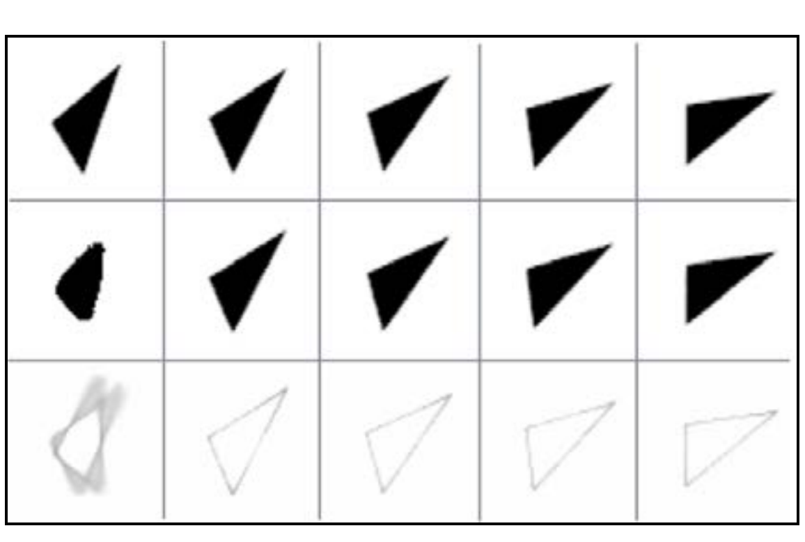

**Figure 2.3 — V-BLT prediction and entropy maps for a rotating 2D shape.** Rows show,
respectively, ground truth, V-BLT predictions and per-pixel entropy maps over five future frames.
The first prediction has the largest shape error and the broadest high-entropy region; subsequent
predictions recover the rotating contour while entropy concentrates near its boundary. Source:
Kulyk and Mokin, *Scaling Video Prediction with Spatio-Temporal Patches*, published Fig. 7,
DOI 10.31649/1997-9266-2025-182-5-129-139.

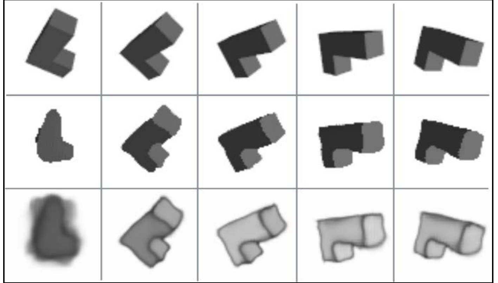

**Figure 2.4 — V-BLT prediction and entropy maps for a rotating 3D polycube.** Rows show ground
truth, V-BLT predictions and per-pixel entropy maps. The first low-context forecast is visibly
degraded; later frames preserve the coarse polycube structure, while uncertainty remains strongest
along moving and newly exposed boundaries. Source: Kulyk and Mokin, *Scaling Video Prediction with
Spatio-Temporal Patches*, published Fig. 8,
DOI 10.31649/1997-9266-2025-182-5-129-139.

From the standpoint of complex-system control, the entropy map is a **candidate feedback signal**
for dynamically forming latent patches of variable size. Low-entropy regions can be aggregated
into larger spatial blocks and high-entropy regions assigned finer patches, reducing the global
sequence length when the observed entropy pattern is informative. The resulting computational
saving depends on the realized patch-count reduction, and useful allocation depends on the
predictive distribution being sufficiently calibrated for the decision [44, 45].

It is important to note the place of this instrument within the overall system developed in this
dissertation. The per-pixel entropy is a *local* measure of informational complexity: it answers
the question "where exactly is prediction hardest for the system". It thereby complements the
*global* consistency criteria of the generation process — the hierarchical- and
trajectory-consistency criteria introduced in Chapter 1, which for the hierarchical generation
model developed in Chapter 3 are operationalized in Chapter 4 through autoregressive-rollout
degradation metrics stratified by re-entry hardness. The local entropy signal governs the
allocation of computational resources within a frame, while the global criteria evaluate the
consistency of the generated process as a whole.

The [A1] results establish the feasibility of entropy-guided allocation in the reported setting;
they do not establish globally optimal patch boundaries or a fully resource-efficient generator.
The next question is how a linear token sequence retains explicit spatial and temporal
coordinates. Section 2.2 develops RoPE-ND for that coordinate-interface problem.

## 2.2 Structural Coherence through Multidimensional Positional Encoding

Flattening a multidimensional spatio-temporal array into a sequence removes **explicit coordinate
structure from token order** unless positional information is supplied. The pixel/patch values are
not themselves erased, but permutation-equivariant self-attention otherwise has no basis for
distinguishing the physical axes. A positional interface is therefore needed before structural
relations can be learned.

The multidimensional tensor of visual data, mathematically described as
$X \in \mathbb{R}^{T \times H \times W \times C}$, where $T$ is the temporal dimension, $H$ and
$W$ are the spatial coordinates, and $C$ the information channels, necessarily undergoes a
linearization operation. As a result, a one-dimensional sequence of latent vectors
$Z = \{z_1, z_2, \dots, z_L\}$ is formed, with total sequence length $L = T \cdot H \cdot W$.
This linearization is a conventional interface for global self-attention. By itself, it does not
encode the mutual spatio-temporal arrangement of the elements; the arrangement must be supplied
through positional features, architectural locality, or an equivalent signal.

In the theory of complex systems, such a loss of information is classified as a critical growth
of structural uncertainty. The transformer architecture is, by its mathematical nature, invariant
to permutations of the elements of a set. This means that without additional control signals the
system cannot distinguish whether two latent patches were physically adjacent horizontally within
one frame, or belonged to entirely different frames of the video sequence in time. The absence of
a precise coordinate anchoring makes it impossible to model adequate kinematics and geometry of
the visual scene.

One common approach is absolute positional encoding [12], which adds a coordinate vector $p_i$ to each latent token $z_i$. Absolute positions
break strict translation equivariance of an otherwise equivariant token operation, although a
learned model can still represent relative relationships and may benefit from absolute location
when the task is not translation invariant.

An alternative is relative positional encoding or bias [106, 71], where the attention score depends on relative displacement. A naively
materialized pairwise bias tensor has $O(L^2)$ entries, but parameterized, bucketed, local, and
kernel-fused implementations need not store a separate dense learned matrix. The relevant design
question is therefore which positional interface expresses the required axes with acceptable
materialized memory and computation.

To overcome these systemic contradictions, within the development of the information technology
it is proposed to apply the mathematical apparatus of Rotary Positional Embedding (RoPE)
[107] with its subsequent generalization to N-dimensional space. The
RoPE applies position-dependent rotations without storing a learned pairwise relative-bias
matrix. The core idea is to group feature pairs as complex coordinates and rotate them according
to position.

Let the attention subsystem operate on query vectors $q$ and key vectors $k$ of dimensionality
$D$. For a one-dimensional sequence, the position of element $m$ is encoded by multiplying the
vector by an orthogonal rotation matrix $R_{\Theta,m}$. Applying this operation to query and key
vectors makes the positional phase in their scalar product depend on relative displacement. In
the complex representation:

$$
\left\langle R_{\Theta,m}\,q,\; R_{\Theta,n}\,k \right\rangle
= \operatorname{Re}\!\left[ \left(q\,e^{im\theta}\right) \left(k\,e^{in\theta}\right)^{*} \right]
= \operatorname{Re}\!\left[ q\,k^{*}\,e^{i(m-n)\theta} \right]
\tag{2.4}
$$

As the equation shows, the positional phase contains the difference $m-n$. The complete attention
score still depends on the learned content vectors \(q\) and \(k\); RoPE does not force a
particular attention pattern.

The original RoPE formulation [107] uses a one-dimensional sequence coordinate.
A flattened video index can be supplied, but it does not explicitly separate time, row, and
column displacement. In the research underlying **[A1]**, N-dimensional rotary positional
embedding (RoPE-ND) [107] assigns independent feature
subspaces to these axes.

The essence of the generalization is the decomposition of the latent token's feature space into
$N$ independent subspaces, each responsible for its own physical coordinate. For video data the
dimensionality of the coordinate system is $N = 3$: the time axis $t$, the vertical axis $y$, and
the horizontal axis $x$. Accordingly, the state vectors $q$ and $k$ of total dimensionality $D$
are split into three equal non-overlapping segments of dimensionality $d = D/3$.

For the equal disjoint-subspace construction used here, each subspace has even dimensionality.
Thus this **implementation** chooses $D$ divisible by $2N$ (by 6 for three video axes). Other
allocations can reserve unequal subspaces or leave channels unrotated, so divisibility by six is
not a universal requirement of video transformers.

For each of the three coordinates, an independent set of basis rotation frequencies $\theta_j$ is
formed. The frequencies are typically defined by a geometric progression:

$$
\theta_j = 10000^{-2j/d}, \qquad j \in \{0, \dots, d/2 - 1\}
\tag{2.5}
$$

Let a visual token of the system be located at the spatio-temporal point with physical
coordinates $(t_c, y_c, x_c)$. The rotation angles for each segment are computed as the product
of the coordinate and the corresponding frequencies: $t_c\theta_j$, $y_c\theta_j$, $x_c\theta_j$.
The resulting unitary transformation of the whole state vector $q$ is formed as the concatenation
of three independently rotated sub-vectors:

$$
q'_{\text{rotated}} = \left[\; R^{d}_{\Theta,t_c} q_t \;\big\|\; R^{d}_{\Theta,y_c} q_y \;\big\|\; R^{d}_{\Theta,x_c} q_x \;\right]
\tag{2.6}
$$

where $R^{d}_{\Theta,\text{pos}}$ denotes the $d \times d$ rotation matrix for the corresponding
axis. The same operation is applied to the key vector $k$.

**Figure 2.5 — N-dimensional rotary positional embedding.** Independent rotations encode
horizontal, vertical and temporal coordinates so attention depends on relative displacement
along all three axes. Source: author’s schematic of the [A1] method.

With disjoint coordinate subspaces, the rotary attention logit decomposes by axis while retaining
the learned query and key content. For token positions
$\mathbf p_q=(t_q,y_q,x_q)$ and $\mathbf p_k=(t_k,y_k,x_k)$,

$$
s(q,k;\mathbf p_q,\mathbf p_k)
=\frac{1}{\sqrt D}
\sum_{a\in\{t,y,x\}}
q_a^{\top}R^{d}_{\Theta,\,p_{k,a}-p_{q,a}}k_a.
\tag{2.7}
$$

Thus each term depends jointly on the learned content vectors $q_a,k_a$ and the corresponding
relative coordinate displacement. With $\Delta t=t_q-t_k$, $\Delta y=y_q-y_k$, and
$\Delta x=x_q-x_k$, the algebra establishes
relative-coordinate dependence in the rotary score terms. It does not prove that a learned model
recovers physical topology or attends to the correct object.

**Systemic significance and scope.** In an architecture with explicit cross-resolution
attention, coordinates can be affinely mapped to a common physical scale before RoPE-ND is
applied. This provides a consistent coordinate convention for fine and coarse tokens, but it does
not force attention to select geometrically correct regions or guarantee semantic routing. The
measured Chapter 3 predictor does **not** use this mechanism: it uses learned level, role, and
frame embeddings with joint attention. RoPE-ND is therefore a separate representation result
from [A1], not an explanation of the Chapter 4 context-package effects.

Applying RoPE-ND costs $O(D)$ arithmetic per token and avoids storing a learned pairwise bias
matrix. It is compatible with memory-efficient architectures, but no end-to-end experiment in
this dissertation combines RoPE-ND, reversible rollout training, and the final hierarchical
predictor.

## 2.3 Resource Optimization for Multi-Step Temporal Modelling

The V-BLT and RoPE-ND methods address representation and coordinate structure. A separate
constraint arises when an iterative model must be differentiated through a long computation:
activation storage can exceed available device memory. Systems analysis must therefore consider
both model adequacy and implementation feasibility.

For the long unrolls measured in this work, accelerator memory is a binding constraint alongside
throughput [108, 109]. Which resource
dominates is hardware- and model-dependent.

Backpropagation Through Time (BPTT) [28] differentiates a temporally unrolled
dynamic system. A vanilla implementation retains the intermediate activations required by the
reverse pass; checkpointing and reversible replay are alternative storage/recomputation
schedules.

Mathematically, the amount of operating memory $M$ required to store the full computation graph
is linearly dependent on the depth of the temporal unrolling and the number of layers in the
system:

$$
M = O(N \cdot T \cdot L \cdot D)
\tag{2.8}
$$

where $N$ is the dimensionality of the spatial state (the number of tokens per frame), $T$ the
number of time steps or optimization iterations, $L$ the number of model layers, and $D$ the
dimensionality of the latent feature space. For video states, the product can exceed available
memory as the differentiated horizon grows.

The presence of such computational uncertainty forces various heuristic compromises. The most
common approaches are truncated backpropagation (Truncated BPTT) [29] and
gradient checkpointing [30, 31]. Truncated
backpropagation limits the gradient horizon—e.g., differentiating only the last five frames—and
therefore removes learning signals that cross that boundary. Checkpointing reduces memory
consumption (to a square-root trade-off under a balanced segment schedule; see Table 2.1) at the
cost of recomputation.

The task considered here is to organize reverse differentiation so that the transient local
activation graph is constant with respect to the number of reversible time steps \(T\), while
preserving the full-horizon gradient semantics for the tested recurrence.

To solve this systemic problem, the dissertation research developed the Temporal Reversible
Transformer (TempVerseFormer) architecture. The developed architecture and the mathematical
method of computational-resource optimization were published by the author as the sole author in
an international scientific journal indexed by the Scopus scientometric database (**[A2]**).

The method replaces a stored long activation tape with discrete reversible transitions. If the
transition from layer $l$ to layer $l+1$ has a closed-form algebraic inverse, the preceding state
can be reconstructed from the current state during reverse replay. In finite precision the
reconstruction is approximate and its error must be measured; parameters, optimizer state, and
any exogenous replay information remain resident.

Continuous-time adjoint methods such as Neural ODEs [91] and
discrete reversible models such as RevNet and RevViT
[32] provide related
storage/recomputation strategies with different numerical trade-offs. The
scientific novelty of TempVerseFormer lies in combining structural reversibility at the level of
individual transformer layers with an iterative temporal-chaining mechanism for modeling
multi-step processes.

The structural decomposition of the reversible block in the TempVerseFormer architecture is based
on splitting the input information flow into two independent branches. Let the system operate on
a latent state of total dimensionality $D$. At the input of the reversible block, this state is
forcibly split into two mutually exclusive sub-vectors $x_1$ and $x_2$. The functioning of the
reversible block is described by a system of two sequential nonlinear transformations using the
attention mechanism and a multilayer perceptron (MLP).

The mathematical formalization of the forward pass through reversible block $l$ is described by
the following system of algebraic equations.

Update equation of the first branch:

$$
y_1^{(l)} = x_1^{(l)} + \operatorname{Attention}\!\left(x_2^{(l)}\right)
\tag{2.9}
$$

Update equation of the second branch:

$$
y_2^{(l)} = x_2^{(l)} + \operatorname{MLP}\!\left(y_1^{(l)}\right)
\tag{2.10}
$$

This algebraic structure ensures that only $x_2$—unchanged during the first stage—is used to
compute the additive update of $x_1$. Accordingly, in exact arithmetic the inputs are recovered
by evaluating the couplings in reverse order and replacing addition with subtraction; numerical
reconstruction error is reported separately.

Reverse reconstruction of the second branch:

$$
x_2^{(l)} = y_2^{(l)} - \operatorname{MLP}\!\left(y_1^{(l)}\right)
\tag{2.11}
$$

Reverse reconstruction of the first branch:

$$
x_1^{(l)} = y_1^{(l)} - \operatorname{Attention}\!\left(x_2^{(l)}\right)
\tag{2.12}
$$

**Figure 2.6 — Forward and reverse information flow in a reversible transformer block.** The
additive coupling structure permits algebraic reconstruction of block inputs from its outputs;
finite-precision error is measured separately.
Source: author’s published TempVerseFormer project asset [A2].

For the reversible blocks to solve the task of controlling generation in time, they are
integrated into a higher structural level of the system through the **temporal chaining**
mechanism. Instead of concatenating all video frames into a single enormous tensor — which leads
to the quadratic memory collapse $O((N \cdot T)^2)$ in the attention mechanisms — the system
moves to an iterative autoregressive paradigm of state generation.

The temporal chaining mechanism works as follows. The system receives an initial context set
$V_{\text{ctx}}$. At step $t$, the system applies the transition functional — a stack of $L$
reversible blocks — and generates the time-shifted sequence $V_{\text{out}}$. This output tensor
is fed back directly and becomes the input $V_{\text{in}}$ for the next generation step $t+1$.
Mathematically this is described by the recurrence relation:

$$
V_t = \Phi(V_{t-1}, \theta)
\tag{2.13}
$$

where $\Phi$ is the transition functor built exclusively from algebraically reversible
transformer blocks.

**Figure 2.7 — Temporal chaining for autoregressive time-series modeling.** The same reversible
transition is applied along physical time while the realized state is passed to the next step.
Source: author’s published TempVerseFormer project asset [A2].

For a deterministic recurrence composed of these reversible elements, and given unchanged model
parameters and all conditioning inputs, the trajectory
$V_1 \to V_2 \to \dots \to V_T$ is algebraically invertible. Reverse replay reconstructs its
intermediate states from $V_T$ one step at a time instead of retaining their activation graphs;
finite-precision error and any stochastic replay signal remain separate accounting terms.

To focus the computational resource of the reversible transformer exclusively on the analysis of
complex temporal dynamics, the global architecture of the TempVerseFormer information technology
uses an auxiliary spatial-compression subsystem — a variational autoencoder (VAE). Its function
is to resolve the spatial redundancy of pixels: each video frame is projected into a compact
latent vector before processing by the reversible blocks. After generation is completed, the
latent states are unfolded back by the VAE decoder. This architectural modularity separates the
task of spatial compression from the task of temporal control.

**Figure 2.8 — Global TempVerseFormer architecture.** A spatial VAE interfaces the video frames
with the reversible temporal core. Source: author’s published TempVerseFormer project asset [A2].

Temporal chaining of reversible blocks provides algebraic state recoverability in exact
arithmetic. It does not guarantee numerical stability, preservation of task-relevant
information, or useful gradients. The next subsection shows how reverse replay is used for
gradient computation and later measurements delimit its stability and memory behaviour.

## 2.4 Time-Agnostic Backpropagation through Reversible Transformations

Long temporal optimization requires an explicit policy for storing or reconstructing the reverse
pass. BPTT [28] supplies the gradient semantics; the resource question is how
its required intermediate values are made available.

The BPTT gradient follows the chain rule through the unrolled composite function. The reverse
pass needs the corresponding states and local activations, but they need not all be cached:
vanilla autograd retains them, checkpointing recomputes segments, and the developed method
reconstructs reversible states before rebuilding each local graph.

For large spatio-temporal states, vanilla retention makes activation memory grow with the unroll
and can cause out-of-memory failure. This is the measured bottleneck addressed here; it is not a
claim that every long-horizon model must use reversibility.

Within this dissertation research, the method of **time-agnostic backpropagation** was developed
for the tested reversible recurrence. The method is based on integrating the mathematical
apparatus of discrete reversible transformations directly into the gradient-computation process
along the temporal chain.

The main idea is to reconstruct states during the backward pass instead of caching the full
activation trajectory during the forward pass. The inverse transition functions $R^{-1}$ are
algebraically exact for the stated recurrence; an implementation reconstructs them within
floating-point tolerance and pays recomputation cost without requiring a learned inverse.

The training strategy of the complex generative system under this algorithm splits into two
phases.

**Phase one — the forward pass.** The system sequentially computes the evolution of the state.
For every time step $t$ from $1$ to $T$ and every layer $l$ from $1$ to $L$, the forward
reversible transformation $R$ is applied to the current inputs $(x_1, x_2)$. After the outputs
$(y_1, y_2)$ are computed, the system immediately deletes all internal activations from memory,
keeping only the result. Upon reaching the final step $T$, the system stores only one final
macro-state in memory.

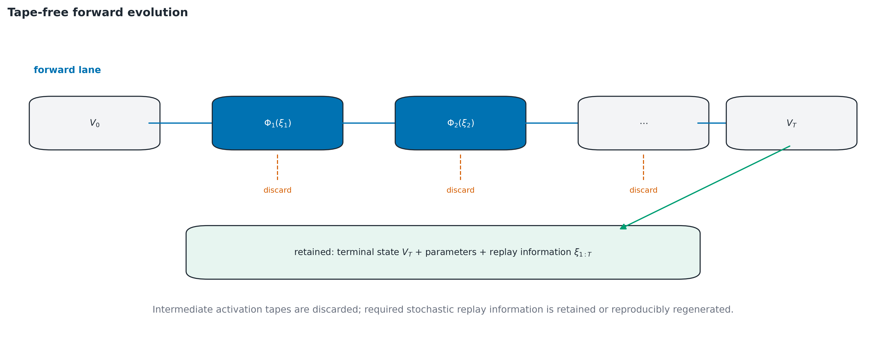

**Figure 2.9 — Activation-free forward evolution.** Intermediate temporal states are discarded;
the terminal state, parameters and stochastic replay information are retained. Source: author’s
algorithmic schematic.

**Phase two — the reverse pass.** This phase is the conceptual core of the method. The reverse
pass starts with the computation of the gradient of the loss function with respect to the final
state of the system, $\nabla_{y_T} L_{\text{loss}}$. Then, for every time step $t$ from $T$ down
to $1$, the algorithm moves in the reverse direction: it reconstructs the layer inputs by the
inverse transformations (2.11)–(2.12), locally rebuilds the computation graph of a single
transition, computes the local gradients, and immediately destroys the local graph.

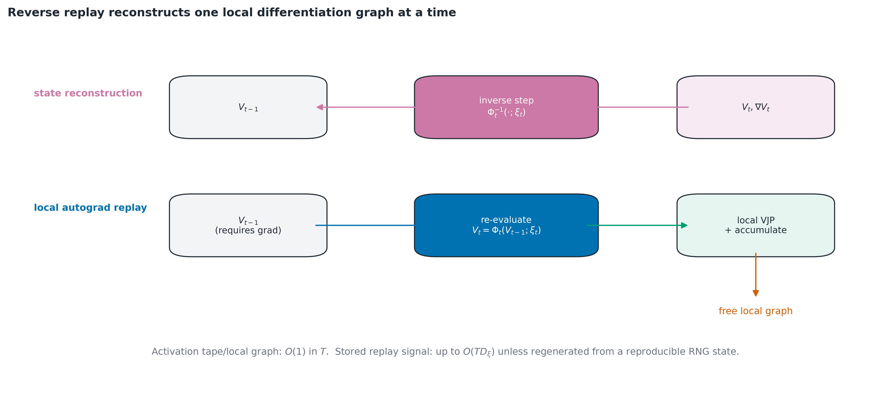

**Figure 2.10 — Reverse-pass local replay.** Each state is reconstructed, its local graph is
rebuilt, gradients are accumulated, and the graph is released before moving to the preceding
time step. Source: author’s algorithmic schematic.

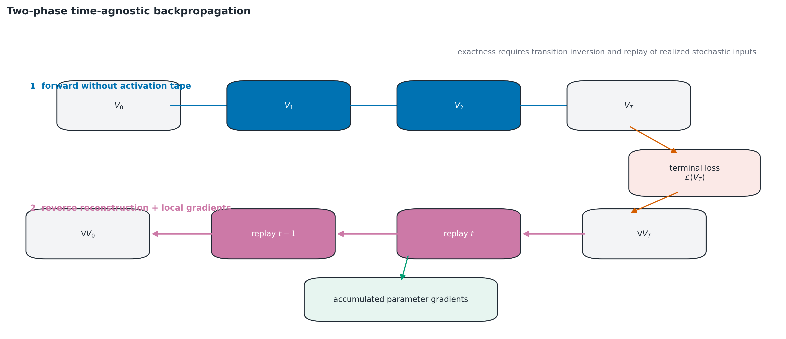

**Figure 2.11 — Two-phase time-agnostic backpropagation.** A tape-free forward phase is followed
by algebraic reverse replay, local graph reconstruction, and gradient accumulation. Source:
author’s algorithmic schematic.

For a rigorous confirmation of the effectiveness of the developed method, we formulate and prove
a lemma on the optimization of operating-memory consumption.

**Lemma 1 (activation-tape complexity of deterministic time-agnostic backpropagation).** *Let a
deterministic discrete dynamic system have a trajectory of $T$ steps, with a transition
parameterized by a reversible neural network of $L$ layers and complete per-layer state footprint
$D_s$ (for $N$ tokens of width $D$, $D_s=ND$). Excluding model/optimizer state, and assuming the transition needs no $T$-dependent
exogenous replay record, the peak transient activation graph needed for reverse replay is
$O(L \cdot D_s)$ and therefore $O(1)$ in $T$.*

**Proof.**

1. Assume the state footprint at one layer is $D_s$. Under classical BPTT the
   algorithm caches all inputs for every layer $l \in \{1, \dots, L\}$ and every time step
   $t \in \{1, \dots, T\}$; hence the peak memory is
   $M_{\text{BPTT}} = T \cdot L \cdot D_s = O(T \cdot L \cdot D_s)$.

2. The proposed deterministic algorithm stores, during the forward pass, the terminal state and
   horizon-independent control information. The terminal state costs $O(D_s)$. Activations for
   $t < T$ and $l < L$ are deleted after use, so this activation term does not depend on $T$.

3. During the reverse pass the algorithm processes the steps sequentially: $t = T, T-1, \dots, 1$.
   At the current step $t$ the algorithm reconstructs the inputs and unrolls the local
   computation graph of a single transition. The size of this graph is $O(L \cdot D_s)$.

4. Immediately after the gradients $\nabla_{\theta} L_{\text{loss}}$ and
   $\nabla_{x_{t-1}} L_{\text{loss}}$ are computed, this local graph is completely destroyed and
   its memory freed before the algorithm proceeds to step $t-1$.

5. Therefore, the maximum transient activation graph equals one local graph,
   $O(L \cdot D_s)$, plus horizon-independent gradient buffers. Model parameters and optimizer
   state are common base costs. If a stochastic recurrence stores one conditioning/noise tensor
   per step, the additional persistent replay term is $O(TD_{\epsilon})$ (§2.4(i)); it is not
   covered by this deterministic lemma. $\blacksquare$

For comparative analysis, Table 2.1 presents the theoretical complexity estimates of the
developed method against the existing approaches.

**Table 2.1 — Theoretical estimate of computational complexity in multi-step optimization**

| Optimization method | Horizon-dependent storage | Recomputation | Gradient semantics |
|---|---|---|---|
| Standard BPTT | $O(T \cdot L \cdot D_s)$ activation tape | baseline $C$ | reverse-mode gradient |
| Gradient checkpointing | schedule-dependent; $O(\sqrt{T}\cdot L\cdot D_s)$ for a balanced segment schedule | schedule-dependent, typically $>C$ | same gradient in exact arithmetic; floating-point differences implementation-dependent |
| Developed method (deterministic recurrence) | $O(L \cdot D_s)$ transient local graph, $O(1)$ in $T$ | approximately one local recomputation per reverse step | same gradient in exact arithmetic; numerical agreement measured |

The table isolates horizon-dependent activation storage. Parameters, optimizer state, allocator
overheads, and—in the stochastic extension—the replay signal are additional terms. Consequently,
the square-root checkpoint row and any compute multiplier describe a particular schedule rather
than a universal property [30, 31].

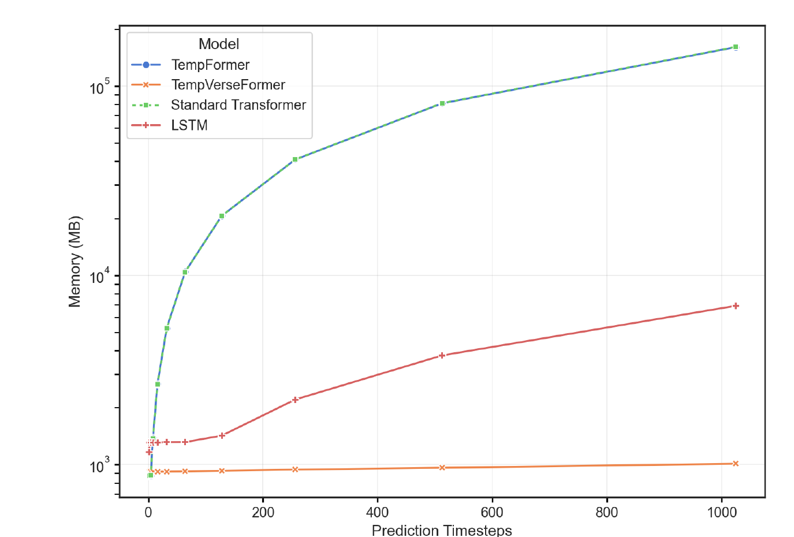

**Figure 2.12 — GPU memory consumption versus prediction horizon.** Published TempVerseFormer
measurement at batch size 32. The reversible temporal model remains near 0.9 GB over 1–1,024
prediction steps, whereas the two non-reversible transformer variants grow to approximately
160 GB in the reported extrapolated/extended measurement and the LSTM grows more slowly. The
logarithmic vertical scale must be retained when typesetting. Source: Kulyk, *Temporal modeling
with reversible transformers*, Fig. 13, author preprint (CC BY 4.0), DOI
10.21203/rs.3.rs-6293520/v1; version of record DOI 10.1007/s00521-025-11707-3.

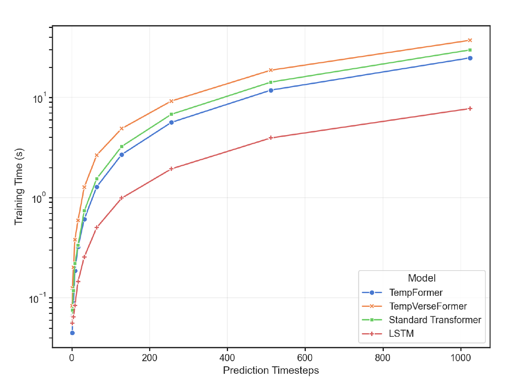

**Figure 2.13 — Training time per step versus prediction horizon.** Published comparison at batch
size 32 and 1–1,024 prediction steps. Time grows with the prediction horizon for all four
architectures; TempVerseFormer pays a compute premium relative to the matched non-reversible
transformer while preserving the qualitatively different memory-scaling behavior in Fig. 2.12.
The logarithmic vertical scale must be retained when typesetting. Source: Kulyk, *Temporal
modeling with reversible transformers*, Fig. 14, author preprint (CC BY 4.0), DOI
10.21203/rs.3.rs-6293520/v1; version of record DOI 10.1007/s00521-025-11707-3.

As Fig. 2.12 shows, measured temporal-model memory remains nearly constant even at large
prediction depths. Figure 2.13 also makes the trade-off explicit rather than cost-free:
TempVerseFormer is slower per step than the matched TempFormer over the tested horizons, and all
methods become slower as the horizon grows. Within this published configuration, the developed
method is the only compared transformer whose activation-memory curve is practically independent
of trajectory length. Algebraic reconstruction during the reverse pass therefore exchanges
additional computation for the critically scarce resource — GPU memory — and makes horizons of
hundreds or thousands of steps operationally possible when the non-reversible activation tape
would exceed the device budget.

The implementation also supports **selective backpropagation** over a chosen terminal segment.
The system can run the forward process to full length and reconstruct local graphs only for
$[T-K_{\text{opt}},T]$. This is a form of deliberately truncated or partial-loss optimization,
not a unique gradient semantics: it omits learning signals through earlier steps. Skipped stages
avoid activation-graph reconstruction, but the terminal/base state and any replay metadata still
consume memory.

### Extension to Stochastic Recurrences and Limits of Reversible Computation

The time-agnostic backpropagation method was substantiated above for deterministic transition
functors (2.13). Many generative recurrences also inject stochastic conditioning, which creates an
additional replay-information requirement. This section extends the accounting to that case and
delimits when reversible replay is useful. The final Chapter 3 predictor samples stochastically
but is trained on individual clean-context windows and does **not** differentiate through its
rollout or sampler; the extension is therefore a separately measured method that could support a
future rollout-through-time objective, not the training foundation of the reported context result.

**(i) A conditionally invertible stochastic recurrence (store-the-noise).** Consider the stochastic
generalization of the temporal chain (2.13), in which the latent state $h_t$ of the modeled
process evolves as

$$
h_t = F(h_{t-1}) + \sigma\,\epsilon_t, \qquad \epsilon_t \sim \mathcal{N}(0, I),
\tag{2.14}
$$

where $F$ is a transition operator built from reversible (additive-coupling) blocks, $\sigma$ is
the noise scale, and $\epsilon_t$ is the noise sample of step $t$. Transformation (2.14), taken
alone, is not invertible: the noise irreversibly injects new information. However, if the noise
samples $\epsilon_t$ drawn during the forward pass are *stored*—the store-the-noise principle,
extending the reversible recurrent networks of [110]—the
preceding state becomes algebraically recoverable conditional on replaying the identical noise.
Equations (2.14)–(2.15) state the principle in its
simplest, *external-additive* form, in which the stored noise is subtracted before the inverse
transition is applied:

$$
h_{t-1} = F^{-1}\!\left(h_t - \sigma\,\epsilon_t\right).
\tag{2.15}
$$

The construction **implemented and measured in this dissertation** is the more general
*conditioning-injected* form: within a coupled two-branch state $(s_1, s_2)$, the stored noise
enters the coupling functions as a conditioning argument,

$$
(y_1, y_2) \;=\; \Bigl(s_1 + F(s_2, \epsilon_t),\;\; s_2 + G\bigl(y_1\bigr)\Bigr),
\tag{2.16}
$$

whose closed-form inverse subtracts the couplings in reverse order with the *same* stored
conditioning replayed:

$$
s_2 = y_2 - G(y_1), \qquad s_1 = y_1 - F(s_2, \epsilon_t).
\tag{2.16'}
$$

The additive-coupling inverse is algebraically valid for an *arbitrary* fixed conditioning
argument, so (2.16') holds for any identically replayed signal injected this way (noise, actions,
level context); the
external-additive scheme (2.14)–(2.15) is recovered as the special case in which the noise
enters only as a final additive term. All numerical properties quoted below are measured on the
conditioning-injected construction (2.16)–(2.16'), which is the one realized in the software
complex. Storing one noise tensor per step costs $O(T \cdot D_{\epsilon})$. It has no layer or
computation-graph factor and is much smaller than the $O(T \cdot L \cdot D_s)$ BPTT activation tape
in the measured configuration, but it is still linear in $T$. Accordingly, the method has a
constant-in-$T$ **transient local activation graph**, not a universal $O(1)$ total-memory claim.
Table 2.3 reports the resulting modest growth of measured peak memory.

The following properties of this construction were verified numerically on the implemented
hierarchical multi-rate recurrent core (software complex of the dissertation; measurement details
in Chapter 4):

- **Algebraic invertibility of the deterministic coupling:** maximum numerical
  state-reconstruction error
  $5.5 \times 10^{-15}$ (fp64); for the Lipschitz-constrained coupling in fp32,
  $3.1 \times 10^{-5}$.
- **Conditional algebraic invertibility of the stochastic recurrence:** with the stored noise
  replayed, the maximum numerical reconstruction error over the trajectory is
  $8.4 \times 10^{-13}$; replaying *wrong* noise destroys the reconstruction (error of order
  $10^{1}$). The replay signal is therefore necessary information for this implementation and
  must be counted.
- **Gradient direction agreement:** gradients obtained by reverse replay (reconstructing the
  implemented conditioning-injected states backward by (2.16') and rebuilding local graphs, as in
  Lemma 1) have cosine similarity $1.000000$ with the full-BPTT gradients in the reported numerical
  test. Cosine similarity establishes directional agreement, not equality of gradient magnitude.
  The algebraic procedures implement the same chain rule under exact reconstruction in exact
  arithmetic; finite-precision componentwise or norm equality is not established by this test.

Thus the local reverse-replay construction transfers to stochastic multi-level recurrences when
the identical conditioning is available, with explicit $O(TD_{\epsilon})$ replay storage in the
measured implementation. This extends the [A2] resource method; it is compatible with, but not
required by or used in, the Chapter 3 predictor.

**(ii) Invertibility does not imply stability: a Lipschitz diagnostic.** A separate
systemic question is whether the reversibility of the transition operator stabilizes the
long-horizon behavior of the modeled process. The answer, established by direct measurement, is
negative — and this delimits what the developed method may and may not be credited with. All
recurrences in Table 2.2 are algebraically invertible under identical conditioning; they differ
only in the spectral-norm bound imposed on the coupling function $F$.
The measured perturbation growth $\lVert \delta_K \rVert / \lVert \delta_0 \rVert$ of a
free-running rollout over $K = 100$ steps spans four orders of magnitude:

**Table 2.2 — Perturbation growth of algebraically invertible recurrences over $K = 100$ free-running
steps as a function of the Lipschitz bound on the coupling**

| Coupling constraint | $\lVert \delta_{100} \rVert / \lVert \delta_0 \rVert$ | Regime |
|---|---|---|
| unconstrained | $333\times$ | explodes |
| spectral norm, $\operatorname{Lip}(F) \le 1$ | $26{,}600\times$ | **still explodes** |
| spectral norm, $\operatorname{Lip}(F) \le 0.1$ | $1.5\times$ | bounded |
| spectral norm, $\operatorname{Lip}(F) \le 0.02$ | $1.0\times$ | tightly bounded |

For the residual map $G=I+F$, the triangle inequality gives the valid general upper bound

$$
\operatorname{Lip}(G)
\;=\;\operatorname{Lip}(I+F)
\;\le\;1+\operatorname{Lip}(F).
\tag{2.17}
$$

This bound is neither an equality nor a lower bound: cancellation can make $I+F$ contractive, and
the bound alone cannot predict realized perturbation growth. Table 2.2 supplies the empirical
result for the tested recurrences: imposing $\operatorname{Lip}(F)\le1$ did not prevent growth,
whereas the tested constraints at 0.1 and 0.02 yielded bounded trajectories over 100 steps. These
measurements motivate a small-coupling condition in this implementation; they do not prove a
universal threshold [111, 112]. The
systemic conclusion is narrower and valid: **algebraic invertibility enables reconstruction but
does not imply stable forward dynamics.** Stability must be established separately for the
recurrence being used. The final Chapter 3 predictor does not use this reversible recurrence or
its Lipschitz constraint.

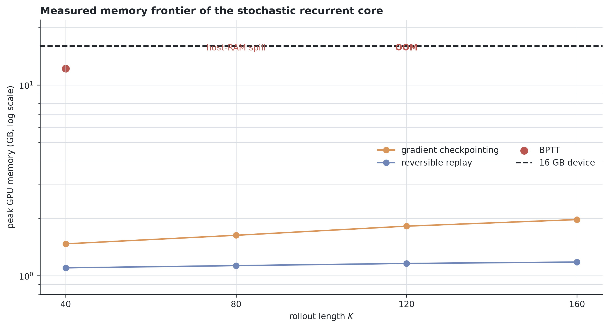

**Figure 2.14 — Measured memory frontier of the stochastic recurrent core.** Standard BPTT
reaches 12.2 GB at $K=40$, spills at $K=80$ and cannot run at $K=120$ on the 16 GB device;
checkpointing grows slowly, while reverse replay stays near 1.1–1.2 GB through $K=160$. Source:
author’s measurements summarized in Table 2.3; artifact provenance is listed in the reproducibility
appendix.

**(iii) The activation-tape frontier for autoregressive rollout (measured).** The practical payoff of
the extended method is measured on the real training loop of the implemented stochastic
hierarchical recurrent core (three levels, batch 32, Adam optimizer, NVIDIA RTX 4060 Ti 16 GB;
the full environment is specified in Chapter 4, §4.1.4). Table 2.3 gives the peak training memory as a function of the
free-running rollout length $K$:

**Table 2.3 — Measured peak training memory (MB) vs rollout length $K$: BPTT, gradient
checkpointing, and the developed reversible reverse-replay on the same model**

| $K$ | BPTT | Gradient checkpointing | Developed method (reversible) |
|---:|---:|---:|---:|
| 40 | 12,162 | 1,471 | 1,091 |
| 80 | 23,305\* | 1,637 | 1,125 |
| 120 | OOM | 1,801 | 1,152 |
| 160 | OOM | 1,967 | 1,176 |

\* At $K = 80$, BPTT exceeds the physical GPU memory and spills into shared host RAM, slowing a
training step by a factor of $\approx 60$ (from 0.74 s at $K = 40$ to 43.8 s); at $K = 120$ it
fails with a hard out-of-memory error.

The frontier supports Lemma 1 and the stochastic accounting in the tested range: BPTT consumes
12.2 GB already at $K = 40$ and becomes infeasible at $K = 120$, while the developed method grows
modestly from 1.091 to 1.176 GB through $K = 160$, making the measured long-horizon rollout
training feasible on a consumer-grade 16 GB device. This curve includes the replay information;
the constant-in-$K$ claim applies to the transient local activation graph. **The interpretation
of Table 2.3 must
include the checkpointing column:** gradient checkpointing also remains feasible at all measured
$K$ (1.47–1.97 GB, growing slowly). The correct claim for the developed method is therefore a
**constant activation-tape capability relative to vanilla BPTT**—with algebraically valid replay
and measured gradient-direction agreement. Reverse replay also has lower peak memory than the
checkpointing arm at every $K$ in Table 2.3, but the temporal-rollout experiment does not report a
matched checkpointing-versus-replay runtime comparison. It therefore establishes neither Pareto
dominance nor Pareto equivalence between those two methods. This scoping is stated deliberately:
the three-axis analysis below turns it into an applicability boundary.

**(iv) The three-axis taxonomy of reversible computation and its measured boundary.** The reversible
mechanisms developed and reviewed in this chapter can be organized along three orthogonal axes of
the computation graph on which reversibility can be exploited to avoid storing states:

1. **The depth axis** — reversibility across the layers of a network at a single step (RevNet and
   its descendants [32]): the
   literature baseline on which the developed blocks build.
2. **The temporal axis** — reversibility along the physical time of the modeled process
   (temporal chaining of §2.3–2.4 and the stochastic extension (2.14)–(2.16')). On the tested
   recurrence this axis **paid** because the BPTT activation trajectory dominated the avoidable
   horizon-dependent storage; inverse coupling reconstructed that trajectory, while replay noise
   remained explicitly counted. The measured result is Table 2.3.
3. **The computational axis** — reversibility along the *inner optimization loop*: the $K$
   pseudo-time steps of iterative refinement (gradient descent, MCMC/Langevin sampling, or a
   diffusion sampler) executed inside one generation step. Although this is also a chain, its
   stored trajectory state can be much smaller than the derivative graph rebuilt at each reverse
   step. The comparison must therefore be decided by state-versus-graph accounting rather than by
   graph shape alone. In the tested implementation, reversibility did not improve the practical
   trade-off over checkpointing.

The accounting for the third axis is as follows. Differentiating through a $K$-step
gradient-descent (or Langevin) inner loop requires, at each reverse step, a Hessian-vector
product and mixed second-order terms — i.e., rebuilding the differentiable graph of
$\nabla E$ (a `create_graph`-class second-order graph) from a fresh forward pass, *regardless of
how the trajectory state at that step was obtained*. Reversibility can eliminate only the storage
of the trajectory states themselves. **The direct four-way measurement on the implemented system**
(naive full-graph / truncated / checkpointed / reversible differentiation of the inner loop,
$K \in \{4, 8, 32, 128\}$, micro-batch 12, fp32) gives: the naive full graph consumes 18.1 GB
already at $K = 4$ (spilling to shared memory) and exhausts device memory at $K = 8$; the
truncated, checkpointed, and reversible variants all remain flat at 5.282–5.296 GB through
$K = 128$; and the reversible variant saves **14 MB = 0.26% of the peak** relative to
checkpointing, at approximately twice the wall-clock time (recomputation). The per-step descent
state $(y, v)$ is 0.117 MB, so checkpointing's total state storage at $K = 128$ is 15.0 MB =
0.28% of its measured peak — an upper bound on what reversibility could ever reclaim on this
axis. The analytic accounting band for the same quantity is $\approx 0.6$–$1.0\%$, and the
crossover at which trajectory states would begin to dominate the second-order graph lies at
$K \approx 5{,}000$–$30{,}000$ inner steps, far beyond any practically meaningful refinement
depth. The underlying storage arithmetic — counting the bits per step that an optimizer
trajectory consumes versus the volume contraction of the update map — is due to
[113], **applied** here to the video-generation inner loop, not claimed as a new theorem.
Moreover, a generic nonlinear gradient-descent update does not provide the closed-form inverse
assumed by the local replay algorithm; the reversible momentum-buffer construction of Maclaurin
et al. supplies additional replay information. In this measured configuration its kilobyte-scale
state confirms that trajectory storage was not the binding constraint. Reversible-sampler variants for
diffusion inner loops are already published [114, 115, 116], while related optimization-through-sampling work
also uses checkpointing or truncation [117, 118].

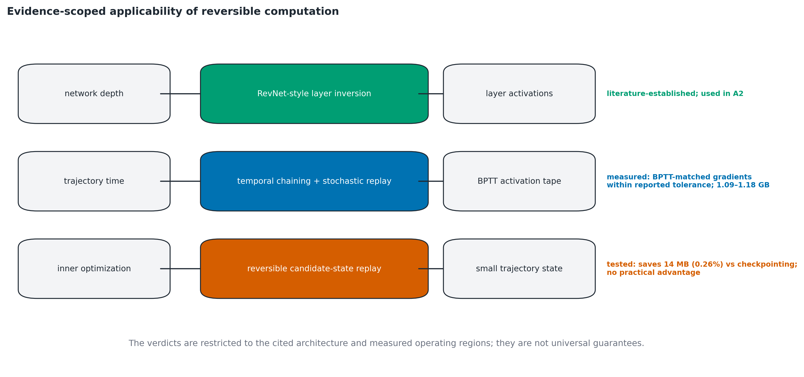

**Figure 2.15 — Three axes of reversible computation and their measured applicability.**
Reconstruction can save activation storage along network depth and temporal recurrence. In the tested inner-optimization
loop the model/optimizer base state dominates: reversible replay saves only 14 MB (0.26% of peak)
relative to checkpointing while approximately doubling wall time. Source: author’s taxonomy and
measurements; artifact provenance is listed in the reproducibility appendix.

The resulting **applicability boundary** is conditional rather than universal. Reversible replay
is attractive when the avoidable activation trajectory is a material fraction of peak memory and
the transition has a stable, economical inverse. In the measured temporal recurrence those
conditions hold relative to vanilla BPTT. In the measured inner-optimization loop, the per-step
state is only 0.28% of peak, reverse replay saves 0.26% relative to checkpointing, and
recomputation roughly doubles wall time; checkpointing is therefore the appropriate method in
that tested regime. A crossover would require much larger state relative to the derivative graph
or an extreme inner depth (the present accounting estimates $K\approx5{,}000$–$30{,}000$), so no
benefit is claimed beyond the measured and analyzed conditions. The Chapter 3 predictor is
single-window trained and does not presuppose this method.

## 2.5 Chapter Conclusions

In the second chapter of the dissertation, a complex of mathematical methods was developed and
substantiated for resolving the structural, informational, and computational uncertainties in
multi-step video generation systems. The main results are as follows.

1. In accordance with **Task 3** of the dissertation research, a method for estimating the
   spatio-temporal uncertainty of video data was developed through the transition from rigid
   patch tokenization to adaptive entropy-based decomposition (the V-BLT architecture). It was
   established that computing entropy over byte predictions yields per-pixel uncertainty maps
   that can guide non-uniform allocation. The evidence supports the reported [A1] setting; it
   does not prove globally optimal token boundaries.

2. To ensure the structural coherence of data under spatial linearization, the mathematical
   apparatus of N-dimensional rotary positional embedding (RoPE-ND) was developed. The derivation
   shows that its rotary score terms depend on relative displacement along each encoded axis. A
   coordinate-scaling mechanism provides a common convention for cross-level coordinates but does
   not guarantee learned attention localization. This is a level-appropriate instrument for
   architectures that require spatial coordinate transfer; the measured Chapter 3 predictor
   instead uses learned level/role/frame embeddings in joint attention, so its results do not
   depend on RoPE-ND.

3. In accordance with **Task 4**, activation-memory growth in vanilla BPTT was addressed for the
   tested recurrence. The TempVerseFormer mathematical architecture was developed from discrete
   reversible transformer blocks joined by the temporal-chaining mechanism.

4. The lemma on the computational complexity of the time-agnostic backpropagation algorithm was
   formulated for the deterministic recurrence: algebraic state replay reduces the transient
   activation graph from $O(T \cdot L \cdot D_s)$ to $O(L \cdot D_s)$, constant in trajectory length,
   while implementing the same reverse-mode derivative in exact arithmetic. Parameters,
   optimizer state, and stochastic replay information are accounted separately.

5. The time-agnostic backpropagation method was **extended to stochastic multi-level
   recurrences** through a store-the-noise construction that is algebraically invertible given
   identical replay conditioning. Numerical state-reconstruction error is
   $8.4 \times 10^{-13}$ and the reverse-replay and BPTT gradient vectors have cosine similarity
   $1.000000$ in the reported test. This is directional agreement; gradient-magnitude equality is
   not inferred from cosine similarity. The stored noise costs $O(TD_{\epsilon})$; it is smaller than
   the removed activation tape here but is not zero. The measured memory frontier of
   the real training loop confirms the practical payoff — BPTT consumes 12.2 GB at rollout length
   $K = 40$ and fails (OOM) at $K = 120$, whereas the developed method remains at
   $\approx$1.1–1.2 GB through $K = 160$, with gradient checkpointing remaining memory-feasible
   (1.47–1.97 GB). Thus the method provides a constant-local-activation capability relative to
   vanilla BPTT. Because matched runtime was not reported for the temporal-rollout replay and
   checkpointing arms, no Pareto-equivalence claim is made between them.
   The **applicability domain** of reversible computation was delimited by the three-axis taxonomy
   (depth — time — computation): the measured temporal-rollout axis paid and can support
   future rollout-through-time training of hierarchical video generators; the final Chapter 3
   predictor is trained on individual windows and does not use that integration. The
   inner-optimization-loop implementation did not pay against checkpointing (a saving of
   $\approx 0.2\%$ at $K = 128$, with the state-versus-graph accounting applied after Maclaurin
   et al.); the stated crossover conditions bound this conclusion. Measurement also established
   that **invertibility does not imply stability**: the tested algebraically invertible recurrences span
   perturbation-growth regimes from $333\times$ to $1.0\times$ over 100 steps purely as a
   function of the Lipschitz bound on the coupling, so trajectory stability is a separate design
   requirement for the tested recurrence. This is an applicability result for reversible temporal
   recurrences; the final Chapter 3 predictor does not use reversible rollout training.

The chapter therefore hands two distinct instruments to the rest of the dissertation. [A1]
provides a representation-allocation method and a multi-axis coordinate interface; [A2] and its
stochastic extension provide an activation-tape storage/recomputation method with a measured
boundary against checkpointing. Chapter 3 does not combine these modules into its predictor.
Instead, it takes forward their systems question—how finite capacity should be allocated—and
applies it to retained context/state. Chapter 4 keeps the corresponding evidence streams separate
and compares their operating regions in the final synthesis.

The results of this chapter are published in the author's works **[A1]** (§§2.1–2.2), **[A2]**
(§§2.3–2.4). The stochastic-recurrence extension and three-axis applicability taxonomy are
dissertation developments building on [A2]; they are not attributed to the context-packaging
article [A4]. These stable labels are bound mechanically to the final numbered publication list.

---
