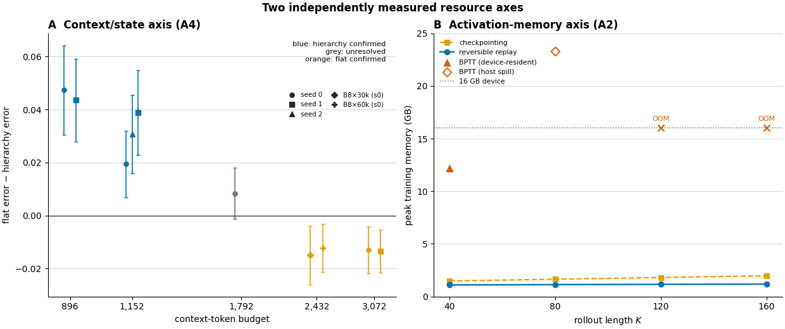

# Chapter 4 — Experimental Evaluation, Operating Regions, and Practical Application

This chapter evaluates the developed methods by scientific question rather than by experiment
chronology. A curated configuration-and-evidence appendix reports the complete observed arm grid,
seed coverage, comparison licences, robustness cells, and provenance receipts. Historical gate
decisions and exploratory branches remain research records rather than part of the scientific
argument. The main chapter answers:

1. Which generation mechanism is appropriate for the controlled predictor, and under which
   inference regime?
2. Does hierarchical context retrieve memory-relevant content beyond a token-matched flat window?
3. Where is the tested reach–fidelity frontier, and what context-state efficiency does it imply?
4. Which context-package shape is preferred?
5. Which directions survive training seeds, sampler allocation, and codec changes?
6. Which proposed effects fail to replicate?
7. What do explicit access and persistent-object evaluation reveal about the mechanism’s limits?

The chapter reports frozen evidence only. Moving-MNIST-CIFAR, KTH, E5b, E9, and the B1
fixed-target control are not executed results. E9 is terminally skipped because it provides no
incremental utility after the protected evidence programme; B1 retains whole-configuration
wording, so the unexecuted control is not required for the present claims.

## 4.1 Evaluation Design and Evidence Levels

### 4.1.1 Testbeds and roles

The experimental programme separates mechanism identification, confirmation, robustness, and
external-boundary evidence.

**LoopMom** is the primary mechanistic instrument. A \(64\times64\) viewport moves over a
\(192\times64\) toroidal world containing background texture and digit sprites. At any instant,
two thirds of the world is outside the viewport. Recorded actions and viewport positions identify
when each world region was last visible; at the main operating point, relevant content re-enters
after approximately 48 frames. This geometry provides exact *geometric observability*: it tells
whether the information required for a re-entry was previously visible within a package’s reach.
It does not prove information-theoretic necessity because common digit priors can make unseen
content statistically predictable.

**Moving-MNIST 10-to-10** is a short, no-re-entry competence boundary using the canonical
OpenSTL protocol [1] [124]. It asks whether the general predictor
functions on a standard dataset, not whether hierarchical memory pays.

**Persistent-object long Moving-MNIST (E6)** uses a 48-frame warm-up followed by 300 self-fed
frames. The generator saves persistent object and source-glyph identities, boxes, and
trajectories. The evaluator uses one-to-one Hungarian assignment
[125], explicit misses and extras, a fixed ground-truth denominator for
identity accuracy, and object coverage. E6 is an external synthetic boundary, not a replication of
LoopMom’s geometry.

**TaxiBJ** is a real spatio-temporal forecasting competence bridge under the OpenSTL 4-to-4
protocol [126] [1]. It does not contain the off-screen re-entry mechanism required by
the article’s central claim and is therefore not treated as memory confirmation.

### 4.1.2 Evidence hierarchy

Four evidence levels are kept distinct:

1. **Development evidence** uses the original evaluation pool that informed theory and arm
   selection.
2. **Untouched confirmation** evaluates frozen checkpoints and registered populations once on a
   newly generated, hash-pinned holdout rejected by training and monitoring loaders.
3. **Robustness evidence** changes sampler allocation or the entire latent codec under separately
   purpose-locked data.
4. **External-boundary evidence** changes the task and object semantics and is interpreted as a
   scope test rather than a replication.

The source of truth is the immutable local NPZ/JSON evidence, not dashboard summaries. Protected
data require purpose-specific access records. Each accepted result is linked to a content-addressed
run specification, dataset hash, checkpoint provenance, source revision, and completion
validator.

**Table 4.1 — Experimental study map.** “Seeds” means training seeds unless sampler or codec
seeds are named explicitly. A comparison license (written “licence” in the tables) states what
kind of inference the design permits.

| Study | Scientific question | Intervention and held-fixed quantities | Co-change / comparison licence | Seeds | Population and evidence level | Inferential family and terminal reading |
|---|---|---|---|---:|---|---|
| Mechanism study | Which prediction mechanism is useful? | regression/diffusion head and objective changed while context layout, latent interface and transformer capacity were closely matched; EBM tested separately in the official-code adaptation | objective and inference differ; best-of-8 total network work is not equal; EBM is not a third matched-capacity cell / **MATCHED_CAPACITY** for regression–diffusion, **DEVELOPMENT_DIAGNOSTIC** for EBM | one regression, one diffusion, two EBM recipes | LoopMom development | best-of-8 coverage with declared per-candidate and total work; NFE sensitivity; separate EBM capability verdict; regime-dependent selection |
| E2 | Where does hierarchy pay at fixed context budget? | package geometry changed; codec, backbone, evaluation clips and pair budgets fixed | reach and retained spatial fidelity change together / **MATCHED** except the labelled 480-vs-512 near-match and B1 | pair-specific, 0–2 | protected LoopMom untouched holdout | one simultaneous frontier family; hierarchy at 896/1,152, unresolved at 1,792, flat at 2,432/3,072 |
| B1 within E2 | Does the complete stride-2 configuration beat a short flat configuration? | 512 context tokens matched | target stride, target tokens, auxiliary loss and optimization load co-change / **WHOLE_CONFIGURATION** | 0–1 | protected LoopMom untouched holdout | registered reach band; configuration confirmed, pure stride claim prohibited |
| E4b | Does package preference survive head and training-seed changes? | temporal and spatial 48-frame packages crossed with diffusion/regression; codec and backbone fixed | 1,088-vs-1,152 context tokens / **DEVELOPMENT_FACTORIAL, NEAR_MATCHED** | 0–4 | adaptively used LoopMom development pool | per-seed clip intervals plus across-seed summaries; stable diffusion direction, heterogeneous regression/interaction |
| E5a | Does a late self-fed inversion replicate? | frozen long-loop pair repeated at two new seeds | seed 0 generated the hypothesis / **REGISTERED_REPLICATION** | 0–2 | long-loop development/replication set | early hierarchy benefit repeats; late negative direction **NOT_REPLICATED** |
| E7c | Are central directions sensitive to sampler randomness or NFE? | frozen seed-0 predictors; NFE and sampler seed varied | checkpoint-only / **ROBUSTNESS_ONLY** | training seed 0; sampler seeds 0–2 | purpose-locked LoopMom robustness set | one 20-effect family; directionally robust, upper inversion less precise |
| E7a | Do directions survive a newly trained codec? | full codec, normalization and all seven predictors retrained | whole latent interface changes / **ROBUSTNESS_ONLY** | predictor seed 0; one alternate codec | purpose-locked LoopMom robustness set | one eight-effect family; codec-directionally robust |
| E8a | How much error remains when addressing is explicit? | exact future pose and lossless warm-up pixels supplied | not token or information matched / **PRIVILEGED_REFERENCE** | n/a | purpose-locked LoopMom reference | one six-effect family; large explicit-access advantage |
| E6 | Does the support–identity boundary appear on persistent objects? | matched 1,152-token flat and hierarchical packages | task and object semantics changed / **EXTERNAL_BOUNDARY** | 0–2 | protected long Moving-MNIST | one 15-effect family; support/continuity favor hierarchy, identity favors flat |
| Competence bridges | Does the general stack function outside the central instrument? | dataset/protocol changed | no re-entry mechanism and limited replication / **DESCRIPTIVE_BOUNDARY** | one reported model per arm | Moving-MNIST 10-to-10 and TaxiBJ | competence only; no hierarchy-generalization claim |

### 4.1.3 Endpoints and statistical protocol

Sparse-video evaluation requires more than aggregate full-frame error. Every accepted evaluation
retains full-frame MSE, non-empty ground-truth-foreground MSE, background MSE, union-mask MSE,
foreground precision/recall/F1, component counts, misses, extras, overlap, and coverage.
Persistent-object studies additionally retain trajectory error and identity accuracy. SSIM, PSNR,
LPIPS, FID, and FVD remain useful conventional metrics
[127, 128, 94, 129], but no one aggregate score is allowed to substitute for
re-entry, hallucination, support, identity, and coverage endpoints.

For a registered pair, record-level differences are paired by clip and horizon. The sampling unit
is the clip: a bootstrap replicate samples clips with replacement and retains all rollout frames
inside each selected clip. This preserves within-rollout dependence. Clip-cluster intervals
condition on the trained model, while training seeds are a separate uncertainty level.
Registered families use a studentized maximum statistic across all contrasts in each bootstrap
replicate, producing simultaneous intervals rather than interpreting many marginal intervals
independently [120, 121, 122, 123].

Effect signs are harmonized so that positive values favor the registered candidate: comparator
minus candidate for lower-is-better errors, and candidate minus comparator for higher-is-better
accuracy or coverage. A null interval is unresolved, not
evidence of equivalence. Equivalence would require a justified smallest effect of interest,
adequate measurement reliability, and a confidence interval wholly inside that margin.

### 4.1.4 Computational environment and budget vocabulary

The main experiments use the recorded Python/PyTorch environments and NVIDIA GPU configurations
stored with their run specifications. CPU-only gates validate dataset integrity, package
interfaces, experiment authorization, metric semantics, and deterministic evidence generation.
GPU-hour accounting includes training, evaluation, pilots, failures, and retries.

“Matched budget” always names the matched resource:

- context-token matched;
- target-interface matched;
- total-sequence-token matched;
- parameter matched;
- training-example matched;
- optimizer-update matched; or
- per-candidate NFE declared, with total candidate-generation work reported.

The B16×30k and B8×60k regimes process approximately the same number of examples but differ in
updates, gradient noise, grouping, and effective EMA horizon. They are optimizer-regime
comparisons, not “twice the data.”

**Table 4.2 — Complete observed LoopMom package/interface registry.** Fine tokens are
\(8\times8=64\) per frame and coarse tokens are \(4\times4=16\) per frame. “Observed” means that a
completed model/evaluation cell exists; it does not make every row mutually comparable. The
comparison licence in Table 4.1 and Table 4.8 controls interpretation.

| Arm | Context geometry | Reach | Context | Target | Total | Head(s) and executed training seeds | Training regime | Scientific role |
|---|---|---:|---:|---:|---:|---|---|---|
| `hier-short` | 6 coarse + 6 fine, dense | 6 | 480 | 320 | 800 | diffusion 0–1 | B16×30k | lower near-match; span below loop |
| `flat-short` / `flat-short-reg` | 8 contiguous fine | 8 | 512 | 320 | 832 | diffusion 0–1; regression 0 | B16×30k | lower comparator; B1 baseline |
| `hier-s2-min` / `hier-s2-min-reg` | 24 stride-2 coarse + 2 recent fine | 48 | 512 | 288 | 800 | diffusion 0–1; regression 0 | B16×30k | B1 whole configuration |
| `spat18` / `spat18-reg` | 18 dense coarse + 6 recent fine | 18 | 672 | 320 | 992 | diffusion 0; regression 0 | B16×30k | fixed-span resolution diagnostic |
| `flat-min` | 14 contiguous fine | 14 | 896 | 320 | 1,216 | diffusion 0–1 | B16×30k | 896-token reach comparator |
| `hier-min` | 48 dense coarse + 2 recent fine | 48 | 896 | 320 | 1,216 | diffusion 0–1 | B16×30k | 896-token reach candidate |
| `strided-flat` / `strided-flat-reg` | 11 stride-4 fine anchors + 6 recent fine | 48 | 1,088 | 320 | 1,408 | diffusion 0–4; regression 0–4 | B16×30k | temporal-package factorial arm |
| `flat-budget` / `reg-flat` | 18 contiguous fine | 18 | 1,152 | 320 | 1,472 | diffusion 0–2; regression 0–1 | B16×30k; diffusion seed 0 also B8×60k | 1,152-token comparator |
| `hier-long` / `reg-long` | 48 dense coarse + 6 recent fine | 48 | 1,152 | 320 | 1,472 | diffusion 0–4; regression 0–4 | B16×30k; diffusion seed 0 also B8×60k | 1,152-token candidate and spatial package arm |
| `hier3` | 48 top + 24 coarse + 9 fine | 48 | 1,152 | 336 | 1,488 | diffusion 0 | B16×30k | depth-plus-objective/allocation diagnostic |
| `flat-c1` | 28 contiguous fine | 28 | 1,792 | 320 | 2,112 | diffusion 0 | B16×30k | intermediate frontier comparator |
| `hier-c1` | 48 dense coarse + 16 recent fine | 48 | 1,792 | 320 | 2,112 | diffusion 0 | B16×30k | intermediate frontier candidate |
| `flat-c2` | 38 contiguous fine | 38 | 2,432 | 320 | 2,752 | diffusion 0 | B16×30k and B8×60k | upper frontier comparator |
| `hier-c2` | 48 dense coarse + 26 recent fine | 48 | 2,432 | 320 | 2,752 | diffusion 0 | B16×30k and B8×60k | upper frontier candidate |
| `flat-long` | 48 contiguous fine | 48 | 3,072 | 320 | 3,392 | diffusion 0–1 | B8×60k | equal-reach dense comparator |
| `hier-rich` | 48 dense coarse + 36 recent fine | 48 | 3,072 | 320 | 3,392 | diffusion 0–1 | B8×60k | equal-budget hierarchy |

The registry deliberately contains no “pending” cells. The proposed `flat-320`, `hier-s4-min`, and
`hier3-reg` cells were **NOT_EXECUTED / OUT_OF_SCOPE** when the frozen programme closed; they are
not missing results and support no claim. The curated appendix reports the observed outcome grid,
per-seed factorial cells, robustness families, measured cost fields, and artifact bindings.

## 4.2 Selection of the Generation Mechanism

The model chapter uses v-parameterized latent diffusion, but the experiment does not assume that
diffusion wins every evaluation regime. Regression and diffusion share the same conditioning
structure and closely matched transformer capacity. Energy-based descent is assessed in a
separate 14.66 M-parameter official-code adaptation; it contributes a capability diagnosis, not a
third cell in the matched-capacity regression–diffusion comparison.

**Table 4.3 — Mechanism-selection contract.** The table separates the question answered by each
head from its final role; it does not collapse incompatible inference regimes into one ranking.

| Mechanism | Training object | Additional inference input | Inference rule | Single-step result | Best-of-1 rollout result | Final role |
|---|---|---|---|---|---|---|
| Regression | clean target latent | none beyond context/actions | one direct pass; MC dropout only for coverage diagnostics | weaker best-of-8 coverage | stronger deterministic self-fed rollout | deterministic rollout control |
| Diffusion | velocity of a noisy target latent | noisy candidate and diffusion time | DDIM at a declared NFE | stronger stochastic/oracle coverage | weaker than regression in tested deterministic rollout | primary head for the fixed-budget frontier |
| Energy-based model | scalar energy of context–candidate pairs | initialized target candidate | gradient descent in candidate space | ordering/descent failure modes at reachable scale | no rollout grid after the gate failed | characterized negative; no universal impossibility claim |

### 4.2.1 Shared single-step mechanism study

The regression and diffusion predictors use width 256, six transformer blocks, eight heads, and a
shared context layout; their parameter counts are 7.27 M and 7.53 M. Context contains six frames
at both latent levels, and the target lies four actions after the last context frame. Per-level
latent standardization is essential: without it, unit-scale diffusion noise overwhelms raw latent
scales and reverses the observed ranking. Best-of-\(N\) is an oracle coverage diagnostic selected
by decoded foreground MSE against the ground truth and is always separated from mean-over-\(N\)
and best-of-1.

The inference accounting is deliberately explicit. One regression candidate requires one
MC-dropout network evaluation; one diffusion candidate requires the declared number of DDIM
network function evaluations (NFE). Therefore best-of-8 uses 8 regression evaluations but 32, 64,
or 128 diffusion evaluations at 4, 8, or 16 NFE per candidate. The study is matched in backbone
capacity and interface, **not** in total inference work. The NFE sweep is a diffusion
inference-allocation sensitivity analysis against a fixed-cost regression coverage diagnostic.

**Table 4.4 — Matched-capacity single-step best-of-8 mechanism comparison.** For the two learned
heads, score columns except “mean over 8” use the per-record oracle-selected best candidate;
diffusion uses 16 NFE per candidate (128 network evaluations per record), whereas regression uses
eight evaluations per record. Persistence is a one-output reference.

| Head | Best-of-8 fg-MSE, all | Best-of-8 easy | Best-of-8 hard novel strip | Mean over 8 candidates | Best-of-8 fg-sharpness |
|---|---:|---:|---:|---:|---:|
| Regression with MC dropout | 0.0664 | 0.0232 | 0.1808 | 0.0714 | 0.1591 |
| Diffusion, v-prediction + DDIM | **0.0512** | **0.0120** | **0.1549** | **0.0640** | **0.1886** |
| Persistence reference | 0.2367 | — | — | — | 0.0515 |

The frozen sensitivity receipt uses a smaller two-batch evaluation pool than Table 4.4 and is
therefore reported separately rather than spliced into its columns:

| Per-candidate NFE | Regression best-of-8 fg-MSE | Diffusion best-of-8 fg-MSE | Total regression / diffusion evaluations per record |
|---:|---:|---:|---:|
| 4 | 0.0680 | 0.0546 | 8 / 32 |
| 8 | 0.0680 | 0.0514 | 8 / 64 |
| 16 | 0.0680 | 0.0503 | 8 / 128 |

Diffusion wins every column in Table 4.4's single-step best-of-8 coverage regime and remains lower
in foreground MSE at each tested diffusion allocation in the sensitivity receipt. This does not
show equal-work superiority because total candidate-generation work differs. The separation is
largest on the genuinely generative hard subset. The regressor’s
mean-over-8 and best-of-8 values are close, while diffusion gains more from multiple samples,
consistent with the established distinction between mean-seeking regression and stochastic
coverage [130, 131, 132].

### 4.2.2 Best-of-1 rollout reverses the head ranking

During deterministic best-of-1 self-fed rollout, regression performs better: `reg-long` reaches
foreground MSE 0.1682 versus 0.1848 for `hier-long`, with paired interval
\([+0.0110,+0.0227]\) for diffusion-minus-regression and nearly equal sharpness
(0.0741 versus 0.0729). At the matched flat context, regression reaches 0.2015 versus 0.2038 for
diffusion.

The two results answer different questions. Diffusion wins an oracle-coverage regime in which
multiple samples are compared to the ground truth. Regression wins the deterministic best-of-1
rollout in which every prediction is fed back. The defensible conclusion is regime dependence,
not a universal best head.

### 4.2.3 Energy-based descent is a characterized negative

The energy-based study uses the official Energy-Based Transformer implementation and two reported
training recipes [88]. It separates two capabilities:
whether the trained energy orders true targets below mismatched targets, and whether candidate
descent from the prescribed initialization reaches structured outputs.

One recipe produces a persistently misordered landscape. The second repairs the ordering but
descent still fails to reach structured video targets at the scale feasible in this programme.
This is a two-sided characterized negative, not a proof that energy-based video generation is
impossible at larger scale. It justifies selecting diffusion for the coverage-oriented
single-step mechanism while retaining regression as a best-of-1 control. Detailed energy
landscapes, scale gaps, and descent trajectories remain in the curated evidence appendix.

The receipt-level result is: S2 places the batch mean below the target on all 21 recorded probes
(converged loss approximately 0.597); S1 places the target lowest on 15 consecutive probes from
steps 6,000–20,000, with a target-below-mean gap of +0.22 to +3.09 and final loss 0.3614.
Nevertheless, S1 cold-descent foreground sharpness never exceeds 0.0345, and its paper-style
best-of-4 probes remain in 0.0102–0.0154, below the predeclared approximately-0.08 structured-output
threshold. These receipts come from hash-listed legacy logs rather than the content-addressed E2–E8
result schema; the appendix states that provenance distinction explicitly.

## 4.3 Untouched Confirmation of Reach

The original LoopMom pool informed qualitative monitoring and configuration selection. The
central reach claims were therefore tested once on the newly generated hash-pinned holdout
`loopmom-confirmation_holdout-20260712-e033abee6e04`. Before access, the protocol froze
checkpoint evaluations, pair definitions, reach bands, endpoints, table layouts, and the
simultaneous frontier family.

For `hier-min` versus `flat-min`, the registered population contains non-empty answerable records
with

$$
14 < \Delta t \le 48,
$$

so the relevant past lies outside the 14-frame flat reach and inside the 48-frame hierarchical
reach. The effects are:

| Training seed | Reach-band effect | 95% CI |
|---:|---:|---:|
| 0 | +0.0980 | [0.0788, 0.1179] |
| 1 | +0.0914 | [0.0736, 0.1098] |

Whole-population effects are +0.0474 \([0.0354,0.0595]\) and +0.0436
\([0.0326,0.0549]\). Union-mask, full-frame, recall/F1, missed-component, and coverage endpoints
support the same direction. The concentration of the larger effects inside the pair-derived band
supports reach as the mechanism.

For B1 versus `flat-short`, the registered \(8<\Delta t\le48\) effects are +0.0692
\([0.0543,0.0845]\) and +0.0743 \([0.0588,0.0899]\). B1 changes context stride, target stride,
target slots, auxiliary loss, sequence length, and optimization difficulty together. It is
therefore a confirmed *whole-configuration* effect, not a pure causal stride estimate.

Geometric observability is exact for the generator but not information-theoretic necessity. A
stronger necessity experiment would require paired worlds identical over the short visible
context but different in hidden content that determines re-entry.

## 4.4 Tested Reach–Fidelity Frontier and Memory Efficiency

The untouched E2 simultaneous family is the principal frontier evidence:

**Table 4.5 — Registered tested frontier with arm identities and simultaneous intervals.** Effects
are flat loss minus hierarchical loss, so positive values favor hierarchy. The first two rows are
a declared 480-versus-512 near-match and are not used to define the exact-budget confirmed bracket.

| Context budget | Flat arm / reach | Hierarchical arm / reach | Seed and regime | Effect | Simultaneous 95% CI | Decision |
|---:|---|---|---|---:|---|---|
| 480 vs 512 | `flat-short` / 8 | `hier-short` / 6 | seed 0, B16×30k | −0.0038 | [−0.0081,+0.0005] | unresolved near-match |
| 480 vs 512 | `flat-short` / 8 | `hier-short` / 6 | seed 1, B16×30k | −0.0060 | [−0.0105,−0.0015] | flat favored; near-match |
| 896 | `flat-min` / 14 | `hier-min` / 48 | seed 0, B16×30k | +0.0474 | [+0.0305,+0.0642] | hierarchy confirmed |
| 896 | `flat-min` / 14 | `hier-min` / 48 | seed 1, B16×30k | +0.0436 | [+0.0280,+0.0592] | hierarchy confirmed |
| 1,152 | `flat-budget` / 18 | `hier-long` / 48 | seed 0, B16×30k | +0.0195 | [+0.0070,+0.0320] | hierarchy confirmed |
| 1,152 | `flat-budget` / 18 | `hier-long` / 48 | seed 1, B16×30k | +0.0389 | [+0.0228,+0.0549] | hierarchy confirmed |
| 1,152 | `flat-budget` / 18 | `hier-long` / 48 | seed 2, B16×30k | +0.0307 | [+0.0159,+0.0455] | hierarchy confirmed |
| 1,792 | `flat-c1` / 28 | `hier-c1` / 48 | seed 0, B16×30k | +0.0084 | [−0.0013,+0.0181] | unresolved |
| 2,432 | `flat-c2` / 38 | `hier-c2` / 48 | seed 0, B16×30k | −0.0150 | [−0.0260,−0.0039] | flat confirmed |
| 2,432 | `flat-c2` / 38 | `hier-c2` / 48 | seed 0, B8×60k | −0.0122 | [−0.0213,−0.0032] | flat confirmed; separate optimizer regime |
| 3,072 | `flat-long` / 48 | `hier-rich` / 48 | seed 0, B8×60k | −0.0129 | [−0.0217,−0.0041] | flat confirmed |
| 3,072 | `flat-long` / 48 | `hier-rich` / 48 | seed 1, B8×60k | −0.0134 | [−0.0215,−0.0053] | flat confirmed |

The largest tested family-wise-confirmed hierarchy point is 1,152; the smallest tested confirmed
flat point is 2,432. No monotonicity, unique crossing, interpolation, or asymptotic law is inferred
between them.

At the frozen latent resolution, one fine frame costs \(8\times8=64\) tokens and one coarse
frame costs \(4\times4=16\). The 48-frame arithmetic is:

**Table 4.6 — Context-state cost at equal nominal 48-frame addressable reach.** Each frozen-codec
spatial token contains 16 latent coefficients. The rollout transformer width is \(d=384\).

| Package | Context-token calculation | Tokens | Latent payload, fp32 | Latent payload, fp16/bf16 | Materialized width-384 embeddings, bf16 | Relative cost |
|---|---:|---:|---:|---:|---:|---:|
| 48 dense fine frames | \(48\times64\) | 3,072 | 192 KiB | 96 KiB | 2.250 MiB | 1.00× |
| 48 coarse + 6 fine | \(48\times16+6\times64\) | 1,152 | 72 KiB | 36 KiB | 0.844 MiB | 2.67× fewer |
| 48 coarse + 2 fine | \(48\times16+2\times64\) | 896 | 56 KiB | 28 KiB | 0.656 MiB | 3.43× fewer |

The result is **same nominal reach with fewer context tokens**. It is not a claim of equal
information, equal error, equal total tokens, equal compute, or equal wall time. Target tokens and
total sequence tokens are reported separately. The latent-payload columns are exact contiguous
array payloads; the embedding column is an implementation-level materialization whose fp32 size is
twice the value shown. These figures exclude target tokens, attention/MLP intermediates, allocator
and container overhead, parameters, optimizer state and training activations. All representations
therefore preserve the same 2.67× and 3.43× context-state ratios without implying equal end-to-end
VRAM savings.

**Figure 4.1 — Untouched tested frontier and exact context-token arithmetic.** Positive effects
favor hierarchy. Intervals belong to one simultaneous family; no line is drawn through the tested
points and 1,792 is shown as unresolved. The values are bound to the frozen E2 result artifact in
the curated evidence appendix.

The frontier supports the dissertation’s central state-memory interpretation. Hierarchy pays when
compression buys access to otherwise unreachable evidence. Once the flat package can afford the
relevant span, discarded fine information becomes an abstraction cost and flat fidelity recovers.

## 4.5 Context-Package Shape

Temporal subsampling and spatial coarsening both buy reach, but they preserve different
information. The near-matched comparison uses a 1,088-token temporally sparse full-resolution
package and a 1,152-token spatial hierarchy. The 64-token deficit favors the temporal package, so
the pair is near-matched rather than exactly matched.

The complete five-seed head-by-package factorial is:

**Table 4.7 — Package form by prediction head and training seed.** Positive package effects favor
the temporally sparse full-resolution package. Negative interactions mean that changing from
diffusion to regression shifts the contrast toward spatial coarsening.

| Seed | Diffusion temporal advantage | Regression temporal advantage | Head × package interaction |
|---:|---:|---:|---:|
| 0 | +0.0197 [+0.0143,+0.0252] | +0.0107 [+0.0062,+0.0158] | −0.0089 [−0.0151,−0.0025] |
| 1 | +0.0046 [+0.0007,+0.0084] | −0.0104 [−0.0146,−0.0062] | −0.0150 [−0.0199,−0.0104] |
| 2 | +0.0111 [+0.0070,+0.0151] | −0.0208 [−0.0270,−0.0150] | −0.0319 [−0.0401,−0.0245] |
| 3 | +0.0075 [+0.0037,+0.0114] | +0.0248 [+0.0181,+0.0323] | +0.0173 [+0.0106,+0.0245] |
| 4 | +0.0060 [+0.0027,+0.0092] | −0.0166 [−0.0229,−0.0108] | −0.0226 [−0.0297,−0.0160] |

The across-seed mean is +0.0098, SD 0.0060, with t95
\([+0.0023,+0.0173]\). Thus temporal full-resolution anchors are stable at the tested static-world
diffusion operating point.

Regression does not reproduce a stable package direction: effects are
+0.0107, −0.0104, −0.0208, +0.0248, and −0.0166. The head-by-package interaction also changes
sign. The correct conclusion is therefore:

- temporal packaging is stable across the five tested diffusion seeds;
- regression package use and the cross-head interaction are training-seed-sensitive;
- neither package is universally superior independent of head, task dynamics, or required detail.

**Table 4.8 — Context-form evidence and comparison licences.** This table prevents rows from
different designs being read as one Cartesian causal factorial.

| Question | Tested comparison | What is held fixed or isolated | What remains co-changed or confounded | Licence and evidence level | Supported conclusion |
|---|---|---|---|---|---|
| Reach beyond a flat window | `hier-min` vs `flat-min` | context, target and total tokens; codec, head, clips; pair-derived reach band | resolution and nominal reach change together | **MATCHED**, untouched E2 | benefit concentrates where only the hierarchy can address the relevant past; supports reach |
| Fixed-span spatial abstraction | `spat18` vs `flat-budget` under each head | 18-frame span, recent fine tail, head, codec and evaluation records | replacing older fine history with coarse history reduces tokens from 1,152 to 672 | **DEVELOPMENT_DIAGNOSTIC** | coarse history costs 0.0082 under diffusion and is unresolved under regression; no intrinsic-abstraction win |
| Temporal versus spatial package | `strided-flat` vs `hier-long` under diffusion/regression | nominal 48-frame reach, six-frame fine tail, backbone, codec and training protocol | temporal sparsity versus spatial coarsening; 1,088 versus 1,152 tokens | **NEAR_MATCHED DEVELOPMENT_FACTORIAL**, five seeds | temporal anchors are stable under diffusion; regression and interaction are heterogeneous |
| Stride-2 family | `hier-s2-min` vs `flat-short` | 512 context tokens and paired records | target stride/slots/tokens, auxiliary loss, total length and optimization load | **WHOLE_CONFIGURATION**, untouched E2 | the complete B1 configuration wins; no pure context-stride effect |
| Third representation level | `hier3` vs `hier-long` | 1,152 context tokens, nominal reach and diffusion backbone | target tokens, loss allocation, fine/coarse allocation, optimization load and top-level information floor | **DEVELOPMENT_DIAGNOSTIC**, seed 0 | two-level error minus three-level error = −0.0196 [−0.0248,−0.0146], so the three-level probe is worse; no general depth law |
| Stream contribution | coarse/fine blinding; `hier3` top blinding | trained weights and rollout records | zeroing a stream is out of distribution | **DEVELOPMENT_DIAGNOSTIC** | removing coarse history harms re-entry, removing fine history causes renderer collapse, and the tested top stream contributes little; magnitudes are not information accounting |

**Figure 4.2 — Executed configuration and evidence matrix.** Confirmatory, robustness,
replication, privileged-reference and external-boundary rows retain their distinct evidence roles.
Red-tinted rows are explicit structural gaps, not zero effects or invitations to infer unobserved
Cartesian cells. In particular, the executed B1 whole-configuration result is separated from its
unexecuted fixed-target control.

Static hidden content can reward sparse full-resolution anchors because old pixels remain
informative. Dynamically evolving or low-detail hidden state may reward spatial compression
instead. This study locates one operating region.

**Figure 4.3 — Package effects by training seed.** Per-seed intervals condition on each trained
model; the seed summary uses training seeds as units.

## 4.6 Robustness of the Principal Directions

### 4.6.1 Sampler allocation and randomness

E7c crosses four frozen seed-0 diffusion contrasts with NFE 8/16/32 at sampler seed 0 and NFE 16
at sampler seeds 1/2:

1. 896-token reach;
2. 1,152-token interior frontier;
3. 1,088-versus-1,152 package shape; and
4. the 2,432-token flat-fidelity inversion.

All 20 point estimates retain their registered direction, and 18 simultaneous lower bounds exceed
zero. The first three contrasts are family-wise clean under every variant. The 2,432 inversion
remains positive but is unresolved at sampler seed 1
\(+0.0098[-0.0001,+0.0196]\) and seed 2
\(+0.0077[-0.0013,+0.0167]\). The verdict is **directionally robust**, not sampler invariant.
This study changes inference allocation for frozen seed-0 predictors; it does not add
training-seed or dataset robustness.

**Figure 4.4 — Sampler/NFE robustness.** Open points mark upper-inversion intervals that include
zero.

### 4.6.2 Independently trained codec

E7a changes the whole continuous latent interface: a second codec is trained independently,
normalization is recomputed, and the seven seed-0 predictors are retrained. Codec weights,
reconstruction error, latent geometry, and normalization therefore change together.

**Table 4.9 — Whole-codec robustness.**

| Codec | 896 reach | 1,152 interior | 1,088 vs 1,152 shape | 2,432 inversion |
|---|---:|---:|---:|---:|
| Original | +0.0494 [0.0339, 0.0649] | +0.0283 [0.0169, 0.0397] | +0.0253 [0.0163, 0.0343] | +0.0150 [0.0065, 0.0235] |
| Alternate | +0.0521 [0.0374, 0.0669] | +0.0439 [0.0310, 0.0569] | +0.0112 [0.0039, 0.0184] | +0.0079 [−0.0006, 0.0165] |

All eight point estimates retain direction, and seven simultaneous lower bounds exceed zero. The
alternate-codec upper inversion is unresolved. The verdict is
**codec-directionally robust**, conditional on predictor seed 0 and one alternative codec; codec
seed is not an inferential replicate and no component-level cause is identified.

**Figure 4.5 — Original and alternate codec effects under one simultaneous family.**

## 4.7 Boundary and Negative Evidence

### 4.7.1 The proposed late trust boundary does not replicate

At a longer-loop operating point, seed 0 showed an early hierarchy benefit followed by a late
inversion during self-fed rollout. E5a preregistered that horizon pattern and repeated the pair at
two new training seeds.

**Table 4.10 — Registered self-fed reliability replication. Positive favors hierarchy.**

| Training seed | Early h1–24 | Late h61–256 |
|---:|---:|---:|
| 0 | +0.0204 [+0.0133, +0.0279] | −0.0064 [−0.0095, −0.0032] |
| 1 | +0.0082 [+0.0035, +0.0133] | +0.0074 [+0.0038, +0.0112] |
| 2 | +0.0230 [+0.0150, +0.0315] | +0.0087 [+0.0035, +0.0139] |

The early advantage is positive at all three seeds. Neither new seed reproduces the required late
negative direction; both reverse it. The registered verdict is **NOT_REPLICATED**. No stable
approximately-24-frame trust boundary is established, and the gated E5b localization programme
is not authorized. The conceptual distinction between addressable history and reliable self-fed
reuse remains valid, but it is not a third empirical law.

**Figure 4.6 — Early benefit and seed-0-only late inversion.**

### 4.7.2 Privileged pose-indexed raw access

E8a asks how much error remains when addressing is explicit. A world-coordinate mosaic stores raw
warm-up pixels and is queried using exact saved future viewport positions. It receives raw pixels,
future poses, and no token-matched budget; it is therefore a privileged access reference, not a
deployable neural competitor.

**Table 4.11 — Simultaneous pose-indexed raw-memory effects.**

| Registered contrast | Estimate | Simultaneous 95% CI |
|---|---:|---:|
| Raw K14 minus raw K48 | +0.0723 | [+0.0548, +0.0898] |
| Raw K38 minus raw K48 | +0.0210 | [+0.0096, +0.0325] |
| `hier-min` minus raw K48 | +0.1219 | [+0.1031, +0.1407] |
| `hier-long` minus raw K48 | +0.1368 | [+0.1190, +0.1545] |
| `strided-flat` minus raw K48 | +0.1134 | [+0.0944, +0.1324] |
| `flat-c2` minus raw K48 | +0.1310 | [+0.1122, +0.1498] |

Raw K48 reaches foreground MSE 0.0494, full-frame MSE 0.0027, and foreground recall 0.8438,
versus foreground MSE 0.1628–0.1862 for the four neural references. The result shows that
geometric reach is not sufficient for reliable addressing and reuse. It does not show that raw
mosaics are practical or that hierarchy is unnecessary.

**Figure 4.7 — Privileged explicit-access reference.**

### 4.7.3 Persistent-object external boundary

E6 compares matched 1,152-token flat and hierarchical packages at training seeds 0–2, using a
48-frame warm-up, 300 self-fed targets, and 100 protected clips.

To make unlike endpoint directions comparable, the registered harmonized effect is

$$
\Delta_m=
\begin{cases}
\overline{m}_{\mathrm{flat}}-\overline{m}_{\mathrm{hier}},
& m\in\{\text{foreground MSE, union MSE, trajectory error}\},\\
\overline{m}_{\mathrm{hier}}-\overline{m}_{\mathrm{flat}},
& m\in\{\text{identity accuracy, coverage}\}.
\end{cases}
$$

Thus positive values always favor hierarchy; the transformation changes only sign orientation,
not the endpoint denominators or paired records.

**Table 4.12 — E6 simultaneous effects. Positive favors hierarchy.**

| Seed | Foreground MSE | Union MSE | Trajectory error | Identity accuracy | Coverage |
|---:|---:|---:|---:|---:|---:|
| 0 | +0.0036 [−0.0074,+0.0146] | +0.0102 [+0.0019,+0.0185] | +2.4786 [+0.2130,+4.7443] | −0.0762 [−0.1106,−0.0418] | +0.0304 [+0.0016,+0.0591] |
| 1 | −0.0031 [−0.0127,+0.0065] | +0.0122 [+0.0052,+0.0192] | +1.4223 [−1.0646,+3.9092] | −0.0561 [−0.0934,−0.0188] | +0.0159 [−0.0163,+0.0482] |
| 2 | −0.0024 [−0.0131,+0.0083] | +0.0169 [+0.0093,+0.0245] | +4.1325 [+1.5271,+6.7380] | −0.0647 [−0.0955,−0.0338] | +0.0498 [+0.0161,+0.0834] |

Absolute performance prevents overstatement:

**Table 4.13 — E6 absolute performance.** Both packages remain difficult in absolute terms;
paired values are shown as flat / hierarchy.

| Seed | Arm | Union MSE ↓ | Trajectory error ↓ | Identity accuracy ↑ | Coverage ↑ |
|---:|---|---:|---:|---:|---:|
| 0 | flat / hierarchy | 0.6861 / 0.6759 | 42.19 / 39.71 | 0.214 / 0.138 | 0.619 / 0.650 |
| 1 | flat / hierarchy | 0.6901 / 0.6779 | 40.20 / 38.77 | 0.244 / 0.188 | 0.646 / 0.662 |
| 2 | flat / hierarchy | 0.6931 / 0.6763 | 43.79 / 39.65 | 0.222 / 0.158 | 0.599 / 0.649 |

The preregistered verdict is **MIXED_BOUNDARY**. Union-mask error favors hierarchy at every seed.
Trajectory and coverage favor hierarchy cleanly at seeds 0 and 2 and remain directionally positive
but unresolved at seed 1. Identity favors flat context at every seed; foreground-only MSE is
unresolved. Hierarchy therefore better preserves *where* an object is and whether its support
continues, while flat context better preserves *what* digit it is. Neither system solves the
task.

**Figure 4.8 — Spatial-support/identity division of labour in E6.**

### 4.7.4 Short and real-data competence boundaries

On canonical Moving-MNIST 10-to-10, the general predictor beats persistence but remains far behind
specialized OpenSTL pixel predictors on aggregate MSE. Flat and hierarchical packages are nearly
equal because no off-screen re-entry mechanism requires a longer addressable history. This is a
negative control for the reach account, not a claim of benchmark leadership.

On TaxiBJ 4-to-4, the unchanged general stack is competitive with quoted OpenSTL rows on some
metrics but not uniformly. The flat regression arm uses 256 context tokens and reaches MSE
0.3642; the hierarchical regression arm uses 128 tokens and reaches 0.4170. Because only one
training seed was used and the task has no long memory horizon, this row demonstrates transfer
competence and the cost of unnecessary abstraction, not a claim-bearing hierarchy comparison.

## 4.8 Context-State and Activation-Memory Synthesis

The context-package experiments and reversible-computation experiments act on different resource
terms:

**Table 4.14 — Dissertation-strand operating-region synthesis with evidentiary separation.**

| Method / strand | Primary system term or layer | Benefit | Cost or boundary | Evidence source | In the final Chapter 3 predictor? |
|---|---|---|---|---|---|
| V-BLT entropy allocation [A1] | representation/capacity allocation | assigns finer capacity where the model's byte prediction is more dispersed | entropy is a model-internal proxy, not calibrated uncertainty or proof of optimal patches | published [A1] visual experiments and entropy maps, summarized in Chapter 2 | no; shared allocation principle only |
| RoPE-ND [A1] | representation-coordinate interface | keeps horizontal, vertical, and temporal coordinates explicit after linearization | does not guarantee semantic routing or cross-level coherence | [A1] method and Chapter 2 derivation | no; final predictor uses learned level/role/frame embeddings |
| Dense flat context [A4] | \(M_{\mathrm{context/state}}\) | preserves fine identity/detail | short reach at fixed budget; high cost at long reach | flat wins at 2,432/3,072 and on E6 identity | yes, as comparator packages |
| Spatial hierarchy [A4] | \(M_{\mathrm{context/state}}\) | economical dense historical support | loses fine detail after reach saturates | hierarchy wins at 896/1,152; E6 support/continuity | yes |
| Temporal subsampling [A4] | \(M_{\mathrm{context/state}}\) | preserves old full-resolution anchors | can miss intermediate dynamics | five-seed diffusion package-shape result | yes, as a comparator package |
| Gradient checkpointing | \(M_{\mathrm{activations}}\) | general recomputation-based memory reduction | recomputation and schedule-dependent memory | Chapter 2 measured comparator | no |
| Reversible temporal replay [A2 + dissertation extension] | \(M_{\mathrm{activations}}\) | approximately horizon-independent peak activation-tape footprint in the tested recurrence | invertibility/stability constraints, replay noise/metadata, and no inner-loop advantage | Chapter 2 measured memory frontier and numerical validation | no |
| Consistency criteria [A3] and LoopMom instrument | measurement and decision layer | turns trajectory consistency into self-fed, re-entry-, support-, identity-, miss/extra-, and coverage-sensitive decisions | criteria remain task-dependent proxies; LoopMom provides exact geometric observability only in its synthetic generator | [A3] criteria; Chapters 3–4 executed LoopMom/E6 endpoint programme | not a predictive module; consumed by final evaluation |

**Figure 4.9 — Two independently measured resource axes.** Panel A reports the Chapter 4
context-state frontier; Panel B reports the Chapter 2 activation-memory measurements. The panels
do not form a joint factorial or an end-to-end model experiment. Their savings have not been shown
to multiply and must not be added into one experimentally measured total-memory reduction.

The savings are not automatically multiplicative. The Chapter 4 predictor uses bounded context
state but is trained on individual windows without differentiating through the long rollout.
TempVerseFormer and the stochastic reversible recurrence show how activation memory can be reduced
when such long temporal differentiation is required; they are not the cause of the context-package
effects.

## 4.9 Software Toolkit and Practical Application

The research software comprises separately validated modules for:

- entropy-guided representation and RoPE-ND;
- reversible temporal transformations and memory measurement;
- hierarchical, flat, and temporally sparse context packages;
- latent diffusion, regression, and energy-based mechanism controls;
- LoopMom and persistent-object Moving-MNIST generation;
- frame, component, trajectory, identity, and coverage metrics;
- experiment authorization, purpose-locked access, content-addressed run specifications, and
  generated evidence artifacts.

This is an integrated research methodology and software toolkit. It is not one executable predictor
that jointly uses adaptive tokenization, RoPE-ND, reversible rollout training, and hierarchical
context.

The methods were used in the practical activities of ORNETIKA LLC and in the educational process
of VNTU according to implementation acts dated 14 October 2025 and 19 September 2025. Those acts
concern the reversible-transformer and entropy-tokenization strands. The final appendices must
reproduce their approved wording and copies.

## 4.10 Threats to Validity and Research Limits

The principal limitations are:

1. **Synthetic mechanism scope.** LoopMom provides exact geometric-observability labels and a
   deliberately constrained mechanism test, but it is not natural video and does not establish
   unrestricted causal interpretability. E6 is also synthetic.
2. **Representation scope.** The main predictor uses one frozen two-level continuous codec. One
   independently trained codec supports directional robustness but not representation-family
   universality.
3. **Training-seed scope.** Central points use two or three training seeds; clip intervals provide
   conditional data uncertainty and do not replace seed replication.
4. **B1 confounding.** B1 changes target and optimization properties with context stride.
5. **No equivalence claim.** Context-token efficiency does not establish equal performance at
   fewer tokens.
6. **No unique crossing.** The frontier contains tested discrete points; 1,792 is unresolved.
7. **Self-fed reliability.** The late trust-boundary hypothesis does not replicate.
8. **Absolute E6 difficulty.** Identity accuracy, coverage, and trajectory error show that neither
   package solves the persistent-object task.
9. **Pipeline scope.** State-memory and activation-memory savings are separately measured.
10. **Release scope.** Hash-pinned artifacts support auditability, but public archive availability
    must be distinguished from local provenance until external URLs are published.

Future work should prioritize counterfactual hidden-state instruments, dynamic hidden content,
natural-video memory benchmarks, explicit learned retrieval, and larger training-seed panels. Such
work would extend external validity; it is not required to support the present conditional
dissertation claims.

## 4.11 Chapter Conclusions

1. The generation-head study establishes a regime boundary rather than a universal ranking:
   diffusion is superior in the matched-capacity single-step oracle-coverage regime at the
   reported, unequal total inference allocations, regression is superior
   in deterministic best-of-1 rollout, and energy-based descent is a characterized negative at the
   tested scale.

2. On the untouched LoopMom holdout, hierarchy is confirmed precisely in registered populations
   where the longer package contains re-entry evidence outside the comparator’s reach. This
   supports reach as the mechanism under the tested representation and head.

3. The simultaneous frontier confirms hierarchy at 896 and 1,152 context tokens, leaves 1,792
   unresolved, and confirms flat full-resolution context at 2,432 and 3,072. No continuous
   crossing or universal hierarchy advantage is inferred.

4. At nominal 48-frame reach, the confirmed hierarchical packages use 2.67–3.43 times fewer
   context tokens than dense fine history. This is context-state reach efficiency, not equal
   performance, compute, or information.

5. Temporal full-resolution anchors are stable across five diffusion training seeds at the tested
   static-world point, while regression and the head-by-package interaction are
   training-seed-sensitive. Spatial and temporal compression are therefore not interchangeable.

6. Sampler/NFE and alternate-codec studies retain all principal point-estimate directions; the
   upper flat-fidelity inversion becomes a precision boundary in some variants.

7. The proposed late self-fed trust boundary fails to replicate. Explicit pose-indexed raw access
   shows a substantial addressing gap, and E6 separates hierarchy-favouring spatial
   support/continuity from flat-favouring identity fidelity.

8. The complete systems result has two independently measured resource axes. Context packaging
   reduces the state cost of retaining distant history; reversible replay reduces the activation
   cost of differentiating through long processes. The practical design rule is to compress
   long-lived state when reach is limiting, preserve detail when fidelity is limiting, and
   reconstruct activations when the training tape dominates.

The results of this chapter provide the experimental basis for Tasks 5–7 and for article [A4].
The curated configuration-and-evidence appendix retains the complete observed grid and secondary
receipts without interrupting the main argument.
