# Front Matter

## Title-page information

**Approved topic in Ukrainian:** «Системний аналіз та інтелектуальні технології консистентного моделювання процесів ієрархічної генерації відеоданих».

**English title:** *Systems Analysis and Intelligent Technologies for Consistent Modelling of Hierarchical Video-Data Generation Processes*.

**Applicant:** Leonid Ruslanovych Kulyk.  
**Degree field:** 12 Information Technologies.  
**Specialty:** 124 System Analysis.  
**Academic supervisor:** Oleksandr Borysovych Mokin, Doctor of Technical Sciences, Professor.  
**Institution:** Vinnytsia National Technical University, Vinnytsia, 2026.

**UDC:** 004.054:[004.032.26+004.85] **[AUTHOR INPUT: verify the classification and every title-page field against the approved institutional record.]**

## Ukrainian annotation

**[AUTHOR TRANSLATION SLOT: insert the approved Ukrainian annotation here. It should follow the same sequence and evidentiary scope as the English abstract below, then provide Ukrainian keywords. The institutional version should normally occupy four to six pages in the reference format.]**

## English abstract

Kulyk L. R. *Systems Analysis and Intelligent Technologies for Consistent Modelling of Hierarchical Video-Data Generation Processes*. Qualifying scientific work submitted as a manuscript for the degree of Doctor of Philosophy in specialty 124 System Analysis, field 12 Information Technologies.

The dissertation addresses long-horizon video prediction as a resource-constrained systems problem. A useful prediction must do more than resemble the next frame. Those requirements become harder with horizon because the predictor observes only a viewport of an evolving world and must decide what history to retain. Training introduces a different difficulty: differentiating through a long temporal computation stores intermediate activations even when the inference state itself is compact. Spatial representation adds a third constraint, since a uniform grid assigns equal capacity to regions whose information content may differ greatly.

Taken together, these difficulties are often compressed into one informal notion of “memory”. Activation storage during training, spatial allocation inside a representation, and addressable context during inference are different resources; reducing one does not automatically reduce the others. The unresolved task is therefore not simply to build a larger generator. It is to formulate the interfaces, budgets, and consistency criteria so that a claimed improvement can be attributed to a specific mechanism.

Accordingly, the work aims to improve task-relevant consistency and resource efficiency in long-horizon hierarchical video prediction through systems analysis and separately validated interventions for temporal training, spatial representation, retained context, and evaluation. Generated video is first treated as the output of a partially observed dynamic system. Appearance, identity, geometry, semantic content, temporal continuity, trajectory correctness, and cross-level agreement are modelled as overlapping criteria rather than substitutes for one another. This vocabulary extends an earlier qualitative analysis of consistency control in static diffusion-based image generation. The earlier taxonomy supplies criteria and control interfaces without constituting temporal evidence.

Activation memory is addressed first. Inspection of the implementation fixes the exact scope of that statement. On the reported controlled rotation task, the temporal-model memory remains approximately 0.89 GB at the one-, four-, and sixteen-step measurements, whereas matched non-reversible transformer variants rise to approximately 2.60–2.61 GB at sixteen steps. The long-horizon profile remains near 1 GB through the reported 1,024-step range. Reversibility is consequently an option when activation storage binds, not a general explanation for better prediction.

Spatial representation is examined through Vision Byte Latent Transformer. V-BLT applies local–global–local processing to raster pixel-channel bytes, uses RoPE-ND to preserve separate time and image coordinates after flattening, and predicts a 256-way categorical distribution at each byte location. The published fixed-$4\times4\times4$ proof of concept reports lower GFLOPs than the listed ViViT and UNet-3D configurations and favourable, though not uniformly best, quality results on rotating two-dimensional shapes and three-dimensional polycubes. Predictive entropy forms structured spatial maps around difficult or changing regions. It is used here as a complexity diagnostic: the experiment neither changed region sizes online nor measured an adaptive allocation policy.

Neither intervention determines which observations should remain available during inference. The dissertation therefore makes hierarchical retained context the central empirical problem. A frozen two-level latent codec supplies coarse and fine spatial streams to one joint-attention diffusion predictor. Competing packages are defined by resolution, count, temporal stride, and stream-anchor geometry; their context, target, payload, and total-token costs are accounted separately. Autoregressive rollouts update coarse and fine ring buffers with generated states. TempVerseFormer, V-BLT, and RoPE-ND remain outside the final predictor: they occupy different interfaces in the same systems methodology and were evaluated separately.

A purpose-built LoopMom environment isolates memory-dependent prediction. Evaluation includes complete frame and foreground endpoints, explicit miss and extra-foreground measures, persistent-object assignment, identity and trajectory criteria, paired clip-level effects, and simultaneous maximum-statistic intervals for registered comparison families. Training seeds form a separate uncertainty level from correlated frames within a clip. Untouched, purpose-locked, and protected populations are distinguished from development evidence, and negative results remain part of the terminal record.

The principal result is conditional but clear. On the untouched reach-differential population, hierarchical context improves the registered endpoint by 0.0980 and 0.0914 for two training seeds when the matched flat fine-resolution window cannot include the relevant past. Across the simultaneously analysed tested frontier, hierarchy is confirmed at 896 and 1,152 context tokens, the 1,792-token comparison is unresolved, and flat fine-resolution context is confirmed at 2,432 and 3,072 tokens. Forty-eight coarse frames combined with six or two fine frames use 1,152 or 896 tokens, respectively—2.67 and 3.43 times fewer.

Robustness studies preserve the principal directions under alternative sampler allocations and an independently trained codec, although some upper-region intervals lose precision. A registered self-fed study replicates an early hierarchical benefit across three seeds but fails to replicate the late inversion first seen at seed zero. Finally, a protected persistent-object long Moving-MNIST study exposes a useful boundary: hierarchical context better preserves spatial support and trajectory continuity, while dense flat context better preserves digit identity.

Scientific novelty lies in the combination of a system-level resource decomposition with mechanism-specific evaluation: trajectory-level consistency criteria; a bounded reversible temporal-state contract and its measured memory–computation frontier; a hierarchical raster-byte representation with multidimensional positional structure and entropy-based complexity estimation; a matched-budget hierarchical context model with a measured reach–fidelity frontier; and an exact-observability, paired clip-cluster protocol for effects that depend on historical reach. The novelty is methodological and empirical; priority over hierarchical video models, reversible networks, or adaptive tokenization as broad classes is outside the claim.

Practical outputs include controlled video generators, validated configuration schemas, fail-closed experiment authorization, immutable evidence artifacts, complete endpoint implementations, figure and table generation from frozen results, and a public research-software interface. Together, the tools support reproducible investigation and teaching; deployment in safety-critical or natural-video applications has not been validated. A direct design rule follows: compress retained state when distant reach is missing, preserve dense detail when fidelity is limiting, and reconstruct activations when the training tape—not inference context—is the dominant cost.

**Keywords:** systems analysis; long-horizon video prediction; hierarchical context; consistency; reach–fidelity trade-off; reversible computation; activation memory; raster-byte modelling; predictive entropy; latent diffusion; exact observability; cluster-aware inference.

## Applicant publications

- **[A1]** Kulyk L. R., Mokin O. B. “Scaling Video Prediction with Spatio-Temporal Patches.” *Visnyk of Vinnytsia Politechnical Institute*, 2025, No. 5, pp. 129–139. DOI: 10.31649/1997-9266-2025-182-5-129-139.
- **[A2]** Kulyk L. “Temporal Modeling with Reversible Transformers.” *Neural Computing and Applications*, 2026, Vol. 38, article 30. DOI: 10.1007/s00521-025-11707-3. Sole author; Scopus-indexed.
- **[A3]** Kulyk L. R., Mokin O. B. “Methods for Ensuring Consistent Generation in Diffusion Models.” *Visnyk of Vinnytsia Politechnical Institute*, 2024, No. 4, pp. 75–85. DOI: 10.31649/1997-9266-2024-175-4-75-85.
- **[A4]** Kulyk L. R. “When Does Hierarchical Video Memory Pay? Reach–Fidelity Trade-offs under Fixed Context Budgets.” **[AUTHOR INPUT: insert target venue and terminal status.]**
- **Conference publications:** **[AUTHOR INPUT: insert the six verified bibliographic entries and confirm whether DSMSI-2023 belongs in the list.]**

## Contents

The final institutional version should generate a live table of contents after pagination. Its scientific body comprises the Introduction; Chapter 1, *Systems Analysis and Consistency Requirements of Long-Horizon Video Prediction*; Chapter 2, *Methods for Feasible Temporal Training and Adaptive Spatial Representation*; Chapter 3, *Hierarchical Context Model for Long-Horizon Video Prediction*; Chapter 4, *Experimental Validation and Operating-Region Decisions*; General Conclusions; References; and Appendices.

## Symbols and abbreviations

| Symbol or abbreviation | Meaning |
|---|---|
| AR | autoregressive |
| BPTT | backpropagation through time |
| CI | confidence interval |
| CRN | common random numbers |
| DDIM | denoising diffusion implicit model |
| DDPM | denoising diffusion probabilistic model |
| DiT | diffusion transformer |
| EBM / EBT | energy-based model / energy-based transformer |
| EMA | exponential moving average |
| FID / FVD | Fréchet inception distance / Fréchet video distance |
| fg-MSE | foreground mean squared error |
| LPIPS | learned perceptual image patch similarity |
| MSE | mean squared error |
| NFE | number of function evaluations |
| RoPE-ND | N-dimensional rotary positional embedding |
| SSIM | structural similarity index measure |
| V-BLT | Vision Byte Latent Transformer |
| VAE | variational autoencoder |

---

# Introduction

## Relevance and justification of the research topic

A video predictor is often judged one frame at a time, yet many of its consequential errors are visible only after a longer interval. Camera motion can reveal a region that was present earlier while the model fills it with plausible but unsupported texture. These are not merely reductions in image sharpness. They show that the generated process has failed to preserve information that the task treats as invariant.

Prior research provides strong components but rarely isolates the resulting mechanisms under compatible budgets. Checkpointing and reversible networks trade storage for recomputation [30–32, 92, 108–113]. Hierarchical latent models, recurrent state, compressed memory, retrieval, sparse attention, and state-space models extend temporal access in different ways [14–24, 33–37, 79–83]. Patch-based visual transformers and byte-latent models alter the unit of computation [69–78]. Their reported gains are informative, but comparisons often change architecture, token count, objective, target interface, or evaluation population simultaneously. A better score then identifies a configuration, not necessarily the reason for its advantage.

That separation leads to a controlled systems methodology. It should define consistency as a vector of task criteria, account separately for training and inference resources, make context packages comparable, and construct populations in which the proposed mechanism can actually be identified. The final empirical model in this dissertation is designed for that purpose. Earlier methods address activation growth and spatial representation independently; they explain how two other resource constraints can be relieved while remaining outside the final predictor.

## Relationship to research programmes, plans, and topics

Work on the dissertation was carried out at Vinnytsia National Technical University within the scientific direction of systems analysis and intelligent information technologies. **[AUTHOR INPUT: insert the official title, number, dates, and applicant role for state-budget project 1.]** **[AUTHOR INPUT: insert the corresponding verified information for state-budget project 2.]** The final wording must follow the signed institutional reports; project names or responsibilities are not inferred from software history.

## Aim and research tasks

The aim of the dissertation is to improve task-relevant consistency and resource efficiency in long-horizon hierarchical video prediction through systems analysis, separately addressing temporal training, spatial representation, retained context, and evaluation.

Achieving this aim requires more than combining existing modules. Each intervention must be tied to the resource it changes, and its evidence must distinguish an actual mechanism from a coincident architectural difference. For this reason, the work moves from formal criteria to two enabling methods and then to a central matched-budget context study. The sequence is conceptual rather than a chronology of publications.

Accordingly, six research tasks are set:

1. Analyse long-horizon video prediction as a partially observed dynamic system; classify relevant uncertainty and consistency failures; and derive requirements for causal, resource-accounted comparison.
2. Develop and delimit reversible temporal computation for long-horizon training, verify its reconstructable state and backward procedure, and characterize the resulting activation-memory and computation trade-off.
3. Develop a hierarchical raster-byte representation, multidimensional rotary positional encoding, and entropy-based estimation of spatial predictive complexity, while separating the evaluated fixed-patch method from proposed dynamic allocation.
4. Develop a hierarchical long-context video predictor whose coarse and fine streams, anchors, token costs, target interface, and autoregressive update are explicit.
5. Develop exact-observability instruments, complete frame and object endpoints, and paired clip-cluster inference for comparisons whose effect depends on retained-history reach.
6. Evaluate the methods, robustness, negative cases, and external boundaries; identify the operating regions in which hierarchical context, dense context, checkpointing or reversibility, and entropy-informed spatial allocation are appropriate.

Together, these tasks answer one systems question: how should a long-horizon predictor allocate spatial detail, retained history, and training memory so that the consistency criterion relevant to the task can be maintained under bounded resources? The wording matters. It asks for a conditional allocation rule, not for an architecture that wins every benchmark.

## Object and subject of research

The object of research is the process of neural video prediction over long self-fed horizons under finite computational and memory resources. It includes the formation, retention, and reuse of visual information during training and autoregressive inference, when generated frames enter the model's later inputs and relevant scene content may leave the current viewport or context window.

The subject of research is the set of system models, reversible temporal transformations, hierarchical spatial and context representations, positional encodings, evaluation instruments, and statistical procedures used to preserve task-relevant consistency and to identify reach–fidelity operating regions. The subject therefore covers relations between an intervention, the resource it directly changes, and the consistency endpoints used to judge it. It excludes broad claims about all generative video systems and deployment performance in untested application domains.

## Research methods

Systems decomposition is used to define state, observation, control, disturbance, prediction feedback, and the locations of the principal resource costs [5–11, 41]. Multi-criteria analysis separates appearance, identity, geometry, trajectory, false-foreground, and cross-level consistency instead of collapsing them into one score. Information theory supplies the categorical entropy used to describe the dispersion of raster-byte predictions [9]. It is treated as a diagnostic unless calibration is measured [44, 45].

Controlled procedural simulation isolates temporal dynamics and memory demand. LoopMom supplies analytically known world and viewport geometry; long persistent-object Moving-MNIST provides a different synthetic boundary; OpenSTL datasets are used only where the corresponding published experiment directly evaluated them [1, 124, 126]. Object-level correspondence is established with Hungarian assignment [125]. Effects are computed on paired clips, clips rather than rollout frames are resampled, and simultaneous maximum-statistic intervals control registered comparison families [120–123]. Content-addressed configurations, untouched or protected populations, and artifact-derived reporting reduce opportunities for post-hoc reinterpretation; preregistration and benchmark-variance analyses motivate the same separation between planned claims and observed variability [168, 170].

## Scientific novelty

Here, scientific novelty is methodological and empirical. It concerns how a resource-constrained video-prediction system is decomposed, measured, and compared; it does not rely on claiming priority for broad architectural families.

1. A multi-criteria formulation of consistency is developed for long self-fed video prediction. Static appearance, identity, geometry, and conceptual requirements are extended to temporal continuity, trajectory correctness, re-entry recovery, hallucination-sensitive foreground support, and agreement between explicit representational levels. The extension links each criterion to an observable failure and an appropriate endpoint, avoiding the assumption that low average frame error implies process consistency.

Relative to the earlier static-image taxonomy and conventional frame-aggregate evaluation, the difference is the trajectory-level operationalization: delayed events, assignment failures, false foreground, and cross-level contradictions are made separately observable.

2. Reversible temporal computation is delimited by an explicit state contract. Additive coupling is applied to the persistent doubled transformer state, while non-invertible encoding, projection, fusion, decoding, and loss interfaces remain outside the exact claim. The work combines algebraic reconstruction, numerical replay, gradient comparison, activation-memory measurement, and computation accounting to identify when reverse replay is useful and when checkpointing or ordinary backpropagation is the more suitable choice.

The distinction from a generic reversible-network construction is this verified applicability boundary: reconstruction, retained state, replay metadata, and computation premium are evaluated together instead of inferring end-to-end reversibility from one invertible block.

3. A hierarchical visual representation is developed over uncompressed raster pixel-channel bytes using local–global–local processing, causal prediction, and N-dimensional rotary positional encoding. Categorical predictive entropy provides a model-internal spatial-complexity signal without requiring a separate learned uncertainty head. Unlike a stronger adaptive-token claim, the validated method uses the fixed spatio-temporal packages reported in the publication; using entropy to change region size or compute on the fly is defined as a future controller and is not counted as an experimental result.

4. A two-level hierarchical context model is developed for matched-budget long-horizon prediction. Its package specification separates spatial level, temporal stride, frame count, anchor geometry, context tokens, target tokens, and payload. This enables a tested reach–fidelity frontier: hierarchy is evaluated where coarse history extends beyond a dense fine window, while flat context is also evaluated where reach is saturated and fine identity detail can dominate.

Hierarchical latent architectures already exist [20, 35–37]. The new element claimed here is consequently the controlled package-by-budget intervention and its measured lower and upper inversions, not the use of multiple scales itself.

5. An evaluation methodology is developed for memory-dependent video prediction. Exact geometric observability defines pair-specific reach-differential populations rather than relying only on aggregate clips. Complete foreground metrics penalize both missing and extra content; persistent-object assignment separates support, continuity, identity, and trajectory. Paired clip-cluster resampling and simultaneous inference then preserve rollout dependence and multiplicity. This combination makes a claim about retained reach falsifiable at the population where the compared packages differ.

## Practical significance

In practical terms, the work provides a reproducible research toolkit rather than a deployment product. Stable command-line interfaces support training, evaluation, analysis, and validation. These provisions follow the broader reproducibility principle that claims should be traceable to data, code, configurations, and a declared evaluation procedure [166].

For future systems, the methods also provide a decision procedure. If the needed past lies outside a dense window, a lower-resolution long stream can buy reach. If the relevant history is already present but identity detail is lost, dense fine context is preferable. When the backward activation tape dominates training, checkpointing or a verified reversible core can exchange computation for memory. Predictive entropy can motivate a spatial allocation policy, although its end-to-end benefit still requires direct testing.

Documented implementation acts and educational use are reported only to the extent supported by signed records. **[AUTHOR INPUT: insert the verified institutions, dates, covered software components, and appendix letters for the implementation acts.]**

## Reliability and validity of results

Reliability is supported at several levels. Algebraic properties are checked against implementation boundaries; numerical replay and gradient directions are compared where reversibility is claimed. Controlled generators expose the latent mechanism instead of relying exclusively on natural scenes with unknown history. The central context study separates development data from hash-pinned untouched, purpose-locked, and protected populations, following the logic of holdout protection in adaptive analysis [167]. Comparators share capacity where the research question requires it, while whole-configuration comparisons are labelled as such.

Reproducibility checks complement those inferential safeguards. Configurations and checkpoints are content-addressed, headline artifacts are regenerated from frozen evidence tables, and compatibility checks reject comparisons with mismatched interfaces. Published point estimates that lack seed-level records remain labelled as such; they are not retrofitted with uncertainty. This separation between verified provenance and estimated sampling variation is important because the two establish different kinds of reliability.

## Personal contribution of the applicant

Within this programme, the applicant formulated the systems decomposition, developed the software and controlled generators, implemented the model and evaluation components attributed to the dissertation, conducted the experiments, curated the evidence artifacts, and prepared the scientific analysis. Contributions associated with joint publications are distinguished from dissertation-only extensions.

The applicant also carried out the dissertation-level synthesis: aligning terminology across the separate studies, auditing implementation boundaries against published descriptions, and narrowing claims where the available experiment supports only a fixed configuration or a conditional operating region. Administrative statements about co-author roles remain subject to approval by the corresponding authors and the institution.

- For **[A1]**, the applicant developed and implemented the V-BLT method, RoPE-ND integration, procedural experiments, and analysis; the co-author contributed scientific supervision, systems framing, and manuscript review. The dissertation narrows the published adaptive wording to the fixed-patch evidence actually reported.
- **[A2]** is a sole-author work. The applicant developed TempVerseFormer, the reversible temporal backward procedure, controlled motion experiments, external comparisons, and memory/time evaluation. The verified reversible-state contract and later stochastic-replay analysis are stated separately where they extend the article.
- For **[A3]**, the applicant performed the technical review and proposed the conceptual-consistency category; the co-author contributed scientific supervision and editorial review. The dissertation extends that static-image discussion into operational video criteria without attributing temporal evidence to the paper.
- For **[A4]**, the applicant developed the hierarchical-context study, exact-observability instrument, endpoint suite, statistical protocol, robustness programme, figures, and reproducible artifact chain. **[AUTHOR INPUT: verify the final author list and contribution statement at submission.]**

## Approbation and publications

Principal results have been presented in three journal articles already identified as [A1]–[A3], with the hierarchical-context manuscript [A4] prepared for submission. **[AUTHOR INPUT: supply the complete six conference records, event names, locations or online status, dates, page ranges, and the final aggregate publication statement. Confirm whether DSMSI-2023 is included.]**

## Dissertation structure and volume

The dissertation consists of an English annotation, this Introduction, four chapters, General Conclusions, References, and Appendices. Two independent enabling methods occupy Chapter 2: reversible temporal computation for activation-limited training and hierarchical raster-byte representation for nonuniform spatial complexity. Experimental evidence in Chapter 4 selects the generative mechanism, tests retained reach and fidelity across budgets, examines robustness and boundary cases, and yields an operating-region decision rule.

General Conclusions return to the six research tasks and state the resulting methods, operating regions, and limits without reconstructing the publication sequence. References bind the technical and empirical claims used in the argument. Material needed for audit or reproduction moves to the appendices: complete configurations, seed-level and endpoint tables, supplementary derivations, negative-result receipts, provenance records, software commands, figure permissions, administrative documents, and the publication-to-result mapping. **[AUTHOR INPUT: insert total pages, main-text pages, figures, tables, references, appendix count, and final appendix letters after institutional typesetting.]**

---

# Chapter 1 — Systems Analysis and Consistency Requirements of Long-Horizon Video Prediction

The Introduction identified three resource bottlenecks, but it left two terms deliberately informal: *the state that should be remembered* and *the consistency that should be preserved*. Both must be defined before selecting a model. This chapter establishes the system boundary, turns consistency into a set of observable criteria, and derives the requirements used by the methods and experiments that follow.

## 1.1 Video prediction as a partially observed dynamic system

### 1.1.1 System boundary, state, observations, and controls

Consider an evolving scene whose complete physical and semantic state at discrete time $t$ is denoted by $x_t$. It may include object geometry, identity, pose, velocity, lighting, camera state, and variables that never appear directly in the image. An optional control $u_t$ represents a camera action, an agent action, or another measured input. Process disturbance $w_t$ covers stochastic dynamics and unmodelled influences. The video frame is an observation of the world state, not the state itself. With observation operator $h$, sensor or rendering noise $v_t$, and viewport parameters included either in $x_t$ or $u_t$, the transition–observation pair is

The same boundary appears outside benchmark video generation. Remote-sensing sequences and physics-informed wildfire forecasts combine incomplete observations with latent spatial evolution, so plausible imagery cannot substitute for state-relevant prediction [47–49].

$$
\begin{aligned}
x_{t+1}&=f(x_t,u_t,w_t),\\
y_t&=h(x_t,v_t), \qquad y_t\in\mathbb{R}^{H\times W\times C}.
\end{aligned}
\tag{1.1}
$$

**Figure 1.1 — System boundary for long-horizon video prediction.** *Source: dissertation-native systems schematic; routing verified for this revision.*

Figure 1.1 places the predictor inside the observation loop. A context-construction operator $C_t$ selects or compresses past observations into a model state $m_t=C_t(y_{\leq t},u_{\leq t})$. The predictor with parameters $\theta$ produces a distribution over a future window,

$$
p_{\theta}\!\left(\widehat y_{t+1:t+K}\mid m_t,u_{t:t+K-1}\right).
\tag{1.2}
$$

For a task loss $\mathcal{L}$, multi-step prediction seeks parameters and a context policy that reduce expected risk across horizons,

$$
\min_{\theta,C}\;\mathbb{E}\!\left[
\sum_{k=1}^{K}\lambda_k
\mathcal{L}\!\left(\widehat y_{t+k},y_{t+k};x_{t+k}\right)
\right],
\tag{1.3}
$$

where the semicolon emphasizes that the endpoint can depend on latent task properties—identity or true support, for example—even though the predictor sees only images. The weights $\lambda_k$ need not be uniform. A short controller may care most about immediate error, whereas a memory study intentionally upweights events whose relevant evidence lies in the distant past.

**Figure 1.2 — Hidden state versus viewport observation.** *Source: dissertation-native conceptual storyboard.*

Figure 1.2 illustrates why “previous frames” and “system state” are not interchangeable. The camera sees a rectangular crop of a larger cyclic world. When an object leaves that crop, its latent position and appearance persist. A model with a short flat window may infer plausible motion but cannot recover an earlier appearance that is no longer represented. A model with a long low-resolution stream can still address the event, although it may have discarded identity detail. In later chapters, this simple geometry becomes an exact experimental instrument rather than serving only as an analogy.

### 1.1.2 Self-fed prediction and the growth of uncertainty

Training commonly conditions on ground-truth history. Autoregressive evaluation does not. Once the first prediction is generated, later contexts contain model output, and the recurrence becomes

$$
\widehat y_{t+k}
\sim p_{\theta}\!\left(
\widehat y_{t+k}\mid
C_{t+k-1}(y_{\leq t},\widehat y_{t+1:t+k-1}),
u_{\leq t+k-1}
\right).
\tag{1.4}
$$

The change is deeper than accumulating numerical error. Exposure bias and scheduled or self-conditioned training address related sequence-level mismatches [25–29], but they cannot restore past information absent from the retained context. If a deterministic recurrence is written as $\widehat s_{t+1}=F_\theta(\widehat s_t)$, a perturbation evolves approximately under the product of Jacobians along the generated trajectory [93]. An average error-versus-horizon curve can therefore mix qualitatively different phases. The registered self-fed analysis later separates an early interval from the proposed late boundary, and replication shows that the apparent late inversion is not stable across seeds.

Error can also appear deceptively stable. A predictor that gradually removes uncertain foreground may converge to an easy background state. Pixel error then stops growing rapidly, but the sequence has lost the object. Conversely, a stochastic model can maintain multiple plausible futures and score poorly under a pointwise metric even when one sample is valid [130, 131, 155]. Complete endpoints and explicit candidate-count rules are required to distinguish these cases.

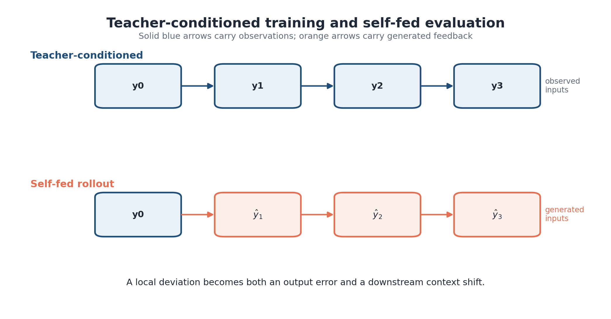

**Figure 1.3 — Teacher-conditioned training and self-fed rollout.** *Source: dissertation-native conceptual schematic.*

### 1.1.3 Resource-constrained multi-criteria formulation

The predictor is constrained by several memory terms that occur at different times and locations. A useful accounting identity is

$$
M_{\mathrm{total}}
=M_{\mathrm{parameters}}
+M_{\mathrm{optimizer}}
+M_{\mathrm{activations}}
+M_{\mathrm{context/state}}
+M_{\mathrm{transient}}.
\tag{1.5}
$$

Parameter and optimizer terms depend mainly on model size, precision, and training algorithm [108]. Activation memory stores or reconstructs intermediate values required for gradients. Context or state memory holds historical information used by prediction. Transient memory includes attention workspaces, sampler buffers, decoded candidates, and framework allocations. Summing them is useful for hardware feasibility; treating them as one design variable is not.

**Figure 1.4 — Locations of system memory costs.** *Source: dissertation-native systems schematic.*

Figure 1.4 explains why the methods in this dissertation are related without forming one inseparable model. Reversible temporal replay modifies the activation term inside a differentiable chain. Hierarchical context packaging modifies the retained-state term by changing how much history is represented at each resolution. V-BLT changes the spatial unit processed by local and global modules. Their costs could interact in a future integrated system, but the reported experiments measure them separately.

$$
\boldsymbol{\ell}(\widehat Y,Y)
=\bigl(
\ell_{\mathrm{frame}},
\ell_{\mathrm{support}},
\ell_{\mathrm{identity}},
\ell_{\mathrm{trajectory}},
\ell_{\mathrm{extra}},
\ell_{\mathrm{cross}}
\bigr).
\tag{1.6}
$$

$$
\begin{aligned}
\min_{\theta,C,a}\quad &
\mathbb{E}\!\left[\boldsymbol{\alpha}^{\mathsf T}
\boldsymbol{\ell}(\widehat Y,Y)\right] \\
\text{subject to}\quad &
M_{\mathrm{context/state}}(C)\leq B_{\mathrm{ctx}},\\
&M_{\mathrm{activations}}(\theta,a,K)\leq B_{\mathrm{act}},\\
&\operatorname{Work}(\theta,C,a,K)\leq B_{\mathrm{work}}.
\end{aligned}
\tag{1.7}
$$

Resource constraints also have different scaling variables. Parameter memory grows with model size, activation memory with the differentiated graph, context memory with the retained package, and attention work with the sequence presented to a block. IO-aware kernels such as FlashAttention can reduce the transient cost of exact attention without changing which history the model retains [13]. A context intervention may reduce both state storage and attention work, but only if token representations, precision, batch size, and target length are held comparable. Reporting “tokens” alone is incomplete when a coarse token and a fine latent carry different payloads, so Chapter 3 records token count and byte payload separately. Pareto reasoning must likewise remain discrete. The tested packages sample only a handful of budgets, leaving a continuous curve unidentified. In particular, the unresolved 1,792-token point prevents coloring an interpolated interval as a confirmed hierarchical region. Here, “frontier” denotes simultaneous comparisons at tested points, not a fitted phase transition.

| Resource term | Stored object | Dominant phase | Intervention examined here | Common confound |
|---|---|---|---|---|
| Parameters | learned weights | training and inference | capacity held fixed within matched comparisons | architecture changes with budget |
| Optimizer | moments and gradients | training | accounted but not directly optimized | precision and sharding |
| Activations | intermediate differentiated states | training | checkpointing or reversible replay | extra recomputation omitted |
| Context/state | retained observations or latent state | training and inference | flat, hierarchical, or subsampled packages | reach and fidelity co-change |
| Transient | attention and sampler workspaces | both | measured through total work/NFE where relevant | peak allocation mistaken for persistent state |

**Table 1.1 — Resource terms and their control interfaces.** The table distinguishes the quantity an intervention changes from nearby costs that may remain unchanged.

## 1.2 Consistency as a multi-criteria property

### 1.2.1 Why one quality score is insufficient

“Consistency” is sometimes used as a synonym for visual quality, temporal smoothness, or agreement with a prompt. A blurred object can follow the correct path. Sharpness offers no protection against a smooth identity change. Even low average error can conceal the disappearance of the only moving object when the background dominates. The metric should follow the failure, not the other way around.

Mean squared error measures pointwise deviation and remains valuable when pixels are aligned. SSIM adds local luminance, contrast, and structural terms [127]. LPIPS compares deep features [128], while FID and FVD summarize distribution-level feature statistics [94, 129]. Each compresses information differently. None directly states whether a particular object survived an occlusion, whether foreground was hallucinated, or whether the model recovered the appearance that was visible forty frames earlier.

**Figure 1.5 — Conceptual multi-step consistency landscape.** *Source: dissertation-native conceptual figure.*

Figure 1.5 should be read horizontally and vertically. Along the horizon, self-fed errors accumulate and the available context changes. Across criteria, image fidelity can decline independently of support, identity, or trajectory. The central empirical result later follows the same logic: hierarchical context can improve *where* an object is supported while dense context better preserves *what* the object is. Calling one arm simply “more consistent” would lose that boundary. Background imbalance makes the issue measurable. In a sparse scene, most pixels are easy background, so predicting empty space can achieve a respectable full-frame MSE while failing on every object pixel. Foreground-only MSE corrects the weighting but can still ignore hallucinated objects outside the ground-truth mask [46, 51]. Union-mask error includes both regions but changes its denominator with the prediction. Precision, recall, miss, and extra rates expose different directions of failure. Their empty cases must be defined before evaluation because a rollout may contain frames with no visible object.

**Figure 1.6 — Illustrative SDXL outputs and the limits of single-image inspection.** *Source: Kulyk and Mokin [133], original Figure 1; artwork assembled by L. Kulyk from locally generated SDXL outputs; reused under CC BY 4.0. Non-evidentiary illustration.*

$$
\mathbf q_{ik}
=\left(
q^{\mathrm{frame}}_{ik},
q^{\mathrm{support}}_{ik},
q^{\mathrm{identity}}_{ik},
q^{\mathrm{trajectory}}_{ik},
q^{\mathrm{extra}}_{ik}
\right).
\tag{1.8}
$$

### 1.2.2 Appearance, object, and conceptual consistency

The earlier analysis of diffusion-based image generation distinguished style or appearance, object identity, shape or geometry, and a proposed category called conceptual consistency [133]. Geometry concerns contour, spatial arrangement, and structural relations. Conceptual consistency, as proposed in [133], refers to preservation of a higher-level semantic idea across outputs that may vary in surface appearance. Classical accounts of visual representation and later vision-language evaluation show why semantic agreement cannot be inferred from pixels alone [100–104]. The dimensions overlap. A face identity depends partly on geometry and texture; a stylized sequence can preserve concept while changing both.

**Figure 1.7 — Overlapping consistency criteria.** *Source: dissertation-native synthesis informed by [133].*

**Figure 1.8 — Local visual input and integrated scene understanding.** *Source: Kulyk and Mokin [133], original Figure 5; artwork by L. Kulyk, conceptually informed by Hertzmann [174]; reused under CC BY 4.0. Heuristic illustration.*

| Criterion | Typical failure in generated video | Representative endpoint | What the endpoint can miss |
|---|---|---|---|
| Appearance/style | color, texture, or illumination drifts | feature or style similarity | correct score with wrong object identity |
| Identity | object changes class or instance after occlusion | assignment-based identity accuracy | spatial support may still be wrong |
| Geometry/support | contour collapses, object disappears, or extra foreground appears | overlap, coverage, precision/recall, miss and extra rates | fine attributes inside support |
| Concept/semantics | sequence contradicts the intended relation or event | task classifier, structured relation, or human protocol | temporal continuity and localization |
| Trajectory | motion is smooth but follows the wrong path | centroid or pose error over time | appearance and internal structure |
| Cross-level agreement | coarse state and fine prediction describe different events | decoded cross-level discrepancy | both levels may be jointly wrong |

**Table 1.2 — Consistency criteria, observable failures, and metric blind spots.** No endpoint is treated as a complete substitute for the others.

The control interface changes the cost of consistency. Image-to-image conditioning supplies a reference each time and is simple to deploy when such a reference exists [95]. DreamBooth and LoRA store a subject or style in adapted parameters [96, 97]; repeated identities can then be generated without sending the full reference, but adaptation consumes data and optimization. Structural control supplies edges, depth, pose, or segmentation [98]. Inversion methods estimate a latent or noise state for an existing image, providing strong edit control at additional inference cost [114, 115]. Shared-attention methods couple features among samples [99]. None is universally strongest because each assumes different information at the system boundary.

### 1.2.3 Temporal and trajectory consistency

Adding time changes the criteria in two ways. First, values should remain coherent between adjacent frames. Second, the sequence should follow a valid long-range process. Local smoothness addresses the former but can fail the latter: a vehicle may drift smoothly off its road, or a rotating object may decelerate continuously when the true dynamics require acceleration. Temporal consistency is thus necessary and insufficient.

$$
L_{\mathrm{traj}}^{(i)}
=\frac{1}{|\mathcal T_i|}
\sum_{t\in\mathcal T_i}
\left\|\widehat c_{it}-c_{it}\right\|_2.
\tag{1.9}
$$

This error detects displacement but not an identity swap between nearby objects. Assignment must be persistent or identity-aware, and unmatched predictions need an explicit penalty. Conversely, an identity classifier can recognize a digit whose predicted position is badly wrong. The combination of support, assignment, identity, and trajectory endpoints is what makes the persistent-object boundary interpretable.

Identity across time also requires an assignment rule. Hungarian assignment solves the per-frame minimum-cost correspondence [125]; the persistent-object evaluation augments it with metadata and declared penalties so that disappearing predictions do not receive a favorable identity score simply by remaining unassigned. Before disappearance, the context contains direct appearance evidence. Paired populations and multiple seeds reduce that alternative explanation; the privileged raw-memory reference clarifies the upper bound on access.

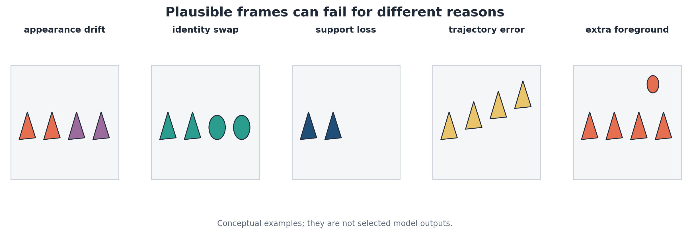

**Figure 1.9 — Distinct failures with superficially plausible frames.** Appearance drift, identity substitution, support loss, trajectory deviation, and extra foreground require different endpoints; the montage is conceptual rather than model evidence. *Source: dissertation-native examples.*

For a binary ground-truth foreground mask $G_t$ and predicted mask $P_t$, overlap alone can be misleading when both are empty. The later endpoint suite therefore includes the ground-truth-normalized miss and extra fractions

$$
r_{\mathrm{miss}}(t)=\frac{|G_t\setminus P_t|}{|G_t|},
\qquad
r_{\mathrm{extra}}(t)=\frac{|P_t\setminus G_t|}{|G_t|},
\tag{1.10}
$$

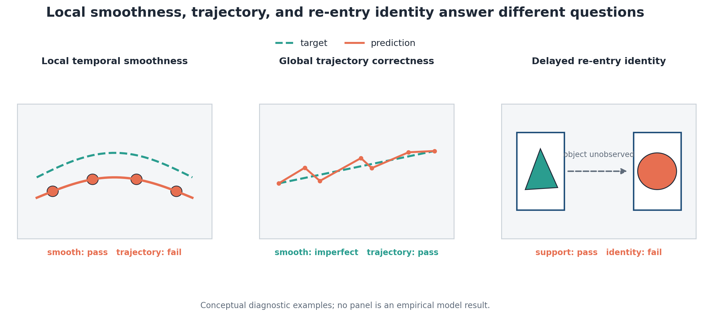

**Figure 1.10 — Operational separation of temporal smoothness, trajectory correctness, and re-entry identity.** *Source: dissertation-native conceptual figure.*

### 1.2.4 Hierarchical and cross-level consistency

Hierarchy introduces another relation to evaluate, but only for a system that exposes distinct levels with a defined correspondence. Cross-level consistency therefore begins with an alignment contract: which levels describe the same event, how their coordinates map, and what information survives the projection used for comparison. Multiscale architectures have demonstrated the value of slow and fast or coarse and fine representations [20, 35–37, 150], yet the presence of such levels supplies no automatic consistency guarantee.

$$
L_{\mathrm{cross}}(t)
=d\!\left(
D_c(z_t^c),
\mathcal S\bigl(D_f(z_t^f)\bigr)
\right),
\tag{1.11}
$$

Three checks follow for a hierarchical predictor. First, each level should be evaluated for the property it is expected to preserve; a coarse occupancy map should not be penalized for absent texture. Agreement is then tested only over their shared information. Finally, the fine output must still be compared with ground truth, because perfect internal coherence can describe the wrong future. In the present experiments, hierarchy is judged primarily through observable decoded endpoints and package-level effects. Equation (1.11) formalizes the additional cross-level criterion but is not promoted to a headline result without a registered empirical test.

**Figure 1.11 — Consistent and contradictory predictions across representational levels.** Multiple resolutions create an alignment problem; they do not guarantee that coarse and fine outputs describe the same event. *Source: dissertation-native conceptual figure.*

V-BLT and the final predictor instantiate different hierarchies. V-BLT organizes local and global processing inside one representation, whereas Chapter 3 retains coarse and fine histories across time. Their shared principle is scale-dependent capacity, not a shared tensor path or empirical result.

### 1.2.5 From static control criteria to video requirements

The static criteria survive in video, but their observability changes. Appearance and identity must be checked across time and after occlusion. Geometry becomes support and motion as well as contour. Concept becomes an event or relation that unfolds over a sequence. Structure supplied at every frame can prevent one class of error, whereas a predictor with no future condition must infer structure from dynamics and retained state.

**Figure 1.12 — From static-image invariants to video requirements.** *Source: dissertation-native synthesis.*

Figure 1.12 distinguishes inheritance from extension. A reference image can establish appearance or identity at one instant, but video introduces ordering and delayed verification: the object observed at $t=3$ may not be judged again until $t=40$. During that interval, the predictor receives its own outputs and the evidence available to its context changes. Trajectory and re-entry criteria are therefore temporal constructs, while cross-level agreement applies only when a model exposes more than one representational level. The figure transfers a vocabulary, not empirical results from static generation.

**Figure 1.13 — Forward diffusion as progressive corruption.** *Source: Kulyk and Mokin [133], original Figure 2; author-created schematic based on the DDPM formulation [3]; reused under CC BY 4.0.*

**Figure 1.14 — Reverse diffusion as iterative denoising.** The historical drawing communicates progressive refinement; the formal learned transition is $p_\theta(x_{s-1}\mid x_s)$, distinct from the forward and posterior $q$-distributions. *Source: Kulyk and Mokin [133], original Figure 3; author-created artwork reused unchanged under CC BY 4.0.*

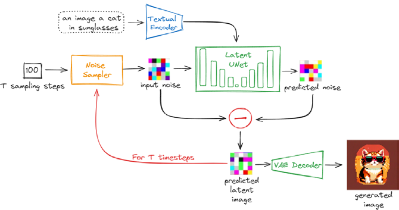

**Figure 1.15 — Generic latent diffusion generation pipeline.** Text conditioning, iterative latent denoising and image decoding illustrate the static-generation background; this is not the architecture of the Chapter 3 predictor. *Source: Kulyk and Mokin [133], original Figure 4; author-created artwork reused unchanged under CC BY 4.0.*

Diffusion time and video time are different coordinates. The former indexes noise levels used to refine one target sample; the latter indexes successive states of an evolving scene. A video diffusion model contains both, so convergence of its denoising loop cannot establish temporal consistency by itself.

> **Reserved author-supplied video-generation example.** Insert a short fixed sequence only when its clip or prompt, model and checkpoint, seed, sampler, frame indices, and output hashes are available. The example should illustrate one declared temporal invariant or failure and be captioned “qualitative illustration; not used for inference.” It remains unnumbered and is not counted as evidence until populated.

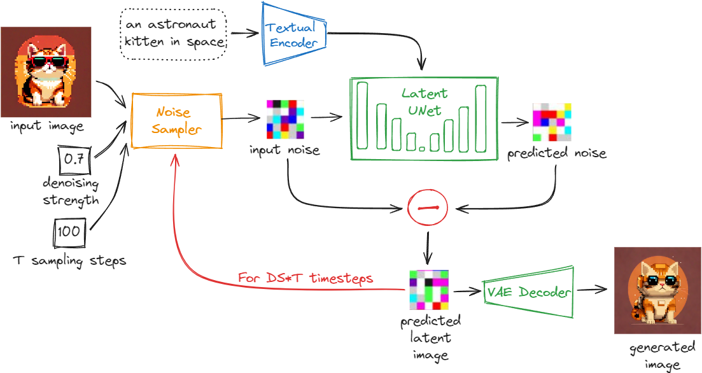

**Figure 1.16 — Image-to-image generation from a reference and noise level.** Direct reference conditioning can preserve local appearance when the source is available, but stronger perturbation permits greater change and does not guarantee identity or temporal memory. *Source: Kulyk and Mokin [133], original Figure 6; author-created artwork reused unchanged under CC BY 4.0.*

**Figure 1.17 — Structural conditioning controls geometry more directly than identity.** *Source: Kulyk and Mokin [133], original Figure 7; artwork and locally generated examples by L. Kulyk; ControlNet method from Zhang et al. [98]; reused under CC BY 4.0.*

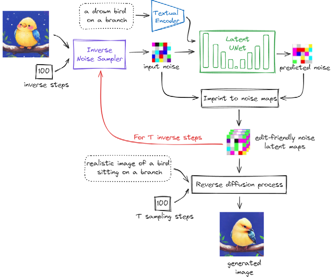

**Figure 1.18 — Inversion-based control through a recovered latent trajectory.** Inversion can anchor edits to a specific source more tightly than free sampling, at the cost of reconstruction error and additional optimization or inversion work [114, 115]. *Source: Kulyk and Mokin [133], original Figure 8; author-created artwork reused unchanged under CC BY 4.0.*

**Figure 1.19 — Shared style across changing subjects.** *Source: Kulyk and Mokin [133], original Figure 9; locally generated and assembled by L. Kulyk; StyleAligned method from Hertz et al. [99]; reused under CC BY 4.0.*

**Figure 1.20 — Five interfaces for controlling related generations.** Reference input, parameter adaptation, structural conditioning, inversion, and shared attention preserve different information and incur different update or inference costs. *Source: dissertation-native synthesis of [95–99, 133].*

**Figure 1.21 — Support and identity as independent axes.** Correct location can coexist with incorrect identity, while identity can survive despite poor spatial continuity. This distinction motivates the persistent-object endpoints in Chapter 4 without implying a shared causal mechanism. *Source: dissertation-native conceptual figure.*

These interfaces also set a fairness boundary. Future structure supplied to a controlled generator is privileged information unavailable to an autonomous rollout; parameter and latent adaptation store information at different system locations. Every comparison must therefore name both the invariant and the information legally available at prediction time.

A useful evaluation order follows. First establish whether the event was observable to each package. Then measure support and false foreground, because a missing object makes identity and trajectory conditional. Next evaluate assigned identity and motion. Finally inspect full-frame and perceptual quality as complementary summaries. Reversing this order encourages a high aggregate score to dominate the interpretation before the memory-dependent criterion is tested. Interpretability critiques make the same general point: an explanation is useful only when its construct and decision role are explicit [39, 40].

## 1.3 Three bottlenecks behind long-horizon inconsistency

### 1.3.1 Activation growth during temporal learning

Backpropagation through time expands a recurrent computation into a directed acyclic graph [28, 29, 105]. If one temporal step creates activations of size $A$, retaining every intermediate value for a horizon $K$ gives the leading-order relation

$$
M_{\mathrm{act}}^{\mathrm{BPTT}}(K)=\Theta(KA),
\tag{1.12}
$$

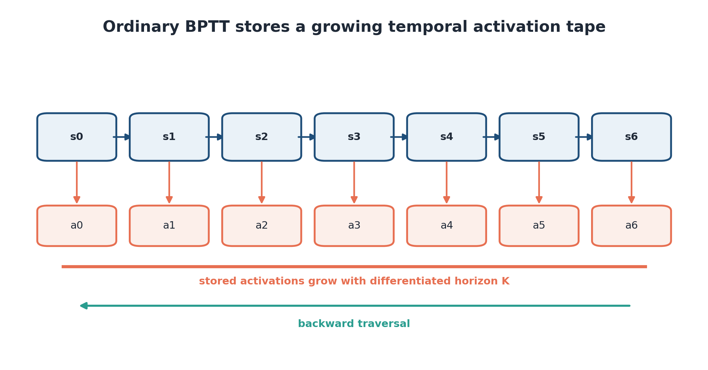

**Figure 1.22 — Activation-tape growth under ordinary temporal backpropagation.** *Source: dissertation-native conceptual schematic.*

Checkpointing stores selected boundary states and recomputes missing segments during the backward pass [30, 31, 108, 109]. Reversible coupling takes another route: if a block input can be reconstructed from its output, the block need not retain the same activation tape [32, 92]. Chapter 2 verifies this exchange and the TempVerseFormer state boundary. Chapter 3 uses windowed training for the final predictor, with ordinary gradient flow confined to each training window.

The differentiated horizon, rather than the deployed rollout length by itself, is the controlling variable. Truncating the graph changes which delayed dependencies receive gradient. Checkpointing can preserve the objective while selecting a storage–recomputation schedule, whereas a reversible core reconstructs compatible internal states and still retains non-invertible boundaries, parameters, gradients, and replay metadata. Their asymptotic descriptions therefore apply to scoped components. A practical comparison must report peak memory and time at the same horizon, batch, precision, and model interface; otherwise a smaller activation term can be hidden by unrelated constant allocations.

### 1.3.2 Uniform spatial allocation

A fixed patch grid is simple, parallel, and easy to batch [69–71]. Its token count for a video with $T$ frames and non-overlapping spatial patches $p_h\times p_w$ is

$$
N_{\mathrm{fixed}}
=T\left\lceil\frac{H}{p_h}\right\rceil
\left\lceil\frac{W}{p_w}\right\rceil.
\tag{1.13}
$$

**Figure 1.23 — Uniform spatial allocation on a nonuniform scene.** *Source: dissertation-native conceptual figure.*

Information density offers a possible signal for allocation. A categorical predictor that is confident about a constant region has a concentrated distribution; a moving edge can produce a broader one. Predictive entropy, however, also changes with model misspecification, limited context, and multimodal futures. It provides neither calibrated uncertainty [44, 45] nor proof that changing token sizes will improve a compute–quality frontier. A dynamic allocator would need a causal aggregation rule, a fixed compute budget, routing and merge operations, and an end-to-end comparison against the same fixed-grid model. The V-BLT experiment in Chapter 2 stops earlier: it validates fixed raster-byte packages, multidimensional positions, and entropy maps. Those maps motivate adaptive regioning but do not validate the controller.

There is a second allocation issue inside the hierarchy. That lowers global sequence length without requiring every byte to become one global token. Whether this saves wall-clock time depends on local work, memory movement, hardware utilization, and batch shape—not GFLOPs alone. The published point estimates support a proof of concept, not a scaling law.

### 1.3.3 Limited retained-context reach

Let a context package at decision time $t$ expose a set of source anchors $\mathcal A_t$. Its nominal reach is the age of the earliest addressable anchor,

$$
R(C_t)=t-\min_{\tau\in\mathcal A_t}\tau.
\tag{1.14}
$$

**Figure 1.24 — A relevant appearance outside a dense fine-context window.** *Source: dissertation-native schematic; temporal scale is explanatory.*

At a fixed token budget, increasing reach usually changes fidelity or sampling density. A flat fine stream allocates all tokens to recent high-resolution frames. Even with similar token counts, the packages expose different events because their anchor geometry differs. If an object never leaves the recent window, a long memory may be unused; if the relevant evidence predates both packages, neither arm has an access advantage. Aggregate performance remains supporting evidence, not the primary mechanism test.

### 1.3.4 Causal map from bottlenecks to interventions

**Figure 1.25 — Causal map of the dissertation.** Activation replay, spatial representation, and retained context act at different interfaces; Chapter 4 combines their evidence as a selection rule, not as one executed pipeline. *Source: dissertation-native systems synthesis.*

Figure 1.25 connects the developed works by system interface without presenting an untested end-to-end architecture. The left branch changes how gradients are computed through a temporal state; the middle branch changes how visual bytes are represented and how positional structure is encoded; the right branch changes which coarse and fine histories enter prediction. All three are judged against the consistency criteria above, and only the right branch is integrated into the final matched-budget model. This relation is familiar in systems engineering: compatible interventions can address separate constraints even when their combinations remain untested. Explicit interfaces and evidence levels then allow the final chapter to select a method after diagnosing the binding resource. Compatibility here concerns interfaces; compounded savings remain unmeasured. Activation and context costs were obtained in separate systems and therefore stay on separate axes. Any future integration would need its own end-to-end memory, computation, quality, and causal-attribution tests before the separate effects could be combined.

The map is causal in the sense of a diagnosis–intervention–measurement chain. Activation growth is diagnosed by scaling the differentiated horizon and measured through memory and replay time. Spatial allocation is examined through fixed local/global processing and entropy structure, while retained reach is identified through package anchors and re-entry populations. A gain at one branch cannot validate another branch because the manipulated variable, resource account, and endpoint differ. This separation also explains the chapter order: the first two interventions can be validated independently, after which the final model isolates the context decision that remains unresolved.

## 1.4 Existing methods and unresolved gap

### 1.4.1 Long-horizon temporal modelling and memory-efficient training

Recurrent video predictors compress the past into a hidden state. ConvLSTM introduced convolutional gates for spatio-temporal forecasting [137], and later models such as PredRNN, PredRNN++, E3D-LSTM, and PhyDNet added memory pathways, three-dimensional recurrence, or physics-informed decomposition [138–140, 152]. Feed-forward predictors provide an important counterpoint. SimVP shows that strong spatio-temporal prediction can emerge from an encoder–translator–decoder without recurrent rollout inside the training window [141]. The Temporal Attention Unit combines spatial attention with temporal differential modelling [153], while Earthformer structures space–time interactions through cuboid attention [142].

World-model research provides a complementary perspective. Latent imagination models learn compact recurrent dynamics for control [64–67, 132]; generative video models use adversarial, latent-variable, autoregressive, diffusion, or masked objectives [38, 42, 43, 50, 53–63, 74, 151, 156–158]. Their main result is often prediction or control quality, while activation-memory measurements are secondary or absent. Differentiable-reward fine-tuning changes the objective again, but does not by itself solve temporal state storage or context reach [117, 118]. One-step or short-window objectives offer another practical choice: they train a transition locally and rely on repeated inference, as the final predictor does, but leave the complete rollout loss outside optimization. Reversible replay matters only when the research or application requires gradients through that longer chain. The unresolved training question is therefore conditional: when such an objective is required and activation storage binds, what is the measured exchange among storage, replay, and predictive quality?

### 1.4.2 Adaptive and hierarchical visual representation

Patch tokenization makes images compatible with transformers by mapping regular regions to a sequence [69], and video transformers extend the operation in space and time [70, 71]. Dynamic pruning removes tokens judged unimportant; TokenLearner constructs a compact learned set; adaptive-depth transformers stop examples or tokens early; token merging combines similar representations [143–146]. NaViT and FlexiViT vary aspect ratio or patch size across training and inference [147, 148].

Byte-level models avoid a fixed semantic vocabulary and predict elementary discrete values [72, 73]. BLT groups text bytes into latent patches so that a global model operates at a lower rate [72]. V-BLT adapts a local–global–local pattern to raster pixel-channel bytes and adds multidimensional positional coordinates [134]. The resulting categorical distribution at each output byte supports direct entropy calculation. Absolute embeddings can bind a model to trained sizes; relative attention and rotary embeddings encode relations more directly [106, 107]. It preserves relative phase differences within each axis and supplies coordinate structure to attention, without guaranteeing correct routing or hierarchy.

### 1.4.3 Context memory, retrieval, and multirate hierarchy

Long context can be obtained by enlarging a dense window, compressing old states, retrieving selected memories, or updating a recurrent summary. Transformer-XL caches earlier hidden states [14]; Compressive Transformer adds a lower-rate compressed memory [15]; Memorizing Transformers retrieve approximate nearest-neighbour values [16]. Hierarchical temporal models add multiple update rates: Clockwork RNN partitions hidden units by clock [33], Variational Temporal Abstraction learns temporal segments [34], and Clockwork VAE represents video at nested temporal scales [20].

Recent video world models make memory an explicit subsystem. Long-context state-space video models extend the sequential backbone [22]; WorldPack compresses spatial memory [23]; long-term spatial memory, compression-and-retrieval, learned context querying, and geometry-aware memory propose different storage or retrieval interfaces [24, 79–81]. Multiscale recurrent prediction also predates the present package intervention, including explicitly hierarchical spatio-temporal scales in MSPred [150]. Memory Maze, MBench, and MemoBench evaluate memory capability across different scenarios [68, 82, 83]. MilliVid is the closest architectural comparator because it uses hierarchical coarse-to-fine latents to maintain long-range consistency [37]. The contribution of Chapters 3–4 is the controlled package intervention, exact analytic observability, registered pair-derived populations, and measured lower and upper inversions.

| Bottleneck | Representative approaches | Resource directly controlled | Typical evidence | Unresolved issue addressed here |
|---|---|---|---|---|
| Activation growth | truncation, checkpointing, reversible residual or transformer blocks [28–32, 92] | retained differentiated activations | peak memory, replay cost, gradient agreement | verified temporal-state boundary and applicability |
| Uniform spatial allocation | multiscale encoders, pruning, learned tokens, merging, variable patches [71, 72, 143–148] | spatial/global token work | accuracy or quality versus tokens/FLOPs | raster-byte entropy signal separated from untested adaptive policy |
| Limited retained reach | cached, compressed, retrieved, recurrent, or hierarchical memory [14–24, 33–37, 79–83] | addressable history and representation detail | benchmark quality or memory recall | matched-budget reach population and reach–fidelity inversion |
| Rollout inconsistency | scheduled sampling, self-forcing, rollout objectives [25–29] | train–test exposure and differentiated horizon | self-fed quality | distinguish objective exposure from context reach and activation cost |
| Metric blindness | frame, perceptual, distributional, object, and benchmark suites [94, 120–131] | evaluation construct | aggregate scores and task endpoints | complete false-positive-sensitive and clip-cluster protocol |

**Table 1.3 — Literature organized by the resource or construct it controls.** Grouping by bottleneck exposes where methods are complementary and where apparently similar “memory” claims refer to different quantities.

## 1.5 Problem decomposition and requirements for the developed methods

### 1.5.1 Derived design requirements

Across model families, the analysis yields the following requirements.

1. **Causal semantics must be explicit.** Each token or latent may use only the observations, controls, and generated states allowed at its prediction time. A diagram is insufficient; masks and anchor mappings require mathematical or code-level definitions.
2. **Resources must be accounted at their interface.** Context, target, payload, total sequence length, activation storage, and transient sampler work should not be collapsed into one token or memory number.
3. **Consistency must be evaluated by failure type.** Frame fidelity, missing support, extra foreground, identity, trajectory, and cross-level disagreement require separate endpoints with declared empty cases.
4. **A long-memory claim requires a reach-identifying population.** The relevant evidence should be within one compared package and outside another, or the analysis must be labelled aggregate rather than mechanistic.
5. **Comparisons must state what co-changes.** Matched capacity, near-matched package shape, whole-configuration interfaces, and privileged references answer different questions.
6. **Uncertainty must preserve dependence.** Rollout frames remain within resampled clips; training seeds are reported separately; registered families receive simultaneous inference.
7. **Measured and proposed components must be visually and verbally distinct.** This applies especially to adaptive entropy regioning and any future combination of reversibility with the hierarchical predictor.

Together, the requirements turn broad ambitions into reviewable contracts and prevent a seemingly unified architecture from masking several untested links. They also impose an order: causality and resource accounting define admissible systems; endpoint completeness defines success; the reach population and uncertainty model determine whether a mechanism is identifiable. Only after those conditions are fixed can a package comparison support a design rule.

Documentation follows the same contract. Random-number state, sampler steps, codec identity, dataset purpose, and checkpoint hash are part of the experiment definition when they can change a conclusion. Evidence figures should be generated from the same frozen tables used for inference; hand-entered headline values create a second, drift-prone source of truth. Protected datasets need purpose and access logs so that an untouched label remains meaningful.

### 1.5.2 Research hypotheses

The hypotheses arise from the bottlenecks, independent of publication order.

Each hypothesis links one proposed mechanism to an observation that could limit it. A lower memory reading alone is insufficient for H1 unless reconstruction and gradient behavior remain acceptable. Comparisons at different reach conditions are required for H3 and H4 because the same package may be favored for distant support and disfavored for fine identity. Robustness under H5 asks whether those directions survive interface changes; it is not a request that every interval reach significance.

| Hypothesis | Mechanism prediction | Evidence required | Falsifying or limiting result |
|---|---|---|---|
| H1: reversible temporal replay reduces activation growth | intermediate doubled states can be reconstructed instead of stored | inverse and gradient checks; memory and time versus horizon | non-reversible interfaces dominate, instability, or replay cost outweighs storage |
| H2: raster-byte hierarchy exposes nonuniform predictive complexity | local/global processing predicts categorical bytes and entropy varies spatially | fixed-patch quality/cost and faithfully rendered entropy | no useful spatial structure or no advantage over comparators |
| H3: hierarchy buys reach under a fixed context budget | coarse frames preserve addressable distant evidence beyond a short fine window | pair-specific population with matched/declared budget | no benefit where reach differs |
| H4: flat context recovers when fidelity binds | once both packages reach the event, dense fine history preserves more detail | upper tested budget comparisons and identity-sensitive boundary | hierarchy remains superior across all sampled fidelity regimes |
| H5: principal directions are not artifacts of one sampler or codec | reach/fidelity pattern persists under controlled interface changes | registered sampler/NFE and independent-codec studies | sign reversal or loss of precision sufficient to leave the claim unresolved |

**Table 1.4 — Research hypotheses and their evidence conditions.** The hypotheses are independent mechanism tests: H2 does not claim an executed adaptive allocator, while H3–H4 describe sampled reach–fidelity operating regions rather than a continuous law.

### 1.5.3 Chapter conclusions and transition

Long-horizon video prediction is a partially observed, self-fed system. The predictor sees frames rather than complete world state, and its own outputs alter later inputs. Consistency must therefore be specified across appearance, identity, geometry, support, trajectory, false foreground, and cross-level agreement. Aggregate frame quality is necessary evidence, but it cannot identify every failure that matters after disappearance and re-entry.

Three resource constraints were separated. Activation memory grows along a differentiated temporal chain, uniform spatial tokens can misallocate capacity inside a scene, and retained context limits which earlier observations remain addressable at inference. The literature offers an intervention at each interface: reversible and checkpointed computation exchange storage for replay; adaptive or hierarchical representations alter spatial tokenization and global work; compressed, retrieved, recurrent, and multirate memories extend temporal access. Their coexistence supports a method-selection framework whose claims are tied to the tested interface, not a claim of one integrated model.

---

# Chapter 2 — Methods for Feasible Temporal Training and Adaptive Spatial Representation

Chapter 1 separated three resource constraints that are often collapsed into the single phrase
"long-horizon video modelling." One arises from the activation tape retained while gradients pass
through a long temporal process. Another concerns how representational capacity is distributed
across the visual field. The third is the history available when a trained predictor runs
autonomously. Here, the first two become the subjects of analysis; retained history becomes the central model
problem in Chapter 3.

At the system level, the methods occupy different interfaces. Reversible temporal computation changes how
intermediate states are supplied to reverse-mode differentiation, exchanging storage for
reconstruction. Vision Byte Latent Transformer (V-BLT), together with multidimensional rotary
positional encoding, changes how raster information is transformed around a global temporal model;
it studies local-global processing and a model-internal signal of spatial complexity. These are
sibling interventions, not stages of one network, and neither appears inside the later
hierarchical-context predictor. Their common design question is nevertheless concrete: under a
bounded capacity, which information must stay explicit, and which can be reconstructed or
represented more compactly?

## 2.1 Shared controlled experimental foundation

### 2.1.1 Why controlled procedural video is used

A prediction error in natural video can have several causes at once: an object may be occluded,
the camera may move, illumination may change, or the future may genuinely be multimodal. Such
variation is essential for external validation, but it is awkward when the immediate question is
whether a model has learned a particular temporal transformation. Procedural video narrows that
question. The generator exposes the state variables that determine each frame, and a new sequence
can be sampled without collecting another recording.

Let a procedural scene state be $s_t$, let $u_t$ contain the chosen motion parameters, and let
$\mathcal R$ denote the renderer. A deterministic sequence has the form

$$
s_{t+1}=f(s_t,u_t),
\qquad
x_t=\mathcal R(s_t),
\tag{2.1}
$$

That control is the point.

The gain in control carries a cost. Black backgrounds, isolated objects, and prescribed motion
laws simplify segmentation and reduce the diversity of textures, interactions, and camera effects.
A model may therefore perform well by exploiting regularities that would fail in natural video.
These data can show whether a mechanism works under controlled conditions; general video
competence requires a broader test. That distinction determines the dataset ladder used throughout
the dissertation: simple rotations are followed by OpenSTL tasks, then by purpose-built long-memory
tests whose difficulty comes from loss of observable history rather than visual clutter [1].

### 2.1.2 Rotating two-dimensional shapes

The common procedural idea in the temporal and byte-level studies is a rotating triangle rendered
at $64\times64$ pixels. Each sequence starts from a randomly generated triangular geometry and a
random initial orientation. The object is centred, the camera remains fixed, and the angle evolves
at discrete frame times. For a constant-velocity sequence,

$$
\theta_{t+1}=\theta_t+\omega,
\tag{2.2}
$$

with direction sampled clockwise or counter-clockwise. In the temporal-modelling experiments,
$\lvert\omega\rvert$ was sampled between $5^\circ$ and $20^\circ$ per step. Additional regimes
changed $\omega_t$ by acceleration or deceleration, reversed its sign periodically, interrupted it
for a sampled interval, or combined these patterns. Frames were rendered as $64\times64$ RGB
images for that study; the context contained 12 frames, the training curriculum increased the
prediction depth from one to five, and evaluation extended to 12 predicted steps [135]. The public
simple-shape toolbox supplies the two- and three-dimensional procedural generators, metadata
records, and command-line entry points needed to regenerate this dataset family [171].

**Figure 2.1 - Procedurally generated rotating two-dimensional triangle.**

### 2.1.3 Rotating three-dimensional polycubes

The three-dimensional testbed increases structural variation without giving up procedural control.
A polycube is assembled from $n\in\{2,\ldots,6\}$ face-connected unit cubes selected from canonical
forms. The object is centred in a fixed-camera scene and assigned random initial rotations about all
three axes. A sampled angular-velocity vector then updates orientation:

$$
\boldsymbol\theta_{t+1}
=\boldsymbol\theta_t+\boldsymbol\omega,
\qquad
\boldsymbol\theta_t=(\theta^x_t,\theta^y_t,\theta^z_t).
\tag{2.3}
$$

Unlike the planar silhouette, a polycube reveals and hides surfaces as it rotates. The predictor
must preserve the arrangement of constituent cubes while accounting for self-occlusion, projected
geometry, and changes in shading. These properties make the sequence a more demanding test of
local-global visual representation, even though its background and motion law remain simple.

Occlusion gives this testbed a second role. Hidden object
structure constrains what should reappear. Even so, the tested clips are short and their rotation
rule is regular. They lack the long unobserved interval later used to identify context reach. Polycubes increase spatial and view-dependent difficulty without substituting for LoopMom or
persistent long Moving-MNIST.

**Figure 2.2 - Procedurally generated rotating three-dimensional polycube.**

### 2.1.4 Dataset progression across the dissertation

The complete experimental programme moves along two different axes: visual complexity and
identifiability of long-range memory. OpenSTL adds established synthetic and real spatio-temporal
tasks. LoopMom and persistent long Moving-MNIST, introduced in Chapter 3, instead create events for
which the useful observation can leave a short dense context and later become relevant again. The
latter tests are visually simpler than KTH, yet sharper for the question of retained reach.

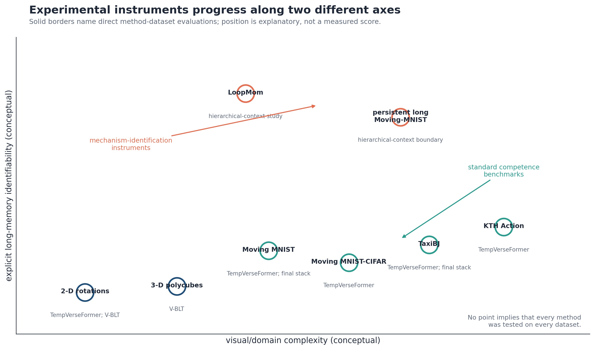

**Figure 2.3 - Progression of experimental instruments.**

| Dataset or family | Controlled phenomenon | Method evaluated | Evidentiary role | Principal limitation |
|---|---|---|---|---|
| Rotating 2-D triangles | constant and variable angular dynamics | TempVerseFormer; V-BLT in separate configurations | mechanism isolation and temporal extrapolation | synthetic silhouettes; cross-paper generator identity is not assumed |
| Rotating 3-D polycubes | three-axis rotation, self-occlusion and shading | V-BLT, ViViT and UNet-3D | harder controlled representation test | fixed-camera synthetic scenes; point estimates only |
| Moving MNIST / Moving MNIST-CIFAR | object translation, collision and textured background | TempVerseFormer and OpenSTL baselines | standard synthetic competence | short protocol does not isolate long-memory reach |
| KTH Action / TaxiBJ | human motion and urban flow fields | TempVerseFormer and OpenSTL baselines | real-data interface boundary | neither supplies object-level re-entry observability |
| LoopMom | disappearance, world-loop re-entry and exact visibility | Chapter 3 model family | causal identification of retained reach | purpose-built synthetic world |
| Persistent long Moving-MNIST | long-lived identity, support and trajectory | flat and hierarchical Chapter 3 configurations | external synthetic reach–fidelity boundary | absolute task performance remains difficult |

**Table 2.1 - Dataset roles and evidence boundaries.** Dataset complexity and mechanism identifiability are separate axes; a visually harder benchmark need not be the sharper memory test.

The studies also differ in their experimental units. Neither early paper reports the seed-level uncertainty that is later required for the central
context-package comparisons. Their numerical results are therefore retained as published point
estimates. Chapters 3 and 4 use clips as resampling clusters and training seeds as a separate
uncertainty level rather than retrofitting confidence intervals onto these earlier data.

## 2.2 Reversible temporal modelling

### 2.2.1 Activation memory in long temporal chains

Consider a parameterized transition $h_t=\Phi_\theta(h_{t-1},c_t)$, where
$h_t\in\mathbb R^{D_s}$ is the temporal state and $c_t$ denotes known conditioning. A loss may
depend on one terminal
state, several decoded states, or the complete trajectory. Standard backpropagation through time
applies reverse-mode differentiation to the unrolled composite map [28]. Its
gradient is not problematic in definition. The practical difficulty is supplying each reverse
step with the forward values needed to evaluate the local vector-Jacobian product.

$$
M_{\mathrm{act}}^{\mathrm{BPTT}}(T)
\approx
T\sum_{l=1}^{L} A_l,
\tag{2.4}
$$

$$
C_{\mathrm{BPTT}}(T)
=T\bigl(C_{\Phi}^{\mathrm{fwd}}+C_{\Phi}^{\mathrm{bwd}}\bigr).
\tag{2.5}
$$

Truncated BPTT reduces both storage and gradient horizon, thereby changing the objective whenever
the omitted dependencies matter [29]. Gradient checkpointing preserves the
full-horizon derivative in exact arithmetic by storing selected boundary states and recomputing
the intervening segments [30, 31]. Reversible replay
uses a more specialized opportunity: if the previous state can be reconstructed from the next
state and replay information, most temporal boundary states need not be stored at all.

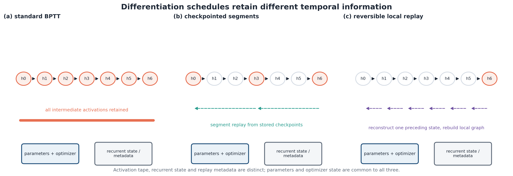

**Figure 2.4 - Storage schedules for differentiation through time.**

$$
M_{\mathrm{peak}}(T)
=M_{\mathrm{param}}+M_{\mathrm{grad}}+M_{\mathrm{opt}}
+M_{\mathrm{input}}+M_{\mathrm{workspace}}(T)+M_{\mathrm{tape}}(T).
\tag{2.5a}
$$

### 2.2.2 Reversible transformer block

An additive-coupling block divides a state into two streams, applies arbitrary differentiable
functions to one stream at a time, and updates the other by addition. In a canonical notation,

$$
y_1=x_1+F_\theta(x_2),
\tag{2.6}
$$

$$
y_2=x_2+G_\theta(y_1).
\tag{2.7}
$$

$$
x_2=y_2-G_\theta(y_1),
\tag{2.8}
$$

$$
x_1=y_1-F_\theta(x_2).
\tag{2.9}
$$

**Figure 2.5 - Additive reversible transformer block.**

$$
\det J_{R_\theta}=1.
\tag{2.9a}
$$

Volume preservation clarifies both the strength and the limitation of additive coupling. The
complete state is recoverable, but the transition cannot simply forget nuisance information as a
many-to-one recurrent gate can [110]. Compression or forgetting must happen at
a non-reversible boundary or be represented with explicit side information. Dynamic stability must therefore be tested independently.

The reversible-state boundary is especially important in TempVerseFormer. The published diagram
contains a variational encoder and decoder, linear projections, duplication of a projected stream,
normalization, and output fusion. Those operations are useful interfaces, but they are not all
bijections. The audited implementation confirms the following contract.

**Table 2.2 - Verified reversible-state contract of the released TempVerseFormer implementation**

| Tensor or operation | Implemented transformation | Algebraically invertible from its output alone? | What reverse differentiation retains or recomputes | Included in the exact state-replay claim? |
|---|---|---:|---|---:|
| Image frame to VAE latent | Convolutional variational encoder, $x\mapsto z$ | No | Ordinary autograd values or frozen/precomputed latent, depending on training mode | No |
| Latent input projection | $256$-dimensional latent to $768$-dimensional embedding plus learned position | Not established as bijective | Boundary input is handled by ordinary autograd in the default mode | No |
| Stream creation | Concatenation $[e,e]$ of two identical $768$-dimensional streams | No; duplication is injective but not a two-stream bijection onto the codomain | Projected embedding exists at the core boundary | No |
| Repeated temporal state | Additive-coupling stack over the doubled embedding | Yes in exact arithmetic for the audited deterministic block; any future stochastic conditioning would also have to be replayed | Terminal doubled state; local block functions are reevaluated | Yes |
| Output normalization and fusion | $2\times768$ state to a $256$-dimensional latent | No | Ordinary autograd boundary values in the default mode; the alternative utility stores non-reversible boundaries | No |
| VAE decoding and image loss | Latent to pixels followed by MSE/LPIPS/KL terms | No | Standard loss graph at the boundary | No |

Table 2.2 narrows the valid claim to the persistent doubled transformer state. The complete
VAE-to-VAE prediction pipeline is non-invertible, yet the repeated core is precisely where a
temporal activation tape would otherwise grow. Its reconstruction therefore supports the measured
activation-memory result without implying that the final image prediction determines every
intermediate operation.

### 2.2.3 Temporal chaining and TempVerseFormer

TempVerseFormer places the reversible stack between a spatial encoder and decoder. In the published
configuration, each $64\times64$ RGB frame is mapped to a 256-dimensional latent state. A learned
linear projection expands each state to 768 features, position embeddings identify the $N$
locations in the window, and the projected sequence is duplicated to form the two coupling streams. The temporal core contains eight reversible transformer blocks with eight attention heads [135].

**Figure 2.6 - Complete TempVerseFormer architecture.** Exact replay applies to the repeated doubled transformer state; the VAE, projections and output fusion remain ordinary non-invertible boundaries. *Source: Kulyk [135], published figure reused unchanged.*

$$
q^{(0)}=P_{\mathrm{in}}(z^{(0)}),
\qquad
q^{(r+1)}=R_\theta(q^{(r)}),\quad r=0,\ldots,T-1,
\tag{2.10}
$$

$$
\widehat z^{(T)}=P_{\mathrm{out}}(q^{(T)}),
\qquad
\widehat x^{(T)}=d_\psi(\widehat z^{(T)}).
\tag{2.11}
$$

The state dimension is held fixed as the shift grows. Temporal depth therefore counts repeated
applications of one window operator, not an ever longer token sequence. Parameter sharing is
complete across those applications. Gradients from the terminal decoded window must nevertheless
traverse every repeated transition, which is why the activation history grows under ordinary
autograd even though the number of learned temporal parameters does not.

**Figure 2.7 - Temporal chaining of a fixed-width latent window.**

Training uses a context of 12 frames and a curriculum in which the shift $T$ increases from one
to five. The decoded output window is compared with the corresponding time-shifted target window.
Equation (16) in the published paper reports a three-term objective [135]:

$$
\mathcal L_{\mathrm{paper}}
=\lambda_{\mathrm{MSE}}\mathcal L_{\mathrm{MSE}}
+\lambda_{\mathrm{LPIPS}}\mathcal L_{\mathrm{LPIPS}}
+\lambda_{\mathrm{KL}}D_{\mathrm{KL}}
\bigl(q_\phi(z\mid x)\,\|\,\mathcal N(0,I)\bigr).
\tag{2.12}
$$

$$
\mathcal L_{\mathrm{code}}
=\mathcal L_{\mathrm{pred\text{-}MSE}}
+\mathcal L_{\mathrm{input\text{-}VAE\text{-}MSE}}
+\lambda_{\mathrm{LPIPS}}\mathcal L_{\mathrm{LPIPS}}
+\lambda_{\mathrm{KL}}D_{\mathrm{KL}}.
\tag{2.12a}
$$

### 2.2.4 Time-agnostic backpropagation

Temporal chaining creates a repeated reversible state, but memory is reduced only if training
actually avoids retaining the ordinary activation graph. The time-agnostic procedure separates
forward prediction from reverse differentiation. During the forward phase, the recurrent core is
evaluated under a no-gradient context, intermediate block activations are discarded, and the
terminal state $q^{(T)}$ is retained. During the backward phase, each preceding state is recovered
algebraically, the corresponding local forward computation is rebuilt with gradient tracking, its
vector-Jacobian products are accumulated, and the local graph is freed.

**Figure 2.8 - Time-agnostic backpropagation through the reversible temporal state.**

$$
a_{t-1}
=\frac{\partial\ell_{t-1}}{\partial q^{(t-1)}}
+\left(\frac{\partial R_\theta(q^{(t-1)})}{\partial q^{(t-1)}}\right)^{\!\top}a_t,
\tag{2.13}
$$

$$
\nabla_\theta\mathcal L
=\sum_{t=1}^{T}
\left(\frac{\partial R_\theta(q^{(t-1)})}{\partial\theta}\right)^{\!\top}a_t.
\tag{2.14}
$$

1. Compute $q^{(0)}=P_{\mathrm{in}}(e_\phi(x_{1:N}))$ with the required boundary graph.
2. For $t=1,\ldots,T$, evaluate $q^{(t)}=R_\theta(q^{(t-1)})$ without retaining the core's
   intermediate activations.
3. Apply $P_{\mathrm{out}}$, decode the terminal prediction, evaluate the loss, and obtain the
   terminal adjoint $a_T$ through the non-reversible output boundary.
4. For $t=T,\ldots,1$, reconstruct $q^{(t-1)}=R_\theta^{-1}(q^{(t)})$.
5. Reevaluate $R_\theta(q^{(t-1)})$ with gradient tracking, accumulate the parameter gradient and
   compute $a_{t-1}$.
6. Release the local graph before processing $t-1$, then propagate the recovered gradient through
   the ordinary input-projection and VAE boundary.

The following result states the memory claim at the level justified by this algorithm.

**Lemma 2.1 (activation-tape complexity).** Let $R_\theta$ be a deterministic reversible
transition consisting of $L$ additive-coupling blocks, and let $D_s$ be the complete state
footprint at one block. Suppose the loss boundary and all conditioning needed for replay occupy
memory independent of $T$. Both bounds are $O(1)$ in temporal depth $T$; a direct BPTT
tape requires $O(TLD_s)$.

$$
C_{\mathrm{rev}}(T)
\approx T\bigl(2C_{R}^{\mathrm{fwd}}+C_{R}^{\mathrm{local-bwd}}\bigr),
\tag{2.15}
$$

### 2.2.5 Controlled temporal-pattern results

The controlled evaluation compared four systems: the reversible TempVerseFormer, a matched
non-reversible TempFormer with temporal chaining, a standard transformer without the same repeated
chaining interface, and an encoder-decoder LSTM. TempFormer and TempVerseFormer both used eight
blocks, eight attention heads, and 768 hidden features. All models shared the VAE interface and
were trained for 30,000 updates on one NVIDIA RTX 4060 Ti. Evaluation used 2,000 procedurally
generated sequences and a fixed generator seed across models [135].

**Table 2.3 - Published predictive point estimates by rotation regime**

| Regime | Model | FID $\downarrow$ | MSE $\downarrow$ | SSIM $\uparrow$ |
|---|---|---:|---:|---:|
| Constant | TempFormer | 103 | 0.023 | 0.84 |
|  | **TempVerseFormer** | **75** | **0.018** | **0.88** |
|  | Standard Transformer | 87 | 0.030 | 0.86 |
|  | LSTM | 157 | 0.080 | 0.76 |
| Accelerated | **TempFormer** | 90 | **0.021** | **0.857** |
|  | TempVerseFormer | 87 | 0.028 | 0.853 |
|  | Standard Transformer | 95 | 0.030 | 0.851 |
|  | **LSTM** | **86** | 0.048 | 0.821 |
| Decelerated | TempFormer | 90 | **0.025** | **0.86** |
|  | TempVerseFormer | 87 | 0.036 | 0.84 |
|  | Standard Transformer | 86 | 0.036 | 0.85 |
|  | **LSTM** | **85** | 0.039 | 0.84 |
| Oscillating | TempFormer | 130 | 0.024 | 0.82 |
|  | TempVerseFormer | 112 | **0.021** | **0.84** |
|  | Standard Transformer | 119 | 0.068 | 0.78 |
|  | **LSTM** | **108** | 0.081 | 0.77 |
| Interrupted | TempFormer | 98 | 0.034 | 0.83 |
|  | **TempVerseFormer** | **91** | **0.032** | **0.84** |
|  | Standard Transformer | 99 | 0.056 | 0.80 |
|  | LSTM | 107 | 0.060 | 0.79 |
| Combined | **TempFormer** | **119** | 0.060 | **0.79** |
|  | TempVerseFormer | 123 | **0.059** | 0.78 |
|  | Standard Transformer | 127 | 0.086 | 0.77 |
|  | LSTM | 156 | 0.089 | 0.74 |

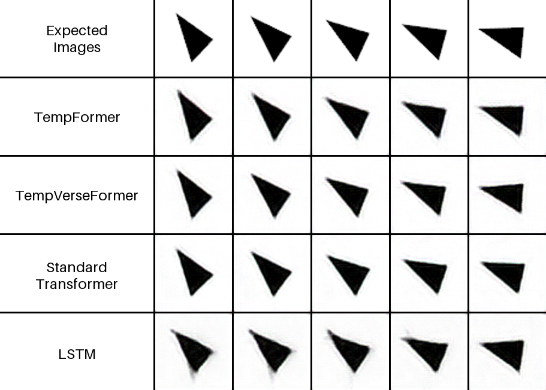

**Figure 2.9 - Five-step predictions for constant rotation.** The unchanged gallery illustrates the regime in which TempVerseFormer has its clearest joint FID, MSE and SSIM result; Table 2.3 remains the quantitative evidence. *Source: Kulyk [135], published figure reused unchanged.*

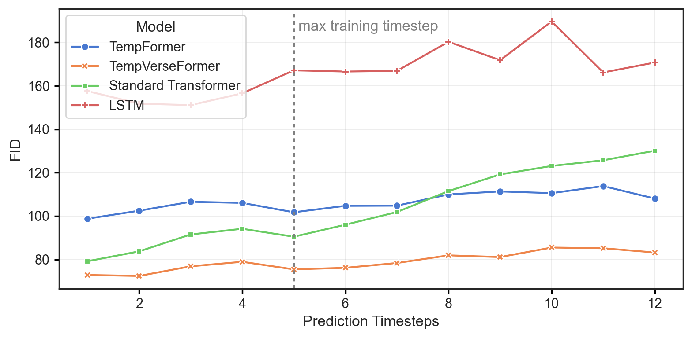

**Figure 2.10 - Constant-rotation FID over prediction depth.** Error accumulation differs among the four temporal models as the prediction index increases. *Source: Kulyk [135], published figure reused unchanged.*

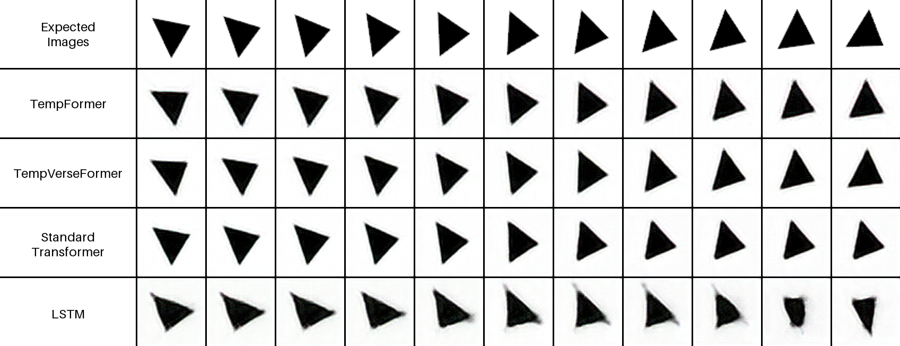

**Figure 2.11 - Eleven-step prediction beyond the training horizon.** The sequence demonstrates operation beyond the five-step training target but is qualitative rather than statistical extrapolation evidence. *Source: Kulyk [135], published figure reused unchanged.*

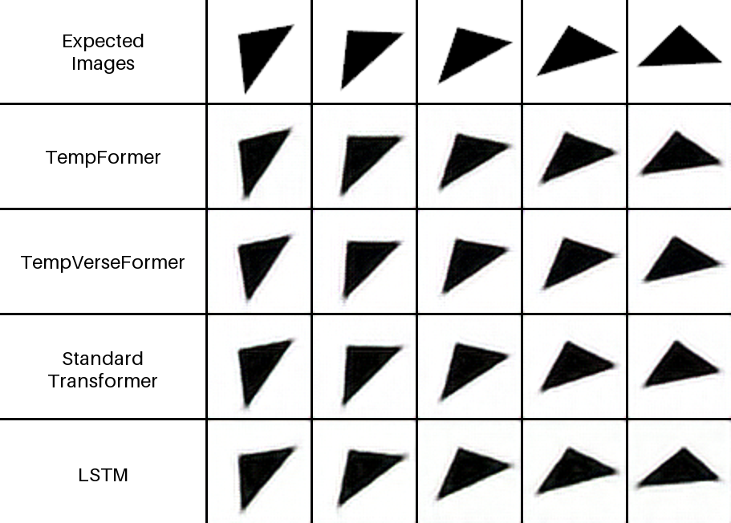

**Figure 2.12 - Predictions under accelerated rotation.** Increasing angular velocity exposes tracking lag and disagreement among metrics. *Source: Kulyk [135], published figure reused unchanged.*

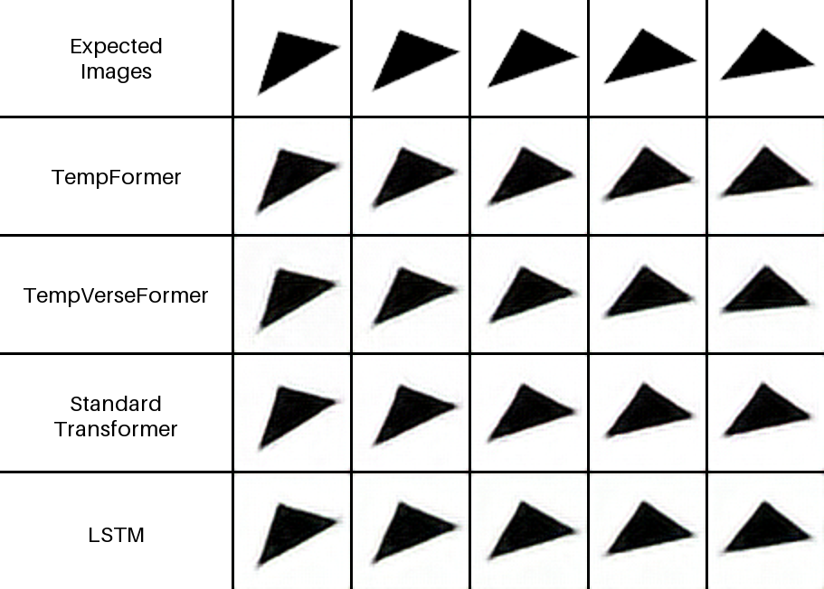

**Figure 2.13 - Predictions under decelerated rotation.** Changing step size tests whether the temporal model follows a nonstationary rule instead of repeating a fixed displacement. *Source: Kulyk [135], published figure reused unchanged.*

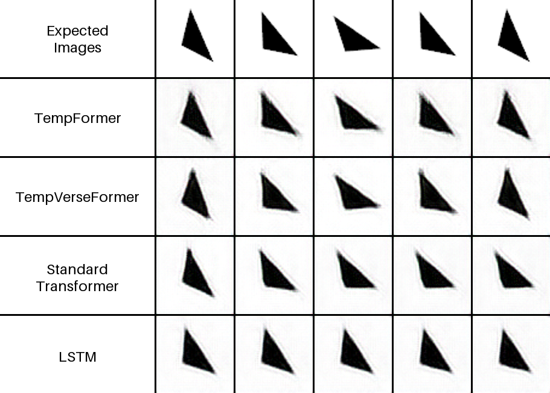

**Figure 2.14 - Predictions under oscillating rotation.** Direction changes reveal failures that constant-motion sequences can hide. *Source: Kulyk [135], published figure reused unchanged.*

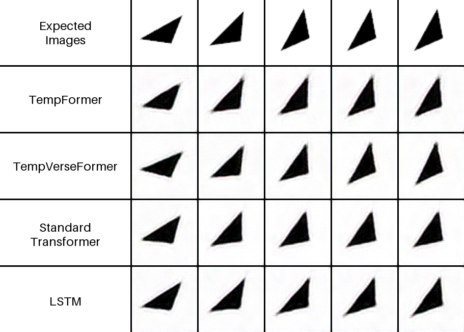

**Figure 2.15 - Predictions under interrupted rotation.** Stop-and-resume dynamics test retention of the motion state across a locally static interval. *Source: Kulyk [135], published figure reused unchanged.*

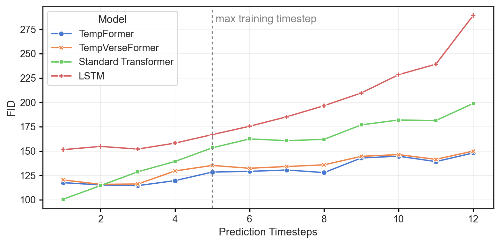

**Figure 2.16 - FID over prediction depth for combined temporal patterns.** The aggregate curve summarizes heterogeneous regimes and must be read with Table 2.3, where no model dominates every metric. *Source: Kulyk [135], published figure reused unchanged.*

Metric disagreement is scientifically informative here. FID compares distributions in a feature
space and can favour a set of diverse samples even when corresponding frames are not close to their
targets [94]. MSE rewards pixel alignment and penalizes a small angular displacement sharply.
SSIM emphasizes local luminance, contrast, and structure [94, 127–129]. An LSTM
can therefore obtain the lowest reported FID for acceleration while having substantially worse MSE
and SSIM. Calling that row the overall winner would conceal the prediction task's paired nature.

### 2.2.6 External OpenSTL validation

Controlled rotation cannot establish competence on textured scenes or real motion. The temporal
model was therefore integrated into OpenSTL and evaluated under its prescribed splits and metrics
on Moving MNIST, Moving MNIST-CIFAR, KTH Action, and TaxiBJ [1, 124, 126, 154]. The reported comparison spans recurrent ConvLSTM and PredRNN++ [137, 152], together with recurrent-free
ViT and Uniformer baselines.

**Table 2.4 - Published OpenSTL comparisons**

| Dataset | Model | SSIM $\uparrow$ | MSE $\downarrow$ | Best reported point in this comparison |
|---|---|---:|---:|---|
| Moving MNIST | ConvLSTM | 0.929 | 29.80 |  |
|  | **PredRNN++** | **0.951** | **22.06** | SSIM and MSE |
|  | TempVerseFormer | 0.932 | 26.08 |  |
|  | ViT | 0.914 | 35.15 |  |
|  | Uniformer | 0.931 | 30.38 |  |
| Moving MNIST-CIFAR | ConvLSTM | 0.920 | 73.31 |  |
|  | **PredRNN++** | **0.957** | **44.19** | SSIM and MSE |
|  | TempVerseFormer | 0.950 | 50.37 |  |
|  | ViT | 0.936 | 64.94 |  |
|  | Uniformer | 0.944 | 56.96 |  |
| KTH Action | ConvLSTM | 0.898 | 47.65 |  |
|  | **PredRNN++** | **0.912** | **39.84** | SSIM and MSE |
|  | TempVerseFormer | 0.898 | 48.97 |  |
|  | ViT | 0.895 | 56.57 |  |
|  | Uniformer | 0.906 | 44.71 |  |
| TaxiBJ | ConvLSTM | 0.9836 | 0.34 |  |
|  | PredRNN++ | 0.9834 | 0.33 |  |
|  | TempVerseFormer | 0.9835 | **0.31** | MSE |
|  | ViT | 0.9841 | 0.32 |  |
|  | **Uniformer** | **0.9844** | 0.34 | SSIM |

This comparison closes an important but limited gap in the controlled-rotation evidence. It shows
that the temporal architecture can be trained through OpenSTL interfaces spanning object rasters,
textured composites, human actions and gridded flow fields without a task-specific claim of
dominance. It does not isolate the effect of reversible replay: Table 2.4 contains no matched
non-reversible TempFormer arm on these datasets. Nor do the benchmark protocols make a uniquely
relevant view disappear beyond the available context before it is needed again. The evidence thus
supports portability and predictive competence, while the activation-memory claim continues to
rest on direct reversible/non-reversible measurements and the reach mechanism remains a separate
question. Its broader value is showing that the controlled result was not confined to one renderer.

The four datasets test different kinds of competence. KTH replaces synthetic digits with articulated human
actions, while TaxiBJ is a gridded flow field rather than an object-rendering problem. Agreement
across all four would be stronger than success on one rotation generator. The published pattern is
more modest: the architecture remains usable across these interfaces, but its relative position
changes with the data.

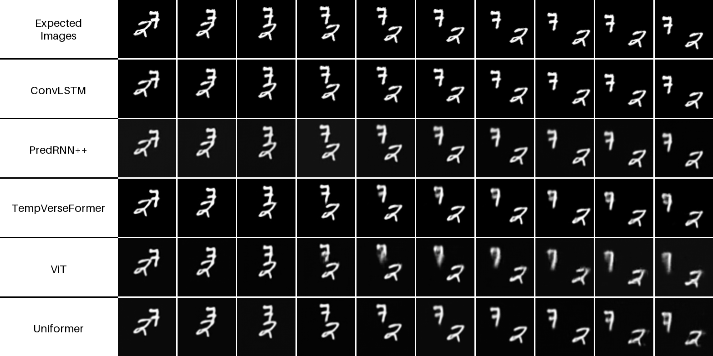

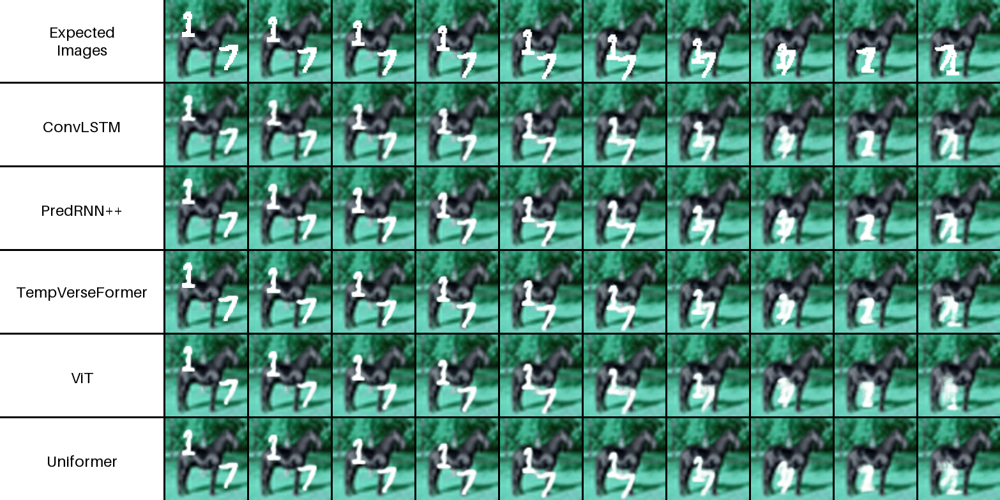

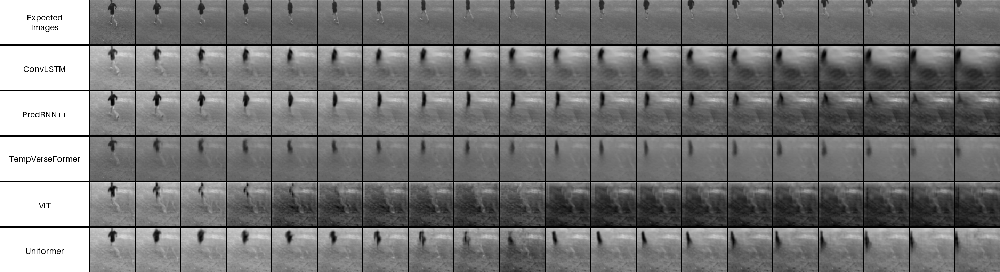

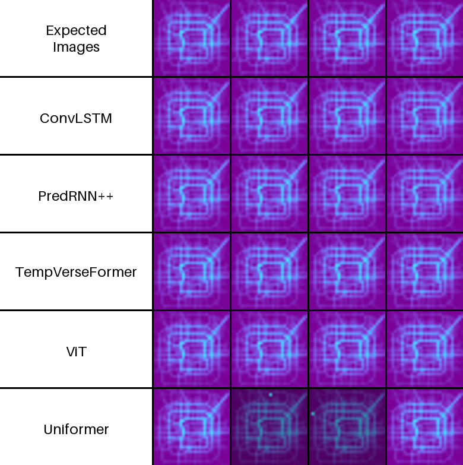

**Figure 2.17 - Qualitative OpenSTL predictions.**

### 2.2.7 Activation-memory and computation frontier

What matters most in the TempVerseFormer measurements is the different scaling of temporal-core memory. Published
measurements separate memory attributed to the temporal model from total pipeline allocation,
which also includes the VAE and common components. This separation prevents a constant core curve
from being misreported as zero growth of every device allocation.

**Table 2.5 - Published GPU-memory measurements at the tabulated horizons, batch size 32**

| Prediction steps | Model | Temporal-model memory (GB) | Total pipeline memory (GB) |
|---:|---|---:|---:|
| 1 | TempFormer | 0.85 | 4.11 |
|  | TempVerseFormer | 0.89 | 3.94 |
|  | Standard Transformer | 0.85 | 4.10 |
|  | LSTM | 1.27 | 4.00 |
| 4 | TempFormer | 0.85 | 4.59 |
|  | TempVerseFormer | 0.89 | 3.95 |
|  | Standard Transformer | 0.86 | 4.58 |
|  | LSTM | 1.28 | 4.03 |
| 16 | TempFormer | 2.61 | 6.50 |
|  | TempVerseFormer | 0.89 | 3.98 |
|  | Standard Transformer | 2.60 | 6.51 |
|  | LSTM | 1.28 | 4.13 |

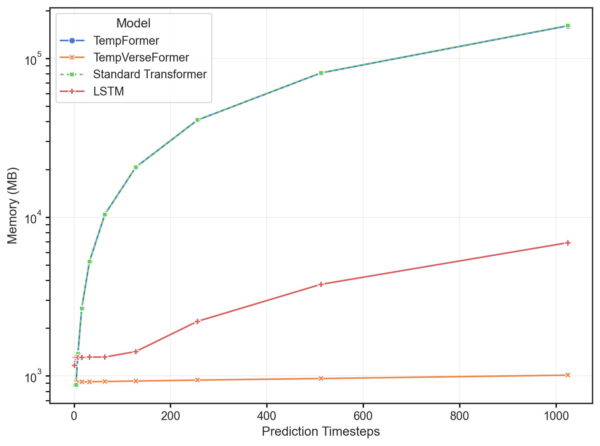

**Figure 2.18 - GPU memory versus prediction depth.** Temporal-core memory remains near its reported baseline as the reversible horizon grows, unlike the matched non-reversible transformer; total pipeline memory includes common components. *Source: Kulyk [135], published figure reused unchanged.*

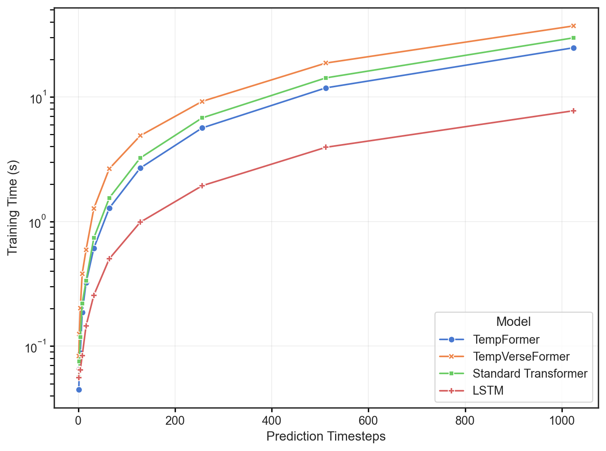

**Figure 2.19 - Training time versus prediction depth.** The flatter activation-memory curve is purchased with replay computation, so feasibility and runtime must be evaluated together. *Source: Kulyk [135], published figure reused unchanged.*

At sixteen steps, the tabulated comparison already demonstrates the operating effect without relying on the
far end of the curve. Relative to TempFormer, TempVerseFormer uses 1.72 GB less reported
temporal-model memory at that point, a reduction of about 66%. At total-pipeline level the
difference is 2.52 GB, or about 39%, because common spatial and training allocations remain. The first isolates the
mechanism; the second is closer to the capacity a practitioner observes.

The published plots extend visually to 1,024 prediction steps and keep the reversible temporal-core
curve near 1 GB. Exact coordinates for those high-horizon points are not available in the retained
results, however. Quantitative comparisons therefore remain anchored to the tabulated one-, four-,
and sixteen-step measurements; the farther range is used only to describe the plotted scaling trend.

### 2.2.8 Stochastic replay extension and separate recurrent-core checks

Inside its reversible stack, the published temporal model is deterministic. Many generative video
transitions are not. They sample a latent innovation, apply stochastic regularization, or receive
a random diffusion state. Discarding that realized input would destroy information required for
reconstruction.

$$
h_t=F_\theta(h_{t-1})+\sigma\epsilon_t,
\qquad
\epsilon_t\sim\mathcal N(0,I),
\tag{2.16}
$$

$$
h_{t-1}=F_\theta^{-1}(h_t-\sigma\epsilon_t).
\tag{2.17}
$$

$$
y_{1,t}=s_{1,t-1}+F_\theta(s_{2,t-1},\epsilon_t),
\qquad
y_{2,t}=s_{2,t-1}+G_\theta(y_{1,t}),
\tag{2.18}
$$

$$
s_{2,t-1}=y_{2,t}-G_\theta(y_{1,t}),
\qquad
s_{1,t-1}=y_{1,t}-F_\theta(s_{2,t-1},\epsilon_t).
\tag{2.19}
$$

$$
M_{\mathrm{replay}}(T)
=M_{\mathrm{anchor}}(T)+M_{\mathrm{rng}}(T)+M_{\mathrm{gates}}(T),
\qquad
M_{\mathrm{rng}}(T)=
\begin{cases}
\dfrac{T D_\epsilon b_\epsilon}{8}, & \text{stored innovations},\\[2mm]
\dfrac{T b_{\mathrm{seed}}}{8}, & \text{one independent seed per step},\\[2mm]
M_{\mathrm{counter}}, & \text{fixed counter-based replay state}.
\end{cases}
\tag{2.20}
$$

$$
M_{\mathrm{anchor}}(T)
\approx \left\lceil\frac{T}{a}\right\rceil\frac{D_s b_s}{8}
=O(\sqrt T\,D_s).
\tag{2.20a}
$$

Consequently, the defensible general claim is constant-in-$T$ **transient local activation memory** plus
the declared anchor and replay metadata. It is not constant total memory for every reversible or
stochastic recurrence.

**Table 2.6 - Measured deterministic multi-level memory and runtime frontier on an RTX 4060 Ti 16 GB**

| Rollout (K) | BPTT peak (MB) | Checkpoint peak (MB) | Reversible peak (MB) | BPTT (ms/step) | Checkpoint (ms/step) | Reversible (ms/step) |
|---:|---:|---:|---:|---:|---:|---:|
| 10 | 3,809 | 1,354 | 1,065 | 549 | 322 | 257 |
| 20 | 6,592 | 1,391 | 1,078 | 399 | 544 | 479 |
| 40 | 12,162 | 1,471 | 1,091 | 740 | 1,028 | 882 |
| 80 | 23,305* | 1,637 | 1,125 | 43,797* | 3,131 | 2,556 |
| 120 | OOM | 1,801 | 1,152 | - | 3,960 | 2,760 |
| 160 | OOM | 1,967 | 1,176 | - | 4,066 | 3,362 |

*The $K=80$ BPTT run exceeded physical GPU memory and spilled into shared host memory under
WDDM; it completed but no longer represented practical device-resident training.*

Measured totals include the encoder, deterministic three-level recurrent core, decoder, Adam state,
batch 32, and $64\times64$ inputs. Vanilla BPTT becomes infeasible before $K=120$. Both
checkpointing and reversible replay reach $K=160$, with the measured replay implementation using
less peak memory and time than the checkpoint implementation at the shown points. These configuration-specific measurements cannot establish that reversible
replay dominates an optimally scheduled or kernel-tuned checkpointing system.

$$
\operatorname{Lip}(I+F)\le 1+\operatorname{Lip}(F)
\tag{2.21}
$$

### 2.2.9 Applicability relative to BPTT and checkpointing

No single reverse-computation schedule is best for every model. Vanilla BPTT is attractive when
the required horizon fits comfortably, because it avoids reconstruction logic. Truncation is a
legitimate modelling choice when dependencies beyond the truncation boundary are intentionally
excluded. Checkpointing works with arbitrary differentiable modules and offers a tunable
storage-recomputation schedule. Reversible replay requires a carefully delimited invertible state,
stable numerical reconstruction, and exact reproduction of stochastic inputs [30, 32, 91, 110, 113, 116].

What matters is the fraction of memory that an inverse can remove. Along the published temporal
core and the deterministic multi-level recurrent frontier, repeated activations are large enough for
reconstruction to change feasibility. In the tested inner optimization loop, second-order local
graphs and common model state dominate, so checkpointing is the better practical choice. Chapter 4
returns to this binding-constraint rule without treating reversibility as a universal architectural
preference.

| Method | Horizon-dependent storage | Extra computation | Architectural condition | Appropriate use |
|---|---|---|---|---|
| Vanilla BPTT | full activation tape, typically $O(TLD_s)$ | baseline | none | the complete horizon fits comfortably |
| Truncated BPTT | bounded by the chosen segment | baseline over the segment | none | earlier dependencies are intentionally excluded |
| Gradient checkpointing | schedule-dependent | recomputes omitted segments | ordinary differentiable modules | a general, tunable storage–time trade-off is needed |
| Reversible replay | local graph plus boundary state, anchors and replay metadata | inverse and local-forward reevaluation | stable inverse over the retained state | repeated reversible activations dominate a long training graph |

**Table 2.7 - Selection of a temporal differentiation strategy by binding constraint.** Reversibility is selected by the training graph and resource profile, not by a presumption of predictive superiority.

## 2.3 Hierarchical spatial representation and entropy estimation

### 2.3.1 Fixed-patch allocation problem

Making a longer temporal chain differentiable solves only the storage schedule. The next bottleneck
is spatial: where should a visual model spend its representation capacity? A conventional video
transformer partitions a clip into a regular grid of spatio-temporal tubes or cubes, embeds every
cell, and processes the resulting sequence [70, 71]. Regular patching is easy to batch and gives
each token a clear geometric support. Its cost, however, depends on the number of patches rather
than on how much unpredictable content each patch contains.

$$
N_{\mathrm{patch}}
=\left\lceil\frac{T}{\tau}\right\rceil
 \left\lceil\frac{H}{p_h}\right\rceil
 \left\lceil\frac{W}{p_w}\right\rceil.
\tag{2.22}
$$

An identical count is allocated to a static black region and to a moving, newly exposed contour. This
is not automatically inefficient: regularity may be valuable, and the learned encoder can suppress
redundant content. The allocation becomes questionable when the global model is the expensive
component and local information density is highly non-uniform.

**Figure 2.20 - Fixed-patch tensor and local-global-local processing path.**

### 2.3.2 V-BLT architecture

V-BLT operates on **uncompressed raster pixel-channel bytes**. A byte target $x_{t,c,y,x}$ is an
integer in $\{0,\ldots,255\}$. This target interface avoids committing the output to a learned
discrete codebook, as a VQ-VAE would [73]. Nevertheless, the hidden representation remains lossy: convolutions,
projections, attention, and finite latent width still form a learned information bottleneck.

$$
u_m=E_\alpha\bigl(\mathcal P_m(X)\bigr),
\qquad m=1,\ldots,N_{\mathrm{patch}}.
\tag{2.23}
$$

$$
g_{1:N_{\mathrm{patch}}}
=G_\beta\bigl(u_{1:N_{\mathrm{patch}}};M_{\mathrm{causal}},R_{\mathrm{ND}}\bigr),
\tag{2.24}
$$

$$
\ell_{t,c,y,x}
=D_\gamma\bigl(r_{t,c,y,x},g_{\pi(t,y,x)}\bigr)
\in\mathbb R^{256}.
\tag{2.25}
$$

Here $r_{t,c,y,x}$ is a local decoder feature and $\pi(t,y,x)$ maps a raster coordinate to its
global support. Cross-attention transmits information between local and patch representations. The
global transformer therefore performs the broad spatio-temporal reasoning, while the local stages
retain and restore spatial detail.

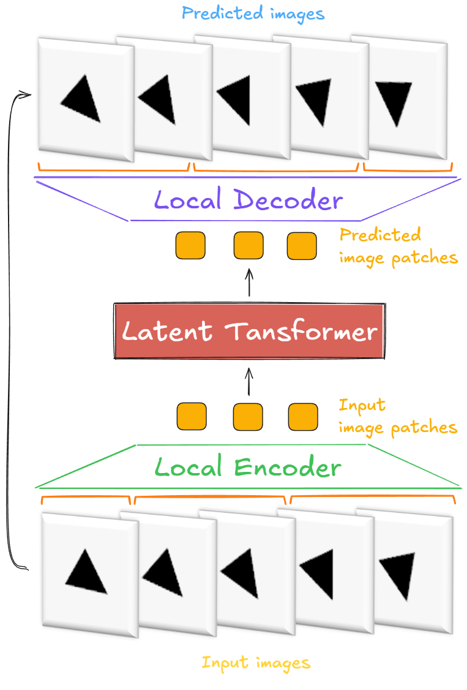

**Figure 2.21 - Published Vision Byte Latent Transformer architecture.**

The architectural evidence supports a hierarchical representation method. It does not establish
that the model learned semantic patches, that the latent sequence is optimal, or that the same
design scales unchanged to compressed natural video.

| Component | Function | Published status | Evidence boundary |
|---|---|---|---|
| Raster-byte interface and local encoder | preserve categorical targets and aggregate short-range structure | implemented | hidden features remain learned and lossy |
| Fixed $4\times4\times4$ package assignment | define global computational units | reported | exact historical run configuration is not fully archived |
| Global latent transformer and local decoder | exchange broad context and restore local detail | implemented | component-wise causal credit is not isolated |
| RoPE-ND | retain separate temporal, row and column coordinates | implemented | mathematical divisibility contract is stronger than the current assertion |
| Categorical byte head | predict 256 logits per byte location | implemented | probabilities are not shown to be calibrated |
| Entropy map | diagnose spatial predictive dispersion | measured and visualized | association with error is descriptive |
| Dynamic region controller | resize regions or route computation | not implemented | proposed extension only |

**Table 2.8 - V-BLT component contract and evidence level.** The executed fixed-patch system and the proposed adaptive allocator are kept on opposite sides of the evidence boundary.

### 2.3.3 Causal attention and categorical byte objective

Flattening a clip converts time and space into a single token index, so causal permission must be
defined by frame coordinate rather than by an undifferentiated lower-triangular sequence. If token
$i$ belongs to frame $t_i$ and token $j$ to $t_j$, the global attention mask is

$$
M_{ij}=
\begin{cases}
0, & t_j\le t_i,\\
-\infty, & t_j>t_i.
\end{cases}
\tag{2.26}
$$

Tokens within the same observed frame may attend to one another. Tokens in earlier frames are also
visible, while future-frame tokens are suppressed before softmax. The resulting matrix has dense
diagonal frame blocks and a block-lower-triangular temporal structure. Direct future information
leakage is blocked at the global attention layer; physical plausibility and autoregressive stability
remain learned properties [12].

**Figure 2.22 - Causal spatio-temporal attention mask.**

$$
p_\Theta(x_i=k\mid X_{<t})
=\frac{\exp(\ell_{i,k})}
{\sum_{r=0}^{255}\exp(\ell_{i,r})},
\qquad k\in\{0,\ldots,255\}.
\tag{2.27}
$$

$$
\mathcal L_{\mathrm{byte}}(\Theta)
=-\frac{1}{|\mathcal I|}
\sum_{i\in\mathcal I}
\log p_\Theta(x_i=x_i^{\star}\mid X_{<t_i}),
\tag{2.28}
$$

where $\mathcal I$ contains the target byte locations and $x_i^{\star}$ is the ground-truth
integer. Unlike a scalar MSE head, this interface can represent several plausible byte values at
one location. That modelling flexibility does not guarantee that the probabilities are calibrated,
and it does not remove spatial dependence between neighbouring bytes that are predicted through a
factorized output head.

### 2.3.4 Multidimensional rotary positional encoding

Self-attention is permutation-equivariant before positional information is introduced. Once a
spatio-temporal grid is flattened, a token's order alone does not reveal whether a neighbour lies
one column away, one row away, or one frame away. Absolute embeddings can label each index, while
relative biases can parameterize pairwise displacement [12, 71, 106]. Rotary positional embedding takes
a different route: it rotates query and key feature pairs by a position-dependent phase so their
inner product depends on relative displacement [107].

For one real feature pair $(v_{2j},v_{2j+1})$, define the complex coordinate
$\widetilde v_j=v_{2j}+\mathrm i v_{2j+1}$. At scalar position $p$, one-dimensional RoPE applies

$$
\rho_p(\widetilde v_j)
=\widetilde v_j\exp(\mathrm i p\omega_j),
\qquad
\omega_j=\beta^{-j/K},\quad j=0,\ldots,K-1,
\tag{2.29}
$$

$$
\rho_p(\widetilde q_j)
\overline{\rho_q(\widetilde k_j)}
=\widetilde q_j\overline{\widetilde k_j}
 \exp\bigl(\mathrm i(p-q)\omega_j\bigr).
\tag{2.30}
$$

$$
\mathbf R_j(p)=
\begin{bmatrix}
\cos(p\omega_j) & -\sin(p\omega_j)\\
\sin(p\omega_j) & \cos(p\omega_j)
\end{bmatrix},
\qquad
\mathbf R_j(p)^\top\mathbf R_j(q)=\mathbf R_j(q-p).
\tag{2.30a}
$$

$$
R_{\mathrm{ND}}(p)q
=R_t(p_t)q_t\;\|\;R_y(p_y)q_y\;\|\;R_x(p_x)q_x.
\tag{2.31}
$$

The corresponding attention logit decomposes into axis-specific terms:

$$
s(q,k;p,r)
=\frac{1}{\sqrt{d_h}}
\sum_{a\in\{t,y,x\}}
q_a^{\top}R_a(r_a-p_a)k_a.
\tag{2.32}
$$

For multiresolution tokens, integer row and column indices from two grids should not be compared
without a coordinate convention. A coarse token at index one may cover the same physical region as
several fine indices. V-BLT uses one latent geometry, so this mapping is not tested there. The issue becomes
relevant to hierarchical context, but the final predictor resolves it through explicit learned
level and frame embeddings rather than importing RoPE-ND.

**Figure 2.23 - Disjoint coordinate subspaces in RoPE-ND.**

### 2.3.5 Predictive entropy as a spatial-complexity signal

A categorical byte head yields a complete distribution rather than only a point prediction. Its
dispersion can be summarized locally with Shannon entropy. In bits,

$$
H_i^{(2)}
=-\sum_{k=0}^{255}p_{i,k}\log_2 p_{i,k},
\qquad 0\le H_i^{(2)}\le 8.
\tag{2.33}
$$

At the lower bound lies a point mass; a uniform 256-way distribution attains the upper one.
The audited visualization code uses the natural logarithm, producing entropy in nats:

$$
H_i^{(e)}=-\sum_{k=0}^{255}p_{i,k}\ln p_{i,k}
=(\ln2)H_i^{(2)}.
\tag{2.34}
$$

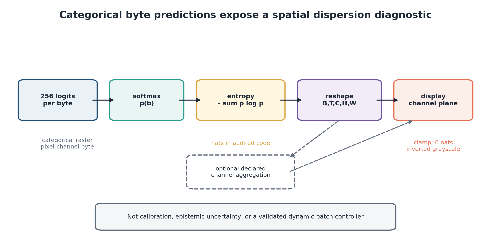

**Figure 2.24 - From categorical logits to a spatial entropy map.**

Turning that map into a controller would require more than visual structure. Calibration could be checked by
binning predicted byte probabilities or entropy values and measuring realized error; spatial
utility would require comparing allocations induced by entropy with random, motion-based, and
oracle policies at the same token budget. Temporal smoothing might also be necessary, because a
patch boundary that changes every frame introduces overhead and unstable token identities. None of
these controller tests is part of the fixed-patch study.

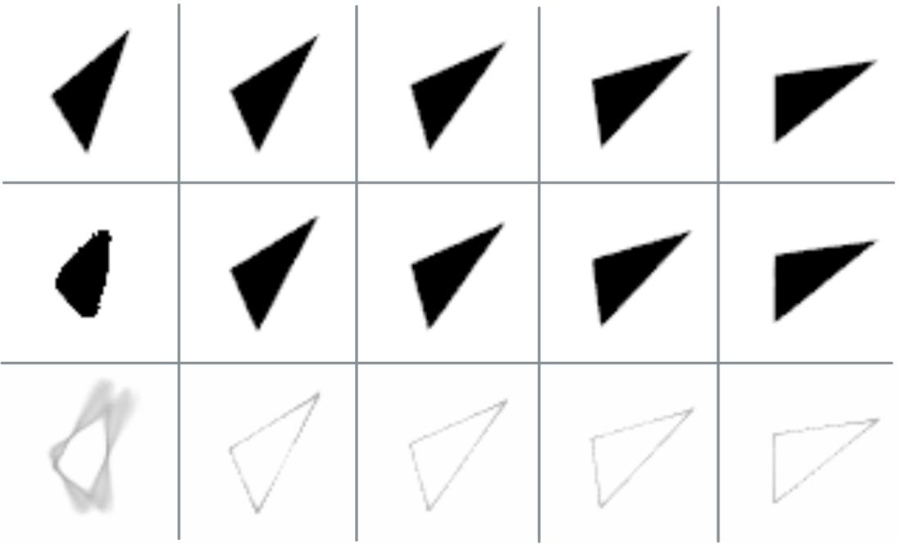

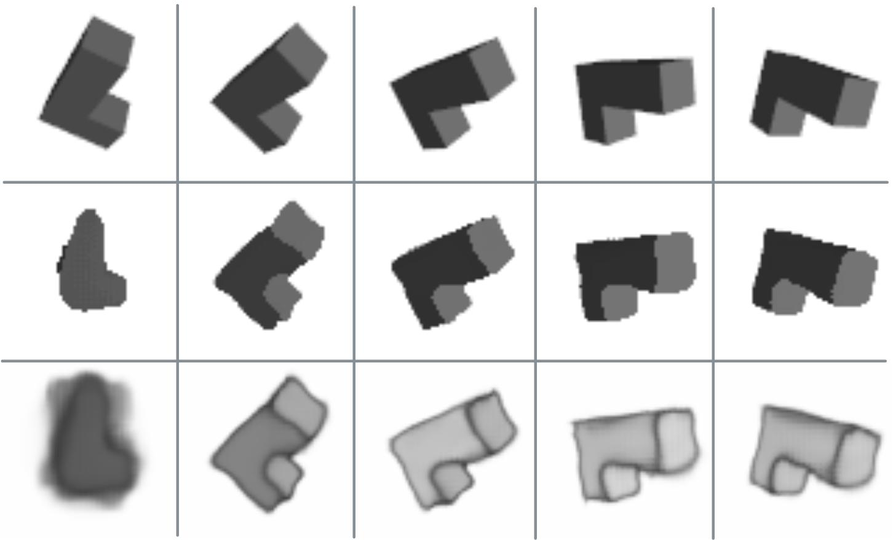

**Figure 2.25 - V-BLT predictions and entropy maps for two-dimensional and three-dimensional rotation.** Entropy is spatially concentrated in these selected examples, but the figure demonstrates neither calibration nor an executed adaptive-region controller. *Source: Kulyk and Mokin [134], published panels reused unchanged.*

### 2.3.6 Experimental results on two-dimensional and three-dimensional rotations

The fixed-patch V-BLT study compared V-BLT with ViViT and UNet-3D on the two procedural rotation
datasets. Model size and GFLOPs describe the reported computational configuration. MSE, SSIM, and
PSNR summarize prediction quality. All are point estimates; the paper gives neither training-seed
variation nor confidence intervals.

**Table 2.9 - Published V-BLT cost and quality point estimates**

| Evidence group | Dataset | Model | Model size (MB) | GFLOPs | MSE $\downarrow$ | SSIM $\uparrow$ | PSNR dB $\uparrow$ |
|---|---|---|---:|---:|---:|---:|---:|
| Computational | - | V-BLT | 6.5 | 51.2 | - | - | - |
|  | - | ViViT | 6.5 | 59.3 | - | - | - |
|  | - | UNet-3D | 24.0 | 70.4 | - | - | - |
| Quality | 2-D shapes | **V-BLT** | - | - | **0.039** | **0.98** | **32.3** |
|  | 2-D shapes | ViViT | - | - | 0.181 | 0.87 | 20.7 |
|  | 2-D shapes | UNet-3D | - | - | 0.125 | 0.88 | 21.8 |
| Quality | 3-D polycubes | V-BLT | - | - | **0.11** | **0.91** | 23.4 |
|  | 3-D polycubes | ViViT | - | - | 0.19 | 0.83 | **24.8** |
|  | 3-D polycubes | UNet-3D | - | - | 0.20 | 0.75 | 20.3 |

V-BLT uses $13.7\%$ fewer reported GFLOPs than ViViT and $27.3\%$ fewer than UNet-3D. The two
6.5 MB entries are equal reported model-size figures. The paper does not state enough about
serialization format or precision to infer identical parameter counts from them. GFLOPs likewise
do not measure latency, throughput, activation memory, or energy on a specific device.

What the comparison establishes is the viability of the complete V-BLT configuration, not causal
credit for one component. Lower reported GFLOPs and favourable
two-dimensional metrics therefore support the system as tested; they do not isolate the positional
encoding or the byte interface. The mixed three-dimensional ranking is useful precisely because it
prevents configuration-level evidence from being recast as uniform metric dominance.

**Figure 2.26 - Published V-BLT cost and quality point estimates (derived).**

### 2.3.7 Measured method versus proposed dynamic regioning

The fixed-patch study supports a clear set of claims. V-BLT demonstrates a hierarchical
local-global-local architecture over direct byte targets, fixed spatio-temporal patching, causal
global attention, RoPE-ND, categorical prediction, and spatially structured entropy maps. Each
item was either implemented or reported in that experiment.

Dynamic regioning is a next step. One possible policy would choose a partition
$\Pi_t=\{R_{t,1},\ldots,R_{t,m_t}\}$ under a token budget $B_t$ by minimizing expected predictive
loss plus computation:

$$
\Pi_t^{\star}
\in\arg\min_{\Pi_t:\,|\Pi_t|\le B_t}
\mathbb E\!\left[\mathcal L_{t+1}(\Pi_t)\right]
+\lambda C(\Pi_t),
\tag{2.35}
$$

with entropy used as one input to the policy. The experiment did not instantiate this optimization,
train a boundary predictor, vary patch sizes online, or measure its effect on speed and quality.
Equation (2.35) is consequently a design proposal, not the objective optimized by the reported
model.

**Figure 2.27 - Implemented V-BLT method and proposed adaptive extension.** The solid path is the measured fixed-patch system; the adaptive routing branch is a design candidate whose quality–cost effect remains untested. *Source: dissertation-native evidence-boundary schematic.*

## 2.4 Design implications for the hierarchical-context model

The executable implementations corresponding to the two published enabling methods are available in the TempVerseFormer and visionBLT repositories [172, 173]. Repository availability supports reproduction of the released configurations; it does not replace the evidence qualifications stated in this chapter.

### 2.4.1 Results that transfer conceptually

The temporal and spatial methods do not form a serial architecture, yet three lessons carry into
the final model design. V-BLT reduces the burden on a global processor by surrounding it with local
transformations, and its entropy maps show that predictive difficulty is spatially uneven in the
controlled examples. Both methods ask which values require expensive persistent representation.

$$
M_{\mathrm{total}}
=M_{\mathrm{parameters}}+M_{\mathrm{optimizer}}
+M_{\mathrm{activations}}+M_{\mathrm{context/state}}+M_{\mathrm{transient}},
\tag{2.36}
$$

Coordinate structure supplies the third lesson. V-BLT shows why time, row, and column should not be
silently collapsed into one index when token geometry changes. Chapter 3 does not adopt RoPE-ND,
but it makes level, frame, role, and anchor geometry explicit through its own embeddings and stream
construction. The transferred principle is explicit geometry, not a claim of shared weights or an
inherited positional module.

### 2.4.2 Components not executed in Chapter 3

Table 2.10 records the integration status once so later chapters can describe the final predictor
directly. "Possible interface" indicates an engineering location, not a demonstrated benefit.

**Table 2.10 - Validated methods, possible interfaces, and integration status**

| Method or result | Bottleneck addressed | Validated result | Possible interface to a future integrated system | Status in the Chapter 3 predictor |
|---|---|---|---|---|
| Reversible transformer coupling | Layer and temporal-core activation storage | Algebraic state reconstruction; published near-constant temporal-core memory | Replace a deep transition whose activation history binds | Not used |
| Time-agnostic reverse replay | Long differentiated temporal chain | Full reverse-mode traversal with local graph rebuilding; separate deterministic multi-level gradient-direction and memory/runtime checks | Train through a longer self-fed recurrence | Not used; Chapter 3 trains clean individual windows |
| Stochastic store-the-noise extension | Replay of stochastic recurrent transitions | Single-stage, 40-step reconstruction check with correct versus wrong conditioning; explicit metadata accounting; no stochastic multi-level gradient or memory frontier | Replay stochastic latent innovations during long-rollout training | Not used |
| V-BLT local-global-local representation | Uniform expensive processing of raster bytes | Competitive fixed-patch prediction and lower reported GFLOPs in controlled rotations | Produce compact local/global visual tokens before context storage | Not used; Chapter 3 has a separate frozen two-level codec |
| RoPE-ND | Loss of explicit multi-axis coordinates after flattening | Verified axis-disjoint positional transform | Encode physical coordinates for variable-resolution tokens | Not used; learned level/role/frame embeddings are used |
| Predictive byte entropy | Lack of a local model-internal complexity signal | Structured entropy maps in controlled sequences | Input to a future spatial allocation controller | Entropy controller not implemented |
| Dynamic entropy regioning | Content-adaptive spatial computation | No end-to-end result in the reported study | Select variable patch support under a budget | Proposed future work only |

This table also explains why adding familiar module names to the Chapter 3 architecture would make
the dissertation weaker rather than stronger. It would turn separately measured methods into an
unmeasured composite and obscure which experiment supports which claim.

### 2.4.3 Chapter conclusions and transition

The first method in this chapter addresses the activation cost of temporal learning. A reversible
transformer block uses triangular additive coupling, so its two input streams can be recovered from
its outputs without inverting either attention or the MLP. When the block stack is repeated through
time, reverse replay reconstructs one preceding state, rebuilds one local differentiation graph,
accumulates its gradient, and releases the graph. Under the stated deterministic conditions, the
transient recurrent-core activation term is $O(1)$ in temporal depth rather than $O(T)$.

Implementation inspection narrows that result to the correct state. This boundary is sufficient to explain the published memory
curve: temporal-model memory remains near $0.89$ GB at the tabulated 1-, 4-, and 16-step points,
while the matched non-reversible transformer reaches $2.61$ GB at 16 steps. Predictive results are also mixed. TempVerseFormer leads all
reported metrics for constant and interrupted rotations and remains competitive elsewhere, but
TempFormer or LSTM leads several variable-motion endpoints. OpenSTL provides competence evidence,
including the lowest reported TaxiBJ MSE in that comparison, not a universal benchmark win.

Per-byte entropy is the most useful bridge from that experiment to resource allocation. It
concentrates around changing contours, occlusions, and low-context predictions in the published
examples. Still, entropy maps were observed, not used to drive variable patch sizes. The measured
model used the paper's fixed $4\times4\times4$ specification; dynamic entropy-guided regioning
remains a proposal whose computational and predictive benefit has not been tested.

---

# Chapter 3 — Hierarchical Context Model for Long-Horizon Video Prediction

Chapter 2 addressed two constraints that arise before long-range performance can even be tested: activation storage during temporal differentiation and the spatial allocation of representational capacity. It left a different question unresolved. Which observations remain available once prediction proceeds far beyond the initial input? That question belongs to inference state. A model may be trainable, spatially expressive and locally accurate, yet still fail when evidence for a re-entering object has already left its context window.

Architecturally, the isolation is equally explicit. The final predictor contains neither the reversible temporal model nor V-BLT and RoPE-ND, which operate at other system interfaces. Its representation is a frozen two-level continuous codec, its prediction core is a windowed diffusion transformer or regression control, and its fixed-size context buffers are updated with the model's own outputs. This separation permits an observed effect to be assigned to retained context without suggesting that the dissertation validated one jointly trained end-to-end architecture.

## 3.1 Retained context as the final model problem

### 3.1.1 From consistency requirements to memory reach

Long-horizon consistency requires more than a plausible continuation of the latest frame. Consider a digit or textured object that moves beyond the viewport. While it remains absent, several visually reasonable worlds are compatible with the current observation. When it returns, however, its position, extent and identity can be constrained by an earlier view. If that view is still available, the task is retrieval-conditioned prediction. Once it has left memory, the same target becomes a prior-driven guess.

Re-entry becomes decisive after the relevant appearance has left a dense fine-resolution window. A flat model can lengthen that window, but each additional fine frame has a fixed token cost. A multiresolution package instead keeps many older frames at lower spatial resolution and reserves detailed tokens for the recent past. The coarse history may then contain evidence that a token-matched flat window cannot reach. Compression also removes information, so mere inclusion does not guarantee a better prediction. The model must be tested where missing history and lost detail impose competing limitations.

**Figure 3.1 — Re-entry after the determining appearance leaves a dense context window.** *Source: dissertation-native conceptual schematic based on the LoopMom geometry specified in Section 3.5.*

### 3.1.2 Context-package design space

Let $t$ denote the first frame of the target window. A context package at that boundary is a finite set of streams

$$
\mathcal P_t=\left\{\mathcal S_i\right\}_{i=1}^{L},
\qquad
\mathcal S_i=(\ell_i,s_i,n_i,a_i),
\tag{3.1}
$$

$$
K_i=\{a_i+j s_i\mid j=0,\ldots,n_i-1\},
\qquad
A_i(t)=\{t-k\mid k\in K_i\}.
\tag{3.2}
$$

$$
B_{\mathrm{ctx}}(\mathcal P_t)=\sum_{i=1}^{L}n_i q_{\ell_i}.
\tag{3.3}
$$

$$
B_{\mathrm{tgt}}=\sum_j m_jq_j,
\qquad
B_{\mathrm{total}}=B_{\mathrm{ctx}}+B_{\mathrm{tgt}}.
\tag{3.4}
$$

Each quantity answers a different question. Context tokens measure retained state available to the prediction step; target tokens count the unknown latent cells estimated together; total tokens set the transformer sequence length and therefore affect training and inference work. Context efficiency alone cannot establish end-to-end memory, runtime or attention cost.

$$
R(\mathcal P_t)=\max_i\max K_i
=\max_i\bigl[a_i+(n_i-1)s_i\bigr].
\tag{3.5}
$$

Reach is nominal: it records the oldest supplied slot, while saying nothing about whether its contents are sufficient or actually used. In the executed dense hierarchical packages, the coarse stream covers the 48 immediately preceding frame positions. The temporally sparse control combines recent fine frames with older full-resolution anchors. Its registered “48-frame” label denotes the intended operating-span class, while configuration validation relies on the recorded anchors themselves.

**Figure 3.2 — Three ways to package retained video context.** Dense flat history preserves detail, spatial hierarchy preserves dense temporal coverage at lower per-frame cost, and sparse anchors preserve selected full-resolution times; the packages answer different information questions. *Source: author-generated schematic from the frozen package registry and predictor interface.*

Table 3.1 fixes the semantics used throughout the model and results chapters. “Level” names a representation without presuming semantic abstraction; “stride” names anchor spacing without implying that a token summarizes the intervening motion. In particular, a full-resolution anchor stored every four frames differs from a coarse token observed at every frame. Both extend temporal access, but they discard different information.

**Table 3.1 — Context-package fields and their interpretation.**

| Field | Symbol | Operational meaning | What it does not imply |
|---|---:|---|---|
| Representation level | $\ell_i$ | Frozen codec level and its spatial token grid | Semantic correctness or guaranteed cross-level agreement |
| Temporal stride | $s_i$ | Spacing between regular stream anchors | Temporal averaging, unless the encoder explicitly performs it |
| Retained slots | $n_i$ | Number of stored latent maps in the stream | Equal payload across levels |
| Most recent anchor lag | $a_i$ | Distance from the first target to the newest stored anchor | That all intervening frames are present |
| Anchor set | $A_i(t)$ | Exact historical frames represented by the stream | Successful retrieval from those frames |
| Tokens per slot | $q_{\ell_i}$ | Number of spatial cells at the selected level | Bytes, transformer width or full activation memory |
| Context cost | $B_{\mathrm{ctx}}$ | Sum of stored context tokens | Total sequence length or equal computation |
| Addressable reach | $R$ | Oldest supplied lag under the package geometry | Fidelity, information-theoretic necessity or reliable reuse |

### 3.1.3 Reach–fidelity hypothesis

Once packages are explicit, the central prediction can be stated without assuming that hierarchy is generally better. Let $Z_t^\star$ be the historical evidence relevant to a target at time $t$, and let $I_t(\mathcal P)$ indicate whether that evidence lies inside the supplied anchors. Let $Q_t(\mathcal P)$ denote the task-relevant information retained after encoding and packaging. The expected error can be organized conceptually as

$$
\mathcal R(\mathcal P)
=\mathbb E\!\left[
\mathcal L\mid I_t(\mathcal P)=0
\right]\Pr[I_t(\mathcal P)=0]
+\mathbb E\!\left[
\mathcal L\mid I_t(\mathcal P)=1,Q_t(\mathcal P)
\right]\Pr[I_t(\mathcal P)=1].
\tag{3.6}
$$

Equation (3.6) is an explanatory decomposition, not a fitted probabilistic model. Missing historical access drives the first term. The second contains representation loss, model error and self-fed degradation after the relevant past is nominally available. Increasing reach can reduce the first term. Preserving spatial detail can reduce part of the second. Neither change is guaranteed to dominate across all tasks.

**Figure 3.3 — Reach and fidelity are separate properties of a context package.** *Source: dissertation-native conceptual diagram; no empirical crossing is implied.*

## 3.2 Hierarchical latent state

### 3.2.1 Two-level frozen autoencoder

Package arithmetic becomes meaningful only after the representation levels are fixed. The implemented packages operate in a continuous latent space produced by a convolutional autoencoder. For an input frame $x_t\in[-1,1]^{1\times64\times64}$, a shared encoder trunk produces an $8\times8$ feature map. One $1\times1$ projection gives the fine code; a further stride-two encoder stage followed by another projection gives the coarse code:

$$
\mathcal E(x_t)=\left(z_t^{\mathrm c},z_t^{\mathrm f}\right),
\qquad
z_t^{\mathrm c}\in[-1,1]^{16\times4\times4},
\qquad
z_t^{\mathrm f}\in[-1,1]^{16\times8\times8}.
\tag{3.7}
$$

Both projections use a hyperbolic tangent, so the raw latent coordinates are bounded. A coarse frame contains $16\times4\times4=256$ coefficients arranged as 16 spatial tokens; a fine frame contains $16\times8\times8=1{,}024$ coefficients arranged as 64 tokens. It does not establish that the coarse code is four times less informative in any general sense.

Each level has its own decoder to the full image:

$$
\hat x_t^{\mathrm c}=\mathcal D_{\mathrm c}(z_t^{\mathrm c}),
\qquad
\hat x_t^{\mathrm f}=\mathcal D_{\mathrm f}(z_t^{\mathrm f}).
\tag{3.8}
$$

$$
\mathcal L_{\mathrm{AE}}=
\begin{cases}
4\bigl(\operatorname{MAE}(x,\hat x^{\mathrm c})+
\operatorname{MSE}(x,\hat x^{\mathrm c})\bigr), & b=\mathrm c,\\[2mm]
\operatorname{MAE}(x,\hat x^{\mathrm f})+
\operatorname{MSE}(x,\hat x^{\mathrm f}), & b=\mathrm f,
\end{cases}
\qquad \Pr(b=\mathrm c)=\Pr(b=\mathrm f)=\tfrac12.
\tag{3.9}
$$

The objective encourages both levels to reconstruct the entire frame. Terms such as “layout” and “detail” summarize their resolution difference; they are not supervised semantic labels. A coarse code may preserve identity information, and a fine code may encode global position. Their actual division of labour is an empirical property that later object-sensitive endpoints can expose.

$$
\tilde z_t^{\ell}[c]=
\frac{z_t^{\ell}[c]-\mu_c^{\ell}}
{\max(\sigma_c^{\ell},10^{-4})},
\qquad \ell\in\{\mathrm c,\mathrm f\}.
\tag{3.10}
$$

**Figure 3.4 — Frozen two-level codec and latent tensor dimensions.** *Source: dissertation-native schematic of the implemented `HierConvAE` architecture.*

**Table 3.2 — Frozen latent-interface specification.**

| Property | Coarse level | Fine level | Consequence for the predictor |
|---|---:|---:|---|
| Latent shape per frame | $16\times4\times4$ | $16\times8\times8$ | Same channel width, different spatial grid |
| Spatial tokens per frame | 16 | 64 | Fine history costs four times as many context tokens per frame |
| Scalar coefficients per frame | 256 | 1,024 | Payload differs even before projection to transformer width |
| Pixel decoder | Independent coarse decoder | Independent fine decoder | Either code can be inspected as a full-frame reconstruction |
| Predictor input scaling | Per-channel training-set z-score | Per-channel training-set z-score | Noise scale and level-wise losses use comparable standardized coordinates |
| Training after codec freeze | None | None | Package comparisons cannot move the latent interface |
| Primary rollout rendering | Diagnostic only | Frozen fine decoder | Main frame metrics share one output path |

### 3.2.2 Stream construction and embeddings

A latent map becomes a token sequence by treating each spatial cell as one token. If $z_{t,h,w}^{\ell}\in\mathbb R^{16}$ is the channel vector at level $\ell$ and spatial position $(h,w)$, the shared content projection is

$$
e_{t,h,w}^{\ell}=W_{\mathrm{in}}z_{t,h,w}^{\ell}+b_{\mathrm{in}}+p_{h,w}^{\ell},
\qquad e_{t,h,w}^{\ell}\in\mathbb R^d,
\tag{3.11}
$$

$$
S_t=
\mathop{\Vert}_{i=1}^{L}
\mathop{\Vert}_{k\in K_i}
\operatorname{Tok}_{\ell_i}(\tilde z_{t-k}^{\ell_i})
\;\Vert\;
\mathop{\Vert}_{j=0}^{W-1}
\left[
\operatorname{Tok}_{\mathrm c}(y_{t+j}^{\mathrm c})
\Vert
\operatorname{Tok}_{\mathrm f}(y_{t+j}^{\mathrm f})
\right].
\tag{3.12}
$$

$$
h^{(0)}_r=e_r+e_{\mathrm{level}}(\ell_r)+e_{\mathrm{role}}(r_r)
+e_{\mathrm{frame}}(f_r),
\qquad r_r\in\{\mathrm{context},\mathrm{target}\}.
\tag{3.13}
$$

Arithmetic becomes concrete for the standard $48$-coarse plus $6$-fine configuration. Coarse history contributes $48\times16=768$ tokens. The recent fine tail contributes $6\times64=384$. Four targets contain $16+64=80$ tokens each. Thus

$$
|S_t|=
\underbrace{768+384}_{B_{\mathrm{ctx}}=1{,}152}
+\underbrace{4(16+64)}_{B_{\mathrm{tgt}}=320}
=1{,}472.
\tag{3.14}
$$

**Figure 3.5 — Token assembly before joint attention.** *Source: author-generated diagram from the implemented tokenization path.*

$$
c_r=e_{\mathrm{level}}(\ell_r)+e_{\mathrm{role}}(r_r)+e_{\mathrm{frame}}(f_r)
+
\begin{cases}
e_\tau(0), & r_r=\mathrm{context},\\
e_\tau(\tau)+e_a(u_{t+j}), & r_r=\mathrm{target\ at\ frame}\ t+j.
\end{cases}
\tag{3.15}
$$

Padding is unnecessary in the registered two-level arms because every stream length is fixed by its package. Consequently, a token's role and frame label cannot be inferred from a padding convention or an attention mask. They are explicit inputs. This becomes important when the same backbone is reused across package families: a fine token at lag 47 in the sparse stream and a fine token at lag 6 in the recent tail share the content projection, but their frame embeddings differ. The predictor can therefore learn that two equally detailed observations have different temporal relevance without assigning them different channel semantics.

### 3.2.3 Joint-attention context transfer

Coarse and fine tokens are processed together in one transformer sequence. At no point is a coarse prediction completed and handed to a separate fine stage: coarse context, fine context, noisy coarse targets and noisy fine targets coexist in every block. Each layer can therefore transfer information across levels and roles before either output head is read.

$$
Q=\operatorname{RMSNorm}(HW_Q),\quad
K=\operatorname{RMSNorm}(HW_K),\quad
V=HW_V,
\qquad
\operatorname{Attn}(H)=
\operatorname{softmax}\!\left(\frac{QK^\top}{\sqrt{d_h}}\right)V.
\tag{3.16}
$$

Queries and keys are normalized per head before scaled dot-product attention [161]. Multiple heads are concatenated and projected in the usual way [12]. Crucially, attention inside the current four-frame prediction step is full. There is no triangular mask that forces target frame $t+1$ to be generated before $t+2$, nor a parent–child mask that restricts fine cells to a predefined coarse cell. The predictor learns cross-level and within-window dependencies from token identity, conditioning and data.

$$
M^{\mathrm{roll}}_{nm}=
\begin{cases}
0, & m\le n,\\
-\infty, & m>n,
\end{cases}
\tag{3.17}
$$

Joint denoising still exposes only corrupted target candidates. Every target token supplied to a diffusion call belongs to the current noisy block; under regression, the corresponding position is zero. The four candidates are coordinated simultaneously while all observed information remains past-conditioned. Calling this interface “non-causal within block” would therefore be misleading.

**Figure 3.6 — Joint attention within a prediction block and structural causality across blocks.** *Source: dissertation-native schematic verified against the implemented `WindowDiT` forward path.*

### 3.2.4 Gradient boundaries and information asymmetry

Three boundaries determine which quantities can change during predictor training. Codec parameters are fixed; context latents are detached observations; and the training graph ends at the current target window. If $\theta$ denotes predictor parameters and $\phi$ denotes codec parameters, then

$$
\nabla_\phi\mathcal L_{\mathrm{pred}}=0,
\qquad
\frac{\partial\mathcal L_{n}}{\partial \hat z_{m}}=0
\quad\text{for }m<n,
\qquad
\nabla_\theta\mathcal L_n\ne0.
\tag{3.18}
$$

Decoded-pixel losses and auxiliary coarse-decoder teaching are absent from predictor training. Consequently, a package with more coarse slots cannot receive a different reconstruction-training signal merely because it exposes that pathway more often.

**Figure 3.7 — Frozen, detached and trainable paths.** Predictor gradients update token projections, embeddings, transformer blocks and output heads; they neither update the codec nor cross previous autoregressive windows. *Source: dissertation-native schematic of the implemented optimization graph.*

These boundaries make the package comparison cleaner, but they leave exposure bias intact [25, 26]. A longer package can gradually fill with corrupted self-generated values, so reliable operation must be tested under self-fed rollout and across training seeds. A future multi-window objective could use checkpointing or the reversible replay method of Chapter 2 to control activation storage. Such integration remains future work and contributes no evidence to the present model study.

## 3.3 Generative prediction core

### 3.3.1 Windowed latent-diffusion objective

With the package and latent interface fixed, the remaining model problem is to predict the next window. The predictor estimates a block of consecutive future latents conditioned on packaged history and recorded controls. With $W=4$, its conditional law is

$$
p_\theta\!\left(
z^{\mathrm c}_{t:t+W-1},z^{\mathrm f}_{t:t+W-1}
\mid \mathcal P_t,u_{t:t+W-1}
\right).
\tag{3.19}
$$

$$
y_\tau^{\ell}=\alpha_\tau z_0^{\ell}+\sigma_\tau\varepsilon^{\ell},
\qquad
\varepsilon^{\ell}\sim\mathcal N(0,I),
\qquad
\alpha_\tau=\sqrt{\bar\alpha_\tau},\quad
\sigma_\tau=\sqrt{1-\bar\alpha_\tau}.
\tag{3.20}
$$

Schedule coefficients follow the clipped cosine construction of Nichol and Dhariwal [149]:

$$
\bar\alpha_\tau=
\operatorname{clip}\!\left[
\frac{\cos^2\!\left(\frac{\tau/T+s}{1+s}\frac{\pi}{2}\right)}
{\cos^2\!\left(\frac{s}{1+s}\frac{\pi}{2}\right)},
10^{-4},0.9999
\right],
\qquad s=0.008.
\tag{3.21}
$$

$$
v_\tau^{\ell}=\alpha_\tau\varepsilon^{\ell}-\sigma_\tau z_0^{\ell},
\qquad \ell\in\{\mathrm c,\mathrm f\}.
\tag{3.22}
$$

Given both noisy target levels, the transformer also receives the clean context package, the normalized timestep and per-frame actions. Only target tokens are read out. Its loss is

$$
\mathcal L_v(\theta)=
\mathbb E\left[
\operatorname{MSE}\!\left(v_\theta^{\mathrm c},v_\tau^{\mathrm c}\right)
+
\operatorname{MSE}\!\left(v_\theta^{\mathrm f},v_\tau^{\mathrm f}\right)
\right].
\tag{3.23}
$$

**Figure 3.8 — Prediction-objective interfaces.** *Source: dissertation-native diagram of the implemented training objectives; diffusion formulation follows [2, 119, 149].*

Optimization uses AdamW [159] with learning rate $3\times10^{-4}$, weight decay $10^{-4}$, linear warm-up for 2,000 updates, gradient-norm clipping at 1.0 and exponential moving average decay 0.999. The principal regime uses batch 16 for 30,000 updates; a disclosed batch-8, 60,000-update regime processes approximately the same number of examples but is not identical in gradient noise, update count or effective EMA horizon. Training uses bfloat16 where supported, following the mixed-precision principle of retaining higher precision for sensitive operations [162]. Checkpoints contain model, optimizer and EMA state; later-format checkpoints also preserve random-number-generator state.

### 3.3.2 Transformer backbone and conditioning

The WindowDiT backbone contains eight pre-normalized transformer blocks, width $d=384$, six attention heads and an MLP expansion ratio of four. Its two-level variants contain approximately 22.18–22.19 million trainable parameters; the small difference comes from package-specific input and output interfaces. Every package comparison keeps backbone depth and width fixed. Model scale is therefore controlled while the context intervention remains visible.

Each block follows adaptive LayerNorm-Zero conditioning from the DiT family [4], building on feature normalization within each sample [160]. A modulation network maps $c_r$ from (3.15) to shift, scale and gate vectors for attention and the MLP. For a hidden token $h$,

$$
\operatorname{mod}(h;\beta,\gamma)=h\odot(1+\gamma)+\beta,
\tag{3.24}
$$

and one block updates

$$
\begin{aligned}
h'&=h+g_1\odot
\operatorname{Attn}\!\left(
\operatorname{mod}(\operatorname{LN}(h);\beta_1,\gamma_1)
\right),\\
h^{+}&=h'+g_2\odot
\operatorname{MLP}\!\left(
\operatorname{mod}(\operatorname{LN}(h');\beta_2,\gamma_2)
\right).
\end{aligned}
\tag{3.25}
$$

For the diffusion head, the block modulation projections are initialized to zero, so the residual blocks begin as identity maps in the adaLN-Zero convention. The regression control uses ordinary initialized block modulation rather than that denoiser-specific zero gating. In both modes, the final adaptive projections and output heads begin at zero. After the eighth block, only target positions are selected. Separate adaptive normalizations and linear heads map the coarse and fine target tokens back to 16 codec channels and reshape them into $4\times4$ and $8\times8$ latent maps.

**Figure 3.9 — Complete predictor from frozen codes to a four-frame latent target.** The codec, WindowDiT and target interface remain fixed while only the retained context package changes in the principal frontier comparisons. *Source: author-generated schematic from the frozen codec and predictor implementation.*

### 3.3.3 DDIM sampling and inference work

Inference begins with Gaussian noise for every coarse and fine target latent in the four-frame block. Deterministic DDIM sampling [52] evaluates the denoiser on a rounded linear subgrid of the training schedule. Given a current iterate $y_i$ at schedule point $\tau_i$, the velocity output is converted to estimates of clean data and noise:

$$
\hat z_{0,i}=\alpha_{\tau_i}y_i-\sigma_{\tau_i}v_\theta(y_i,\mathcal P_t,u,\tau_i),
\qquad
\hat\varepsilon_i=\sigma_{\tau_i}y_i+\alpha_{\tau_i}v_\theta(y_i,\mathcal P_t,u,\tau_i).
\tag{3.26}
$$

$$
y_{i+1}=\alpha_{\tau_{i+1}}\hat z_{0,i}
+\sigma_{\tau_{i+1}}\hat\varepsilon_i,
\qquad i=1,\ldots,N_{\mathrm{DDIM}}-1,
\tag{3.27}
$$

Default evaluation sets $N_{\mathrm{DDIM}}=16$. One four-frame block then costs 16 network function evaluations, or four evaluations per generated frame. For a rollout with $N_{\mathrm{blk}}$ predicted blocks,

$$
\mathrm{NFE}_{\mathrm{roll}}=N_{\mathrm{DDIM}}N_{\mathrm{blk}}.
\tag{3.28}
$$

Candidate count is a separate multiplier. The headline package comparisons use one sampled rollout per registered sampler seed. In the mechanism-selection diagnostic, best-of-eight asks whether at least one of eight candidates covers a target well; it is an oracle coverage statistic, not ordinary deployment error. Eight diffusion candidates at 16 DDIM calls consume 128 predictor evaluations per record, whereas the regression diagnostic uses eight MC-dropout passes. Per-candidate NFE and total candidate-generation work are both reported because “best of eight” does not make the mechanisms compute-matched.

**Figure 3.10 — Deterministic DDIM timeline and function-evaluation accounting.** *Source: dissertation-native schematic of the implemented sampler.*

### 3.3.4 Regression control head

The regression variant uses the same tokenization, backbone dimensions, context package and target geometry. It replaces noisy targets with zeros, fixes the time input at zero, interprets the two output heads as clean latent predictions and minimizes

$$
\mathcal L_{\mathrm{reg}}(\theta)=
\operatorname{SmoothL1}(\hat z^{\mathrm c},z^{\mathrm c})
+\operatorname{SmoothL1}(\hat z^{\mathrm f},z^{\mathrm f}).
\tag{3.29}
$$

At ordinary evaluation the regression path is deterministic for fixed weights, inputs and arithmetic. Consequently, a single regression trajectory should not be described as a sample from the same generative family as DDIM. The control asks whether a one-pass conditional estimate can exploit the same packaged history, while the diffusion head asks whether iterative stochastic refinement changes that use.

This separation prevents a common interpretive shortcut. If diffusion exceeds regression on a best-of-eight statistic, the result may reflect multimodal coverage, iterative work, stochastic candidate count or their combination. If regression is stronger in a one-trajectory rollout, that does not invalidate diffusion. The valid conclusion is tied to the declared regime, candidate allocation and endpoint.

## 3.4 Autoregressive rollout and memory update

### 3.4.1 Ring-buffer recurrence

A one-block predictor becomes a long-horizon system only through recurrence. Each completed four-frame block enters the next context, and the process repeats. What persists between calls is the collection of fixed-size latent buffers specified by the active package; the transformer's activation graph ends with the call.

$$
B_{n+1}^{\ell}=
\operatorname{tail}_{N_\ell}\!\left(B_n^{\ell}\Vert\hat Z_n^{\ell}\right),
\qquad
t_{n+1}=t_n+W,
\qquad
(N_{\mathrm c},N_{\mathrm f})=(48,6).
\tag{3.30}
$$

The operator $\operatorname{tail}_{N}$ retains the newest $N$ slots after concatenation. With $W=4$, the fine buffer discards four of its six old values and appends four predictions; the coarse buffer performs the same update over 48 slots. Temporal-sparse and stride-reduced configurations use their declared anchor scheduler, so only target slots aligned to the stream's clock are returned to that stream. The dense frontier pairs, which carry the central reach–fidelity claim, update four coarse and four fine targets per block and keep their target interface identical.

**Algorithm 3.1 — Four-frame self-fed rollout with packaged latent memory**

> **Input:** warm-up frames $x_{0:47}$; controls $u_{48:T-1}$; frozen codec; training-set normalization; EMA predictor; package $\mathcal P$; sampler allocation.
> **Output:** decoded predictions $\hat x_{48:T-1}$ and aligned evaluation records.
> 1. Encode and standardize the warm-up frames, then initialize each stream from its declared anchors.
> 2. At boundary $t_n$, assemble ordered context tokens and read controls $u_{t_n:t_n+3}$.
> 3. Generate four coarse/fine latent pairs with DDIM or the regression control.
> 4. Commit generated slots through the package scheduler and evict obsolete anchors; retain no cross-window gradient graph.
> 5. Unstandardize and decode the fine latents, saving geometry labels and endpoint inputs with each frame.
> 6. Set $t_{n+1}=t_n+4$ and repeat to the declared horizon.

On the standard 200-frame LoopMom evaluation clip, the 48-frame warm-up is followed by 38 rollout blocks, giving 152 predicted frames. Later contexts therefore become entirely self-generated. Buffer capacity remains fixed, but the age and quality of its contents change. This is why a model may have nominal access to a long horizon and still lose reliable information during rollout.

**Figure 3.11 — Coarse and fine ring-buffer updates during self-fed rollout.** *Source: author-generated schematic of Algorithm 3.1 and the implemented rollout path.*

### 3.4.2 Anchor geometry and causal semantics

Buffer length is not enough to reconstruct historical meaning. Each stored slot must carry, or be deterministically assigned, the frame it represents. For stream $i$, slot $k$ at target boundary $t$ is anchored at

$$
\alpha_{i,k}(t)=t-a_i-k s_i,
\qquad
\lambda_{i,k}(t)=t-\alpha_{i,k}(t),
\qquad k=0,\ldots,n_i-1.
\tag{3.31}
$$

The same convention affects stride-reduced coarse context. `hier-s2-min` stores $t-47,t-45,\ldots,t-1$: 24 block-end anchors distributed across 48 frame positions, with oldest lag 47. Its purpose-locked protocol nevertheless uses the registered 48-span label and the predeclared $8<\Delta t\le48$ band. That comparison remains a whole-configuration test; it should not be used to infer a one-frame-precise reach threshold at the band's upper edge.

**Figure 3.12 — Stream-anchor geometry at a four-frame prediction boundary.** *Source: dissertation-native schematic based on the package registry and batch constructor.*

Anchor geometry also explains the scope of the B1 stride-2 configuration. Its context uses 24 coarse slots at stride two and two recent fine frames, but the implemented target interface returns two coarse target slots instead of four. Target-token count and the action aggregation for coarse slots therefore change with context stride. A fixed-target version exists as a prepared specification only; because it was not executed, Chapter 4 retains whole-configuration wording.

### 3.4.3 Context, target and total cost

The fixed buffers make retained-state memory independent of rollout duration. For package $\mathcal P$ with $C_\ell=16$ codec coefficients per token and element size $b$ bytes, its contiguous latent payload is

$$
M_{\mathrm{payload}}(\mathcal P)=
bC_\ell B_{\mathrm{ctx}}(\mathcal P).
\tag{3.32}
$$

At float32, one token occupies 64 bytes; at float16 or bfloat16 it occupies 32. The principal 48-coarse plus 6-fine state therefore stores 18,432 latent coefficients, or 72 KiB in float32 and 36 KiB in a 16-bit format. A dense 48-frame fine history stores 49,152 coefficients, or 192 KiB in float32. These are exact array payloads, not measurements of Python containers, allocator behaviour or device peak memory.

**Table 3.3 — Exact package, token and context-payload accounting for the principal frontier and B1 interfaces.**

| Package | Exact context description | Nominal reach | Context / target / total tokens | Context latent payload, fp32 / bf16 | Context embeddings at width 384, bf16 | Comparison role |
|---|---|---:|---:|---:|---:|---|
| `flat-short` | 8 contiguous fine frames | 8 | 512 / 320 / 832 | 32 / 16 KiB | 0.375 MiB | B1 flat comparator |
| `hier-s2-min` | 24 stride-2 coarse + 2 recent fine | 48 | 512 / 288 / 800 | 32 / 16 KiB | 0.375 MiB | B1 whole configuration; target differs |
| `flat-min` | 14 contiguous fine frames | 14 | 896 / 320 / 1,216 | 56 / 28 KiB | 0.656 MiB | matched lower flat control |
| `hier-min` | 48 dense coarse + 2 recent fine | 48 | 896 / 320 / 1,216 | 56 / 28 KiB | 0.656 MiB | matched lower hierarchy |
| `flat-budget` | 18 contiguous fine frames | 18 | 1,152 / 320 / 1,472 | 72 / 36 KiB | 0.844 MiB | matched central flat control |
| `hier-long` | 48 dense coarse + 6 recent fine | 48 | 1,152 / 320 / 1,472 | 72 / 36 KiB | 0.844 MiB | principal spatial hierarchy |
| `strided-flat` | 11 older fine anchors + 6 recent fine | registered 48-span class | 1,088 / 320 / 1,408 | 68 / 34 KiB | 0.797 MiB | near-matched temporal package |
| `flat-c1` | 28 contiguous fine frames | 28 | 1,792 / 320 / 2,112 | 112 / 56 KiB | 1.313 MiB | matched intermediate flat control |
| `hier-c1` | 48 dense coarse + 16 recent fine | 48 | 1,792 / 320 / 2,112 | 112 / 56 KiB | 1.313 MiB | matched intermediate hierarchy |
| `flat-c2` | 38 contiguous fine frames | 38 | 2,432 / 320 / 2,752 | 152 / 76 KiB | 1.781 MiB | matched upper flat control |
| `hier-c2` | 48 dense coarse + 26 recent fine | 48 | 2,432 / 320 / 2,752 | 152 / 76 KiB | 1.781 MiB | matched upper hierarchy |
| `flat-long` | 48 contiguous fine frames | 48 | 3,072 / 320 / 3,392 | 192 / 96 KiB | 2.250 MiB | equal-reach dense reference |
| `hier-rich` | 48 dense coarse + 36 recent fine | 48 | 3,072 / 320 / 3,392 | 192 / 96 KiB | 2.250 MiB | matched top-budget hierarchy |

Self-attention work depends on total sequence length. Ignoring kernel constants, one block has an attention term proportional to

$$
\mathcal C_{\mathrm{attn}}(S,d)=O(S^2d),
\qquad
\frac{\mathcal C_{\mathrm{attn}}(S_1,d)}
{\mathcal C_{\mathrm{attn}}(S_2,d)}
\approx\left(\frac{S_1}{S_2}\right)^2.
\tag{3.33}
$$

**Figure 3.13 — Context, payload and total-token arithmetic at equal nominal 48-frame reach.** Hierarchical packages reduce retained context and total sequence length while the common target remains visible; the bars are exact interface counts, not performance measurements. *Source: derived from the frozen codec and package registry.*

The resource axis here is context/state memory, distinct from the activation memory studied in Chapter 2. During single-window training, activation memory depends on the arm's declared sequence length—800 to 3,392 tokens among the observed two-level configurations—while remaining independent of the number of rollout blocks evaluated later. Any joint saving would then require direct measurement.

## 3.5 Evaluation instruments and estimands

### 3.5.1 Why short benchmarks cannot identify the reach mechanism

Explicit packages make reach measurable in principle; an ordinary benchmark may still leave the mechanism unidentified. In canonical Moving-MNIST, digits move and collide within a $64\times64$ image, but the generator normally keeps them inside the frame by reflecting their trajectories at the boundary [124]. Future uncertainty and long rollout error are present. The protocol lacks a clean population in which an observed object leaves short context and later returns under geometry that makes longer-history availability computable.

Short benchmarks are therefore retained as competence and boundary instruments, not discarded. Canonical Moving-MNIST and TaxiBJ show whether a temporal predictor can operate on recognizable external protocols [1, 124, 126]. Persistent long Moving-MNIST adds stable object identities and a 300-frame self-fed horizon. Neither provides the exact visibility geometry needed for the central mechanism test. That role belongs to the purpose-built LoopMom generator.

Keeping these roles separate avoids two opposite errors. A synthetic mechanism dataset cannot replace evidence on established prediction tasks, while a standard benchmark cannot identify a memory advantage merely because its test sequence is long. Each table and claim therefore names the property it uses. The instrument was designed around one criterion: it must create records that are hard for a shorter package, answerable by a longer one, and labelable without inspecting model output. Achieving that criterion requires control over the world, viewport and trajectory rather than greater visual realism. The result is intentionally synthetic. Its strength is identification; its limitation is external scope.

### 3.5.2 LoopMom generator and re-entry geometry

Each LoopMom clip begins with a static world $\mathcal W\in[0,1]^{64\times192}$ whose horizontal dimension is toroidal. A smooth background is formed from four sinusoidal components with integer horizontal frequencies, normalized and scaled to the intensity interval $[0.15,0.50]$. Three MNIST glyphs are then placed at fixed world coordinates by pixelwise maximum composition. Horizontal glyph placement wraps around the torus; vertical placement keeps the 28-pixel source patch within the 64-pixel height. The selected world remains unchanged throughout a clip.

The observed frame is a $64\times64$ viewport. Let $r_t\in\{0,\ldots,191\}$ be its saved left-edge coordinate and $a_t\in\{-1,0,+1\}$ the recorded camera action. The executed motion and observation equations are

$$
r_t=(r_{t-1}+4a_t)\bmod192,
\qquad
x_t(y,x)=\mathcal W\!\left(y,(r_t+x)\bmod192\right).
\tag{3.34}
$$

**Figure 3.14 — LoopMom world geometry and analytic reach comparison.** Saved viewport positions make historical visibility computable, allowing a pair-specific test instead of a generic late-horizon comparison. *Source: author-generated schematic from the frozen generator and E2 configuration.*

Two dataset layers support development and protected evaluation. The common training set contains 3,000 clips of 100 frames; predictor training uses clip-disjoint training and validation indices. Evaluation sets contain 500 clips of 200 frames and are generated separately for development, untouched confirmation, sampler robustness, codec robustness and explicit-access analysis. Manifests record purpose, generator commit, random seed, source glyph file, configuration and SHA-256 hashes, consistent with dataset-documentation practice [165].

**Figure 3.15 — Multi-frame disappearance and re-entry event.** The storyboard shows why late horizon alone is insufficient: the evaluator must know when target content was last visible and whether that observation falls inside each package. *Source: dissertation-native illustration derived from LoopMom geometry; not an empirical rollout.*

### 3.5.3 Exact observability and pair-specific reach populations

The evaluator derives visibility from saved viewport coordinates. For the $m$ frames before target time $t$, define the set of world columns covered by the viewport and the target foreground columns as

$$
\begin{aligned}
\operatorname{cov}_m(t)
&=\bigcup_{u=t-m}^{t-1}
\{(r_u+x)\bmod192\mid x=0,\ldots,63\},\\
F(t)&=\{(r_t+x)\bmod192\mid \max_y x_t(y,x)>0.5\},\\
N_m(t)&=F(t)\setminus\operatorname{cov}_m(t),
\qquad
\nu_m(t)=\frac{|N_m(t)|}{|F(t)|}.
\end{aligned}
\tag{3.35}
$$

Hardness alone leaves earlier observability unresolved. Let $v_t(c)$ be the latest time before $t$ at which world column $c$ was inside the viewport, and let $A_t=\{c\in N_6(t):v_t(c)\text{ exists}\}$. The answerability fraction and time-since-visible label are

$$
\rho_t=\frac{|A_t|}{|N_6(t)|},
\qquad
\Delta t_t=
\operatorname*{median}_{c\in A_t}\bigl[t-v_t(c)\bigr].
\tag{3.36}
$$

The explicit conventions are $\rho_t=0$ when $N_6(t)=\varnothing$ and $\Delta t_t=0$ when $A_t=\varnothing$. A record is called answerable when $|N_6(t)|>0$ and $\rho_t\ge0.5$. Thus an all-recent frame cannot enter a positive reach band, and a genuinely unseen re-entry is reported separately instead of being counted as evidence against a memory package.

$$
\mathcal D_{l:s}^{\mathrm{reach}}=
\left\{(c,t):
R(\mathcal P_s)<\Delta t_t\le R(\mathcal P_l),
\ \rho_t\ge0.5,
\ |F(t)|>0
\right\}.
\tag{3.37}
$$

For `hier-min` versus `flat-min`, the registered band is $14<\Delta t\le48$. The B1 whole-configuration comparison against `flat-short` uses $8<\Delta t\le48$. These bands were derived on the development instrument and frozen before the untouched confirmation set was opened. Other pairs receive their own limits; a generic “hard” label never substitutes for the reach difference of the actual arms.

**Figure 3.16 — Pair-specific reach-differential population.** Only records whose relevant evidence lies outside the shorter package but inside the longer package identify the proposed reach mechanism. *Source: dissertation-native schematic of the registered geometric estimand.*

### 3.5.4 Complete frame and object metrics

No single endpoint is allowed to stand in for all forms of consistency. Let $p,g\in[0,1]^{H\times W}$ be a decoded prediction and target, and choose the population-specific threshold $\tau$. Define predicted, ground-truth and union masks by $P_\tau=\{p>\tau\}$, $G_\tau=\{g>\tau\}$ and $U_\tau=P_\tau\cup G_\tau$. With squared error $e=(p-g)^2$, the four pixel losses are

$$
\begin{aligned}
\operatorname{MSE}_{\mathrm{full}}&=\frac{\sum e}{HW},
&
\operatorname{MSE}_{\mathrm{fg}}&=\frac{\sum e\mathbf 1_{G_\tau}}{|G_\tau|},\\
\operatorname{MSE}_{\mathrm{bg}}&=\frac{\sum e\mathbf 1_{\neg G_\tau}}{|\neg G_\tau|},
&
\operatorname{MSE}_{\mathrm{union}}&=\frac{\sum e\mathbf 1_{U_\tau}}{|U_\tau|}.
\end{aligned}
\tag{3.38}
$$

Foreground sharpness is measured as per-image masked Laplacian energy, using the Laplacian focus-measure family [163]. SSIM and PSNR remain conventional reconstruction diagnostics [127]. Visual review is also compulsory: decoded prediction, target and last-context panels are saved from the same records used for numerical analysis. The panels diagnose collapse and qualitative mismatch; they are selected by a declared rule and do not replace inference.

Connected components add object-presence information to the frame endpoints [164]. For LoopMom, predicted and target components are paired by the Hungarian algorithm using cost $1-\operatorname{IoU}$ [125]. Zero-overlap assignments are rejected. If $M$ matches survive, missed objects equal $n_{\mathrm{GT}}-M$ and extras equal $n_{\mathrm{pred}}-M$. Mean overlap and centroid distance are calculated only for accepted matches and are always accompanied by miss, extra and coverage quantities. Otherwise, a model could improve a matched-only score by producing fewer objects.

**Table 3.4 — Complete endpoint suite, population and failure sensitivity.** Arrows indicate the conventional favorable direction; effect signs are harmonized separately for pairwise inference.

| Endpoint | Estimand population | Direction | Empty-case rule | Principal failure detected | Main limitation |
|---|---|---:|---|---|---|
| Full-frame MSE | every decoded frame | ↓ | always defined | global pixel error | background can dominate |
| GT-foreground MSE | non-empty $G_\tau$ | ↓ | undefined on empty GT | missed or distorted target content | ignores false foreground elsewhere |
| GT-background MSE | every frame | ↓ | zero only if denominator empty | hallucination outside GT support | can underweight mislocalized foreground |
| Union-mask MSE | every frame | ↓ | zero only if union empty | misses and extras in one support | threshold-dependent |
| Foreground precision / recall / F1 | every frame with explicit mask flags | ↑ | denominator conventions stated above | false positives / misses / balance | pixel overlap is not object identity |
| Masked Laplacian energy | non-empty GT foreground | ↑, interpreted against codec reference | undefined on empty GT | blur or collapse | can reward high-frequency artefacts |
| GT / predicted component count | every frame | equality | zero is valid | object survival and hallucination | connected components may split or merge |
| Missed / extra components | every frame | ↓ | explicit counts | omission / false objects | no persistent identity |
| Matched component IoU | accepted pairs | ↑ | diagnostic when no pairs | shape and overlap | survivor-selected unless coverage is shown |
| Matched centroid distance | accepted pairs | ↓ | diagnostic when no pairs | localization | survivor-selected unless misses are penalized |
| Object coverage | visible GT objects | ↑ | one when no GT object | detection survival | says nothing about class identity |
| Intention-to-score identity | visible labelled GT objects | ↑ | undefined when none are visible | persistent object identity, including misses | classifier- and assignment-dependent |
| Intention-to-score trajectory error | visible GT objects | ↓ | zero when no GT object | localization and missed objects | frame-diagonal miss penalty is task-defined |

### 3.5.5 Persistent-object and benchmark boundaries

LoopMom gives exact visibility labels, but its foreground components do not by themselves establish persistent glyph identity through collision and long self-fed motion. Training clips contain 100 frames; development and protected clips contain 348. After 48 warm-up frames, each model predicts 300 frames. Flat and hierarchical packages both use 1,152 context tokens, and three training seeds are evaluated.

$$
\begin{aligned}
c_{gd}&=\tfrac12\min\!\left(\frac{\lVert q_g-q_d\rVert_2}{D},1\right)
+\tfrac12(1-\operatorname{IoU}_{gd}),\qquad c_{gd}\le0.65,\\
\operatorname{coverage}&=\frac{M}{n_{\mathrm{GT}}},\\
\operatorname{traj}&=
\frac{\sum_{(g,d)\in\mathcal M}\lVert q_g-q_d\rVert_2+(n_{\mathrm{GT}}-M)D}
{n_{\mathrm{GT}}},\\
\operatorname{identity}&=
\frac{\#\{(g,d)\in\mathcal M:\operatorname{class}(g)=\operatorname{class}(d)\}}
{n_{\mathrm{GT,labelled}}}.
\end{aligned}
\tag{3.39}
$$

**Figure 3.17 — Persistent-object assignment and identity tracking.** *Source: dissertation-native schematic of the frozen E6 evaluator.*

| Instrument | Context → prediction | Property examined | Valid role | Claim it cannot support |
|---|---:|---|---|---|
| LoopMom development | 48 → 152 | package design and geometry-derived strata | hypothesis formation and diagnostics | untouched confirmation |
| LoopMom untouched/protected sets | 48 → 152 | exact reach bands, frontier and named robustness studies | controlled mechanism confirmation | natural-video superiority |
| Persistent long Moving-MNIST | 48 → 300 | support, continuity, identity and trajectory | external synthetic boundary | replication of LoopMom's geometric reach mechanism |
| Canonical Moving-MNIST | protocol-specific short horizon | motion-prediction competence | benchmark check and negative control | hierarchy equivalence or re-entry benefit |
| TaxiBJ | OpenSTL protocol | spatio-temporal field prediction | external competence | long-memory object consistency |

**Table 3.5 — Evaluation datasets and their evidentiary roles.** A dataset change changes the scientific question; benchmark competence is not silently promoted to mechanism confirmation.

Changing the dataset changes the question. The persistent-object study tests whether the reach–fidelity interpretation remains useful when identity becomes explicit, while remaining an external synthetic boundary. Natural-video validation would require moving cameras, dynamic hidden content and controlled re-observation labels, or a benchmark whose annotations permit a comparable estimand.

### 3.5.6 Statistical protocol

Pairing is applied before resampling: the same clip and target horizon appear in both arms, and stochastic samplers use common random numbers for registered paired cells [169]. A lower-is-better endpoint uses comparator minus candidate; a higher-is-better endpoint uses candidate minus comparator, so positive effects consistently favour the registered candidate. Pairing reduces noise while leaving the comparison licence unchanged. A near-matched package remains near-matched, and a whole-configuration intervention remains confounded at component level.

$$
\begin{aligned}
\widehat\Delta_j
&=\frac{\sum_c\sum_{i\in c}d_{jci}}{\sum_c n_c},\\
\widehat\Delta_j^{*(b)}
&=\frac{\sum_{c\in C_b}\sum_{i\in c}d_{jci}}{\sum_{c\in C_b}n_c},\\
T_b^{\max}
&=\max_j\left|
\frac{\widehat\Delta_j^{*(b)}-\widehat\Delta_j}{\widehat s_j^*}
\right|,
\qquad
\mathrm{CI}_j^{\mathrm{sim}}
=\left[
\widehat\Delta_j-q_{0.95}(T^{\max})\widehat s_j^*,
\widehat\Delta_j+q_{0.95}(T^{\max})\widehat s_j^*
\right].
\end{aligned}
\tag{3.40}
$$

Verdicts follow the sign of the simultaneous interval together with the predeclared endpoint direction. An interval entirely above zero supports the registered candidate for that contrast; an interval entirely below zero supports the comparator; overlap with zero remains unresolved. Seed replication can strengthen or qualify that verdict, but thousands of within-clip frames cannot manufacture training-seed replication. This is why clip counts, record counts and model-seed counts appear as separate quantities in Chapter 4.

Equivalence is not inferred from an interval that crosses zero. It would require a justified smallest effect of interest in the endpoint's native units and reliable measurement under that margin. No such margin was frozen for the central programme, so unresolved means unresolved. Negative and mixed outcomes remain terminal evidence when their registered decision rules are satisfied; they do not trigger an unplanned search for a more favourable population.

## 3.6 Research hypotheses and chapter conclusions

### 3.6.1 Registered hypotheses and expected directions

The model and instruments above support five hypothesis families. They are stated before the results so that a later observation cannot redefine what the package was expected to do.

**H2 — Fidelity recovery.** As a dense flat package approaches the history span of the hierarchical package, preserving full-resolution evidence should become more valuable. The tested budget points may therefore move from hierarchy-favouring to unresolved and then flat-favouring outcomes. The hypothesis does not require monotonicity, a unique crossing or any conclusion between sampled budgets.

**H5 — Self-fed reliability and external boundary.** Nominal access need not remain trustworthy through a long rollout. A seed-specific early/late pattern therefore requires outcome-independent replication before it can become a boundary claim. On persistent-object long Moving-MNIST, support/trajectory and identity endpoints may separate because a coarse stream can preserve where an object is while losing detail about what it is.

**Table 3.6 — Hypothesis-to-estimand mapping fixed for Chapter 4.**

| Hypothesis | Primary intervention | Primary population or family | Expected informative pattern | Interpretation if not observed |
|---|---|---|---|---|
| H1 Reach differential | matched long hierarchy vs shorter flat package | answerable non-empty pair-specific reach band | positive candidate effect concentrated between reaches | reach account weakened for that pair |
| H2 Fidelity recovery | matched package pairs across sampled token budgets | one simultaneous frontier family | lower hierarchy region, possible unresolved middle, upper flat recovery | no interpolation; report sampled outcomes only |
| H3 Package shape | sparse fine anchors vs dense coarse history | near-matched package contrast, crossed with head and seed | stable direction only if seed and head evidence support it | package use is conditional or heterogeneous |
| H4 Robustness | sampler/NFE grid and independent codec | separately frozen simultaneous families | registered directions persist with disclosed precision | sensitivity localized to the changed interface |
| H5 Self-fed/external boundary | repeated long-loop seeds and persistent objects | fixed early/late contrasts; five object endpoints | replication required for a trust boundary; support may separate from identity | retain negative or mixed verdict without post-hoc rescue |

These hypotheses are conditional by construction. They identify operating regions for a particular frozen codec, predictor family and set of controlled tasks. Chapter 4 can broaden confidence through seeds and protected datasets, but it cannot turn that design into a universal ordering of hierarchical and flat video models.

### 3.6.2 Chapter conclusions

Chapter 3 has converted retained history from an informal architectural intuition into an explicit model variable. A package is defined by representation levels, temporal strides, retained slots and anchor geometry. Context, target and total tokens are counted separately. Reach then identifies which past observations can enter a prediction, while fidelity describes the task-relevant information that survives representation and sampling. The distinction leads to a conditional expectation: hierarchy can help where it uniquely includes the relevant past, whereas dense fine context can recover when both packages reach the event and detail becomes limiting.

At the systems level, the earlier methods remain complementary: spatial allocation and activation storage are controlled at interfaces outside the present experiment. With interfaces, hypotheses and estimands fixed, Chapter 4 can now answer the empirical question that motivated the design: where does longer hierarchical reach pay, and where does the fidelity retained by flat context become more valuable?

---

# Chapter 4 — Experimental Validation and Operating-Region Decisions

This chapter reports the terminal evidence for the hierarchical-context study associated with manuscript [136]. Its order follows the research questions and evidence levels rather than the chronology in which runs were launched.

The model developed in Chapter 3 makes a concrete choice unavoidable. The resulting packages differ in more than size. Consequently, the experiments in this chapter are organised around decisions:
which generation mechanism to use, when longer addressable history is valuable, where spatial
detail becomes the limiting factor, and how robust those conclusions remain when another source
of variation is introduced.

The principal conclusion can be stated in one sentence, but it requires the full chapter to
justify it: hierarchy buys reach when relevant history would otherwise be absent; flat context
buys fidelity when the required span is already available. The statement describes measured
operating regions, not an architectural ranking.

## 4.1 Experimental map and comparison logic

### 4.1.1 Research questions, datasets, and evidence levels

Four questions determine the experimental sequence. First, does the stochastic diffusion head
offer a useful benefit over direct regression, and is an energy-based alternative reachable at
the available scale? Second, for packages with equal or explicitly near-equal context budgets,
does extending the addressable history improve prediction specifically on records that require
that history? Third, after the flat window approaches the same span, does retaining full-resolution
detail reverse the ordering? The last question concerns scope: do the main directions persist
across training seeds, sampling choices, an independently trained codec, and a persistent-object
task?

LoopMom is the mechanism-identification instrument for the middle two questions. A
$64\times64$ viewport traverses a $192\times64$ toroidal world containing texture and digit
sprites. Two thirds of the world are outside the viewport at a given instant, and relevant content
re-enters after approximately 48 frames at the principal operating point. Saved viewport
positions allow the evaluator to locate the last observation of each visible world column. This
is exact geometric observability. Information-theoretic necessity remains unestablished because
the digit prior can make unobserved content partly predictable.

| Study | Scientific question | Evidence class | Seeds or variants | Terminal role |
|---|---|---|---|---|
| Mechanism study | Which generation rule is useful under each inference regime? | development | regression, diffusion and two energy recipes | select diffusion for sampled coverage; retain regression control; record energy descent as negative |
| E2 and B1 | Does hierarchy help where a shorter flat window lacks the relevant past? | untouched confirmation | pair-specific seeds 0–2; B1 seeds 0–1 | confirm the lower hierarchy region; keep B1 as a whole-configuration result |
| E4b | Does package preference survive prediction-head and seed changes? | development factorial | five training seeds | establish diffusion stability and heterogeneous regression interaction |
| E5a | Does the seed-0 late self-fed inversion replicate? | registered replication | seeds 0–2 | early benefit repeats; late inversion fails to replicate |
| E7c | Are directions sensitive to sampling work and randomness? | robustness | NFE 8/16/32; sampler seeds 0–2 | directions persist; some upper intervals lose precision |
| E7a | Do directions survive another latent codec? | robustness | one alternate codec and predictor seed | directional robustness; upper effect unresolved |
| E8a | What remains when historical storage and addressing are explicit? | privileged reference | K6/K14/K38/K48 | separate potential access from learned reuse |
| E6 | Does package form separate support from identity? | protected external boundary | training seeds 0–2 | hierarchy favours support/continuity; flat favours identity |
| Competence studies | Does the stack operate outside LoopMom? | descriptive boundary | one seed per arm | competence only, not long-memory confirmation |

**Table 4.1 — Research-question and evidence map.** Evidence classes remain distinct even when their artifacts share a release; sampler variants are not training seeds, and a privileged reference is not a fair model baseline.

**Figure 4.1 — Experimental coverage and evidence roles.**

**Table 4.2 — Executed component and configuration matrix.** “C/F” gives coarse/fine context
slots. A number after `s` is context stride; `d` means dense. The original codec is denoted C0 and
the independently trained codec C1. DDIM-16 with sampler seed 0 is the default unless the sampler
column states otherwise. Rows marked **not executed** support no empirical claim.

| Study or arm group | Codec | Package; C/F; stride; reach | Context / target / total tokens | Head | Target interface | Sampler / work | Dataset | Training seeds | Evidence level and status |
|---|---|---|---:|---|---|---|---|---|---|
| `hier-short` / `flat-short` | C0 | 6C+6F, d, R6 / 8F, d, R8 | 480/320/800 vs 512/320/832 | diffusion | four dense targets | DDIM-16 | LoopMom | 0–1 | near-matched lower diagnostic; seed 1 favours flat |
| B1 `hier-s2-min` / `flat-short` | C0 | 24C+2F, s2, R48 / 8F, d, R8 | 512/288/800 vs 512/320/832 | diffusion; regression at seed 0 in development | B1 uses stride-2 targets and auxiliary interface | DDIM-16; one-pass regression | LoopMom | diffusion 0–1; regression 0 | whole-configuration effect confirmed under diffusion |
| `spat18` / `flat-budget` | C0 | 18C+6F, d, R18 / 18F, d, R18 | 672/320/992 vs 1,152/320/1,472 | diffusion and regression | four dense targets | DDIM-16 / one pass | LoopMom | 0 | fixed-span abstraction diagnostic |
| `hier-min` / `flat-min` | C0 | 48C+2F, d, R48 / 14F, d, R14 | 896/320/1,216 both | diffusion | four dense targets | DDIM-16 | LoopMom | 0–1 | untouched lower reach confirmation |
| `hier-long` / `flat-budget` | C0 | 48C+6F, d, R48 / 18F, d, R18 | 1,152/320/1,472 both | diffusion; regression control | four dense targets | DDIM-16 / one pass | LoopMom | diffusion 0–4 for hierarchy, 0–2 flat; regression 0–4 hierarchy, 0–1 flat | untouched interior confirmation plus development controls |
| `strided-flat` / `hier-long` | C0 | 11 stride-4 F anchors+6F, R48 / 48C+6F, d, R48 | 1,088/320/1,408 vs 1,152/320/1,472 | diffusion and regression | four dense targets | DDIM-16 / one pass | LoopMom | 0–4 | five-seed near-matched head × package factorial |
| `hier3` / `hier-long` | C0 | 48 top+24C+9F / 48C+6F; R48 | 1,152/336/1,488 vs 1,152/320/1,472 | diffusion | three-level target allocation differs | DDIM-16 | LoopMom | 0 | depth-plus-objective/allocation diagnostic; three-level arm worse |
| `hier-c1` / `flat-c1` | C0 | 48C+16F, R48 / 28F, R28 | 1,792/320/2,112 both | diffusion | four dense targets | DDIM-16 | LoopMom | 0 | untouched point unresolved |
| `hier-c2` / `flat-c2` | C0 | 48C+26F, R48 / 38F, R38 | 2,432/320/2,752 both | diffusion | four dense targets | DDIM-16 | LoopMom | 0 in B16×30k and B8×60k | flat confirmed in both optimizer regimes |
| `hier-rich` / `flat-long` | C0 | 48C+36F, R48 / 48F, R48 | 3,072/320/3,392 both | diffusion | four dense targets | DDIM-16 | LoopMom | 0–1, B8×60k | flat confirmed at equal nominal reach |
| E5a long-loop pair | C0 | long-reach hierarchy / dense comparator; registered R224 contrast | registered pair | diffusion | long-loop rollout | registered sampler | long-loop LoopMom | 0–2 | early benefit replicated; late inversion not replicated |
| E7c sampler family | C0 | four registered contrasts spanning 896–2,432 | as above | diffusion | unchanged | NFE 8/16/32, sampler seeds 0–2 | protected LoopMom | predictor seed 0 | 20-effect robustness family; directionally robust |
| E7a codec family | C1, with C0 controls | seven predictors forming four registered contrasts | as above | diffusion | unchanged | DDIM-16 | protected LoopMom | predictor seed 0 | eight-effect whole-codec family; directionally robust |
| E8a raw reference | raw pixels and C0 neural references | pose-indexed mosaic K6/K14/K38/K48 | not token matched | raw lookup plus diffusion references | exact future pose supplied | direct lookup / DDIM-16 | protected LoopMom | deterministic / neural seed 0 | privileged reference, not a model ablation |
| E6 flat / hierarchy | C0 | 18F, R18 / 48C+6F, R48 | 1,152 context tokens each | diffusion | 300 self-fed targets after 48 warm-up frames | registered sampler | persistent long Moving-MNIST | 0–2 | external mixed boundary |
| `mm-flat` / `mm-hier` | fresh benchmark codec | 10F / 10C+6F | 640 vs 544 context tokens | diffusion | OpenSTL 10→10 | best-of-1 | Moving-MNIST | 0 | descriptive short-horizon negative control |
| TaxiBJ four-arm cell | fresh two-channel codec | 4F / 4C+1F equivalent | 256 vs 128 context tokens | diffusion and regression | OpenSTL 4→4 | DDIM / one pass | TaxiBJ | 0 | descriptive real-data competence boundary |
| B1 fixed-target control | — | stride-2 versus short flat at fixed target interface | — | — | would isolate target co-change | — | LoopMom | — | **not executed; unnecessary under retained configuration-level wording** |
| `flat-320`, `hier-s4-min`, `hier3-reg` | — | proposed grid-completion cells | — | — | — | — | LoopMom | — | **not executed / out of scope** |
| E5b and E9 | — | post-failure localisation / counterfactual extension | — | — | — | — | proposed extensions | — | **not authorised; E9 terminally skipped after programme freeze** |

### 4.1.2 Budget vocabulary and comparison rules

An experimental pair is *matched* only with respect to resources named in advance. A
near-matched pair differs in a disclosed direction: `strided-flat` uses 1,088 context tokens while
`hier-long` uses 1,152, so the 64-token deficit favours the temporal-package control. B1 falls into this
last category because its context stride, target stride, number of target slots, auxiliary loss,
sequence length, and optimisation load are coupled.

$$
\Delta_m=
\begin{cases}
\bar m_{\mathrm{comparator}}-\bar m_{\mathrm{candidate}}, & m\text{ is lower-is-better},\\[2mm]
\bar m_{\mathrm{candidate}}-\bar m_{\mathrm{comparator}}, & m\text{ is higher-is-better}.
\end{cases}
\tag{4.1}
$$

The orientation makes heterogeneous endpoint panels readable, while the metrics remain
incommensurate. A difference of 0.01 in union-mask MSE is not directly comparable to a difference of
0.01 in identity accuracy. For the upper frontier, the registered candidate is the flat package,
so positive robustness effects there favour flat even though the primary E2 table is written as
flat loss minus hierarchical loss.

## 4.2 Selection of the generation mechanism

### 4.2.1 Regression and diffusion under controlled capacity

The context study needs a prediction head, yet selecting one by habit would build an unnecessary
assumption into every later comparison. Both use a
transformer of width 256 with six blocks and eight attention heads. Their parameter counts are
7.27 and 7.53 million, respectively; context contains six frames at both latent levels, and the
target occurs four actions after the last context frame. Per-channel and per-level latent
standardisation is shared.

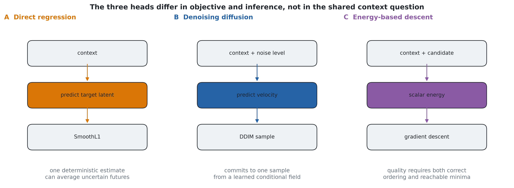

**Figure 4.2 — Generation objectives under the shared context question.**

Best-of-$N$ is used only as an oracle coverage diagnostic. For each record, the decoded sample
with the smallest foreground MSE against ground truth is selected. One regression candidate costs
one stochastic MC-dropout network evaluation, whereas a diffusion candidate costs the declared
number of DDIM evaluations. Best-of-eight at 16 NFE therefore uses eight regression evaluations
and 128 diffusion evaluations. In general, the network-evaluation counts are

$$
W_{\mathrm{reg}}(N)=N,
\qquad
W_{\mathrm{diff}}(N,K)=NK,
\tag{4.2}
$$

**Table 4.3 — Generation-mechanism decision evidence.** Foreground MSE is lower-is-better and
foreground sharpness is higher-is-better. The NFE sensitivity values come from a smaller frozen
evaluation receipt and are not pooled with the six-batch main row.

| Regime | Regression | Diffusion | Persistence or reference | Licensed reading |
|---|---:|---:|---:|---|
| Single step, best-of-8 foreground MSE, all | 0.0664 | **0.0512** | persistence 0.2367 | diffusion has better oracle coverage at the reported unequal total work |
| Single step, easy subset | 0.0232 | **0.0120** | — | both learn the conditioned motion; diffusion remains lower |
| Single step, hard novel-strip subset | 0.1808 | **0.1549** | — | the larger separation occurs where a committed hypothesis is required |
| Mean over eight candidates | 0.0714 | **0.0640** | — | diffusion also improves the sample mean in this study |
| Single step, foreground sharpness | 0.1591 | **0.1886** | persistence 0.0515 | diffusion samples are sharper in the coverage regime |
| Best-of-8 foreground MSE, 4 NFE per diffusion candidate | 0.0680 | **0.0546** | — | diffusion direction persists at the smallest tested diffusion allocation |
| Best-of-8 foreground MSE, 8 NFE | 0.0680 | **0.0514** | — | sensitivity, not an equal-work comparison |
| Best-of-8 foreground MSE, 16 NFE | 0.0680 | **0.0503** | — | more denoising work gives a modest additional gain |
| Self-fed best-of-1, matched hierarchical package | **0.1682** | 0.1848 | paired diffusion-minus-regression interval [0.0110, 0.0227] | direct regression is better in deterministic rollout |
| Self-fed best-of-1, matched flat package | **0.2015** | 0.2038 | — | the rollout reversal is not confined to the hierarchical arm |

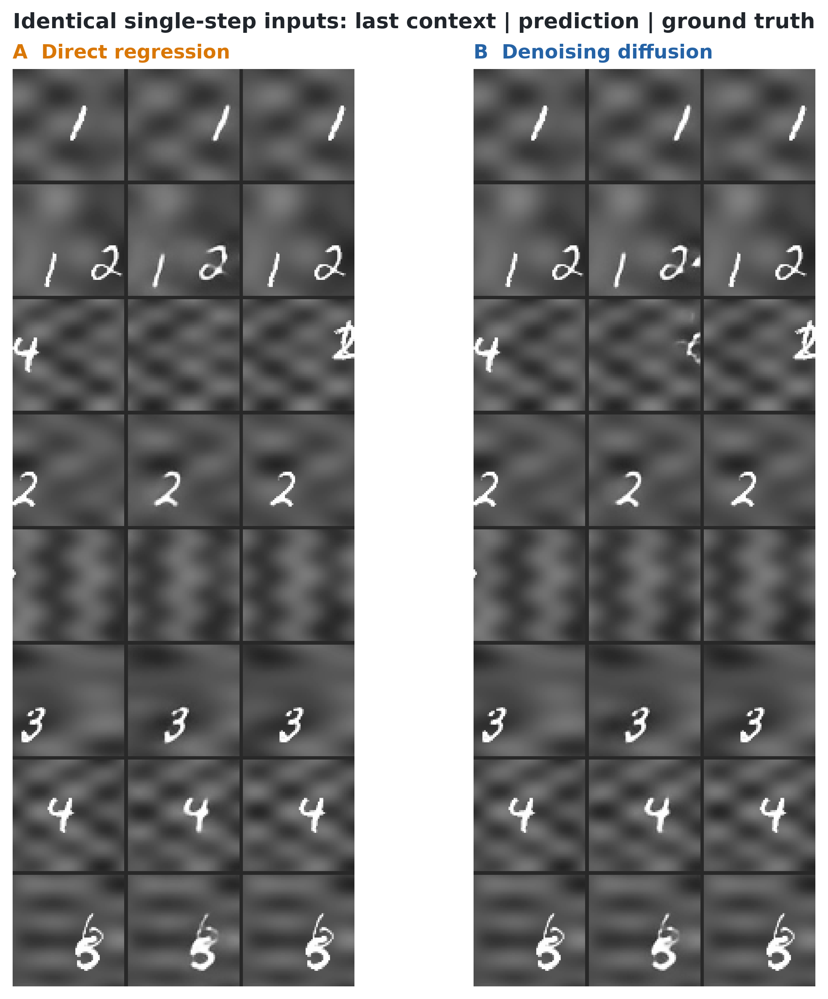

**Figure 4.3 — Single-step predictions on identical inputs.**

### 4.2.2 Energy-based descent as a characterised negative

An energy-based transformer offers another route to generation: learn a scalar energy rather than a normalized probability [84, 85],
$E_\phi(c,z)$ for context $c$ and candidate future $z$, then update the candidate according
to

$$
z^{(k+1)}=z^{(k)}-\alpha_k\nabla_zE_\phi(c,z^{(k)})+\eta_k,
\tag{4.3}
$$

where $\eta_k$ is the registered Langevin term when that recipe uses noise [89, 90]. Score matching connects related energy gradients to data-density gradients [86, 87]. The energy must order meaningful
candidates correctly, and descent from the prescribed initialisation must reach the structured
region of the landscape. At a 14.66-million-parameter scale, the study adapted the official Energy-Based Transformer
implementation [88] and evaluated two published recipe families. The S2 recipe
converges to a loss near 0.597 but places the batch-mean candidate below the target on every one of
21 recorded probes. S1 changes the ordering: from updates 6,000 through 20,000, the target has the
lowest energy on fifteen consecutive probes, with a target-below-mean gap between 0.22 and 3.09. Ordering can therefore be learned at this scale.

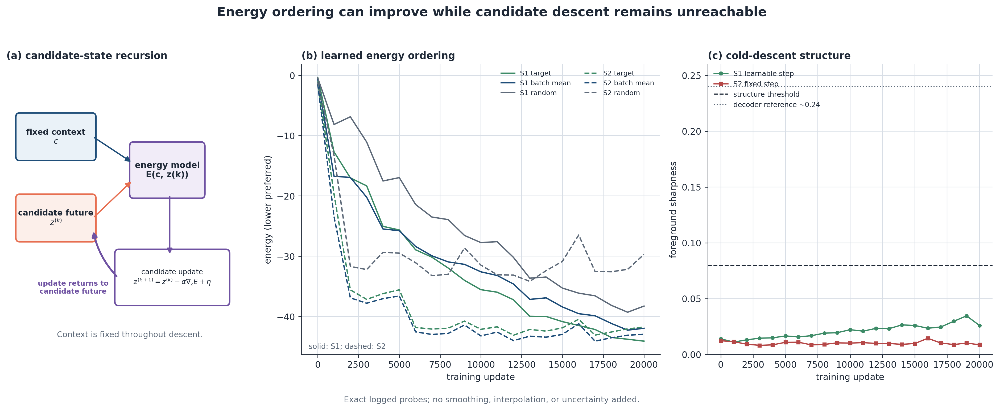

**Figure 4.4 — Energy ordering and descent reachability.**

### 4.2.3 Mechanism decision

The three mechanisms leave two viable heads. Diffusion is used for the untouched package
frontier because it gives the strongest stochastic single-step coverage in the controlled study.
Regression remains a necessary control because it is better in deterministic self-fed best-of-one
rollout. Energy-based descent is closed as a characterised negative for this programme: pursuing
it would test scale rather than answer the context-packaging question.

No universal head ranking follows from these studies. The relevant decision is conditional on how
predictions will be sampled and reused.

That decision also fixes the licence of every later result. The frontier measures package effects
for diffusion with declared denoising work; regression cells ask whether a direction survives a
deterministic one-pass head. They are complementary tests, not interchangeable replications.
Keeping both visible prevents stochastic coverage from being attributed to context geometry and
prevents a stable regression rollout from being mistaken for evidence against diffusion in its
intended sampling regime.

## 4.3 Hierarchical reach under a fixed context budget

### 4.3.1 Untouched reach-differential confirmation

The development pool had already influenced model selection and the reach hypothesis. A valid
confirmation therefore required new data rather than another analysis of the same clips. The E2
holdout, `loopmom-confirmation_holdout-20260712-e033abee6e04`, was generated and hash-pinned after
the checkpoints, package pairs, reach bands, endpoints, table layouts, and interpretation rules
had been frozen, applying a protected-holdout principle to prevent adaptive reuse [167]. Training and monitoring loaders reject the protected split, and its opening is
recorded through a purpose-specific access log.

$$
14<\Delta t_i\le48.
\tag{4.4}
$$

$$
e_{ci}=\mathbf 1\!\left(
14<\Delta t_{ci}\le48,\;
\mathrm{seen}_{ci}\ge0.5,\;
\mathrm{fg}_{ci}\ne\varnothing,\;
\Delta t_{ci}\text{ finite}
\right).
\tag{4.5}
$$

If $d_{ci}=m_{ci}^{\mathrm{flat}}-m_{ci}^{\mathrm{hier}}$ is the foreground-error difference
for frame record $i$ of clip $c$, the paired reach estimand is

$$
\widehat{\Delta}_{\mathrm{reach}}=
\frac{\sum_c\sum_{i\in c}e_{ci}\,d_{ci}}
{\sum_c\sum_{i\in c}e_{ci}}.
\tag{4.6}
$$

A development-only optimization diagnostic checks whether the retrieval direction appears after sufficient training. The two 6,000-update predictors are unresolved, whereas the independently trained 20,000-update predictors are positive. These are separate schedules, not checkpoints selected from one trajectory, and they do not enter the untouched E2 family.

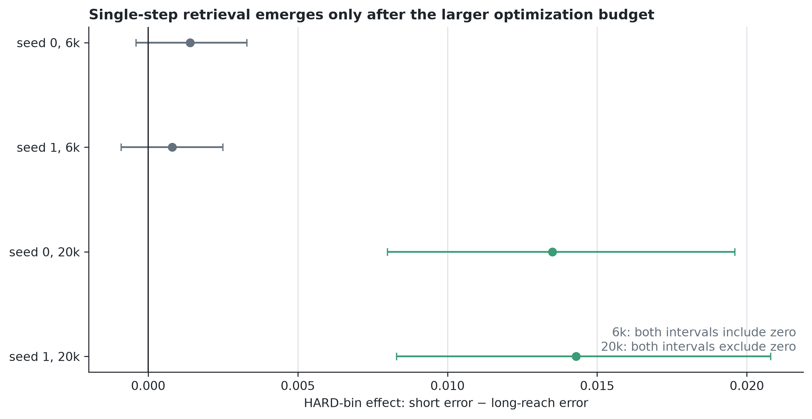

**Figure 4.5 — Conditional development diagnostic for optimization sufficiency.** The contrast becomes positive only in the two longer schedules, motivating the completed-training gate without being used as confirmation evidence. *Source: four frozen development logs at 6,000 and 20,000 updates.*

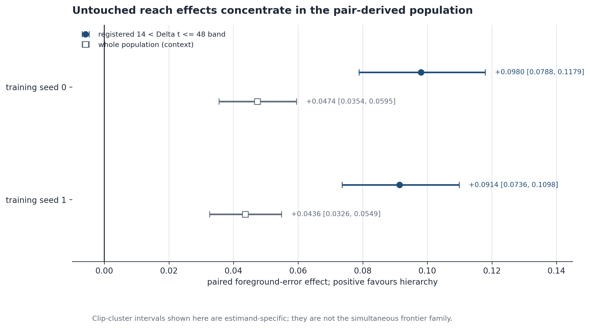

**Figure 4.6 — Untouched pair-specific reach effects.** Both seeds show a larger hierarchy benefit in the registered reach band than over the full population, matching the mechanism predicted from package geometry.

The B1 pair provides a second, qualified confirmation. Its registered population is
$8<\Delta t_i\le48$, and the two seed effects are +0.0692 [0.0543, 0.0845] and +0.0743
[0.0588, 0.0899]. Whole-population effects are +0.0340 and +0.0381. B1 changes more than context
reach, however. Its stride-2 target interface, target-token count, auxiliary loss, and training
load differ from `flat-short`. The result confirms the complete configuration. It cannot be used
as an isolated causal estimate of temporal stride.

### 4.3.2 Whole-population and endpoint support

Foreground-only error could conceal a model that predicts the object at the correct location but
also creates false objects elsewhere. Table 4.4 reports the registered reach band rather
than selecting favourable endpoints after inspection. The sign convention is harmonised so that
positive values favour `hier-min`; for missed and extra components, the reported value is the
number avoided by the hierarchical package.

**Table 4.4 — Complete endpoint support in the untouched $14<\Delta t\le48$ population.** Each
row contains 1,006 frame records from 96 clips. Intervals are paired clip-cluster intervals for the
named trained model; the two seed columns are not pooled.

| Endpoint | Seed 0 effect [95% CI] | Seed 1 effect [95% CI] | What the endpoint rules out |
|---|---:|---:|---|
| Non-empty GT-foreground MSE | +0.0980 [0.0788, 0.1179] | +0.0914 [0.0736, 0.1098] | failure on the re-entering object itself |
| Union-mask MSE | +0.0808 [0.0632, 0.0987] | +0.0773 [0.0613, 0.0940] | improvement obtained only by ignoring hallucinated support |
| Full-frame MSE | +0.0045 [0.0033, 0.0058] | +0.0042 [0.0032, 0.0052] | contradiction with aggregate image error |
| GT-background MSE | +0.0013 [0.0006, 0.0019] | +0.0012 [0.0006, 0.0017] | a foreground gain purchased by worse background reconstruction |
| Foreground precision | +0.1550 [0.1027, 0.2066] | +0.0691 [0.0051, 0.1317] | uncontrolled false-positive area |
| Foreground recall | +0.2708 [0.2180, 0.3238] | +0.2539 [0.2060, 0.3029] | an apparently sharp result that omits much of the object |
| Foreground F1 | +0.2458 [0.1975, 0.2954] | +0.2342 [0.1893, 0.2801] | precision–recall imbalance |
| Missed components avoided | +0.4911 [0.3686, 0.6102] | +0.5527 [0.4315, 0.6699] | lower pixel error caused by deleting difficult instances |
| Extra components avoided | +0.3231 [0.1530, 0.4915] | +0.1968 [0.0334, 0.3701] | benefit accompanied by duplicate objects |
| Component coverage | +0.2622 [0.1968, 0.3264] | +0.2992 [0.2370, 0.3605] | selective scoring of easy surviving components |

Agreement across union, background, recall, misses, extras, and coverage makes the reach result
stronger than a foreground-MSE difference alone. It also narrows the interpretation. The package
improves more than blur inside a supplied mask; it more often reconstructs a coherent object
where a shorter window has lost the relevant scene content.

### 4.3.3 Interpretation of reach

The pair-derived band is the decisive feature of the experiment. A generic late-horizon analysis
would mix events whose required evidence is present in both packages, absent from both, or
available only to one. LoopMom's saved geometry removes that mixture. The larger band-specific
effect, repeated across two training seeds and supported by false-positive-sensitive metrics,
matches the mechanism predicted in Chapter 3.

The same logic suggests a requirement for future benchmarks. A late frame is informative only if
the evaluator can establish when its relevant content was last observed and which packages could
still address that observation. Without that record, a horizon-conditioned effect mixes reach,
fidelity, scene difficulty, and accumulated rollout error. LoopMom solves the identification
problem analytically; natural-video studies will need logged camera geometry, annotated
disappearance and re-entry events, or counterfactual sequences that provide an equally auditable
population.

## 4.4 Reach–fidelity frontier and memory efficiency

### 4.4.1 Simultaneous tested frontier

Reach is valuable only while it changes which relevant observations are available. Once the flat
package can retain most or all of the needed span, its full-resolution history may become more
useful than a compressed stream. The untouched E2 family tests this proposition at discrete
budgets. Every listed interval is produced by one studentized max-statistic clip-cluster family
with critical value 2.741; therefore the decisions do not arise from choosing separate marginal
tests after seeing the outcome.

**Table 4.5 — Untouched tested frontier and equal-reach context-state accounting.** Panel A
contains the complete simultaneous decision family. Panel B, introduced in Section 4.4.2, reports
the exact storage arithmetic used to interpret its lower-budget points.

| Context budget | Flat package / nominal reach | Hierarchical package / nominal reach | Seed and optimiser regime | Flat loss − hierarchical loss | Simultaneous 95% CI | Decision |
|---:|---|---|---|---:|---:|---|
| 480 vs 512 | `flat-short` / 8 | `hier-short` / 6 | seed 0, B16×30k | −0.0038 | [−0.0081, +0.0005] | unresolved near-match |
| 480 vs 512 | `flat-short` / 8 | `hier-short` / 6 | seed 1, B16×30k | −0.0060 | [−0.0105, −0.0015] | flat favoured; near-match |
| 896 | `flat-min` / 14 | `hier-min` / 48 | seed 0, B16×30k | +0.0474 | [+0.0305, +0.0642] | hierarchy confirmed |
| 896 | `flat-min` / 14 | `hier-min` / 48 | seed 1, B16×30k | +0.0436 | [+0.0280, +0.0592] | hierarchy confirmed |
| 1,152 | `flat-budget` / 18 | `hier-long` / 48 | seed 0, B16×30k | +0.0195 | [+0.0070, +0.0320] | hierarchy confirmed |
| 1,152 | `flat-budget` / 18 | `hier-long` / 48 | seed 1, B16×30k | +0.0389 | [+0.0228, +0.0549] | hierarchy confirmed |
| 1,152 | `flat-budget` / 18 | `hier-long` / 48 | seed 2, B16×30k | +0.0307 | [+0.0159, +0.0455] | hierarchy confirmed |
| 1,792 | `flat-c1` / 28 | `hier-c1` / 48 | seed 0, B16×30k | +0.0084 | [−0.0013, +0.0181] | unresolved |
| 2,432 | `flat-c2` / 38 | `hier-c2` / 48 | seed 0, B16×30k | −0.0150 | [−0.0260, −0.0039] | flat confirmed |
| 2,432 | `flat-c2` / 38 | `hier-c2` / 48 | seed 0, B8×60k | −0.0122 | [−0.0213, −0.0032] | flat confirmed in separate optimiser regime |
| 3,072 | `flat-long` / 48 | `hier-rich` / 48 | seed 0, B8×60k | −0.0129 | [−0.0217, −0.0041] | flat confirmed |
| 3,072 | `flat-long` / 48 | `hier-rich` / 48 | seed 1, B8×60k | −0.0134 | [−0.0215, −0.0053] | flat confirmed |

The two lower near-match rows compare 480 and 512 tokens and cannot define an exact-budget edge.
Among exact-budget pairs, 1,152 is the largest
tested family-wise-confirmed hierarchy-favouring budget, while 2,432 is the smallest tested
family-wise-confirmed flat-favouring budget. The 1,792 point remains unresolved.

**Figure 4.7 — Untouched reach–fidelity frontier.** Hierarchy is simultaneously confirmed at 896 and 1,152 tokens, 1,792 remains unresolved, and flat context is confirmed at 2,432 and 3,072; no continuous crossing is fitted.

### 4.4.2 Exact token and payload arithmetic

The frontier is meaningful because its context cost is explicit. With the frozen codec, a fine
frame contains $8\times8=64$ tokens and a coarse frame contains $4\times4=16$. For package
$\mathcal P$, the context-token reduction relative to dense fine storage at the same nominal
span is

$$
G_{\mathrm{ctx}}(\mathcal P)=
\frac{48q_{\mathrm f}}
{n_{\mathrm c}q_{\mathrm c}+n_{\mathrm f}q_{\mathrm f}},
\qquad q_{\mathrm f}=64,\quad q_{\mathrm c}=16.
\tag{4.7}
$$

**Panel B: context-state cost at equal nominal 48-frame reach.** Each token carries 16 codec
coefficients. Payload columns are contiguous array sizes for one example and one context package;
the batch dimension is excluded. They also exclude target tokens, attention and MLP intermediates,
parameters, optimiser state, allocator overhead, and training activations.

| Package | Token arithmetic | Context tokens | Latent payload fp32 | Latent payload fp16/bf16 | Materialised width-384 embeddings, bf16 | Relative context cost |
|---|---:|---:|---:|---:|---:|---:|
| 48 dense fine frames | $48\times64$ | 3,072 | 192 KiB | 96 KiB | 2.250 MiB | 1.00× |
| 48 coarse + 6 recent fine | $48\times16+6\times64$ | 1,152 | 72 KiB | 36 KiB | 0.844 MiB | 2.67× fewer |
| 48 coarse + 2 recent fine | $48\times16+2\times64$ | 896 | 56 KiB | 28 KiB | 0.656 MiB | 3.43× fewer |

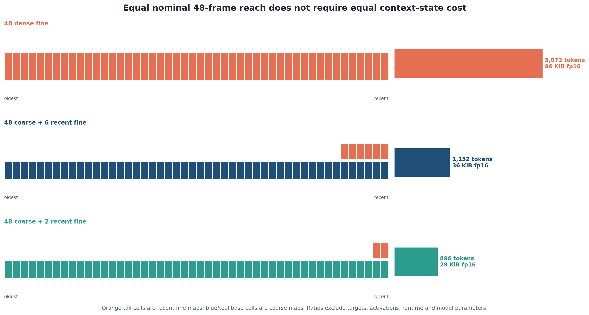

**Figure 4.8 — Equal-reach context-state arithmetic.** At nominal 48-frame reach, 896- and 1,152-token hierarchical packages use 3.43 and 2.67 times fewer context tokens than 3,072-token dense fine history.

The arithmetic supports two distinct claims. First, hierarchy makes 48-frame addressability
possible at budgets where a flat fine-only window reaches only 14 or 18 frames. Second, the same
addressable span requires 2.67 to 3.43 times fewer context tokens than 48 fine frames. Equal
performance with fewer tokens remains untested. Prediction quality depends on which details the
task needs, as the upper frontier and E6 later demonstrate.

### 4.4.3 Reach and fidelity as an operating-region interpretation

At 896 and 1,152 tokens, the flat window excludes relevant re-entry history that the coarse stream
retains. The pair-specific result in Section 4.3 makes that mechanism observable rather than merely
plausible. At 3,072 tokens, both packages reach 48 frames. The 2,432-token result belongs between those clean cases. Flat reaches 38 frames and hierarchy
reaches 48, yet flat is confirmed in the primary E2 family. On this static world, an old fine
observation can preserve digit appearance and exact texture better than a denser coarse history. No general 38-frame sufficiency threshold follows. The sampler and codec studies will
show that the upper effect is smaller and less precise than the lower reach effects.

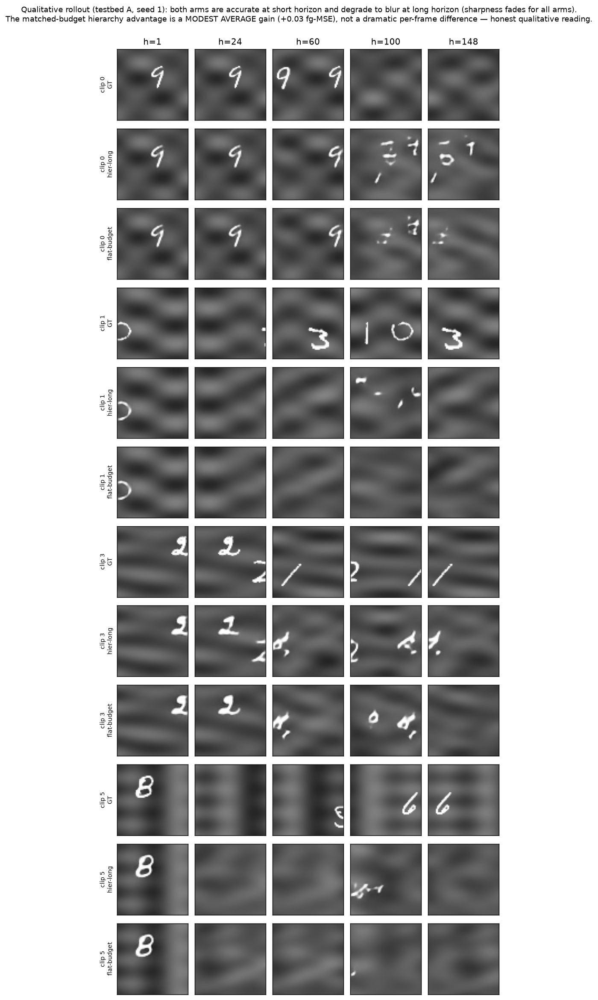

**Figure 4.9 — Fixed-index qualitative rollouts.**

## 4.5 Context-package shape and model interaction

### 4.5.1 Spatial hierarchy versus temporal subsampling

The matched frontier establishes that cheap coarse tokens can buy useful reach. Whether spatial
coarsening is the best use of a fixed number of tokens remains a separate question. A
full-resolution temporal anchor also reaches into the past, but leaves intervals between stored
frames. Comparing those packages separates two kinds of loss: spatial compression discards detail
at every old time step; temporal subsampling preserves the selected frames but discards
intermediate dynamics.

Seed-resolved results make the prediction head impossible to ignore. Under diffusion, every one
of five training seeds favours the temporally sparse full-resolution package. Under regression,
the direction changes across seeds. Table 4.6 keeps those levels of uncertainty separate.

**Table 4.6 — Five-seed head × package factorial.** Positive package effects favour temporal
full-resolution anchors over spatially coarse dense history. Clip intervals condition on one
trained model; the final three rows use training seeds as units.

| Training seed or summary | Diffusion package effect [clip 95% CI] | Regression package effect [clip 95% CI] | Head × package interaction [clip 95% CI] |
|---:|---:|---:|---:|
| 0 | +0.0197 [+0.0143, +0.0252] | +0.0107 [+0.0062, +0.0158] | −0.0089 [−0.0151, −0.0025] |
| 1 | +0.0046 [+0.0007, +0.0084] | −0.0104 [−0.0146, −0.0062] | −0.0150 [−0.0199, −0.0104] |
| 2 | +0.0111 [+0.0070, +0.0151] | −0.0208 [−0.0270, −0.0150] | −0.0319 [−0.0401, −0.0245] |
| 3 | +0.0075 [+0.0037, +0.0114] | +0.0248 [+0.0181, +0.0323] | +0.0173 [+0.0106, +0.0245] |
| 4 | +0.0060 [+0.0027, +0.0092] | −0.0166 [−0.0229, −0.0108] | −0.0226 [−0.0297, −0.0160] |
| Across-seed mean | +0.0098 | −0.0024 | −0.0122 |
| Across-seed SD | 0.0060 | 0.0195 | 0.0186 |
| Across-seed t95 interval | [+0.0023, +0.0173] | [−0.0266, +0.0217] | [−0.0353, +0.0109] |

**Figure 4.10 — Package effects across prediction heads and training seeds.**

**Table 4.7 — Context-form evidence map and comparison licences.** Rows answer different causal
questions and must not be treated as one fully crossed factorial.

| Question | Executed comparison | What is held fixed or isolated | Remaining co-change | Licence and evidence level | Supported conclusion |
|---|---|---|---|---|---|
| Reach beyond a flat window | `hier-min` versus `flat-min` | context, target and total tokens; codec, head, clips; pair-derived reach band | nominal reach and old-history resolution change together | **MATCHED**, untouched E2 | benefit concentrates where only hierarchy addresses the relevant past |
| Fixed-span spatial abstraction | `spat18` versus `flat-budget`, separately by head | 18-frame span, recent fine tail, codec and evaluation records | coarse package uses 672 rather than 1,152 tokens | **DEVELOPMENT DIAGNOSTIC** | coarse history has a small cost under diffusion and is unresolved under regression; no intrinsic abstraction win |
| Temporal versus spatial compression | `strided-flat` versus `hier-long` | nominal 48-frame reach, six-frame fine tail, backbone, codec, training protocol | temporal sparsity versus spatial coarsening; 1,088 versus 1,152 tokens | **NEAR-MATCHED DEVELOPMENT FACTORIAL**, five seeds | temporal anchors are stable under diffusion; regression and cross-head interaction are heterogeneous |
| Spatial × temporal stride-2 package | `hier-s2-min` versus `flat-short` | 512 context tokens and paired records | target stride, target slots/tokens, auxiliary loss, total sequence length, optimisation load | **WHOLE CONFIGURATION**, untouched E2 | complete B1 configuration wins; pure context-stride effect is unidentified |
| Added representational depth | `hier3` versus `hier-long` | 1,152 context tokens, nominal reach, diffusion backbone | target allocation, objective load, fine/coarse allocation, top-level information floor | **DEVELOPMENT DIAGNOSTIC**, seed 0 | three-level probe is worse by −0.0196 [−0.0248, −0.0146]; no general depth law |
| Stream contribution | coarse/fine blinding and `hier3` top blinding | trained model and rollout records | zeroing a stream is out of distribution | **DEVELOPMENT DIAGNOSTIC** | coarse removal harms re-entry; fine removal causes rendering collapse; tested top stream adds little; magnitudes are not information accounting |
| Budget allocation | E2 frontier | codec, head, endpoint family and discrete package pairs | seed coverage varies by budget; no continuous dose response | **UNTOUCHED SIMULTANEOUS FAMILY** | spend tokens on reach while history is absent; preserve fine detail after reach is available |

Two comparisons in the table are easily misread. The third-level arm keeps the context budget at
1,152 but changes loss allocation and target tokens as well as depth. Its poorer result is evidence
against that complete probe, not against hierarchical depth as a concept. It can show that removing a
stream destroys a capability, but it cannot assign an information value to the stream.

### 4.5.2 Prediction-head interaction

The regression column shows heterogeneity, not a tie. Two seeds materially favour temporal anchors and
three favour spatial hierarchy; the across-seed interval is wide because the direction changes. Neither condition holds. The correct term is training-seed
heterogeneity. The interaction behaves similarly. Four per-seed estimates are negative and one is positive, but
the seed-level t interval [−0.0353, +0.0109] crosses zero. An early hypothesis that regression
would produce a stable shift toward spatial coarsening therefore fails. Package utilisation is not
only a property of stored tokens; it depends on the objective, sampling rule, and optimisation
trajectory that teach the model to use them.

For model selection, the diffusion result licenses temporal anchors on this controlled static
world, while the heterogeneous regression result calls for seed-resolved validation before that
choice is transferred. A moving hidden world would be the decisive extension: if meaningful state
changes occur between stride-4 anchors, temporal sparsity should lose information that a dense
coarse stream retains. Such a crossed dynamic test would distinguish an instrument-specific
advantage from a broader package principle without changing the confirmed spatial-hierarchy
frontier.

## 4.6 Robustness of the principal directions

### 4.6.1 Sampler allocation and randomness

The untouched frontier uses deterministic DDIM-16 with one registered sampling seed. E7c therefore freezes four seed-0 predictor contrasts before opening a new purpose-locked set: the
896-token reach effect, the 1,152-token interior effect, the 1,088-versus-1,152 package-shape
effect, and the 2,432-token flat-fidelity inversion. All 20 point estimates retain the registered direction. For the first three contrasts, every
simultaneous lower bound is above zero. The 2,432-token inversion is positive and family-wise
resolved for all three NFE allocations at sampler seed 0, but its intervals include zero at
sampler seed 1 (+0.0098 [−0.0001, +0.0196]) and seed 2 (+0.0077 [−0.0013, +0.0167]). Eighteen of
the twenty family-wise intervals are therefore clean.

**Figure 4.11 — Robustness to denoising work and sampler randomness.** All point-estimate directions persist across the registered sampler allocations, although two upper intervals lose simultaneous precision.

### 4.6.2 Independently trained codec

E7a intervenes earlier in the pipeline. A second codec is trained independently, new latent
normalisation is computed, and seven seed-0 predictors are retrained. Reconstruction error,
coordinate geometry, scale, and predictor optimisation all change together. The experiment is
therefore a whole-codec robustness study; one cannot attribute any numerical difference to a
single property of the latent space.

**Table 4.8 — Direction and simultaneous status across sampler and codec interventions.** Positive
effects favour the registered candidate; for the 2,432 contrast that candidate is flat context.

| Intervention | 896 reach | 1,152 interior | 1,088 temporal vs 1,152 spatial | 2,432 flat inversion | Registered reading |
|---|---:|---:|---:|---:|---|
| DDIM NFE 8, sampler 0 | +0.0478 [0.0323, 0.0634] | +0.0152 [0.0045, 0.0259] | +0.0276 [0.0171, 0.0381] | +0.0115 [0.0016, 0.0214] | all family-wise resolved |
| DDIM NFE 16, sampler 0 | +0.0465 [0.0310, 0.0621] | +0.0146 [0.0041, 0.0251] | +0.0283 [0.0172, 0.0394] | +0.0117 [0.0018, 0.0217] | all family-wise resolved |
| DDIM NFE 32, sampler 0 | +0.0471 [0.0317, 0.0625] | +0.0140 [0.0036, 0.0245] | +0.0292 [0.0182, 0.0403] | +0.0122 [0.0022, 0.0221] | all family-wise resolved |
| DDIM NFE 16, sampler 1 | +0.0482 [0.0325, 0.0638] | +0.0201 [0.0086, 0.0315] | +0.0251 [0.0160, 0.0342] | +0.0098 [−0.0001, 0.0196] | upper effect unresolved |
| DDIM NFE 16, sampler 2 | +0.0466 [0.0314, 0.0618] | +0.0200 [0.0087, 0.0313] | +0.0221 [0.0133, 0.0309] | +0.0077 [−0.0013, 0.0167] | upper effect unresolved |
| Original-codec controls on E7a set | +0.0494 [0.0339, 0.0649] | +0.0283 [0.0169, 0.0397] | +0.0253 [0.0163, 0.0343] | +0.0150 [0.0065, 0.0235] | all family-wise resolved |
| Independently trained codec | +0.0521 [0.0374, 0.0669] | +0.0439 [0.0310, 0.0569] | +0.0112 [0.0039, 0.0184] | +0.0079 [−0.0006, 0.0165] | upper effect unresolved |

**Figure 4.12 — Original- and alternate-codec effects.** Seven of eight simultaneous intervals resolve in the registered direction; the alternate-codec upper contrast remains unresolved rather than reversed.

The alternate codec strengthens the lower and interior reach effects descriptively, while the
package-shape and upper effects shrink. Codec seed is not an inferential replicate, so these
changes should not be averaged or explained post hoc. The licensed conclusion is narrower: four
principal directions survive a complete replacement of one continuous latent interface at the
point-estimate level, and three remain family-wise clean. The upper flat-fidelity inversion is the
consistent precision boundary in both robustness programmes.

## 4.7 Boundary and negative evidence

### 4.7.1 Failed self-fed trust-boundary replication

Addressable history can be present yet fail during long self-fed generation. A seed-0 long-loop
study appeared to show exactly such a boundary: hierarchy helped early, then became worse after
approximately 24 frames. At horizons 61–256, seed 0 is negative at −0.0064
[−0.0095, −0.0032]. The two new seeds instead favour hierarchy, +0.0074 [0.0038, 0.0112] and
+0.0087 [0.0035, 0.0139].

**Figure 4.13 — Registered early and late long-loop effects.**

The failure changes the dissertation’s recommendation. Early self-fed benefit may be reported as
replicated, but rollout age cannot be used as a calibrated switch from hierarchical to flat memory.
Nor is seed 0 evidence for a universal decay time. Localising why that run differs would require a
new registered question, additional seeds, and diagnostics chosen before their outcomes were seen.
Because the confirmed frontier and external boundary already answer the dissertation’s design
questions, opening that branch would add exploratory explanation rather than necessary evidence.

### 4.7.2 Privileged raw-memory reference

The learned models mix at least three difficulties: compressing a past frame, addressing the
right stored content, and propagating predictions without drift. E8a removes most of the first two. Its K6, K14, K38, and K48 variants differ only in how much warm-up history
contributes to the mosaic. K6 supplies descriptive storage and coverage context; the registered
simultaneous reach contrasts compare K14 and K38 with K48 alongside the four neural references.

**Figure 4.14 — Explicit pose-indexed storage and access.**

This is not a competitive baseline. The mosaic has no token constraint, receives future pose,
stores lossless observed pixels, avoids a learned decoder, and has no self-fed hidden state. Its
value is diagnostic. Even when a neural package has nominal geometric reach, a large gap remains
between potential access and learned reuse.

### 4.7.3 Persistent-object support–identity boundary

LoopMom makes reach measurable, but its static world and viewport coordinates do not test whether
an object retains its identity through collision and long self-fed motion. Three
flat and three hierarchical predictors are trained with the same codec, head, 1,152-token context
budget, and 48-frame warm-up. Evaluation covers 300 generated frames on 100 protected clips. All detections are assigned one-to-one to visible ground-truth objects using the frozen Hungarian
cost. Consequently, a model cannot improve identity accuracy by producing only
easy survivors. The fifteen co-primary effects—five endpoints over three seeds—form one
simultaneous max-statistic family.

**Table 4.9 — E6 relative effects and absolute performance.** Positive effects favour hierarchy
for every endpoint after sign harmonisation. Absolute cells are flat / hierarchy. Identity and
coverage are proportions; trajectory error is measured in pixels.

**Panel A: simultaneous paired effects**

| Seed | Foreground MSE | Union-mask MSE | Trajectory error | Identity accuracy | Object coverage |
|---:|---:|---:|---:|---:|---:|
| 0 | +0.0036 [−0.0074, +0.0146] | +0.0102 [+0.0019, +0.0185] | +2.4786 [+0.2130, +4.7443] | −0.0762 [−0.1106, −0.0418] | +0.0304 [+0.0016, +0.0591] |
| 1 | −0.0031 [−0.0127, +0.0065] | +0.0122 [+0.0052, +0.0192] | +1.4223 [−1.0646, +3.9092] | −0.0561 [−0.0934, −0.0188] | +0.0159 [−0.0163, +0.0482] |
| 2 | −0.0024 [−0.0131, +0.0083] | +0.0169 [+0.0093, +0.0245] | +4.1325 [+1.5271, +6.7380] | −0.0647 [−0.0955, −0.0338] | +0.0498 [+0.0161, +0.0834] |

**Panel B: absolute endpoint values**

| Seed | Union-mask MSE, flat / hierarchy | Trajectory error, flat / hierarchy | Identity accuracy, flat / hierarchy | Coverage, flat / hierarchy |
|---:|---:|---:|---:|---:|
| 0 | 0.6861 / 0.6759 | 42.19 / 39.71 | 0.214 / 0.138 | 0.619 / 0.650 |
| 1 | 0.6901 / 0.6779 | 40.20 / 38.77 | 0.244 / 0.188 | 0.646 / 0.662 |
| 2 | 0.6931 / 0.6763 | 43.79 / 39.65 | 0.222 / 0.158 | 0.599 / 0.649 |

**Figure 4.15 — Support/continuity versus identity in persistent-object long Moving-MNIST.** Hierarchy better preserves spatial support and trajectory continuity, while flat context retains digit identity; difficult absolute performance prevents a solved-task interpretation.

### 4.7.4 Short-horizon and real-data competence boundaries

Canonical Moving-MNIST 10-to-10 contains no off-screen re-entry. The flat diffusion arm uses ten
fine frames and 640 context tokens; the hierarchical arm uses ten coarse and six fine frames for
544 tokens. Their OpenSTL-convention MSE values are 180.91 and 181.29, with SSIM 0.7625 and
0.7607. Both beat persistence, which records MSE 286.28 and SSIM 0.6528, but both remain far behind
specialised deterministic OpenSTL predictors whose quoted MSE values lie around 22–30. The result
is a competence check and a negative control: with no re-entry demand, the extra hierarchical span
has little reason to help.

Neither comparison is an exact replica of the LoopMom frontier. The Moving-MNIST packages use 640
and 544 context tokens, and the TaxiBJ hierarchical arm uses half the flat arm’s context budget;
dataset, horizon, and task semantics also change. These are intentionally descriptive competence
checks. A
natural-video hierarchy claim would require a purpose-built long-memory population, matched
interfaces, and the same cluster-aware inferential discipline used for LoopMom.

## 4.8 System-level method-selection rule

### 4.8.1 Diagnose the binding constraint

The results do not identify one model that should replace all others. They identify a sequence of
questions that should precede architecture selection. The first question is about the task, not
the model: which failure is costly? A system that must maintain occupancy, geometry, or trajectory
can tolerate different losses from one that must preserve a person's face, a digit class, or fine
texture. That criterion determines whether support or identity is the relevant notion of
consistency.

Next, test whether the necessary past is present. If re-entry evidence lies outside the current
flat window, increasing local fidelity cannot recover it. A spatially coarse dense history or a
temporally sparse set of fine anchors can buy reach, and the choice between them depends on how
the hidden state evolves. Dense coarse history is safer when motion between anchors matters;
sparse fine anchors are effective when old states remain stable and precise appearance is useful.

A separate question arises during training: does differentiation through the desired temporal
process exceed the activation-memory budget? If the final predictor is trained on bounded windows,
as in Chapter 3, a reversible temporal chain is unnecessary. If long temporal differentiation is
required, checkpointing and reversible replay become candidate interventions. They operate on
activations, not on the context state measured in this chapter.

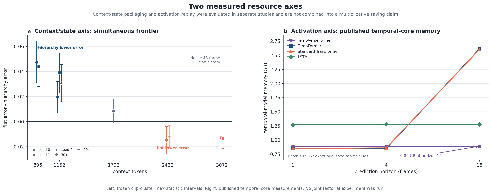

**Figure 4.16 — Two independently measured resource axes.** Context packaging reduces retained inference state, whereas reversible replay reduces training activations; their separate measurements cannot be multiplied into an end-to-end saving.

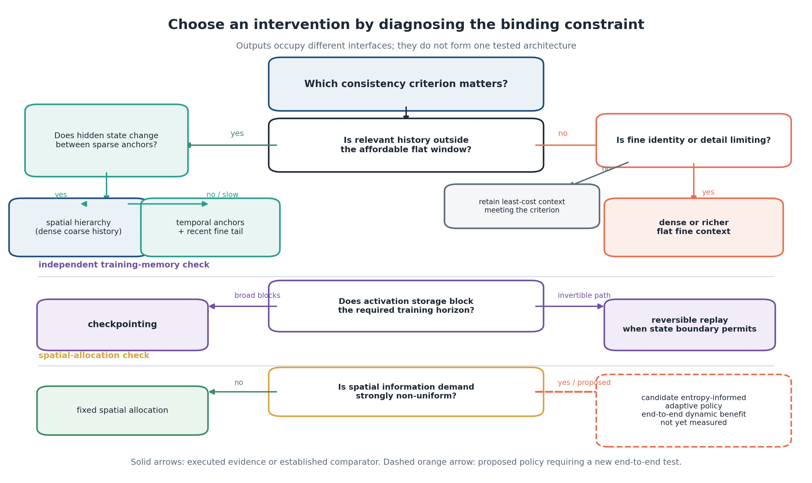

**Figure 4.17 — Binding-constraint decision flow.** Method selection begins with the missing resource—reach, fine detail, or training activations—before choosing hierarchy, dense context, checkpointing, or reversible replay.

### 4.8.2 Package applicability matrix

**Table 4.10 — Applicability of the developed and comparator interventions.** Evidence level
distinguishes measured methods from design candidates. “Cost” names the principal trade-off, not
an exhaustive implementation budget.

| Intervention | Controlled resource or interface | Principal benefit | Cost or failure mode | Evidence level in this dissertation | Suitable operating region |
|---|---|---|---|---|---|
| Dense flat context | context/state memory | preserves full spatial identity and texture at every retained time | reach grows linearly with fine-token cost | executed comparator; confirmed at the tested upper frontier and favoured for E6 identity | relevant span fits and fine identity/detail is limiting |
| Spatial hierarchical context | context/state memory | dense long history at one quarter of the per-frame token cost in the frozen codec | old detail is compressed; abstraction costs appear after reach saturates | executed and untouched-confirmed at 896/1,152; external support/continuity boundary | important past lies outside the affordable fine window; support or trajectory matters |
| Temporal subsampling with recent fine tail | context/state memory | retains old full-resolution anchor frames efficiently | aliases changes between anchors and gives no dense decodable old stream | five-seed diffusion-stable development result on a static world | hidden state changes slowly between anchors and appearance at selected times matters |
| Spatio-temporal stride-2 package | context and target configuration | cheapest tested complete configuration with nominal 48-frame reach | context and target interfaces co-change; pure stride effect unidentified | untouched whole-configuration confirmation | use only as the measured complete interface, not as evidence for stride alone |
| Entropy-informed adaptive spatial representation | candidate representation allocator | could direct fine capacity toward locally complex regions | policy overhead, calibration, routing stability, and end-to-end gain unmeasured | predictive entropy maps measured under fixed patches; dynamic allocation proposed | future systems with strongly non-uniform spatial demand |
| Gradient checkpointing | activation memory | broadly applicable recomputation without invertible layers | recomputation schedule and residual stored activations | established comparator; no direct Chapter 3 factorial | activation storage binds and arbitrary non-invertible blocks must be retained |
| Reversible temporal replay | activation memory | reconstructs intermediate temporal states instead of storing the full activation tape | invertibility and numerical constraints, replay computation, deterministic re-anchors, and strategy-dependent RNG metadata | published deterministic TempVerse result; deterministic multi-level memory frontier and separate gradient check; separate single-stage stochastic reconstruction check; not in Chapter 3 | long temporal differentiation is required and reversible state boundaries can be enforced |
| Privileged explicit memory | storage/addressing interface | shows the potential of lossless history and exact querying | raw storage, exact pose, and non-deployable information advantage | executed diagnostic reference | mechanism analysis or an upper access reference, not a fair model comparison |

The matrix prevents two common category errors. A context package cannot solve activation growth
through a long training graph, and reversible replay cannot make a missing observation available
at inference. Similarly, only an executed policy with a measured computation–quality trade-off can
turn an entropy map into a validated dynamic allocator.

### 4.8.3 Relationship among the developed methods

The methods occupy adjacent interfaces in one systems methodology. Consistency criteria define
what must be preserved. Reversible temporal computation reduces the activation cost when the loss
must differentiate through a long process. V-BLT and RoPE-ND investigate hierarchical visual
representation, coordinate structure, and predictive dispersion. The final predictor manipulates
which historical latent observations remain addressable under an explicit context budget. Chapter
4 turns the last design space into empirical operating regions and uses the earlier results only
where their resource terms genuinely meet.

They have not been executed as one jointly trained architecture. In particular, the final
hierarchical predictor contains neither TempVerseFormer nor V-BLT/RoPE-ND, and no experiment shows
that reversible activation savings multiply with hierarchical context savings. A future integrated
system is technically plausible; it is not needed to make the present dissertation coherent.

## 4.9 Software toolkit and practical application

### 4.9.1 Software architecture

The software follows the same separation as the scientific argument. The supported `hvp` package
provides side-effect-free interfaces for context descriptions and geometric reach, complete frame
and persistent-object evaluation, clip-cluster and simultaneous statistics, content-addressed
provenance, and outcome-independent experiment authorisation. Package import is side-effect-free:
it loads no dataset, initialises no CUDA context, contacts no experiment service, and starts no run. The public command-line
surface in version 0.3.0 is deliberately read-only: it reports the package version and checks an
experiment gate. Training and evaluation remain controlled research workflows rather than an
advertised stable CLI.

Reproducibility checks operate at several levels. Interface validators reject incompatible package
comparisons. Metric tests cover empty masks, false positives, persistent-object assignment, misses,
extras, and coverage. Scientific configuration checks fail closed for terminal, skipped,
unregistered, or unattested studies. At the recorded release gate, ten scientific configurations
passed authorisation validation, 83 CPU tests passed, Python compilation succeeded, and the
versioned wheel built and installed in an isolated target. Those checks support auditability. They
do not make large local datasets and checkpoints publicly downloadable; external availability
requires archive URLs, licences, hashes, and tested download instructions.

### 4.9.2 Implementation and educational use

The toolkit is useful in two ways. For research, it provides reusable generators, package
interfaces, rollout evaluators, and statistical routines that keep mechanism tests distinct from
benchmark scoring. A new package can be added only after its anchor geometry, context/target token
counts, comparison licence, and evaluation population are explicit. That discipline is a practical
result of the dissertation, not merely administrative support for it.

Documented implementation acts report use at ORNETIKA LLC and in the educational process of
Vinnytsia National Technical University, dated 14 October 2025 and 19 September 2025. Their
approved scope concerns the reversible-transformer and entropy-tokenisation methods. They should
not be rewritten as deployment validation of the Chapter 3 predictor. Final administrative
appendices must reproduce the signed wording and scans supplied by the author.

## 4.10 Limitations and threats to validity

### 4.10.1 Internal and construct validity

The strongest internal-validity feature is the pair-specific observability instrument. Still, spatial resolution and nominal reach change together in the central matched pair. Counterfactual hidden worlds would be needed
to distinguish observed history from a strong prior that guesses the same content. B1 has a sharper confound. Its target stride, target slots, auxiliary objective, sequence length,
and optimisation load change with context stride. The whole configuration is valid and confirmed,
but any sentence assigning its effect solely to stride would exceed the design. The depth probe
has an analogous boundary because representational depth, target allocation, and training load are
not separated.

Qualitative evidence is intentionally secondary. A fixed-index gallery makes the displayed sample
reproducible, but selection uncertainty remains without a registered representative-quantile rule;
in any case, a small gallery cannot represent the joint distribution of
errors. Likewise, the raw mosaic is informative because it removes learned addressing, but its
privileged future pose and lossless storage exclude it from the model ranking.

### 4.10.2 Statistical and external validity

Training-seed coverage is uneven by design. The primary 896-token result has two seeds; the
1,152-token result has three; the package-shape factorial has five; middle and upper points have
one or two. Clip-cluster intervals quantify uncertainty over clips conditional on each trained
model and cannot substitute for seed replication. The unresolved 1,792 point and the reduced
precision of upper robustness effects should therefore remain visible wherever the frontier is
summarised. Sampler robustness uses frozen seed-0 checkpoints. Codec robustness uses one independently trained
codec and predictor seed 0. Nor does the experiment
identify which change inside the alternate codec caused the smaller upper effect.

The budget frontier is discrete. It supports confirmed tested points and a family-wise bracket,
not a unique crossing, monotonic curve, or asymptotic law. Context-token ratios quantify direct
state storage and materialised embeddings, not wall time, attention FLOPs, total GPU memory, or
equal performance. No equivalence test was registered, so an unresolved interval must never be
translated into “the methods are the same.”

### 4.10.3 Chapter conclusions

Taken together, the experiments yield a decision framework rather than a winning architecture. Under a
controlled single-step oracle-coverage regime, diffusion covers the target distribution better
than the closely matched regression head at the reported, unequal total inference work. During
deterministic self-fed best-of-one rollout, regression is better. Energy-based descent fails to
reach structured targets at the tested scale even when one recipe learns the desired energy
ordering. Generation mechanism must therefore be selected with the inference regime attached.

Two regions appear on the tested budget frontier. Hierarchy is confirmed at 896 and 1,152
context tokens; the 1,792-token comparison is unresolved; flat context is confirmed at 2,432 and
3,072. At equal nominal 48-frame reach, the two confirmed hierarchical packages use 2.67 and 3.43
times fewer context tokens than dense fine history. They do not
state equal performance, information, compute, or total memory.

Short Moving-MNIST and TaxiBJ results add competence evidence, not confirmation of long-range
memory. Their limited horizons and unmatched context budgets keep them outside the central causal
claim. Natural-video disappearance and re-entry, broader codec and seed panels, and a registered
test near 1,792 tokens remain the most direct routes to a wider operating-region conclusion.

---

# General Conclusions

The dissertation treated long-horizon video prediction as a problem of allocating limited resources to the information a task must preserve. The developed methods intervene at different interfaces. TempVerseFormer reconstructs a verified temporal transformer state during the backward pass; V-BLT studies local–global raster-byte representation and predictive entropy; the final hierarchical-context model compares coarse and fine retained histories under explicit budgets. Their connection is a systems methodology, not one jointly evaluated neural pipeline.

That separation changes the design question. A system may fail because the relevant event has left its context, because fine evidence was compressed, or because the desired training horizon cannot fit in activation memory. Those failures call for different interventions. Accordingly, the work moves from consistency criteria to resource diagnosis and then to operating-region evidence: first establish what must remain correct, identify the binding constraint, and only then choose the memory or representation mechanism.

1. **The system problem and its consistency criteria were formalized.** Video prediction was represented as a partially observed dynamic process whose frames reveal only a viewport of the latent world state. Autoregressive feedback turns an early prediction error into a change in the later input distribution, so single-frame similarity cannot by itself characterize long-horizon behavior. A task-level framework distinguishes appearance, identity, geometry and support, temporal continuity, trajectory, false foreground, and cross-level agreement. Although overlapping, these criteria expose different failures: a predictor can place an object correctly while changing its identity, preserve local smoothness while following the wrong trajectory, or reconstruct fine recent appearance without retaining the earlier observation needed at re-entry. Storage, addressability, and reliable reuse are also separated. Resource statements were therefore assigned to parameter, optimizer, activation, context/state, or transient memory instead of being summarized as one generic saving. This decomposition supplied the requirements used in the later controlled comparisons: causal processing, explicit cost accounting, self-fed evaluation, mechanism-sensitive populations, and endpoints that penalize both omissions and hallucinations.

2. **A reversible temporal-computation method and its applicability boundary were established.** Additive coupling permits the persistent doubled transformer state to be reconstructed from the terminal state during backward execution. Implementation inspection confines that exact inverse to the repeated transformer chain; the VAE, learned input projection, output fusion, decoder, and loss interface remain outside it. Within the reported measurements, temporal-model memory stays near 0.89 GB at one, four, and sixteen prediction steps, while matched non-reversible transformer variants reach approximately 2.60–2.61 GB at sixteen steps. The published long-horizon plot remains near 1 GB through the displayed 1,024-step range, although raw high-horizon coordinates are unavailable and no finer numerical claim is made from the image.

The saving has a price. Separate dissertation checks examine stochastic single-stage reconstruction, deterministic multilevel gradient agreement, and a deterministic multilevel memory frontier; no one frozen receipt combines all three properties. Replay metadata, deterministic re-anchors, and numerical drift therefore belong in any deployment cost. The method is best read as an activation-memory option when a loss must differentiate through a long temporal process and the reversible state boundary can be enforced. It neither proves that reversibility improves forecasting universally nor explains the hierarchical-context effects reported later.

3. **A hierarchical raster-byte representation, multidimensional positional method, and spatial-complexity signal were developed.** V-BLT applies local encoding, global latent processing, and local decoding to uncompressed raster pixel-channel bytes. Its 256-way categorical objective avoids a learned output vocabulary, while RoPE-ND assigns disjoint rotary subspaces to temporal and spatial coordinates so that their relative positions enter attention without collapsing the axes. The published proof of concept evaluates fixed $4\times4\times4$ spatio-temporal packages on rotating 2-D triangles and 3-D polycubes. Reported cost and quality point estimates compare favorably with the listed ViViT and UNet-3D configurations on several measures, although equal reported model-size figures do not establish equal serialized size and ViViT retains the best reported 3-D PSNR.

   Categorical entropy computed from the byte distributions is spatially nonuniform in the published examples, concentrating around changing contours and uncertain early predictions. That observation provides a model-internal complexity signal, not calibrated uncertainty. Patch geometry remained fixed throughout the evaluated system: no controller resized regions, routed computation, or demonstrated an adaptive quality–cost gain. Entropy-driven regioning is therefore a specified future extension rather than a completed experimental result. A valid test would require a causal allocation rule, a fixed resource budget, routing overhead, calibration or error-association measurements, and an end-to-end comparison against the fixed-grid implementation.

4. **The central hierarchical-context predictor was specified as a controlled model family.** A frozen two-level codec supplies independently decodable coarse and fine states. Context tokens and noisy target tokens enter a shared joint-attention diffusion transformer, while autoregressive ring buffers return decoded predictions to both streams after each generated window. A package records its spatial level, temporal stride, frame count, and anchor geometry; this makes its addressable history calculable before a result is observed. Context tokens, target tokens, total sequence length, latent payload, and inference work are reported separately, avoiding the misleading use of one “budget” for several different costs.

5. **An evaluation methodology was developed for effects that depend on historical reach.** LoopMom provides a known toroidal world, viewport path, and re-entry geometry. That structure makes the last relevant observation identifiable and permits pair-specific populations whose evidence lies beyond the shorter package’s reach but within the longer one’s reach. Eligibility also excludes empty or unanswerable records. Complete frame and object endpoints distinguish missing content from extra foreground, while the persistent-object extension separates coverage, identity, and trajectory through one-to-one assignment with misses retained in the denominator.

Statistical units follow the rollout process. Paired effects are computed from aligned records, but clips—not individual frames—are resampled so that inherited self-fed errors remain clustered; training seeds form a separate uncertainty level. Registered comparison families receive simultaneous maximum-statistic intervals. Development, untouched, purpose-locked, protected, robustness, and boundary populations retain distinct roles, and unresolved or failed results remain in the terminal record. This protocol turns the proposed reach mechanism into a falsifiable comparison rather than relying on late-horizon averages or selected qualitative examples.

6. **Operating regions of hierarchical and flat context were identified.** The strongest evidence is local to the mechanism. On the untouched reach-differential population, hierarchical context improves the registered endpoint by 0.0980 and 0.0914 across two training seeds, with supporting gains in union-mask error, precision, recall, missed and extra components, and coverage. Simultaneous analysis confirms hierarchy at 896 and 1,152 context tokens, leaves 1,792 unresolved, and confirms dense flat context at 2,432 and 3,072. No interpolated crossing is inferred. At nominal 48-frame reach, 48 dense fine frames require 3,072 context tokens; packages with 48 coarse frames plus six or two recent fine frames require 1,152 or 896. The corresponding 2.67- and 3.43-fold reductions establish reach efficiency at the tested interface, not equal performance, compute, or total-memory savings.

## Practical significance

The work provides a reusable experimental and software framework for designing long-horizon predictors. Configurations encode package anchors, costs, datasets, samplers, codec identities, and evidence purposes. Fail-closed authorization, content-addressed run specifications, immutable artifacts, complete endpoint implementations, compatibility checks, and artifact-derived reporting reduce semantic drift between experiments and manuscripts. Controlled generators allow a new method to be tested where its proposed mechanism is observable before more expensive natural-video evaluation.

The resulting selection rule is operational. When the required event lies outside the fine window, preserve longer state through hierarchy or another compression mechanism. When both packages reach the event and fine identity matters, retain dense detail. If a desired training loss differentiates through a long chain and activations dominate memory, compare checkpointing with a verified reversible core, including replay time and metadata. Predictive entropy can inform a future allocation policy, but it should not be counted as a saving until that policy is executed and measured.

For education and research transfer, the separation of interfaces is as useful as the individual model implementations. Students and practitioners can vary a context package without rewriting the predictor, inspect which endpoint detects a failure, and distinguish an artifact receipt from an exploratory plot. **[AUTHOR INPUT: insert only the implementation acts and covered components supported by signed institutional documents in the final version.]**

## Limitations and directions for further research

External validity remains the strongest limitation. LoopMom and persistent long Moving-MNIST were designed to isolate memory phenomena; they do not reproduce the textures, camera cuts, nonrigid motion, multi-object interaction, or latent ambiguity of natural video. OpenSTL results establish competence only for the methods and datasets directly evaluated in the corresponding source experiment. A next study should construct a natural-video or interactive-world protocol with auditable long-range evidence and identity-sensitive endpoints instead of relying on a generic leaderboard average.

The reversible method deserves a direct comparison with modern checkpoint schedules under the same model, precision, horizon, and memory budget. Stochastic replay metadata and numerical drift should be included in the cost. If future integration is pursued, an optional multi-window objective could test whether reversible rollout training improves the hierarchical predictor; until then, activation and context savings remain separately measured axes.

Finally, the tested context budgets sample a frontier but do not estimate a universal Pareto curve. More seeds near the unresolved 1,792-token point, additional independently trained codecs, broader package shapes, and natural-video tasks would refine the boundary. Such experiments should preserve the central discipline of this dissertation: diagnose the binding constraint first, then test one intervention where its mechanism can be observed.

---

# References

External sources retain stable numeric identifiers across the assembled dissertation. In-text citations use square brackets throughout.

1. Tan C., Li S., Gao Z., et al. OpenSTL: A Comprehensive Benchmark of Spatio-Temporal Predictive Learning. *NeurIPS 36 (D&B)*, 2023.
2. Ho J., Jain A., Abbeel P. Denoising Diffusion Probabilistic Models. *NeurIPS 33*, 2020.
3. Rombach R., Blattmann A., Lorenz D., Esser P., Ommer B. High-Resolution Image Synthesis with Latent Diffusion Models. *CVPR*, 2022.
4. Peebles W., Xie S. Scalable Diffusion Models with Transformers (DiT). *ICCV*, 2023.
5. Згуровський М. З., Панкратова Н. Д. *Основи системного аналізу: підручник*. Київ: Видавнича група BHV, 2007. 544 с. ISBN 978-966-552-153-2.
6. Zgurovsky M. Z., Pankratova N. D. *System Analysis: Theory and Applications*. 1st ed. Springer Berlin, Heidelberg, 2007. XXII, 447 p. DOI: 10.1007/978-3-540-48880-4.
7. Mesarović M. D., Macko D., Takahara Y. *Theory of Hierarchical, Multilevel Systems*. Academic Press, 1970.
8. Simon H. A. The Architecture of Complexity. *Proceedings of the American Philosophical Society* 106(6):467–482, 1962.
9. Shannon C. E. A Mathematical Theory of Communication. *Bell System Technical Journal* 27:379–423, 623–656, 1948.
10. Kalman R. E. A New Approach to Linear Filtering and Prediction Problems. *Journal of Basic Engineering* 82(1):35–45, 1960.
11. Ashby W. R. *An Introduction to Cybernetics*. Chapman & Hall, 1956.
12. Vaswani A., Shazeer N., Parmar N., et al. Attention Is All You Need. *NeurIPS 30*, 2017.
13. Dao T., Fu D. Y., Ermon S., Rudra A., Ré C. FlashAttention: Fast and Memory-Efficient Exact Attention with IO-Awareness. *NeurIPS 35*, 2022.
14. Dai Z., Yang Z., Yang Y., Carbonell J., Le Q. V., Salakhutdinov R. Transformer-XL: Attentive Language Models Beyond a Fixed-Length Context. *ACL*, 2019.
15. Rae J. W., Potapenko A., Jayakumar S. M., Lillicrap T. P. Compressive Transformers for Long-Range Sequence Modelling. *ICLR*, 2020.
16. Wu Y., Rabe M. N., Hutchins D., Szegedy C. Memorizing Transformers. *ICLR*, 2022.
17. Kitaev N., Kaiser Ł., Levskaya A. Reformer: The Efficient Transformer. *ICLR*, 2020.
18. Beltagy I., Peters M. E., Cohan A. Longformer: The Long-Document Transformer. arXiv:2004.05150, 2020.
19. Gu A., Dao T. Mamba: Linear-Time Sequence Modeling with Selective State Spaces. arXiv:2312.00752, 2023.
20. Saxena V., Ba J., Hafner D. Clockwork Variational Autoencoders. *NeurIPS 34*, 2021.
21. Harvey W., Naderiparizi S., Masrani V., Weilbach C., Wood F. Flexible Diffusion Modeling of Long Videos (FDM). *NeurIPS 35*, 2022.
22. Po R., Nitzan Y., Zhang R., Chen B., Dao T., Shechtman E., Wetzstein G., Huang X. Long-Context State-Space Video World Models. arXiv:2505.20171, 2025.
23. Oshima Y., Iwasawa Y., Suzuki M., Matsuo Y., Furuta H. WorldPack: Compressed Memory Improves Spatial Consistency in Video World Modeling. arXiv:2512.02473, 2025.
24. Wu T., Yang S., Po R., Xu Y., Liu Z., Lin D., Wetzstein G. Video World Models with Long-term Spatial Memory. arXiv:2506.05284, 2025.
25. Ranzato M., Chopra S., Auli M., Zaremba W. Sequence Level Training with Recurrent Neural Networks (exposure bias). *ICLR*, 2016.
26. Bengio S., Vinyals O., Jaitly N., Shazeer N. Scheduled Sampling for Sequence Prediction with Recurrent Neural Networks. *NeurIPS 28*, 2015.
27. Huang X., Li Z., He G., Zhou M., Shechtman E. Self Forcing: Bridging the Train-Test Gap in Autoregressive Video Diffusion. *NeurIPS 2025* (spotlight); arXiv:2506.08009.
28. Werbos P. J. Backpropagation Through Time: What It Does and How to Do It. *Proceedings of the IEEE* 78(10), 1990.
29. Williams R. J., Peng J. An Efficient Gradient-Based Algorithm for On-Line Training of Recurrent Network Trajectories (truncated BPTT). *Neural Computation* 2(4), 1990.
30. Chen T., Xu B., Zhang C., Guestrin C. Training Deep Nets with Sublinear Memory Cost. arXiv:1604.06174, 2016.
31. Griewank A., Walther A. Algorithm 799: revolve — An Implementation of Checkpointing for the Reverse or Adjoint Mode of Computational Differentiation. *ACM TOMS* 26(1), 2000.
32. Gomez A. N., Ren M., Urtasun R., Grosse R. B. The Reversible Residual Network: Backpropagation Without Storing Activations. *NeurIPS 30*, 2017.
33. Koutník J., Greff K., Gomez F., Schmidhuber J. A Clockwork RNN. *Proceedings of Machine Learning Research* 32(2):1863–1871, ICML, 2014.
34. Kim T., Ahn S., Bengio Y. Variational Temporal Abstraction. *NeurIPS 32*, 2019.
35. Zakharov A., Guo Q., Fountas Z. Long-Horizon Video Prediction Using a Dynamic Latent Hierarchy. arXiv:2212.14376, submitted 2022, revised 2023.
36. Yan W., Hafner D., James S., Abbeel P. Temporally Consistent Transformers for Video Generation (TECO). *ICML*, 2023.
37. Chandratreya I. P., Charatan D., Van Hoorick B., Zakharov S., Guizilini V., Isola P., Sitzmann V. MilliVid: Hierarchical Latents for Long-Range Consistency in Video Generation. arXiv:2606.09056, 2026.
38. Liu Y., Zhang K., Li Y., Yan Z., Gao C., Chen R., Yuan Z., Huang Y., Sun H., Gao J., He L., Sun L. Sora: A Review on Background, Technology, Limitations, and Opportunities of Large Vision Models. arXiv:2402.17177, 2024.
39. Lipton Z. C. The Mythos of Model Interpretability. *Communications of the ACM* 61(10), 2018.
40. Rudin C. Stop Explaining Black Box Machine Learning Models for High Stakes Decisions and Use Interpretable Models Instead. *Nature Machine Intelligence* 1, 2019.
41. von Bertalanffy L. *General System Theory: Foundations, Development, Applications*. George Braziller, 1968.
42. Goodfellow I., Pouget-Abadie J., Mirza M., et al. Generative Adversarial Networks. *NeurIPS 27*, 2014.
43. Kingma D. P., Welling M. Auto-Encoding Variational Bayes. *ICLR*, 2014.
44. Kendall A., Gal Y. What Uncertainties Do We Need in Bayesian Deep Learning for Computer Vision? *NeurIPS 30*, 2017.
45. Guo C., Pleiss G., Sun Y., Weinberger K. Q. On Calibration of Modern Neural Networks. *Proceedings of Machine Learning Research* 70:1321–1330, ICML, 2017.
46. Bhadra S., Kelkar V. A., Brooks F. J., Anastasio M. A. On Hallucinations in Tomographic Image Reconstruction. *IEEE Transactions on Medical Imaging* 40(11):3249–3260, 2021. DOI: 10.1109/TMI.2021.3077857.
47. Ebel P., Sainte Fare Garnot V., Schmitt M., Wegner J. D., Zhu X. X. UnCRtainTS: Uncertainty Quantification for Cloud Removal in Optical Satellite Time Series. *IEEE/CVF Conference on Computer Vision and Pattern Recognition Workshops*, pp. 2086–2096, 2023. DOI: 10.1109/CVPRW59228.2023.00202.
48. Huot F., Hu R. L., Goyal N., Sankar T., Ihme M., Chen Y.-F. Next Day Wildfire Spread: A Machine Learning Data Set to Predict Wildfire Spreading From Remote-Sensing Data. *IEEE Transactions on Geoscience and Remote Sensing* 60:1–13, 2022. DOI: 10.1109/TGRS.2022.3192974.
49. Shaddy B., Ray D., Farguell A., et al. Generative Algorithms for Fusion of Physics-Based Wildfire Spread Models with Satellite Data for Initializing Wildfire Forecasts. *Artificial Intelligence for the Earth Systems* 3(3):e230087, 2024. DOI: 10.1175/AIES-D-23-0087.1.
50. Bond-Taylor S., Leach A., Long Y., Willcocks C. G. Deep Generative Modelling: A Comparative Review of VAEs, GANs, Normalizing Flows, Energy-Based and Autoregressive Models. *IEEE TPAMI* 44(11), 2022.
51. Ji Z., Lee N., Frieske R., et al. Survey of Hallucination in Natural Language Generation. *ACM Computing Surveys* 55(12), 2023.
52. Song J., Meng C., Ermon S. Denoising Diffusion Implicit Models. *ICLR*, 2021.
53. OpenAI (Brooks T., Peebles B., et al.). Video Generation Models as World Simulators (Sora technical report), 2024.
54. Ho J., Salimans T., Gritsenko A., Chan W., Norouzi M., Fleet D. J. Video Diffusion Models. *NeurIPS 35*, 2022.
55. Blattmann A., Rombach R., Ling H., Dockhorn T., Kim S. W., Fidler S., Kreis K. Align Your Latents: High-Resolution Video Synthesis with Latent Diffusion Models. *CVPR*, 2023.
56. Blattmann A., Dockhorn T., Kulal S., et al. Stable Video Diffusion: Scaling Latent Video Diffusion Models to Large Datasets. arXiv:2311.15127, 2023.
57. Singer U., Polyak A., Hayes T., et al. Make-A-Video: Text-to-Video Generation without Text-Video Data. *ICLR*, 2023.
58. Ho J., Chan W., Saharia C., et al. Imagen Video: High Definition Video Generation with Diffusion Models. arXiv:2210.02303, 2022.
59. Villegas R., Babaeizadeh M., Kindermans P.-J., et al. Phenaki: Variable Length Video Generation from Open Domain Textual Descriptions. arXiv:2210.02399, 2022.
60. Yu L., Lezama J., Gundavarapu N. B., et al. MAGVIT: Masked Generative Video Transformer. *CVPR*, 2023.
61. Yu L., Lezama J., Gundavarapu N. B., et al. Language Model Beats Diffusion — Tokenizer Is Key to Visual Generation. *ICLR*, 2024.
62. Bruce J., Dennis M., Edwards A., et al. Genie: Generative Interactive Environments. *ICML*, 2024.
63. Hu A., Russell L., Yeo H., et al. GAIA-1: A Generative World Model for Autonomous Driving. arXiv:2309.17080, 2023.
64. Ha D., Schmidhuber J. World Models. arXiv:1803.10122, 2018.
65. Hafner D., Lillicrap T., Ba J., Norouzi M. Dream to Control: Learning Behaviors by Latent Imagination. *ICLR*, 2020.
66. Hafner D., Pasukonis J., Ba J., Lillicrap T. Mastering Diverse Domains through World Models. arXiv:2301.04104, 2023.
67. Micheli V., Alonso E., Fleuret F. Transformers Are Sample-Efficient World Models. *ICLR*, 2023.
68. Pasukonis J., Lillicrap T., Hafner D. Evaluating Long-Term Memory in 3D Mazes (Memory Maze). arXiv:2210.13383, 2022.
69. Dosovitskiy A., Beyer L., Kolesnikov A., et al. An Image is Worth 16×16 Words: Transformers for Image Recognition at Scale (ViT). *ICLR*, 2021.
70. Arnab A., Dehghani M., Heigold G., et al. ViViT: A Video Vision Transformer. *ICCV*, 2021.
71. Liu Z., Ning J., Cao Y., et al. Video Swin Transformer. *CVPR*, 2022.
72. Pagnoni A., Pasunuru R., Rodriguez P., et al. Byte Latent Transformer: Patches Scale Better Than Tokens. arXiv:2412.09871, 2024.
73. van den Oord A., Vinyals O., Kavukcuoglu K. Neural Discrete Representation Learning (VQ-VAE). *NeurIPS 30*, 2017.
74. Yan W., Zhang Y., Abbeel P., Srinivas A. VideoGPT: Video Generation using VQ-VAE and Transformers. arXiv:2104.10157, 2021.
75. Razavi A., van den Oord A., Vinyals O. Generating Diverse High-Fidelity Images with VQ-VAE-2. *NeurIPS 32*, 2019.
76. Child R. Very Deep VAEs Generalize Autoregressive Models and Can Outperform Them on Images. *ICLR*, 2021.
77. Vahdat A., Kautz J. NVAE: A Deep Hierarchical Variational Autoencoder. *NeurIPS 33*, 2020.
78. Sønderby C. K., Raiko T., Maaløe L., Sønderby S. K., Winther O. Ladder Variational Autoencoders. *NeurIPS 29*, 2016.
79. Peng Z., Ma J., Sun H., et al. Compression and Retrieval: Implicit Memory Retrieval for Video World Models. arXiv:2606.23105, 2026.
80. Yu J., Gao J., Bai J., et al. MemLearner: Learning to Query Context Memory for Video World Models. arXiv:2606.31734; ECCV 2026.
81. Wei Z., Guo X., Li X., et al. Geometry-Aware Implicit Memory for Video World Models. arXiv:2606.02436, 2026.
82. Zhang S., Zhang Z., Huang S., et al. MBench: A Comprehensive Benchmark on Memory Capability for Video World Models. arXiv:2606.00793, 2026.
83. Chen H., Zhou K., Hua H., et al. MemoBench: Benchmarking World Modeling in Dynamically Changing Environments. arXiv:2606.27537, 2026.
84. LeCun Y., Chopra S., Hadsell R., Ranzato M., Huang F. A Tutorial on Energy-Based Learning. In *Predicting Structured Data*, MIT Press, 2006.
85. Ackley D. H., Hinton G. E., Sejnowski T. J. A Learning Algorithm for Boltzmann Machines. *Cognitive Science* 9(1), 1985.
86. Hyvärinen A. Estimation of Non-Normalized Statistical Models by Score Matching. *JMLR* 6, 2005.
87. Song Y., Ermon S. Generative Modeling by Estimating Gradients of the Data Distribution. *NeurIPS 32*, 2019.
88. Gladstone A., Nanduru G., Islam M. M., Han P., Ha H., Chadha A., Du Y., Ji H., Li J., Iqbal T. Energy-Based Transformers are Scalable Learners and Thinkers. arXiv:2507.02092, 2025.
89. Du Y., Mordatch I. Implicit Generation and Modeling with Energy-Based Models. *NeurIPS 32*, 2019.
90. Nijkamp E., Hill M., Zhu S.-C., Wu Y. N. On Learning Non-Convergent Non-Persistent Short-Run MCMC Toward Energy-Based Model. *NeurIPS 32*, 2019.
91. Chen R. T. Q., Rubanova Y., Bettencourt J., Duvenaud D. Neural Ordinary Differential Equations. *NeurIPS 31*, 2018.
92. Mangalam K., Fan H., Li Y., et al. Reversible Vision Transformers. *CVPR*, 2022.
93. Khalil H. K. *Nonlinear Systems* (3rd ed.). Prentice Hall, 2002.
94. Heusel M., Ramsauer H., Unterthiner T., et al. GANs Trained by a Two Time-Scale Update Rule Converge to a Local Nash Equilibrium (FID). *NeurIPS 30*, 2017.
95. Saharia C., Chan W., Chang H., et al. Palette: Image-to-Image Diffusion Models. *SIGGRAPH*, 2022.
96. Ruiz N., Li Y., Jampani V., et al. DreamBooth: Fine Tuning Text-to-Image Diffusion Models for Subject-Driven Generation. *CVPR*, 2023.
97. Hu E. J., Shen Y., Wallis P., et al. LoRA: Low-Rank Adaptation of Large Language Models. *ICLR*, 2022.
98. Zhang L., Rao A., Agrawala M. Adding Conditional Control to Text-to-Image Diffusion Models (ControlNet). *ICCV*, 2023.
99. Hertz A., Voynov A., Fruchter S., Cohen-Or D. Style Aligned Image Generation via Shared Attention. *CVPR*, 2024.
100. Marr D. *Vision: A Computational Investigation into the Human Representation and Processing of Visual Information*. W. H. Freeman, 1982.
101. Radford A., Kim J. W., Hallacy C., et al. Learning Transferable Visual Models From Natural Language Supervision (CLIP). *ICML*, 2021.
102. Hessel J., Holtzman A., Forbes M., Le Bras R., Choi Y. CLIPScore: A Reference-free Evaluation Metric for Image Captioning. *EMNLP*, pp. 7514–7528, 2021. DOI: 10.18653/v1/2021.emnlp-main.595.
103. Otani M., Togashi R., Sawai Y., et al. Toward Verifiable and Reproducible Human Evaluation for Text-to-Image Generation. *CVPR*, pp. 14277–14286, 2023.
104. Thrush T., Jiang R., Bartolo M., et al. Winoground: Probing Vision and Language Models for Visio-Linguistic Compositionality. *CVPR*, pp. 5238–5248, 2022.
105. Goodfellow I., Bengio Y., Courville A. *Deep Learning*. MIT Press, 2016.
106. Shaw P., Uszkoreit J., Vaswani A. Self-Attention with Relative Position Representations. *NAACL*, 2018.
107. Su J., Ahmed M., Lu Y., et al. RoFormer: Enhanced Transformer with Rotary Position Embedding. *Neurocomputing* 568, 2024 (arXiv:2104.09864, 2021).
108. Rajbhandari S., Rasley J., Ruwase O., He Y. ZeRO: Memory Optimizations Toward Training Trillion Parameter Models. *SC20*, 2020.
109. Korthikanti V., Casper J., Lym S., McAfee L., Andersch M., Shoeybi M., Catanzaro B. Reducing Activation Recomputation in Large Transformer Models. arXiv:2205.05198, 2022.
110. MacKay M., Vicol P., Ba J., Grosse R. B. Reversible Recurrent Neural Networks. *NeurIPS 31*, 2018.
111. Behrmann J., Grathwohl W., Chen R. T. Q., Duvenaud D., Jacobsen J.-H. Invertible Residual Networks (i-ResNet). *ICML*, 2019.
112. Behrmann J., Vicol P., Wang K.-C., Grosse R., Jacobsen J.-H. Understanding and Mitigating Exploding Inverses in Invertible Neural Networks. *AISTATS*, 2021.
113. Maclaurin D., Duvenaud D., Adams R. P. Gradient-Based Hyperparameter Optimization Through Reversible Learning. *ICML*, 2015.
114. Wallace B., Gokul A., Ermon S., Naik N. End-to-End Diffusion Latent Optimization Improves Classifier Guidance (DOODL). *ICCV*, 2023.
115. Wallace B., Gokul A., Naik N. EDICT: Exact Diffusion Inversion via Coupled Transformations. *CVPR*, 2023.
116. Zhuang J., Dvornek N. C., Tatikonda S., Duncan J. S. MALI: A Memory-Efficient and Reverse-Accurate Integrator for Neural ODEs. *ICLR*, 2021.
117. Prabhudesai M., Goyal A., Pathak D., Fragkiadaki K. Aligning Text-to-Image Diffusion Models with Reward Backpropagation (AlignProp). arXiv:2310.03739, 2023.
118. Clark K., Vicol P., Swersky K., Fleet D. J. Directly Fine-Tuning Diffusion Models on Differentiable Rewards (DRaFT). *ICLR*, 2024.
119. Salimans T., Ho J. Progressive Distillation for Fast Sampling of Diffusion Models. *ICLR*, 2022.
120. Efron B. Bootstrap Methods: Another Look at the Jackknife. *The Annals of Statistics* 7(1):1–26, 1979.
121. Cameron A. C., Gelbach J. B., Miller D. L. Bootstrap-Based Improvements for Inference with Clustered Errors. *Review of Economics and Statistics* 90(3):414–427, 2008.
122. Westfall P. H., Young S. S. *Resampling-Based Multiple Testing: Examples and Methods for p-Value Adjustment*. Wiley, 1993.
123. Romano J. P., Wolf M. Exact and Approximate Stepdown Methods for Multiple Hypothesis Testing. *Econometrica* 73(4):1237–1282, 2005.
124. Srivastava N., Mansimov E., Salakhutdinov R. Unsupervised Learning of Video Representations using LSTMs (Moving MNIST). *ICML*, 2015.
125. Kuhn H. W. The Hungarian Method for the Assignment Problem. *Naval Research Logistics Quarterly* 2(1–2):83–97, 1955. DOI: 10.1002/nav.3800020109.
126. Zhang J., Zheng Y., Qi D. Deep Spatio-Temporal Residual Networks for Citywide Crowd Flows Prediction (TaxiBJ). *AAAI*, 2017.
127. Wang Z., Bovik A. C., Sheikh H. R., Simoncelli E. P. Image Quality Assessment: From Error Visibility to Structural Similarity. *IEEE Transactions on Image Processing* 13(4):600–612, 2004. DOI: 10.1109/TIP.2003.819861.
128. Zhang R., Isola P., Efros A. A., Shechtman E., Wang O. The Unreasonable Effectiveness of Deep Features as a Perceptual Metric. *CVPR*, 2018.
129. Unterthiner T., van Steenkiste S., Kurach K., et al. Towards Accurate Generative Models of Video: A New Metric and Challenges. arXiv:1812.01717, 2019.
130. Denton E., Fergus R. Stochastic Video Generation with a Learned Prior (SVG). *ICML*, 2018.
131. Lee A. X., Zhang R., Ebert F., et al. Stochastic Adversarial Video Prediction (SAVP). arXiv:1804.01523, 2018.
132. Alonso E., Jelley A., Micheli V., et al. Diffusion for World Modeling: Visual Details Matter in Atari (DIAMOND). *NeurIPS 37*, 2024.

133. Kulyk L. R., Mokin O. B. Methods for Ensuring Consistent Generation in Diffusion Models. *Visnyk of Vinnytsia Politechnical Institute*, No. 4, pp. 75–85, 2024. DOI: 10.31649/1997-9266-2024-175-4-75-85.
134. Kulyk L. R., Mokin O. B. Scaling Video Prediction with Spatio-Temporal Patches. *Visnyk of Vinnytsia Politechnical Institute*, No. 5, pp. 129–139, 2025. DOI: 10.31649/1997-9266-2025-182-5-129-139.
135. Kulyk L. Temporal Modeling with Reversible Transformers. *Neural Computing and Applications* 38, article 30, 2026. DOI: 10.1007/s00521-025-11707-3.
136. Kulyk L. R. When Does Hierarchical Video Memory Pay? Reach–Fidelity Trade-offs under Fixed Context Budgets. Manuscript in preparation, 2026. **[AUTHOR INPUT: replace with the final author list, venue and publication status at submission.]**
137. Shi X., Chen Z., Wang H., Yeung D.-Y., Wong W.-K., Woo W.-C. Convolutional LSTM Network: A Machine Learning Approach for Precipitation Nowcasting. *NeurIPS 28*, 2015.
138. Wang Y., Long M., Wang J., Gao Z., Yu P. S. PredRNN: Recurrent Neural Networks for Predictive Learning Using Spatiotemporal LSTMs. *NeurIPS 30*, 2017.
139. Wang Y., Jiang L., Yang M.-H., Li L.-J., Long M., Fei-Fei L. Eidetic 3D LSTM: A Model for Video Prediction and Beyond. *ICLR*, 2019.
140. Le Guen V., Thome N. Disentangling Physical Dynamics from Unknown Factors for Unsupervised Video Prediction. *CVPR*, pp. 11474–11484, 2020.
141. Gao Z., Tan C., Wu L., Li S. Z. SimVP: Simpler Yet Better Video Prediction. *CVPR*, pp. 3170–3180, 2022.
142. Gao Z., Shi X., Wang H., Zhu Y., Wang Y. B., Li M., Yeung D.-Y. Earthformer: Exploring Space-Time Transformers for Earth System Forecasting. *NeurIPS 35*, 2022.
143. Rao Y., Zhao W., Liu B., Lu J., Zhou J., Hsieh C.-J. DynamicViT: Efficient Vision Transformers with Dynamic Token Sparsification. *NeurIPS 34*, 2021.
144. Ryoo M. S., Piergiovanni A. J., Arnab A., Dehghani M., Angelova A. TokenLearner: Adaptive Space-Time Tokenization for Videos. *NeurIPS 34*, 2021.
145. Yin H., Vahdat A., Alvarez J. M., Mallya A., Kautz J., Molchanov P. A-ViT: Adaptive Tokens for Efficient Vision Transformer. *CVPR*, pp. 10809–10818, 2022.
146. Bolya D., Fu C.-Y., Dai X., Zhang P., Feichtenhofer C., Hoffman J. Token Merging: Your ViT but Faster. *ICLR*, 2023.
147. Dehghani M., Djolonga J., Mustafa B., et al. Patch n' Pack: NaViT, a Vision Transformer for Any Aspect Ratio and Resolution. *NeurIPS 36*, 2023.
148. Beyer L., Izmailov P., Kolesnikov A., et al. FlexiViT: One Model for All Patch Sizes. *CVPR*, pp. 14496–14506, 2023.
149. Nichol A. Q., Dhariwal P. Improved Denoising Diffusion Probabilistic Models. *Proceedings of Machine Learning Research* 139:8162–8171, ICML, 2021.
150. Villar-Corrales A., Karapetyan A., Boltres A., Behnke S. MSPred: Video Prediction at Multiple Spatio-Temporal Scales with Hierarchical Recurrent Networks. *BMVC*, paper 34, 2022. arXiv:2203.09303.
151. Yin S., Wu C., Yang H., et al. NUWA-XL: Diffusion over Diffusion for eXtremely Long Video Generation. *ACL*, pp. 1309–1320, 2023. DOI: 10.18653/v1/2023.acl-long.73.
152. Wang Y., Gao Z., Long M., Wang J., Yu P. S. PredRNN++: Towards a Resolution of the Deep-in-Time Dilemma in Spatiotemporal Predictive Learning. *Proceedings of Machine Learning Research* 80:5123–5132, ICML, 2018.
153. Tan C., Gao Z., Wu L., Xu Y., Xia J., Li S., Li S. Z. Temporal Attention Unit: Towards Efficient Spatiotemporal Predictive Learning. *CVPR*, pp. 18770–18782, 2023.
154. Schuldt C., Laptev I., Caputo B. Recognizing Human Actions: A Local SVM Approach. *International Conference on Pattern Recognition*, Vol. 3, pp. 32–36, 2004. DOI: 10.1109/ICPR.2004.1334462.
155. Babaeizadeh M., Saffar M. T., Nair S., Levine S., Finn C., Erhan D. FitVid: Overfitting in Pixel-Level Video Prediction. arXiv:2106.13195, 2021.
156. Voleti V., Jolicoeur-Martineau A., Pal C. MCVD: Masked Conditional Video Diffusion for Prediction, Generation, and Interpolation. *NeurIPS 35*, 2022.
157. Höppe T., Mehrjou A., Bauer S., Nielsen D., Dittadi A. Diffusion Models for Video Prediction and Infilling. *Transactions on Machine Learning Research*, 2022. arXiv:2206.07696.
158. Ge S., Hayes T., Yang H., et al. Long Video Generation with Time-Agnostic VQGAN and Time-Sensitive Transformer. *ECCV*, pp. 102–118, 2022.
159. Loshchilov I., Hutter F. Decoupled Weight Decay Regularization. *ICLR*, 2019.
160. Ba J. L., Kiros J. R., Hinton G. E. Layer Normalization. arXiv:1607.06450, 2016.
161. Zhang B., Sennrich R. Root Mean Square Layer Normalization. *NeurIPS 32*, 2019.
162. Micikevicius P., Narang S., Alben J., et al. Mixed Precision Training. *ICLR*, 2018. arXiv:1710.03740.
163. Pech-Pacheco J. L., Cristóbal G., Chamorro-Martínez J., Fernández-Valdivia J. Diatom Autofocusing in Brightfield Microscopy: A Comparative Study. *International Conference on Pattern Recognition*, Vol. 3, pp. 314–317, 2000. DOI: 10.1109/ICPR.2000.903548.
164. Rosenfeld A., Pfaltz J. L. Sequential Operations in Digital Picture Processing. *Journal of the ACM* 13(4):471–494, 1966. DOI: 10.1145/321356.321357.
165. Gebru T., Morgenstern J., Vecchione B., et al. Datasheets for Datasets. *Communications of the ACM* 64(12):86–92, 2021. DOI: 10.1145/3458723.
166. Pineau J., Vincent-Lamarre P., Sinha K., et al. Improving Reproducibility in Machine Learning Research: A Report from the NeurIPS 2019 Reproducibility Program. *Journal of Machine Learning Research* 22(164):1–20, 2021.
167. Dwork C., Feldman V., Hardt M., Pitassi T., Reingold O., Roth A. Generalization in Adaptive Data Analysis and Holdout Reuse. *NeurIPS 28*, 2015.
168. Nosek B. A., Ebersole C. R., DeHaven A. C., Mellor D. T. The Preregistration Revolution. *Proceedings of the National Academy of Sciences* 115(11):2600–2606, 2018. DOI: 10.1073/pnas.1708274114.
169. Glasserman P. *Monte Carlo Methods in Financial Engineering*. Springer, 2003. DOI: 10.1007/978-0-387-21617-1.
170. Bouthillier X., Delaunay P., Bronzi M., et al. Accounting for Variance in Machine Learning Benchmarks. *Proceedings of Machine Learning and Systems* 3:747–769, 2021.
171. Kulyk L. *Simple Shape Dataset Toolbox: Procedural 2-D and 3-D Shape-Sequence Generators*. Software repository, MIT License, 2026. Available at: https://github.com/leo27heady/simple-shape-dataset-toolbox.
172. Kulyk L. *TempVerseFormer: Temporal Modeling with Reversible Transformers*. Software repository, MIT License, 2026. Available at: https://github.com/leo27heady/TempVerseFormer.
173. Kulyk L. *visionBLT: Vision Byte Latent Transformer Implementation*. Software repository, 2026. Available at: https://github.com/leo27heady/visionBLT.
174. Hertzmann A. Toward a Theory of Perspective Perception in Pictures. *Journal of Vision* 24(4):23, 2024. DOI: 10.1167/jov.24.4.23.

---

# Appendices

The appendices preserve audit material that would interrupt the main scientific argument if it
were repeated there. They do not enlarge the scope of the reported experiments. Where an item
depends on an institutional record, permission decision, or final venue status, the required
author input is stated explicitly rather than inferred from the repository.

## Appendix A — Publications, dissertation results, and personal contribution

The labels in this appendix follow the publication list in the front matter. They are not the
order in which the scientific body is organized.

| Publication | Dissertation role | Results carried into the dissertation | Applicant contribution | Qualification retained |
|---|---|---|---|---|
| **[A1]** Kulyk and Mokin, *Scaling Video Prediction with Spatio-Temporal Patches* | Chapter 2 spatial-representation method | fixed `4 x 4 x 4` raster-byte packages, local/global/local V-BLT processing, RoPE-ND, categorical prediction, entropy maps, published cost and quality point estimates | method and software development, procedural experiments, quantitative and qualitative analysis, manuscript preparation; supervisor contribution to systems framing and review | dynamic entropy-driven regioning was proposed but not executed; the available default source configuration does not independently establish the published temporal patch length |
| **[A2]** Kulyk, *Temporal Modeling with Reversible Transformers* | Chapter 2 activation-memory method | reversible transformer core, temporal chaining, controlled rotation results, OpenSTL comparisons, memory and runtime evidence | sole-author design, implementation, experiments, analysis, and manuscript | exact reconstruction applies to the persistent doubled transformer state; encoder/decoder, learned projections, fusion, and loss lie outside the reversible boundary; quality is mixed and replay costs computation |
| **[A3]** Kulyk and Mokin, *Methods for Ensuring Consistent Generation in Diffusion Models* | Chapter 1 conceptual starting point | appearance/style, identity, geometry/shape, and conceptual consistency; comparison of input-, weight-, structure-, inversion-, and attention-based controls | technical review, synthesis, and proposal of the conceptual-consistency category; supervisor contribution to scientific framing and editorial review | qualitative static-image review, not a systematic review or temporal experiment; the dissertation extends its criteria to video instead of treating them as ready-made temporal evidence |
| **[A4]** Kulyk, *When Does Hierarchical Video Memory Pay?* | Chapters 3–4 empirical core | explicit context packages, LoopMom observability, complete endpoints, clip-cluster inference, tested reach–fidelity frontier, robustness, negative replication, and persistent-object boundary | model, generators, evaluation and statistical software, experiment design and execution, artifact curation, analysis, and manuscript | **[AUTHOR INPUT: verify the final authorship, venue, bibliographic status, and contribution statement before submission.]** |

Dissertation-only work includes the cross-method systems synthesis, the implementation-boundary
audit of TempVerseFormer and V-BLT, the explicit distinction between context/state and activation
memory, the stochastic reversible-replay extension where identified in Chapter 2, and the
publication-independent operating-region decision rule. These additions must not be attributed
retroactively to the published papers.

## Appendix B — Administrative records and implementation acts

The final institutional version must insert verified records for the two state-budget research
projects, the applicant's role in each project, six conference publications, and the aggregate
publication statement. It must also reproduce the signed implementation acts rather than
paraphrasing them from memory.

| Required record | Repository status | Required author action |
|---|---|---|
| UDC and title-page wording | provisional value in the front matter | verify against the approved VNTU record |
| State-budget project 1 | no authoritative number or signed wording in the repository | insert title, number, dates, and applicant role |
| State-budget project 2 | no authoritative number or signed wording in the repository | insert title, number, dates, and applicant role |
| Conference publications | incomplete administrative list | supply all six entries and confirm whether DSMSI-2023 belongs |
| Article [A4] status | manuscript complete; venue field open | insert final venue, author list, and status |
| ORNETIKA LLC implementation act | date and scientific scope described in Chapter 4 | insert the signed scan and assigned appendix letter; preserve the act's exact scope |
| VNTU educational implementation act | date and scientific scope described in Chapter 4 | insert the signed scan and assigned appendix letter; preserve the act's exact scope |
| Final document statistics | unavailable before institutional typesetting | insert total and main-text pages, figure/table counts, reference count, and appendix letters |
| Reused-figure licences | author ownership declaration and source licences recorded | no further permission action for the retained author-created CC BY figures; preserve attribution in final typesetting |

## Appendix C — Complete configuration and evidence registry

The complete arm-level registry is maintained in
[`APPENDIX_CH4_CONFIGURATION_AND_EVIDENCE_REGISTRY.md`](../rewrite/appendices/APPENDIX_CH4_CONFIGURATION_AND_EVIDENCE_REGISTRY.md).
It is part of the review package and should be appended without changing its numerical cells when
the institutional document is assembled. The registry contains:

1. comparison licences and prohibited interpretations;
2. the observed LoopMom package grid and structurally absent cells;
3. exact context, target, total-token, payload, optimization, and available hardware receipts;
4. the untouched simultaneous frontier and pair-derived reach effects;
5. the five-seed head-by-package factorial;
6. package-shape, depth, and stream-blinding diagnostics;
7. sampler/NFE and independently trained codec families;
8. the failed self-fed replication, explicit-access reference, persistent-object boundary, and
   short-horizon competence studies;
9. artifact paths, access records, and terminal programme states.

## Appendix D — Evidence and provenance index

| Evidence role | Human-readable record | Machine-readable or access record |
|---|---|---|
| Untouched E2 confirmation | `docs/confirmation/E2_RESULTS.md` | `artifacts/confirmation_e2/` and its dataset manifest |
| E5a registered replication | `docs/confirmation/E5A_RESULTS.md` | `artifacts/e5a_trust_replication/results.json` and completion validation |
| E6 persistent-object boundary | `docs/confirmation/E6_PHASEC_V2_RESULTS.md` | protected E6 result artifacts referenced by the release manifest |
| E7a codec robustness | `docs/confirmation/E7A_RESULTS.md` | experiment manifest, completion validation, and frozen result artifacts |
| E7c sampler/NFE robustness | `docs/confirmation/E7C_RESULTS.md` | `artifacts/e7c_sampler_nfe/results.json`, access log, and completion validation |
| E8a explicit-access reference | `docs/confirmation/E8A_RESULTS.md` | experiment manifest and frozen reference artifacts |
| Programme closure | `docs/FINAL_PROGRAMME_REPORT_2026-07-18.md` | `artifacts/release_manifest_2026-07-19.json` and `experiments/authorization.json` |
| Release checks | `docs/RELEASE_QA_REPORT_2026-07-18.md` | source revision and file hashes in the release manifest |

Development, untouched confirmation, registered replication, robustness, privileged reference,
and external boundary are different evidence roles. Their artifacts may be stored in one release,
but their inferential licences do not merge.

## Appendix E — Statistical reporting contract

Every paired analysis retains the clip as the resampling unit. The minimum
report for an inferential contrast consists of: candidate and comparator; comparison licence;
population filter; clip and record counts; endpoint and favorable direction; point estimate;
interval type; registered family; training seed; sampler allocation; codec identity; and terminal
decision. Empty-mask rules and assignment denominators travel with the endpoint definition.

## Appendix F — Supplementary method and negative-result material

The following material remains available for a full institutional appendix or article
supplement:

- the six detailed controlled-rotation metric tables and the four unchanged variable-motion
  TempVerseFormer galleries;
- the verified reversible-state contract, numerical reconstruction tolerance, gradient-direction
  tests, stochastic replay metadata, and the distinction between measured and extrapolated memory
  points;
- exact V-BLT tensor, mask, RoPE-ND, entropy-channel aggregation, published-table, and
  source-configuration audit receipts;
- the complete energy-based transformer ordering and descent logs, including the corrected
  candidate-state update diagram;
- secondary sampler, codec, foreground, component, and raw-access endpoint tables;
- additional qualitative sequences chosen by fixed indices or a declared aggregate-quantile rule.

## Appendix G — Software and reproduction map

The public `hvp` namespace defines stable context, evaluation, provenance, and validation
interfaces. The frozen `hvp_rev` namespace retains the evidence-producing implementations and
compatibility paths. `experiments/` contains authorization and scientific configurations;
`artifacts/` contains immutable evidence; `scripts/` contains controlled runners and figure/table
generators. Local artifacts, rather than an experiment-tracking service, are the source of truth.

Three public repositories preserve the earlier-method reproduction routes:

| Component | Public source | Reproduction role |
|---|---|---|
| Procedural 2-D/3-D rotation data | [simple-shape-dataset-toolbox](https://github.com/leo27heady/simple-shape-dataset-toolbox) [171] | generators, metadata, and command-line dataset creation |
| Reversible temporal modelling | [TempVerseFormer](https://github.com/leo27heady/TempVerseFormer) [172] | model code, train/evaluate/memory-test configurations, checkpoints, and experiment links |
| Byte-level visual modelling | [visionBLT](https://github.com/leo27heady/visionBLT) [173] | V-BLT implementation and executable configuration surface |

Repository availability and historical identity are recorded separately. A new run is reproducible
when its commit, environment, data manifest, configuration, seeds, and checkpoint hashes are fixed.
That run need not be described as byte-identical to a published run whose exact historical manifest
was not archived. The distinction protects the published receipt while giving a concrete route for
independent execution.

## Appendix H — Figure provenance and permissions

The machine-readable figure records are split between the
[Chapter 1 extraction and generation ledger](../../figures/restructured/figure_provenance.json),
the [Chapter 2–4 extraction and generation ledger](../../figures/restructured/ch2_ch4_figure_provenance.json),
and the [pre-existing repository-figure ledger](../../figures/restructured/existing_figure_provenance.json). Every reused published figure additionally records the
source paper, original figure number and page,
extraction method, SHA-256 hash, pixel dimensions, modification status, caption attribution, and
permission status. An extracted source panel retains the published appearance. Placement, surrounding whitespace, and the
dissertation caption may change; labels, content, and evidentiary meaning may not.

## Appendix I — Terminal open items

The scientific programme is closed for the claims made in the dissertation. E9 is recorded as
`SKIPPED_POST_FREEZE_NO_INCREMENTAL_UTILITY`; the B1 fixed-target control remains unexecuted and is
not needed while B1 is described permanently as a whole-configuration comparison. No additional
GPU experiment is required.

Open work is authorial or institutional: confirm the fields in Appendix B, translate the approved
English text if required, apply the VNTU template, insert signed
records, update live cross-references, and perform page-by-page render inspection. These steps can
change presentation and administrative completeness. They must not change the frozen experiment
verdicts or broaden the claim scope.
