# Front Matter

---

## 1. Title Page

- **Topic (UA, approved, verbatim — fixed):** «Системний аналіз та інтелектуальні технології
  консистентного моделювання процесів ієрархічної генерації відеоданих»
- **Topic (EN):** *Systems Analysis and Intelligent Technologies for Consistent Modeling of
  Hierarchical Video Data Generation Processes*
- Candidate: Kulyk Leonid Ruslanovych. Specialty 124 «System Analysis», field 12 «Information
  Technologies». Supervisor: Prof. O. B. Mokin, Dr. Sc. (Eng.). VNTU, Vinnytsia — 2026.
- UDC: 004.054:[004.032.26+004.85] **[AUTHOR: confirm the UDC classification and the title-page
  wording against the approved institutional record.]**

---

## 2. Abstract

Kulyk L. R. *Systems Analysis and Intelligent Technologies for Consistent Modeling of
Hierarchical Video Data Generation Processes*. — Qualifying scientific work submitted as a
manuscript.

The dissertation addresses the scientific and technical problem of modelling long multi-step
video processes under bounded computational resources. A video generator must retain
memory-relevant history, preserve task-relevant visual detail, and support differentiation through
long temporal computations. Treating these requirements as one undifferentiated “memory” problem
obscures which resource is limiting and which intervention is appropriate.

The work develops a systems methodology that separates total training and inference memory into
parameter, optimizer, context/state, activation, and transient components:

$$
M_{\mathrm{system}}=
M_{\mathrm{parameters}}+
M_{\mathrm{optimizer}}+
M_{\mathrm{context/state}}+
M_{\mathrm{activations}}+
M_{\mathrm{transient}}.
$$

Two complementary resource axes are investigated. Hierarchical or multirate context packaging acts
on \(M_{\mathrm{context/state}}\) by retaining distant history at reduced spatial resolution or
temporal density. Reversible temporal computation acts on \(M_{\mathrm{activations}}\) by
reconstructing intermediate states during reverse replay. Their savings were measured separately
and are not assumed to multiply automatically.

The dissertation develops methods for entropy-guided adaptive decomposition of video data,
N-dimensional rotary positional encoding, reversible optimization of long temporal processes, and
multi-stream latent video generation. The final hierarchical predictor uses a frozen two-level
continuous latent representation, a shared joint-attention backbone, v-parameterized window
diffusion, and autoregressive rollout. A purpose-built panning-world instrument provides exact
geometric observability when content leaves and re-enters the viewport. Context packages are
compared at explicit context-token budgets, and inference is based on paired clip-cluster
resampling with simultaneous max-statistic intervals for registered comparison families.

On a hash-pinned untouched holdout, hierarchy is confirmed where a token-matched flat
full-resolution window cannot reach the relevant re-entry past. The registered 14-to-48-frame
reach-band effects are +0.0980 and +0.0914 across two training seeds. The simultaneous tested
frontier confirms hierarchy at 896 and 1,152 context tokens, leaves 1,792 unresolved, and confirms
flat full-resolution context at 2,432 and 3,072. In the frozen interface, 48 fine frames require
3,072 context tokens, while 48 coarse frames plus a two- or six-frame fine tail require 896 or
1,152. Thus the confirmed hierarchical packages provide the same nominal 48-frame addressable
reach with 2.67–3.43 times fewer context tokens; this is a reach-efficiency result, not a claim of
equal information or equal prediction error.

The principal directions persist across registered sampler allocations and an independently
trained codec, although the upper inversion is less precise under alternate sampler or codec
conditions. A preregistered long-rollout study confirms an early hierarchy benefit at three
training seeds but fails to replicate a seed-0 late inversion; no stable trust boundary is
claimed. A protected persistent-object 48-to-300 Moving-MNIST study provides a mixed external
boundary: hierarchy better preserves spatial support and trajectory continuity, whereas flat
context better preserves digit identity. Both systems remain difficult in absolute terms.

The reversible-computation strand independently demonstrates exact reverse replay and constant
activation-memory scaling with temporal horizon in the tested recurrence, while identifying
gradient checkpointing as the appropriate practical competitor and delimiting cases in which
reversibility does not pay. The dissertation therefore contributes an integrated systems
methodology and research software toolkit, not one experimentally validated end-to-end model that
combines every strand.

The practical design rule is conditional: compress long-lived state when distant reach is the
binding constraint; preserve dense detail when fidelity is limiting; reconstruct activations when
the training tape dominates; and evaluate storage, addressing, and self-fed reuse as distinct
failure modes.

**Keywords:** systems analysis; hierarchical video generation; long-horizon video prediction;
context packaging; memory horizon; temporal consistency; reversible computation; activation
memory; diffusion transformer; autoregressive prediction; geometric observability; clip-cluster
inference.

---

## 3. Applicant's Publications

The following stable labels are used throughout the dissertation:

- **[A1]** — Kulyk L. R., Mokin O. B. “Scaling Video Prediction with Spatio-Temporal Patches,”
  *Visnyk of Vinnytsia Politechnical Institute*, 2025, No. 5, pp. 129–139,
  DOI 10.31649/1997-9266-2025-182-5-129-139.
- **[A2]** — Kulyk L. “Temporal modeling with reversible transformers” (TempVerseFormer),
  *Neural Computing and Applications*, 2026, Vol. 38, article 30,
  DOI 10.1007/s00521-025-11707-3, sole author, Scopus-indexed.
- **[A3]** — Kulyk L. R., Mokin O. B. “Methods for Ensuring Consistent Generation in Diffusion
  Models,” *Visnyk of Vinnytsia Politechnical Institute*, 2024, No. 4, pp. 75–85,
  DOI 10.31649/1997-9266-2024-175-4-75-85.
- **[A4]** — the fourth article, *When Does Hierarchical Video Memory Pay? Reach–Fidelity
  Trade-offs under Fixed Context Budgets*, in finalization.
  **[AUTHOR: supply target venue and status at submission/defence.]**
- Six conference theses.
  **[AUTHOR: supply the six verified bibliographic entries.]**

Publication-administration facts that cannot be established from the scientific repository are
collected in `docs/dissertation/AUTHOR_INPUT_CHECKLIST.md`; they must not be inferred.

---

## 4. Symbols and Abbreviations

| Abbreviation | Expansion |
|---|---|
| VNTU | Vinnytsia National Technical University |
| AE | Autoencoder |
| AR | Autoregressive |
| BPTT | Backpropagation Through Time |
| CI | Confidence Interval |
| CRN | Common Random Numbers |
| DDIM | Denoising Diffusion Implicit Models |
| DDPM | Denoising Diffusion Probabilistic Models |
| DiT | Diffusion Transformer |
| EBM | Energy-Based Model |
| EBT | Energy-Based Transformer |
| EMA | Exponential Moving Average |
| FID | Fréchet Inception Distance |
| FVD | Fréchet Video Distance |
| fg-MSE | Foreground Mean Squared Error |
| GPU | Graphics Processing Unit |
| LPIPS | Learned Perceptual Image Patch Similarity |
| MCMC | Markov Chain Monte Carlo |
| MSE | Mean Squared Error |
| NFE | Number of Function Evaluations |
| OOM | Out of Memory |
| RoPE-ND | N-dimensional Rotary Positional Embedding |
| SSIM | Structural Similarity Index Measure |
| V-BLT | Video Byte-Latent Transformer |
| VAE | Variational Autoencoder |

---

## 5. Table of Contents

The submission document must generate this list as a live table of contents with page numbers and
cross-references:

1. Introduction.
2. Chapter 1. Systems Analysis of Hierarchical Video Generation and Its Consistency Criteria.
3. Chapter 2. Mathematical Methods for Uncertainty Estimation and Resource-Efficient Modelling of
   Multi-Step Video Processes.
4. Chapter 3. A Hierarchical Mathematical Model for Video Generation with Long Multi-Stream
   Context.
5. Chapter 4. Experimental Evaluation and Practical Application.
6. General Conclusions.
7. References.
8. Appendices: applicant publications; implementation acts; registered experimental
   configurations; supplementary evidence tables; and reproduction information.

# Introduction

## Relevance and Justification of the Research Topic

Video generation and prediction are multi-step processes in which spatial appearance, object
identity, motion, scene geometry, and control signals must remain mutually consistent over time.
Recurrent prediction, stochastic latent modelling, transformer-based generation, and diffusion
have progressively improved short-horizon visual quality
[1] [2] [3] [4].
Long-horizon use, however,
introduces a systems problem: the generator must preserve information that may disappear from the
current viewport, decide which detail should remain accessible, and propagate learning signals
through an increasingly long computation.

From the viewpoint of systems analysis, a generative video model is a complex dynamic system with
partially observed state, interacting representation levels, stochastic transitions, bounded
resources, and multiple performance criteria. The relevant uncertainties are not only
probabilistic. They include informational uncertainty about hidden content, structural uncertainty
about the appropriate decomposition of state, algorithmic uncertainty about the generation
mechanism, computational uncertainty about feasible horizons, and target uncertainty about which
notion of consistency the task requires
[5, 6, 7]
[8, 9, 10, 11].

A common engineering response is to enlarge a flat spatio-temporal context. Standard dense
self-attention has quadratic arithmetic in sequence length, while stored attention state and
key–value caches grow with the number of retained tokens; memory-efficient implementations reduce
data movement but do not make the choice of retained history irrelevant
[12, 13]
[14, 15, 16, 17, 18, 19]. Long-context video models
therefore face an allocation problem: a fixed state budget can preserve many low-detail or sparse
historical observations, or fewer dense high-detail observations
[20] [21]
[22, 23, 24].

Long self-fed rollout creates a second difficulty. A model trained predominantly on
ground-truth-conditioned histories is evaluated on its own imperfect outputs; errors alter later
inputs and can accumulate over time [25, 26]
[27]. Extending the training horizon by ordinary backpropagation through time also stores
intermediate activations whose memory grows with the differentiated process length
[28] [29]. Gradient checkpointing trades recomputation for reduced
activation storage, while reversible networks reconstruct intermediate states instead
[30, 31]
[32].

These pressures are often described collectively as a “memory problem,” but they act on different
terms. The dissertation uses the conceptual decomposition

$$
M_{\mathrm{system}} =
M_{\mathrm{parameters}} +
M_{\mathrm{optimizer}} +
M_{\mathrm{context/state}} +
M_{\mathrm{activations}} +
M_{\mathrm{transient}}.
$$

Hierarchical or multirate context packaging acts primarily on
\(M_{\mathrm{context/state}}\): it changes how much historical state can be addressed under a
fixed context budget. Reversible temporal computation acts primarily on
\(M_{\mathrm{activations}}\): it reconstructs intermediate states during reverse replay instead
of retaining the full activation tape. These mechanisms are complementary but separately
measured. The dissertation does not assume that their savings multiply, and the final video
predictor is not presented as an end-to-end combination of every dissertation strand. The shared
systems principle is:

> **Compress what must be remembered; reconstruct what need not be stored.**

The state-memory question also contains an information trade-off. A coarse, subsampled, or
hierarchical package may extend addressable temporal reach but discard fine detail. A dense flat
package may preserve identity and texture but cover a shorter history. Existing hierarchical and
memory-augmented video models demonstrate that long history can be represented in several ways
[33] [34]
[20, 35, 36] [37], but cross-paper
score comparisons do not isolate whether a difference is caused by reach, fidelity, target
interface, sampler allocation, or evaluation population.

This dissertation therefore treats context packaging as a controlled design space and introduces
a memory-horizon measurement instrument in which geometric observability at viewport re-entry is
known exactly. The resulting empirical rule is deliberately conditional:

> **Hierarchy buys reach; flat context buys fidelity.**

The hierarchy is confirmed at tested budgets where a flat full-resolution window cannot address
the relevant past. Flat context recovers at larger tested budgets and better preserves digit
identity in a persistent-object boundary study. This is not a universal architecture ranking; it
locates operating regions and failure modes.

The relevance of the research follows from the need for methods that jointly:

1. decompose a complex video-generation process into measurable state, resource, and consistency
   components;
2. retain memory-relevant history under bounded context/state resources;
3. reduce the activation cost of long temporal optimization;
4. distinguish storage, addressing, fidelity, and self-fed reuse experimentally; and
5. provide an auditable software and evidence chain for claims about complex generative systems.

## Relationship to Research Programmes, Plans and Topics

The dissertation was carried out in accordance with the research plans of Vinnytsia National
Technical University, including the following state-budget research topics:

- Research topic No. **[AUTHOR: research-project number 1]**, *Development of Information
  Technologies and Mathematical Methods for Intelligent Analysis of Spatio-Temporal Data in
  Complex Systems* (2021–2023), within which the applicant developed adaptive estimation of
  spatio-temporal uncertainty and entropy-based tokenization of video data.
- Research topic No. **[AUTHOR: research-project number 2]**, *Systems Analysis and Modelling of
  Multi-Step Processes under Resource Constraints and Uncertainty* (2024–2026), within which the
  applicant developed reversible temporal optimization and the hierarchical video-generation
  model.

**[AUTHOR: verify both approved project titles, numbers, dates, and the applicant’s role against
the official project reports.]**

## Aim and Research Tasks

**The aim of the dissertation** is to improve the resource efficiency and temporal and spatial
consistency of hierarchical video-data generation processes through systems-analysis methods,
mathematical models, and intelligent information technologies that separate context/state memory,
activation memory, and task-dependent fidelity.

The following seven tasks are solved:

1. Analyze video-data generation as a complex dynamic system; classify its informational,
   structural-algorithmic, computational, and target uncertainties; and identify the resource and
   consistency limitations of flat long-context modelling.

2. Improve the criteria apparatus for generative processes by extending the taxonomy of
   conceptual, hierarchical, and trajectory consistency and by operationalizing trajectory
   consistency through measurable self-fed rollout and re-entry-stratified endpoints.

3. Develop a method for estimating spatio-temporal uncertainty through adaptive entropy-based
   decomposition and multidimensional rotary positional encoding.

4. Develop a reversible method for optimizing long multi-step temporal processes, extend it to
   stochastic multi-level recurrences, and delimit its applicability relative to
   backpropagation through time and gradient checkpointing.

5. Develop a mathematical model of multi-stream latent video generation whose context streams
   retain history at different temporal rates and spatial resolutions over a shared
   joint-attention backbone.

6. Create a research software toolkit and intelligent information technology for systems
   analysis of hierarchical video generation, including adaptive representation, reversible
   optimization, context packaging, provenance controls, the memory-horizon testbed, and
   re-entry-stratified evaluation. The modules are integrated at the methodology and software
   environment level; no claim is made that every module forms one measured end-to-end predictor.

7. Experimentally evaluate the developed methods on controlled and open datasets; compare
   generation mechanisms and context packages under declared budgets; measure memory use,
   uncertainty, consistency, and robustness; and determine the operating regions and limitations
   of the resulting methods.

The tasks correspond directly to the principal results and General Conclusions. The fourth
article addresses the context-packaging part of Tasks 5–7; [A1], [A2], and [A3] support the
representation, reversible-optimization, and consistency-criteria strands.

## Object and Subject of Research

**The object of research** is the processes of systems analysis, mathematical modelling, and
control of complex multi-level video-data generation systems under structural, informational, and
computational uncertainty.

**The subject of research** is the mathematical models, methods, criteria, algorithms, and
intelligent information technologies for uncertainty estimation, resource-efficient temporal
optimization, hierarchical context representation, and consistency evaluation in generative
video systems.

## Research Methods

The research uses:

- systems-analysis and hierarchical-decomposition methods to define the system boundary,
  interacting state levels, uncertainty classes, resource terms, and evaluation criteria;
- information theory and entropy estimation for adaptive spatio-temporal decomposition;
- probability theory and stochastic-process models for diffusion, autoregressive rollout, and
  uncertainty analysis;
- tensor algebra, optimization, attention mechanisms, and deep learning for model construction
  and parameter identification;
- reversible computation, backpropagation through time, and checkpointing analysis for temporal
  activation-memory optimization;
- common random numbers, paired clip-level cluster bootstrap, training-seed summaries, and
  simultaneous max-statistic inference for registered comparison families;
- criteria-based decision rules, protected holdouts, content-addressed run specifications, and
  immutable artifacts for outcome-independent experimental control.

The statistical sampling unit is the clip. Frames remain inside a resampled clip because rollout
errors are temporally dependent. Clip-cluster intervals condition on a trained model; training
seeds form a separate uncertainty level. Null intervals are not interpreted as equivalence without
a justified smallest effect of interest.

## Scientific Novelty

The scientific novelty is scoped to the developed methods and controlled demonstrations rather
than to the invention of hierarchical video models as a class.

1. **For the first time, a controlled methodology for systems analysis of memory-dependent
   re-entry in budgeted video prediction is developed.** It combines a purpose-built
   memory-horizon testbed with exact geometric observability, pair-specific reach-differential
   populations, complete false-positive-sensitive endpoints, matched context-token comparisons,
   protected holdouts, and simultaneous clip-cluster inference. Unlike aggregate evaluation, the
   methodology isolates records for which the longer package can address relevant history that
   the comparator cannot.

2. **A fixed-budget operating-region account of hierarchical video memory is established for the
   tested system.** Hierarchical packages are confirmed at 896 and 1,152 context tokens, the
   1,792-token point is unresolved, and flat full-resolution packages are confirmed at 2,432 and
   3,072. At equal nominal 48-frame reach, the confirmed hierarchical packages use 2.67–3.43
   times fewer context tokens. The contribution is the controlled reach–fidelity measurement and
   tested bracket, not a universal hierarchy law or a unique continuous crossing.

3. **For the first time in the dissertation’s temporal-optimization line, an exactly reversible
   stochastic recurrence with stored noise and a three-axis applicability taxonomy is developed
   and experimentally verified.** It extends time-agnostic reverse replay to the tested
   stochastic multi-level process while distinguishing reversibility across depth, time, and
   computation and identifying checkpointing as the relevant practical comparator.

4. **The criteria apparatus for generative systems is improved** by formalizing conceptual,
   hierarchical, and trajectory consistency and connecting trajectory consistency to
   self-fed-rollout, object-support, re-entry, identity, miss/extra, and coverage endpoints.

5. **The entropy-based adaptive decomposition method is improved** through N-dimensional rotary
   positional encoding and spatio-temporal entropy maps, enabling resource allocation to
   high-information regions while preserving multi-axis positional structure.

## Practical Significance

The practical result is a research software toolkit and evidence-controlled workflow that
implements:

- entropy-guided adaptive decomposition and RoPE-ND experiments;
- reversible temporal blocks, reverse replay, and memory measurement;
- flat, hierarchical, and temporally sparse context packages;
- a shared latent diffusion-transformer predictor and regression/energy controls;
- the LoopMom memory-horizon generator, persistent-object Moving-MNIST generator, and complete
  frame/object metrics;
- fail-closed experiment authorization, content-addressed run specifications, dataset-purpose
  logging, immutable evidence artifacts, and generated tables.

The toolkit supports research and education in the modelling of long spatio-temporal processes.
Its present evidence establishes controlled synthetic and benchmark boundaries; it does not by
itself establish deployment effectiveness in medical, environmental, or safety-critical
monitoring.

The reported implementation acts concern the reversible-transformer and entropy-tokenization
strands:

- ORNETIKA LLC, Kyiv, implementation act dated 14 October 2025;
- the VNTU educational process for the disciplines *Information Technologies for Monitoring and
  Analysing the State of Complex Systems* and *Internet of Things and Intelligent Data Analysis*,
  implementation act dated 19 September 2025.

The final submission should reproduce the wording of those acts exactly in the appendices.

## Reliability and Validation of the Results

Reliability is supported by analytical derivations, controlled synthetic instruments, protected
and purpose-locked holdouts, multiple training seeds where registered, common-random-number paired
evaluation, clip-cluster resampling, simultaneous inference, independent codec and sampler
interventions, negative-replication reporting, hash-pinned datasets and artifacts, and executable
CPU validation.

The central hierarchy result is limited to the tested representation, predictor family, budgets,
and datasets. LoopMom is a mechanistic synthetic instrument rather than natural-video evidence.
Persistent-object Moving-MNIST is a valid external synthetic boundary, not a replication of
LoopMom’s exact geometry. The reversible-memory result is independently measured and is not
claimed as the cause of the context-package effects.

## Personal Contribution of the Applicant

The applicant’s contribution is separated by publication strand:

- In **[A1]**, the applicant developed and implemented entropy-based adaptive decomposition of
  spatio-temporal data, RoPE-ND, and the corresponding video-data experiments.
- In **[A2]**, a sole-author article, the applicant developed and mathematically substantiated
  TempVerseFormer and time-agnostic backpropagation based on reversible transformations.
- In **[A3]**, the applicant developed the consistency-criteria treatment used in the
  dissertation’s systems-analysis framework.
- In **[A4]** and the associated dissertation programme, the applicant developed the controlled
  context-packaging study, hierarchical latent predictor, LoopMom instrument, pair-specific
  reach populations, persistent-object evaluation, experiment-control system, and the complete
  reach–fidelity evidence chain.
- The exactly reversible stochastic recurrence and applicability taxonomy are dissertation
  developments connected to, but separately scoped from, the published TempVerseFormer result.

For co-authored works, the final institutional version must reproduce the formally approved
contribution statements.

## Approbation and Publications

The main provisions and results were reported at six scientific conferences:

- 50th Scientific and Technical Conference of VNTU Departments, Vinnytsia, 2021;
- 51st Scientific and Technical Conference of VNTU Departments, Vinnytsia, 2022;
- *Problems of Higher Mathematical Education: Contemporary Challenges*, VNTU, Vinnytsia, 2022;
- 52nd Scientific and Technical Conference of VNTU Departments, Vinnytsia, 2023;
- 53rd Scientific and Technical Conference of VNTU Departments, Vinnytsia, 2024;
- Dynamical System Modeling and Stability Investigation (DSMSI-2023), Kyiv, 2023.

**[AUTHOR: verify every event, date, contribution, and corresponding publication against the
applicant’s records.]**

The dissertation currently records four article strands—[A1], [A2], [A3], and the fourth article
[A4]—plus six conference theses. **[AUTHOR: supply the target venue/status of [A4], the six
conference entries, and the institutionally approved publication count and categories.]**

## Dissertation Structure and Volume

The dissertation consists of an Introduction, four chapters, chapter conclusions, General
Conclusions, references, and appendices.

- **Chapter 1** analyses video generation as a complex hierarchical system, classifies its
  uncertainties and consistency criteria, reviews flat, hierarchical, memory-augmented, and
  energy-based approaches, and states the research tasks.
- **Chapter 2** develops entropy-based adaptive decomposition, RoPE-ND, reversible temporal
  transformations, time-agnostic backpropagation, the stochastic reversible recurrence, and the
  applicability boundary relative to checkpointing.
- **Chapter 3** develops the compact two-level latent state, joint-attention multi-stream
  predictor, v-parameterized window diffusion, autoregressive rollout, token-cost model, LoopMom
  instrument, complete endpoints, and clip-cluster inference.
- **Chapter 4** evaluates mechanism selection, untouched reach confirmation, the tested
  reach–fidelity frontier, package shape, robustness, negative replication, explicit access, the
  persistent-object boundary, practical implementation, and limitations.

The final page, figure, table, reference, and appendix counts must be inserted after institutional
typesetting. **[AUTHOR: supply the final pagination and confirm the appendix set.]**

# Chapter 1 — Systems Analysis of Hierarchical Video Generation and Its Consistency Criteria

## 1.1 Generative video models as complex control systems

The development of artificial-intelligence and machine-learning methods over the last decade has
produced new classes of mathematical models capable of solving complex problems of data analysis,
prediction, and synthesis. A special place among them is occupied by generative models, which have
transformed from simple statistical tools into extremely complex multi-level information systems.
Large generative models — including systems operating on spatio-temporal video data — can contain
billions of parameters and require substantial computational resources [38]. Despite impressive visual results, their long-horizon
state, resource, and failure behaviour is often difficult to characterize from aggregate output
quality alone. Their learned components can be difficult to interpret, which complicates
analysis of stability, predictability, and resource efficiency [39, 40].

To address these problems it is necessary to change the paradigm of perceiving generative
algorithms and to consider them as open complex dynamic systems. In this formulation the process
of video data generation is not merely a mathematical transformation of information but a
purposeful process of changing the state of a complex system under control actions and the
influence of the external environment. Iterative generative models — diffusion models [2], autoregressive systems, and energy-based models employing Markov chain Monte Carlo —
can usefully be analysed as complex dynamic systems with state, inputs, outputs, feedback, and
resource constraints.

A complex system controlling the process of video data generation is characterized by input
actions, a state space, and output data. The input actions of such a system are the initial noise
distribution, which plays the role of an entropy source, and a set of conditioning vectors (for
example, textual descriptions, semantic masks, previous frames of the video sequence, or recorded
control/action tracks), which play the role of control signals. The state space is the
multidimensional latent or pixel space in which the system resides at every discrete moment of
time. The output data is the final generated object, which must satisfy the specified criteria of
quality and consistency. The scheme of a modern generative video model as an example of an open
complex dynamic control system is shown in Fig. 1.1.

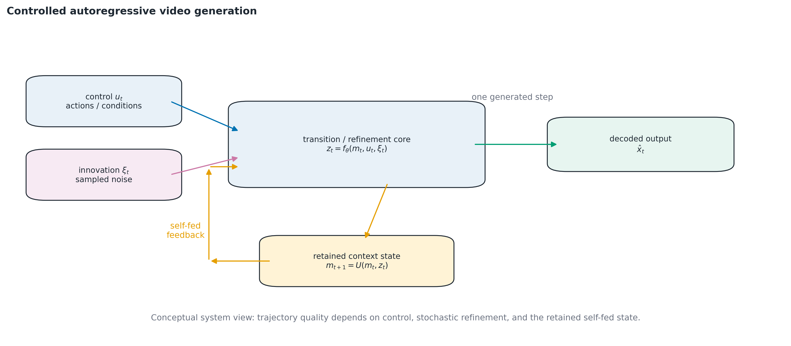

**Figure 1.1 — Video generation as an open dynamic control system.** Noise acts as an entropy
source, previous frames and actions as control signals, and autoregressive feedback makes output
quality a property of the complete self-fed trajectory. Source: author’s schematic.

In accordance with classical systems theory [41], the object
under study is characterized by a large number of interrelated elements, nonlinear interactions,
emergence, and a hierarchical structure. In the context of computer vision the elements of the
system are individual pixels or latent features (tokens). Their interaction is provided by
attention mechanisms and convolutional operations, which model spatio-temporal correlations.
Nonlinearity is achieved through nonlinear activation functions in the artificial neural networks
that form the core of the system.

An important characteristic of such a system is the iterative nature of its state transitions.
Unlike common GAN [42] or VAE
[43] decoders, which synthesize an output through one feed-forward
inference path, iterative models such as denoising diffusion probabilistic models (DDPM)
[2] explicitly decompose sampling into many state transitions.
This approach fundamentally changes the mathematical nature of the system: the state evolves in
time (or in the pseudo-time of optimization steps), and every next state depends on the previous
one, the current parameters, and the control action.

Mathematically, the evolution of the state of such a system is described by a recurrent equation
of Markov type:

$$x_t = f(x_{t-1}, u_t, \theta, \xi_t) \tag{1.1}$$

where $x_t$ is the system state (a multidimensional tensor of video data or its latent
representations) at step $t$; $u_t$ is the vector of control actions (generation conditions);
$\theta$ is the parameter matrix of the system (the neural network weights); $\xi_t$ is the
stochastic component (the random number generator); and $f$ is the nonlinear transition function
describing the law of state change.

When the stochastic component $\xi_t$ is present, the transition samples from a conditional
distribution; deterministic samplers correspond to a fixed or zero stochastic term. Systems
methodology under risk and uncertainty [5, 6] motivates tracking how initial state, conditioning, sampling, and feedback
affect later outputs. In generative video, failures can appear as visual artifacts, temporal
discontinuities, or violations of the intended scene dynamics.

Complex systems can be decomposed into interacting levels of detail or abstraction
[7]. For video generation, a useful analytical decomposition
distinguishes a **macro level** of scene composition and global relations, a **meso level** of
geometry and object structure, and a **micro level** of high-frequency appearance, lighting, and
pixels. This is a modelling choice used to expose cross-level consistency requirements; it is not
a claim that every implemented model contains three explicit modules.

Meaningful video depends on spatial and temporal relations across these descriptive scales. A
failure of cross-scale coherence may, for example, place plausible texture on an inconsistent
shape. Hierarchical consistency is therefore one component of stable generation, alongside
temporal, trajectory, conceptual, and object-level criteria developed later in the chapter.

### 1.1.1 Generation as an optimal-control problem

Increasing model capacity and training data can improve generation, but it also raises training
and inference cost and does not by itself identify which state or trajectory constraint is
violated. This motivates a complementary control formulation of the generation trajectory.

Consider the generation process as an optimal-control problem. At the initial moment $t = 0$ the
system state $x_0$ is fully chaotic (a pure-noise distribution), corresponding to the state of
maximal informational uncertainty. At the final moment $t = T$ the system must arrive at a state
$x_T$ belonging to the target distribution of real video data (a state of high internal
structural organization).

The formalization of this process requires a systemic criteria apparatus. In the present research
the quality of the terminal state and of the trajectory leading to it is described by a
**consistency criterion functional** $J(x, u)$, which quantitatively expresses the degree of
non-correspondence between the current state $x$ and the target concept under conditions $u$.
Generation then becomes a constrained optimization problem over the state space:

$$x^{*} = \arg\min_{x} J(x, u) \tag{1.2}$$

subject to the state-transition law (1.1). The smaller the value of the criterion, the more
consistent and realistic the generated object.

**Figure 1.2 — Conceptual multi-step generation on the landscape of a consistency criterion
$J(x,u)$.** The trajectory moves from a high-criterion noise state toward a structured
low-criterion region. This is a systems-level abstraction; only energy-based models instantiate
the landscape as an explicit learned scalar energy. Source: author’s schematic.

In the context of the intelligent information technology being developed, it is important to
clearly delimit the roles of two fundamental system concepts: the **global consistency criterion**
and **entropy**. The global criterion (1.2) is trajectory-level: it is a functional the modeling
system strives to minimize along the entire multi-step generation trajectory in order to reach
integral consistency of the object; in this dissertation it is operationalized not by a learned
scalar energy but by the measurable consistency criteria of §1.4 — in particular the
re-entry-stratified rollout metrics of §1.4.5, which the hierarchical model of Chapter 3 is built
to optimize. Entropy, by contrast, acts as a **local diagnostic indicator**: it quantifies the
level of structural informational uncertainty at specific spatio-temporal coordinates of the
data. Entropy maps allow the system to "understand" where complex moving contours are located and
where there is static background, and accordingly to adaptively redistribute limited
computational resources (this apparatus is realized in the V-BLT subsystem in Chapter 2).
Together these two system concepts form a closed loop of analysis and control.

Controlling this system runs into **computational uncertainty** on two fronts. First, at the
stage of parameter identification (training): since the transition function is realized by a deep
neural network, identifying the system parameters along a long chain of iterations requires
storing all intermediate states (activations) in operating memory, so the memory of
backpropagation through time grows linearly with the trajectory length. This creates a resource
barrier that rules out long control trajectories on practically available computing systems.
Second, at the stage of operation (inference): extending the temporal context of a flat attention
mechanism inflates its key–value memory linearly and its computation quadratically with context
length (analyzed quantitatively in §1.3.1). Overcoming the first front requires special methods
of structural optimization — in particular the introduction of reversible transformations that
reduce the memory-consumption complexity (developed in Chapter 2); overcoming the second requires
hierarchical decomposition of the state space with a compact long-memory level (developed in
Chapter 3).

### 1.1.2 Applied domains

Beyond its theoretical significance, understanding generative video models as complex control
systems has enormous practical importance for various applied fields. The tasks solved by such
systems intertwine closely with the objects of study of the specialty "System Analysis".

The first important application domain is medical imaging and the development of intelligent
systems for supporting clinical decision-making. Complex multidimensional spatial data (MRI, CT)
often require reconstruction, super-resolution, or cross-modal generation to minimize the
radiation load on the patient. In this domain any generation anomaly (a "hallucination" in the
form of non-existent tumors, or the loss of real anatomical structures) has fatal consequences,
so the requirement of absolute structural consistency is critical.

The second domain is ecological and technical monitoring using remote sensing data. Satellite
data often contain gaps due to cloud cover or technical failures. Generative systems are used for
spatial or temporal interpolation of missing data and for predicting the development of
ecological catastrophes (for example, the spread of forest fires). In this case the generated
intermediate states must strictly obey the laws of physics, thermodynamics, and the topology of
the terrain.

The third domain is the creation of educational and training simulators (for example, for
autonomous vehicle control systems). Training robots requires millions of hours of synthetic
video data with diverse scenarios (including extreme ones). The requirement imposed on the
generative system is long-term temporal coherence: objects cannot suddenly disappear, deform over
time, or violate the logic of physical interactions. In particular, an object that leaves the
camera's field of view must reappear in a consistent state and position when the camera returns
to it — a requirement that, as will be shown in §1.3.1 and §1.4.5, directly demands a long memory
horizon from the modeling system.

The analysis of the listed practical domains shows that modern generative systems are subject to
the following strict systemic requirements:

1. High visual quality and detail of the target data distribution;
2. Controllability of the system and the ability to respond to control actions;
3. Hierarchical representations without loss of coupling between levels;
4. Absence of spatial, temporal, and logical anomalies — including over long horizons, when
   content leaves and re-enters the field of view;
5. Resource efficiency under constraints of computational memory;
6. Interpretability of the process.

Summarizing, it can be stated that generative video models have reached the stage of evolution at
which their further development by empirical architecture search exhausts its potential. What is
required is the treatment of these algorithms as complex systems controlling dynamic processes,
which demands the development of a corresponding mathematical apparatus: methods of
decomposition, identification of uncertainty types, introduction of new consistency criteria, and
creation of algorithms for optimal resource control. The following subsections of this research
are devoted precisely to these questions.

## 1.2 Decomposition of the video generation system

The principal instrument of systems analysis in the study of complex systems is the method of
decomposition — the division of an integral system into interrelated subsystems, elements, and
couplings, with the aim of simplifying analysis and revealing deep properties and sources of
uncertainty. For the multidimensional system controlling the process of video data generation it
is expedient to apply several orthogonal kinds of decomposition: structural (functional),
hierarchical (semantic), and temporal.

### 1.2.1 Structural decomposition

Structural (functional) decomposition treats the generative system as a set of functional
information-processing blocks. In most modern architectures, irrespective of their mathematical
basis, three basic macro-subsystems are distinguished [44].

The first subsystem is the **Encoder** — the block of condition preprocessing and encoding. Its
function is to transform "raw" control signals (for example, a textual description, semantic
masks, or the pixels of context video frames) into a formalized multidimensional feature space.

The second subsystem, the **Iterative Generator / Denoiser**, is the central block of iterative
transformation. It is the mathematical core of the system, directly executing the
state-transition equation and performing optimization or denoising steps in the feature space.
This subsystem is responsible for eliminating the entropy of the initial state and forming a
consistent structure.

The third subsystem, the **Decoder**, is the block of decoding and reconstruction, which
translates the optimized latent state of the system back into the space of human perception (the
pixel space of an image or video stream).

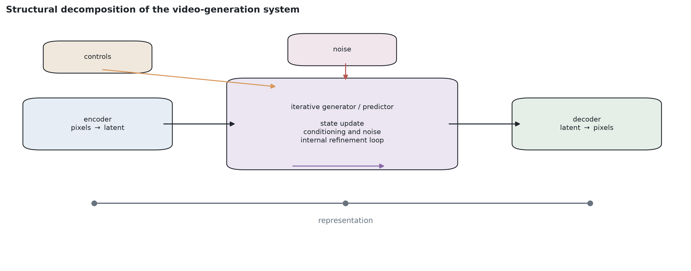

**Figure 1.3 — Structural decomposition of the video-generation system.** The encoder and
decoder define the representation interface; the central predictor carries the controlled
state transition and iterative refinement. Source: author’s schematic.

Of greatest interest for systems analysis is the central subsystem, since it is where the
state-control process takes place and the principal work of overcoming uncertainty is
concentrated. Its detailed study requires the deeper kinds of decomposition that follow.

### 1.2.2 Hierarchical decomposition of the state space

Complex systems have a pronounced hierarchical nature [7].
Accordingly, the state space of the central generation subsystem cannot be "flat" — it must be
decomposed into macro, meso, and micro levels.

At the **macro level** (the level of highest abstraction) the system operates with semantic
vectors of low spatial resolution but high semantic saturation. Here the questions of conceptual
composition are decided: the presence of objects, their mutual arrangement, and correspondence to
the specified condition.

At the **meso level** of abstraction (medium resolution) the system forms structural contours,
geometry, and the spatial relations of object parts.

At the **micro level** (high resolution) the questions of local pixel organization are decided:
the coherence of textures, lighting, and micro-details.

The problem of many modern generative systems — for example, standard diffusion models built over
variational autoencoders [3, 43] — is that they operate in a
single-level latent space, ignoring the necessity of explicit hierarchical decomposition [20, 35, 36]. This produces an internal control conflict in which macro- and
micro-decisions are taken simultaneously. The mixing of levels is a direct source of generation
anomalies: a correct object texture may be imposed on a distorted global shape.

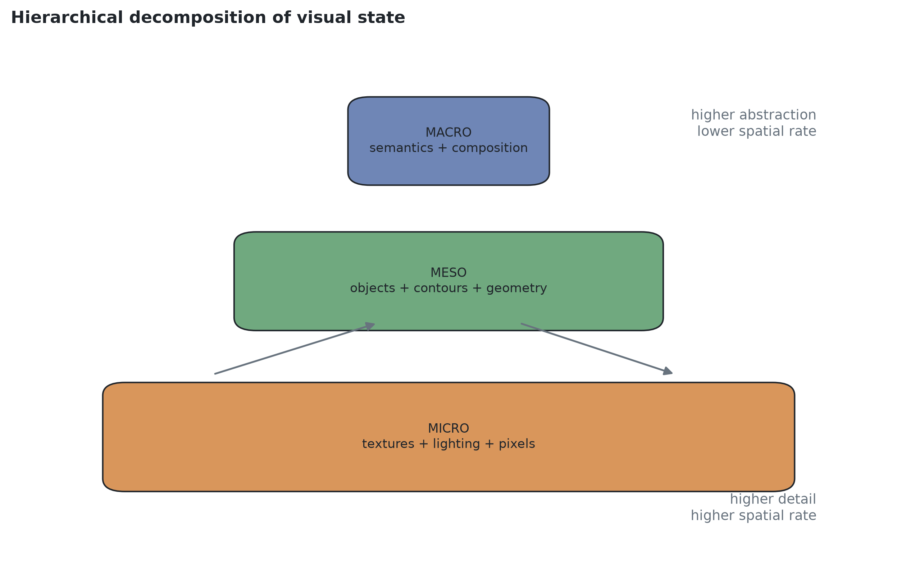

**Figure 1.4 — Hierarchical decomposition of visual state.** Macro denotes the highest
abstraction and lowest spatial rate; micro denotes the pixel-proximal level and highest detail.
Source: author’s schematic.

The systems approach requires the development of mathematical models of explicit hierarchical
decomposition with mechanisms of strict coherence between these orthogonal levels of
representation. This decomposition is the core of the present dissertation's topic. Moreover — a
property central to the direction developed in Chapters 2–4 — an explicitly decomposed hierarchy
allows the levels to run at *different temporal rates and context lengths*: a compact upper
(coarse) level with a low information rate can afford to retain a long temporal context at the
same memory budget for which a flat single-level representation affords only a short one, and can
therefore serve as the carrier of the system's long-range temporal memory (quantified in §1.3.1
and developed in Chapter 3).

### 1.2.3 Temporal decomposition

The third necessary kind of stratification is temporal decomposition. When modeling systems that
generate video data, time must be considered in two entirely different, orthogonal dimensions,
which creates the so-called "two-dimensional temporal grid".

The first dimension concerns the internal **pseudo-time** of the generation process — the
partition of the continuous process of state change into discrete refinement steps
$k = 1, \dots, K$ *per generated frame*: the steps of the reverse diffusion process, the token
steps of an autoregressive decoder, or the descent steps of an energy-based sampler. Every such
step is a micro-transition of the system in phase space, during which the total entropy of the
state decreases and its consistency increases.

The second dimension is introduced upon the transition to processing video sequences and reflects
the **physical time axis** $t = 1, \dots, T$, where every discrete slice is a separate frame. The
complexity of system control lies in the fact that the generative model must simultaneously
ensure stability in both temporal dimensions: the system state must evolve correctly along the
optimization axis $k$ for every individual frame, and at the same time all generated frames must
be spatio-temporally coherent along the physical axis $t$, forming smooth motion kinematics.

The physical axis, in turn, gives rise to the key quantitative characteristic of this
dissertation: the **memory horizon** — the maximal temporal distance $\Delta t$ at which
information about the past state of the modeled process can still influence the generated present
state. For a system whose central subsystem attends to a flat context window of $w$ frames, the
memory horizon is bounded by $w$; events separated by more than $w$ frames (for example, content
that left the field of view and returns later) are informationally inaccessible to it.

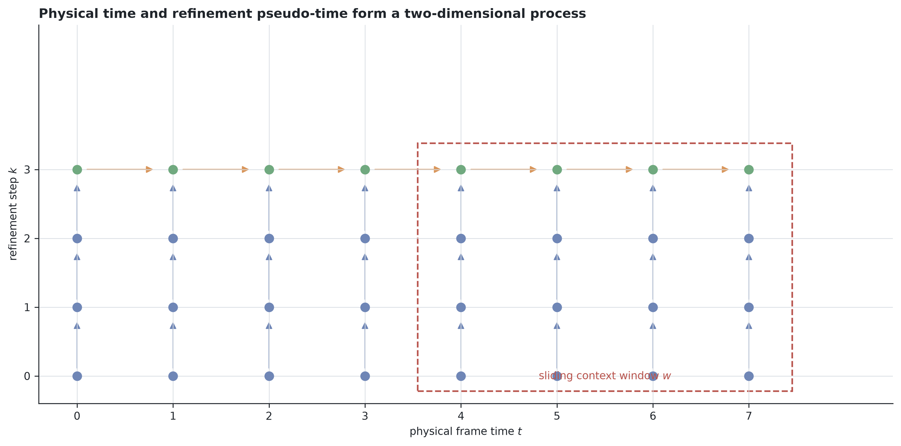

**Figure 1.5 — Two-dimensional temporal decomposition of video generation.** Horizontal
transitions advance physical frame time, vertical transitions refine each predicted state, and
the sliding context window bounds directly addressable history. Source: author’s schematic.

### 1.2.4 Classification of uncertainty types

The performed decomposition of the complex system permits a classification of the kinds of
uncertainty arising in it. In accordance with the theory of systems analysis of complex systems
under risk [5, 6] and system methodology [5, 6], uncertainties are classified by source and nature. In the video generation system
under study, four principal kinds of uncertainty are distinguished: informational,
structural-algorithmic, computational, and target uncertainty.

**Informational uncertainty** is conditioned by the very nature of the iterative generative
process, which begins from a state of pure noise (the state of maximal entropy). Moreover,
informational uncertainty is commonly present in the control actions. For example, the textual
description "a car drives along a road" or a coarse semantic mask is usually incomplete: it
specifies only boundary macro-conditions, leaving a multitude of micro-details (the shape of the
headlights, the texture of the asphalt, the lighting) undescribed. The task of the complex system
is the correct and plausible resolution of this uncertainty during generation. If the system
completes the missing information incorrectly, "hallucinations" and anomalies arise, rendering
the result inconsistent [45].

**Structural-algorithmic uncertainty** is connected with limitations and inductive biases of the
mathematical apparatus itself (the neural network). Implemented models have finite capacity. A
separate manifestation of this
uncertainty is the problem of spatio-temporal tokenization. Standard transformer architectures
(ViT, ViViT) partition the image into a regular grid of fixed-size patches, ignoring the fact
that the visual signal has non-uniform information density.

**Figure 1.6 — Fixed-grid tokenization under non-uniform information density.** Equal-size
patches assign equal token cost to static background and to high-information moving contours.
Source: author’s schematic.

Uniform allocation can be inefficient when large low-variation regions and small high-detail
moving regions have different representational requirements. This motivates—not logically
requires—adaptive tokenization based on local entropy, developed and evaluated in Chapter 2.

**Computational uncertainty** is the most critical for iterative multi-step models. It arises on
two fronts, corresponding to the two temporal axes of §1.2.3. On the training front (the
identification of model parameters), the backpropagation-through-time algorithm (BPTT) requires
storing in operating memory all intermediate states for every step of the modeled process; since
the state space of visual data is enormous, the linear growth $O(N \cdot K)$ of memory
requirements can exceed the physical limits of the hardware. Truncating the differentiated
trajectory removes gradient paths beyond the selected horizon and may therefore impair learning
of long-range effects. On the operation front, the flat attention context over the physical time
axis inflates the key–value memory linearly and the computation quadratically with the number of
context tokens (§1.3.1, eq. (1.7)), so the memory horizon of a flat system is capped by the
hardware precisely in the regimes where a long horizon is required. Reducing memory consumption
for gradient computation along deep trajectories and for context retention along long horizons
is therefore an important design objective for multi-step generative systems.

**Target uncertainty** arises when the criterion optimized by the model during training does not
coincide with the global goal during generation. For example, diffusion models optimize the local
error of noise prediction at one isolated step, but during generation these steps are chained
into a long sequence in which errors accumulate. This local-versus-trajectory mismatch can leave
terminal rollout quality only indirectly optimized.

The performed multidimensional decomposition of the video generation control system and the
classification of the identified kinds of uncertainty form a clear methodological basis for the
further research. This decomposition shows why improving one architectural element or one
aggregate metric need not resolve the complete consistency problem.

The dissertation therefore investigates a combined methodological toolkit comprising: methods of adaptive
entropy-based state estimation for resolving spatial uncertainty; resource-saving algorithms
based on reversible computation for overcoming computational uncertainty; and the creation of a
new **hierarchical control apparatus over compact continuous hierarchical latent state spaces**
for measuring and reducing structural and target uncertainty.

The next subsection conducts a detailed critical analysis of existing approaches to the
mathematical modeling of visual data — diffusion, hierarchical latent and autoregressive, and
energy-based models — with the aim of identifying their strengths and their fundamental systemic
limitations in the context of the requirements formulated above.

## 1.3 Analysis of existing approaches

To solve the posed problems of systems analysis and to construct an intelligent information
technology of video data generation, a thorough critical review of the existing mathematical
approaches to modeling complex multimodal spatio-temporal distributions is necessary. The modern
scientific landscape offers several competing paradigms, each with its own architectural
features, advantages, and limitations. This subsection reviews three classes
of models **in the order dictated by the argument of this dissertation**: (i) diffusion models —
one major route to high generation quality, with costly dense long-context variants; (ii)
hierarchical latent and autoregressive approaches — a possible remedy direction, within which the
choice between discrete and continuous latent spaces is examined;
(iii) energy-based models — reviewed as literature together with the resource-efficiency methods
they motivated. The focus criteria are systemic consistency and resource control.

### 1.3.1 Diffusion models: generation quality and the flat long-context barrier

Denoising diffusion probabilistic models (DDPM) [2] and deterministic/non-Markovian
samplers such as DDIM [46] are major approaches to high-quality image and video
generation. Unlike a GAN generator [42], which maps noise to data through one learned
forward path, diffusion models use an explicitly iterative denoising process.

The mathematical basis of the diffusion approach rests on concepts of non-equilibrium
thermodynamics. The modeling process is decomposed into two mutually inverse processes: forward
and reverse diffusion.

The forward diffusion stage is fixed and consists in the gradual addition of Gaussian noise to
the original "clean" data sample $x_0$, progressively driving it to the state of random noise
$x_T$. The process is modeled as a Markov chain:

$$q(x_t \mid x_{t-1}) = \mathcal{N}\!\left(x_t;\; \sqrt{1-\beta_t}\, x_{t-1},\; \beta_t \mathbf{I}\right) \tag{1.3}$$

where $\beta_t$ is a predetermined deterministic schedule of noise variance at step $t$. A
mathematical advantage of this construction is the closed-form availability of the noised state
at an arbitrary step directly from the original state:

$$q(x_t \mid x_0) = \mathcal{N}\!\left(x_t;\; \sqrt{\bar\alpha_t}\, x_0,\; (1-\bar\alpha_t)\mathbf{I}\right) \tag{1.4}$$

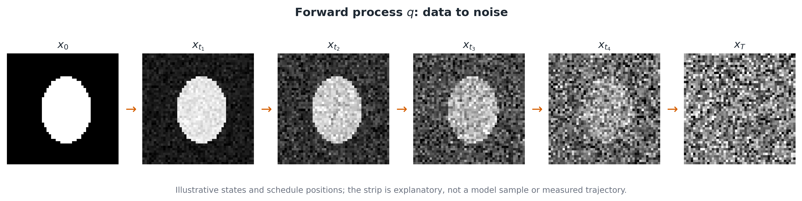

**Figure 1.7 — Forward diffusion.** Progressive Gaussian corruption destroys the information
structure of a sample from $x_0$ toward $x_T$. Source: author’s schematic.

At the reverse diffusion stage the system learns to invert this process, denoising the corrupted
sample and restoring the data. Unlike forward diffusion, the reverse process constitutes a
complex computational problem solved by deep neural networks:

$$p_\theta(x_{t-1} \mid x_t) = \mathcal{N}\!\left(x_{t-1};\; \mu_\theta(x_t, t),\; \Sigma_\theta(x_t, t)\right) \tag{1.5}$$

In practice the model is optimized to predict the added noise $\epsilon$ via the simplified loss:

$$L_{\text{simple}} = \mathbb{E}_{x_0, \epsilon, t}\left[\,\bigl\|\epsilon - \epsilon_\theta\bigl(\sqrt{\bar\alpha_t}\,x_0 + \sqrt{1-\bar\alpha_t}\,\epsilon,\; t\bigr)\bigr\|^2\,\right] \tag{1.6}$$

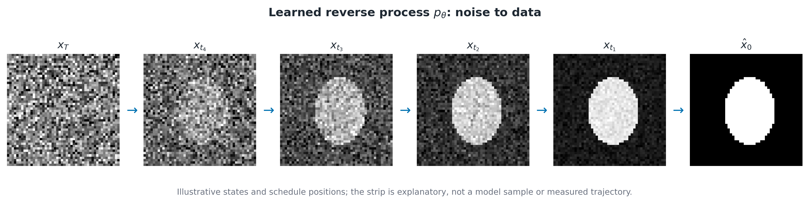

**Figure 1.8 — Reverse diffusion.** A learned denoising field iteratively restores structure from
noise. The sequence is conceptual and does not depict an experimental sample. Source: author’s
schematic.

The forward–reverse construction supports high-quality synthesis by turning sampling into a
sequence of denoising decisions. Pixel-space diffusion is expensive at high spatial resolution;
latent diffusion models (LDM) [3] reduce this cost by operating in a compressed
autoencoder space. Diffusion Transformers (DiT) [4] provide a transformer alternative to
convolutional denoisers, and video systems such as Sora [47] operate on
spatio-temporal latent patches at substantially larger data and model scales.

Modern video diffusion and token generators extend this lineage through spatio-temporal
denoising, latent video diffusion, large-scale video pretraining, variable-length token
generation, and masked video transformers [48, 49, 50, 51, 52, 53, 54, 55].
Interactive and autonomous world models further shift evaluation from isolated clips toward
action-conditioned state prediction and control [56, 57, 58, 59, 60, 61].
These systems establish the scale and practical importance of the problem, but they do not remove
the need to measure which historical information is retained under a bounded state interface.

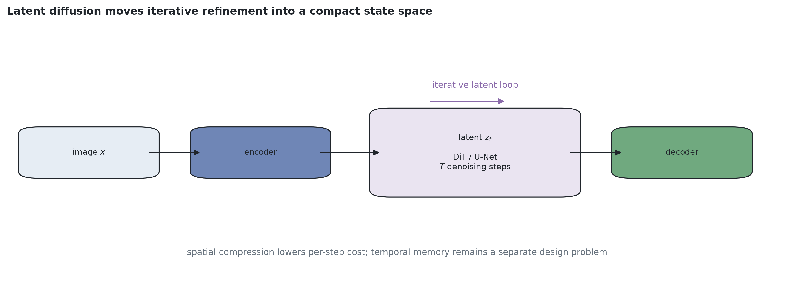

**Figure 1.9 — Latent-space diffusion.** Spatial compression reduces the per-step denoising cost,
but it does not by itself solve the temporal-memory allocation problem. Source: author’s
schematic.

Despite their generation quality, dense-context diffusion video systems retain resource and
long-horizon limitations that are the direct object of this dissertation's analysis. **The paradigm-level
strengths of iterative refinement are not in question here** — on the contrary, Chapter 4's
matched-capacity, matched-NFE mechanism study confirms empirically that an iterative refinement (diffusion)
core commits to sharp, correctly located content where a regression core averages over futures;
the per-frame generation core of the model developed in Chapter 3 is itself a diffusion core,
selected by exactly that controlled analysis. The limitations lie elsewhere — in *how the
temporal context is represented and scaled*.

One limitation of a **flat, single-level latent interface** is that global composition and local
appearance share one token field. This does not make inconsistency inevitable, but it prevents
explicit budget allocation and separate control across representation levels.

The second limitation is the **resource blow-up of flat long-context attention**. To lengthen the
memory horizon, a flat video transformer must lengthen its spatio-temporal token context. For a
context of $T_w$ frames tokenized at $N_s$ spatial tokens per frame, the attention context length
is $L = T_w \cdot N_s$, and the principal costs of the attention mechanism scale as

$$C_{\text{compute}} = O(L^2 \cdot D) = O(T_w^2 N_s^2 D), \qquad
M_{\text{KV}} = O(L \cdot D) = O(T_w N_s D) \tag{1.7}$$

where $D$ is the model width. For a standard dense attention layer, attention arithmetic grows
quadratically with context length; when past keys and values are cached, cache storage grows
linearly. Kernel improvements can reduce data movement and constants but do not remove the need
to choose which historical tokens remain in the state interface.

The third limitation is the **degradation of long-horizon temporal consistency** even where a
long flat context is affordable. Empirical evaluations of long-video generators and world models
show that content which leaves the field of view is not restored consistently upon its return,
and that consistency metrics degrade with the distance to the relevant past [62, 22, 24, 23]. In systems-analysis terms, the flat
context window imposes a hard memory horizon (§1.2.3): information older than the window is not
merely expensive — it is absent from the system state. Related to this is **target uncertainty**:
during training the model optimizes the local error of one isolated step, while during generation
errors accumulate along the whole autoregressive chain — the phenomenon of exposure bias [25, 26].

**Figure 1.10 — Flat long-context resource and re-entry barrier.** Panel A is schematic rather
than a hardware benchmark: key–value memory grows linearly and attention work quadratically with
sequence length. Panel B shows why a low-rate long-memory stream can remain addressable after the
relevant content has left a short flat window. Source: author’s schematic.
Source: NEW (draw)

### 1.3.2 Hierarchical latent approaches and autoregressive prediction

The remedy direction for the contradictions of §1.3.1 is formed by approaches that (i) treat
video prediction autoregressively along the physical time axis and (ii) decompose the latent
state space instead of flattening it. This subsection reviews the components of that direction:
patch-based autoregressive transformers, discrete-token models, and hierarchical latent models —
and motivates, by the author's own measurements, the choice of *continuous* hierarchical latent
spaces made in this work.

**Patch-based autoregressive transformers.** This line of work originates in the transfer of
natural-language-processing principles to computer vision. The standard approach, popularized by
the Vision Transformer (ViT) [63] and its video adaptations ViViT [64] and Video
Swin Transformer [65], partitions the video into a grid of non-overlapping
spatio-temporal patches that are linearized and fed to a transformer. The principal advantage of
transformer models is their capacity to model long-range dependencies between distant regions of
the video; their principal cost is exactly the quadratic attention complexity (1.7). Although
Video Swin partially mitigates it with local attention windows, the fundamental limitation —
a single-level latent space with fixed patching — remains. Fixed-grid tokenization is a form of
rigid, content-blind discretization: static low-information background and dynamic scene regions
receive equal computational budgets, which §1.2.4 identified as a source of
structural-algorithmic uncertainty. An analogous problem in language modeling was resolved by the
Byte Latent Transformer (BLT) [66], which groups bytes into latent patches of variable size
governed by information density (entropy). Transferring this paradigm to the visual modality
resolves the rigid-tokenization component of structural uncertainty; the V-BLT architecture
developed in this dissertation realizes that transfer and is presented in Chapter 2. *(Preserved
from old §1.3.2.)*

**Discrete-token autoregressive models.** A prominent branch of autoregressive video modeling
operates over *discrete* latent spaces: a vector-quantized autoencoder (VQ-VAE) [67] compresses frames into grids of codebook indices, over which an autoregressive
transformer learns the video distribution — the VideoGPT line [68] and its successors,
including long-video architectures with compressed memory [36]. The attraction of this paradigm is genuine: discrete tokens give a clean autoregressive
likelihood, natural compatibility with language-model tooling, and strong compression.

Discrete bottlenecks also introduce specific optimization risks—straight-through assignment,
codebook underutilization, dead codes and level collapse—that are documented in the VQ
literature [67, 68]. The implemented fourth-article system
therefore uses **compact continuous hierarchical latent state spaces**, in which both levels are
end-to-end differentiable and independently decodable. This is an implementation choice, not an
empirical conclusion that continuous representations are universally superior: the present
repository contains no controlled hierarchical-VQ-versus-continuous comparison and makes no such
claim. Representation sensitivity is instead tested within the continuous-codec family by the
pre-registered alternate-codec-seed study in Chapter 4.

Hierarchical latent variables are themselves a broad prior lineage, including deep
vector-quantized and variational hierarchies [69, 70, 71, 72]. The dissertation therefore assigns novelty to its systems methodology and
controlled video-memory demonstration, not to the general idea of arranging latent variables at
multiple levels.

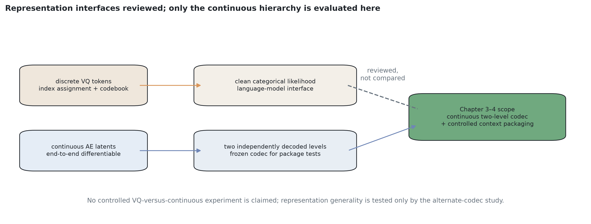

**Figure 1.11 — Representation interfaces and the evidence boundary of this dissertation.**
Discrete VQ models are reviewed as an important autoregressive family; the controlled experiments
use a continuous two-level codec. The dashed path denotes a comparison not performed here.
Source: author’s schematic.

**Hierarchical latent video models.** The direct remedy for the flat-latent limitation is the
class of models whose latent state space is explicitly multi-level, with distinct temporal or
spatial rates per level. Early representatives use multi-rate recurrent latents — clockwork
variational hierarchies [20] — where upper levels tick more slowly and thereby
retain longer temporal context. The modern form of this idea in the diffusion family is the
hierarchical latent video diffusion model of the MilliVid class [37]: a compact hierarchy of continuous latents (a low-rate *coarse* level and
a high-rate *fine* level, each independently decodable to pixels), a diffusion core that denoises
the levels jointly with cross-level attention, and autoregressive rollout along physical time.
The systemic significance of this spatial construction follows directly from eq. (1.7): because the
coarse level carries far fewer tokens per frame than the fine level, a *heterogeneous* context —
long in coarse tokens, short in fine tokens — covers a memory horizon many times longer than a
flat context of the same total token budget. The hierarchy converts the quadratic cost of horizon
extension into a near-linear one along the cheap level, making the coarse level one economical
carrier of long-range temporal memory. Temporal subsampling provides a distinct route to the same
span and is compared directly in Chapter 4. *(Chapter 3 develops the spatial form with a two-level
continuous latent interface and unidirectional context transfer; Chapter 4 treats it as one point
in the broader context-packaging design space.)*

Recent work broadens the design space beyond hierarchical latent state. WorldPack compresses and
retrieves trajectory memory; CaR/SceneFly and MemLearner study implicit or learned retrieval;
GIM-World introduces geometry-aware memory; and MBench and MemoBench construct explicit
long-memory evaluation tasks [23, 73, 74, 75, 76, 77, 22]. These papers
make architecture-level novelty untenable for generic “video memory.” The dissertation’s novelty
is instead the controlled package-by-budget intervention, exact LoopMom observability,
pair-specific reach populations, tested lower and upper inversions, and outcome-independent
simultaneous inference.

**Figure 1.12 — Context packages allocate equal capacity differently across reach and
fidelity.** Flat contiguous, spatially hierarchical and temporally strided packages feed the same
predictor family; the exact experimental token counts and target interfaces are reported in
Chapters 3–4. Source: author’s schematic.
Formally, the hierarchical factorization of the video distribution replaces the flat conditional
$p_\theta(x_t \mid x_{t-w:t-1})$ with a level-decomposed conditional of the form

$$p_\theta\!\left(z^{c}_{t}, z^{f}_{t} \,\middle|\, z^{c}_{t-w_c:t-1},\; z^{f}_{t-w_f:t-1},\; u_t\right), \qquad w_c \gg w_f \tag{1.8}$$

where $z^{c}$ and $z^{f}$ are the coarse- and fine-level latent states, $w_c$ and $w_f$ their
context windows, and $u_t$ the control signals; the asymmetry $w_c \gg w_f$ at a matched token
budget $w_c N_s^{c} + w_f N_s^{f} \approx \mathrm{const}$ is what extends the memory horizon
without the flat blow-up (1.7).

**Methodology for comparing hierarchical configurations.** The canonical comparison methodology
of this class is the Clockwork-VAE benchmark
[20]: one configuration table over several datasets and metrics, quality-retention
curves over long open-loop rollouts, and level-content probes (an upper level following its
prior while lower levels see the context). The dissertation adopts this *format* in §4.4 while
tightening three controls the original lacks — a systems-analysis point in its own right. First,
capacity: the compared CW-VAE-class models differ in parameter count (their RSSM baseline 5M vs
CW-VAE 12M; only the NoTmpAbs ablation is matched), whereas in the token-stream architecture of
Chapter 3 depth adds tokens to a shared backbone with only per-level I/O heads (+1.4%
parameters, disclosed) — the depth axis is backbone-capacity neutral. Second, context cost: a recurrent state has no token-budget axis, so
hierarchy-versus-flat comparisons in the recurrent family cannot hold context cost fixed; the
token interface makes every configuration's cost an exact count, enabling matched-budget
comparison. Third, metrics: the CW-VAE evaluation aggregates SSIM/PSNR over full frames, and the
author's own measurement (§3.4.3) shows a constant all-black frame outperforming a trained
CW-VAE on such aggregates on sparse-foreground video — hence the foreground-masked,
re-entry-stratified protocol of §3.4. It is also noted that the CW-VAE paper's depth evidence is
an information-allocation (KL-per-level) analysis rather than a prediction-quality dose–response;
the quality-per-depth cells are measured directly in §4.4.5. The temporal-abstraction relatives —
VTA [34] (whose lower level resets when the upper level ticks) and the clockwork recurrent
lineage [33] — complete the review of hierarchy *shapes*:
spatial and temporal abstraction, depth and budget allocation are four axes of the design space.
Which form of hierarchy pays and where is therefore a measurement question (§4.4), not a
postulate.

Summarizing the hierarchical-latent review: this paradigm inherits the generation quality of the
diffusion core (§1.3.1) while remedying its two systemic limitations — the flat latent space and
the flat context window — and, per the author's measured finding, its *continuous* form is the
one trainable at practically reachable scale. It is therefore adopted as the base paradigm of
this dissertation.

### 1.3.3 Energy-based models and resource efficiency

The third class of the review is that of energy-based models (EBM). The EBM paradigm originates
in statistical physics [78, 79]. Its basic principle is that the probability of a data configuration $x$ is defined by
the Gibbs/Boltzmann distribution:

$$p_\theta(x) = \frac{\exp\left(-E_\theta(x)\right)}{Z(\theta)} \tag{1.9}$$

where $E_\theta(x)$ is a scalar energy function parameterized by a neural network and $Z(\theta)$
is the partition function. Under a calibrated model, lower energy corresponds to higher model
density; it does not automatically imply semantic or temporal consistency.

An important theoretical bridge connects EBM to diffusion models through score matching [80, 81]: the score function approximated by a diffusion model is the negative gradient of
an (implicit) energy,

$$\nabla_x \log p(x) = -\nabla_x E(x) \tag{1.10}$$

From the standpoint of systems analysis, the attraction is that the energy supplies an explicit
scalar criterion and its input gradient defines an inference direction. This does not guarantee
convergence, calibrated probabilities, or anomaly detection: those properties depend on the
learned landscape and sampler. Transformer-parameterized realizations such as Energy-Based
Transformers (EBT) [82] expose the number of descent steps as an
inference-compute control. This dissertation evaluates that mechanism for conditional video
prediction without attributing that task or result to the original EBT publication.

However, the broad application of EBM is critically limited by computational uncertainty. To
train such a model, backpropagation must be threaded through $K$ MCMC iterations of the forward
pass; BPTT memory grows as $O(K \cdot L)$, where $L$ is the network depth, and since every MCMC
iteration requires a gradient with respect to the input (double backward), memory overflow occurs
rapidly [83, 84], precluding deep optimization trajectories for
high-quality video data.

Approaches to this barrier constitute the resource-efficiency toolbox of multi-step systems.
Gradient checkpointing [30, 31] trades computation for memory by storing
only a subset of activations and recomputing the rest; a balanced segment schedule can achieve a
square-root memory trade-off in trajectory length. Neural ODE adjoints [85] can avoid
retaining the full forward tape but introduce reconstruction and numerical-accuracy concerns.
Discrete reversible neural networks—RevNet [32] and RevViT [86]—instead
reconstruct layer inputs algebraically. This apparatus forms the core of TempVerseFormer in
Chapter 2. It is **not** used to train the final Chapter 3 hierarchical predictor through its
rollout; the two resource strands are synthesized methodologically and measured separately.

An honest forward reference completes this review. In the present research the energy-based
mechanism was not adopted a priori but *examined experimentally* under matched conditions: the
matched-capacity, matched-NFE mechanism study of Chapter 4 (§4.2) includes a two-sided
capability study of Energy-Based Transformers, run with the official published implementation and
both published training recipes at the largest scale reachable on the available hardware. Its
outcome is a **characterized negative** at that scale: one published recipe converges to a stably
*mis-ordered* energy landscape (the mean of the data attains lower energy than the true target);
the other recipe repairs the ordering — the true target becomes the energy minimum among probed
candidates — yet gradient descent from the prescribed initialization still does not reach
structured outputs, and inference-time computation does not buy the capability back; meanwhile a
diffusion core of roughly half the parameter count, on the same latents and protocol, commits to
sharp and correctly located predictions. The study is scoped explicitly: it tests a capability
the EBT publication does not claim at a scale it did not run, and contradicts none of the
published claims. For this dissertation its systemic significance is that the choice of the
per-frame generation core in Chapter 3 is made *by controlled measurement, not by paradigm
preference* — and the measurement selects diffusion.

Summarizing the critical analysis of existing approaches: diffusion models are a strong
generation mechanism, but a dense flat realization runs into the long-context resource
blow-up (1.7) and the memory-horizon consistency degradation; patch-based transformer models
capture global context well but require entropy-based adaptation of their rigid tokenization;
hierarchical latent models provide an alternative to flat-latent and flat-context allocation, and
the continuous form was trainable at the scale reached in this work (whereas the tested
hierarchical VQ configurations were unstable); energy-based models offer an attractive explicit
criterion but are resource-barred in training, and their descent mechanism is experimentally
characterized as a negative at this work's reachable scale (Chapter 4). The synthesis defining
this dissertation is therefore: **a hierarchical continuous-latent video model with a diffusion
refinement core, whose coarse level carries the long memory horizon (Chapter 3), supported by
entropy-adaptive decomposition (Chapter 2), reversible-computation resource optimization
(Chapter 2), and a criterion-driven measurement instrument (Chapters 3–4)**. These are linked
dissertation strands, not one experimentally integrated executable pipeline.

## 1.4 Consistency criteria and methods

In the theory of complex systems one of the fundamental notions is the stability of a system
[87] — its capacity to maintain a specified state or target
trajectory under external disturbances and internal stochasticity. In the context of generative
video models the notion of stability is most closely tied to the term "consistency" (coherence,
non-contradiction). Traditionally, the evaluation of generation results in machine learning
reduces to the subjective criterion of visual attractiveness or to statistical metrics of
proximity to the training sample, such as FID [88]. From the standpoint of systems
analysis such an approach is severely limited.

Systems analysis requires the transition from abstract aesthetic evaluation to a formalized
criteria apparatus. The generative model is treated as a system transforming the input
information signal of the condition $u$ into the output state $x$. If the state $x$ contains
internal logical, spatial, or physical contradictions, it is classified as anomalous.
Accordingly, **consistency is operationalized as the absence or bounded severity of specified
contradictions in the generated state and trajectory**. It is related to, but not synonymous with,
software reliability or dynamical stability.

Since video data have a deep multidimensional structure, consistency cannot be described by one
scalar parameter. It is a complex systemic phenomenon requiring an extended taxonomy. This
subsection analyzes the classical kinds of consistency — spatial, object, and temporal —
integrates the notion of conceptual consistency, and formalizes hierarchical and trajectory
consistency, which are critically important for hierarchical multi-step generative systems.
### 1.4.1 Spatial and object consistency

The basic level of coherence for any visual signal is **spatial consistency**. This criterion
determines the structural integrity of the generated frame at the level of geometry and the
mutual arrangement of elements. Its endpoints concern object proportions, boundaries,
perspective, and lighting coherence; no single endpoint guarantees all of these properties.

The next level is **object consistency**. In many practical tasks the system must generate a
series of states of one and the same object (from different viewpoints, under different
lighting), preserving its unique identifying features. Modern generative algorithms approach this
task in several ways.

The simplest method of achieving object consistency in diffusion models is generation by the
image-to-image approach [89]: an existing reference image is used as
the starting point to steer the generation toward a specified result. The diffusion model
transfers the information of the image into its latent space, subtly influencing the direction of
the process.

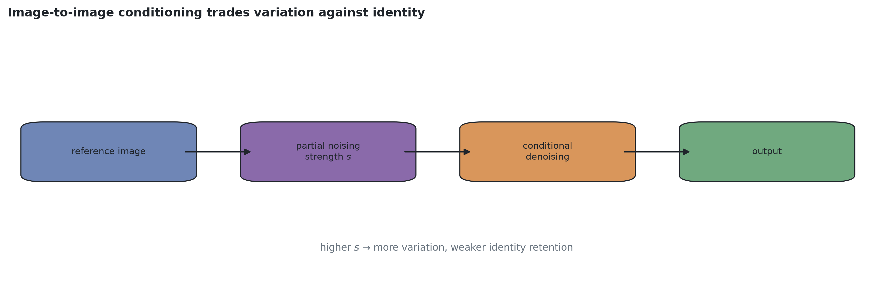

**Figure 1.13 — Image-to-image conditioning.** Increasing noising strength expands variation but
weakens direct preservation of the reference identity. Source: author’s schematic.

This approach, however, has rigid systemic limitations — the difficulty of precise control: a
higher degree of noising of the reference increases variability and loses the consistency of fine
details (textures, scratches).

A deeper method is fine-tuning of the model itself by approaches of the DreamBooth family [90] and its low-rank variation LoRA [91]. This method uses a set of reference
images of a specific object to adjust the internal representation (the weight coefficients
$\theta$) of the model. Although DreamBooth can secure the consistency of specific features (for
example, facial features or the texture of a particular object), it is computationally heavy and
works exclusively within the "learned" object.

For enforcing strict spatial consistency of shape there exists the ControlNet architecture [92], which injects a special control signal (depth maps, contours, segmentation masks)
into the reverse diffusion process. Methods of the ControlNet type perform the function of hard
boundary control of the admissible state space: the input image acts as a guiding form
constraining the evolution of the system.

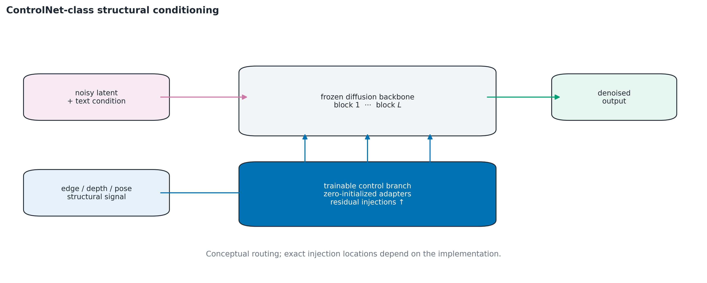

**Figure 1.14 — Structural control with a ControlNet-class branch.** A trainable branch maps
edges, depth or segmentation into residual constraints for a frozen diffusion backbone. Source:
author’s schematic after the ControlNet architecture [92].

Despite the effectiveness of ControlNet, it is not a complete solution for object consistency,
since it focuses only on the form ("how") and not on the properties ("what"). A fully autonomous
system must be able to maintain object identity through internal control mechanisms, without
mandatory external structural prompts. *(This requirement — identity maintenance by internal
memory rather than external prompts — is exactly the long-memory requirement that the coarse
level of the Chapter 3 model serves.)*

### 1.4.2 Temporal consistency

Upon the transition from static images to video data the key criterion becomes **temporal
consistency**. It requires that the sequence of generated states $x_1, x_2, \dots, x_T$ form a
logical and smooth video stream. Anomalies of temporal consistency manifest as flicker, sudden
background color changes, or deformation of objects during motion.

The mathematically strict local requirement of temporal consistency is formalized through
optical flow or a warping function $W$: if the vector field of motion between frames $t-1$ and
$t$ is known, the generated state $x_t$ must maximally correspond to the warped previous state
$W(x_{t-1})$. The local temporal-consistency error is defined as:

$$L_{\text{temp}} = \left\|\left(x_t - W(x_{t-1})\right)\right\|^2 \odot M \tag{1.12}$$

where $M$ is a binary mask excluding occlusion regions.

It must be emphasized, however, that the warp criterion (1.12) is **local**: it couples only
adjacent frames and therefore certifies only short-range temporal consistency. It is entirely
blind to the long-range regime identified in §1.3.1: content that leaves the field of view exits
the domain of the mask $M$, and its consistent restoration upon re-entry many frames later is not
constrained by any chain of local warp terms — it is constrained only by the memory of the
generating system. Long-range temporal consistency is therefore operationalized separately, as
part of trajectory consistency (§1.4.5), through metrics stratified by re-entry hardness. For
ensuring temporal consistency in the developed information technology, the following mechanisms
are used: multidimensional positional encoding 3D-RoPE, block-causal attention masks, and
temporal chaining mechanisms (Chapter 2), together with the coarse-level long memory of the
hierarchical model (Chapter 3).

### 1.4.3 Style and conceptual consistency

Besides object consistency, complex systems must maintain a unified **stylistic** appearance of a
series of generated data. Modern approaches such as StyleAligned [93] solve this
problem through intervention in the attention mechanism (shared attention): target images receive
information about the reference image during generation, copying its global stylistic
characteristics (color palettes, brushwork) without interfering with spatial geometry.

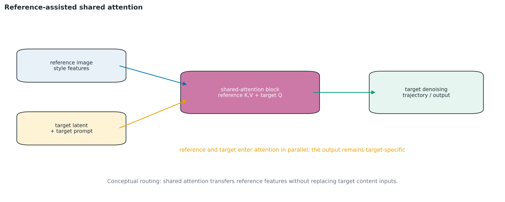

**Figure 1.15 — Style consistency through shared attention.** Reference attention features are
shared across distinct target trajectories while their content conditions remain separate.
Source: author’s schematic after StyleAligned [93].

For a more thorough and qualitative analysis of generative models, within this dissertation
research — published in **[A3]** (the consistency-criteria article) — the notion of **conceptual
consistency** was formalized.

Marr's multi-stage account of visual representation — progressing from image evidence toward
structured descriptions of the scene [94] — motivates a broad engineering analogy, but does not itself prescribe
the taxonomy used here. The dissertation's narrower claim is that the traditional division into
style and object alone is incomplete. Conceptual consistency is the capacity of the generative system for
compositionality and extrapolation. It evaluates the ability of the model not merely to reproduce
existing objects but to generate entirely new visual ideas (out-of-distribution), never
encountered during training, while strictly observing the logic of the control conditions $u$.

For example, generating the image "a skyscraper built of skyscrapers" requires the system to
perfectly disentangle the vectors of "shape" and "material". An anomaly of conceptual consistency
is the loss of compositionality — when the system ignores part of the textual condition or
generates objects side by side instead of combining them.

As the metric for evaluating conceptual consistency, the cosine similarity between the semantic
vectors of the generated image and the textual condition in the joint space of a contrastive
model (CLIP score) [95] is proposed. Let $E_I$ be the visual encoder and $E_T$ the textual
encoder; then the measure of conceptual consistency is defined as:

$$C_{\text{concept}}(x, u) = \frac{E_I(x) \cdot E_T(u)}{\left\|E_I(x)\right\| \left\|E_T(u)\right\|} \tag{1.13}$$

High values of this indicator testify that the system has successfully resolved the target
uncertainty and learned the deep causal relations of the visual space.

### 1.4.4 Hierarchical consistency

For the transition to systems of a higher order of complexity — multi-level generative models —
this research introduces the notion of **hierarchical consistency**, developed within the
construction of the hierarchical generation model of Chapter 3. This criterion follows directly
from the principles of systems analysis of multi-level objects.

Hierarchical consistency is defined as the strict informational and structural coherence between
the representations of one and the same visual object at different levels of abstraction: the
macro level (semantics), the meso level (structure), and the micro level (pixels or textures). An
anomaly of hierarchical consistency is a situation of internal system conflict: for example, the
macro signal forms the contour of a brick building while at the micro level the system generates
organic wood patterns.

Ensuring this property requires the introduction of an inter-level coherence operator. From the
standpoint of system control, the essential requirement is that the junior (fine/detailed) level
must not be able to contradict the senior (coarse/abstract) level's decisions at long range. In
the Chapter 3 model this requirement is satisfied by two complementary mechanisms (§3.1.2–3.1.3).
First, by **information-design asymmetry**: within a prediction step both levels are denoised
jointly in one shared attention pass, but only the coarse level's history extends over the full
memory horizon — long-range structure can therefore *originate only from the coarse channel*,
and the fine level physically lacks the inputs to contradict it at long range; the control is
unidirectional in the information-theoretic sense (coarse → fine for long-horizon signals), not
in the scheduling sense. Second, by **gradient detachment at the system boundaries** where it is
exact and load-bearing: between the frozen representation subsystem and the prediction core (the
state coordinate system is a constant of the control problem), and between past and future along
the autoregressive rollout (previously generated context enters as a constant, excluding
destructive gradient interference between successive windows).

### 1.4.5 Trajectory consistency

The last — and, for multi-step generative systems, fundamental — criterion is **trajectory
consistency**: the stability of the generation process itself as a trajectory of the complex
system. In the original, single-frame reading it concerned the stability of the iterative
refinement process in pseudo-time $k$; in the present research it is generalized and
operationalized on the physical time axis, where the dominant practical instability of video
generation lives: the degradation of **autoregressive rollout**, in which the system consumes its
own outputs as context and errors compound along $t$ (the realization of the target uncertainty
of §1.2.4 and the exposure bias of §1.3.1).

A trajectory-consistent system must satisfy two requirements. First, **bounded degradation**: the
prediction error along an autoregressive rollout must grow in a controlled manner, without
divergence or collapse of the generated content. Second — the requirement that separates a
long-memory system from a flat one — **consistent re-entry**: content that left the field of view
must be restored correctly when it returns, at any temporal distance within the modeled process.

The operationalization of this criterion, developed in Chapters 3–4, stratifies rollout error by
an exactly computable hardness label. For a generated frame $x_t$ with context window $C$, let
the **novel-foreground fraction** $\nu_t(C) \in [0, 1]$ be the fraction of the frame's foreground
content that was informationally inaccessible from $C$ (in the purpose-built testbed of Chapter 3
this quantity is computed *exactly* from the recorded control-action track, rather than
estimated). Trajectory consistency is then measured as the family of stratified degradation
curves

$$\mathcal{E}_{b}(h) = \mathbb{E}\!\left[\, e\!\left(x_{t+h},\, \hat{x}_{t+h}\right) \,\middle|\, \nu_{t+h} \in b \,\right] \tag{1.14}$$

— the expected prediction error $e$ at rollout horizon $h$ within each hardness bin $b$ (easy:
$\nu = 0$; medium: small $\nu$; hard re-entry: substantial $\nu$) — rather than as a single
aggregate number. This stratification is what makes the criterion *diagnostic*: a flat-context
system and a long-memory hierarchical system can be indistinguishable on aggregate error while
differing qualitatively on the hard re-entry bin beyond the flat window's horizon; conversely, an
anomaly of trajectory consistency (divergence, mean-collapse, identity loss at re-entry)
localizes to specific bins and horizons.

For energy-based mechanisms the trajectory criterion has a specialized classical diagnostic in
pseudo-time: the divergence of the sampling chain (1.11) is monitored by the **energy gap**
between the initial and final states of the descent,

$$\Delta E = \frac{E(x_0) - E(x_K)}{E(x_0)} \tag{1.15}$$

which must be strictly positive, and by the ordering of the trained landscape (whether the true
target attains lower energy than degenerate candidates). Finally, the practical attainability of long
consistent trajectories depends on resolving the computational uncertainty of §1.2.4: removing
the memory limits on trajectory depth by the time-agnostic backpropagation developed in **[A2]**
and Chapter 2.

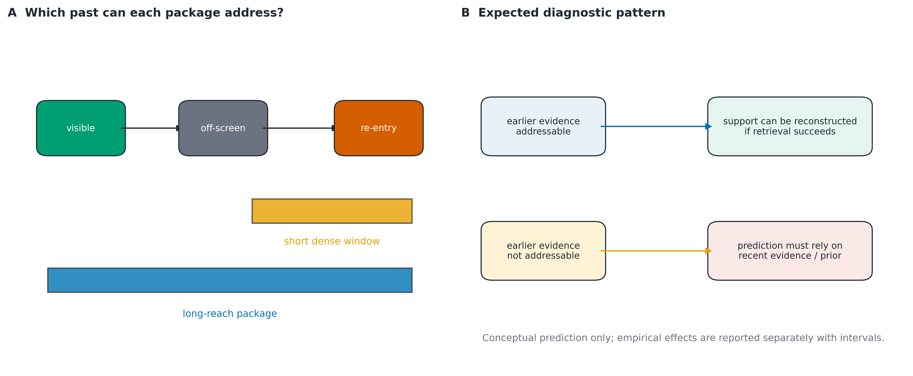

**Figure 1.16 — Conceptual operationalization of trajectory consistency.** The schematic predicts
separation specifically on memory-relevant re-entry records beyond a short window; Chapter 4
tests this prediction with exact generator-derived observability labels and paired rollouts.
Source: author’s schematic; curves are illustrative, not measured.

The criteria interact but are not interchangeable. A frame can be spatially plausible while
identity is wrong, or retain identity while drifting in trajectory. This motivates reporting a
suite of criteria rather than reducing consistency to one aggregate score.

ControlNet and LoRA address specific conditioning or adaptation objectives. The systems approach
used here complements such mechanisms by making the state interface, context budget, temporal
reach, and evaluation population explicit. Chapters 3–4 construct and evaluate a multi-stream
context model; Chapter 2 measures reversible activation-memory savings separately. The
dissertation does not claim that stop-gradient transfer or reversibility guarantees every form of
consistency.

## 1.5 Conclusions and statement of the research tasks

In the first chapter of the dissertation a thorough systems analysis of the processes of
hierarchical video data generation has been carried out. On the basis of complex-systems theory,
generative video models have been characterized as open dynamic multi-level control systems
operating under substantial structural, informational, computational, and target uncertainty.

The decomposition of the generation system revealed the key problems of contemporary approaches.
The analysis of diffusion models showed that dense flat realizations have two limitations relevant
to this dissertation: a single-level latent interface provides no explicit allocation between
abstraction levels, and a flat spatio-temporal attention context whose computation grows
quadratically and whose
memory grows linearly with context length. This makes dense extension increasingly costly, while
long-video studies report consistency failures when content leaves and later re-enters the field
of view. In addition, the divergence between the local training objective and the long
autoregressive generation trajectory (exposure bias) undermines long-horizon stability.

The review of patch-based transformer architectures demonstrated their advantages in capturing
global contextual dependencies but also identified a possible inefficiency of fixed
spatio-temporal tokenization on non-uniform signals. This motivates the entropy-guided adaptive
decomposition developed in Chapter 2; it does not imply that fixed patches are always inferior.

The study of hierarchical latent approaches established the remedy direction: an explicitly
multi-level latent state space in which a compact upper (coarse) level, carrying few tokens per
frame, can retain a long temporal context at a fixed token budget and thereby serve as the
carrier of the long-range memory of the process. Discrete-token hierarchies remain an important
reviewed alternative with codebook-specific optimization risks. The implemented and evaluated
scope of this dissertation is a **compact continuous hierarchical latent state space**; because
no controlled VQ-versus-continuous receipts are present, representation-family superiority is
not claimed.

The examination of energy-based models (EBM) recorded their systemic attraction—an explicit
scalar optimization criterion and input-gradient inference direction—alongside their measured
computational barrier: gradient identification through long MCMC trajectories with linear memory
growth. In this dissertation the energy-based mechanism is treated as reviewed literature whose
capability boundary at reachable scale is characterized experimentally in Chapter 4; the survey
of resource-efficiency methods it motivated (checkpointing, Neural ODE, reversible networks)
identified reversible transformations as one promising apparatus, which Chapter 2 develops
into the time-agnostic backpropagation method and its extension to stochastic multi-level
recurrences.

Furthermore, the chapter extended and improved the criteria apparatus for evaluating the results
of generative models. The notion of consistency was reconceived as the systemic property of the
absence of anomalies and the stability of the generation trajectory. To the classical criteria
(spatial, object, temporal consistency) new kinds were added: conceptual, hierarchical, and
trajectory consistency — the last operationalized through autoregressive-rollout degradation
metrics stratified by an exactly computable re-entry hardness label, which converts a previously
declarative criterion into a measurable instrument of systems analysis.

The identified systemic contradiction — between the necessity of ensuring multi-level consistency
of video data over long time horizons (which requires long memory horizons and deep hierarchies)
and the strict resource constraints of modern computing systems (the attention-memory blow-up of
flat contexts and the linear growth of training memory with horizon length) — determines the
relevance of this dissertation research and forms its purpose.

**The purpose of the dissertation research** is to improve the efficiency and the temporal and
spatial consistency of hierarchical video data generation processes through the development of
systems analysis methods, mathematical models, and intelligent information technologies.

To achieve this purpose and to resolve the identified systemic contradictions, the following
research tasks must be solved:

1. Analyze the state and problems of generative video-data models as complex systems; classify
   the types of uncertainty and identify the systemic causes of anomalies (inconsistencies) in
   the generation process, including the resource and consistency limitations of flat
   long-context modeling *(performed in Chapter 1)*.

2. Improve the criteria apparatus of systems analysis of generative processes by extending the
   taxonomy of consistency types (conceptual, hierarchical, trajectory) and operationalizing
   trajectory consistency through measurable rollout metrics stratified by re-entry hardness
   *(the taxonomy is constructed in Chapter 1; the operational metrics and their measurement
   instrument are developed in Chapters 3–4)*.

3. Develop a method for estimating the state of uncertainty of spatio-temporal data through their
   adaptive decomposition using entropy metrics and the mathematical apparatus of
   multidimensional rotary positional embedding.

4. Develop a method for optimizing the computational resources of multi-step iterative models
   that ensures constant, process-length-independent consumption of memory on the basis of
   reversible mathematical transformations; extend it to stochastic multi-level recurrences and
   delimit its domain of applicability.

5. Develop a mathematical model of multi-stream video data generation in compact hierarchical
   latent state spaces, supporting context streams at different temporal rates and spatial
   resolutions over a shared attention backbone, with unidirectional context-signal transfer
   and a per-frame iterative-refinement generation core selected by controlled mechanism analysis.

6. Create an intelligent information technology and a software complex for the systems analysis
   of hierarchical video generation processes, integrating the developed methods of adaptive
   tokenization, resource optimization, and hierarchical generation, together with a
   purpose-built memory-horizon testbed and re-entry-stratified evaluation protocol as its
   measurement instrument.

7. Conduct comprehensive experimental studies and approbation of the developed methods and
   technology on synthetic and open datasets — including a matched-capacity, matched-NFE
   comparison of prediction mechanisms — and compare their efficiency and consistency with
   modern analogues.

The solution of tasks 3–7 is the subject of the following chapters of the dissertation. Chapter 2
presents the mathematical apparatus of adaptive data tokenization and computational-resource
optimization; Chapter 3 develops the hierarchical mathematical model with long-range coarse-level
memory and the memory-horizon measurement instrument; Chapter 4 presents the experimental
research and practical application.

The results of this chapter are published in the author's work [A3] and in the conference
publications to be identified in the final author-supplied publication list.

---

# Chapter 2 — Mathematical Methods for Uncertainty Estimation and Resource-Efficient Modelling of Multi-Step Video Processes

## 2.1 Entropy-Based Estimation of Spatio-Temporal Video Uncertainty

As established in the previous chapter during the decomposition of the complex system, the
processes of hierarchical video data generation operate under a high level of multidimensional
uncertainty. To build an effective control system for such processes, it is necessary to develop
a mathematical apparatus for resolving the informational, structural-algorithmic, and
computational uncertainty at every stage of information processing. One of the fundamental
problems that generates a significant share of the structural-algorithmic and computational
uncertainty is the problem of inefficient decomposition of the input spatio-temporal data.

In classical systems analysis, the decomposition of a complex system must reflect its internal
information saturation and structure. However, the traditional approaches to the mathematical
modeling of video data, popularized by architectures of the Vision Transformer (ViT) type
[63] and their spatio-temporal extensions ViViT
[64] and Video Swin Transformer [65],
are based on a rigid, a-priori-fixed partition of the image or video stream into a regular grid
of non-overlapping patches of fixed size, e.g., 16×16 pixels.

Fixed patches are simple and effective, but their token allocation is independent of local signal
complexity. In videos with large low-variation regions and small high-detail moving regions, this
can allocate equal token cost to areas with different representational demands. Whether that
trade-off matters is empirical rather than a universal defect of fixed-grid models.

The dissertation investigates adaptive, data-dependent decomposition as one response. The conceptual
foundation for this transition is the new paradigm of byte-level language models that emerged in
natural language processing, in particular the Byte Latent Transformer (BLT)
[66]. These systems abandoned the paradigm of fixed token vocabularies
in favor of dynamic grouping of elementary information units (bytes) into latent patches whose
size is inversely proportional to the local complexity of the signal.

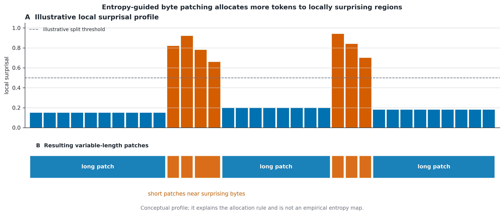

**Figure 2.1 — Conceptual operating principle of entropy-driven byte patching.** Long
low-entropy regions are grouped into larger latent patches, whereas locally surprising regions
receive finer allocation. The values are schematic, not empirical measurements. Source:
author’s schematic after BLT [66].

Within the dissertation research, the results of which are published in **[A1]**, the hypothesis
was put forward that transferring the principles of adaptive entropy-based tokenization to the
visual modality may improve the allocation of
computational resources of a generative system. On the basis of this approach, the author
developed the method for estimating spatio-temporal uncertainty and a new mathematical
architecture — the Vision Byte Latent Transformer (V-BLT).

Working at the input-byte level, where each RGB channel value is represented by an integer from
0 to 255, avoids committing the target interface to a learned discrete visual codebook
[67]. It does not make the learned hidden representation
lossless. The developed V-BLT architecture is
a three-tier hierarchical information-transformation system consisting of a Local Encoder, a
Global Latent Transformer, and a Local Decoder. In the arc of this dissertation, V-BLT is the
author's **first realization of the hierarchical adaptation of video generation** — a two-stage
decomposition in which local byte-level stages surround a global latent stage and an entropy
criterion governs the allocation of capacity between them; the mature form of this hierarchical
decomposition, in which the upper level carries the long-range temporal memory of the process,
is developed in Chapter 3.

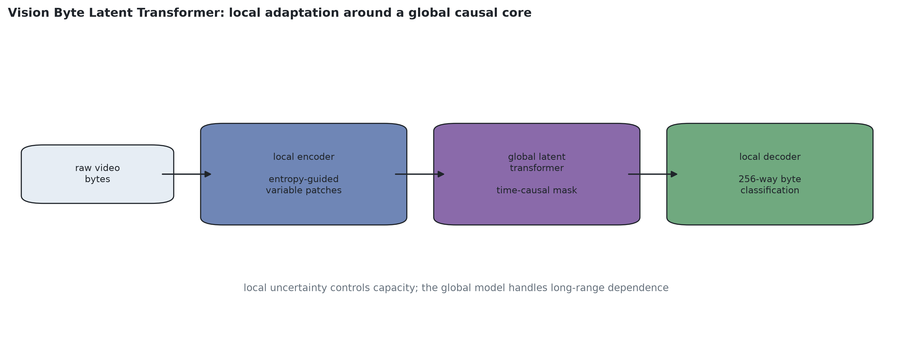

**Figure 2.2 — Vision Byte Latent Transformer architecture.** Local entropy-guided aggregation
and byte classification surround the global time-causal latent transformer. Source: author’s
schematic of the [A1] method.

The first subsystem — the **Local Encoder** — performs the function of primary adaptive
aggregation. The input is a video sequence as a multidimensional tensor of raw bytes. The task of
the Local Encoder is the dynamic grouping of locally correlated bytes into compact latent
representations in the form of spatio-temporal patches $Z = \{z_1, z_2, \dots, z_M\}$.
Mathematically it is realized as a lightweight convolutional-transformer network that predicts
data-dependent boundaries of information aggregation.

The second subsystem — the **Global Latent Transformer** — is the computational core and is
responsible for modeling the long-term dynamics in the compressed space. Since this block
performs autoregressive prediction for time-series modeling, its architecture requires a specific
design of the attention-masking system to prevent information leakage from future frames
[12], while allowing tokens within the current
and preceding frames to interact.

For this purpose, a spatio-temporal attention-masking matrix is used. Let the latent space have
dimensionality $T' \times S'$, where $T'$ is the number of time steps and $S'$ is the number of
spatial patches per frame. The attention matrix $M$ is computed so that for any token $z_i$ from
frame $t_i$, the attention weights toward a token $z_j$ from frame $t_j$ obey the rule:

$$
M_{i,j} =
\begin{cases}
0, & \text{if } t_j \le t_i \\
-\infty, & \text{if } t_j > t_i
\end{cases}
\tag{2.1}
$$

This time-causal, spatially connected mask prevents future-frame attention. It does not by itself
guarantee physical plausibility or accurate dynamics.

The third subsystem — the **Local Decoder** — projects the predicted latent macro-states back
into the micro-space of image bytes. The key mathematical innovation of the developed method,
which distinguishes it from standard pixel-regression approaches of the MSE type, is the use of a
classification model for byte generation. At the output, the decoder forms a tensor that yields,
for each pixel, not a scalar brightness value but a full probability distribution over the 256
possible byte states.

Formally, for each byte (sub-pixel) $x_i$ the system computes a logit vector
$L_i \in \mathbb{R}^{256}$. The probability estimate that the byte takes a specific discrete
value $k \in \{0, \dots, 255\}$ is determined by the softmax activation function:

$$
p(x_i = k) = \frac{\exp L_{i,k}}{\sum_{j=0}^{255} \exp L_{i,j}}
\tag{2.2}
$$

Such a mathematical formulation transforms the problem of minimizing the mean squared error
(MSE), which by its nature is prone to smoothing and to the loss of high-frequency details, into
a classification problem using the cross-entropy loss function [96]. This makes it possible to correctly model multimodal distributions:
for example, the contour of a moving object may shift one pixel to the left or to the right with
equal probability, which cannot be described by a single mean value.

The main advantage of the classification approach for systems analysis lies in the possibility of
direct mathematical computation of a measure of spatio-temporal uncertainty. Having a discrete
probability distribution for each pixel, the classical apparatus of Shannon information theory is
applied. The information-entropy measure $H_i$ for each predicted pixel $i$ is computed as:

$$
H_i = -\sum_{k=0}^{255} p(x_i = k)\,\log_2 p(x_i = k)
\tag{2.3}
$$

The entropy value lies in the range from 0 (absolute determinism and confidence of the system in
its prediction) to 8 bits (maximum informational uncertainty, a uniform distribution). By
computing this value for all pixels of a frame, the generative system forms a two-dimensional
per-pixel entropy map.

Entropy maps are a direct indicator of the state of structural uncertainty and serve as a
powerful diagnostic instrument. Empirical studies, the results of which are presented in **[A1]**
and are considered in detail in Chapter 4, confirm that the highest entropy values systematically
concentrate on the contours of fast-moving objects and in occlusion zones with complex
kinematics, whereas the static, predictable background exhibits entropy rapidly approaching zero.
Figures 2.3 and 2.4 show prediction examples for a simple 2D and a complex 3D sequence
respectively, where the first row contains the expected frames of the sequence, the second the
frames predicted by the V-BLT model, and the third the entropy maps corresponding to the
predicted frames (black indicates high entropy, white low entropy). A key aspect of the V-BLT
architecture is its ability to operate on raw bytes, which makes it possible to compute per-pixel
entropy for every prediction. Entropy in this context is a measure of the model's uncertainty:
the higher the entropy, the less "confident" the model is in its prediction for the given pixel.

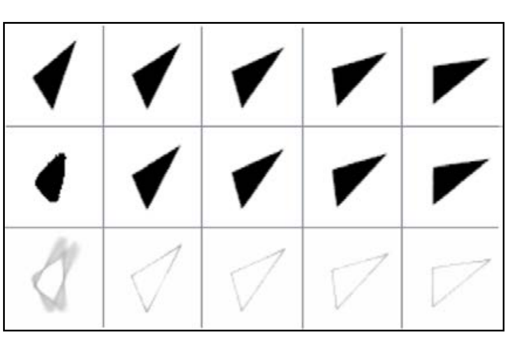

**Figure 2.3 — V-BLT prediction and entropy maps for a rotating 2D shape.** Rows show,
respectively, ground truth, V-BLT predictions and per-pixel entropy maps over five future frames.
The first prediction has the largest shape error and the broadest high-entropy region; subsequent
predictions recover the rotating contour while entropy concentrates near its boundary. Source:
Kulyk and Mokin, *Scaling Video Prediction with Spatio-Temporal Patches*, published Fig. 7,
DOI 10.31649/1997-9266-2025-182-5-129-139.

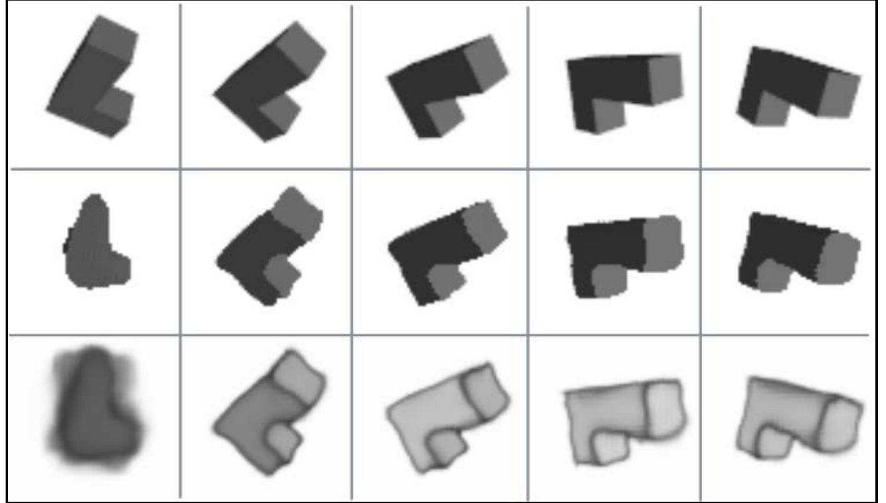

**Figure 2.4 — V-BLT prediction and entropy maps for a rotating 3D polycube.** Rows show ground
truth, V-BLT predictions and per-pixel entropy maps. The first low-context forecast is visibly
degraded; later frames preserve the coarse polycube structure, while uncertainty remains strongest
along moving and newly exposed boundaries. Source: Kulyk and Mokin, *Scaling Video Prediction with
Spatio-Temporal Patches*, published Fig. 8,
DOI 10.31649/1997-9266-2025-182-5-129-139.

From the standpoint of complex-system control, the entropy map is an ideal feedback signal. It
allows the problem of structural-algorithmic uncertainty to be solved by dynamically forming
latent patches of variable size. Low-entropy regions (background) can be aggregated into large
spatial blocks, saving the $O(L^2)$ resources of the global attention mechanisms. High-entropy
regions (motion, fine details) can be split into small patches, concentrating the maximum
computational power of the transformer exactly on the zones where the uncertainty is highest.

It is important to note the place of this instrument within the overall system developed in this
dissertation. The per-pixel entropy is a *local* measure of informational complexity: it answers
the question "where exactly is prediction hardest for the system". It thereby complements the
*global* consistency criteria of the generation process — the hierarchical- and
trajectory-consistency criteria introduced in Chapter 1, which for the hierarchical generation
model developed in Chapter 3 are operationalized in Chapter 4 through autoregressive-rollout
degradation metrics stratified by re-entry hardness. The local entropy signal governs the
allocation of computational resources within a frame, while the global criteria evaluate the
consistency of the generated process as a whole.

The successful substantiation and approbation of the entropy-based method for estimating
spatio-temporal uncertainty opens the path to building fully resource-efficient video-generation
models. However, the process of transforming a multidimensional spatio-temporal data array into a
linear sequence of patches for transformer processing carries a serious mathematical problem —
the loss of structural topology. The next subsection is devoted to solving this problem by
adapting and integrating multidimensional rotary positional encoding.

## 2.2 Structural Coherence through Multidimensional Positional Encoding

During the transformation of a multidimensional spatio-temporal information array into a form
suitable for processing by the model, the primary topology of the complex system is destroyed.
Therefore, an important step is to ensure structural coherence before feeding the data into the
system.

The multidimensional tensor of visual data, mathematically described as
$X \in \mathbb{R}^{T \times H \times W \times C}$, where $T$ is the temporal dimension, $H$ and
$W$ are the spatial coordinates, and $C$ the information channels, necessarily undergoes a
linearization operation. As a result, a one-dimensional sequence of latent vectors
$Z = \{z_1, z_2, \dots, z_L\}$ is formed, with total sequence length $L = T \cdot H \cdot W$.
This change of dimensionality is a necessary condition for applying global self-attention
mechanisms, but it completely erases the information about the mutual spatio-temporal arrangement
of the elements.

In the theory of complex systems, such a loss of information is classified as a critical growth
of structural uncertainty. The transformer architecture is, by its mathematical nature, invariant
to permutations of the elements of a set. This means that without additional control signals the
system cannot distinguish whether two latent patches were physically adjacent horizontally within
one frame, or belonged to entirely different frames of the video sequence in time. The absence of
a precise coordinate anchoring makes it impossible to model adequate kinematics and geometry of
the visual scene.

The traditional approach to preserving positional information is absolute positional encoding
[12]. This method adds a special coordinate
vector $p_i$ to each latent token $z_i$. However, absolute encoding has fundamental drawbacks in
this application: it destroys translation invariance, which is a natural property of the visual
world, since the system must recognize and generate an object equally well regardless of its
absolute coordinates in the frame.

An alternative approach is relative positional encoding (Relative Positional Bias)
[97, 65], where coordinate information is
added directly to the attention-weight matrix in the form of biases. Although this method models
relative distances more correctly, it is accompanied by a significant growth of computational
complexity and requires $O(L^2)$ memory for storing multidimensional bias matrices, which
directly contradicts one of the main tasks of this research — the optimization of resource
consumption.

To overcome these systemic contradictions, within the development of the information technology
it is proposed to apply the mathematical apparatus of Rotary Positional Embedding (RoPE)
[98] with its subsequent generalization to N-dimensional space. The
RoPE applies position-dependent rotations without storing a learned pairwise relative-bias
matrix. The core idea is to group feature pairs as complex coordinates and rotate them according
to position.

Let the attention subsystem operate on query vectors $q$ and key vectors $k$ of dimensionality
$D$. For a one-dimensional sequence, the position of element $m$ is encoded by multiplying the
vector by an orthogonal rotation matrix $R_{\Theta,m}$. Applying this operation to query and key
vectors makes the positional phase in their scalar product depend on relative displacement. In
the complex representation:

$$
\left\langle R_{\Theta,m}\,q,\; R_{\Theta,n}\,k \right\rangle
= \operatorname{Re}\!\left[ \left(q\,e^{im\theta}\right) \left(k\,e^{in\theta}\right)^{*} \right]
= \operatorname{Re}\!\left[ q\,k^{*}\,e^{i(m-n)\theta} \right]
\tag{2.4}
$$

As the equation shows, the positional phase contains the difference $m-n$. The complete attention
score still depends on the learned content vectors \(q\) and \(k\); RoPE does not force a
particular attention pattern.

The original RoPE formulation [98] uses a one-dimensional sequence coordinate.
A flattened video index can be supplied, but it does not explicitly separate time, row, and
column displacement. In the research underlying **[A1]**, N-dimensional rotary positional
embedding (RoPE-ND) [98] assigns independent feature
subspaces to these axes.

The essence of the generalization is the decomposition of the latent token's feature space into
$N$ independent subspaces, each responsible for its own physical coordinate. For video data the
dimensionality of the coordinate system is $N = 3$: the time axis $t$, the vertical axis $y$, and
the horizontal axis $x$. Accordingly, the state vectors $q$ and $k$ of total dimensionality $D$
are split into three equal non-overlapping segments of dimensionality $d = D/3$.

For the mathematical rotation operation in the complex plane to be possible, the dimensionality
of each subspace must be an even number. This yields a hard architectural requirement on the
generative system: the total dimensionality of the latent feature space $D$ must be divisible by
$2N$, i.e., divisible by 6 in the case of video data.

For each of the three coordinates, an independent set of basis rotation frequencies $\theta_j$ is
formed. The frequencies are typically defined by a geometric progression:

$$
\theta_j = 10000^{-2j/d}, \qquad j \in \{0, \dots, d/2 - 1\}
\tag{2.5}
$$

Let a visual token of the system be located at the spatio-temporal point with physical
coordinates $(t_c, y_c, x_c)$. The rotation angles for each segment are computed as the product
of the coordinate and the corresponding frequencies: $t_c\theta_j$, $y_c\theta_j$, $x_c\theta_j$.
The resulting unitary transformation of the whole state vector $q$ is formed as the concatenation
of three independently rotated sub-vectors:

$$
q'_{\text{rotated}} = \left[\; R^{d}_{\Theta,t_c} q_t \;\big\|\; R^{d}_{\Theta,y_c} q_y \;\big\|\; R^{d}_{\Theta,x_c} q_x \;\right]
\tag{2.6}
$$

where $R^{d}_{\Theta,\text{pos}}$ denotes the $d \times d$ rotation matrix for the corresponding
axis. The same operation is applied to the key vector $k$.

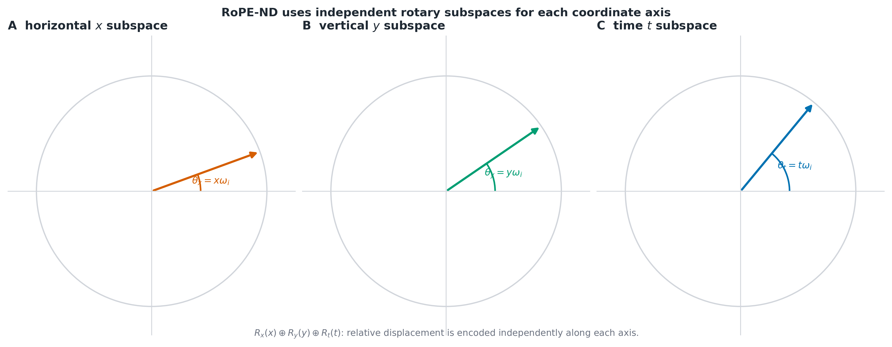

**Figure 2.5 — N-dimensional rotary positional embedding.** Independent rotations encode
horizontal, vertical and temporal coordinates so attention depends on relative displacement
along all three axes. Source: author’s schematic of the [A1] method.

With disjoint coordinate subspaces, the rotary contribution to an attention score decomposes by
axis. Each term depends on the corresponding relative coordinate difference:

$$
q'^{\top}_{\text{rotated}}\, k'_{\text{rotated}} = f(\Delta t, \Delta y, \Delta x)
\tag{2.7}
$$

where $\Delta t = t_q-t_k$, $\Delta y = y_q-y_k$, and $\Delta x=x_q-x_k$. The algebra establishes
relative-coordinate dependence in the rotary score terms. It does not prove that a learned model
recovers physical topology or attends to the correct object.

**Systemic significance and scope.** In an architecture with explicit cross-resolution
attention, coordinates can be affinely mapped to a common physical scale before RoPE-ND is
applied. This provides a consistent coordinate convention for fine and coarse tokens, but it does
not force attention to select geometrically correct regions or guarantee semantic routing. The
measured Chapter 3 predictor does **not** use this mechanism: it uses learned level, role, and
frame embeddings with joint attention. RoPE-ND is therefore a separate representation result
from [A1], not an explanation of the Chapter 4 context-package effects.

Applying RoPE-ND costs $O(D)$ arithmetic per token and avoids storing a learned pairwise bias
matrix. It is compatible with memory-efficient architectures, but no end-to-end experiment in
this dissertation combines RoPE-ND, reversible rollout training, and the final hierarchical
predictor.

## 2.3 Resource Optimization for Multi-Step Temporal Modelling

The V-BLT and RoPE-ND methods address representation and coordinate structure. A separate
constraint arises when an iterative model must be differentiated through a long computation:
activation storage can exceed available device memory. Systems analysis must therefore consider
both model adequacy and implementation feasibility.

For the long unrolls measured in this work, accelerator memory is a binding constraint alongside
throughput [99, 100]. Which resource
dominates is hardware- and model-dependent.

Backpropagation Through Time (BPTT) [28] differentiates a temporally unrolled
dynamic system. A vanilla implementation retains the intermediate activations required by the
reverse pass; checkpointing and reversible replay are alternative storage/recomputation
schedules.

Mathematically, the amount of operating memory $M$ required to store the full computation graph
is linearly dependent on the depth of the temporal unrolling and the number of layers in the
system:

$$
M = O(N \cdot T \cdot L \cdot D)
\tag{2.8}
$$

where $N$ is the dimensionality of the spatial state (the number of tokens per frame), $T$ the
number of time steps or optimization iterations, $L$ the number of model layers, and $D$ the
dimensionality of the latent feature space. For video states, the product can exceed available
memory as the differentiated horizon grows.

The presence of such computational uncertainty forces various heuristic compromises. The most
common approaches are truncated backpropagation (Truncated BPTT) [29] and
gradient checkpointing [30, 31]. Truncated
backpropagation limits the gradient horizon—e.g., differentiating only the last five frames—and
therefore removes learning signals that cross that boundary. Checkpointing reduces memory
consumption (to a square-root trade-off under a balanced segment schedule; see Table 2.1) at the
cost of recomputation.

The task considered here is to organize reverse differentiation so that activation memory is
constant with respect to the number of reversible time steps \(T\), while preserving the
full-horizon gradient for the tested recurrence.

To solve this systemic problem, the dissertation research developed the Temporal Reversible
Transformer (TempVerseFormer) architecture. The developed architecture and the mathematical
method of computational-resource optimization were published by the author as the sole author in
an international scientific journal indexed by the Scopus scientometric database (**[A2]**).

The method is based on the transition from traditional directed acyclic computation graphs to
discrete reversible architectures. The core idea of reversible computation is to build
state-transition functions that are bijective (one-to-one). If the transition function from layer
$l$ to layer $l+1$ has an exact analytic inverse, the system can restore its previous state
purely from the current state, without storing it in memory during the forward pass.

Continuous-time adjoint methods such as Neural ODEs [85] and
discrete reversible models such as RevNet and RevViT
[32] provide related
storage/recomputation strategies with different numerical trade-offs. The
scientific novelty of TempVerseFormer lies in combining structural reversibility at the level of
individual transformer layers with an iterative temporal-chaining mechanism for modeling
multi-step processes.

The structural decomposition of the reversible block in the TempVerseFormer architecture is based
on splitting the input information flow into two independent branches. Let the system operate on
a latent state of total dimensionality $D$. At the input of the reversible block, this state is
forcibly split into two mutually exclusive sub-vectors $x_1$ and $x_2$. The functioning of the
reversible block is described by a system of two sequential nonlinear transformations using the
attention mechanism and a multilayer perceptron (MLP).

The mathematical formalization of the forward pass through reversible block $l$ is described by
the following system of algebraic equations.

Update equation of the first branch:

$$
y_1^{(l)} = x_1^{(l)} + \operatorname{Attention}\!\left(x_2^{(l)}\right)
\tag{2.9}
$$

Update equation of the second branch:

$$
y_2^{(l)} = x_2^{(l)} + \operatorname{MLP}\!\left(y_1^{(l)}\right)
\tag{2.10}
$$

This specific algebraic structure guarantees that only $x_2$ — which remains unchanged during the
first stage — is used to compute the additive update of $x_1$. Accordingly, the input information
can be reconstructed absolutely without loss by performing the operations in reverse order and
replacing addition with subtraction.

Reverse reconstruction of the second branch:

$$
x_2^{(l)} = y_2^{(l)} - \operatorname{MLP}\!\left(y_1^{(l)}\right)
\tag{2.11}
$$

Reverse reconstruction of the first branch:

$$
x_1^{(l)} = y_1^{(l)} - \operatorname{Attention}\!\left(x_2^{(l)}\right)
\tag{2.12}
$$

**Figure 2.6 — Forward and reverse information flow in a reversible transformer block.** The
additive coupling structure permits exact reconstruction of block inputs from its outputs.
Source: author’s published TempVerseFormer project asset [A2].

For the reversible blocks to solve the task of controlling generation in time, they are
integrated into a higher structural level of the system through the **temporal chaining**
mechanism. Instead of concatenating all video frames into a single enormous tensor — which leads
to the quadratic memory collapse $O((N \cdot T)^2)$ in the attention mechanisms — the system
moves to an iterative autoregressive paradigm of state generation.

The temporal chaining mechanism works as follows. The system receives an initial context set
$V_{\text{ctx}}$. At step $t$, the system applies the transition functional — a stack of $L$
reversible blocks — and generates the time-shifted sequence $V_{\text{out}}$. This output tensor
is fed back directly and becomes the input $V_{\text{in}}$ for the next generation step $t+1$.
Mathematically this is described by the recurrence relation:

$$
V_t = \Phi(V_{t-1}, \theta)
\tag{2.13}
$$

where $\Phi$ is the transition functor built exclusively from algebraically reversible
transformer blocks.

**Figure 2.7 — Temporal chaining for autoregressive time-series modeling.** The same reversible
transition is applied along physical time while the realized state is passed to the next step.
Source: author’s published TempVerseFormer project asset [A2].

Since the functor $\Phi$ consists of reversible elements, the entire multi-step trajectory
$V_1 \to V_2 \to \dots \to V_T$ preserves the property of global reversibility. Knowing only the
final state $V_T$, the system has the mathematical ability to reconstruct, step by step, all
intermediate values without storing them in memory.

To focus the computational resource of the reversible transformer exclusively on the analysis of
complex temporal dynamics, the global architecture of the TempVerseFormer information technology
uses an auxiliary spatial-compression subsystem — a variational autoencoder (VAE). Its function
is to resolve the spatial redundancy of pixels: each video frame is projected into a compact
latent vector before processing by the reversible blocks. After generation is completed, the
latent states are unfolded back by the VAE decoder. This architectural modularity separates the
task of spatial compression from the task of temporal control.

**Figure 2.8 — Global TempVerseFormer architecture.** A spatial VAE interfaces the video frames
with the reversible temporal core. Source: author’s published TempVerseFormer project asset [A2].

Temporal chaining of reversible blocks provides algebraic state recoverability in exact
arithmetic. It does not guarantee numerical stability, preservation of task-relevant
information, or useful gradients. The next subsection shows how reverse replay is used for
gradient computation and later measurements delimit its stability and memory behaviour.

## 2.4 Time-Agnostic Backpropagation through Reversible Transformations

Long temporal optimization requires an explicit policy for storing or reconstructing the reverse
pass. BPTT [28] supplies the gradient semantics; the resource question is how
its required intermediate values are made available.

The BPTT gradient follows the chain rule through the unrolled composite function. The reverse
pass needs the corresponding states and local activations, but they need not all be cached:
vanilla autograd retains them, checkpointing recomputes segments, and the developed method
reconstructs reversible states before rebuilding each local graph.

For large spatio-temporal states, vanilla retention makes activation memory grow with the unroll
and can cause out-of-memory failure. This is the measured bottleneck addressed here; it is not a
claim that every long-horizon model must use reversibility.

Within this dissertation research, the method of **time-agnostic backpropagation** was developed
for the tested reversible recurrence. The method is based on integrating the mathematical
apparatus of discrete reversible transformations directly into the gradient-computation process
along the temporal chain.

The main idea of the developed method is a change in the paradigm of computation-graph
construction. Instead of statically caching all system states during the forward pass, they are
reconstructed dynamically during the backward pass. This reconstruction is mathematically exact
and requires no additional training or approximation, since it relies on the algebraic properties
of the inverse transition functions $R^{-1}$ built into the architecture of the reversible
blocks.

The training strategy of the complex generative system under this algorithm splits into two
phases.

**Phase one — the forward pass.** The system sequentially computes the evolution of the state.
For every time step $t$ from $1$ to $T$ and every layer $l$ from $1$ to $L$, the forward
reversible transformation $R$ is applied to the current inputs $(x_1, x_2)$. After the outputs
$(y_1, y_2)$ are computed, the system immediately deletes all internal activations from memory,
keeping only the result. Upon reaching the final step $T$, the system stores only one final
macro-state in memory.

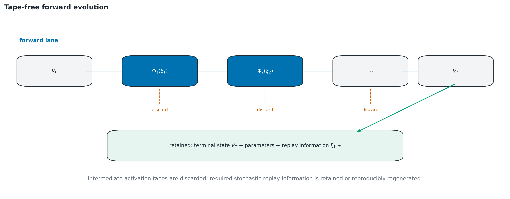

**Figure 2.9 — Activation-free forward evolution.** Intermediate temporal states are discarded;
the terminal state, parameters and stochastic replay information are retained. Source: author’s
algorithmic schematic.

**Phase two — the reverse pass.** This phase is the conceptual core of the method. The reverse
pass starts with the computation of the gradient of the loss function with respect to the final
state of the system, $\nabla_{y_T} L_{\text{loss}}$. Then, for every time step $t$ from $T$ down
to $1$, the algorithm moves in the reverse direction: it reconstructs the layer inputs by the
inverse transformations (2.11)–(2.12), locally rebuilds the computation graph of a single
transition, computes the local gradients, and immediately destroys the local graph.

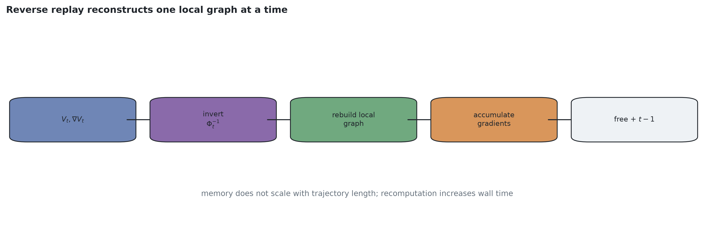

**Figure 2.10 — Reverse-pass local replay.** Each state is reconstructed, its local graph is
rebuilt, gradients are accumulated, and the graph is released before moving to the preceding
time step. Source: author’s algorithmic schematic.

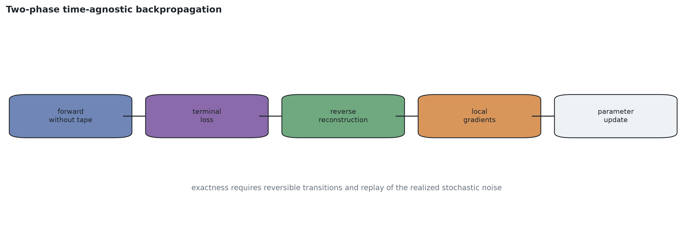

**Figure 2.11 — Two-phase time-agnostic backpropagation.** A tape-free forward phase is followed
by exact reverse reconstruction and local gradient accumulation. Source: author’s algorithmic
schematic.

For a rigorous confirmation of the effectiveness of the developed method, we formulate and prove
a lemma on the optimization of operating-memory consumption.

**Lemma 1 (on the computational complexity of time-agnostic backpropagation).** *Let a discrete
dynamic system be given with a trajectory length of $T$ steps, where the transition functor is
parameterized by a reversible neural network with $L$ layers and per-layer state dimensionality
$D$. Then the peak amount of operating memory required to compute the gradients of the objective
function with respect to the system parameters is $O(L \cdot D)$ and is constant, $O(1)$, with
respect to the length $T$ of the temporal trajectory.*

**Proof.**

1. Assume the dimensionality of the state tensor at one layer is $D$. Under classical BPTT the
   algorithm caches all inputs for every layer $l \in \{1, \dots, L\}$ and every time step
   $t \in \{1, \dots, T\}$; hence the peak memory is
   $M_{\text{BPTT}} = T \cdot L \cdot D = O(T \cdot L \cdot D)$.

2. The proposed algorithm stores, during the forward pass, only the final state at step $T$. The
   memory for this is $O(D)$. Activations for $t < T$ and $l < L$ are deleted immediately after
   they are used for the next step. Hence the forward-pass memory does not depend on $T$.

3. During the reverse pass the algorithm processes the steps sequentially: $t = T, T-1, \dots, 1$.
   At the current step $t$ the algorithm reconstructs the inputs and unrolls the local
   computation graph of a single transition. The size of this graph is $O(L \cdot D)$.

4. Immediately after the gradients $\nabla_{\theta} L_{\text{loss}}$ and
   $\nabla_{x_{t-1}} L_{\text{loss}}$ are computed, this local graph is completely destroyed and
   its memory freed before the algorithm proceeds to step $t-1$.

5. Therefore, the maximum number of tensors simultaneously resident in the system memory at any
   moment equals the size of one local graph, $O(L \cdot D)$, plus a constant volume for the
   gradient-accumulation buffer. Since the temporal parameter $T$ does not enter this expression,
   the peak memory consumption is mathematically $O(1)$ with respect to the sequence length.
   $\blacksquare$

For comparative analysis, Table 2.1 presents the theoretical complexity estimates of the
developed method against the existing approaches.

**Table 2.1 — Theoretical estimate of computational complexity in multi-step optimization**

| Optimization method | Memory consumption | Operation count | Gradient exactness |
|---|---|---|---|
| Standard BPTT | $O(T \cdot L \cdot D)$ | $C$ | exact |
| Gradient checkpointing | $O(\sqrt{T} \cdot L \cdot D)$ | $\approx 1.5\,C$ | $\pm 10^{-6}$ |
| Developed method (time-agnostic BP) | $O(L \cdot D) \sim O(1)$ in $T$ | $2\,C$ | $\pm 10^{-6}$ |

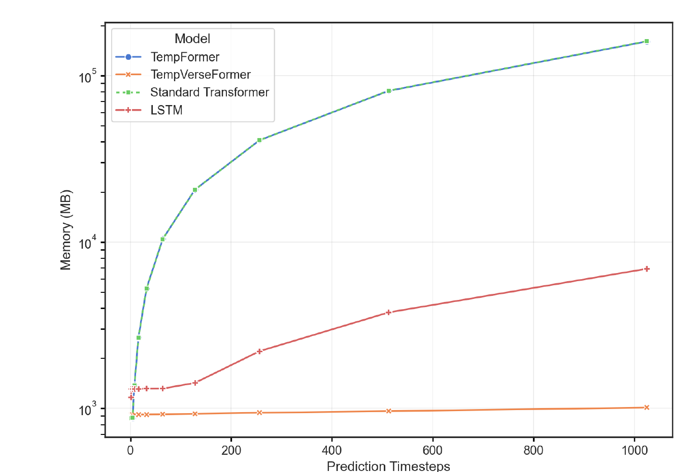

**Figure 2.12 — GPU memory consumption versus prediction horizon.** Published TempVerseFormer
measurement at batch size 32. The reversible temporal model remains near 0.9 GB over 1–1,024
prediction steps, whereas the two non-reversible transformer variants grow to approximately
160 GB in the reported extrapolated/extended measurement and the LSTM grows more slowly. The
logarithmic vertical scale must be retained when typesetting. Source: Kulyk, *Temporal modeling
with reversible transformers*, Fig. 13, author preprint (CC BY 4.0), DOI
10.21203/rs.3.rs-6293520/v1; version of record DOI 10.1007/s00521-025-11707-3.

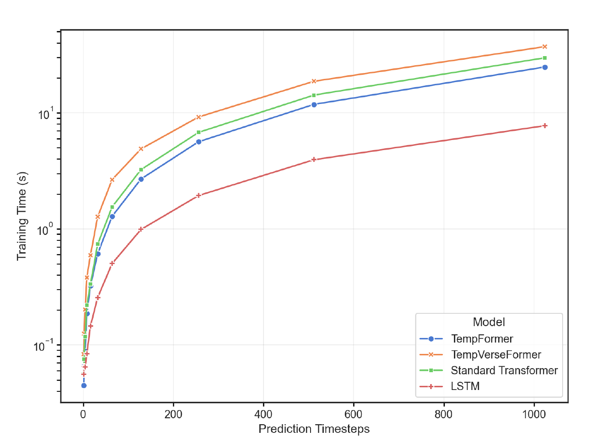

**Figure 2.13 — Training time per step versus prediction horizon.** Published comparison at batch
size 32 and 1–1,024 prediction steps. Time grows with the prediction horizon for all four
architectures; TempVerseFormer pays a compute premium relative to the matched non-reversible
transformer while preserving the qualitatively different memory-scaling behavior in Fig. 2.12.
The logarithmic vertical scale must be retained when typesetting. Source: Kulyk, *Temporal
modeling with reversible transformers*, Fig. 14, author preprint (CC BY 4.0), DOI
10.21203/rs.3.rs-6293520/v1; version of record DOI 10.1007/s00521-025-11707-3.

As Fig. 2.12 shows, measured temporal-model memory remains nearly constant even at large
prediction depths. Figure 2.13 also makes the trade-off explicit rather than cost-free:
TempVerseFormer is slower per step than the matched TempFormer over the tested horizons, and all
methods become slower as the horizon grows. Within this published configuration, the developed
method is the only compared transformer whose activation-memory curve is practically independent
of trajectory length. Algebraic reconstruction during the reverse pass therefore exchanges
additional computation for the critically scarce resource — GPU memory — and makes horizons of
hundreds or thousands of steps operationally possible when the non-reversible activation tape
would exceed the device budget.

In addition, the proposed architecture enables a unique **selective backpropagation** strategy.
In many control problems the initial steps of a process are noisy, while the most informative
steps are the last ones. The method allows the system to run the forward pass to full length and
then reconstruct activations and compute gradients only for a narrow target segment
$[T - K_{\text{opt}},\; T]$, ignoring the rest of the chain. This focuses the optimization on the
relevant portions of the trajectory with zero memory cost for the skipped stages.

### Extension to Stochastic Recurrences and Limits of Reversible Computation

The time-agnostic backpropagation method was substantiated above for *deterministic* transition
functors (2.13). The hierarchical video generation model developed in Chapter 3, however, is a
*stochastic* dynamic system: its state transitions include an injected noise component, both as a
generative modeling choice and within its iterative-refinement generation core. For the developed
resource-optimization method to serve as the training foundation of that model, it must be
extended to stochastic recurrences, and the boundaries of its applicability must be established.
This section performs both steps; all numerical values are measured properties of the software
implementation (the measurement methodology and the experimental environment are described in
Chapter 4).

**(i) The exactly invertible stochastic recurrence (store-the-noise).** Consider the stochastic
generalization of the temporal chain (2.13), in which the latent state $h_t$ of the modeled
process evolves as

$$
h_t = F(h_{t-1}) + \sigma\,\epsilon_t, \qquad \epsilon_t \sim \mathcal{N}(0, I),
\tag{2.14}
$$

where $F$ is a transition operator built from reversible (additive-coupling) blocks, $\sigma$ is
the noise scale, and $\epsilon_t$ is the noise sample of step $t$. Transformation (2.14), taken
alone, is not invertible: the noise irreversibly injects new information. However, if the noise
samples $\epsilon_t$ drawn during the forward pass are *stored* — the store-the-noise principle,
extending the reversible recurrent networks of [101] — the
recurrence becomes exactly invertible. Equations (2.14)–(2.15) state the principle in its
simplest, *external-additive* form, in which the stored noise is subtracted before the inverse
transition is applied:

$$
h_{t-1} = F^{-1}\!\left(h_t - \sigma\,\epsilon_t\right).
\tag{2.15}
$$

The construction **implemented and measured in this dissertation** is the more general
*conditioning-injected* form: within a coupled two-branch state $(s_1, s_2)$, the stored noise
enters the coupling functions as a conditioning argument,

$$
(y_1, y_2) \;=\; \Bigl(s_1 + F(s_2, \epsilon_t),\;\; s_2 + G\bigl(y_1\bigr)\Bigr),
\tag{2.16}
$$

whose closed-form inverse subtracts the couplings in reverse order with the *same* stored
conditioning replayed:

$$
s_2 = y_2 - G(y_1), \qquad s_1 = y_1 - F(s_2, \epsilon_t).
\tag{2.16'}
$$

The additive-coupling inverse is exact for an *arbitrary* conditioning argument, so (2.16')
holds verbatim for any signal injected this way (noise, actions, level context); the
external-additive scheme (2.14)–(2.15) is recovered as the special case in which the noise
enters only as a final additive term. All numerical properties quoted below are measured on the
conditioning-injected construction (2.16)–(2.16'), which is the one realized in the software
complex. The memory cost of storing the noise sequence grows only as $O(T \cdot D_{\epsilon})$ —
one noise tensor per step, with no layer factor $L$ and no computation-graph factor — and is
negligible against the $O(T \cdot L \cdot D)$ activation graph that BPTT would store (confirmed
by the direct measurement in part (iii): the total memory of the reversible method stays flat).

The following properties of this construction were verified numerically on the implemented
hierarchical multi-rate recurrent core (software complex of the dissertation; measurement details
in Chapter 4):

- **Exact invertibility of the deterministic coupling:** maximum state-reconstruction error
  $5.5 \times 10^{-15}$ (fp64); for the Lipschitz-constrained coupling in fp32,
  $3.1 \times 10^{-5}$.
- **Exact invertibility of the stochastic recurrence:** with the stored noise replayed, the
  maximum reconstruction error over the trajectory is $8.4 \times 10^{-13}$; replaying *wrong*
  noise destroys the reconstruction (error of order $10^{1}$) — i.e., the stored noise is
  exactly the information-theoretic price of inverting a stochastic step.
- **Gradient equivalence:** the gradients obtained by reverse-replay (reconstructing states
  backward by (2.15) and rebuilding local graphs, as in Lemma 1) coincide with the gradients of
  full BPTT with cosine similarity $1.000000$ — the extension preserves the exact-gradient
  property of the deterministic method.

Thus the time-agnostic backpropagation of §2.4 transfers to stochastic multi-level recurrences
without loss of exactness, which is precisely the form required by the hierarchical generation
model of Chapter 3 (Task 4 of the research in its extended formulation).

**(ii) Invertibility does not imply stability: the Lipschitz characterization.** A separate
systemic question is whether the reversibility of the transition operator stabilizes the
long-horizon behavior of the modeled process. The answer, established by direct measurement, is
negative — and this delimits what the developed method may and may not be credited with. All
recurrences in Table 2.2 are *exactly invertible* (the additive coupling has unit Jacobian
determinant); they differ only in the spectral-norm bound imposed on the coupling function $F$.
The measured perturbation growth $\lVert \delta_K \rVert / \lVert \delta_0 \rVert$ of a
free-running rollout over $K = 100$ steps spans four orders of magnitude:

**Table 2.2 — Perturbation growth of exactly invertible recurrences over $K = 100$ free-running
steps as a function of the Lipschitz bound on the coupling**

| Coupling constraint | $\lVert \delta_{100} \rVert / \lVert \delta_0 \rVert$ | Regime |
|---|---|---|
| unconstrained | $333\times$ | explodes |
| spectral norm, $\operatorname{Lip}(F) \le 1$ | $26{,}600\times$ | **still explodes** |
| spectral norm, $\operatorname{Lip}(F) \le 0.1$ | $1.5\times$ | bounded |
| spectral norm, $\operatorname{Lip}(F) \le 0.02$ | $1.0\times$ | tightly bounded |

The mechanism is elementary: the additive-coupling step $s \mapsto s + F(s)$ has a step-Lipschitz
constant

$$
\operatorname{Lip}(\text{step}) \approx 1 + \operatorname{Lip}(F) \;\ge\; 1,
\tag{2.17}
$$

i.e., the additive structure is inherently non-contractive — constraining $F$ to
$\operatorname{Lip}(F) \le 1$ is *not* sufficient (the growth factor $26{,}600\times$ in
Table 2.2), and bounded long-horizon dynamics require a *small* coupling Lipschitz constant
($\operatorname{Lip}(F) \lesssim 0.1$). This is the stability analysis of invertible networks
[102, 103] instantiated
for temporal recurrences and confirmed by measurement. The systemic conclusion: **invertibility
is a memory-and-correctness property, not a stability property.** In the developed technology,
reversibility is claimed exclusively as the constant-memory enabler of long-horizon training with
exact gradients; the stability of the modeled trajectory is a separate design requirement,
enforced by the Lipschitz constraint on the coupling (this requirement informs the architecture
of Chapter 3).

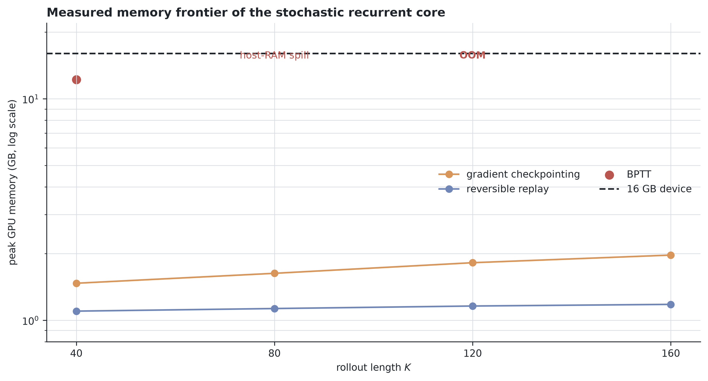

**Figure 2.14 — Measured memory frontier of the stochastic recurrent core.** Standard BPTT
reaches 12.2 GB at $K=40$, spills at $K=80$ and cannot run at $K=120$ on the 16 GB device;
checkpointing grows slowly, while reverse replay stays near 1.1–1.2 GB through $K=160$. Source:
repository Panel-A measurements (`hvp_rev/mem_frontier.py`,
`docs/SESSION_JOURNEY_AND_EBT_PLAN.md`, §2.2).

**(iii) The constant-memory autoregressive-rollout frontier (measured).** The practical payoff of
the extended method is measured on the real training loop of the implemented stochastic
hierarchical recurrent core (three levels, batch 32, Adam optimizer, NVIDIA RTX 4060 Ti 16 GB;
the full environment is specified in Chapter 4, §4.1.4). Table 2.3 gives the peak training memory as a function of the
free-running rollout length $K$:

**Table 2.3 — Measured peak training memory (MB) vs rollout length $K$: BPTT, gradient
checkpointing, and the developed reversible reverse-replay on the same model**

| $K$ | BPTT | Gradient checkpointing | Developed method (reversible) |
|---:|---:|---:|---:|
| 40 | 12,162 | 1,471 | 1,091 |
| 80 | 23,305\* | 1,637 | 1,125 |
| 120 | OOM | 1,801 | 1,152 |
| 160 | OOM | 1,967 | 1,176 |

\* At $K = 80$, BPTT exceeds the physical GPU memory and spills into shared host RAM, slowing a
training step by a factor of $\approx 60$ (from 0.74 s at $K = 40$ to 43.8 s); at $K = 120$ it
fails with a hard out-of-memory error.

The frontier confirms Lemma 1 and its stochastic extension empirically: BPTT consumes 12.2 GB
already at $K = 40$ and becomes infeasible at $K = 120$, while the developed method remains
essentially flat ($\approx$1.1–1.2 GB through $K = 160$), making long-horizon rollout training
feasible on a consumer-grade 16 GB device. **The honest reading of Table 2.3, however, must
include the checkpointing column:** gradient checkpointing also remains feasible at all measured
$K$ (1.47–1.97 GB, growing slowly). The correct claim for the developed method is therefore a
**constant-memory capability relative to vanilla BPTT** — with strictly exact reconstruction and
gradients equal to BPTT — and an approximate **Pareto equivalence with gradient checkpointing**
(comparable memory order and comparable recomputation overhead), *not* a memory victory over
checkpointing. This scoping is stated deliberately: it is what the three-axis analysis below
turns into a general applicability boundary.

**(iv) The three-axis taxonomy of reversible computation and its no-go result.** The reversible
mechanisms developed and reviewed in this chapter can be organized along three orthogonal axes of
the computation graph on which reversibility can be exploited to avoid storing states:

1. **The depth axis** — reversibility across the layers of a network at a single step (RevNet and
   its descendants [32]): the
   literature baseline on which the developed blocks build.
2. **The temporal axis** — reversibility along the physical time of the modeled process
   (temporal chaining of §2.3–2.4 and the stochastic extension (2.14)–(2.16)). On this axis
   reversibility **pays**: the stored quantity that BPTT accumulates is the $O(T \cdot L \cdot D)$
   activation trajectory itself, exactly what the inverse coupling reconstructs; the measured
   result is the frontier of Table 2.3.
3. **The computational axis** — reversibility along the *inner optimization loop*: the $K$
   pseudo-time steps of iterative refinement (gradient descent, MCMC/Langevin sampling, or a
   diffusion sampler) executed *inside* one generation step. The original draft of this
   dissertation asserted that the graph isomorphism between the temporal chain $T$ and the inner
   chain $K$ makes time-agnostic backpropagation the foundation for differentiating through such
   loops. The isomorphism of the graph *structure* is real, but the memory *accounting* is
   opposite, and on this axis reversibility **provably cannot pay** against checkpointing.

The accounting for the third axis is as follows. Differentiating through a $K$-step
gradient-descent (or Langevin) inner loop requires, at each reverse step, a Hessian-vector
product and mixed second-order terms — i.e., rebuilding the differentiable graph of
$\nabla E$ (a `create_graph`-class second-order graph) from a fresh forward pass, *regardless of
how the trajectory state at that step was obtained*. Reversibility can eliminate only the storage
of the trajectory states themselves. **The direct four-way measurement on the implemented system**
(naive full-graph / truncated / checkpointed / reversible differentiation of the inner loop,
$K \in \{4, 8, 32, 128\}$, micro-batch 12, fp32) gives: the naive full graph consumes 18.1 GB
already at $K = 4$ (spilling to shared memory) and exhausts device memory at $K = 8$; the
truncated, checkpointed, and reversible variants all remain flat at 5.282–5.296 GB through
$K = 128$; and the reversible variant saves **14 MB = 0.26% of the peak** relative to
checkpointing, at approximately twice the wall-clock time (recomputation). The per-step descent
state $(y, v)$ is 0.117 MB, so checkpointing's total state storage at $K = 128$ is 15.0 MB =
0.28% of its measured peak — an upper bound on what reversibility could ever reclaim on this
axis. The analytic accounting band for the same quantity is $\approx 0.6$–$1.0\%$, and the
crossover at which trajectory states would begin to dominate the second-order graph lies at
$K \approx 5{,}000$–$30{,}000$ inner steps, far beyond any practically meaningful refinement
depth. The underlying storage arithmetic — counting the bits per step that an optimizer
trajectory consumes versus the volume contraction of the update map — is due to
[104], **applied** here to the video-generation inner loop, not claimed as a new theorem.
Moreover, plain gradient descent is not closed-form invertible at all (inversion requires the
momentum-buffer scheme of Maclaurin et al., whose kilobyte-scale state itself demonstrates that
trajectory storage was never the binding constraint), and the reversible-sampler variants for
diffusion inner loops are already published [105, 106, 107], with large-scale practice choosing checkpointing
or truncation precisely because state $\ll$ graph [108, 109].

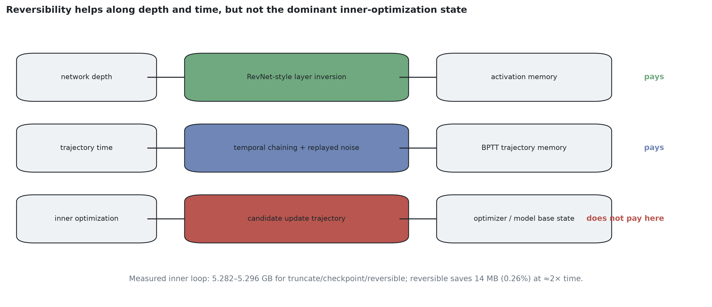

**Figure 2.15 — Three axes of reversible computation and their measured applicability.**
Reconstruction pays along network depth and temporal recurrence. In the tested inner-optimization
loop the model/optimizer base state dominates: reversible replay saves only 14 MB (0.26% of peak)
relative to checkpointing while approximately doubling wall time. Source: author’s taxonomy from
`logs_rhcp/mem_panel.md`.

The resulting **applicability boundary** of the developed resource-optimization method is stated
as the closing result of this chapter: *reversibility pays on recurrences whose transition
operator is the invertible coupling itself — the temporal rollout of the modeled video process —
and cannot pay on inner optimization loops, whose reverse step is dominated by the reconstruction
of a per-step derivative graph; the latter regime belongs to gradient checkpointing.* This
scoping replaces the earlier $T \leftrightarrow K$ isomorphism claim with a two-sided,
measurement-backed delimitation: it simultaneously establishes where the method is the correct
tool — as the **enabling instrument** for constant-memory rollout-through-time training, whose
feasibility Chapter 4 demonstrates by direct memory measurement (the validated Chapter 3 model
itself is trained single-window and does not presuppose it) — and closes, on the record, the
axis where it is not.

## 2.5 Chapter Conclusions

In the second chapter of the dissertation, a complex of mathematical methods was developed and
substantiated for resolving the structural, informational, and computational uncertainties in
multi-step video generation systems. The main results are as follows.

1. In accordance with **Task 3** of the dissertation research, a method for estimating the
   spatio-temporal uncertainty of video data was developed through the transition from rigid
   patch tokenization to adaptive entropy-based decomposition (the V-BLT architecture). It was
   established that computing entropy over byte predictions yields per-pixel uncertainty maps
   that can guide non-uniform allocation. The evidence supports the reported [A1] setting; it
   does not prove globally optimal token boundaries.

2. To ensure the structural coherence of data under spatial linearization, the mathematical
   apparatus of N-dimensional rotary positional embedding (RoPE-ND) was developed. The derivation
   shows that its rotary score terms depend on relative displacement along each encoded axis. A
   coordinate-scaling mechanism provides a common convention for cross-level coordinates but does
   not guarantee learned attention localization. This is a level-appropriate instrument for
   architectures that require spatial coordinate transfer; the measured Chapter 3 predictor
   instead uses learned level/role/frame embeddings in joint attention, so its results do not
   depend on RoPE-ND.

3. In accordance with **Task 4**, activation-memory growth in vanilla BPTT was addressed for the
   tested recurrence. The TempVerseFormer mathematical architecture was developed from discrete
   reversible transformer blocks joined by the temporal-chaining mechanism.

4. The lemma on the computational complexity of the time-agnostic backpropagation algorithm was
   formulated and proven: the algebraic reconstruction of local graphs during the reverse pass
   reduces the peak memory consumption from $O(T \cdot L \cdot D)$ to $O(L \cdot D)$ — a constant
   with respect to the trajectory length — while preserving gradient exactness.

5. The time-agnostic backpropagation method was **extended to stochastic multi-level
   recurrences** via the exactly invertible store-the-noise recurrence: with stored noise, state
   reconstruction is exact (measured error $8.4 \times 10^{-13}$) and the reverse-replay
   gradients coincide with BPTT (cosine similarity $1.000000$). The measured memory frontier of
   the real training loop confirms the practical payoff — BPTT consumes 12.2 GB at rollout length
   $K = 40$ and fails (OOM) at $K = 120$, whereas the developed method remains at
   $\approx$1.1–1.2 GB through $K = 160$, with gradient checkpointing remaining a comparable
   alternative (1.47–1.97 GB) — i.e., the method provides a constant-memory capability relative
   to vanilla BPTT and approximate Pareto equivalence with checkpointing, which is stated
   honestly. The **applicability domain** of reversible computation was delimited by the
   three-axis taxonomy (depth — time — computation): the temporal-rollout axis pays and can support
   future rollout-through-time training of hierarchical video generators; the final Chapter 3
   predictor is trained on individual windows and does not use that integration. The
   inner-optimization-loop axis cannot pay against
   checkpointing (a saving of $\approx 0.2\%$ at $K = 128$, with the state-versus-graph
   accounting applied after Maclaurin et al.). It was additionally established by measurement
   that **invertibility does not imply stability**: exactly invertible recurrences span
   perturbation-growth regimes from $333\times$ to $1.0\times$ over 100 steps purely as a
   function of the Lipschitz bound on the coupling, so trajectory stability is a separate design
   requirement (a Lipschitz constraint). This is an applicability result for reversible temporal
   recurrences; the final Chapter 3 predictor does not use reversible rollout training.

The results of this chapter are published in the author's works **[A1]** (§§2.1–2.2), **[A2]**
(§§2.3–2.4). The stochastic-recurrence extension and three-axis applicability taxonomy are
dissertation developments building on [A2]; they are not attributed to the context-packaging
article [A4]. These stable labels are bound mechanically to the final numbered publication list.

---

# Chapter 3 — A Hierarchical Mathematical Model for Video Generation with Long Multi-Stream Context

The preceding chapters decomposed the video-generation system and developed separate instruments
for entropy-based representation, positional structure, and reversible temporal optimization.
This chapter develops the dissertation's context/state-memory strand: a hierarchical mathematical
model of video-sequence generation in a compact continuous latent state space with
**long-span multi-stream context**. The demonstrated predictor carries long-range history in a
context stream; a spatially downsampled coarse stream is its measured hierarchical
implementation, while temporally sparse full-resolution history is evaluated as an alternative
package. Context signals are processed in one joint-attention mechanism, and target windows are
generated by a v-parameterized latent diffusion core selected by the controlled mechanism study
of Chapter 4. RoPE-ND and reversible temporal optimization remain complementary dissertation
methods, but they are not components of this executed predictor.

Two methodological commitments frame the chapter. First, the model is described exactly as
implemented and verified in the frozen research implementation (`hvp_rev/rhvd.py`): every
architectural constant quoted below is a constant of the measured system, not a proposal. Second, alongside
the generative model itself, the chapter formalizes the **measurement instrument** — a
purpose-built memory-horizon testbed with a re-entry-stratified evaluation protocol (§3.4). Under
the systems-analysis methodology of specialty 124, the instrument is a deliverable of equal rank
with the model: it is what operationalizes the trajectory-consistency criterion of Chapter 1
(§1.4.5) into an exactly computable, statistically disciplined measurement procedure.

## 3.1 Formalization of the Hierarchical Latent State Space

The chapter's organizing object is a **context-stream family**. Stream \(i\) is represented by

$$
\mathcal S_i=(\ell_i,\;s_i,\;n_i,\;a_i),
$$

where \(\ell_i\) is the representation level, \(s_i\) the temporal stride, \(n_i\) the retained
slot count, and \(a_i\) the lag of the most recent anchor. Its lag set is
\(K_i=\{a_i+j s_i:j=0,\ldots,n_i-1\}\). If one slot at level \(\ell\) contains
\(q_\ell=H_\ell W_\ell\) tokens, then

$$
B_{\mathrm{ctx}}=\sum_i n_iq_{\ell_i},\qquad
R=\max_i\left[a_i+(n_i-1)s_i\right].
$$

This explicit anchor geometry avoids treating reach as a hard-coded consequence of one stride.
A system configuration is a set of streams consumed by one shared attention backbone. In this
vocabulary, a **flat** configuration is a
single fine-resolution stride-1 stream; a **temporal (rate) hierarchy** has two or more tick
rates at any resolution; a **resolution hierarchy** has two or more spatial resolutions; a
**deep hierarchy** has three or more streams; the **context budget** counts context tokens only,
with target tokens, total sequence length, and compute reported separately (§4.1). The two-level
coarse-plus-fine model developed next is the family's per-level-decodable resolution form — the
dissertation's demonstrated system, not the family's definition.

### 3.1.1 Two-Level State Decomposition and Frozen Autoencoder

Chapter 1 (§1.2.2) established the hierarchical decomposition of the visual scene state into
levels of abstraction as the core systems-analysis remedy for the anomalies of flat latent
spaces. The developed model instantiates this decomposition with $L = 2$ levels, which is the
minimal configuration that exhibits the phenomenon under study (a low-rate upper level able to
carry memory that the detailed lower level cannot afford), while remaining fully trainable and
evaluable on a single consumer-grade GPU — a deliberate scoping decision consistent with the
resource constraints formalized in Chapter 1.

The state of the video process at frame $t$ is represented not by the pixel frame
$x_t \in \mathbb{R}^{64 \times 64}$ but by a pair of latent codes produced by a shared
convolutional encoder $\mathcal{E}$:

$$
z_t \;=\; \bigl(z^{\mathrm{c}}_t,\; z^{\mathrm{f}}_t\bigr) \;=\; \mathcal{E}(x_t),
\qquad
z^{\mathrm{c}}_t \in \mathbb{R}^{16 \times 4 \times 4},
\qquad
z^{\mathrm{f}}_t \in \mathbb{R}^{16 \times 8 \times 8},
\tag{3.1}
$$

where $z^{\mathrm{c}}_t$ is the **coarse** (macro-level) code — 16 channels on a $4{\times}4$
spatial grid, 256 numbers per frame — and $z^{\mathrm{f}}_t$ is the **fine** (micro-level) code —
16 channels on an $8{\times}8$ grid, 1{,}024 numbers per frame. Both codes pass through a
$\tanh$ nonlinearity and are therefore bounded. The coarse code is, by construction and by
training incentive, the low-rate "layout" description of the scene (global composition and camera
position); the fine code carries texture and stroke detail. In the macro/meso/micro vocabulary of
§1.2.2, the coarse level plays the macro role and the fine level the micro role; the meso level is
absorbed — a two-level pyramid is the minimal sufficient instantiation for the claims under test.

The defining structural property of the autoencoder — adopted from the hierarchical latent video
modeling line of work [37, 20, 36] in minimal form — is **per-level decodability**: each level is *independently* decodable to
the full frame by its own decoder,

$$
\hat{x}^{\mathrm{c}}_t = \mathcal{D}_{\mathrm{c}}\bigl(z^{\mathrm{c}}_t\bigr),
\qquad
\hat{x}^{\mathrm{f}}_t = \mathcal{D}_{\mathrm{f}}\bigl(z^{\mathrm{f}}_t\bigr),
\tag{3.2}
$$

so that neither level is a mere residual of the other: the coarse code alone suffices to
reconstruct a (blurred but correctly composed) frame, and the fine code alone suffices to
reconstruct a detailed frame. This property is enforced during autoencoder training by
random-level dropout: at each training step exactly one of the two reconstruction losses
(L1 + MSE) is supervised, with the coarse branch up-weighted ($\times 4$) so that the low-rate
level is not ignored. The trained autoencoder has 1.85 M parameters and reaches a validation
reconstruction error of 0.0020 (MSE, fine level) on the testbed data of §3.4.

Two systemic decisions about this autoencoder follow the unidirectional-control principle
(§3.1.3) and are stated here explicitly:

1. **The autoencoder is frozen.** It is trained once, on the training clips only, and never
   fine-tuned afterwards; during the training and operation of the predictive core its parameters
   are algorithmically excluded from the gradient graph. The latent space is therefore a *fixed
   coordinate system* for the entire study — every predictive mechanism compared in Chapter 4
   operates in literally the same state space, which is a precondition for a valid matched-NFE
   comparison. This decision retains, in the new architecture, exactly the systemic function that
   the old design assigned to its frozen semantic encoder: invariance of the state coordinates
   during generation.

2. **The latent interface is standardized.** The raw $\tanh$-bounded codes are small in scale
   (per-channel standard deviations average 0.121 for the coarse and 0.162 for the fine level).
   Every latent channel $c$ of every level $\ell \in \{\mathrm{c}, \mathrm{f}\}$ is z-scored with
   statistics computed **on the training set only**:

$$
\tilde{z}^{(\ell)}_{t}[c] \;=\; \frac{z^{(\ell)}_{t}[c] - \mu^{(\ell)}_{c}}{\sigma^{(\ell)}_{c}},
\qquad
\sigma^{(\ell)}_{c} \ge 10^{-4},
\tag{3.3}
$$

   and all held-out data are standardized with the *same* constants. This step is part of the
   model definition, not an implementation detail: the diffusion process of §3.2.3 injects noise
   at unit scale, and an unstandardized latent (scale $\approx 0.12$–$0.16$) silently mis-scales
   the entire noise schedule — the initial noise sample is then 4–7× off-scale relative to the
   data manifold. Chapter 4 (§4.2) documents that this single scaling error is capable of
   reversing mechanism-level experimental conclusions; the standardization (3.3) is therefore
   elevated to a protocol requirement. In the remainder of the chapter, $z$ denotes the
   standardized latents.

The pixel decoders $\mathcal{D}_{\mathrm{c}}, \mathcal{D}_{\mathrm{f}}$ participate in the system
only downstream of the predictive core and only through the frozen interface — the old chapter's
"detached pixel decoder" principle survives here in a strictly stronger form (the decoder is not
merely gradient-detached but entirely frozen): pixel-space rendering can never destabilize the
optimization of the dynamics core, and all pixel-space metrics of §3.4.3 are measured through one
and the same fixed decoder for every compared system.

**Figure 3.1 — Model architecture and context-packaging alternatives.**
*Content:* input frames → frozen two-level conv-AE (shared encoder trunk; coarse
$16{\times}4{\times}4$ and fine $16{\times}8{\times}8$ taps); training-only latent
standardization; the shared WindowDiT generation core consuming a selected flat, spatial or
temporal package together with actions; a jointly predicted four-frame latent window; and the
frozen fine decoder. The lower panel reports exact package accounting and makes the 1,088-token
temporal versus 1,152-token spatial comparison explicitly near-matched rather than exact.
*Source:* **`docs/figures/fig16_context_packaging_architecture.png`** and vector PDF; generated
deterministically by `scripts/make_rft_core_schematics.py` from the frozen interface.

### 3.1.2 Cross-Level Context Transfer: from Cross-Attention to Joint Attention

If the two levels of the hierarchy were optimized in complete isolation, the generated states
would contradict each other — the coarse level could place scene content at one position while
the fine level renders texture consistent with another. Guaranteeing the integrity of the
multi-level system requires a strict information channel between the levels; Chapter 1 (§1.4.4)
introduced *hierarchical consistency* as the corresponding criterion. The question is the
mechanism of this **inter-level context-signal transfer**.

The classical mechanism, described in the earlier design iterations of this work, is cross-level
cross-attention: queries formed from the child level, keys and values projected from the parent
level, with positional coordinate scaling to align the two spatial resolutions. The developed
model retains the *function* of this mechanism but generalizes its *form*: instead of a directed
pair of attention maps between separate per-level networks, all tokens of both levels — context
and target alike — are placed into **one joint self-attention sequence** of a single shared
transformer (§3.2.1). Within every attention layer, each fine token attends to all coarse tokens
(and vice versa), with the level identity, temporal position, and role of every token supplied to
the network as additive embeddings and as per-token conditioning of the adaptive normalization
(§3.2.2). Cross-level transfer is thus realized as a special case of joint attention: the
attention sub-blocks between fine queries and coarse keys are exactly the cross-attention of the
earlier design, but they are learned jointly with the within-level blocks rather than imposed as
a separate module.

This generalization has three systemic consequences:

1. **Bidirectional consistency coupling at generation time.** Both levels of the target window
   are denoised *jointly, in one pass, under a shared noise level* (§3.2.3). The fine level
   conditions on the coarse level's current (partially denoised) state and the coarse level
   conditions on the fine level's — at every one of the refinement steps. Hierarchical
   consistency is therefore enforced continuously along the generation trajectory, not once at a
   hand-off between stages.

2. **Asymmetric information budgets without asymmetric wiring.** The long memory enters the
   sequence only as coarse tokens (48 frames × 16 tokens), while the fine level contributes only
   a short window (6 frames × 64 tokens). The *architecture* is symmetric; the *information
   design* is what makes the coarse level the carrier of long-range memory (§3.3.4). This is the
   precise sense in which "the coarse level carries the memory horizon" is a designed property of
   the developed model rather than an emergent accident.

3. **No hand-crafted spatial masks.** The old design constrained the child-to-parent attention by
   a hard $2{\times}2$ receptive-field mask routed by scaled positional coordinates. In the
   developed model, the spatial correspondence between a $4{\times}4$ coarse cell and its
   $2{\times}2$ block of $8{\times}8$ fine cells is available to the network through the learned
   per-level spatial position embeddings, but it is not imposed as a hard constraint; at the
   adopted resolutions the joint attention learns the routing directly. Thus the hard
   $2{\times}2$ mask of the superseded 32×32 design is explicitly not part of the validated
   4×4/8×8 implementation. RoPE-ND remains the scaled-coordinate instrument developed for the
   [A1] system in Chapter 2.

### 3.1.3 One-Way Control with Detached Gradient Paths

The old chapter postulated a strict *sequential* ordering of level generation (macro level first,
then meso, then micro, each receiving the previous level's output as a gradient-detached
constant) — and simultaneously, in its own algorithmic listing, executed the levels in the
opposite order. The resolution adopted in this dissertation is to state what the validated
implementation actually does and to re-scope the unidirectionality principle to the boundaries
where it is both real and load-bearing:

**Within a prediction step, the levels are generated jointly, not sequentially.** As established
in §3.1.2, one attention pass denoises both levels of the 4-frame target window simultaneously.
There is no macro-first or micro-first ordering *inside* the step, and the dissertation makes no
such claim. What survives of the top-down intuition is the **information-design asymmetry**: the
coarse level is the only level whose history extends over the full memory horizon, so at
generation time the long-range structure of the prediction can only originate from the coarse
context — the fine level physically lacks the inputs to contradict it at long range. The control
is unidirectional in the information-theoretic sense (long-horizon signals flow coarse → fine
because only the coarse channel transports them), not in the scheduling sense.

**Gradient detachment survives at two system boundaries**, where it is exact and deliberate:

1. **Between the representation subsystem and the prediction core.** The autoencoder is frozen
   (§3.1.1): no gradient of any prediction objective ever reaches $\mathcal{E}$,
   $\mathcal{D}_{\mathrm{c}}$, or $\mathcal{D}_{\mathrm{f}}$. The state coordinate system is a
   fixed constant of the control problem. This is the direct descendant of the old design's
   Detached-KV principle — the parent representation is a constant with respect to the child's
   optimization — applied at the representation/dynamics boundary where it demonstrably matters.

2. **Between past and future along the rollout.** At every autoregressive step (§3.3.1), the
   context buffers contain previously generated latents that enter the network as constants:
   during training no gradient propagates from the current window's loss into earlier windows
   (training is single-window by design, §3.2.3), and during generation the sampled window is
   appended to the buffers via an implicit detachment (sampling runs under no-grad). Destructive
   interference between the optimization of successive windows — the failure mode the old
   chapter's unidirectional control was designed to prevent — is thereby excluded structurally.

This formulation combines stop-gradient discipline, constant parent context and prevention of
bidirectional gradient interference. The implemented and validated system generates both levels
jointly in a single attention pass, with the coarse level distinguished by *what it remembers*,
not by a separate execution phase.

## 3.2 Generative Core: Windowed Latent Diffusion

The per-frame generation mechanism of the developed model is an iterative-refinement (denoising
diffusion) core. This choice is not aesthetic: Chapter 4 (§4.2) selects it by a matched-capacity,
matched-capacity and matched-NFE comparison of three mechanisms sharing this chapter's backbone — direct
regression, denoising diffusion, and energy-based gradient descent — in which diffusion commits
to sharp, correctly located content where regression hedges toward the conditional mean and the
energy-based alternative fails in a two-sided, characterized manner. This chapter presents the
selected core; the selection evidence belongs to Chapter 4.

### 3.2.1 Token Sequence and Component-Wise Conditioning

The prediction problem is windowed. Let $t$ be the first frame to predict, $W = 4$ the window
length, $H_{\mathrm{c}}$ the coarse context length and $w_{\mathrm{f}}$ the fine context length
(system configuration: $H_{\mathrm{c}} = 48$, $w_{\mathrm{f}} = 6$; §3.3.4 introduces the control
configurations). One prediction step consumes:

- the coarse context $\;C^{\mathrm{c}} = \bigl(z^{\mathrm{c}}_{t-H_{\mathrm{c}}}, \ldots,
  z^{\mathrm{c}}_{t-1}\bigr)$ — the last 48 coarse latents;
- the fine context $\;C^{\mathrm{f}} = \bigl(z^{\mathrm{f}}_{t-w_{\mathrm{f}}}, \ldots,
  z^{\mathrm{f}}_{t-1}\bigr)$ — the last 6 fine latents (the fine context frames are by
  construction the *last* $w_{\mathrm{f}}$ frames of the coarse window, so the two contexts are
  temporally aligned and satisfy $w_{\mathrm{f}} \le H_{\mathrm{c}}$);
- the recorded control actions $a_{t}, \ldots, a_{t+W-1}$, $a \in \{-1, 0, +1\}$ (§3.4.1), where
  $a_{t+j}$ is the action that moves the process from frame $t{+}j{-}1$ to frame $t{+}j$;
- the noisy target window $\;y = \bigl(y^{\mathrm{c}}_{t..t+3},\, y^{\mathrm{f}}_{t..t+3}\bigr)$
  at noise level $\tau$ (during generation — the current iterate of the sampler).

Every latent map is linearized into spatial tokens (one token per spatial cell, its 16 channels
linearly projected to the model width $d$): a coarse frame contributes $4 \times 4 = 16$ tokens,
a fine frame $8 \times 8 = 64$ tokens. The full input of one prediction step is the single joint
sequence

$$
S \;=\;
\underbrace{\bigl[\,\text{coarse ctx: } 48 \times 16\,\bigr]}_{768}
\;\Vert\;
\underbrace{\bigl[\,\text{fine ctx: } 6 \times 64\,\bigr]}_{384}
\;\Vert\;
\underbrace{\bigl[\,\text{targets: } 4 \times (16 + 64)\,\bigr]}_{320}
\;=\; 1472 \ \text{tokens},
\tag{3.4}
$$

of which $48 \cdot 16 + 6 \cdot 64 = 1152$ are context tokens — the context-token budget that
the matched-budget flat control of §3.3.4 is required to equal exactly.

Each token carries four additive identity embeddings: a learned spatial position embedding (one
table per level), a **level** embedding ($\mathrm{c}/\mathrm{f}$), a **role** embedding
(context/target), and a **frame-index** embedding. Frame indices are absolute within the step:
context frames occupy indices $0 \ldots 47$ (fine context frames share the indices $42 \ldots 47$
of their coarse counterparts), and the four target frames occupy indices $48 \ldots 51$ — the
frame-embedding table has 52 entries. On top of the identity embeddings, every token receives a
per-token conditioning vector $c$ used by the adaptive normalization of every block:

$$
c \;=\;
e_{\mathrm{level}} + e_{\mathrm{frame}} + e_{\mathrm{role}} +
\begin{cases}
e_{\tau}(0), & \text{context tokens (clean, noise level } 0\text{)},\\[2pt]
e_{\tau}(\tau) + e_{\mathrm{act}}(a_{t+j}), & \text{target tokens of frame } t{+}j,
\end{cases}
\tag{3.5}
$$

where $e_{\tau}(\cdot)$ is a sinusoidal-MLP embedding of the continuous noise level and
$e_{\mathrm{act}}$ is a learned embedding of the action alphabet. Two properties of (3.5) are
essential. First, context tokens are conditioned at noise level 0 — the network is explicitly
told which part of the sequence is clean evidence and which is the object of refinement; the
prediction loss is computed on target tokens only. Second, the action conditioning is
**per-target-frame**: frame $t{+}j$ receives exactly its own action $a_{t+j}$, so the network
never needs to disentangle a summed multi-step action code — each generated frame is bound to
the control signal that produced it.

**Figure 3.2 — Token layout for one prediction step.**
The 1,472-token sequence contains 768 coarse-context tokens, 384 recent fine-context tokens and
four 80-token coarse-plus-fine targets. The bracket identifies the 1,152-token context budget
matched by the central contiguous-fine control; the lower strips show the additive token
embeddings and per-target action/noise conditioning.
*Source:* `docs/figures/fig22_token_sequence_layout.png`; deterministic source
`scripts/make_dissertation_missing_figures.py`, reflecting
`hvp_rev/rhvd.py::WindowDiT._ctx_tokens/forward`.

### 3.2.2 Transformer Backbone with Adaptive Normalization

The sequence (3.4) with conditioning (3.5) is processed by a stack of $N_{\mathrm{blk}} = 8$
pre-norm transformer blocks of width $d = 384$ with 6 attention heads and MLP expansion ratio 4
(22.18–22.19 M trainable parameters for the two-level arms; the 0.01 M difference is due to the
package-specific input/output interface). Attention is full (every token attends to every token): the causality of the
overall system is enforced by sequence construction and by the autoregressive recursion (§3.3.2),
not by an attention mask inside the step.

Each block applies **adaLN-Zero conditioning** [4]: the per-token
conditioning vector $c$ is mapped (SiLU → linear) to six modulation signals
$(\gamma_1, \beta_1, g_1, \gamma_2, \beta_2, g_2)$, and the block computes

$$
\operatorname{mod}(h; \beta, \gamma) = h \,(1 + \gamma) + \beta,
\tag{3.6}
$$

$$
h \leftarrow h + g_1 \cdot \operatorname{Attn}\bigl(\operatorname{mod}(\operatorname{LN}(h);
\beta_1, \gamma_1)\bigr),
\qquad
h \leftarrow h + g_2 \cdot \operatorname{MLP}\bigl(\operatorname{mod}(\operatorname{LN}(h);
\beta_2, \gamma_2)\bigr),
\tag{3.7}
$$

with the modulation projection zero-initialized, so every block starts as the identity — the
standard stable initialization for a denoiser trained as a residual refiner. Queries and keys are
RMS-normalized per head. After the final block, only the 320 target tokens are read out: each
level has its own final adaptive layer-norm (again zero-initialized) and its own zero-initialized
linear head projecting $d \to 16$ channels, after which the tokens are reshaped back into the
latent geometry — $(W, 16, 4, 4)$ for the coarse and $(W, 16, 8, 8)$ for the fine level. The
backbone, tokenizer, and conditioning are shared verbatim with the alternative mechanisms of the
Chapter 4 mechanism study; only the output interpretation and the training objective differ —
this is what "matched capacity" means operationally in this work.

### 3.2.3 v-Parameterization

Why a *window* of $W = 4$ frames rather than one frame at a time? The reason is
rollout-consistency of the training distribution. The autoregressive rollout of §3.3 appends
*all* frames it generates to the context buffers; if training predicted only a single frame at
offset $k = 4$ (the design of the preliminary single-step harness), the rollout context would
consist of stride-4 samples while the training context consisted of consecutive frames — a
train/rollout distribution mismatch built into the protocol itself. Predicting a window of $W$
*consecutive* frames per step and advancing the recursion by exactly $W$ keeps the buffers
consecutive at all times: the layout of every context the model sees at rollout is identically
distributed with the contexts it saw in training.

Let $z_0 = \bigl(z^{\mathrm{c}}_{t..t+3},\, z^{\mathrm{f}}_{t..t+3}\bigr)$ denote the clean
(standardized) target-window latents. The forward diffusion process corrupts them with Gaussian
noise $\varepsilon \sim \mathcal{N}(0, I)$ at a noise index
$\tau \sim \mathrm{U}\{1, \ldots, T\}$, $T = 1000$, *shared across the window's frames and both
levels within a training sample* (one $\tau$ per sample — the coupling that ties the two levels
and four frames to a common refinement trajectory):

$$
y \;=\; \sqrt{\bar\alpha_\tau}\, z_0 \;+\; \sqrt{1 - \bar\alpha_\tau}\,\varepsilon,
\tag{3.8}
$$

with the cosine noise schedule [2]

$$
\bar\alpha_\tau \;=\; \frac{f(\tau)}{f(0)},
\qquad
f(\tau) \;=\; \cos^{2}\!\Bigl(\frac{\tau/T + s}{1 + s} \cdot \frac{\pi}{2}\Bigr),
\qquad
s = 0.008,
\qquad
\bar\alpha_\tau \in [10^{-4},\, 0.9999].
\tag{3.9}
$$

The network is trained in the **v-parameterization** [110]: the regression target is the velocity

$$
v \;=\; \sqrt{\bar\alpha_\tau}\,\varepsilon \;-\; \sqrt{1 - \bar\alpha_\tau}\, z_0,
\tag{3.10}
$$

which interpolates between noise prediction (at low noise) and sign-flipped data prediction (at
high noise) and is well-conditioned across the whole schedule. Denoting by
$v_\theta\bigl(y,\, C^{\mathrm{c}},\, C^{\mathrm{f}},\, \tau,\, a\bigr)$ the two-level output of
the backbone (§3.2.2), the training objective is the unweighted sum of the two levels'
mean-squared v-errors:

$$
\mathcal{L}(\theta)
\;=\;
\mathbb{E}_{\,z_0,\,\tau,\,\varepsilon}
\Bigl[
\bigl\lVert v^{\mathrm{c}}_\theta - v^{\mathrm{c}} \bigr\rVert^2_2
\;+\;
\bigl\lVert v^{\mathrm{f}}_\theta - v^{\mathrm{f}} \bigr\rVert^2_2
\Bigr].
\tag{3.11}
$$

Equal weighting is meaningful only because of the standardization (3.3), which puts both levels'
latents at unit per-channel variance; without it the loss would be silently dominated by whichever
level's raw scale happened to be larger.

Optimization protocol (constants of the validated system): AdamW, learning rate
$3 \cdot 10^{-4}$, weight decay $10^{-4}$; linear warmup over the first 2{,}000 steps to a
constant learning rate (restart-safe by design — training is resumable from atomic checkpoints);
gradient-norm clipping at 1.0; batch size 16–32; 30{,}000 training steps per system arm; an
exponential moving average (EMA) of the parameters with decay 0.999 maintained throughout, with
*all* evaluation performed on the EMA weights. Training uses clean (ground-truth) contexts only —
no self-generated context injection in the base protocol; the pre-registered design reserves
context-noise augmentation as a single budgeted fallback. It was not activated: the observed
deep-horizon sharpness-retention failure is reported as a boundary result rather than repaired by
an adaptive retraining branch.

Training-noise/teacher-forcing scope note for the defense: the long-horizon capability claimed in
Chapter 4 is achieved *without* backpropagation through the rollout — the model is trained on
single windows with clean contexts, and its long memory is an inference-time property of the
information design (§3.1.2), not of a long-horizon training objective. Where a rollout-through-
time objective would be required, the constant-memory machinery of Chapter 2 is the enabling
instrument; the two contributions compose but do not presuppose each other.

### 3.2.4 DDIM

Generation inverts the diffusion with a deterministic DDIM sampler [46] over $N_{\mathrm{DDIM}} = 16$ steps on a rounded-linear sub-grid
$\tau_1 = T > \tau_2 > \cdots > \tau_{16} \ge 1$ of the training schedule. Starting from pure
noise $y^{(1)} \sim \mathcal{N}(0, I)$ over the whole two-level window, each step evaluates the
network once and converts its v-output into the implied clean-data and noise estimates:

$$
\hat{z}_0 \;=\; \sqrt{\bar\alpha_{\tau_i}}\, y^{(i)} \;-\; \sqrt{1 - \bar\alpha_{\tau_i}}\,
v_\theta\bigl(y^{(i)}, \cdot\bigr),
\qquad
\hat{\varepsilon} \;=\; \sqrt{1 - \bar\alpha_{\tau_i}}\, y^{(i)} \;+\;
\sqrt{\bar\alpha_{\tau_i}}\, v_\theta\bigl(y^{(i)}, \cdot\bigr),
\tag{3.12}
$$

$$
y^{(i+1)} \;=\; \sqrt{\bar\alpha_{\tau_{i+1}}}\; \hat{z}_0 \;+\;
\sqrt{1 - \bar\alpha_{\tau_{i+1}}}\; \hat{\varepsilon},
\qquad
y^{(N_{\mathrm{DDIM}}+1)} \;:=\; \hat{z}_0 \ \ (\text{final step}),
\tag{3.13}
$$

i.e. the deterministic ($\eta = 0$) DDIM update; the sampler's only stochasticity is the initial
noise draw, which the evaluation protocol controls with common random numbers (§3.4.4). The
computational price of generation is thus fixed: 16 network evaluations per 4-frame window — 4
network function evaluations per generated frame.

### 3.2.5 Regression Control Head

For the mechanism claims of Chapter 4 (hypothesis H2: the generative mechanism earns its keep at
rollout), the system admits a drop-in **regression** variant on the identical backbone: the noisy
target inputs are replaced by zeros, the noise level is fixed at $\tau \equiv 0$, the output is
interpreted directly as $\hat z_0$, and the objective is the smooth-L1 error on both levels. Its
"sampling" is a single forward pass. Architecture, tokenization, conditioning, context design,
parameter count, optimizer, and evaluation protocol are all shared with the diffusion core — the
two systems differ in the training objective and nothing else. The chapter records this variant
as part of the model family because the honest form of the dissertation's mechanism claim is
comparative, and the comparison is meaningful only under this strict parity.

## 3.3 Autoregressive Rollout with Ring-Buffer Memory

The developed technology operates as a fully **autonomous** autoregressive predictor: its
inputs are past video frames (through the latent interface) and the recorded low-dimensional
control track; no exogenous modality (in particular, no text) steers the generation. The control
track is not a side channel of convenience: in the systems framing of Chapter 1 the actions *are*
part of the observed state of the control system, and Chapter 4 (§4.2) documents that withholding
them forces every mechanism to hedge over the control-marginal future and manufactures a spurious
blur verdict. The salvaged autonomy principle of the old chapter therefore survives in a
sharpened form: autonomous with respect to semantic side information, conditioned on the recorded
control signal.

### 3.3.1 Rollout Recurrence

The state of the rollout between prediction steps is the pair of **ring buffers**

$$
B^{\mathrm{c}}_n = \bigl(\hat z^{\mathrm{c}}_{t_n - H_{\mathrm{c}}}, \ldots,
\hat z^{\mathrm{c}}_{t_n - 1}\bigr),
\qquad
B^{\mathrm{f}}_n = \bigl(\hat z^{\mathrm{f}}_{t_n - w_{\mathrm{f}}}, \ldots,
\hat z^{\mathrm{f}}_{t_n - 1}\bigr),
\tag{3.14}
$$

holding the last $H_{\mathrm{c}} = 48$ coarse and the last $w_{\mathrm{f}} = 6$ fine latents,
where $\hat z$ denotes ground-truth latents during warm-up and self-generated latents thereafter.
The recursion is:

**Algorithm 3.1 — Autoregressive rollout with ring-buffer memory** *(implemented as
`hvp_rev/rhvd.py::rollout_eval`)*

> **Input:** ground-truth frames $x_{0..H_{\mathrm{w}}-1}$ for warm-up ($H_{\mathrm{w}} = 48$),
> recorded actions $a_{1..T}$, frozen AE $(\mathcal{E}, \mathcal{D})$, trained EMA weights
> $\theta$, horizon $T$.
> **Output:** predicted frames $\hat x_{H_{\mathrm{w}}..T-1}$.
> 1. Encode and standardize the warm-up frames; initialize $B^{\mathrm{c}}, B^{\mathrm{f}}$ with
>    their last $H_{\mathrm{c}}$ and $w_{\mathrm{f}}$ latents; $t_0 \leftarrow H_{\mathrm{w}}$.
> 2. **for** $n = 0, 1, \ldots, \lfloor (T - H_{\mathrm{w}})/W \rfloor - 1$ **do**
> 3. &nbsp;&nbsp; read the actions $a_{t_n}, \ldots, a_{t_n+W-1}$ of the current window;
> 4. &nbsp;&nbsp; sample the window by DDIM (§3.2.4):
>    $(\hat z^{\mathrm{c}}_{t_n..t_n+3},\, \hat z^{\mathrm{f}}_{t_n..t_n+3})
>    \leftarrow \mathrm{DDIM}_{16}\bigl(v_\theta;\, B^{\mathrm{c}}_n,\, B^{\mathrm{f}}_n,\,
>    a_{t_n..t_n+3}\bigr)$;
> 5. &nbsp;&nbsp; append all $W$ predicted latent pairs to the buffers; drop the oldest $W$
>    entries of each (ring update); $t_{n+1} \leftarrow t_n + W$;
> 6. &nbsp;&nbsp; decode predictions for evaluation:
>    $\hat x_{t_n+j} = \mathcal{D}_{\mathrm{f}}\bigl(\hat z^{\mathrm{f}}_{t_n+j}\bigr)$,
>    $j = 0..3$ (through un-standardization and the frozen fine decoder).
> 7. **end for**
> On the 200-frame evaluation clips of §3.4: warm-up 48 frames, then
> $(200 - 48)/4 = 38$ rollout steps, i.e. 152 self-generated frames per clip — more than three
> full loop periods of the testbed world.

Because the training windows are consecutive and the recursion advances by exactly $W$, the
buffer contents at every rollout step are distributionally identical to training contexts
(§3.2.3) — the property that makes clean-context training sufficient. The warm-up length is
**universal across all compared systems** (48 frames even for arms whose context is shorter, e.g.
the flat control warms its 18-frame buffer from ground-truth frames 30–47): every arm starts
generating at the same frame of the same clip, so the per-(clip, horizon) records of §3.4 pair
exactly across arms.

**Figure 3.3 — Ring buffers for autoregressive rollout.**
After the common 48-frame ground-truth warm-up, each step combines the fixed 48-slot coarse and
6-slot fine buffers with four actions, samples four latent pairs with DDIM-16, and appends/evicts
four positions. The stored state is 18,432 latent numbers and does not grow with rollout length.
*Source:* `docs/figures/fig23_rollout_ring_buffer.png`; deterministic source
`scripts/make_dissertation_missing_figures.py`, reflecting `hvp_rev/rhvd.py::rollout_eval`.

### 3.3.2 Temporal Routing and Block-Causal Semantics

The old chapter's prediction skeleton promised two routing mechanisms: a block-causal attention
mask (full attention within a frame, causal across frames) over a jointly optimized past+future
token tensor, and 3D-RoPE relative spatio-temporal positional coding. The developed system
realizes the *functions* of both, by different and simpler means, and the dissertation states the
mapping explicitly rather than letting the old vocabulary stand:

- **Block-causality holds at window granularity and is enforced by construction, not by a
  mask.** Within one prediction step, attention over the sequence (3.4) is full — and
  legitimately so: every token in the sequence belongs either to the observed past (context) or
  to the window currently being generated, whose frames are refined *jointly* as one block under
  a shared noise level. Across steps, the recursion of Algorithm 3.1 makes information flow
  strictly causal: frames of window $n{+}1$ are generated conditioned on (at most) windows
  $\le n$ through the buffers, and no token of any future window exists at step $n$. Viewed over
  an entire rollout, the effective attention pattern is exactly block-causal with block size
  $W = 4$ — realized structurally, which eliminates both the mask bookkeeping and any
  possibility of future-information leakage (there is no future present to leak).

- **Temporal position is encoded by learned absolute frame-index embeddings** (52-entry table,
  §3.2.1) rather than rotary relative coding. Because every prediction step re-indexes its
  context to the fixed range $0 \ldots 47$ and its targets to $48 \ldots 51$, the absolute
  indices *are* relative to the window, so the scheme is translation-invariant across the rollout
  by construction.
  RoPE-ND and these learned indices are therefore presented as level-appropriate instruments:
  RoPE-ND for the variable-patch, cross-resolution [A1] system in Chapter 2, and fixed learned
  indices for the re-indexed window used by the validated hierarchical predictor. No unmeasured
  RoPE-ND retrofit is attributed to the final model.

### 3.3.3 Memory and Computational Complexity

**Rollout memory is constant in the horizon.** The complete inter-step state of Algorithm 3.1 is
the buffer pair (3.14):

$$
M_{\mathrm{roll}}
\;=\;
H_{\mathrm{c}} \cdot \bigl|z^{\mathrm{c}}\bigr| \;+\; w_{\mathrm{f}} \cdot
\bigl|z^{\mathrm{f}}\bigr|
\;=\;
48 \cdot 256 \;+\; 6 \cdot 1024
\;=\; 18{,}432 \ \text{numbers}
\;=\; O(1) \ \text{in the rollout length } T,
\tag{3.15}
$$

plus the (constant) transient activations of one network evaluation. Generation compute is
linear in the horizon with a fixed per-frame constant — $N_{\mathrm{DDIM}} / W = 4$ network
evaluations per generated frame — and, crucially, the per-step attention cost never grows with
how long the system has been rolling, because the sequence length (3.4) is fixed. This replaces
the old chapter's inconsistent claims (its §3.4 derived a per-image memory reduction
$O(K \cdot T \cdot L \cdot D) \to O(T \cdot L \cdot D)$ while its §3.5 asserted
$O(K \cdot L \cdot D) \to O(D)$ for the same algorithm) with a single derivation that is true of
the implemented system: there is no inner optimization chain $K$ to reverse at all — sampling
runs gradient-free — and the memory object that matters for long-horizon operation, the rollout
state (3.15), is constant by design.

**Training memory is single-window and horizon-independent.** The training graph spans one
network evaluation over 1,472 tokens and $N_{\mathrm{blk}} = 8$ blocks; no gradient crosses window
boundaries (§3.1.3). The stored residual-state term is
$O(N_{\mathrm{blk}} S d)$, while a naïve attention implementation can additionally materialize
$O(N_{\mathrm{blk}}S^2)$ attention-score storage. Memory-efficient or fused attention changes
that kernel-dependent term but not the model's $O(N_{\mathrm{blk}}S^2d)$ attention compute.
Accordingly, peak VRAM is treated as an empirical implementation property. The justified
invariance is to the number of rollout windows; memory still depends on token count $S$ and hence
on the selected package.

**Token-budget economics of the hierarchy.** The systemic argument for the two-level design is a
counting argument. Let $H$ be the number of past frames a model can consult ("effective memory
frames"). A flat single-level model pays $64$ tokens per remembered frame; the hierarchical model
pays $16$ tokens per remembered frame beyond its short fine window:

$$
S^{\mathrm{flat}}_{\mathrm{ctx}}(H) \;=\; 64\,H,
\qquad
S^{\mathrm{hier}}_{\mathrm{ctx}}(H) \;=\; 16\,H \;+\; 64\,w_{\mathrm{f}}
\quad (w_{\mathrm{f}} \ \text{fixed}),
\tag{3.16}
$$

an asymptotic 4× token advantage per memory frame, hence (attention being quadratic in sequence
length within each of the $N_{\mathrm{blk}}$ layers, $O(S^2 d)$) an asymptotic ≈16× advantage in
attention cost for the same memory horizon. At the system's operating point the concrete numbers
are: hier-long consults 48 frames for 1152 context tokens; a flat model consulting the same 48
frames pays $48 \cdot 64 = 3072$ context tokens — 2.67× the tokens and, at full sequence lengths
(1472 vs 3392 tokens), a ≈5.3× ratio in per-layer attention cost. Conversely, a flat model
*constrained to hier-long's token budget* can afford only $1152 / 64 = 18$ frames of memory —
which is precisely the matched-budget control of §3.3.4. The claim is about **hierarchical
context packaging whose benefit is mediated by reach**, not an intrinsic superiority of coarse
features and not context length treated as a free variable: at equal budget,
the flat alternative's horizon (18 frames) falls short of the testbed's loop period (≈48 frames,
§3.4.1), while the hierarchical allocation covers it.

**Disposition of the reversible inner loop (salvage of old §3.3).** The earlier design stage of
this work proposed integrating the reversible-transformation apparatus of Chapter 2 *inside* the
per-frame generation loop ("Reversible MCMC": reconstructing the activations of a $K$-step
gradient-descent sampling chain instead of storing them). The final system contains no such
component, for two reasons established in this dissertation. First, the three-axis reversibility
taxonomy of Chapter 2 (§2.4) proves that the inner-optimization-loop axis cannot outperform
gradient checkpointing there: the chain's states must be retained for exact reversal, which *is*
checkpointing under another name — the axis is closed by analysis, not abandoned by neglect.
Second, the mechanism study of Chapter 4 removed the premise: the energy-descent core whose
$K$-step chains motivated the machinery was itself the characterized-negative mechanism, and the
selected diffusion core requires no gradient flow through its sampling recursion (3.12)–(3.13) at
all. Reversibility remains a contribution of this dissertation on the axis where it pays — the
temporal-rollout axis of Chapter 2 — and this paragraph is the honest record of where it does
not.

### 3.3.4 System Configurations and Matched-Budget Controls

The information design of §3.1.2 turns context allocation into an experimental variable. The
model family is parameterized by $(H_{\mathrm{c}}, w_{\mathrm{f}}, \text{core})$, and the
dissertation's claims are comparative statements over the following pre-registered
configurations (all sharing the backbone of §3.2.2, the training protocol of §3.2.3, and the
evaluation protocol of §3.4):

**Table 3.1 — System configurations (arms) and context-token accounting.**

| Configuration | Coarse ctx $H_{\mathrm{c}}$ | Fine ctx $w_{\mathrm{f}}$ | Context tokens | Core | Systemic role |
|---|---|---|---|---|---|
| **hier-long** | 48 | 6 | $48 \cdot 16 + 6 \cdot 64 = 1152$ | diffusion | the developed system: coarse memory ≥ loop period |
| hier-short | 6 | 6 | $6 \cdot 16 + 6 \cdot 64 = 480$ | diffusion | memory ablation (hierarchy without the horizon) |
| flat-budget | 0 | 18 | $18 \cdot 64 = 1152$ | diffusion | **token-budget-matched flat control** (equal cost, 18-frame horizon) |
| flat-long | 0 | 48 | $48 \cdot 64 = 3072$ | diffusion | window-matched flat exhibit (equal horizon, 2.67× budget) |
| reg-long | 48 | 6 | 1152 | regression | mechanism control (H2), §3.2.5 |
| persistence / AE round-trip | — | — | — | — | floor / ceiling references (§3.4.4) |

The flat configurations set $H_{\mathrm{c}} = 0$: coarse *context* tokens are absent, while the
coarse *target* tokens are retained, so the latent interface, the output heads, and the loss
(3.11) remain identical across all arms — the flat arm differs from the hierarchical one in
exactly one respect, the absence of coarse memory. The decisive comparison is hier-long versus
flat-budget: both pay 1152 context tokens per step, but the hierarchical allocation stretches
those tokens over a 48-frame horizon while the flat allocation reaches only 18 frames. The
pre-registered prediction — validated in Chapter 4 — is that the two systems separate exactly
where the testbed's re-entry events lie beyond the 18-frame flat horizon, and are otherwise
comparable; if they had *not* separated, the honest conclusion recorded in the design memo was
"context length, not hierarchy," and the dissertation would have reported it as such.

### 3.3.5 Generalization to a Family of Hierarchical Configurations

The token-stream design of §3.2.1 generalizes beyond the two-level, stride-1 family of Table 3.1
without any change to the backbone. A configuration is a set of context streams, each
parameterized by the triple **(spatial resolution, temporal stride, number of frames)**: the
coarse stream may tick at
stride $k_t > 1$ (one slot per $k_t$ frames, block-end anchors, $W/k_t$ target slots per
prediction window so the slot buffer keeps phase for any $k_t$ dividing $W$); a full-resolution
stream may itself be strided (temporal abstraction without a resolution change); and a third,
**top** stream at $2{\times}2$ (4 tokens per frame) extends the pyramid to depth 3 at factor 2
per level ($2{\times}2 / 4{\times}4 / 8{\times}8$). The top latent is a third tap of the frozen
autoencoder trained on the **frozen trunk** (§3.1.1), so the two lower levels remain bit-identical
and every measurement of Chapter 4 stays valid across the extension. Two systemic properties
distinguish this family from recurrent hierarchies of the CW-VAE class: (i) **depth is
backbone-capacity neutral** — all streams share one attention backbone; a third level adds only
per-level input/output parameters (+0.30 M on the 22.19 M predictor, +1.4%) and the frozen
autoencoder tap (1.25 M), measured and disclosed; and (ii)
every configuration's context cost is an exact token count, so families are comparable at
**matched budget** — the property that licenses the shape comparisons of §4.4 (simplified
configurations: `hier-s2-min` = 24 slots at stride 2 + 2 fine = 512 tokens; `strided-flat` = 11
full-resolution slots at stride 4 + 6 fine = 1,088; `hier3` = 48 top + 24 coarse + 9 fine =
1,152).

## 3.4 Memory-Horizon Testbed and Re-Entry-Stratified Evaluation

A model whose defining property is a *memory horizon* cannot be validated on benchmarks that do
not exercise one. On Moving-MNIST-class data nothing ever leaves the frame and returns: every
future frame is either fully determined by a short context or permanently unknowable, so there
exists no *hard-but-computable-with-memory* regime in which a long-memory mechanism could
demonstrate its value — this project's own null results on such data (Chapter 1, §1.3; Chapter 4)
trace to exactly this degeneracy. Existing memory-oriented benchmarks (Memory Maze and
TECO-Minecraft [62, 36], and the recent long-term spatial-memory evaluation protocols for world
models [22, 23, 24]) pose genuine
long-horizon problems but derive their re-entry events from 3-D egomotion in rendered
environments, where determining *which* pixels of a target frame were knowable from a given
context requires geometry processing at best — and their model scales exceed a single-GPU
budget. The instrument constructed here is the minimal fully analytic member of this family:
hardness labels are computed **exactly** from the recorded control track, and the complete
benchmark trains and evaluates on one 16 GB consumer GPU.

### 3.4.1 Cyclic World with Inertial Panning

Each clip is generated (module `scripts/gen_looping.py`) from a static **world**: a
$192 \times 64$ texture on a horizontal torus, composed of a smooth background (a sum of four
sinusoids with integer wavenumbers, hence seamlessly wrapping; intensities in $[0.15, 0.5]$) and
three MNIST digits max-composited at fixed world positions. A $64 \times 64$ **viewport** pans
horizontally; the observed clip is the sequence of viewport crops, so two thirds of the world
(128 of 192 columns, 67%) is off-screen at every instant.

The pan is a **momentum action walk**: at each frame the camera holds with probability
$p_{\mathrm{hold}}$, otherwise continues its heading with probability $p_{\mathrm{cont}}$ and
reverses otherwise (measured on the shipped data: $p_{\mathrm{hold}} \approx 0.10$,
$p_{\mathrm{cont}} \approx 0.90$). The executed action $a_t \in \{-1, 0, +1\}$ is recorded, and
the viewport advances by $4 a_t$ pixels:

$$
x^{\mathrm{vp}}_t \;=\; \bigl(x^{\mathrm{vp}}_{t-1} + 4\,a_t\bigr) \bmod 192 .
\tag{3.17}
$$

The momentum is the essential design element. A symmetric random walk diffuses too slowly to
circumnavigate the torus within a clip, so off-screen content would be either still inside a
short context window (determined) or never seen again (unknowable) — reproducing the degenerate
Moving-MNIST regime. Directed motion cycles the torus with loop period $\approx 192/4 = 48$
frames: a digit that exits the viewport re-enters roughly 48 frames later at a world position
fixed since frame 0. A model with memory spanning the loop period can predict the re-entry
exactly; a short-context model cannot — and 48 frames is precisely the coarse horizon
$H_{\mathrm{c}}$ of the developed system (§3.3.4), while the token-matched flat control's
18-frame horizon falls short of it. The testbed thereby *instantiates* the memory-horizon regime
as a controlled experimental variable.

Datasets (fixed, generated once, shared by every experiment): `loopmom_train` — 3{,}000 clips ×
100 frames (split by clip into 2{,}700 train / 300 validation); `loopmom_test` — 500 clips ×
200 frames, providing a held-out pool of 250 evaluation clips whose 200-frame duration supports
the multi-loop rollouts of Algorithm 3.1 (rollout evaluation uses 100 of them per arm). Test
latents are standardized with the training statistics (3.3).

**Figure 3.4 — LoopMom geometry and analytic reach band.**
The 64-pixel viewport traverses a 192-pixel toroidal static world. Saved positions make geometric
observability exact; the highlighted 14-to-48-frame band contains evidence available to the
long-reach package but outside the compared short flat window. The separate pose-mosaic inset is
marked as a privileged reference because it receives exact pose and raw stored pixels.
*Source:* `docs/figures/fig15_loopmom_observability_schematic.png`; deterministic source
`scripts/make_rft_core_schematics.py`.

### 3.4.2 Exact Re-Entry Difficulty Labels

Because the viewport trajectory (3.17) is a deterministic function of the recorded actions, the
set of world columns covered by any context window is computable in closed form — hardness is an
analytic label, not a heuristic. For a target frame $t$ and a reference window of the $m$
preceding frames, let $\mathrm{cov}_m(t) \subset \{0, \ldots, 191\}$ be the union of world
columns visible in frames $t-m, \ldots, t-1$, and let $F(t)$ be the set of world columns occupied
by the target frame's sprite pixels (detected by the foreground threshold of §3.4.3). The
**novel-foreground fraction** is

$$
\nu_m(t) \;=\; \frac{\bigl|\, F(t) \setminus \mathrm{cov}_m(t) \,\bigr|}{\bigl|\, F(t) \,\bigr|}
\;\in\; [0, 1],
\tag{3.18}
$$

the fraction of the target sprite that is geometrically unobserved in that context. It is an exact
observability label for the generator, not information-theoretic necessity: a shared digit prior
can still support a statistical guess. The protocol fixes the reference window at $m = 6$ frames for *all* systems regardless
of their actual context length ("novel-fg-at-6"), so every arm is stratified on the same hardness
axis, and defines three strata: **easy** ($\nu_6 = 0$ — the sprite was fully visible in the short
window), **mid** ($0 < \nu_6 \le 0.1$), and **hard re-entry** ($\nu_6 > 0.1$ — a substantial part
of the sprite is not geometrically visible in the short window). The single-step mechanism study of Chapter 4 uses
the analogous *novel-strip* label (the same construction restricted to the newly revealed leading
strip of the pan — the only genuinely generative region of a single predicted frame). This
stratification is what turns the trajectory-consistency criterion of §1.4.5 into a measurement:
the dissertation's headline quantities are error deltas *within the hard re-entry stratum* as a
function of rollout horizon.

### 3.4.3 Decoded Frame, Foreground and Object Metrics

Aggregate pixel metrics are excluded by protocol. On the archived CW-VAE Moving-MNIST population
(100 clips, 36 context frames, 964 open-loop targets), a deterministic all-black prediction
scores 0.7681 SSIM and 13.941 dB, while the trained CW-VAE's best-of-5-by-SSIM curve scores
0.5708 and 12.918 dB. The source dataset, archived curve and evaluator are hash-pinned in
`artifacts/cwvae_black_baseline/results.json`; record-level CW-VAE values were not retained, so
this is a same-population metric diagnostic without paired inference, not a budget-matched model
comparison. A benchmark on which the empty image wins its full-frame metrics is not evidence
about dynamics. All metrics below are therefore computed on decoded pixels through the frozen
fine decoder and reported with foreground, background, union, full-frame and component-sensitive
views.

**Table 3.4-A — Same-population Moving-MNIST metric sanity diagnostic.**

| Open-loop horizon | CW-VAE SSIM | All-black SSIM | CW-VAE PSNR, dB | All-black PSNR, dB |
|---|---:|---:|---:|---:|
| +1–48 | 0.6338 | 0.7679 | 13.944 | 13.943 |
| +49–192 | 0.5665 | 0.7679 | 12.625 | 13.942 |
| +193–964 | 0.5677 | 0.7682 | 12.909 | 13.941 |

- **Foreground MSE (fg-MSE).** Predictions and ground truth are decoded to $[0,1]$; the error is
  averaged over pixels where the ground-truth frame exceeds the threshold $0.5$. The threshold is
  testbed-calibrated and verified: the background texture occupies ≈0.18–0.41 while sprite
  strokes reach ≈0.99, so 0.5 isolates the digits (a conventional 0.1 threshold would classify
  the entire panning background as foreground).

- **Foreground sharpness (fg-sharp).** Per-image Laplacian energy on that image's foreground
  mask: $\sum (\nabla^2 \hat x)^2$ weighted by the mask, normalized by mask area, averaged over
  images. Deliberately *not* a batch-variance statistic: batch variance rewards inter-sample
  diversity, whereas per-image Laplacian energy rewards per-frame detail — which is what
  distinguishes a committed prediction from a mean-hedged blur.

- **Rollout records.** During Algorithm 3.1, every generated frame contributes a record
  (clip, horizon $h = t - H_{\mathrm{w}} + 1 \in \{1, \ldots, 152\}$, hardness $\nu_6$, fg-MSE,
  fg-sharp, and the persistence reference for the same frame). Analyses bin horizons as 1–8,
  9–24, 25–60, 61+ — the 9–24 bin brackets the flat control's 18-frame horizon boundary, and
  25–60 brackets the loop period.

- **Decoded-sample review** is a first-class protocol element: every evaluation saves panels of
  decoded frames (last context | prediction | ground truth) from the same samples that produced
  the scores. Twice during this research, scalar metrics concealed a qualitative failure (a slow
  fade to the mean; a blank-output collapse) that one glance at the panels exposed; the protocol
  therefore mandates the panels alongside the numbers.

### 3.4.4 Statistical Protocol, References and Boundaries

All system-versus-system comparisons are **paired**: evaluation draws use fixed seeds so every
arm sees identical (clip, target) pairs; stochastic samplers are re-seeded per batch with common
random numbers; and rollout records pair exactly across arms by (clip, horizon) thanks to the
universal 48-frame warm-up (§3.3.1). Headline deltas are reported with 95% confidence intervals
from a paired **clip-cluster** bootstrap (10{,}000 resamples): clips are the resampling units and
all horizons belonging to a selected clip remain inside the replicate. This preserves
within-rollout dependence rather than treating frames as independent observations
[111, 112, 113, 114]. The untouched frontier and protected robustness families use a
studentized max-statistic clip-cluster procedure for simultaneous coverage across their
registered contrasts. Intervals are computed within each stated hardness×horizon population;
single-step evaluation pools are sized at ≈768 samples
so the hard stratum retains power, and rollout evaluation covers 100 clips × 152 generated frames
= 15{,}200 records per arm. Clip-cluster intervals condition on each trained model; training
seeds are a separate uncertainty level and are reported individually or summarized with seeds as
units. Where a best-of-$N$ statistic appears it is an oracle *coverage* diagnostic (selection by
pixel-space fg-MSE against ground truth) and is always reported alongside the mean over $N$;
headline tables use best-of-1.

Every table is bracketed by references measured under the identical pipeline: the **persistence
floor** (copy the last context frame's fine latent, decode) scores fg-MSE 0.2367 / fg-sharp
0.0515 at the 4-frame offset — any model below that error has learned at least the
action-conditioned warp; and the **sharpness ceiling set by the frozen decoder**: raw
ground-truth frames measure fg-sharp 0.4785, but their autoencoder round-trip measures 0.2412,
so all model sharpness is read against ≈0.24 (roughly half the raw sharpness is spent in the
autoencoder before any prediction model acts), and a decoded output below ≈0.08 contains no
digit structure at all (the empirically calibrated collapse threshold used throughout the
mechanism study).

**Table 3.2 — Testbed and evaluation protocol summary.**

| Component | Value | Notes |
|---|---|---|
| World / viewport | 192×64 torus / 64×64 crop | 128 columns (67%) off-screen at any time |
| Content | background texture + 3 MNIST digits | fixed world positions; max-composited |
| Pan process | momentum walk, 4 px/frame | $p_{\mathrm{hold}} \approx 0.10$, $p_{\mathrm{cont}} \approx 0.90$ (measured); actions $\{-1,0,+1\}$ recorded |
| Loop period | ≈ 48 frames | $192/4$; sets the memory horizon; $= H_{\mathrm{c}}$ of hier-long |
| Train / test | 3,000×100 / 500×200 frames | clip-disjoint; test standardized with train statistics |
| Latent interface | frozen 2-level conv-AE, 1.85 M | coarse 16 ch @ 4×4, fine 16 ch @ 8×8, per-level decodable; fine val recon MSE 0.0020 |
| Standardization | per-channel z-score, per level | training-set statistics only; eq. (3.3) |
| Error metric | fg-MSE, threshold 0.5 | decoded pixels; background ≈0.18–0.41, sprite ≈0.99 |
| Sharpness metric | per-image masked Laplacian energy | GT 0.4785; AE round-trip ceiling 0.2412; collapse < ≈0.08 |
| Hardness axis | $\nu_6$ — novel-fg vs 6-frame window, exact | easy $=0$; mid $(0, 0.1]$; hard $> 0.1$; eq. (3.18) |
| Rollout | 48-frame GT warm-up; 38 steps × 4 frames | 152 generated frames/clip; 100 clips; horizons binned 1–8 / 9–24 / 25–60 / 61+ |
| Statistics | paired clip-cluster 95% CI; CRN for same target shapes | 10,000 resamples; simultaneous max-statistic families where registered; ≈768-sample single-step pools; 15,200 rollout records/arm; training seeds reported separately |
| Floors / ceilings | persistence fg-MSE 0.2367 / fg-sharp 0.0515 | k = 4 offset; identical pipeline for every arm |

Scope and limitations of the instrument are stated plainly, as required of a measurement
deliverable: motion is one-dimensional and piecewise-deterministic given the action, so the
generative burden is concentrated in the re-entry events by design; world content is static in
world coordinates, so the testbed does not probe memory of *dynamic* off-screen state; all
conclusions are at 64×64 grayscale and single-digit complexity; and the frozen decoder's
sharpness ceiling caps every downstream comparison. The analytic hardness labels that justify
the design would not transfer unchanged to 3-D egomotion benchmarks, which are positioned as the
natural next rung (Chapter 4 and General Conclusions).

## 3.5 Chapter Conclusions

1. In accordance with **Task 5** of the dissertation research, a mathematical model of
   multi-stream video-data generation in a compact continuous hierarchical latent state space
   has been developed. It supports streams with different temporal rates and spatial resolutions
   over one shared attention backbone. Its measured spatial implementation decomposes the state
   (3.1) into a coarse
   (macro) level — 16 channels at 4×4, independently decodable, standardized per channel — and a
   fine (micro) level — 16 channels at 8×8 — over a frozen two-level autoencoder. In that
   implementation the coarse stream economically packages long-range history: it is the stream
   whose context extends over the full 48-frame memory horizon, at a cost
   of 16 tokens per remembered frame against the fine level's 64 (eq. 3.16, a 4× per-frame and
   asymptotically ≈16× attention-cost advantage).

2. The inter-level transfer of context signals has been formalized as joint self-attention over
   a single token sequence of both levels (eq. 3.4–3.5), generalizing the cross-level
   cross-attention of the earlier design and enforcing hierarchical consistency continuously
   along the refinement trajectory (both levels denoised jointly under a shared noise level).
   The unidirectional-control principle with gradient detachment has been retained at the two
   boundaries where it is exact and load-bearing — between the frozen representation subsystem
   and the prediction core, and between past and future along the autoregressive recursion —
   while the internally contradictory strict level-ordering claim of the earlier formulation has
   been withdrawn in favor of the validated joint-generation formulation (§3.1.3).

3. The per-frame generation core has been formalized as window diffusion in the standardized
   latent space: v-parameterized (3.10) denoising of 4-frame two-level windows under a cosine
   schedule (3.9) with per-target-frame action conditioning, trained on single windows (3.11)
   and sampled by 16-step deterministic DDIM (3.12)–(3.13) at a fixed cost of 4 network
   evaluations per generated frame. The window length equals the recursion advance, which makes
   the training and rollout **layout and temporal indexing** identical by construction. It does
   not make their values identically distributed: training uses clean contexts, while rollout
   contains self-generated values and therefore retains exposure-bias risk.
   A capacity-matched regression variant on the identical backbone (§3.2.5) completes the model
   family for the mechanism claims whose evidence is presented in Chapter 4.

4. The autoregressive rollout algorithm with ring-buffer memory (Algorithm 3.1) has been
   developed and its resource profile derived: the inter-step state is constant at
   $48 \cdot 256 + 6 \cdot 1024 = 18{,}432$ numbers (3.15) independently of the rollout horizon,
   per-step cost is fixed by the constant 1472-token sequence, and block-causality holds at
   window granularity by construction rather than by masking (§3.3.2). The re-derivation (§3.3.3)
   removes the complexity-claim inconsistency of the earlier chapter version, and the earlier
   reversible-inner-loop proposal is disposed of honestly: by the three-axis taxonomy of
   Chapter 2 that axis cannot outperform checkpointing, and the selected diffusion core requires
   no gradient through its sampler. Reversibility remains a separately measured contribution on
   the temporal-rollout axis and a potential enabler for future rollout-through-time training; it
   is not used to produce the Chapter 4 context-package gains.

5. In accordance with **Task 6**, the measurement instrument of the intelligent information
   technology has been formalized: the momentum looping memory-horizon testbed (3.17) with
   exactly computable re-entry hardness labels (3.18), foreground-masked per-image metrics with
   verified thresholds and decoder-set ceilings, mandatory decoded-sample review, and a paired
   clip-cluster bootstrap protocol with common random numbers and a universal warm-up that pairs every record
   across systems. The instrument operationalizes the trajectory-consistency criterion of
   Chapter 1 into an analytic, statistically disciplined measurement procedure, and its scope
   limits are stated as part of the deliverable.

6. The complete pre-registered experimental design has been fixed within the model chapter
   (Table 3.1): the developed system (hier-long), the memory ablation (hier-short), the
   token-budget-matched flat control (flat-budget, 1152 tokens = 18-frame horizon), the
   window-matched flat exhibit (flat-long, 2.67× budget), and the regression control (reg-long) —
   with the decisive comparison, hier-long versus flat-budget at equal token cost, constructed so
   that the hierarchy's memory horizon (48 frames ≥ loop period) and the flat horizon (18 frames
   < loop period) straddle the testbed's re-entry structure. The experimental verification of the
   pre-registered hypotheses on this design — including the honest fallback conclusions specified
   in advance — constitutes §§4.2–4.4 of Chapter 4.

The context-packaging, model, and evaluation results of this chapter form the methods section of
[A4]. Its final numbered
bibliographic position and any related conference theses are publication-administration fields,
not scientific dependencies of the chapter.

---

# Chapter 4 — Experimental Evaluation, Operating Regions, and Practical Application

This chapter evaluates the developed methods by scientific question rather than by campaign
chronology. The complete chronological record, gate history, secondary arm tables, and
future-study shells are preserved in
`docs/dissertation/rewrite/appendices/CHAPTER4_CAMPAIGN_ARCHIVE.md`. The main chapter answers:

1. Which generation mechanism is appropriate for the controlled predictor, and under which
   inference regime?
2. Does hierarchical context retrieve memory-relevant content beyond a token-matched flat window?
3. Where is the tested reach–fidelity frontier, and what context-state efficiency does it imply?
4. Which context-package shape is preferred?
5. Which directions survive training seeds, sampler allocation, and codec changes?
6. Which proposed effects fail to replicate?
7. What do explicit access and persistent-object evaluation reveal about the mechanism’s limits?

The chapter reports frozen evidence only. Moving-MNIST-CIFAR, KTH, E5b, E9, and the B1
fixed-target control are not executed results. E9 is terminally skipped because it provides no
incremental utility after the protected evidence programme; B1 retains whole-configuration
wording, so the unexecuted control is not required for the present claims.

## 4.1 Evaluation Design and Evidence Levels

### 4.1.1 Testbeds and roles

The experimental programme separates mechanism identification, confirmation, robustness, and
external-boundary evidence.

**LoopMom** is the primary mechanistic instrument. A \(64\times64\) viewport moves over a
\(192\times64\) toroidal world containing background texture and digit sprites. At any instant,
two thirds of the world is outside the viewport. Recorded actions and viewport positions identify
when each world region was last visible; at the main operating point, relevant content re-enters
after approximately 48 frames. This geometry provides exact *geometric observability*: it tells
whether the information required for a re-entry was previously visible within a package’s reach.
It does not prove information-theoretic necessity because common digit priors can make unseen
content statistically predictable.

**Moving-MNIST 10-to-10** is a short, no-re-entry competence boundary using the canonical
OpenSTL protocol [1] [115]. It asks whether the general predictor
functions on a standard dataset, not whether hierarchical memory pays.

**Persistent-object long Moving-MNIST (E6)** uses a 48-frame warm-up followed by 300 self-fed
frames. The generator saves persistent object and source-glyph identities, boxes, and
trajectories. The evaluator uses one-to-one Hungarian assignment
[116], explicit misses and extras, a fixed ground-truth denominator for
identity accuracy, and object coverage. E6 is an external synthetic boundary, not a replication of
LoopMom’s geometry.

**TaxiBJ** is a real spatio-temporal forecasting competence bridge under the OpenSTL 4-to-4
protocol [117] [1]. It does not contain the off-screen re-entry mechanism required by
the article’s central claim and is therefore not treated as memory confirmation.

### 4.1.2 Evidence hierarchy

Four evidence levels are kept distinct:

1. **Development evidence** uses the original evaluation pool that informed theory and arm
   selection.
2. **Untouched confirmation** evaluates frozen checkpoints and registered populations once on a
   newly generated, hash-pinned holdout rejected by training and monitoring loaders.
3. **Robustness evidence** changes sampler allocation or the entire latent codec under separately
   purpose-locked data.
4. **External-boundary evidence** changes the task and object semantics and is interpreted as a
   scope test rather than a replication.

The source of truth is the immutable local NPZ/JSON evidence, not dashboard summaries. Protected
data require purpose-specific access records. Each accepted result is linked to a content-addressed
run specification, dataset hash, checkpoint provenance, source revision, and completion
validator.

### 4.1.3 Endpoints and statistical protocol

Sparse-video evaluation requires more than aggregate full-frame error. Every accepted evaluation
retains full-frame MSE, non-empty ground-truth-foreground MSE, background MSE, union-mask MSE,
foreground precision/recall/F1, component counts, misses, extras, overlap, and coverage.
Persistent-object studies additionally retain trajectory error and identity accuracy. SSIM, PSNR,
LPIPS, FID, and FVD remain useful conventional metrics
[118, 119, 88, 120], but no one aggregate score is allowed to substitute for
re-entry, hallucination, support, identity, and coverage endpoints.

For a registered pair, record-level differences are paired by clip and horizon. The sampling unit
is the clip: a bootstrap replicate samples clips with replacement and retains all rollout frames
inside each selected clip. This preserves within-rollout dependence. Clip-cluster intervals
condition on the trained model, while training seeds are a separate uncertainty level.
Registered families use a studentized maximum statistic across all contrasts in each bootstrap
replicate, producing simultaneous intervals rather than interpreting many marginal intervals
independently [111, 112, 113, 114].

Effects are reported as comparator loss minus candidate loss unless a table states otherwise;
positive values therefore favor the registered candidate. A null interval is unresolved, not
evidence of equivalence. Equivalence would require a justified smallest effect of interest,
adequate measurement reliability, and a confidence interval wholly inside that margin.

### 4.1.4 Computational environment and budget vocabulary

The main experiments use the recorded Python/PyTorch environments and NVIDIA GPU configurations
stored with their run specifications. CPU-only gates validate dataset integrity, package
interfaces, experiment authorization, metric semantics, and deterministic evidence generation.
GPU-hour accounting includes training, evaluation, pilots, failures, and retries.

“Matched budget” always names the matched resource:

- context-token matched;
- target-interface matched;
- total-sequence-token matched;
- parameter matched;
- training-example matched;
- optimizer-update matched; or
- inference-NFE matched.

The B16×30k and B8×60k regimes process approximately the same number of examples but differ in
updates, gradient noise, grouping, and effective EMA horizon. They are optimizer-regime
comparisons, not “twice the data.”

## 4.2 Selection of the Generation Mechanism

The model chapter uses v-parameterized latent diffusion, but the experiment does not assume that
diffusion wins every evaluation regime. Regression, diffusion, and energy-based descent are
compared on the same conditioning structure and closely matched transformer capacity.

### 4.2.1 Shared single-step mechanism study

The regression and diffusion predictors use width 256, six transformer blocks, eight heads, and a
shared context layout; their parameter counts are 7.27 M and 7.53 M. Context contains six frames
at both latent levels, and the target lies four actions after the last context frame. Per-level
latent standardization is essential: without it, unit-scale diffusion noise overwhelms raw latent
scales and reverses the observed ranking. Inference work is measured in network function
evaluations (NFE). Best-of-\(N\) is an oracle coverage diagnostic selected by decoded foreground
MSE against the ground truth and is always separated from mean-over-\(N\) and best-of-1.

**Table 4.1 — Matched-capacity single-step mechanism comparison.**

| Head | fg-MSE, all | Easy | Hard novel strip | Mean over 8 | fg-sharpness |
|---|---:|---:|---:|---:|---:|
| Regression with MC dropout | 0.0664 | 0.0232 | 0.1808 | 0.0714 | 0.1591 |
| Diffusion, v-prediction + DDIM | **0.0512** | **0.0120** | **0.1549** | **0.0640** | **0.1886** |
| Persistence reference | 0.2367 | — | — | — | 0.0515 |

Diffusion wins every column in this single-step best-of-8 coverage regime and is already better at
NFE 4. The separation is largest on the genuinely generative hard subset. The regressor’s
mean-over-8 and best-of-8 values are close, while diffusion gains more from multiple samples,
consistent with the established distinction between mean-seeking regression and stochastic
coverage [121, 122, 123].

### 4.2.2 Best-of-1 rollout reverses the head ranking

During deterministic best-of-1 self-fed rollout, regression performs better: `reg-long` reaches
foreground MSE 0.1682 versus 0.1848 for `hier-long`, with paired interval
\([+0.0110,+0.0227]\) for diffusion-minus-regression and nearly equal sharpness
(0.0741 versus 0.0729). At the matched flat context, regression reaches 0.2015 versus 0.2038 for
diffusion.

The two results answer different questions. Diffusion wins an oracle-coverage regime in which
multiple samples are compared to the ground truth. Regression wins the deterministic best-of-1
rollout in which every prediction is fed back. The defensible conclusion is regime dependence,
not a universal best head.

### 4.2.3 Energy-based descent is a characterized negative

The energy-based study uses the official Energy-Based Transformer implementation and two reported
training recipes [82]. It separates two capabilities:
whether the trained energy orders true targets below mismatched targets, and whether candidate
descent from the prescribed initialization reaches structured outputs.

One recipe produces a persistently misordered landscape. The second repairs the ordering but
descent still fails to reach structured video targets at the scale feasible in this programme.
This is a two-sided characterized negative, not a proof that energy-based video generation is
impossible at larger scale. It justifies selecting diffusion for the coverage-oriented
single-step mechanism while retaining regression as a best-of-1 control. Detailed energy
landscapes, scale gaps, and descent trajectories remain in the campaign appendix.

## 4.3 Untouched Confirmation of Reach

The original LoopMom pool informed qualitative monitoring and configuration selection. The
central reach claims were therefore tested once on the newly generated hash-pinned holdout
`loopmom-confirmation_holdout-20260712-e033abee6e04`. Before access, the protocol froze
checkpoint evaluations, pair definitions, reach bands, endpoints, table shells, and the
simultaneous frontier family.

For `hier-min` versus `flat-min`, the registered population contains non-empty answerable records
with

$$
14 < \Delta t \le 48,
$$

so the relevant past lies outside the 14-frame flat reach and inside the 48-frame hierarchical
reach. The effects are:

| Training seed | Reach-band effect | 95% CI |
|---:|---:|---:|
| 0 | +0.0980 | [0.0788, 0.1179] |
| 1 | +0.0914 | [0.0736, 0.1098] |

Whole-population effects are +0.0474 \([0.0354,0.0595]\) and +0.0436
\([0.0326,0.0549]\). Union-mask, full-frame, recall/F1, missed-component, and coverage endpoints
support the same direction. The concentration of the larger effects inside the pair-derived band
supports reach as the mechanism.

For B1 versus `flat-short`, the registered \(8<\Delta t\le48\) effects are +0.0692
\([0.0543,0.0845]\) and +0.0743 \([0.0588,0.0899]\). B1 changes context stride, target stride,
target slots, auxiliary loss, sequence length, and optimization difficulty together. It is
therefore a confirmed *whole-configuration* effect, not a pure causal stride estimate.

Geometric observability is exact for the generator but not information-theoretic necessity. A
stronger necessity experiment would require paired worlds identical over the short visible
context but different in hidden content that determines re-entry.

## 4.4 Tested Reach–Fidelity Frontier and Memory Efficiency

The untouched E2 simultaneous family is the principal frontier evidence:

**Table 4.2 — Registered tested frontier.**

| Context-token point | Registered interpretation | Training-seed coverage |
|---:|---|---|
| 896 | hierarchy confirmed over matched flat | seeds 0–1 |
| 1,152 | hierarchy confirmed over matched flat | seeds 0–2 |
| 1,792 | unresolved | registered simultaneous interval crosses zero |
| 2,432 | flat full-resolution context confirmed | primary B16×30k and B8×60k regimes |
| 3,072 | flat full-resolution context confirmed | seeds 0–1 |

The largest tested family-wise-confirmed hierarchy point is 1,152; the smallest tested confirmed
flat point is 2,432. No monotonicity, unique crossing, interpolation, or asymptotic law is inferred
between them.

At the frozen latent resolution, one fine frame costs \(8\times8=64\) tokens and one coarse
frame costs \(4\times4=16\). The 48-frame arithmetic is:

**Table 4.3 — Context-state cost at equal nominal 48-frame addressable reach.**

| Package | Context-token calculation | Context tokens | Relative cost |
|---|---:|---:|---:|
| 48 dense fine frames | \(48\times64\) | 3,072 | 1.00× |
| 48 coarse + 6 fine | \(48\times16+6\times64\) | 1,152 | 2.67× fewer |
| 48 coarse + 2 fine | \(48\times16+2\times64\) | 896 | 3.43× fewer |

The result is **same nominal reach with fewer context tokens**. It is not a claim of equal
information, equal error, equal total tokens, equal compute, or equal wall time. Target tokens and
total sequence tokens are reported separately.

**Figure 4.1 — Untouched tested frontier and exact context-token arithmetic.** Positive effects
favor hierarchy. Intervals belong to one simultaneous family; no line is drawn through the tested
points and 1,792 is shown as unresolved. Source:
`artifacts/confirmation_e2/results.json`.

The frontier supports the dissertation’s central state-memory interpretation. Hierarchy pays when
compression buys access to otherwise unreachable evidence. Once the flat package can afford the
relevant span, discarded fine information becomes an abstraction cost and flat fidelity recovers.

## 4.5 Context-Package Shape

Temporal subsampling and spatial coarsening both buy reach, but they preserve different
information. The near-matched comparison uses a 1,088-token temporally sparse full-resolution
package and a 1,152-token spatial hierarchy. The 64-token deficit favors the temporal package, so
the pair is near-matched rather than exactly matched.

Across five diffusion training seeds, temporal-package advantages are:

| Seed | Temporal-package effect | 95% clip-cluster CI |
|---:|---:|---:|
| 0 | +0.0197 | [+0.0143, +0.0252] |
| 1 | +0.0046 | [+0.0007, +0.0084] |
| 2 | +0.0111 | [+0.0070, +0.0151] |
| 3 | +0.0075 | [+0.0037, +0.0114] |
| 4 | +0.0060 | [+0.0027, +0.0092] |

The across-seed mean is +0.0098, SD 0.0060, with t95
\([+0.0023,+0.0173]\). Thus temporal full-resolution anchors are stable at the tested static-world
diffusion operating point.

Regression does not reproduce a stable package direction: effects are
+0.0107, −0.0104, −0.0208, +0.0248, and −0.0166. The head-by-package interaction also changes
sign. The correct conclusion is therefore:

- temporal packaging is stable across the five tested diffusion seeds;
- regression package use and the cross-head interaction are training-seed-sensitive;
- neither package is universally superior independent of head, task dynamics, or required detail.

Static hidden content can reward sparse full-resolution anchors because old pixels remain
informative. Dynamically evolving or low-detail hidden state may reward spatial compression
instead. This study locates one operating region.

**Figure 4.2 — Package effects by training seed.** Per-seed intervals condition on each trained
model; the seed summary uses training seeds as units.

## 4.6 Robustness of the Principal Directions

### 4.6.1 Sampler allocation and randomness

E7c crosses four frozen seed-0 diffusion contrasts with NFE 8/16/32 at sampler seed 0 and NFE 16
at sampler seeds 1/2:

1. 896-token reach;
2. 1,152-token interior frontier;
3. 1,088-versus-1,152 package shape; and
4. the 2,432-token flat-fidelity inversion.

All 20 point estimates retain their registered direction, and 18 simultaneous lower bounds exceed
zero. The first three contrasts are family-wise clean under every variant. The 2,432 inversion
remains positive but is unresolved at sampler seed 1
\(+0.0098[-0.0001,+0.0196]\) and seed 2
\(+0.0077[-0.0013,+0.0167]\). The verdict is **directionally robust**, not sampler invariant.
This study changes inference allocation for frozen seed-0 predictors; it does not add
training-seed or dataset robustness.

**Figure 4.3 — Sampler/NFE robustness.** Open points mark upper-inversion intervals that include
zero.

### 4.6.2 Independently trained codec

E7a changes the whole continuous latent interface: a second codec is trained independently,
normalization is recomputed, and the seven seed-0 predictors are retrained. Codec weights,
reconstruction error, latent geometry, and normalization therefore change together.

**Table 4.4 — Whole-codec robustness.**

| Codec | 896 reach | 1,152 interior | 1,088 vs 1,152 shape | 2,432 inversion |
|---|---:|---:|---:|---:|
| Original | +0.0494 [0.0339, 0.0649] | +0.0283 [0.0169, 0.0397] | +0.0253 [0.0163, 0.0343] | +0.0150 [0.0065, 0.0235] |
| Alternate | +0.0521 [0.0374, 0.0669] | +0.0439 [0.0310, 0.0569] | +0.0112 [0.0039, 0.0184] | +0.0079 [−0.0006, 0.0165] |

All eight point estimates retain direction, and seven simultaneous lower bounds exceed zero. The
alternate-codec upper inversion is unresolved. The verdict is
**codec-directionally robust**, conditional on predictor seed 0 and one alternative codec; codec
seed is not an inferential replicate and no component-level cause is identified.

**Figure 4.4 — Original and alternate codec effects under one simultaneous family.**

## 4.7 Boundary and Negative Evidence

### 4.7.1 The proposed late trust boundary does not replicate

At a longer-loop operating point, seed 0 showed an early hierarchy benefit followed by a late
inversion during self-fed rollout. E5a preregistered that horizon pattern and repeated the pair at
two new training seeds.

**Table 4.5 — Registered self-fed reliability replication. Positive favors hierarchy.**

| Training seed | Early h1–24 | Late h61–256 |
|---:|---:|---:|
| 0 | +0.0204 [+0.0133, +0.0279] | −0.0064 [−0.0095, −0.0032] |
| 1 | +0.0082 [+0.0035, +0.0133] | +0.0074 [+0.0038, +0.0112] |
| 2 | +0.0230 [+0.0150, +0.0315] | +0.0087 [+0.0035, +0.0139] |

The early advantage is positive at all three seeds. Neither new seed reproduces the required late
negative direction; both reverse it. The registered verdict is **NOT_REPLICATED**. No stable
approximately-24-frame trust boundary is established, and the gated E5b localization programme
is not authorized. The conceptual distinction between addressable history and reliable self-fed
reuse remains valid, but it is not a third empirical law.

**Figure 4.5 — Early benefit and seed-0-only late inversion.**

### 4.7.2 Privileged pose-indexed raw access

E8a asks how much error remains when addressing is explicit. A world-coordinate mosaic stores raw
warm-up pixels and is queried using exact saved future viewport positions. It receives raw pixels,
future poses, and no token-matched budget; it is therefore a privileged access reference, not a
deployable neural competitor.

**Table 4.6 — Simultaneous pose-indexed raw-memory effects.**

| Registered contrast | Estimate | Simultaneous 95% CI |
|---|---:|---:|
| Raw K14 minus raw K48 | +0.0723 | [+0.0548, +0.0898] |
| Raw K38 minus raw K48 | +0.0210 | [+0.0096, +0.0325] |
| `hier-min` minus raw K48 | +0.1219 | [+0.1031, +0.1407] |
| `hier-long` minus raw K48 | +0.1368 | [+0.1190, +0.1545] |
| `strided-flat` minus raw K48 | +0.1134 | [+0.0944, +0.1324] |
| `flat-c2` minus raw K48 | +0.1310 | [+0.1122, +0.1498] |

Raw K48 reaches foreground MSE 0.0494, full-frame MSE 0.0027, and foreground recall 0.8438,
versus foreground MSE 0.1628–0.1862 for the four neural references. The result shows that
geometric reach is not sufficient for reliable addressing and reuse. It does not show that raw
mosaics are practical or that hierarchy is unnecessary.

**Figure 4.6 — Privileged explicit-access reference.**

### 4.7.3 Persistent-object external boundary

E6 compares matched 1,152-token flat and hierarchical packages at training seeds 0–2, using a
48-frame warm-up, 300 self-fed targets, and 100 protected clips.

**Table 4.7 — E6 simultaneous effects. Positive favors hierarchy.**

| Seed | Foreground MSE | Union MSE | Trajectory error | Identity accuracy | Coverage |
|---:|---:|---:|---:|---:|---:|
| 0 | +0.0036 [−0.0074,+0.0146] | +0.0102 [+0.0019,+0.0185] | +2.4786 [+0.2130,+4.7443] | −0.0762 [−0.1106,−0.0418] | +0.0304 [+0.0016,+0.0591] |
| 1 | −0.0031 [−0.0127,+0.0065] | +0.0122 [+0.0052,+0.0192] | +1.4223 [−1.0646,+3.9092] | −0.0561 [−0.0934,−0.0188] | +0.0159 [−0.0163,+0.0482] |
| 2 | −0.0024 [−0.0131,+0.0083] | +0.0169 [+0.0093,+0.0245] | +4.1325 [+1.5271,+6.7380] | −0.0647 [−0.0955,−0.0338] | +0.0498 [+0.0161,+0.0834] |

Absolute performance prevents overstatement:

| Seed | Arm | Union MSE ↓ | Trajectory error ↓ | Identity accuracy ↑ | Coverage ↑ |
|---:|---|---:|---:|---:|---:|
| 0 | flat / hierarchy | 0.6861 / 0.6759 | 42.19 / 39.71 | 0.214 / 0.138 | 0.619 / 0.650 |
| 1 | flat / hierarchy | 0.6901 / 0.6779 | 40.20 / 38.77 | 0.244 / 0.188 | 0.646 / 0.662 |
| 2 | flat / hierarchy | 0.6931 / 0.6763 | 43.79 / 39.65 | 0.222 / 0.158 | 0.599 / 0.649 |

The preregistered verdict is **MIXED_BOUNDARY**. Union-mask error favors hierarchy at every seed.
Trajectory and coverage favor hierarchy cleanly at seeds 0 and 2 and remain directionally positive
but unresolved at seed 1. Identity favors flat context at every seed; foreground-only MSE is
unresolved. Hierarchy therefore better preserves *where* an object is and whether its support
continues, while flat context better preserves *what* digit it is. Neither system solves the
task.

**Figure 4.7 — Spatial-support/identity division of labour in E6.**

### 4.7.4 Short and real-data competence boundaries

On canonical Moving-MNIST 10-to-10, the general predictor beats persistence but remains far behind
specialized OpenSTL pixel predictors on aggregate MSE. Flat and hierarchical packages are nearly
equal because no off-screen re-entry mechanism requires a longer addressable history. This is a
negative control for the reach account, not a claim of benchmark leadership.

On TaxiBJ 4-to-4, the unchanged general stack is competitive with quoted OpenSTL rows on some
metrics but not uniformly. The flat regression arm uses 256 context tokens and reaches MSE
0.3642; the hierarchical regression arm uses 128 tokens and reaches 0.4170. Because only one
training seed was used and the task has no long memory horizon, this row demonstrates transfer
competence and the cost of unnecessary abstraction, not a claim-bearing hierarchy comparison.

## 4.8 Context-State and Activation-Memory Synthesis

The context-package experiments and reversible-computation experiments act on different resource
terms:

| Method | Primary term affected | Benefit | Cost or boundary | Evidence |
|---|---|---|---|---|
| Dense flat context | \(M_{\mathrm{context/state}}\) | preserves fine identity/detail | short reach at fixed budget; high cost at long reach | flat wins at 2,432/3,072 and on E6 identity |
| Spatial hierarchy | \(M_{\mathrm{context/state}}\) | economical dense historical support | loses fine detail | hierarchy wins at 896/1,152; E6 support/continuity |
| Temporal subsampling | \(M_{\mathrm{context/state}}\) | preserves old full-resolution anchors | can miss intermediate dynamics | five-seed diffusion package-shape result |
| Gradient checkpointing | \(M_{\mathrm{activations}}\) | general recomputation-based memory reduction | recomputation and schedule-dependent memory | Chapter 2 comparator |
| Reversible temporal replay | \(M_{\mathrm{activations}}\) | constant activation scaling in tested recurrence | invertibility/stability constraints; no inner-loop advantage | Chapter 2 measured frontier |

The savings are not automatically multiplicative. The Chapter 4 predictor uses bounded context
state but is trained on individual windows without differentiating through the long rollout.
TempVerseFormer and the stochastic reversible recurrence show how activation memory can be reduced
when such long temporal differentiation is required; they are not the cause of the context-package
effects.

## 4.9 Software Toolkit and Practical Application

The research software comprises separately validated modules for:

- entropy-guided representation and RoPE-ND;
- reversible temporal transformations and memory measurement;
- hierarchical, flat, and temporally sparse context packages;
- latent diffusion, regression, and energy-based mechanism controls;
- LoopMom and persistent-object Moving-MNIST generation;
- frame, component, trajectory, identity, and coverage metrics;
- experiment authorization, purpose-locked access, content-addressed run specifications, and
  generated evidence artifacts.

This is an integrated research methodology and software toolkit. It is not one executable predictor
that jointly uses adaptive tokenization, RoPE-ND, reversible rollout training, and hierarchical
context.

The methods were used in the practical activities of ORNETIKA LLC and in the educational process
of VNTU according to implementation acts dated 14 October 2025 and 19 September 2025. Those acts
concern the reversible-transformer and entropy-tokenization strands. The final appendices must
reproduce their approved wording and copies.

## 4.10 Threats to Validity and Research Limits

The principal limitations are:

1. **Synthetic mechanism scope.** LoopMom provides exact geometry and causal interpretability but
   is not natural video. E6 is also synthetic.
2. **Representation scope.** The main predictor uses one frozen two-level continuous codec. One
   independently trained codec supports directional robustness but not representation-family
   universality.
3. **Training-seed scope.** Central points use two or three training seeds; clip intervals provide
   conditional data uncertainty and do not replace seed replication.
4. **B1 confounding.** B1 changes target and optimization properties with context stride.
5. **No equivalence claim.** Context-token efficiency does not establish equal performance at
   fewer tokens.
6. **No unique crossing.** The frontier contains tested discrete points; 1,792 is unresolved.
7. **Self-fed reliability.** The late trust-boundary hypothesis does not replicate.
8. **Absolute E6 difficulty.** Identity accuracy, coverage, and trajectory error show that neither
   package solves the persistent-object task.
9. **Pipeline scope.** State-memory and activation-memory savings are separately measured.
10. **Release scope.** Hash-pinned artifacts support auditability, but public archive availability
    must be distinguished from local provenance until external URLs are published.

Future work should prioritize counterfactual hidden-state instruments, dynamic hidden content,
natural-video memory benchmarks, explicit learned retrieval, and larger training-seed panels. Such
work would extend external validity; it is not required to support the present conditional
dissertation claims.

## 4.11 Chapter Conclusions

1. The generation-head study establishes a regime boundary rather than a universal ranking:
   diffusion is superior in the matched single-step oracle-coverage regime, regression is superior
   in deterministic best-of-1 rollout, and energy-based descent is a characterized negative at the
   tested scale.

2. On the untouched LoopMom holdout, hierarchy is confirmed precisely in registered populations
   where the longer package contains re-entry evidence outside the comparator’s reach. This
   supports reach as the mechanism under the tested representation and head.

3. The simultaneous frontier confirms hierarchy at 896 and 1,152 context tokens, leaves 1,792
   unresolved, and confirms flat full-resolution context at 2,432 and 3,072. No continuous
   crossing or universal hierarchy advantage is inferred.

4. At nominal 48-frame reach, the confirmed hierarchical packages use 2.67–3.43 times fewer
   context tokens than dense fine history. This is context-state reach efficiency, not equal
   performance, compute, or information.

5. Temporal full-resolution anchors are stable across five diffusion training seeds at the tested
   static-world point, while regression and the head-by-package interaction are
   training-seed-sensitive. Spatial and temporal compression are therefore not interchangeable.

6. Sampler/NFE and alternate-codec studies retain all principal point-estimate directions; the
   upper flat-fidelity inversion becomes a precision boundary in some variants.

7. The proposed late self-fed trust boundary fails to replicate. Explicit pose-indexed raw access
   shows a substantial addressing gap, and E6 separates hierarchy-favouring spatial
   support/continuity from flat-favouring identity fidelity.

8. The complete systems result has two independently measured resource axes. Context packaging
   reduces the state cost of retaining distant history; reversible replay reduces the activation
   cost of differentiating through long processes. The practical design rule is to compress
   long-lived state when reach is limiting, preserve detail when fidelity is limiting, and
   reconstruct activations when the training tape dominates.

The results of this chapter provide the experimental basis for Tasks 5–7 and for article [A4].
Detailed campaign chronology and secondary receipts are retained in the appendix source rather
than repeated in the main argument.

# General Conclusions

The dissertation addresses the systems problem of consistent long-horizon video generation under
bounded computation and memory. Its central methodological result is that “memory” must be
decomposed before it can be optimized:

$$
M_{\mathrm{system}}=
M_{\mathrm{parameters}}+
M_{\mathrm{optimizer}}+
M_{\mathrm{context/state}}+
M_{\mathrm{activations}}+
M_{\mathrm{transient}}.
$$

Hierarchical and multirate context packaging reduce the context/state cost of retaining distant
history. Reversible temporal computation reduces the activation cost of differentiating through a
long process. The two mechanisms were measured separately and are not presented as one
experimentally integrated predictor or as automatically multiplicative savings. Their shared
design principle is:

> **Compress what must be remembered; reconstruct what need not be stored.**

The aim of the research has been achieved through the following principal results, aligned with
the seven tasks.

**1. Systems decomposition and problem formulation (Task 1).** Video generation is formalized as
a complex dynamic system with interacting representation levels, partial observability,
stochastic transitions, bounded resources, and informational, structural-algorithmic,
computational, and target uncertainties. The analysis identifies two independent resource
bottlenecks: the context/state cost of retaining historical evidence and the activation cost of
long temporal optimization. This decomposition replaces the ambiguous claim that long video has
one generic memory problem.

**2. Consistency criteria and measurement (Task 2).** The criteria apparatus is extended with
conceptual, hierarchical, and trajectory consistency. Trajectory consistency is operationalized
through self-fed rollout, re-entry, foreground/background/union, miss/extra, object-support,
trajectory, identity, and coverage endpoints. The LoopMom instrument makes geometric
observability exactly computable and defines pair-specific reach-differential populations. Clips,
not autocorrelated frames, are the inference units; training seeds are treated as a separate
uncertainty level, and registered families use simultaneous max-statistic intervals.

**3. Adaptive representation of spatio-temporal uncertainty (Task 3).** The V-BLT method uses
entropy-guided adaptive decomposition to allocate representation resources to high-information
regions. RoPE-ND preserves multi-axis positional structure and provides a coordinate system for
variable-patch and cross-resolution models. This strand is validated in [A1]. The final Chapter 3
predictor uses learned level/role/frame embeddings instead; its context-package result does not
depend on an unmeasured RoPE-ND retrofit.

**4. Reversible optimization of long temporal processes (Task 4).** TempVerseFormer and
time-agnostic backpropagation reconstruct intermediate states during reverse replay, giving
activation-memory scaling that is constant in the temporal horizon for the tested reversible
recurrence. The stochastic extension stores the sampled noise and reproduces states at numerical
precision; reverse-replay gradients match BPTT. In the measured rollout-training frontier, BPTT
uses 12.2 GB at \(K=40\) and fails at \(K=120\), while reversible replay remains approximately
1.1–1.2 GB through \(K=160\). Gradient checkpointing remains a strong and appropriate competitor
at 1.47–1.97 GB. The three-axis taxonomy shows where reversibility pays—network depth and
invertible temporal recurrence—and where it does not: in the tested inner optimization loop it
saves only 0.26% relative to checkpointing while increasing computation. Invertibility also does
not guarantee trajectory stability.

**5. Multi-stream latent video model and context-packaging operating regions (Task 5).** A
two-level continuous latent predictor is developed with flat, spatially hierarchical, and
temporally sparse context streams, a shared joint-attention backbone, v-parameterized window
diffusion, and autoregressive ring-buffer rollout. The manipulated object is context packaging;
reach and fidelity are explanatory consequences.

On the hash-pinned untouched LoopMom holdout, the registered
\(14<\Delta t\le48\) reach-band effects are +0.0980 and +0.0914 across two training seeds. The
simultaneous frontier confirms hierarchy at 896 and 1,152 context tokens, leaves 1,792 unresolved,
and confirms flat full-resolution context at 2,432 and 3,072. At equal nominal 48-frame
addressable reach, 48 dense fine frames cost 3,072 context tokens, while 48 coarse frames plus a
two- or six-frame fine tail cost 896 or 1,152. The hierarchy therefore obtains the same nominal
reach with 2.67–3.43 times fewer context tokens.

This is a context-state reach-efficiency result, not proof of equal performance, equal information,
equal total compute, or universal hierarchy superiority. The largest tested confirmed
hierarchy-favouring point is 1,152 and the smallest tested confirmed flat-favouring point is
2,432; no unique crossing or interpolation is inferred.

**6. Research toolkit and intelligent information technology (Task 6).** A research software
toolkit implements entropy-based representation experiments, reversible temporal optimization,
context packages, latent diffusion and control heads, LoopMom and persistent-object generators,
complete metrics, fail-closed experiment authorization, purpose-locked access, content-addressed
run specifications, and immutable evidence generation. These modules form an integrated
methodology and software environment. They are not described as one measured end-to-end model
combining adaptive tokenization, RoPE-ND, reversible rollout training, and hierarchical
prediction.

**7. Experimental verification and boundary identification (Task 7).** The mechanism comparison
shows that head preference depends on inference regime: diffusion wins the single-step
best-of-8 coverage study, regression wins deterministic best-of-1 rollout, and energy-based
descent is a characterized negative at the tested scale. Temporal full-resolution packaging is
stable over five diffusion seeds at the tested static-world operating point, whereas regression
and the head-by-package interaction are training-seed-sensitive.

All principal point-estimate directions survive the registered sampler/NFE grid and one
independently trained codec. The 2,432-token flat inversion becomes family-wise unresolved under
some alternate sampler seeds and under the alternate codec, so the upper edge is a precision
boundary rather than a universally robust threshold.

The preregistered self-fed reliability study reproduces the early hierarchy advantage at all three
training seeds but not the seed-0 late inversion. No stable trust boundary is established.
Privileged pose-indexed raw access substantially outperforms the registered neural references on
the static world, showing that placing information in context is not the same as addressing and
reusing it reliably.

The protected persistent-object 48-to-300 Moving-MNIST study provides a mixed external boundary.
Hierarchy reduces union-mask error at all three seeds and improves trajectory/coverage cleanly at
two; flat context preserves digit identity better at every seed; foreground-only MSE is
unresolved. Absolute identity accuracy remains approximately 0.14–0.24 and coverage approximately
0.60–0.66, so neither package solves the task. The result separates *where an object is and whether
it persists* from *what the object is*.

The dissertation’s empirical rule is therefore conditional:

> **Hierarchy buys reach; flat context buys fidelity.**

Hierarchy pays when compression or multirate storage brings memory-relevant history within the
budget. Flat context recovers when reach is already available and fine identity or appearance is
the limiting resource. Storage, addressing, compression, and self-fed reuse must be evaluated as
different system properties.

## Practical Significance

The developed methods and software support reproducible study of long spatio-temporal processes on
bounded hardware. The reversible-transformer and entropy-tokenization strands were used in the
activities documented by the ORNETIKA LLC and VNTU implementation acts. The repository supplies
controlled datasets, generators, evaluation code, protocols, and evidence provenance. The present
research establishes synthetic and benchmark operating regions; it does not claim deployment
validation in medical, environmental, or safety-critical systems.

## Limitations and Directions for Further Research

The main limitations are the controlled synthetic nature of LoopMom, the synthetic status of E6,
the modest number of training seeds, dependence on one predictor family and two continuous codec
instances, the whole-configuration B1 confound, and the absence of one end-to-end experiment
combining state-memory and activation-memory interventions.

The most informative extensions are:

1. paired counterfactual worlds identical over the visible short context but different in hidden
   re-entry content;
2. dynamic hidden-state tasks crossed with low- and high-detail identity requirements;
3. natural-video disappearance/reappearance benchmarks and explicit learned-retrieval baselines;
4. larger training-seed panels at the unresolved and upper-frontier points;
5. rollout-through-time objectives that compare checkpointing and reversible replay directly in a
   hierarchical predictor.

These directions extend external validity and integration. They do not alter the present
conclusion: compress historical state when reach is limiting, preserve dense detail when fidelity
is limiting, and reconstruct activations when the temporal training tape is the binding resource.

# References

External sources are numbered by first appearance in the assembled dissertation.

1. Tan C., Li S., Gao Z., et al. OpenSTL: A Comprehensive Benchmark of Spatio-Temporal Predictive Learning. *NeurIPS 36 (D&B)*, 2023.
2. Ho J., Jain A., Abbeel P. Denoising Diffusion Probabilistic Models. *NeurIPS 33*, 2020.
3. Rombach R., Blattmann A., Lorenz D., Esser P., Ommer B. High-Resolution Image Synthesis with Latent Diffusion Models. *CVPR*, 2022.
4. Peebles W., Xie S. Scalable Diffusion Models with Transformers (DiT). *ICCV*, 2023.
5. Згуровський М. З., Панкратова Н. Д. *Основи системного аналізу: підручник*. Київ: Видавнича група BHV, 2007. 544 с. ISBN 978-966-552-153-2.
6. Zgurovsky M. Z., Pankratova N. D. *System Analysis: Theory and Applications*. 1st ed. Springer Berlin, Heidelberg, 2007. XXII, 447 p. DOI: 10.1007/978-3-540-48880-4.
7. Mesarović M. D., Macko D., Takahara Y. *Theory of Hierarchical, Multilevel Systems*. Academic Press, 1970.
8. Simon H. A. The Architecture of Complexity. *Proceedings of the American Philosophical Society* 106(6):467–482, 1962.
9. Shannon C. E. A Mathematical Theory of Communication. *Bell System Technical Journal* 27:379–423, 623–656, 1948.
10. Kalman R. E. A New Approach to Linear Filtering and Prediction Problems. *Journal of Basic Engineering* 82(1):35–45, 1960.
11. Ashby W. R. *An Introduction to Cybernetics*. Chapman & Hall, 1956.
12. Vaswani A., Shazeer N., Parmar N., et al. Attention Is All You Need. *NeurIPS 30*, 2017.
13. Dao T., Fu D. Y., Ermon S., Rudra A., Ré C. FlashAttention: Fast and Memory-Efficient Exact Attention with IO-Awareness. *NeurIPS 35*, 2022.
14. Dai Z., Yang Z., Yang Y., Carbonell J., Le Q. V., Salakhutdinov R. Transformer-XL: Attentive Language Models Beyond a Fixed-Length Context. *ACL*, 2019.
15. Rae J. W., Potapenko A., Jayakumar S. M., Lillicrap T. P. Compressive Transformers for Long-Range Sequence Modelling. *ICLR*, 2020.
16. Wu Y., Rabe M. N., Hutchins D., Szegedy C. Memorizing Transformers. *ICLR*, 2022.
17. Kitaev N., Kaiser Ł., Levskaya A. Reformer: The Efficient Transformer. *ICLR*, 2020.
18. Beltagy I., Peters M. E., Cohan A. Longformer: The Long-Document Transformer. arXiv:2004.05150, 2020.
19. Gu A., Dao T. Mamba: Linear-Time Sequence Modeling with Selective State Spaces. arXiv:2312.00752, 2023.
20. Saxena V., Ba J., Hafner D. Clockwork Variational Autoencoders. *NeurIPS 34*, 2021.
21. Harvey W., Naderiparizi S., Masrani V., Weilbach C., Wood F. Flexible Diffusion Modeling of Long Videos (FDM). *NeurIPS 35*, 2022.
22. Po R., Nitzan Y., Zhang R., Chen B., Dao T., Shechtman E., Wetzstein G., Huang X. Long-Context State-Space Video World Models. arXiv:2505.20171, 2025.
23. Oshima Y., Iwasawa Y., Suzuki M., Matsuo Y., Furuta H. WorldPack: Compressed Memory Improves Spatial Consistency in Video World Modeling. arXiv:2512.02473, 2025.
24. Wu T., Yang S., Po R., Xu Y., Liu Z., Lin D., Wetzstein G. Video World Models with Long-term Spatial Memory. arXiv:2506.05284, 2025.
25. Ranzato M., Chopra S., Auli M., Zaremba W. Sequence Level Training with Recurrent Neural Networks (exposure bias). *ICLR*, 2016.
26. Bengio S., Vinyals O., Jaitly N., Shazeer N. Scheduled Sampling for Sequence Prediction with Recurrent Neural Networks. *NeurIPS 28*, 2015.
27. Huang X., Li Z., He G., Zhou M., Shechtman E. Self Forcing: Bridging the Train-Test Gap in Autoregressive Video Diffusion. *NeurIPS 2025* (spotlight); arXiv:2506.08009.
28. Werbos P. J. Backpropagation Through Time: What It Does and How to Do It. *Proceedings of the IEEE* 78(10), 1990.
29. Williams R. J., Peng J. An Efficient Gradient-Based Algorithm for On-Line Training of Recurrent Network Trajectories (truncated BPTT). *Neural Computation* 2(4), 1990.
30. Chen T., Xu B., Zhang C., Guestrin C. Training Deep Nets with Sublinear Memory Cost. arXiv:1604.06174, 2016.
31. Griewank A., Walther A. Algorithm 799: revolve — An Implementation of Checkpointing for the Reverse or Adjoint Mode of Computational Differentiation. *ACM TOMS* 26(1), 2000.
32. Gomez A. N., Ren M., Urtasun R., Grosse R. B. The Reversible Residual Network: Backpropagation Without Storing Activations. *NeurIPS 30*, 2017.
33. Koutník J., Greff K., Gomez F., Schmidhuber J. A Clockwork RNN. *Proceedings of Machine Learning Research* 32(2):1863–1871, ICML, 2014.
34. Kim T., Ahn S., Bengio Y. Variational Temporal Abstraction. *NeurIPS 32*, 2019.
35. Zakharov A., Guo Q., Fountas Z. Long-Horizon Video Prediction Using a Dynamic Latent Hierarchy. arXiv:2212.14376, submitted 2022, revised 2023.
36. Yan W., Hafner D., James S., Abbeel P. Temporally Consistent Transformers for Video Generation (TECO). *ICML*, 2023.
37. Chandratreya I. P., Charatan D., Van Hoorick B., Zakharov S., Guizilini V., Isola P., Sitzmann V. MilliVid: Hierarchical Latents for Long-Range Consistency in Video Generation. arXiv:2606.09056, 2026.
38. Liu Y., Zhang K., Li Y., Yan Z., Gao C., Chen R., Yuan Z., Huang Y., Sun H., Gao J., He L., Sun L. Sora: A Review on Background, Technology, Limitations, and Opportunities of Large Vision Models. arXiv:2402.17177, 2024.
39. Lipton Z. C. The Mythos of Model Interpretability. *Communications of the ACM* 61(10), 2018.
40. Rudin C. Stop Explaining Black Box Machine Learning Models for High Stakes Decisions and Use Interpretable Models Instead. *Nature Machine Intelligence* 1, 2019.
41. von Bertalanffy L. *General System Theory: Foundations, Development, Applications*. George Braziller, 1968.
42. Goodfellow I., Pouget-Abadie J., Mirza M., et al. Generative Adversarial Networks. *NeurIPS 27*, 2014.
43. Kingma D. P., Welling M. Auto-Encoding Variational Bayes. *ICLR*, 2014.
44. Bond-Taylor S., Leach A., Long Y., Willcocks C. G. Deep Generative Modelling: A Comparative Review of VAEs, GANs, Normalizing Flows, Energy-Based and Autoregressive Models. *IEEE TPAMI* 44(11), 2022.
45. Ji Z., Lee N., Frieske R., et al. Survey of Hallucination in Natural Language Generation. *ACM Computing Surveys* 55(12), 2023.
46. Song J., Meng C., Ermon S. Denoising Diffusion Implicit Models. *ICLR*, 2021.
47. OpenAI (Brooks T., Peebles B., et al.). Video Generation Models as World Simulators (Sora technical report), 2024.
48. Ho J., Salimans T., Gritsenko A., Chan W., Norouzi M., Fleet D. J. Video Diffusion Models. *NeurIPS 35*, 2022.
49. Blattmann A., Rombach R., Ling H., Dockhorn T., Kim S. W., Fidler S., Kreis K. Align Your Latents: High-Resolution Video Synthesis with Latent Diffusion Models. *CVPR*, 2023.
50. Blattmann A., Dockhorn T., Kulal S., et al. Stable Video Diffusion: Scaling Latent Video Diffusion Models to Large Datasets. arXiv:2311.15127, 2023.
51. Singer U., Polyak A., Hayes T., et al. Make-A-Video: Text-to-Video Generation without Text-Video Data. *ICLR*, 2023.
52. Ho J., Chan W., Saharia C., et al. Imagen Video: High Definition Video Generation with Diffusion Models. arXiv:2210.02303, 2022.
53. Villegas R., Babaeizadeh M., Kindermans P.-J., et al. Phenaki: Variable Length Video Generation from Open Domain Textual Descriptions. arXiv:2210.02399, 2022.
54. Yu L., Lezama J., Gundavarapu N. B., et al. MAGVIT: Masked Generative Video Transformer. *CVPR*, 2023.
55. Yu L., Lezama J., Gundavarapu N. B., et al. Language Model Beats Diffusion — Tokenizer Is Key to Visual Generation. *ICLR*, 2024.
56. Bruce J., Dennis M., Edwards A., et al. Genie: Generative Interactive Environments. *ICML*, 2024.
57. Hu A., Russell L., Yeo H., et al. GAIA-1: A Generative World Model for Autonomous Driving. arXiv:2309.17080, 2023.
58. Ha D., Schmidhuber J. World Models. arXiv:1803.10122, 2018.
59. Hafner D., Lillicrap T., Ba J., Norouzi M. Dream to Control: Learning Behaviors by Latent Imagination. *ICLR*, 2020.
60. Hafner D., Pasukonis J., Ba J., Lillicrap T. Mastering Diverse Domains through World Models. arXiv:2301.04104, 2023.
61. Micheli V., Alonso E., Fleuret F. Transformers Are Sample-Efficient World Models. *ICLR*, 2023.
62. Pasukonis J., Lillicrap T., Hafner D. Evaluating Long-Term Memory in 3D Mazes (Memory Maze). arXiv:2210.13383, 2022.
63. Dosovitskiy A., Beyer L., Kolesnikov A., et al. An Image is Worth 16×16 Words: Transformers for Image Recognition at Scale (ViT). *ICLR*, 2021.
64. Arnab A., Dehghani M., Heigold G., et al. ViViT: A Video Vision Transformer. *ICCV*, 2021.
65. Liu Z., Ning J., Cao Y., et al. Video Swin Transformer. *CVPR*, 2022.
66. Pagnoni A., Pasunuru R., Rodriguez P., et al. Byte Latent Transformer: Patches Scale Better Than Tokens. arXiv:2412.09871, 2024.
67. van den Oord A., Vinyals O., Kavukcuoglu K. Neural Discrete Representation Learning (VQ-VAE). *NeurIPS 30*, 2017.
68. Yan W., Zhang Y., Abbeel P., Srinivas A. VideoGPT: Video Generation using VQ-VAE and Transformers. arXiv:2104.10157, 2021.
69. Razavi A., van den Oord A., Vinyals O. Generating Diverse High-Fidelity Images with VQ-VAE-2. *NeurIPS 32*, 2019.
70. Child R. Very Deep VAEs Generalize Autoregressive Models and Can Outperform Them on Images. *ICLR*, 2021.
71. Vahdat A., Kautz J. NVAE: A Deep Hierarchical Variational Autoencoder. *NeurIPS 33*, 2020.
72. Sønderby C. K., Raiko T., Maaløe L., Sønderby S. K., Winther O. Ladder Variational Autoencoders. *NeurIPS 29*, 2016.
73. Peng Z., Ma J., Sun H., et al. Compression and Retrieval: Implicit Memory Retrieval for Video World Models. arXiv:2606.23105, 2026.
74. Yu J., Gao J., Bai J., et al. MemLearner: Learning to Query Context Memory for Video World Models. arXiv:2606.31734; ECCV 2026.
75. Wei Z., Guo X., Li X., et al. Geometry-Aware Implicit Memory for Video World Models. arXiv:2606.02436, 2026.
76. Zhang S., Zhang Z., Huang S., et al. MBench: A Comprehensive Benchmark on Memory Capability for Video World Models. arXiv:2606.00793, 2026.
77. Chen H., Zhou K., Hua H., et al. MemoBench: Benchmarking World Modeling in Dynamically Changing Environments. arXiv:2606.27537, 2026.
78. LeCun Y., Chopra S., Hadsell R., Ranzato M., Huang F. A Tutorial on Energy-Based Learning. In *Predicting Structured Data*, MIT Press, 2006.
79. Ackley D. H., Hinton G. E., Sejnowski T. J. A Learning Algorithm for Boltzmann Machines. *Cognitive Science* 9(1), 1985.
80. Hyvärinen A. Estimation of Non-Normalized Statistical Models by Score Matching. *JMLR* 6, 2005.
81. Song Y., Ermon S. Generative Modeling by Estimating Gradients of the Data Distribution. *NeurIPS 32*, 2019.
82. Gladstone A., Nanduru G., Islam M. M., Han P., Ha H., Chadha A., Du Y., Ji H., Li J., Iqbal T. Energy-Based Transformers are Scalable Learners and Thinkers. arXiv:2507.02092, 2025.
83. Du Y., Mordatch I. Implicit Generation and Modeling with Energy-Based Models. *NeurIPS 32*, 2019.
84. Nijkamp E., Hill M., Zhu S.-C., Wu Y. N. On Learning Non-Convergent Non-Persistent Short-Run MCMC Toward Energy-Based Model. *NeurIPS 32*, 2019.
85. Chen R. T. Q., Rubanova Y., Bettencourt J., Duvenaud D. Neural Ordinary Differential Equations. *NeurIPS 31*, 2018.
86. Mangalam K., Fan H., Li Y., et al. Reversible Vision Transformers. *CVPR*, 2022.
87. Khalil H. K. *Nonlinear Systems* (3rd ed.). Prentice Hall, 2002.
88. Heusel M., Ramsauer H., Unterthiner T., et al. GANs Trained by a Two Time-Scale Update Rule Converge to a Local Nash Equilibrium (FID). *NeurIPS 30*, 2017.
89. Saharia C., Chan W., Chang H., et al. Palette: Image-to-Image Diffusion Models. *SIGGRAPH*, 2022.
90. Ruiz N., Li Y., Jampani V., et al. DreamBooth: Fine Tuning Text-to-Image Diffusion Models for Subject-Driven Generation. *CVPR*, 2023.
91. Hu E. J., Shen Y., Wallis P., et al. LoRA: Low-Rank Adaptation of Large Language Models. *ICLR*, 2022.
92. Zhang L., Rao A., Agrawala M. Adding Conditional Control to Text-to-Image Diffusion Models (ControlNet). *ICCV*, 2023.
93. Hertz A., Voynov A., Fruchter S., Cohen-Or D. Style Aligned Image Generation via Shared Attention. *CVPR*, 2024.
94. Marr D. *Vision: A Computational Investigation into the Human Representation and Processing of Visual Information*. W. H. Freeman, 1982.
95. Radford A., Kim J. W., Hallacy C., et al. Learning Transferable Visual Models From Natural Language Supervision (CLIP). *ICML*, 2021.
96. Goodfellow I., Bengio Y., Courville A. *Deep Learning*. MIT Press, 2016.
97. Shaw P., Uszkoreit J., Vaswani A. Self-Attention with Relative Position Representations. *NAACL*, 2018.
98. Su J., Ahmed M., Lu Y., et al. RoFormer: Enhanced Transformer with Rotary Position Embedding. *Neurocomputing* 568, 2024 (arXiv:2104.09864, 2021).
99. Rajbhandari S., Rasley J., Ruwase O., He Y. ZeRO: Memory Optimizations Toward Training Trillion Parameter Models. *SC20*, 2020.
100. Korthikanti V., Casper J., Lym S., McAfee L., Andersch M., Shoeybi M., Catanzaro B. Reducing Activation Recomputation in Large Transformer Models. arXiv:2205.05198, 2022.
101. MacKay M., Vicol P., Ba J., Grosse R. B. Reversible Recurrent Neural Networks. *NeurIPS 31*, 2018.
102. Behrmann J., Grathwohl W., Chen R. T. Q., Duvenaud D., Jacobsen J.-H. Invertible Residual Networks (i-ResNet). *ICML*, 2019.
103. Behrmann J., Vicol P., Wang K.-C., Grosse R., Jacobsen J.-H. Understanding and Mitigating Exploding Inverses in Invertible Neural Networks. *AISTATS*, 2021.
104. Maclaurin D., Duvenaud D., Adams R. P. Gradient-Based Hyperparameter Optimization Through Reversible Learning. *ICML*, 2015.
105. Wallace B., Gokul A., Ermon S., Naik N. End-to-End Diffusion Latent Optimization Improves Classifier Guidance (DOODL). *ICCV*, 2023.
106. Wallace B., Gokul A., Naik N. EDICT: Exact Diffusion Inversion via Coupled Transformations. *CVPR*, 2023.
107. Zhuang J., Dvornek N. C., Tatikonda S., Duncan J. S. MALI: A Memory-Efficient and Reverse-Accurate Integrator for Neural ODEs. *ICLR*, 2021.
108. Prabhudesai M., Goyal A., Pathak D., Fragkiadaki K. Aligning Text-to-Image Diffusion Models with Reward Backpropagation (AlignProp). arXiv:2310.03739, 2023.
109. Clark K., Vicol P., Swersky K., Fleet D. J. Directly Fine-Tuning Diffusion Models on Differentiable Rewards (DRaFT). *ICLR*, 2024.
110. Salimans T., Ho J. Progressive Distillation for Fast Sampling of Diffusion Models. *ICLR*, 2022.
111. Efron B. Bootstrap Methods: Another Look at the Jackknife. *The Annals of Statistics* 7(1):1–26, 1979.
112. Cameron A. C., Gelbach J. B., Miller D. L. Bootstrap-Based Improvements for Inference with Clustered Errors. *Review of Economics and Statistics* 90(3):414–427, 2008.
113. Westfall P. H., Young S. S. *Resampling-Based Multiple Testing: Examples and Methods for p-Value Adjustment*. Wiley, 1993.
114. Romano J. P., Wolf M. Exact and Approximate Stepdown Methods for Multiple Hypothesis Testing. *Econometrica* 73(4):1237–1282, 2005.
115. Srivastava N., Mansimov E., Salakhutdinov R. Unsupervised Learning of Video Representations using LSTMs (Moving MNIST). *ICML*, 2015.
116. Kuhn H. W. The Hungarian Method for the Assignment Problem. *Naval Research Logistics Quarterly* 2(1–2):83–97, 1955. DOI: 10.1002/nav.3800020109.
117. Zhang J., Zheng Y., Qi D. Deep Spatio-Temporal Residual Networks for Citywide Crowd Flows Prediction (TaxiBJ). *AAAI*, 2017.
118. Wang Z., Bovik A. C., Sheikh H. R., Simoncelli E. P. Image Quality Assessment: From Error Visibility to Structural Similarity. *IEEE Transactions on Image Processing* 13(4):600–612, 2004. DOI: 10.1109/TIP.2003.819861.
119. Zhang R., Isola P., Efros A. A., Shechtman E., Wang O. The Unreasonable Effectiveness of Deep Features as a Perceptual Metric. *CVPR*, 2018.
120. Unterthiner T., van Steenkiste S., Kurach K., et al. Towards Accurate Generative Models of Video: A New Metric and Challenges. arXiv:1812.01717, 2019.
121. Denton E., Fergus R. Stochastic Video Generation with a Learned Prior (SVG). *ICML*, 2018.
122. Lee A. X., Zhang R., Ebert F., et al. Stochastic Adversarial Video Prediction (SAVP). arXiv:1804.01523, 2018.
123. Alonso E., Jelley A., Micheli V., et al. Diffusion for World Modeling: Visual Details Matter in Atari (DIAMOND). *NeurIPS 37*, 2024.
