# Front Matter

## Title-page information

**Approved topic in Ukrainian:** «Системний аналіз та інтелектуальні технології консистентного моделювання процесів ієрархічної генерації відеоданих».

**English title:** *Systems Analysis and Intelligent Technologies for Consistent Modelling of Hierarchical Video-Data Generation Processes*.

**Applicant:** Leonid Ruslanovych Kulyk.  
**Degree field:** 12 Information Technologies.  
**Specialty:** 124 System Analysis.  
**Academic supervisor:** Oleksandr Borysovych Mokin, Doctor of Technical Sciences, Professor.  
**Institution:** Vinnytsia National Technical University, Vinnytsia, 2026.

**UDC:** 004.054:[004.032.26+004.85] **[AUTHOR INPUT: verify the classification and every title-page field against the approved institutional record.]**

## English annotation

Kulyk L. R. *Systems Analysis and Intelligent Technologies for Consistent Modelling of Hierarchical Video-Data Generation Processes*. Qualifying scientific work submitted as a manuscript for the degree of Doctor of Philosophy in specialty 124 System Analysis, field 12 Information Technologies.

The dissertation addresses long-horizon video prediction as a resource-constrained systems problem. A useful prediction must do more than resemble the next frame. It may need to preserve an object's appearance after temporary disappearance, continue a plausible trajectory, avoid introducing unsupported foreground, and remain stable when its own outputs become later inputs. Those requirements become harder with horizon because the predictor observes only a viewport of an evolving world and must decide what history to retain. Training introduces a different difficulty: differentiating through a long temporal computation stores intermediate activations even when the inference state itself is compact. Spatial representation adds a third constraint, since a uniform grid assigns equal capacity to regions whose information content may differ greatly.

Taken together, these difficulties are often compressed into one informal notion of “memory”. That description is too coarse for method selection. Activation storage during training, spatial allocation inside a representation, and addressable context during inference are different resources; reducing one does not automatically reduce the others. Existing video models frequently improve overall fidelity without isolating which resource binds, while evaluations based on average frame error can overlook object loss, false foreground, identity substitution, or failures concentrated exactly where distant evidence is required. The unresolved task is therefore not simply to build a larger generator. It is to formulate the interfaces, budgets, and consistency criteria so that a claimed improvement can be attributed to a specific mechanism.

Accordingly, the work aims to improve task-relevant consistency and resource efficiency in long-horizon hierarchical video prediction through systems analysis and separately validated interventions for temporal training, spatial representation, retained context, and evaluation. Generated video is first treated as the output of a partially observed dynamic system. Appearance, identity, geometry, semantic content, temporal continuity, trajectory correctness, and cross-level agreement are modelled as overlapping criteria rather than substitutes for one another. This vocabulary extends an earlier qualitative analysis of consistency control in static diffusion-based image generation. The earlier taxonomy supplies criteria and control interfaces without constituting temporal evidence.

Activation memory is addressed first. TempVerseFormer applies additive reversible coupling inside a temporal transformer chain so that intermediate transformer states can be reconstructed during the backward pass instead of being retained as a conventional activation tape. Inspection of the implementation fixes the exact scope of that statement. The persistent doubled transformer state is reversible; variational encoding and decoding, learned input projection, output fusion, and the loss interface lie outside the reversible boundary. On the reported controlled rotation task, the temporal-model memory remains approximately 0.89 GB at the one-, four-, and sixteen-step measurements, whereas matched non-reversible transformer variants rise to approximately 2.60–2.61 GB at sixteen steps. The long-horizon profile remains near 1 GB through the reported 1,024-step range. This saving has a cost: reverse reconstruction increases computation, and predictive quality is competitive but not best for every motion regime or external OpenSTL dataset. Reversibility is consequently an option when activation storage binds, not a general explanation for better prediction.

Spatial representation poses the next question. Vision Byte Latent Transformer processes raster pixel-channel bytes through a local encoder, a global latent transformer, and a local decoder, with a 256-way categorical objective for each predicted byte. N-dimensional rotary positional encoding preserves separate temporal and spatial coordinates after flattening. The published proof of concept uses fixed 4 × 4 × 4 spatio-temporal packages on procedural 2-D rotations and 3-D polycubes; it reports lower computation than the listed ViViT and UNet-3D comparators and strong, although not uniformly best, image metrics. Categorical predictive entropy is visualized as a per-byte spatial diagnostic and is concentrated around visually changing regions in the selected examples. No adaptive allocation loop was evaluated. Dynamic entropy-driven regioning remains a proposed extension, and the available default source configuration records a different temporal patch length from the publication.

Neither intervention determines which observations should remain available during inference. The dissertation therefore makes hierarchical retained context the central empirical problem. A frozen two-level latent codec supplies coarse and fine spatial streams to one joint-attention diffusion predictor. Competing packages are defined by resolution, count, temporal stride, and stream-anchor geometry; their context, target, payload, and total-token costs are accounted separately. Autoregressive rollouts update coarse and fine ring buffers with generated states. TempVerseFormer, V-BLT, and RoPE-ND remain outside the final predictor: they occupy different interfaces in the same systems methodology and were evaluated separately.

A purpose-built LoopMom environment isolates memory-dependent prediction. The underlying toroidal scene continues outside a moving viewport, so the exact frames that contain relevant evidence—and the interval during which that evidence is no longer directly observable—can be calculated analytically. Evaluation includes complete frame and foreground endpoints, explicit miss and extra-foreground measures, persistent-object assignment, identity and trajectory criteria, paired clip-level effects, and simultaneous maximum-statistic intervals for registered comparison families. Training seeds form a separate uncertainty level from correlated frames within a clip. Untouched, purpose-locked, and protected populations are distinguished from development evidence, and negative results remain part of the terminal record.

The principal result is conditional but clear. On the untouched reach-differential population, hierarchical context improves the registered endpoint by 0.0980 and 0.0914 for two training seeds when the matched flat fine-resolution window cannot include the relevant past. Across the simultaneously analysed tested frontier, hierarchy is confirmed at 896 and 1,152 context tokens, the 1,792-token comparison is unresolved, and flat fine-resolution context is confirmed at 2,432 and 3,072 tokens. At equal nominal 48-frame reach, a dense fine history uses 3,072 context tokens. Forty-eight coarse frames combined with six or two fine frames use 1,152 or 896 tokens, respectively—2.67 and 3.43 times fewer. These findings establish reach efficiency and a fixed-budget advantage in the tested reach-limited region. Equal information content, universal superiority, and a continuously fitted Pareto crossing remain outside the evidence.

Robustness studies preserve the principal directions under alternative sampler allocations and an independently trained codec, although some upper-region intervals lose precision. A registered self-fed study replicates an early hierarchical benefit across three seeds but fails to replicate the late inversion first seen at seed zero. A privileged pose-indexed raw-memory reference distinguishes storing information from learning to use it. Finally, a protected persistent-object long Moving-MNIST study exposes a useful boundary: hierarchical context better preserves spatial support and trajectory continuity, while dense flat context better preserves digit identity. Absolute identity, coverage, and trajectory performance also show that neither system solves the external task.

Scientific novelty lies in the combination of a system-level resource decomposition with mechanism-specific evaluation: trajectory-level consistency criteria; a bounded reversible temporal-state contract and its measured memory–computation frontier; a hierarchical raster-byte representation with multidimensional positional structure and entropy-based complexity estimation; a matched-budget hierarchical context model with a measured reach–fidelity frontier; and an exact-observability, paired clip-cluster protocol for effects that depend on historical reach. The novelty is methodological and empirical; priority over hierarchical video models, reversible networks, or adaptive tokenization as broad classes is outside the claim.

Practical outputs include controlled video generators, validated configuration schemas, fail-closed experiment authorization, immutable evidence artifacts, complete endpoint implementations, figure and table generation from frozen results, and a public research-software interface. Together, the tools support reproducible investigation and teaching; deployment in safety-critical or natural-video applications has not been validated. A direct design rule follows: compress retained state when distant reach is missing, preserve dense detail when fidelity is limiting, and reconstruct activations when the training tape—not inference context—is the dominant cost.

**Keywords:** systems analysis; long-horizon video prediction; hierarchical context; consistency; reach–fidelity trade-off; reversible computation; activation memory; raster-byte modelling; predictive entropy; latent diffusion; exact observability; cluster-aware inference.

## Applicant publications

- **[A1]** Kulyk L. R., Mokin O. B. “Scaling Video Prediction with Spatio-Temporal Patches.” *Visnyk of Vinnytsia Politechnical Institute*, 2025, No. 5, pp. 129–139. DOI: 10.31649/1997-9266-2025-182-5-129-139.
- **[A2]** Kulyk L. “Temporal Modeling with Reversible Transformers.” *Neural Computing and Applications*, 2026, Vol. 38, article 30. DOI: 10.1007/s00521-025-11707-3. Sole author; Scopus-indexed.
- **[A3]** Kulyk L. R., Mokin O. B. “Methods for Ensuring Consistent Generation in Diffusion Models.” *Visnyk of Vinnytsia Politechnical Institute*, 2024, No. 4, pp. 75–85. DOI: 10.31649/1997-9266-2024-175-4-75-85.
- **[A4]** Kulyk L. R. “When Does Hierarchical Video Memory Pay? Reach–Fidelity Trade-offs under Fixed Context Budgets.” **[AUTHOR INPUT: insert target venue and terminal status.]**
- **Conference publications:** **[AUTHOR INPUT: insert the six verified bibliographic entries and confirm whether DSMSI-2023 belongs in the list.]**

## Symbols and abbreviations

| Symbol or abbreviation | Meaning |
|---|---|
| AR | autoregressive |
| BPTT | backpropagation through time |
| CI | confidence interval |
| CRN | common random numbers |
| DDIM | denoising diffusion implicit model |
| DDPM | denoising diffusion probabilistic model |
| DiT | diffusion transformer |
| EBM / EBT | energy-based model / energy-based transformer |
| EMA | exponential moving average |
| FID / FVD | Fréchet inception distance / Fréchet video distance |
| fg-MSE | foreground mean squared error |
| LPIPS | learned perceptual image patch similarity |
| MSE | mean squared error |
| NFE | number of function evaluations |
| RoPE-ND | N-dimensional rotary positional embedding |
| SSIM | structural similarity index measure |
| V-BLT | Vision Byte Latent Transformer |
| VAE | variational autoencoder |

## Contents

The final institutional version should generate a live table of contents after pagination. Its scientific body comprises the Introduction; Chapter 1, *Systems Analysis and Consistency Requirements of Long-Horizon Video Prediction*; Chapter 2, *Methods for Feasible Temporal Training and Adaptive Spatial Representation*; Chapter 3, *Hierarchical Context Model for Long-Horizon Video Prediction*; Chapter 4, *Experimental Validation and Operating-Region Decisions*; General Conclusions; References; and Appendices.

---

# Introduction

## Relevance and justification of the research topic

A video predictor is often judged one frame at a time, yet many of its consequential errors are visible only after a longer interval. After passing behind an obstacle, a vehicle may return with a changed shape. Elsewhere, a digit leaves the viewport and reappears at the correct location with another identity. Camera motion can reveal a region that was present earlier while the model fills it with plausible but unsupported texture. These are not merely reductions in image sharpness. They show that the generated process has failed to preserve information that the task treats as invariant.

Long-horizon prediction makes that failure difficult to prevent for two reasons. First, video is only a partial observation of an evolving scene: content may continue outside the camera view, and the observation needed later can disappear from a short context window. Second, an autoregressive generator is evaluated on inputs that increasingly contain its own output. A small early error therefore changes the distribution of later inputs as well as their pixel values, a train–test mismatch widely discussed in sequence modelling [25–29]. Modern latent diffusion and transformer models improve perceptual quality and scalability [2–4, 38, 52, 54–61], but their visual strength does not by itself decide which history remains accessible or whether an object can be recovered after a long absence.

Applications make the distinction concrete. An autonomous or robotic world model may need spatial support and motion continuity even when fine texture is secondary [62–67]. Satellite, traffic, and environmental sequences place different weight on false structure, temporal continuity, and calibrated uncertainty [46–49, 126]. Generative editing may instead value identity, appearance, or style across related outputs [95–104]. No scalar quality measure captures all these requirements. A systems analysis must begin by asking which property should remain consistent and which failure would invalidate the prediction.

Resource limits enter at several interfaces. During training, backpropagation through a temporal chain retains intermediate activations; its memory cost grows with the differentiated horizon unless recomputation, checkpointing, or a reversible state is used [28–32]. Spatially, fixed token grids spend the same number of latent positions on a static background as on a moving boundary, although their predictive difficulty differs. At inference, a context window may preserve dense local detail but exclude the earlier frame that explains a re-entry event. Calling all three problems “limited memory” hides the important fact that they require different interventions. This work therefore separates activation storage—what training retains for a backward pass—from spatial allocation within a frame or spatio-temporal block and from the historical observations addressable during prediction. Parameter and optimizer memory still matter to implementation, but they cannot substitute for these quantities. A model may use little activation memory yet have a short inference history; another may retain many coarse frames while training only one prediction window at a time.

Prior research provides strong components but rarely isolates the resulting mechanisms under compatible budgets. Checkpointing and reversible networks trade storage for recomputation [30–32, 92, 108–113]. Hierarchical latent models, recurrent state, compressed memory, retrieval, sparse attention, and state-space models extend temporal access in different ways [14–24, 33–37, 79–83]. Patch-based visual transformers and byte-latent models alter the unit of computation [69–78]. Their reported gains are informative, but comparisons often change architecture, token count, objective, target interface, or evaluation population simultaneously. A better score then identifies a configuration, not necessarily the reason for its advantage.

Evaluation creates a second gap. Standard frame metrics are useful competence measures, yet mean error can be dominated by background and may reward a conservative empty prediction when foreground is sparse. Perceptual metrics introduce different sensitivities [127–131]. Long-memory benchmarks test recall or consistency, but they do not always reveal whether the required evidence was geometrically observable, outside one comparator's reach, or merely stored without being used [68, 82, 83]. Statistical uncertainty also has structure: frames from the same rollout are autocorrelated, while independently trained seeds represent another source of variation. Treating every frame as an independent sample produces intervals that are too optimistic.

These gaps are connected, but they should not be collapsed into a demand for one larger end-to-end architecture. A reversible temporal core can make a long training graph affordable without extending the observations available at inference. A compact or hierarchical visual code can change how spatial detail is represented without proving that an old object will be recovered. Conversely, a long context package can expose distant evidence while leaving training activation storage unchanged. The scientific difficulty is to preserve this separation long enough to measure each intervention, then reconnect the findings through a decision rule. Keeping the interfaces distinct allows an observed effect to be assigned to the mechanism that produced it.

That separation leads to a controlled systems methodology. It should define consistency as a vector of task criteria, account separately for training and inference resources, make context packages comparable, and construct populations in which the proposed mechanism can actually be identified. The final empirical model in this dissertation is designed for that purpose. Earlier methods address activation growth and spatial representation independently; they explain how two other resource constraints can be relieved while remaining outside the final predictor.

For specialty 124, the central contribution is the decomposition, formal modelling, controlled comparison, and decision rule for a complex information system. The governing question is which system interface binds, what evidence identifies it, and which intervention is justified within a stated operating region—not which architecture is currently fashionable.

## Relationship to research programmes, plans, and topics

Work on the dissertation was carried out at Vinnytsia National Technical University within the scientific direction of systems analysis and intelligent information technologies. **[AUTHOR INPUT: insert the official title, number, dates, and applicant role for state-budget project 1.]** **[AUTHOR INPUT: insert the corresponding verified information for state-budget project 2.]** The final wording must follow the signed institutional reports; project names or responsibilities are not inferred from software history.

Its topic was approved under the Ukrainian title stated in the front matter. The research results contribute methods, software, and controlled experimental instruments for analysing resource-constrained predictive systems. Administrative alignment does not broaden the scientific evidence beyond the tasks and datasets reported below.

## Aim and research tasks

The aim of the dissertation is to improve task-relevant consistency and resource efficiency in long-horizon hierarchical video prediction through systems analysis, separately addressing temporal training, spatial representation, retained context, and evaluation.

Two qualifications make the aim testable. *Task-relevant consistency* means preservation of a declared property—such as support, identity, or trajectory—during self-fed prediction, rather than visual plausibility in an isolated frame. *Resource efficiency* refers to an identified quantity with a stated accounting boundary: differentiated activations, spatial or spatio-temporal representation, retained context, or inference work. An improvement on one quantity is not credited as a general saving when another quantity was not measured.

Achieving this aim requires more than combining existing modules. Each intervention must be tied to the resource it changes, and its evidence must distinguish an actual mechanism from a coincident architectural difference. For this reason, the work moves from formal criteria to two enabling methods and then to a central matched-budget context study. The sequence is conceptual rather than a chronology of publications.

Accordingly, six research tasks are set:

1. Analyse long-horizon video prediction as a partially observed dynamic system; classify relevant uncertainty and consistency failures; and derive requirements for causal, resource-accounted comparison.
2. Develop and delimit reversible temporal computation for long-horizon training, verify its reconstructable state and backward procedure, and characterize the resulting activation-memory and computation trade-off.
3. Develop a hierarchical raster-byte representation, multidimensional rotary positional encoding, and entropy-based estimation of spatial predictive complexity, while separating the evaluated fixed-patch method from proposed dynamic allocation.
4. Develop a hierarchical long-context video predictor whose coarse and fine streams, anchors, token costs, target interface, and autoregressive update are explicit.
5. Develop exact-observability instruments, complete frame and object endpoints, and paired clip-cluster inference for comparisons whose effect depends on retained-history reach.
6. Evaluate the methods, robustness, negative cases, and external boundaries; identify the operating regions in which hierarchical context, dense context, checkpointing or reversibility, and entropy-informed spatial allocation are appropriate.

Their evidentiary roles differ. Task 1 establishes the criteria against which a later intervention can succeed or fail. Tasks 2 and 3 investigate two enabling methods at separate system interfaces, while Task 4 defines the dissertation's central predictive model. Task 5 supplies the observability and inference conditions needed to attribute a measured effect to retained reach. Task 6 then converts the separate results into a method-selection rule and records the cases in which the expected advantage disappears.

Together, these tasks answer one systems question: how should a long-horizon predictor allocate spatial detail, retained history, and training memory so that the consistency criterion relevant to the task can be maintained under bounded resources? The wording matters. It asks for a conditional allocation rule, not for an architecture that wins every benchmark.

## Object and subject of research

The object of research is the process of neural video prediction over long self-fed horizons under finite computational and memory resources. It includes the formation, retention, and reuse of visual information during training and autoregressive inference, when generated frames enter the model's later inputs and relevant scene content may leave the current viewport or context window.

The subject of research is the set of system models, reversible temporal transformations, hierarchical spatial and context representations, positional encodings, evaluation instruments, and statistical procedures used to preserve task-relevant consistency and to identify reach–fidelity operating regions. The subject therefore covers relations between an intervention, the resource it directly changes, and the consistency endpoints used to judge it. It excludes broad claims about all generative video systems and deployment performance in untested application domains.

## Research methods

Systems decomposition is used to define state, observation, control, disturbance, prediction feedback, and the locations of the principal resource costs [5–11, 41]. Multi-criteria analysis separates appearance, identity, geometry, trajectory, false-foreground, and cross-level consistency instead of collapsing them into one score. Information theory supplies the categorical entropy used to describe the dispersion of raster-byte predictions [9]. It is treated as a diagnostic unless calibration is measured [44, 45].

Reversible additive coupling and custom backward reconstruction are used to reduce retained activations inside a verified temporal-state boundary [32, 92, 110–113]. Conventional BPTT and checkpointing provide the conceptual comparison [28–31, 108, 109]. The spatial representation method combines local and global transformer processing with causal masks, categorical byte prediction, and multidimensional rotary coordinates derived from RoPE [12, 69–74, 106, 107]. Latent-variable modelling, diffusion, v-parameterized prediction, and deterministic DDIM sampling define the central generative model [2–4, 43, 52–56].

Controlled procedural simulation isolates temporal dynamics and memory demand. LoopMom supplies analytically known world and viewport geometry; long persistent-object Moving-MNIST provides a different synthetic boundary; OpenSTL datasets are used only where the corresponding published experiment directly evaluated them [1, 124, 126]. Object-level correspondence is established with Hungarian assignment [125]. Effects are computed on paired clips, clips rather than rollout frames are resampled, and simultaneous maximum-statistic intervals control registered comparison families [120–123]. Content-addressed configurations, untouched or protected populations, and artifact-derived reporting reduce opportunities for post-hoc reinterpretation.

Comparative systems analysis connects these method families. Exact token, payload, and anchor arithmetic is used to determine what each context package exposes before quality is compared. Matched and near-matched interventions isolate package effects where possible; whole-configuration comparisons and privileged references are assigned narrower interpretive roles when interfaces co-change. Numerical reconstruction tests, frozen source artifacts, and source-paper audits serve different purposes from statistical inference: the former verify implementation and provenance, whereas the latter estimates variation in clip-level effects. Keeping those roles distinct prevents a software check from being mistaken for empirical generalization.

## Scientific novelty

Here, scientific novelty is methodological and empirical. It concerns how a resource-constrained video-prediction system is decomposed, measured, and compared; it does not rely on claiming priority for broad architectural families.

1. A multi-criteria formulation of consistency is developed for long self-fed video prediction. Static appearance, identity, geometry, and conceptual requirements are extended to temporal continuity, trajectory correctness, re-entry recovery, hallucination-sensitive foreground support, and agreement between explicit representational levels. The extension links each criterion to an observable failure and an appropriate endpoint, avoiding the assumption that low average frame error implies process consistency.

   Relative to the earlier static-image taxonomy and conventional frame-aggregate evaluation, the difference is the trajectory-level operationalization: delayed events, assignment failures, false foreground, and cross-level contradictions are made separately observable.

2. Reversible temporal computation is delimited by an explicit state contract. Additive coupling is applied to the persistent doubled transformer state, while non-invertible encoding, projection, fusion, decoding, and loss interfaces remain outside the exact claim. The work combines algebraic reconstruction, numerical replay, gradient comparison, activation-memory measurement, and computation accounting to identify when reverse replay is useful and when checkpointing or ordinary backpropagation is the more suitable choice.

   The distinction from a generic reversible-network construction is this verified applicability boundary: reconstruction, retained state, replay metadata, and computation premium are evaluated together instead of inferring end-to-end reversibility from one invertible block.

3. A hierarchical visual representation is developed over uncompressed raster pixel-channel bytes using local–global–local processing, causal prediction, and N-dimensional rotary positional encoding. Categorical predictive entropy provides a model-internal spatial-complexity signal without requiring a separate learned uncertainty head. Unlike a stronger adaptive-token claim, the validated method uses the fixed spatio-temporal packages reported in the publication; using entropy to change region size or compute on the fly is defined as a future controller and is not counted as an experimental result.

4. A two-level hierarchical context model is developed for matched-budget long-horizon prediction. Its package specification separates spatial level, temporal stride, frame count, anchor geometry, context tokens, target tokens, and payload. This enables a tested reach–fidelity frontier: hierarchy is evaluated where coarse history extends beyond a dense fine window, while flat context is also evaluated where reach is saturated and fine identity detail can dominate.

   Hierarchical latent architectures already exist [20, 35–37]. The new element claimed here is consequently the controlled package-by-budget intervention and its measured lower and upper inversions, not the use of multiple scales itself.

5. An evaluation methodology is developed for memory-dependent video prediction. Exact geometric observability defines pair-specific reach-differential populations rather than relying only on aggregate clips. Complete foreground metrics penalize both missing and extra content; persistent-object assignment separates support, continuity, identity, and trajectory. Paired clip-cluster resampling and simultaneous inference then preserve rollout dependence and multiplicity. This combination makes a claim about retained reach falsifiable at the population where the compared packages differ.

   Unlike a benchmark average assembled after prediction, the population is derived from comparator geometry before effects are interpreted. That change makes absence of a reach-band advantage a direct limiting result instead of an inconclusive global score.

## Practical significance

In practical terms, the work provides a reproducible research toolkit rather than a deployment product. It includes procedural generators, explicit package and anchor schemas, frozen codec interfaces, configuration validation, fail-closed experiment authorization, content-addressed run specifications, immutable evidence receipts, complete frame and object metrics, paired comparison checks, and generation of tables and figures from frozen artifacts. Stable command-line interfaces support training, evaluation, analysis, and validation. These provisions follow the broader reproducibility principle that claims should be traceable to data, code, configurations, and a declared evaluation procedure [166].

For future systems, the methods also provide a decision procedure. If the needed past lies outside a dense window, a lower-resolution long stream can buy reach. If the relevant history is already present but identity detail is lost, dense fine context is preferable. When the backward activation tape dominates training, checkpointing or a verified reversible core can exchange computation for memory. Predictive entropy can motivate a spatial allocation policy, although its end-to-end benefit still requires direct testing.

Documented implementation acts and educational use are reported only to the extent supported by signed records. **[AUTHOR INPUT: insert the verified institutions, dates, covered software components, and appendix letters for the implementation acts.]**

The toolkit is intended to support research reproduction, controlled teaching examples, and the design of later video-prediction studies. It has not been validated as a safety-critical or real-time deployment stack. Any such use would require domain data, latency and hardware measurements, monitoring criteria, and an application-specific risk analysis beyond the evidence presented here.

## Reliability and validity of results

Reliability is supported at several levels. Algebraic properties are checked against implementation boundaries; numerical replay and gradient directions are compared where reversibility is claimed. Controlled generators expose the latent mechanism instead of relying exclusively on natural scenes with unknown history. The central context study separates development data from hash-pinned untouched, purpose-locked, and protected populations, following the logic of holdout protection in adaptive analysis [167]. Comparators share capacity where the research question requires it, while whole-configuration comparisons are labelled as such.

Endpoint definitions include empty-case rules and false-positive-sensitive measures. Clips are the sampling units because frames from one rollout are autocorrelated; training seeds remain a separate level of uncertainty. Registered families use simultaneous intervals, and the analysis reports unresolved and negative outcomes: the 1,792-token comparison is not assigned a winner, the late self-fed inversion fails replication, and external persistent-object results favor different packages for support and identity. Sampler and independently trained codec studies test whether the principal directions depend on one inference allocation or latent representation.

Reproducibility checks complement those inferential safeguards. Configurations and checkpoints are content-addressed, headline artifacts are regenerated from frozen evidence tables, and compatibility checks reject comparisons with mismatched interfaces. Published point estimates that lack seed-level records remain labelled as such; they are not retrofitted with uncertainty. This separation between verified provenance and estimated sampling variation is important because the two establish different kinds of reliability.

Several limits bound the evidence. Much of the mechanism-identification programme is synthetic, seed coverage varies by study, and the earlier V-BLT publication reports point estimates without uncertainty. Those limits restrict generalization, but they do not erase the matched-budget results within the tested populations.

## Personal contribution of the applicant

Within this programme, the applicant formulated the systems decomposition, developed the software and controlled generators, implemented the model and evaluation components attributed to the dissertation, conducted the experiments, curated the evidence artifacts, and prepared the scientific analysis. Contributions associated with joint publications are distinguished from dissertation-only extensions.

The applicant also carried out the dissertation-level synthesis: aligning terminology across the separate studies, auditing implementation boundaries against published descriptions, and narrowing claims where the available experiment supports only a fixed configuration or a conditional operating region. Administrative statements about co-author roles remain subject to approval by the corresponding authors and the institution.

- For **[A1]**, the applicant developed and implemented the V-BLT method, RoPE-ND integration, procedural experiments, and analysis; the co-author contributed scientific supervision, systems framing, and manuscript review. The dissertation narrows the published adaptive wording to the fixed-patch evidence actually reported.
- **[A2]** is a sole-author work. The applicant developed TempVerseFormer, the reversible temporal backward procedure, controlled motion experiments, external comparisons, and memory/time evaluation. The verified reversible-state contract and later stochastic-replay analysis are stated separately where they extend the article.
- For **[A3]**, the applicant performed the technical review and proposed the conceptual-consistency category; the co-author contributed scientific supervision and editorial review. The dissertation extends that static-image discussion into operational video criteria without attributing temporal evidence to the paper.
- For **[A4]**, the applicant developed the hierarchical-context study, exact-observability instrument, endpoint suite, statistical protocol, robustness programme, figures, and reproducible artifact chain. **[AUTHOR INPUT: verify the final author list and contribution statement at submission.]**

## Approbation and publications

Principal results have been presented in three journal articles already identified as [A1]–[A3], with the hierarchical-context manuscript [A4] prepared for submission. **[AUTHOR INPUT: supply the complete six conference records, event names, locations or online status, dates, page ranges, and the final aggregate publication statement. Confirm whether DSMSI-2023 is included.]**

Only verified bibliographic and institutional records should appear in the deposited version. The scientific chapters avoid publication chronology; labels [A1]–[A4] are confined to the front matter, this contribution statement, any institutionally required chapter attribution, and the publication-mapping appendix.

## Dissertation structure and volume

The dissertation consists of an English annotation, this Introduction, four chapters, General Conclusions, References, and Appendices. Chapter 1 formalizes the partially observed prediction system, its consistency criteria, and three resource bottlenecks. Two independent enabling methods occupy Chapter 2: reversible temporal computation for activation-limited training and hierarchical raster-byte representation for nonuniform spatial complexity. The central hierarchical-context predictor, its explicit package costs, autoregressive recurrence, exact-observability testbed, endpoints, and inference protocol are defined in Chapter 3. Experimental evidence in Chapter 4 selects the generative mechanism, tests retained reach and fidelity across budgets, examines robustness and boundary cases, and yields an operating-region decision rule.

General Conclusions return to the six research tasks and state the resulting methods, operating regions, and limits without reconstructing the publication sequence. References bind the technical and empirical claims used in the argument. Material needed for audit or reproduction moves to the appendices: complete configurations, seed-level and endpoint tables, supplementary derivations, negative-result receipts, provenance records, software commands, figure permissions, administrative documents, and the publication-to-result mapping. **[AUTHOR INPUT: insert total pages, main-text pages, figures, tables, references, appendix count, and final appendix letters after institutional typesetting.]**

---

# Chapter 1 — Systems Analysis and Consistency Requirements of Long-Horizon Video Prediction

The Introduction identified three resource bottlenecks, but it left two terms deliberately informal: *the state that should be remembered* and *the consistency that should be preserved*. Both must be defined before selecting a model. A long context is useless if it contains the wrong information; a visually convincing frame is insufficient if it contradicts the process that produced the preceding frames. This chapter establishes the system boundary, turns consistency into a set of observable criteria, and derives the requirements used by the methods and experiments that follow.

## 1.1 Video prediction as a partially observed dynamic system

### 1.1.1 System boundary, state, observations, and controls

Consider an evolving scene whose complete physical and semantic state at discrete time $t$ is denoted by $x_t$. It may include object geometry, identity, pose, velocity, lighting, camera state, and variables that never appear directly in the image. An optional control $u_t$ represents a camera action, an agent action, or another measured input. Process disturbance $w_t$ covers stochastic dynamics and unmodelled influences. The video frame is an observation of the world state, not the state itself. With observation operator $h$, sensor or rendering noise $v_t$, and viewport parameters included either in $x_t$ or $u_t$, the transition–observation pair is

$$
\begin{aligned}
x_{t+1}&=f(x_t,u_t,w_t),\\
y_t&=h(x_t,v_t), \qquad y_t\in\mathbb{R}^{H\times W\times C}.
\end{aligned}
\tag{1.1}
$$

This distinction is central. Two world states can generate similar frames, and one state can contain objects that lie entirely outside the current viewport. Occlusion creates the same ambiguity inside the frame. Even a noiseless renderer is therefore only partially observed when $h$ discards state. Classical filtering represents the ambiguity through a belief over hidden states [10]; learned video predictors inherit the issue even when they carry no explicit belief. From a systems perspective, prediction quality consequently depends on *observability over an interval*, not only on what is visible now. A state component may be absent from $y_t$ and still be inferable from the sequence $y_{t-r:t}$. The required interval varies by component: velocity may be estimated from two nearby positions, while an object's identity after a long disappearance may depend on a much earlier view. Observability is thus package-dependent. A 14-frame dense context and a 48-frame coarse context expose different information even when both feed the same predictor.

The familiar Markov assumption should also be attached to a representation. The physical state $x_t$ may be Markov even when the observed frame $y_t$ is not. A learned state $m_t$ is sufficient only if it preserves all historical information needed for the future criterion. In practice that sufficiency is task-relative: a coarse silhouette may be enough to continue location and motion but insufficient to recover which digit produced it. The later support–identity split is therefore compatible with one package being sufficient for one endpoint and insufficient for another.

Partial observability creates several uncertainty classes. *Process uncertainty* concerns alternative valid transitions from a known state. *Observation uncertainty* follows from crop, occlusion, sensor effects, or an information-losing codec. *State-estimation uncertainty* arises because different hidden states explain the observed history. *Model uncertainty* reflects limited data, optimization, or capacity. Finally, *feedback uncertainty* is endogenous: predictions become observations for the model and carry earlier mistakes forward. These classes are analytically useful even when a deterministic network emits one tensor, because they locate the source of a failure and the evidence needed to reduce it [44, 45].

**Figure 1.1 — System boundary for long-horizon video prediction.** The predictor receives observations and optional controls, while the world transition continues outside the model. The diagram should be read from the distinction between latent world evolution and the narrower observation/feedback path. *Source: dissertation-native systems schematic; routing verified for this revision.*

Figure 1.1 places the predictor inside the observation loop. A context-construction operator $C_t$ selects or compresses past observations into a model state $m_t=C_t(y_{\leq t},u_{\leq t})$. The predictor with parameters $\theta$ produces a distribution over a future window,

$$
p_{\theta}\!\left(\widehat y_{t+1:t+K}\mid m_t,u_{t:t+K-1}\right).
\tag{1.2}
$$

For a task loss $\mathcal{L}$, multi-step prediction seeks parameters and a context policy that reduce expected risk across horizons,

$$
\min_{\theta,C}\;\mathbb{E}\!\left[
\sum_{k=1}^{K}\lambda_k
\mathcal{L}\!\left(\widehat y_{t+k},y_{t+k};x_{t+k}\right)
\right],
\tag{1.3}
$$

where the semicolon emphasizes that the endpoint can depend on latent task properties—identity or true support, for example—even though the predictor sees only images. The weights $\lambda_k$ need not be uniform. A short controller may care most about immediate error, whereas a memory study intentionally upweights events whose relevant evidence lies in the distant past.

**Figure 1.2 — Hidden state versus viewport observation.** An object can remain part of the world while absent from every current context frame; successful re-entry prediction then depends on retained earlier evidence rather than present-frame visibility. *Source: dissertation-native conceptual storyboard.*

Figure 1.2 illustrates why “previous frames” and “system state” are not interchangeable. The camera sees a rectangular crop of a larger cyclic world. When an object leaves that crop, its latent position and appearance persist. A model with a short flat window may infer plausible motion but cannot recover an earlier appearance that is no longer represented. A model with a long low-resolution stream can still address the event, although it may have discarded identity detail. In later chapters, this simple geometry becomes an exact experimental instrument rather than serving only as an analogy.

Controls require equally careful treatment. If future camera actions are supplied, the model predicts a controlled observation sequence; if they are absent, camera motion becomes part of the uncertainty. A comparison is invalid when one arm receives privileged actions, coordinates, raw frames, or target-aligned latents that another arm lacks. The system boundary must therefore record inputs as well as parameter count. Much of Chapter 3 is devoted to making those interfaces explicit.

There is a related distinction between forecasting and reconstruction. In forecasting, the target has not been observed and alternative futures may be valid. In reconstruction or conditional editing, a future-aligned structural signal can remove part of that ambiguity. Metrics and qualitative examples cannot be transferred without recognizing the difference. A model that uses future contours may demonstrate controlled synthesis, but it is not a comparator for an autonomous predictor unless the contour is available to both systems at inference.

### 1.1.2 Self-fed prediction and the growth of uncertainty

Training commonly conditions on ground-truth history. Autoregressive evaluation does not. Once the first prediction is generated, later contexts contain model output, and the recurrence becomes

$$
\widehat y_{t+k}
\sim p_{\theta}\!\left(
\widehat y_{t+k}\mid
C_{t+k-1}(y_{\leq t},\widehat y_{t+1:t+k-1}),
u_{\leq t+k-1}
\right).
\tag{1.4}
$$

The change is deeper than accumulating numerical error. A slightly displaced object alters masks, attention correspondences, and the input distribution presented to the next step. If it leaves the viewport one frame too early, later predictions receive different evidence from the ground-truth process. Exposure bias and scheduled or self-conditioned training address related sequence-level mismatches [25–29], but they cannot restore past information absent from the retained context. Local linearization clarifies why stability also changes with the rollout state. If a deterministic recurrence is written as $\widehat s_{t+1}=F_\theta(\widehat s_t)$, a perturbation evolves approximately under the product of Jacobians along the generated trajectory [93]. Contraction can suppress a small deviation; expansion can amplify it; a structural event such as object disappearance can change the relevant regime entirely. An average error-versus-horizon curve can therefore mix qualitatively different phases. The registered self-fed analysis later separates an early interval from the proposed late boundary, and replication shows that the apparent late inversion is not stable across seeds.

Error can also appear deceptively stable. A predictor that gradually removes uncertain foreground may converge to an easy background state. Pixel error then stops growing rapidly, but the sequence has lost the object. Conversely, a stochastic model can maintain multiple plausible futures and score poorly under a pointwise metric even when one sample is valid [130, 131, 155]. Complete endpoints and explicit candidate-count rules are required to distinguish these cases.

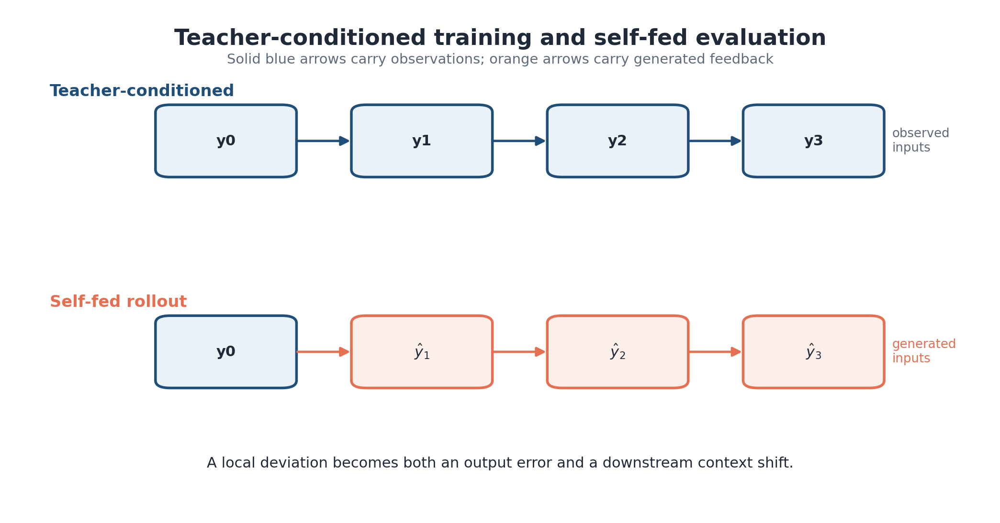

**Figure 1.3 — Teacher-conditioned training and self-fed rollout.** Under self-feeding, one local error changes every downstream context; the figure separates direct pixel deviation from the induced distribution shift. *Source: dissertation-native conceptual schematic.*

Uncertainty grows through at least three channels. Process uncertainty reflects alternative future world transitions. Observation uncertainty follows from occlusion, crop geometry, sensor noise, or lossy encoding. Model-induced uncertainty is created by imperfect inference and then reintroduced through feedback. Diffusion models explicitly represent a conditional distribution [2, 52], yet sampling cannot recover information absent from every candidate's context; additional samples may increase diversity without restoring identity. Self-fed evaluation is consequently part of the construct being measured. Single-step best-of-(k) performance asks whether a mechanism can cover an immediate target when several candidates are allowed. Best-of-one rollout asks whether one generated trajectory remains useful as its own future context. Chapter 4 keeps these regimes separate because a stochastic head can look strong under candidate selection and still degrade rapidly under deterministic deployment.

Teacher forcing, rollout training, and retained memory should not be treated as substitutes. Teacher forcing controls the inputs used during optimization. Rollout objectives control how far generated states participate in the loss. Context design controls what historical information is exposed at each step. A study can improve any one of these while leaving the others unchanged. The final hierarchy effects are measured under common rollout procedures, so their interpretation rests on context reach rather than a different exposure schedule.

### 1.1.3 Resource-constrained multi-criteria formulation

The predictor is constrained by several memory terms that occur at different times and locations. A useful accounting identity is

$$
M_{\mathrm{total}}
=M_{\mathrm{parameters}}
+M_{\mathrm{optimizer}}
+M_{\mathrm{activations}}
+M_{\mathrm{context/state}}
+M_{\mathrm{transient}}.
\tag{1.5}
$$

Parameter and optimizer terms depend mainly on model size, precision, and training algorithm [108]. Activation memory stores or reconstructs intermediate values required for gradients. Context or state memory holds historical information used by prediction. Transient memory includes attention workspaces, sampler buffers, decoded candidates, and framework allocations. Summing them is useful for hardware feasibility; treating them as one design variable is not.

**Figure 1.4 — Locations of system memory costs.** Activation storage lies on the differentiated training path, whereas retained context lies on both training and inference paths. The two can change independently. *Source: dissertation-native systems schematic.*

Figure 1.4 explains why the methods in this dissertation are related without forming one inseparable model. Reversible temporal replay modifies the activation term inside a differentiable chain. Hierarchical context packaging modifies the retained-state term by changing how much history is represented at each resolution. V-BLT changes the spatial unit processed by local and global modules. Their costs could interact in a future integrated system, but the reported experiments measure them separately.

Let the vector of consistency losses be

$$
\boldsymbol{\ell}(\widehat Y,Y)
=\bigl(
\ell_{\mathrm{frame}},
\ell_{\mathrm{support}},
\ell_{\mathrm{identity}},
\ell_{\mathrm{trajectory}},
\ell_{\mathrm{extra}},
\ell_{\mathrm{cross}}
\bigr).
\tag{1.6}
$$

The design problem is multi-objective. One practical formulation minimizes a scalarization chosen for a declared task while imposing resource limits:

$$
\begin{aligned}
\min_{\theta,C,a}\quad &
\mathbb{E}\!\left[\boldsymbol{\alpha}^{\mathsf T}
\boldsymbol{\ell}(\widehat Y,Y)\right] \\
\text{subject to}\quad &
M_{\mathrm{context/state}}(C)\leq B_{\mathrm{ctx}},\\
&M_{\mathrm{activations}}(\theta,a,K)\leq B_{\mathrm{act}},\\
&\operatorname{Work}(\theta,C,a,K)\leq B_{\mathrm{work}}.
\end{aligned}
\tag{1.7}
$$

Here $a$ denotes the training or inference algorithm, and $\boldsymbol{\alpha}$ expresses task priorities. Different weights can choose different winners. A surveillance task may penalize missing support heavily; an identity-preserving editor may tolerate small spatial error but reject an object substitution. The dissertation therefore reports endpoint patterns and operating regions, not only one aggregate optimum.

Resource constraints also have different scaling variables. Parameter memory grows with model size, activation memory with the differentiated graph, context memory with the retained package, and attention work with the sequence presented to a block. A context intervention may reduce both state storage and attention work, but only if token representations, precision, batch size, and target length are held comparable. Reporting “tokens” alone is incomplete when a coarse token and a fine latent carry different payloads, so Chapter 3 records token count and byte payload separately. Pareto reasoning must likewise remain discrete. Configuration (a) dominates (b) only if it is no worse on every declared objective and strictly better on at least one, under compatible evidence. The tested packages sample only a handful of budgets, leaving a continuous curve unidentified. In particular, the unresolved 1,792-token point prevents coloring an interpolated interval as a confirmed hierarchical region. Here, “frontier” denotes simultaneous comparisons at tested points, not a fitted phase transition.

| Resource term | Stored object | Dominant phase | Intervention examined here | Common confound |
|---|---|---|---|---|
| Parameters | learned weights | training and inference | capacity held fixed within matched comparisons | architecture changes with budget |
| Optimizer | moments and gradients | training | accounted but not directly optimized | precision and sharding |
| Activations | intermediate differentiated states | training | checkpointing or reversible replay | extra recomputation omitted |
| Context/state | retained observations or latent state | training and inference | flat, hierarchical, or subsampled packages | reach and fidelity co-change |
| Transient | attention and sampler workspaces | both | measured through total work/NFE where relevant | peak allocation mistaken for persistent state |

**Table 1.1 — Resource terms and their control interfaces.** The table distinguishes the quantity an intervention changes from nearby costs that may remain unchanged.

This formulation supplies the first design rule: a method should be judged against the resource that actually binds. It also creates a stricter requirement. Before optimizing consistency, the criteria themselves must be separated.

## 1.2 Consistency as a multi-criteria property

### 1.2.1 Why one quality score is insufficient

“Consistency” is sometimes used as a synonym for visual quality, temporal smoothness, or agreement with a prompt. Those meanings overlap, but they are not equivalent. A blurred object can follow the correct path. Sharpness offers no protection against a smooth identity change. Even low average error can conceal the disappearance of the only moving object when the background dominates. The metric should follow the failure, not the other way around.

Mean squared error measures pointwise deviation and remains valuable when pixels are aligned. SSIM adds local luminance, contrast, and structural terms [127]. LPIPS compares deep features [128], while FID and FVD summarize distribution-level feature statistics [94, 129]. Each compresses information differently. None directly states whether a particular object survived an occlusion, whether foreground was hallucinated, or whether the model recovered the appearance that was visible forty frames earlier.

**Figure 1.5 — Conceptual multi-step consistency landscape.** Similar short-frame scores can conceal different long-horizon failure modes; the diagram is explanatory and does not report an empirical frontier. *Source: dissertation-native conceptual figure.*

Figure 1.5 should be read horizontally and vertically. Along the horizon, self-fed errors accumulate and the available context changes. Across criteria, image fidelity can decline independently of support, identity, or trajectory. The central empirical result later follows the same logic: hierarchical context can improve *where* an object is supported while dense context better preserves *what* the object is. Calling one arm simply “more consistent” would lose that boundary. Background imbalance makes the issue measurable. In a sparse scene, most pixels are easy background, so predicting empty space can achieve a respectable full-frame MSE while failing on every object pixel. Foreground-only MSE corrects the weighting but can still ignore hallucinated objects outside the ground-truth mask [46, 51]. Union-mask error includes both regions but changes its denominator with the prediction. Precision, recall, miss, and extra rates expose different directions of failure. Their empty cases must be defined before evaluation because a rollout may contain frames with no visible object.

**Figure 1.6 — Illustrative SDXL outputs and the limits of single-image inspection.** The four unrelated outputs demonstrate visual diversity, but they do not constitute a consistency test because no common subject, style, geometry, or trajectory invariant was declared. *Source: Kulyk and Mokin [133], original Figure 1; artwork assembled by L. Kulyk from locally generated SDXL outputs; reused under CC BY 4.0. Non-evidentiary illustration.*

Visual plausibility is therefore only the entry condition. A consistency claim begins when two or more outputs are linked by an invariant that can fail. Figure 1.6 is useful precisely because it shows the opposite case: appealing individual samples offer no basis for deciding whether appearance, identity, geometry, or temporal state has been preserved.

Distribution metrics answer yet another question. FID compares first and second moments of feature embeddings across image sets [94]; FVD extends the idea to spatio-temporal features [129]. Both depend on the feature extractor and sample size, and neither pairs an individual forecast with its ground-truth trajectory. They are appropriate for generative realism but insufficient for a pair-specific claim about a particular historical observation. Human evaluation can reveal semantic or aesthetic failures outside automated metrics, yet it introduces protocol, sampling, and rater uncertainty [103]. A dissertation example alone is no human study, and a post-hoc explanation cannot replace an operational criterion [39, 40]. The controlled chapters therefore use distribution metrics where the source experiment reports them, paired endpoints where geometry provides correspondence, and qualitative rows chosen by a registered clip identifier, median effect, or declared quantile. An image may illustrate a mechanism; the numerical population carries the claim.

A vector criterion makes the distinction explicit. For evaluation unit (i) and horizon (k), let

$$
\mathbf q_{ik}
=\left(
q^{\mathrm{frame}}_{ik},
q^{\mathrm{support}}_{ik},
q^{\mathrm{identity}}_{ik},
q^{\mathrm{trajectory}}_{ik},
q^{\mathrm{extra}}_{ik}
\right).
\tag{1.8}
$$

Directions are standardized only for comparison; their meanings remain separate. A task may define acceptability as a region in this space rather than a weighted sum. That is often the safer interpretation because weights can conceal a catastrophic component behind several modest gains.

### 1.2.2 Appearance, object, and conceptual consistency

The earlier analysis of diffusion-based image generation distinguished style or appearance, object identity, shape or geometry, and a proposed category called conceptual consistency [133]. That qualitative study reviewed control interfaces and argued that the invariant required by a set of related images determines which method is suitable. It supplied no systematic-review protocol, dataset, operational metric, or temporal experiment, so the present dissertation uses it as a clearly identified conceptual starting point. Appearance consistency concerns attributes such as color palette, texture, illumination, and rendering style. Identity consistency is narrower: the same subject should remain recognizable despite pose, view, or background change. Geometry concerns contour, spatial arrangement, and structural relations. Conceptual consistency, as proposed in [133], refers to preservation of a higher-level semantic idea across outputs that may vary in surface appearance. The dimensions overlap. A face identity depends partly on geometry and texture; a stylized sequence can preserve concept while changing both.

**Figure 1.7 — Overlapping consistency criteria.** Appearance, identity, geometry, and concept are shown as dimensions that a task can weight simultaneously, not as mutually exclusive classes. *Source: dissertation-native synthesis informed by [133].*

The value of Figure 1.7 lies in the intersections. A method that copies a reference image may preserve palette and local texture but also copy unwanted pose. Fine-tuning or low-rank adaptation can bind subject attributes into model parameters [96, 97], yet it changes the model rather than supplying a per-sample structural constraint. ControlNet supplies geometry through an auxiliary condition [98]; its strongest guarantee concerns layout, not exact identity. Shared-attention methods can align style across images while allowing objects to change [99]. Each interface controls something different.

**Figure 1.8 — Local visual input and integrated scene understanding.** The two-stage analogy separates information available in a current view from a broader interpretation informed by prior knowledge. It motivates the distinction among appearance, identity, geometry, and concept but does not establish a cognitive or neural architecture. *Source: Kulyk and Mokin [133], original Figure 5; artwork by L. Kulyk, conceptually informed by Hertzmann [174]; reused under CC BY 4.0. Heuristic illustration.*

The analogy in Figure 1.8 is deliberately limited. A current observation can be locally detailed while remaining insufficient for a stable account of the scene; integration depends on information carried across views or time. Learned video models do not reproduce human perception, but they face the same information-level question: which earlier evidence is still available when the current crop no longer contains it? This link motivates the later move from static-image criteria to retained temporal state without treating a perceptual sketch as experimental support.

| Criterion | Typical failure in generated video | Representative endpoint | What the endpoint can miss |
|---|---|---|---|
| Appearance/style | color, texture, or illumination drifts | feature or style similarity | correct score with wrong object identity |
| Identity | object changes class or instance after occlusion | assignment-based identity accuracy | spatial support may still be wrong |
| Geometry/support | contour collapses, object disappears, or extra foreground appears | overlap, coverage, precision/recall, miss and extra rates | fine attributes inside support |
| Concept/semantics | sequence contradicts the intended relation or event | task classifier, structured relation, or human protocol | temporal continuity and localization |
| Trajectory | motion is smooth but follows the wrong path | centroid or pose error over time | appearance and internal structure |
| Cross-level agreement | coarse state and fine prediction describe different events | decoded cross-level discrepancy | both levels may be jointly wrong |

**Table 1.2 — Consistency criteria, observable failures, and metric blind spots.** No endpoint is treated as a complete substitute for the others.

The criteria are relational rather than intrinsic labels attached to an image. Identity requires a reference instance or persistent object record; geometry requires a support, contour, or relation against which displacement can be judged; conceptual consistency requires an explicit task predicate or a defensible evaluation protocol. A perceptual embedding may contribute evidence for several dimensions, but that overlap does not make the dimensions interchangeable. What matters is whether the endpoint changes when the failure of interest occurs and remains stable under nuisance variation that the task permits. This requirement is stricter than choosing the metric most correlated with visual preference [39, 40, 103, 104].

One implication is methodological: a comparison should declare the invariant before showing examples. Qualitative selection otherwise tends to favor a method's natural strength. A style-controlled example can make geometry look adequate; a trajectory plot can hide identity substitution. Chapter 4 therefore uses registered populations and selection rules for rollouts, while complete tables retain the less flattering endpoints.

The control interface changes the cost of consistency. Image-to-image conditioning supplies a reference each time and is simple to deploy when such a reference exists [95]. DreamBooth and LoRA store a subject or style in adapted parameters [96, 97]; repeated identities can then be generated without sending the full reference, but adaptation consumes data and optimization. Structural control supplies edges, depth, pose, or segmentation [98]. Inversion methods estimate a latent or noise state for an existing image, providing strong edit control at additional inference cost [114, 115]. Shared-attention methods couple features among samples [99]. None is universally strongest because each assumes different information at the system boundary.

Conceptual consistency is especially difficult to operationalize. CLIP-based similarity can measure alignment in a joint embedding space [101, 102], yet compositional probes show that high global similarity need not capture relations or ordering [104]. A task-specific structured predicate is often more defensible: for example, whether the same object remains left of another, or whether an expected action completes. Here the category prevents semantic process failures from being mistaken for style or geometry errors; no universal conceptual score is proposed.

### 1.2.3 Temporal and trajectory consistency

Adding time changes the criteria in two ways. First, values should remain coherent between adjacent frames. Second, the sequence should follow a valid long-range process. Local smoothness addresses the former but can fail the latter: a vehicle may drift smoothly off its road, or a rotating object may decelerate continuously when the true dynamics require acceleration. Temporal consistency is thus necessary and insufficient.

Adjacent-frame measures and trajectory measures operate at different scales. Frame differences, optical-flow residuals, or acceleration penalties can detect flicker and abrupt motion, but a low value may reward an increasingly biased path. A long-range endpoint instead compares the generated process with a task reference over an interval or at a delayed event. Its construction must allow valid stochastic variation: when several futures are admissible, deviation from one recorded pixel path need not be a consistency failure. Controlled generators are valuable here because the accepted dynamics and object correspondence can be stated explicitly, while natural-video evaluation usually requires broader perceptual or task-level tolerances [39, 40, 130, 131].

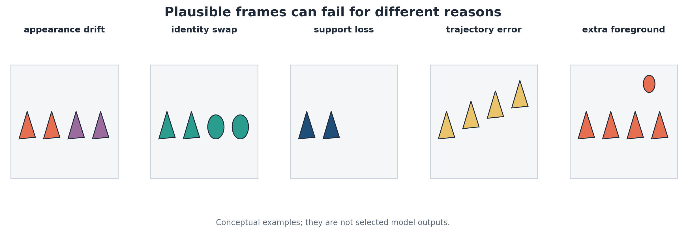

**Figure 1.9 — Distinct failures with superficially plausible frames.** The montage contrasts appearance drift, identity substitution, support loss, trajectory deviation, and extra-foreground hallucination. *Source: dissertation-native conceptual examples; not empirical model outputs.*

Let $c_t\in\mathbb R^2$ be an object's ground-truth centroid and $\widehat c_t$ its assigned predicted centroid. For observed object frames $\mathcal T_i$, one trajectory endpoint is

$$
L_{\mathrm{traj}}^{(i)}
=\frac{1}{|\mathcal T_i|}
\sum_{t\in\mathcal T_i}
\left\|\widehat c_{it}-c_{it}\right\|_2.
\tag{1.9}
$$

This error detects displacement but not an identity swap between nearby objects. Assignment must be persistent or identity-aware, and unmatched predictions need an explicit penalty. Conversely, an identity classifier can recognize a digit whose predicted position is badly wrong. The combination of support, assignment, identity, and trajectory endpoints is what makes the persistent-object boundary interpretable.

Identity across time also requires an assignment rule. Framewise nearest-neighbour matching can swap labels when two objects cross. Persistent matching constrains associations over a clip, but it must decide what happens when an object is missed or an extra object appears. Hungarian assignment solves the per-frame minimum-cost correspondence [125]; the persistent-object evaluation augments it with metadata and declared penalties so that disappearing predictions do not receive a favorable identity score simply by remaining unassigned. Re-entry adds a temporal asymmetry to this correspondence. Before disappearance, the context contains direct appearance evidence. During absence, location can sometimes be propagated from dynamics while appearance survives only in memory. After re-entry, geometry and identity become observable again, but a correct-looking object may have been reconstructed from a learned prior instead of retrieved from the specific earlier frame. Exact observability cannot distinguish internal retrieval from a lucky prior on one clip. Paired populations and multiple seeds reduce that alternative explanation; the privileged raw-memory reference clarifies the upper bound on access.

For a binary ground-truth foreground mask $G_t$ and predicted mask $P_t$, overlap alone can be misleading when both are empty. The later endpoint suite therefore includes the ground-truth-normalized miss and extra fractions

$$
r_{\mathrm{miss}}(t)=\frac{|G_t\setminus P_t|}{|G_t|},
\qquad
r_{\mathrm{extra}}(t)=\frac{|P_t\setminus G_t|}{|G_t|},
\tag{1.10}
$$

with declared empty-case rules. The fixed denominator makes an extra object visible instead of rewarding a large predicted union. Identity and trajectory are then evaluated on assigned objects rather than inferred from the mask score.

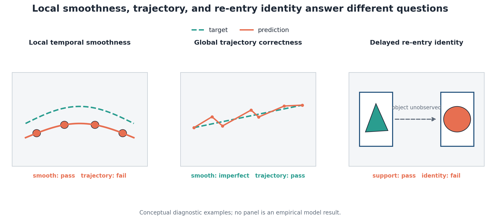

**Figure 1.10 — Operational separation of temporal smoothness, trajectory correctness, and re-entry identity.** Smooth adjacent motion can still be globally wrong; delayed re-entry adds an identity requirement that local differences cannot measure. *Source: dissertation-native conceptual figure.*

Self-fed evaluation is essential to this operationalization. Teacher-conditioned prediction can reintroduce the correct object and position at every step, concealing whether the model's own state survives an absence. Under autoregressive rollout, errors before disappearance alter both the inferred trajectory and the context available at re-entry [25–29]. The later analysis therefore separates event phases and keeps frames clustered within their originating clips. A trajectory conclusion is then attached to the interval and population where it was measured, instead of being inferred from a visually smooth example or from an average over unrelated phases.

### 1.2.4 Hierarchical and cross-level consistency

Hierarchy introduces another relation to evaluate, but only for a system that exposes distinct levels with a defined correspondence. A coarse state can encode broad support or slow motion while a fine state carries edges, texture, or identity cues. If the two refer to different times, viewports, or semantic roles, disagreement may be correct rather than pathological. Cross-level consistency therefore begins with an alignment contract: which levels describe the same event, how their coordinates map, and what information survives the projection used for comparison. Multiscale architectures have demonstrated the value of slow and fast or coarse and fine representations [20, 35–37, 150], yet the presence of such levels supplies no automatic consistency guarantee.

Suppose a model retains a coarse latent state $z_t^c$ and predicts a fine state $z_t^f$. If both are independently decodable, their generated observations should agree at the scale shared by the two levels. A generic discrepancy can be written as

$$
L_{\mathrm{cross}}(t)
=d\!\left(
D_c(z_t^c),
\mathcal S\bigl(D_f(z_t^f)\bigr)
\right),
\tag{1.11}
$$

where $D_c$ and $D_f$ decode the levels, $\mathcal S$ maps fine output to the coarse comparison scale, and $d$ is a declared distance. The equation defines agreement, not correctness. Two levels can agree on the same wrong object.

The choice of $\mathcal S$ and $d$ determines what contradiction is visible. Downsampling a fine prediction may preserve occupancy while erasing the stroke that distinguishes one digit from another. Pixel distance is sensitive to small registration errors; feature distance can ignore a geometric displacement that matters to control. When a coarse code is not independently decodable, latent alignment or cross-attention diagnostics can still be used, but their interpretation depends more heavily on the learned representation. Decoded agreement is consequently most useful as one endpoint alongside level-specific correctness, not as a replacement for it.

**Figure 1.11 — Consistent and contradictory predictions across representational levels.** A hierarchy is useful only when levels exchange compatible information; multiple resolutions alone do not guarantee coherence. *Source: dissertation-native conceptual figure.*

Figure 1.11 also separates two meanings of hierarchy used later. V-BLT contains a local–global–local processing hierarchy inside a representation; the central predictor retains multirate coarse and fine context streams across time. Those architectures can share a systems principle—different capacities at different scales—without sharing tensors, objectives, or experimental evidence. Cross-level consistency may be enforced explicitly, measured after decoding, or left to joint attention, and each choice has a cost. A penalty can encourage agreement by making the fine level copy coarse errors. Separate decoders expose disagreement but introduce codec sensitivity. Joint attention permits information exchange without guaranteeing semantic alignment. The Chapter 3 model uses a shared predictor over both streams and freezes the codec; Chapter 4 then tests whether package differences persist with an independently trained codec.

Three checks follow for a hierarchical predictor. First, each level should be evaluated for the property it is expected to preserve; a coarse occupancy map should not be penalized for absent texture. Agreement is then tested only over their shared information. Finally, the fine output must still be compared with ground truth, because perfect internal coherence can describe the wrong future. In the present experiments, hierarchy is judged primarily through observable decoded endpoints and package-level effects. Equation (1.11) formalizes the additional cross-level criterion but is not promoted to a headline result without a registered empirical test.

### 1.2.5 From static control criteria to video requirements

The static criteria survive in video, but their observability changes. Appearance and identity must be checked across time and after occlusion. Geometry becomes support and motion as well as contour. Concept becomes an event or relation that unfolds over a sequence. Structure supplied at every frame can prevent one class of error, whereas a predictor with no future condition must infer structure from dynamics and retained state.

**Figure 1.12 — From static-image invariants to video requirements.** Static appearance, identity, geometry, and concept remain relevant, while time adds local continuity, trajectory, re-entry recovery, and cross-level agreement. *Source: dissertation-native synthesis.*

Figure 1.12 distinguishes inheritance from extension. A reference image can establish appearance or identity at one instant, but video introduces ordering and delayed verification: the object observed at $t=3$ may not be judged again until $t=40$. During that interval, the predictor receives its own outputs and the evidence available to its context changes. Trajectory and re-entry criteria are therefore temporal constructs, while cross-level agreement applies only when a model exposes more than one representational level. The figure transfers a vocabulary, not empirical results from static generation.

**Figure 1.13 — Forward diffusion as progressive corruption.** The noise index describes diffusion time, not the temporal coordinate of a video sequence. The diagram introduces the corruption process used to train a denoising model and does not report an experiment. *Source: Kulyk and Mokin [133], original Figure 2; author-created schematic based on the DDPM formulation [3]; reused under CC BY 4.0.*

The distinction in Figure 1.13 prevents a common notational confusion. Diffusion time indexes a sequence of noise levels applied to one modelled sample; video time indexes successive states of an evolving scene. A video diffusion predictor may contain both axes. Its denoiser is then called at several noise levels for a target that also occupies one or more future video positions, so temporal consistency cannot be inferred from denoising convergence alone.

> **Reserved author-supplied video-generation example.** Insert a short fixed sequence only when its clip or prompt, model and checkpoint, seed, sampler, frame indices, and output hashes are available. The example should illustrate one declared temporal invariant or failure and be captioned “qualitative illustration; not used for inference.” It remains unnumbered and is not counted as evidence until populated.

Five control interfaces summarize the reviewed methods: a reference can enter through the input, modify parameters, supply an explicit structure, initialize a latent or noise trajectory, or couple attention statistics. Their relative value depends on what is known at inference. A future edge map is powerful but privileged in an unconditional forecast; parameter adaptation can preserve a subject but is expensive per identity; inversion controls edits of an existing sample but is not equivalent to predicting an unseen future [95–99, 114, 115].

**Figure 1.14 — Structural conditioning controls geometry more directly than identity.** A Canny-derived condition enters the denoising network alongside text and latent state. The hand-drawn path identifies the conditioning interface; it is not a literal execution trace and does not show identity preservation or long-context retrieval. *Source: Kulyk and Mokin [133], original Figure 7; artwork and locally generated examples by L. Kulyk; ControlNet method from Zhang et al. [98]; reused under CC BY 4.0.*

**Figure 1.15 — Shared style across changing subjects.** The generated subjects differ while color, pixel-art treatment, and accessory pattern remain similar. The example illustrates appearance/style consistency, not preservation of one object's identity. *Source: Kulyk and Mokin [133], original Figure 9; locally generated and assembled by L. Kulyk; StyleAligned method from Hertz et al. [99]; reused under CC BY 4.0.*

Read together, Figures 1.11 and 1.12 expose an asymmetry that a single score would hide. Structural conditioning often constrains *where* content appears, whereas shared features or reference adaptation constrain *what it looks like*. Their mechanisms and tasks differ from multirate video context, so the figures provide no evidence for the later hierarchy experiment. They establish a more general design lesson: control at one interface can preserve one invariant while leaving another weak.

**Figure 1.16 — Five interfaces for controlling related generations.** Reference input, parameter adaptation, structural conditioning, latent/noise inversion, and shared attention act at different points in a generative system and therefore preserve different invariants. *Source: dissertation-native synthesis of [95–99, 133].*

The interface map in Figure 1.16 also defines a comparison boundary. A method given future structure answers a conditional-synthesis question; a self-fed predictor must generate that structure from its current state. Parameter and latent interventions store information in different places, with different update and inference costs. Consequently, a video requirement should specify both the invariant and the information legally available when it is assessed. Otherwise, strong control can be mistaken for autonomous temporal memory.

**Figure 1.17 — Support and identity as independent axes.** Two predictions can occupy the same support yet differ in identity, or preserve identity while losing spatial continuity. This separation anticipates the Chapter 4 persistent-object analysis without asserting a shared causal mechanism. *Source: dissertation-native conceptual figure.*

For the present problem, the important criterion is delayed reuse. When an object disappears, the model must preserve enough state for the relevant property to be recoverable after re-entry. Fine context is naturally suited to appearance and identity, but a fixed fine-token budget limits temporal span. Coarse context can cover a longer interval, although downsampling removes high-frequency evidence. The reach–fidelity hypothesis emerges directly from the consistency taxonomy: retained history determines whether evidence is present, and representational detail determines what can be recovered from it.

A useful evaluation order follows. First establish whether the event was observable to each package. Then measure support and false foreground, because a missing object makes identity and trajectory conditional. Next evaluate assigned identity and motion. Finally inspect full-frame and perceptual quality as complementary summaries. Reversing this order encourages a high aggregate score to dominate the interpretation before the memory-dependent criterion is tested.

The expected benefit is deliberately conditional. It should appear where the flat window lacks the relevant past, then weaken or reverse when both packages reach the event and fine detail becomes the limiting factor. Chapter 3 turns that prediction into package geometry and an estimand; Chapter 4 tests it without interpolating a universal crossing.

## 1.3 Three bottlenecks behind long-horizon inconsistency

### 1.3.1 Activation growth during temporal learning

Backpropagation through time expands a recurrent computation into a directed acyclic graph [28, 29, 105]. If one temporal step creates activations of size $A$, retaining every intermediate value for a horizon $K$ gives the leading-order relation

$$
M_{\mathrm{act}}^{\mathrm{BPTT}}(K)=\Theta(KA),
\tag{1.12}
$$

in addition to parameters, optimizer state, inputs, and temporary workspaces. Transformer layers can make $A$ large because attention projections, normalization outputs, and feed-forward intermediates are required by automatic differentiation. A model may therefore fit a short window and fail before its training objective reaches the horizon of interest.

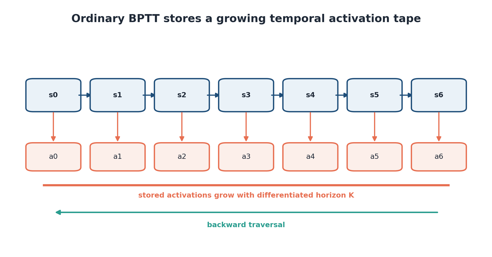

**Figure 1.18 — Activation-tape growth under ordinary temporal backpropagation.** Increasing the differentiated horizon extends the stored graph even when the recurrent state dimension stays fixed. *Source: dissertation-native conceptual schematic.*

Checkpointing stores selected boundary states and recomputes missing segments during the backward pass [30, 31, 108, 109]. Reversible coupling takes another route: if a block input can be reconstructed from its output, the block need not retain the same activation tape [32, 92]. Both methods exchange storage for computation; their value depends on whether saved activations dominate the additional replay work and metadata. The bottleneck here is deliberately *temporal learning*, not long inference. A compact autoregressive state can roll forward for many steps without building a gradient graph. Conversely, a model trained on a long differentiable objective can exhaust memory even if its inference context contains one tensor. Chapter 2 verifies this exchange and the TempVerseFormer state boundary. Chapter 3 uses windowed training for the final predictor, with ordinary gradient flow confined to each training window.

The differentiated horizon, rather than the deployed rollout length by itself, is the controlling variable. Truncating the graph changes which delayed dependencies receive gradient. Checkpointing can preserve the objective while selecting a storage–recomputation schedule, whereas a reversible core reconstructs compatible internal states and still retains non-invertible boundaries, parameters, gradients, and replay metadata. Their asymptotic descriptions therefore apply to scoped components. A practical comparison must report peak memory and time at the same horizon, batch, precision, and model interface; otherwise a smaller activation term can be hidden by unrelated constant allocations.

Peak memory must also be scoped. Measuring only the temporal model isolates activation scaling while excluding the VAE, optimizer, batch, and framework footprint. Measuring the complete pipeline answers hardware feasibility but can hide a constant temporal term beneath a large encoder. Both views are legitimate if named. The TempVerseFormer discussion retains the reported temporal-model and pipeline measurements separately and places runtime beside memory, preventing replay from appearing as a free reduction.

Numerical reversibility is not identical to algebraic invertibility. Additive coupling has an exact inverse over real arithmetic, while finite precision, nondeterministic kernels, dropout, and stochastic transitions can break bitwise reconstruction. Replaying stochastic functions requires their random state or sampled noise; storing that metadata creates its own horizon-dependent term. A trustworthy claim therefore needs the inverse equations, the persistent-state boundary, a reconstruction tolerance, and a gradient comparison against ordinary autograd.

### 1.3.2 Uniform spatial allocation

A fixed patch grid is simple, parallel, and easy to batch [69–71]. Its token count for a video with $T$ frames and non-overlapping spatial patches $p_h\times p_w$ is

$$
N_{\mathrm{fixed}}
=T\left\lceil\frac{H}{p_h}\right\rceil
\left\lceil\frac{W}{p_w}\right\rceil.
\tag{1.13}
$$

Every patch receives one token even if it contains only static background. Smaller patches preserve detail but increase global sequence length; larger patches reduce cost and mix distinct structures. Three-dimensional tubes add a temporal size $p_t$, which reduces temporal tokens at the risk of combining changes that should remain separable [70, 71].

**Figure 1.19 — Uniform spatial allocation on a nonuniform scene.** Static background and changing boundaries consume equal grid capacity despite different predictive complexity. *Source: dissertation-native conceptual figure.*

Nonuniformity is both spatial and predictive. A large uniform region may be cheap to forecast even when it occupies most of the image, while a narrow boundary can determine shape, motion, and later identity. Camera movement reverses the situation by turning background into newly revealed content. A fixed grid cannot react to either case, but it offers stable tensor shapes, straightforward causal masks, and efficient batched kernels. The design problem is therefore not to remove regular patches on principle. It is to determine whether a measurable complexity signal can justify spending a limited global budget differently without losing those implementation advantages.

Information density offers a possible signal for allocation. A categorical predictor that is confident about a constant region has a concentrated distribution; a moving edge can produce a broader one. Predictive entropy, however, also changes with model misspecification, limited context, and multimodal futures. It provides neither calibrated uncertainty [44, 45] nor proof that changing token sizes will improve a compute–quality frontier. A dynamic allocator would need a causal aggregation rule, a fixed compute budget, routing and merge operations, and an end-to-end comparison against the same fixed-grid model. The V-BLT experiment in Chapter 2 stops earlier: it validates fixed raster-byte packages, multidimensional positions, and entropy maps. Those maps motivate adaptive regioning but do not validate the controller.

There is a second allocation issue inside the hierarchy. A local encoder and decoder can keep elementary raster detail away from the expensive global transformer. That lowers global sequence length without requiring every byte to become one global token. Whether this saves wall-clock time depends on local work, memory movement, hardware utilization, and batch shape—not GFLOPs alone. The published point estimates support a proof of concept, not a scaling law.

Although V-BLT packages are spatio-temporal, this bottleneck is spatial: it concerns where a model spends local and global capacity. Chapter 3 addresses a different decision—how many historical frames to preserve at coarse and fine resolution.

### 1.3.3 Limited retained-context reach

Let a context package at decision time $t$ expose a set of source anchors $\mathcal A_t$. Its nominal reach is the age of the earliest addressable anchor,

$$
R(C_t)=t-\min_{\tau\in\mathcal A_t}\tau.
\tag{1.14}
$$

Nominal reach says that an event is represented somewhere in the package. Whether the representation retains the required feature and whether the predictor uses it remain separate questions. Three stages must therefore be distinguished: information can be stored, made addressable to the model, and reliably reused during self-fed generation. The privileged raw-memory reference in Chapter 4 is useful precisely because it separates the first two from learned retrieval.

The scalar $R(C_t)$ also hides anchor density. Two packages can share the same earliest time while one contains every intervening frame and the other contains only periodic samples. Target-window geometry matters as well: a source may be old enough to count toward nominal span yet be causally unavailable to an earlier target inside a jointly predicted window. For this reason, Chapter 3 derives reach from each stream's explicit anchor mapping and evaluates a package pair on the frames for which the relevant source is legally visible to one arm but absent from the other. Frame count alone cannot establish that relation.

**Figure 1.20 — A relevant appearance outside a dense fine-context window.** The long coarse stream retains temporal addressability at lower spatial fidelity; the flat window retains detail only over its shorter span. *Source: dissertation-native schematic; temporal scale is explanatory.*

At a fixed token budget, increasing reach usually changes fidelity or sampling density. A flat fine stream allocates all tokens to recent high-resolution frames. A spatial hierarchy can preserve many older coarse frames plus a short fine tail. Temporal subsampling keeps fine resolution at selected times but can miss events between anchors. Even with similar token counts, the packages expose different events because their anchor geometry differs. Reach becomes identifiable only on examples where comparators differ. If an object never leaves the recent window, a long memory may be unused; if the relevant evidence predates both packages, neither arm has an access advantage. The central experiment therefore derives a pair-specific population from exact scene and viewport geometry: the evidence lies beyond the shorter package's reach but within the longer one's. Aggregate performance remains supporting evidence, not the primary mechanism test.

Compression changes more than storage. Spatial downsampling can remove strokes that distinguish two digits; temporal subsampling can skip the moment at which direction changes; learned retrieval can fail even when the source is stored. These are different failure paths. The package-shape experiment compares spatial hierarchy with temporally sparse fine frames at a near-matched budget so that “longer reach” is not treated as one undifferentiated design.

Reliable reuse is the strongest and most empirical of the three terms. A stored tensor proves persistence, and an anchor map proves addressability; neither proves that a learned predictor consults the source when a prior would generate a plausible alternative. Concentrating effects on a reach-differential population provides evidence for reuse because the arms differ exactly where the required observation becomes available. The inference remains conditional on the generator and endpoints, which is why aggregate clips, an independent codec, and a persistent-object dataset are retained as complementary rather than interchangeable tests.

### 1.3.4 Causal map from bottlenecks to interventions

**Figure 1.21 — Causal map of the dissertation.** Activation growth, uniform spatial allocation, and limited retained reach are addressed at different interfaces. TempVerseFormer and V-BLT are separately validated methods; the hierarchical-context predictor is the final empirical core. *Source: dissertation-native systems synthesis.*

Figure 1.21 connects the developed works by system interface without presenting an untested end-to-end architecture. The left branch changes how gradients are computed through a temporal state; the middle branch changes how visual bytes are represented and how positional structure is encoded; the right branch changes which coarse and fine histories enter prediction. All three are judged against the consistency criteria above, and only the right branch is integrated into the final matched-budget model. This relation is familiar in systems engineering: compatible interventions can address separate constraints even when their combinations remain untested. Explicit interfaces and evidence levels then allow the final chapter to select a method after diagnosing the binding resource. Compatibility here concerns interfaces; compounded savings remain unmeasured. Activation and context costs were obtained in separate systems and therefore stay on separate axes. Any future integration would need its own end-to-end memory, computation, quality, and causal-attribution tests before the separate effects could be combined.

The map is causal in the sense of a diagnosis–intervention–measurement chain. Activation growth is diagnosed by scaling the differentiated horizon and measured through memory and replay time. Spatial allocation is examined through fixed local/global processing and entropy structure, while retained reach is identified through package anchors and re-entry populations. A gain at one branch cannot validate another branch because the manipulated variable, resource account, and endpoint differ. This separation also explains the chapter order: the first two interventions can be validated independently, after which the final model isolates the context decision that remains unresolved.

## 1.4 Existing methods and unresolved gap

### 1.4.1 Long-horizon temporal modelling and memory-efficient training

Recurrent video predictors compress the past into a hidden state. ConvLSTM introduced convolutional gates for spatio-temporal forecasting [137], and later models such as PredRNN, PredRNN++, E3D-LSTM, and PhyDNet added memory pathways, three-dimensional recurrence, or physics-informed decomposition [138–140, 152]. Their state can be compact at inference, but long training still depends on BPTT, truncation, or curriculum choices; a recurrent bottleneck may also forget detail that was not optimized for delayed reuse. Feed-forward predictors provide an important counterpoint. SimVP shows that strong spatio-temporal prediction can emerge from an encoder–translator–decoder without recurrent rollout inside the training window [141]. The Temporal Attention Unit combines spatial attention with temporal differential modelling [153], while Earthformer structures space–time interactions through cuboid attention [142]. These results challenge the assumption that architectural complexity is always necessary, yet leave long-context selection unresolved. A model can excel on a short benchmark while lacking evidence that has already left its input window.

The literature separates more cleanly by state and gradient than by architecture name. Recurrent and state-space models define a bounded state update at inference [19, 137–140], but training that update through many steps still creates a long dependency path unless gradients are truncated or reconstructed. A transformer with an explicit context exposes more past items directly and pays for their interactions, while a feed-forward window model avoids a recurrent training chain by restricting the objective. These choices control different quantities: inference-state size, addressable observations, per-step work, and differentiated horizon. Treating any one of them as “long-term memory” leaves the comparison underspecified.

Transformer predictors expose wider interactions and parallel training [12, 69–71]. Factorized attention, local windows, sparse patterns, and efficient kernels reduce particular costs [13, 17, 18, 70, 71], while state-space models replace quadratic attention with recurrent or convolutional structure [19]. Activation growth through a long differentiated recurrence nevertheless remains a separate problem: efficient attention reduces work inside a step but supplies no backward-storage policy. Rollout-aware objectives address the training distribution instead. Scheduled sampling, sequence-level training, and self-forcing expose the model to its own predictions or align training and inference distributions [25–29]. They can improve self-fed stability, although differentiating through additional generated steps increases activation storage. Truncated gradients cap that burden by changing the objective. Checkpointing preserves the objective and recomputes activations [30, 31]; reversible residual blocks reconstruct inputs from outputs and can approach constant retained activations across a compatible chain [32, 92]. Both pay in recomputation, while reversible blocks add numerical and architectural constraints [110–112].

Checkpointing is broadly applicable because it can place boundaries around ordinary modules, and its schedule allows a continuous trade between stored checkpoints and replay. Reversible computation can remove more internal storage from a compatible repeated block but constrains the state transformation and requires deterministic or replayable operations. Neither method decides which observations the forward model retains. Conversely, sparse or cached context can extend inference access while leaving the backward graph untouched. This division is the unresolved systems issue behind Chapter 2: memory-efficient training should be compared on the same temporal objective and timing boundary, then interpreted as one available intervention rather than as evidence of long-context recall.

TempVerseFormer belongs to the last group but must be located precisely. Its additive-coupling transformer state is replayed backward, while the encoder, decoder, learned projections, and output loss are handled outside the exact inverse. The method tests whether a temporal transform can be repeated for longer horizons without retaining a conventional tape. Its evidence concerns activation scaling and measured prediction quality; predictive supremacy and cost-free reversibility across arbitrary video architectures remain untested.

World-model research provides a complementary perspective. Latent imagination models learn compact recurrent dynamics for control [64–67, 132]; generative video models use adversarial, latent-variable, autoregressive, diffusion, or masked objectives [42, 43, 50, 54–63, 74, 151, 156–158]. Their main result is often prediction or control quality, while activation-memory measurements are secondary or absent. One-step or short-window objectives offer another practical choice: they train a transition locally and rely on repeated inference, as the final predictor does, but leave the complete rollout loss outside optimization. Reversible replay matters only when the research or application requires gradients through that longer chain. The unresolved training question is therefore conditional: when such an objective is required and activation storage binds, what is the measured exchange among storage, replay, and predictive quality?

### 1.4.2 Adaptive and hierarchical visual representation

Patch tokenization makes images compatible with transformers by mapping regular regions to a sequence [69], and video transformers extend the operation in space and time [70, 71]. A fixed grid offers deterministic tensor shapes and efficient batching, which explains its persistence. Its weakness appears when predictive complexity is highly nonuniform: the grid cannot spend more global computation on a moving contour without spending the same amount on background at that resolution. Several model families relax the allocation. Multiscale convolutional and transformer hierarchies reduce spatial resolution while increasing feature depth [71, 77, 78]. Dynamic pruning removes tokens judged unimportant; TokenLearner constructs a compact learned set; adaptive-depth transformers stop examples or tokens early; token merging combines similar representations [143–146]. NaViT and FlexiViT vary aspect ratio or patch size across training and inference [147, 148]. All alter token count or compute, though their selection signals and objectives differ from predictive entropy over raster bytes.

Fixed multiscale hierarchies and sample-adaptive token policies solve related but distinct allocation problems. A feature pyramid predetermines where resolutions change and gives every example the same processing graph. Pruning, merging, or learned token selection changes the active representation according to content, but its policy may discard a small object before the global model can use it. Variable input patches alter geometric support; adaptive depth changes computation while retaining the token grid. Comparison therefore requires more than reporting the final number of tokens. Selection overhead, routing stability, information discarded before selection, and the location of the expensive global operator determine whether a nominal reduction becomes useful system work [143–148].

Byte-level models avoid a fixed semantic vocabulary and predict elementary discrete values [72, 73]. BLT groups text bytes into latent patches so that a global model operates at a lower rate [72]. V-BLT adapts a local–global–local pattern to raster pixel-channel bytes and adds multidimensional positional coordinates [134]. The resulting categorical distribution at each output byte supports direct entropy calculation. Losslessness of the hidden representation is unestablished because learned local encoders and latent bottlenecks remain; “byte stream” here means raster intensities laid out as bytes, not a compressed video bitstream. Position becomes a structural requirement once multiple axes are flattened. Absolute embeddings can bind a model to trained sizes; relative attention and rotary embeddings encode relations more directly [106, 107]. For three coordinates, RoPE-ND assigns disjoint feature subspaces to time, height, and width, then rotates each subspace with its coordinate-dependent phase. It preserves relative phase differences within each axis and supplies coordinate structure to attention, without guaranteeing correct routing or hierarchy.

The byte interface has a specific analytical advantage and a practical cost. A 256-way output distribution makes Shannon entropy directly computable at each pixel-channel byte, avoiding a learned semantic codebook at the target. At the same time, local encoding and decoding remain necessary to prevent the global sequence from expanding to every raster byte. The resulting hierarchy must be evaluated as a whole: a smaller global sequence can coexist with substantial local computation, and equal reported model-size figures need not imply identical serialized parameters or runtime behavior. Categorical outputs make the complexity signal available; they do not alone establish an efficient adaptive allocation.

Adaptive allocation remains the open step. A qualitative entropy map can show where the model's categorical predictions are broad. Establishing a dynamic policy would require a rule that changes regions or computation, a fixed resource budget, a comparator, and an end-to-end quality–cost evaluation. The reported V-BLT experiment stops before that controller, so Chapter 2 separates the implemented method from the proposed direction. The source record adds a specific reproducibility qualification: the publication specifies fixed $4\times4\times4$ spatio-temporal cubes, whereas the available default implementation records $4\times4$ spatial tiles and temporal `patch_size: 5.0`. No frozen paper-run configuration presently reconciles the difference. Accordingly, $4\times4\times4$ is treated as the published experimental specification, and the repository-default mismatch is reported in the provenance appendix.

A later adaptive study would also need to test whether entropy remains useful after conditioning and model capacity change. Broad predictions may mark motion boundaries, genuine ambiguity, missing context, or simply an undertrained local decoder. Calibration is relevant if the value is interpreted probabilistically, while allocation utility can be tested directly even without full calibration. Those are separate questions. The present contribution supplies the fixed-patch architecture, coordinate formulation, and observed signal from which such a policy can be designed; it leaves policy learning, causal routing, and the measured compute–quality gain open.

### 1.4.3 Context memory, retrieval, and multirate hierarchy

Long context can be obtained by enlarging a dense window, compressing old states, retrieving selected memories, or updating a recurrent summary. Transformer-XL caches earlier hidden states [14]; Compressive Transformer adds a lower-rate compressed memory [15]; Memorizing Transformers retrieve approximate nearest-neighbour values [16]. Longformer and Reformer modify attention patterns or representation to reduce sequence cost [17, 18]. These methods separate storage from access, while leaving open how spatial identity survives in video. Hierarchical temporal models add multiple update rates: Clockwork RNN partitions hidden units by clock [33], Variational Temporal Abstraction learns temporal segments [34], and Clockwork VAE represents video at nested temporal scales [20]. Dynamic latent hierarchy and TECO similarly exploit slow and fast variables for longer prediction [35, 36], while Flexible Diffusion Modeling conditions long video generation on flexible subsets of frames [21]. Together they motivate multirate state. The matched package-by-budget reach intervention remains missing.

Recent video world models make memory an explicit subsystem. Long-context state-space video models extend the sequential backbone [22]; WorldPack compresses spatial memory [23]; long-term spatial memory, compression-and-retrieval, learned context querying, and geometry-aware memory propose different storage or retrieval interfaces [24, 79–81]. Multiscale recurrent prediction also predates the present package intervention, including explicitly hierarchical spatio-temporal scales in MSPred [150]. MBench and MemoBench evaluate memory capability across scenarios [82, 83]. MilliVid is the closest architectural comparator because it uses hierarchical coarse-to-fine latents to maintain long-range consistency [37]. Its existence removes hierarchy itself from the novelty claim. The contribution of Chapters 3–4 is the controlled package intervention, exact analytic observability, registered pair-derived populations, and measured lower and upper inversions.

These approaches can be compared along four decisions. A *storage policy* decides which observations or states persist. An *addressing policy* decides what the predictor can query at the current step. A *representation policy* decides the spatial and semantic detail stored in each item. A *learning policy* decides whether the model is trained to use memory under the same conditions encountered during rollout. Two systems can share a storage budget and differ on every other decision. The central package intervention fixes the predictor and training recipe as far as the comparison permits, then changes the spatial level and temporal anchors exposed as context.

Retrieval is attractive when only a few past items matter. Nearest-neighbour or learned query mechanisms can scale to large stores [16, 79, 80], but retrieval introduces selection error and an indexing cost. Compressed recurrent state avoids a growing store but must decide online what to forget. Dense attention exposes all retained items and pays in sequence work. Multirate packaging occupies a middle position: the coarse stream is deterministic and always addressable, while its fidelity is deliberately reduced. That determinism makes package geometry auditable and supports an exact reach calculation. Temporal subsampling is often grouped with hierarchy because both extend span, yet their information losses differ. Uniform subsampling preserves full spatial detail at selected instants and discards intervening states. Spatial hierarchy preserves every selected time at lower resolution and can add a recent fine tail. A sudden motion event favors temporal density; an identity cue favors spatial detail. Chapter 4 therefore includes a near-matched package-shape comparison that separates spatial hierarchy from span alone.

Comparison licences are therefore part of the scientific method. A *matched* comparison holds the intended interface constant and changes one factor. Under a *near-matched* licence, a small cost difference is accepted to test package shape. *Whole-configuration* comparisons report useful system results when several interfaces co-change, without assigning the effect to one component. By contrast, a *privileged reference* supplies information unavailable to learned arms and establishes an access boundary instead of a fair architectural ranking. Naming these licences is more informative than describing every experiment as an ablation.

Benchmarks also shape what can be inferred. Moving MNIST tests controlled motion and remains useful for competence [124]. Memory Maze evaluates long-term memory in a navigable environment [68]. Video quality benchmarks measure realism or average prediction but may not reveal whether a precise re-entry frame was inside one package's reach. A mechanism study needs a generator whose latent geometry is known, followed by external boundary tasks that change the data-generating assumptions. LoopMom and persistent long Moving-MNIST serve those two roles, while natural video remains necessary for external validity. Its texture, camera cuts, nonrigid motion, interacting objects, and uncertain latent state make a single reach mechanism harder to identify because the required historical observation is rarely known exactly. The programme therefore assigns asymmetric roles: controlled geometry for causal identification, persistent objects for a changed synthetic boundary, and OpenSTL datasets for competence where an earlier source directly evaluated them. Future natural-video work should retain this division of evidence instead of replacing controlled identification with a leaderboard average.

| Bottleneck | Representative approaches | Resource directly controlled | Typical evidence | Unresolved issue addressed here |
|---|---|---|---|---|
| Activation growth | truncation, checkpointing, reversible residual or transformer blocks [28–32, 92] | retained differentiated activations | peak memory, replay cost, gradient agreement | verified temporal-state boundary and applicability |
| Uniform spatial allocation | multiscale encoders, pruning, learned tokens, merging, variable patches [71, 72, 143–148] | spatial/global token work | accuracy or quality versus tokens/FLOPs | raster-byte entropy signal separated from untested adaptive policy |
| Limited retained reach | cached, compressed, retrieved, recurrent, or hierarchical memory [14–24, 33–37, 79–83] | addressable history and representation detail | benchmark quality or memory recall | matched-budget reach population and reach–fidelity inversion |
| Rollout inconsistency | scheduled sampling, self-forcing, rollout objectives [25–29] | train–test exposure and differentiated horizon | self-fed quality | distinguish objective exposure from context reach and activation cost |
| Metric blindness | frame, perceptual, distributional, object, and benchmark suites [94, 120–131] | evaluation construct | aggregate scores and task endpoints | complete false-positive-sensitive and clip-cluster protocol |

**Table 1.3 — Literature organized by the resource or construct it controls.** Grouping by bottleneck exposes where methods are complementary and where apparently similar “memory” claims refer to different quantities.

The literature supports the dissertation's system decomposition but leaves the final question open. Hierarchical models show that multiple scales can work; reversible models show that activations can be reconstructed; adaptive-token methods show that uniform allocation can be relaxed. The remaining task is to define the evidence available for each intervention and measure when retained hierarchy pays under an explicit budget.

## 1.5 Problem decomposition and requirements for the developed methods

### 1.5.1 Derived design requirements

Across model families, the analysis yields the following requirements.

1. **Causal semantics must be explicit.** Each token or latent may use only the observations, controls, and generated states allowed at its prediction time. A diagram is insufficient; masks and anchor mappings require mathematical or code-level definitions.
2. **Resources must be accounted at their interface.** Context, target, payload, total sequence length, activation storage, and transient sampler work should not be collapsed into one token or memory number.
3. **Consistency must be evaluated by failure type.** Frame fidelity, missing support, extra foreground, identity, trajectory, and cross-level disagreement require separate endpoints with declared empty cases.
4. **A long-memory claim requires a reach-identifying population.** The relevant evidence should be within one compared package and outside another, or the analysis must be labelled aggregate rather than mechanistic.
5. **Comparisons must state what co-changes.** Matched capacity, near-matched package shape, whole-configuration interfaces, and privileged references answer different questions.
6. **Uncertainty must preserve dependence.** Rollout frames remain within resampled clips; training seeds are reported separately; registered families receive simultaneous inference.
7. **Measured and proposed components must be visually and verbally distinct.** This applies especially to adaptive entropy regioning and any future combination of reversibility with the hierarchical predictor.

Together, the requirements turn broad ambitions into reviewable contracts and prevent a seemingly unified architecture from masking several untested links. They also impose an order: causality and resource accounting define admissible systems; endpoint completeness defines success; the reach population and uncertainty model determine whether a mechanism is identifiable. Only after those conditions are fixed can a package comparison support a design rule.

Documentation follows the same contract. Stream anchors belong in configuration, not in prose derived from a hard-coded stride. Random-number state, sampler steps, codec identity, dataset purpose, and checkpoint hash are part of the experiment definition when they can change a conclusion. Evidence figures should be generated from the same frozen tables used for inference; hand-entered headline values create a second, drift-prone source of truth. Protected datasets need purpose and access logs so that an untouched label remains meaningful.

Visual evidence needs an equally explicit status. A conceptual diagram may explain a mechanism but cannot be styled as measured evidence. A chart derived from a published table carries only the reported point estimates; adding synthetic error bars would manufacture certainty. Published figures remain unchanged and are attributed at their original source, while dissertation-native companions clarify state boundaries or tensor shapes. These rules are substantive: they prevent a polished page from implying an experiment that did not occur.

Internal consistency adds one final requirement. A claim should survive translation among the research task, method definition, chapter conclusion, and General Conclusions. If its scope expands at one location—fixed patches becoming adaptive regions, for example—the dissertation becomes inconsistent even when each sentence sounds plausible. The final audit checks these mappings mechanically and scientifically.

### 1.5.2 Research hypotheses

The hypotheses arise from the bottlenecks, independent of publication order.

Each hypothesis links one proposed mechanism to an observation that could limit it. A lower memory reading alone is insufficient for H1 unless reconstruction and gradient behavior remain acceptable. Spatially structured entropy supports H2 as a complexity diagnostic, but no dynamic-allocation benefit follows without a controller experiment. Comparisons at different reach conditions are required for H3 and H4 because the same package may be favored for distant support and disfavored for fine identity. Robustness under H5 asks whether those directions survive interface changes; it is not a request that every interval reach significance.

| Hypothesis | Mechanism prediction | Evidence required | Falsifying or limiting result |
|---|---|---|---|
| H1: reversible temporal replay reduces activation growth | intermediate doubled states can be reconstructed instead of stored | inverse and gradient checks; memory and time versus horizon | non-reversible interfaces dominate, instability, or replay cost outweighs storage |
| H2: raster-byte hierarchy exposes nonuniform predictive complexity | local/global processing predicts categorical bytes and entropy varies spatially | fixed-patch quality/cost and faithfully rendered entropy | no useful spatial structure or no advantage over comparators |
| H3: hierarchy buys reach under a fixed context budget | coarse frames preserve addressable distant evidence beyond a short fine window | pair-specific population with matched/declared budget | no benefit where reach differs |
| H4: flat context recovers when fidelity binds | once both packages reach the event, dense fine history preserves more detail | upper tested budget comparisons and identity-sensitive boundary | hierarchy remains superior across all sampled fidelity regimes |
| H5: principal directions are not artifacts of one sampler or codec | reach/fidelity pattern persists under controlled interface changes | registered sampler/NFE and independent-codec studies | sign reversal or loss of precision sufficient to leave the claim unresolved |

**Table 1.4 — Research hypotheses and their evidence conditions.** H2 concerns the evaluated fixed-patch representation and entropy observation; it does not presuppose that dynamic regioning improves performance.

H1 concerns activation memory and makes no prediction that reversibility improves image quality. A useful complexity signal is sufficient for H2 even if an adaptive controller remains future work. Together, H3 and H4 express the reach–fidelity interpretation at sampled operating points, not as a continuous law. Robustness under H5 permits an honest unresolved result. The hypotheses are deliberately non-cumulative: because the final predictor executes neither earlier method, H3 remains logically independent of H1 and H2. Conversely, a useful reversible core or entropy map remains a contribution if a particular context package is inferior. The resulting dependency graph is conceptual—Chapter 1 defines criteria, Chapter 2 validates two available interventions, Chapter 3 isolates retained context, and Chapter 4 chooses among operating regions. No serial neural pipeline is implied.

### 1.5.3 Chapter conclusions and transition

Long-horizon video prediction is a partially observed, self-fed system. The predictor sees frames rather than complete world state, and its own outputs alter later inputs. Consistency must therefore be specified across appearance, identity, geometry, support, trajectory, false foreground, and cross-level agreement. Aggregate frame quality is necessary evidence, but it cannot identify every failure that matters after disappearance and re-entry.

Three resource constraints were separated. Activation memory grows along a differentiated temporal chain, uniform spatial tokens can misallocate capacity inside a scene, and retained context limits which earlier observations remain addressable at inference. Applying the word *memory* to all three obscures their distinct scaling variables. The literature offers an intervention at each interface: reversible and checkpointed computation exchange storage for replay; adaptive or hierarchical representations alter spatial tokenization and global work; compressed, retrieved, recurrent, and multirate memories extend temporal access. Their coexistence supports a method-selection framework whose claims are tied to the tested interface, not a claim of one integrated model.

Consistency occupies a different role: it is the task-dependent outcome against which resource-allocation decisions are judged, not a fourth resource beside memory and computation. More history is beneficial only if it improves the endpoint that matters; finer detail helps only when the relevant event is already present; a longer differentiated horizon is justified only when the objective warrants its replay cost. The dissertation's central contribution is therefore an operating-region argument supported by mechanism-specific evidence.

Several conclusions remain intentionally asymmetric. The reversible method has a strong activation-scaling result but mixed predictive rankings. V-BLT has encouraging controlled point estimates and informative entropy maps but no adaptive-policy experiment or uncertainty analysis. Hierarchical context has untouched and robustness evidence for a reach-limited advantage, alongside confirmed flat-context recovery at larger budgets. Preserving those asymmetries is essential. A narrative that makes every method uniformly successful would be smoother and scientifically weaker.

The chapter has also fixed the meaning of the central terms used later. *Reach* is an anchor-based property of an exposed context package. *Fidelity* is the task-relevant information retained by that representation. *Reuse* describes learned behavior under self-feeding, whereas storage merely preserves a value. *Consistency* is a set of endpoints, not a visual impression. These definitions connect otherwise distinct methods through a common language and determine the burden of proof: resource claims require accounting, mechanism claims require an identifying population, and generalization claims require a changed data-generating setting with endpoints that retain the same meaning and causal interface.

Two bottlenecks now require concrete methods: activation storage during temporal training and spatial allocation inside a visual representation. Solving either one still leaves open which past frames the final predictor can address. Chapter 2 develops those sibling interventions, Chapter 3 isolates retained context, and Chapter 4 tests the resulting operating regions.

---

# Chapter 2 — Methods for Feasible Temporal Training and Adaptive Spatial Representation

Chapter 1 separated three resource constraints that are often collapsed into the single phrase
"long-horizon video modelling." One arises from the activation tape retained while gradients pass
through a long temporal process. Another concerns how representational capacity is distributed
across the visual field. The third is the history available when a trained predictor runs
autonomously. Here, the first two become the subjects of analysis; retained history becomes the central model
problem in Chapter 3.

At the system level, the methods occupy different interfaces. Reversible temporal computation changes how
intermediate states are supplied to reverse-mode differentiation, exchanging storage for
reconstruction. Vision Byte Latent Transformer (V-BLT), together with multidimensional rotary
positional encoding, changes how raster information is transformed around a global temporal model;
it studies local-global processing and a model-internal signal of spatial complexity. These are
sibling interventions, not stages of one network, and neither appears inside the later
hierarchical-context predictor. Their common design question is nevertheless concrete: under a
bounded capacity, which information must stay explicit, and which can be reconstructed or
represented more compactly?

Evidence begins with two controlled procedural testbeds whose motion laws, rendering, and targets
are observable. Architectural behaviour can then be examined without the uncontrolled variation
of natural video. Standard spatio-temporal benchmarks broaden the test of the temporal method.
Synthetic mechanism identification and broader competence remain different evidentiary roles.

## 2.1 Shared controlled experimental foundation

### 2.1.1 Why controlled procedural video is used

A prediction error in natural video can have several causes at once: an object may be occluded,
the camera may move, illumination may change, or the future may genuinely be multimodal. Such
variation is essential for external validation, but it is awkward when the immediate question is
whether a model has learned a particular temporal transformation. Procedural video narrows that
question. The generator exposes the state variables that determine each frame, and a new sequence
can be sampled without collecting another recording.

Let a procedural scene state be $s_t$, let $u_t$ contain the chosen motion parameters, and let
$\mathcal R$ denote the renderer. A deterministic sequence has the form

$$
s_{t+1}=f(s_t,u_t),
\qquad
x_t=\mathcal R(s_t),
\tag{2.1}
$$

where $x_t$ is the rendered raster frame. Because $f$ and $\mathcal R$ are known, one can alter
angular velocity, acceleration, interruption, object structure, or initial pose independently.
Procedural sampling also avoids a small fixed training corpus: random initial geometry and motion
parameters yield an effectively unbounded stream of sequences. Reproducibility follows from the
generator version, parameter ranges, random-number state, and rendering configuration rather than
from a manually assembled list of video files.

That control is the point.

Known state is useful for diagnosis as well as generation. A failure can be located against the
motion law: the predicted object may rotate at the wrong rate, reverse too early, lose a face
during occlusion, or drift despite a stationary camera. Natural-video metrics usually merge those
events into one residual. Here the generator makes the distinction visible, even when the reported
endpoint remains image based. Controlled sequences also permit paired evaluation because two
models can receive exactly the same initial pose and subsequent targets. The pairing reduces
variation across evaluated clips; it does not replace independent training runs.

The gain in control carries a cost. Black backgrounds, isolated objects, and prescribed motion
laws simplify segmentation and reduce the diversity of textures, interactions, and camera effects.
A model may therefore perform well by exploiting regularities that would fail in natural video.
These data can show whether a mechanism works under controlled conditions; general video
competence requires a broader test. That distinction determines the dataset ladder used throughout
the dissertation: simple rotations are followed by OpenSTL tasks, then by purpose-built long-memory
tests whose difficulty comes from loss of observable history rather than visual clutter [1].

### 2.1.2 Rotating two-dimensional shapes

The common procedural idea in the temporal and byte-level studies is a rotating triangle rendered
at $64\times64$ pixels. Each sequence starts from a randomly generated triangular geometry and a
random initial orientation. The object is centred, the camera remains fixed, and the angle evolves
at discrete frame times. For a constant-velocity sequence,

$$
\theta_{t+1}=\theta_t+\omega,
\tag{2.2}
$$

with direction sampled clockwise or counter-clockwise. In the temporal-modelling experiments,
$\lvert\omega\rvert$ was sampled between $5^\circ$ and $20^\circ$ per step. Additional regimes
changed $\omega_t$ by acceleration or deceleration, reversed its sign periodically, interrupted it
for a sampled interval, or combined these patterns. Frames were rendered as $64\times64$ RGB
images for that study; the context contained 12 frames, the training curriculum increased the
prediction depth from one to five, and evaluation extended to 12 predicted steps [135]. The public
simple-shape toolbox supplies the two- and three-dimensional procedural generators, metadata
records, and command-line entry points needed to regenerate this dataset family [171].

**Figure 2.1 - Procedurally generated rotating two-dimensional triangle.** The sequence isolates
constant planar rotation while varying geometry, initial orientation, and angular velocity between
samples. Source: Kulyk and Mokin, *Scaling Video Prediction with Spatio-Temporal Patches*, published
Figure 5; reused unchanged, subject to the figure-provenance ledger [134].

The V-BLT study also used 12-frame $64\times64$ rotating-shape sequences, although its archived
paper describes constant rotation for the two-dimensional experiment. The temporal study includes
a broader set of variable-rotation laws and a separately documented curriculum. The two
publications did not freeze one common cross-paper manifest that matches generator commit,
rendering mode, channel convention, parameter ranges, random splits, conditioning, and target
construction byte for byte. The defensible description is therefore a
**shared procedural rotation family**, not an identical dataset. Common object geometry supports
the conceptual progression developed here, while FID, MSE, SSIM, and PSNR remain interpretable only
within the source study that produced them. This distinction does not prevent reproduction: the
generator repository is public, but each rerun must record its own configuration and seed manifest
rather than retroactively treating the two historical datasets as byte-identical [171].

A triangle is more diagnostic than a rotationally symmetric disk because its vertices make angular
phase observable in every non-degenerate frame. At the same time, centring the object on a black
background removes translation, camera motion, clutter and most appearance variation. The test can
therefore expose drift in angular dynamics and long-rollout stability, but it cannot establish
identity preservation through occlusion or natural-scene interference. Those limitations motivate
the polycube and OpenSTL evaluations that follow.

### 2.1.3 Rotating three-dimensional polycubes

The three-dimensional testbed increases structural variation without giving up procedural control.
A polycube is assembled from $n\in\{2,\ldots,6\}$ face-connected unit cubes selected from canonical
forms. The object is centred in a fixed-camera scene and assigned random initial rotations about all
three axes. A sampled angular-velocity vector then updates orientation:

$$
\boldsymbol\theta_{t+1}
=\boldsymbol\theta_t+\boldsymbol\omega,
\qquad
\boldsymbol\theta_t=(\theta^x_t,\theta^y_t,\theta^z_t).
\tag{2.3}
$$

Unlike the planar silhouette, a polycube reveals and hides surfaces as it rotates. The predictor
must preserve the arrangement of constituent cubes while accounting for self-occlusion, projected
geometry, and changes in shading. These properties make the sequence a more demanding test of
local-global visual representation, even though its background and motion law remain simple.

Occlusion gives this testbed a second role. A surface that disappears from the rendered view may
later return, so moving only the visible contour cannot produce a plausible sequence. Hidden object
structure constrains what should reappear. Even so, the tested clips are short and their rotation
rule is regular. They lack the long unobserved interval later used to identify context reach.
Polycubes increase spatial and view-dependent difficulty without substituting for LoopMom or
persistent long Moving-MNIST.

The rendering also separates geometric error from photographic variation more cleanly than a
natural scene would. Face visibility, projected edge length, and illumination change with pose,
while background and camera remain controlled. MSE, SSIM, and PSNR are consequently interpretable
as within-protocol comparisons, although no one metric is sufficient evidence of recovered
three-dimensional structure.

**Figure 2.2 - Procedurally generated rotating three-dimensional polycube.** Fixed-camera rendering
exposes changes in pose, visible faces, self-occlusion, and shading while keeping the motion law
known. Source: Kulyk and Mokin, published Figure 6; reused unchanged [134].

The fixed-patch study used the polycube data to evaluate V-BLT, ViViT, and a three-dimensional
U-Net; the published TempVerseFormer experiment used no polycubes. Accordingly, each method retains
its own empirical population instead of being presented as though one benchmark covered all of
them.

### 2.1.4 Dataset progression across the dissertation

The complete experimental programme moves along two different axes: visual complexity and
identifiability of long-range memory. OpenSTL adds established synthetic and real spatio-temporal
tasks. LoopMom and persistent long Moving-MNIST, introduced in Chapter 3, instead create events for
which the useful observation can leave a short dense context and later become relevant again. The
latter tests are visually simpler than KTH, yet sharper for the question of retained reach.

**Figure 2.3 - Progression of experimental instruments.** Controlled rotations isolate known
dynamics; OpenSTL broadens the visual domain; LoopMom and persistent long Moving-MNIST make missing
history the experimental variable. The diagram distinguishes visual realism from memory demand.
Source: author's synthesis of the reported experimental programme.

**Table 2.1 - Dataset roles and evidence boundaries**

| Dataset or family | Controlled phenomenon | Method evaluated here | Reported endpoints | Role in the dissertation | Main limitation |
|---|---|---|---|---|---|
| Rotating 2-D triangles | Constant and, for the temporal study, variable angular dynamics | TempVerseFormer; V-BLT in separate configurations | FID, MSE, SSIM; V-BLT also PSNR and entropy maps | Mechanism isolation and short-to-moderate temporal extrapolation | Synthetic silhouettes; cross-paper generator identity not established |
| Rotating 3-D polycubes | Three-axis rotation, self-occlusion, shading, object structure | V-BLT, ViViT, UNet-3D | MSE, SSIM, PSNR, entropy maps | Harder controlled representation test | Synthetic fixed-camera scenes; no seed inference |
| Moving MNIST | Digit translation and collision | TempVerseFormer and OpenSTL baselines | MSE, SSIM | Standard synthetic competence check | Short protocol does not isolate long-memory reach |
| Moving MNIST-CIFAR | Moving digits over textured backgrounds | TempVerseFormer and OpenSTL baselines | MSE, SSIM | Visual-background stress test | Still procedurally composed |
| KTH Action | Human motion | TempVerseFormer and OpenSTL baselines | MSE, SSIM | Real-video competence boundary | Low resolution and constrained actions; predictions blur |
| TaxiBJ | Urban flow fields | TempVerseFormer and OpenSTL baselines | MSE, SSIM | Real spatio-temporal field prediction | Not object-centric natural video |
| LoopMom | Disappearance, world-loop re-entry, exact observability | Chapter 3 predictor configurations | Complete-frame and object-aware endpoints | Causal identification of reach under fixed context budgets | Purpose-built synthetic world |
| Persistent long Moving-MNIST | Long-lived identities, coverage, trajectories | Flat and hierarchical Chapter 3 configurations | Identity, coverage, continuity, trajectory and frame endpoints | External synthetic reach-fidelity boundary | Absolute task performance remains difficult |

Each row in Table 2.1 answers a different question. OpenSTL tests broader competence, whereas
LoopMom identifies a reach mechanism under exact geometry; neither result can stand in for the
other. Persistent long Moving-MNIST adds an object-level boundary without becoming natural-video
validation.

The studies also differ in their experimental units. A procedural generator seed determines a
stream of evaluated sequences; a training seed determines initialization, data order, and other
stochastic optimization choices. Holding the generator seed fixed across models improves paired
comparability of the evaluated clips, but it does not measure variation across trained models.
Neither early paper reports the seed-level uncertainty that is later required for the central
context-package comparisons. Their numerical results are therefore retained as published point
estimates. Chapters 3 and 4 use clips as resampling clusters and training seeds as a separate
uncertainty level rather than retrofitting confidence intervals onto these earlier data.

Metric scales are similarly local to a protocol. An MSE of $0.02$ on normalized synthetic RGB
frames and an OpenSTL MSE of $26.08$ are not contradictory; they reflect different value ranges,
reductions, and dataset conventions. SSIM is closer in numerical range but still depends on window,
channel, and aggregation settings. The dissertation compares models within the source table whose
preprocessing and evaluation code they share, rather than placing all datasets on one synthetic
quality axis.

The ladder therefore separates competence from causal identification. Rotation and OpenSTL ask
whether the temporal and spatial methods work on known transformations and recognized prediction
tasks. LoopMom and persistent long Moving-MNIST later ask which historical evidence remains
available when a target returns. With these roles fixed, the first engineering problem can be posed
cleanly: how can a temporal model be differentiated through a longer chain without retaining the
entire activation history?

## 2.2 Reversible temporal modelling

### 2.2.1 Activation memory in long temporal chains

Consider a parameterized transition $h_t=\Phi_\theta(h_{t-1},c_t)$, where
$h_t\in\mathbb R^{D_s}$ is the temporal state and $c_t$ denotes known conditioning. A loss may
depend on one terminal
state, several decoded states, or the complete trajectory. Standard backpropagation through time
applies reverse-mode differentiation to the unrolled composite map [28]. Its
gradient is not problematic in definition. The practical difficulty is supplying each reverse
step with the forward values needed to evaluate the local vector-Jacobian product.

Let $A_l$ denote the activation footprint of layer $l$ inside one transition. A direct autograd
implementation retains an activation tape whose leading term is

$$
M_{\mathrm{act}}^{\mathrm{BPTT}}(T)
\approx
T\sum_{l=1}^{L} A_l,
\tag{2.4}
$$

in addition to parameters, gradients, optimizer state, the current recurrent state, input batches,
and allocator workspace. If $A_l=\alpha_lND$ for $N$ tokens of width $D$, then
$M_{\mathrm{act}}^{\mathrm{BPTT}}=O(TLND)$ when the layer footprints are comparable. This is an
activation-memory statement; the quadratic arithmetic of self-attention inside one transition and
the fixed terms in total GPU allocation lie outside it.

The corresponding forward and backward work can be written schematically as

$$
C_{\mathrm{BPTT}}(T)
=T\bigl(C_{\Phi}^{\mathrm{fwd}}+C_{\Phi}^{\mathrm{bwd}}\bigr).
\tag{2.5}
$$

Truncated BPTT reduces both storage and gradient horizon, thereby changing the objective whenever
the omitted dependencies matter [29]. Gradient checkpointing preserves the
full-horizon derivative in exact arithmetic by storing selected boundary states and recomputing
the intervening segments [30, 31]. Reversible replay
uses a more specialized opportunity: if the previous state can be reconstructed from the next
state and replay information, most temporal boundary states need not be stored at all.

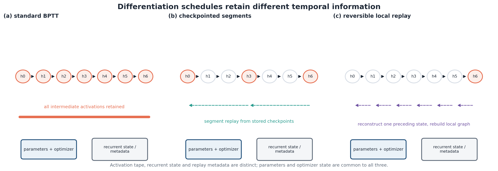

**Figure 2.4 - Storage schedules for differentiation through time.** Vanilla BPTT retains the
activation history, checkpointing retains selected boundaries, and reversible replay reconstructs
the preceding state before rebuilding one local graph. Source: author's schematic after BPTT,
checkpointing, and reversible-network literature [28, 30, 32].

The relevant design objective is therefore not "minimum memory" in the abstract. Parameters and
optimizer tensors may dominate a small model; attention workspace may dominate another. The method
pays only when the avoidable activation trajectory is a material part of peak memory.

A more useful peak-memory model separates fixed and horizon-dependent terms:

$$
M_{\mathrm{peak}}(T)
=M_{\mathrm{param}}+M_{\mathrm{grad}}+M_{\mathrm{opt}}
+M_{\mathrm{input}}+M_{\mathrm{workspace}}(T)+M_{\mathrm{tape}}(T).
\tag{2.5a}
$$

Reversibility acts principally on $M_{\mathrm{tape}}$; attention-score workspace, the current
state, parameter gradients, and optimizer tensors remain. In a fixed-window recurrence,
self-attention also has two distinct scaling variables. Attention within one $N$-token transition
costs $O(N^2)$ in its conventional form, and repeating that transition for $T$ predicted shifts
costs $O(TN^2)$. One full-attention operation over a concatenated $TN$-token sequence would instead
cost $O(T^2N^2)$. TempVerseFormer concerns the activation history of the repeated fixed-width
operator, leaving other long-sequence attention bottlenecks to separate interventions.

This distinction explains why efficient attention and reversible replay can coexist. Sparse,
linear, or IO-aware attention changes the local transition cost and workspace [12, 13]. Replay changes how those local transitions are
differentiated across repeated time. Treating one as a substitute for the other would conflate
sequence length inside a step with the number of differentiated steps.

### 2.2.2 Reversible transformer block

An additive-coupling block divides a state into two streams, applies arbitrary differentiable
functions to one stream at a time, and updates the other by addition. In a canonical notation,

$$
y_1=x_1+F_\theta(x_2),
\tag{2.6}
$$

$$
y_2=x_2+G_\theta(y_1).
\tag{2.7}
$$

No inverse of $F_\theta$ or $G_\theta$ is required. Given $y_1$ and $y_2$, the inputs follow
in reverse order:

$$
x_2=y_2-G_\theta(y_1),
\tag{2.8}
$$

$$
x_1=y_1-F_\theta(x_2).
\tag{2.9}
$$

Substitution proves exact reconstruction in real arithmetic. TempVerseFormer instantiates one
coupling function with multi-head self-attention and the other with a feed-forward network,
including pre-normalization. The released implementation uses the algebraically equivalent stream
ordering $O_2=I_2+F(I_1)$, $O_1=I_1+G(O_2)$. Names change; the triangular dependency and the
inverse do not. Dropout is absent in the audited block. The replay utility contains block-level
random-seed hooks, but the repeated stack inspected here is deterministic; the available
implementation record does not validate time-indexed stochastic replay across repeated temporal
calls.

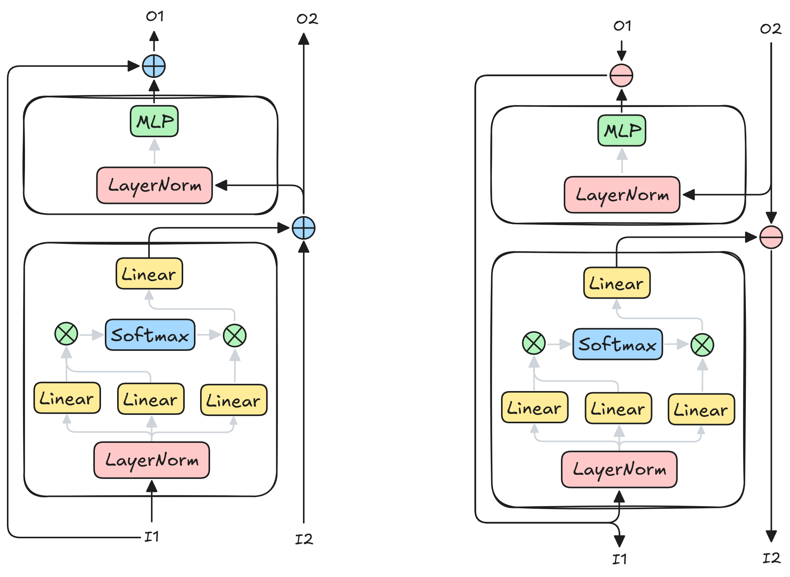

**Figure 2.5 - Additive reversible transformer block.** The second coupling is evaluated only
after the first update, so subtraction in the opposite order reconstructs both input streams.
Source: Kulyk, *Temporal Modeling with Reversible Transformers*, published Figure 2, adapted there
from RevViT; reproduced here without pixel modification [32, 92, 135].

Reconstruction and differentiation are separate operations. During the backward pass, the block
first evaluates $G_\theta(y_1)$ to recover $x_2$, recreates the local graph for that evaluation,
and accumulates its parameter and input gradients. It then evaluates $F_\theta(x_2)$, recovers
$x_1$, and completes the local vector-Jacobian product. The graph is released before the previous
block is processed. This is why a reversible block can save activation storage even though its
backward pass performs extra forward computations [32].

Finite precision weakens the word "exact." Each subtraction uses a recomputed floating-point value,
and round-off can accumulate across depth or time. Normalization, stochastic layers, mixed
precision, and non-deterministic kernels add implementation constraints. Algebraic invertibility
therefore establishes a valid reconstruction formula; numerical agreement must still be measured.
Numerical agreement is therefore measured by the dissertation-level recurrence tests in Section
2.2.8 rather than inferred from the block equations.

The block can also be read as a composition of two shear transformations. The first maps
$(x_1,x_2)\mapsto(x_1+F(x_2),x_2)$; the second maps
$(y_1,x_2)\mapsto(y_1,x_2+G(y_1))$. Where the functions are differentiable, each Jacobian is
block triangular with unit diagonal, so

$$
\det J_{R_\theta}=1.
\tag{2.9a}
$$

Volume preservation clarifies both the strength and the limitation of additive coupling. The
complete state is recoverable, but the transition cannot simply forget nuisance information as a
many-to-one recurrent gate can [110]. Compression or forgetting must happen at
a non-reversible boundary or be represented with explicit side information. Nor does unit
determinant bound the largest singular value: one direction may expand strongly while another
contracts. Dynamic stability must therefore be tested independently.

The reversible-state boundary is especially important in TempVerseFormer. The published diagram
contains a variational encoder and decoder, linear projections, duplication of a projected stream,
normalization, and output fusion. Those operations are useful interfaces, but they are not all
bijections. The audited implementation confirms the following contract.

**Table 2.2 - Verified reversible-state contract of the released TempVerseFormer implementation**

| Tensor or operation | Implemented transformation | Algebraically invertible from its output alone? | What reverse differentiation retains or recomputes | Included in the exact state-replay claim? |
|---|---|---:|---|---:|
| Image frame to VAE latent | Convolutional variational encoder, $x\mapsto z$ | No | Ordinary autograd values or frozen/precomputed latent, depending on training mode | No |
| Latent input projection | $256$-dimensional latent to $768$-dimensional embedding plus learned position | Not established as bijective | Boundary input is handled by ordinary autograd in the default mode | No |
| Stream creation | Concatenation $[e,e]$ of two identical $768$-dimensional streams | No; duplication is injective but not a two-stream bijection onto the codomain | Projected embedding exists at the core boundary | No |
| Repeated temporal state | Additive-coupling stack over the doubled embedding | Yes in exact arithmetic for the audited deterministic block; any future stochastic conditioning would also have to be replayed | Terminal doubled state; local block functions are reevaluated | Yes |
| Output normalization and fusion | $2\times768$ state to a $256$-dimensional latent | No | Ordinary autograd boundary values in the default mode; the alternative utility stores non-reversible boundaries | No |
| VAE decoding and image loss | Latent to pixels followed by MSE/LPIPS/KL terms | No | Standard loss graph at the boundary | No |

Table 2.2 narrows the valid claim to the persistent doubled transformer state. The complete
VAE-to-VAE prediction pipeline is non-invertible, yet the repeated core is precisely where a
temporal activation tape would otherwise grow. Its reconstruction therefore supports the measured
activation-memory result without implying that the final image prediction determines every
intermediate operation.

### 2.2.3 Temporal chaining and TempVerseFormer

TempVerseFormer places the reversible stack between a spatial encoder and decoder. An input window
of $N$ frames is encoded frame by frame into continuous latent vectors. In the published
configuration, each $64\times64$ RGB frame is mapped to a 256-dimensional latent state. A learned
linear projection expands each state to 768 features, position embeddings identify the $N$
locations in the window, and the projected sequence is duplicated to form the two coupling streams.
The temporal core contains eight reversible transformer blocks with eight attention heads [135].

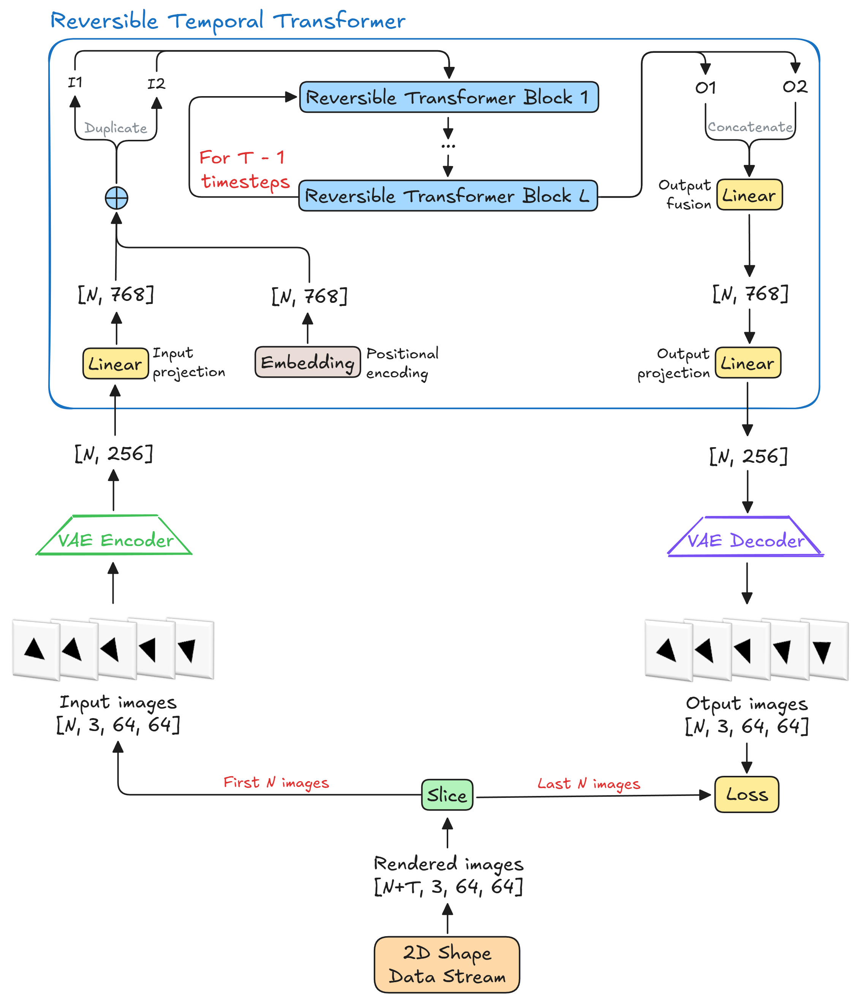

**Figure 2.6 - Complete TempVerseFormer architecture.** A variational image encoder and decoder
surround the repeated reversible temporal core. The detailed published diagram is retained at full
or landscape page width; its inclusion does not imply that the VAE and projection boundaries are
invertible. Source: Kulyk, published Figure 3, reproduced without pixel modification [135].

Let $e_\phi$ and $d_\psi$ denote the VAE encoder and decoder, $P_{\mathrm{in}}$ the input
projection and duplication interface, $P_{\mathrm{out}}$ the terminal normalization and fusion,
and $R_\theta$ one application of the reversible transformer stack. For an encoded context
$z^{(0)}=(e_\phi(x_1),\ldots,e_\phi(x_N))$, the implemented recurrence can be written as

$$
q^{(0)}=P_{\mathrm{in}}(z^{(0)}),
\qquad
q^{(r+1)}=R_\theta(q^{(r)}),\quad r=0,\ldots,T-1,
\tag{2.10}
$$

followed by

$$
\widehat z^{(T)}=P_{\mathrm{out}}(q^{(T)}),
\qquad
\widehat x^{(T)}=d_\psi(\widehat z^{(T)}).
\tag{2.11}
$$

Here $q^{(r)}\in\mathbb R^{B\times N\times 1536}$ is the persistent doubled state to which the
inverse applies. The released implementation repeats the same stack $T$ times before applying
the output fusion once. It does not decode and re-encode an image between temporal iterations.
This detail resolves an ambiguity in a literal reading of the published chaining diagram: the
feedback loop is a recurrence in the projected transformer state, while the VAE and fusion
operations form non-reversible boundaries around that loop.

The state dimension is held fixed as the shift grows. Temporal depth therefore counts repeated
applications of one window operator, not an ever longer token sequence. Parameter sharing is
complete across those applications. Gradients from the terminal decoded window must nevertheless
traverse every repeated transition, which is why the activation history grows under ordinary
autograd even though the number of learned temporal parameters does not.

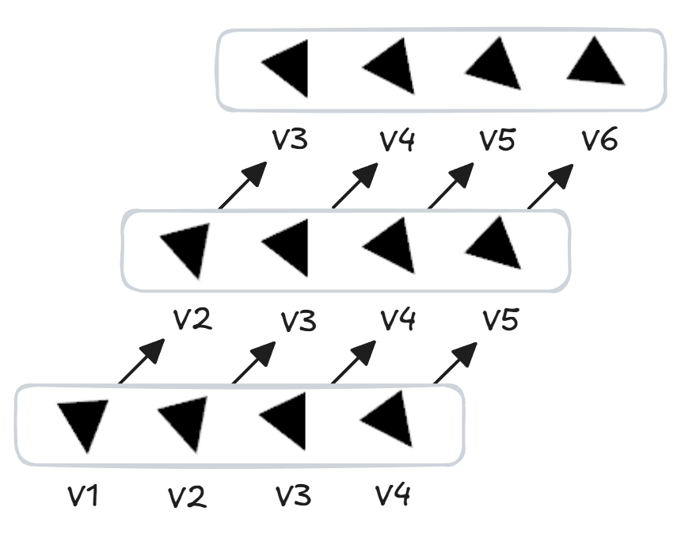

**Figure 2.7 - Temporal chaining of a fixed-width latent window.** Each application advances the
window representation toward a time-shifted target, and the terminal hidden state is exposed to the
output projection after the requested prediction depth. Source: Kulyk, published Figure 4,
reproduced without pixel modification [135].

Training uses a context of 12 frames and a curriculum in which the shift $T$ increases from one
to five. The decoded output window is compared with the corresponding time-shifted target window.
Equation (16) in the published paper reports a three-term objective [135]:

$$
\mathcal L_{\mathrm{paper}}
=\lambda_{\mathrm{MSE}}\mathcal L_{\mathrm{MSE}}
+\lambda_{\mathrm{LPIPS}}\mathcal L_{\mathrm{LPIPS}}
+\lambda_{\mathrm{KL}}D_{\mathrm{KL}}
\bigl(q_\phi(z\mid x)\,\|\,\mathcal N(0,I)\bigr).
\tag{2.12}
$$

The inspected `train_default` implementation is more explicit than that published notation. It
computes prediction-image MSE and a second MSE between the input images and their VAE
reconstruction, then adds prediction LPIPS and KL:

$$
\mathcal L_{\mathrm{code}}
=\mathcal L_{\mathrm{pred\text{-}MSE}}
+\mathcal L_{\mathrm{input\text{-}VAE\text{-}MSE}}
+\lambda_{\mathrm{LPIPS}}\mathcal L_{\mathrm{LPIPS}}
+\lambda_{\mathrm{KL}}D_{\mathrm{KL}}.
\tag{2.12a}
$$

Thus the fourth term is an implementation detail, not a term that should be attributed to the
paper's Equation (16). MSE and LPIPS supervise the decoded prediction, while the input
reconstruction and KL terms shape the spatial latent interface [43, 128]. The paper reports unit
weights for MSE and LPIPS and a KL weight annealed to $10^{-3}$. The released training code instead
sets its maximum KL coefficient to $10^{-4}$. The public TempVerseFormer repository provides
training, evaluation, memory-test configurations, checkpoints, and experiment-tracking links for
independent reproduction [172]. The numerical tables below nevertheless remain quotations of the
published experiment rather than newly rerun values; any fresh run should identify its commit and
configuration, including the KL schedule, instead of silently equating the current default with the
historical publication setup.

Non-causal self-attention is used inside each 12-token window. That choice allows each location in
the input window to interact with the complete supplied window while the temporal shift is learned
at the level of the repeated operator. It also means the core is not a token-by-token causal
language model. Causality is imposed by the construction of input and target windows: future target
frames are not part of the input. The distinction becomes important later, because Chapter 3 uses
explicitly causal retained-context packages and an autoregressive rollout rather than this
fixed-window transition.

The reported architecture-cost table provides another reason to separate accuracy from the memory
claim. TempVerseFormer is listed at 60 million parameters, $0.98$ GFLOPs, and 488 million MACs;
the matched TempFormer and standard transformer are each listed at 57 million parameters,
$1.37$ GFLOPs, and 684 million MACs. The LSTM row reports 76 million parameters, $0.98$ GFLOPs,
and 2.6 million MACs. These source values are reproduced as published, but the LSTM FLOP/MAC pair
does not follow the usual two-FLOP-per-MAC convention. They should not be used to derive a new
hardware-efficiency ranking without the exact profiler settings. The activation-memory result is
supported directly by allocation measurements instead.

### 2.2.4 Time-agnostic backpropagation

Temporal chaining creates a repeated reversible state, but memory is reduced only if training
actually avoids retaining the ordinary activation graph. The time-agnostic procedure separates
forward prediction from reverse differentiation. During the forward phase, the recurrent core is
evaluated under a no-gradient context, intermediate block activations are discarded, and the
terminal state $q^{(T)}$ is retained. During the backward phase, each preceding state is recovered
algebraically, the corresponding local forward computation is rebuilt with gradient tracking, its
vector-Jacobian products are accumulated, and the local graph is freed.

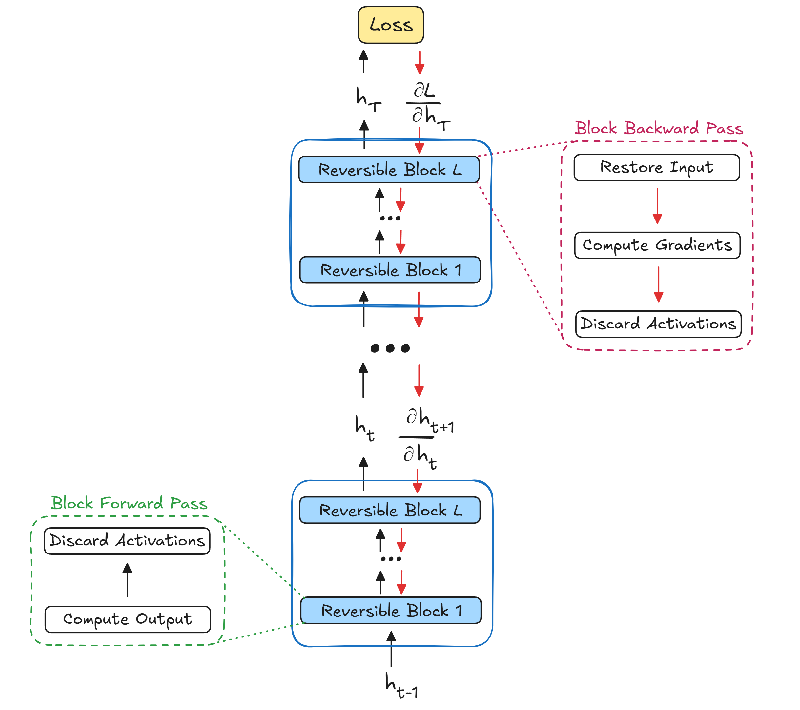

**Figure 2.8 - Time-agnostic backpropagation through the reversible temporal state.** The forward
trajectory discards core activations; reverse replay reconstructs one state and one local graph at
a time. The figure applies to the verified recurrent core, not to the VAE and projection interfaces.
Source: Kulyk, published Figure 5, reused unchanged [135].

For a trajectory loss $\mathcal L=\sum_{t=1}^{T}\ell_t(q^{(t)})$, define the adjoint
$a_t=\partial\mathcal L/\partial q^{(t)}$. Reverse-mode differentiation gives

$$
a_{t-1}
=\frac{\partial\ell_{t-1}}{\partial q^{(t-1)}}
+\left(\frac{\partial R_\theta(q^{(t-1)})}{\partial q^{(t-1)}}\right)^{\!\top}a_t,
\tag{2.13}
$$

and the parameter gradient is

$$
\nabla_\theta\mathcal L
=\sum_{t=1}^{T}
\left(\frac{\partial R_\theta(q^{(t-1)})}{\partial\theta}\right)^{\!\top}a_t.
\tag{2.14}
$$

Reversible replay leaves these derivatives unchanged and changes only how $q^{(t-1)}$, and hence
the local Jacobian products, are obtained. Starting from $q^{(t)}$, the algorithm evaluates
$R_\theta^{-1}$ with the same parameters and replay inputs. It then reevaluates
$R_\theta(q^{(t-1)})$ under autograd and applies (2.13)-(2.14). The derivative is the ordinary
reverse-mode derivative of the reconstructed trajectory, up to finite-precision reconstruction
and recomputation differences.

**Algorithm 2.1 - Reverse replay through a deterministic reversible temporal core**

1. Compute $q^{(0)}=P_{\mathrm{in}}(e_\phi(x_{1:N}))$ with the required boundary graph.
2. For $t=1,\ldots,T$, evaluate $q^{(t)}=R_\theta(q^{(t-1)})$ without retaining the core's
   intermediate activations.
3. Apply $P_{\mathrm{out}}$, decode the terminal prediction, evaluate the loss, and obtain the
   terminal adjoint $a_T$ through the non-reversible output boundary.
4. For $t=T,\ldots,1$, reconstruct $q^{(t-1)}=R_\theta^{-1}(q^{(t)})$.
5. Reevaluate $R_\theta(q^{(t-1)})$ with gradient tracking, accumulate the parameter gradient and
   compute $a_{t-1}$.
6. Release the local graph before processing $t-1$, then propagate the recovered gradient through
   the ordinary input-projection and VAE boundary.

Two details are easy to miss in this schedule. First, model parameters are shared across temporal
applications. Their gradients are therefore accumulated over reverse steps before the optimizer
updates them; replay does not create a separate parameter copy for each time index. Second, the
non-reversible boundaries are differentiated in the usual way. A memory claim for the core is
compatible with storing the projected input, terminal fusion values, and loss graph. Omitting those
terms from the statement would turn a scoped complexity result into an inaccurate whole-pipeline
claim.

The reverse step must also recreate the same local function that produced the forward state.
Weights cannot change between the forward and reconstructed evaluations. Any data-dependent branch,
dropout mask, random augmentation, or nondeterministic operation inside the state transition must
be fixed or replayed. Batch-normalization statistics would need similar care; the audited block
uses normalization without running-state updates inside the coupling functions. These are
implementation conditions, not cosmetic reproducibility preferences. If the reevaluated map
differs, the subtraction no longer reconstructs the state on which the original loss depended.

The following result states the memory claim at the level justified by this algorithm.

**Lemma 2.1 (activation-tape complexity).** Let $R_\theta$ be a deterministic reversible
transition consisting of $L$ additive-coupling blocks, and let $D_s$ be the complete state
footprint at one block. Suppose the loss boundary and all conditioning needed for replay occupy
memory independent of $T$. A transition-level replay schedule has the conservative peak bound
$O(LD_s)$, while the audited blockwise schedule releases each reconstructed block graph before
processing the preceding block and therefore has a tighter transient-graph bound $O(D_s)$, apart
from retained state and bookkeeping. Both bounds are $O(1)$ in temporal depth $T$; a direct BPTT
tape requires $O(TLD_s)$.

**Proof.** A direct BPTT execution retains the values needed by each of the $L$ block graphs at
each of the $T$ transitions, yielding $T\sum_l A_l=O(TLD_s)$. Reverse replay retains the
terminal recurrent state and processes temporal indices sequentially in descending order. At one
index it reconstructs the preceding state and instantiates no more than one transition's local
graph, giving the conservative $O(LD_s)$ bound. In the inspected implementation, the blocks of
that transition are replayed in reverse order and each local graph is released immediately, so at
most one block graph is live and the transient contribution tightens to $O(D_s)$. Parameters,
gradients, optimizer state, retained recurrent state, the non-reversible boundary graph, and replay
metadata are common additive terms and are excluded from the transient-graph statement. Hence its
dependence on $T$ is constant under the stated assumptions. $\square$

The assumption on replay information is exact for the deterministic published block because the
audited attention and MLP contain no dropout. It is not exact for a stochastic recurrence unless
the realized random variables can be reproduced. Section 2.2.8 makes that extra term explicit.

Lemma 2.1 deliberately concerns peak transient activations. At least one complete recurrent state
must remain available, and the local inverse itself may require workspace. Attention kernels can
also allocate temporary score or softmax buffers whose size depends on the fixed window length.
Those terms can be substantial, but they do not grow with the number of repeated temporal
applications under the stated operator. Measuring both temporal-core and total allocation is the
empirical check that the distinction survives the actual software stack.

Replay saves storage, not arithmetic. Each discarded transition is evaluated again during the
reverse pass. In a simplified cost model,

$$
C_{\mathrm{rev}}(T)
\approx T\bigl(2C_{R}^{\mathrm{fwd}}+C_{R}^{\mathrm{local-bwd}}\bigr),
\tag{2.15}
$$

where one forward evaluation generates the trajectory and another reconstructs the local graph.
Kernel reuse and implementation details change the observed multiplier, but they cannot remove
the storage-recomputation exchange. The published runtime evidence in Section 2.2.7 is therefore
part of the result, not an incidental implementation detail.

### 2.2.5 Controlled temporal-pattern results

The controlled evaluation compared four systems: the reversible TempVerseFormer, a matched
non-reversible TempFormer with temporal chaining, a standard transformer without the same repeated
chaining interface, and an encoder-decoder LSTM. TempFormer and TempVerseFormer both used eight
blocks, eight attention heads, and 768 hidden features. All models shared the VAE interface and
were trained for 30,000 updates on one NVIDIA RTX 4060 Ti. Evaluation used 2,000 procedurally
generated sequences and a fixed generator seed across models [135].

**Table 2.3 - Published predictive point estimates by rotation regime**

| Regime | Model | FID $\downarrow$ | MSE $\downarrow$ | SSIM $\uparrow$ |
|---|---|---:|---:|---:|
| Constant | TempFormer | 103 | 0.023 | 0.84 |
|  | **TempVerseFormer** | **75** | **0.018** | **0.88** |
|  | Standard Transformer | 87 | 0.030 | 0.86 |
|  | LSTM | 157 | 0.080 | 0.76 |
| Accelerated | **TempFormer** | 90 | **0.021** | **0.857** |
|  | TempVerseFormer | 87 | 0.028 | 0.853 |
|  | Standard Transformer | 95 | 0.030 | 0.851 |
|  | **LSTM** | **86** | 0.048 | 0.821 |
| Decelerated | TempFormer | 90 | **0.025** | **0.86** |
|  | TempVerseFormer | 87 | 0.036 | 0.84 |
|  | Standard Transformer | 86 | 0.036 | 0.85 |
|  | **LSTM** | **85** | 0.039 | 0.84 |
| Oscillating | TempFormer | 130 | 0.024 | 0.82 |
|  | TempVerseFormer | 112 | **0.021** | **0.84** |
|  | Standard Transformer | 119 | 0.068 | 0.78 |
|  | **LSTM** | **108** | 0.081 | 0.77 |
| Interrupted | TempFormer | 98 | 0.034 | 0.83 |
|  | **TempVerseFormer** | **91** | **0.032** | **0.84** |
|  | Standard Transformer | 99 | 0.056 | 0.80 |
|  | LSTM | 107 | 0.060 | 0.79 |
| Combined | **TempFormer** | **119** | 0.060 | **0.79** |
|  | TempVerseFormer | 123 | **0.059** | 0.78 |
|  | Standard Transformer | 127 | 0.086 | 0.77 |
|  | LSTM | 156 | 0.089 | 0.74 |

Bold values mark the best reported point estimate for each metric and regime; ties are not
manufactured where the paper reports different rounded values. The pattern is mixed. On constant
and interrupted rotations, TempVerseFormer leads all three metrics. It also has the best MSE and
SSIM for oscillation, although the LSTM reports a slightly lower FID. For acceleration and
deceleration, the matched non-reversible TempFormer leads MSE and SSIM, while the LSTM gives the
lowest FID. Under combined dynamics, TempFormer leads FID and SSIM and TempVerseFormer leads only
MSE.

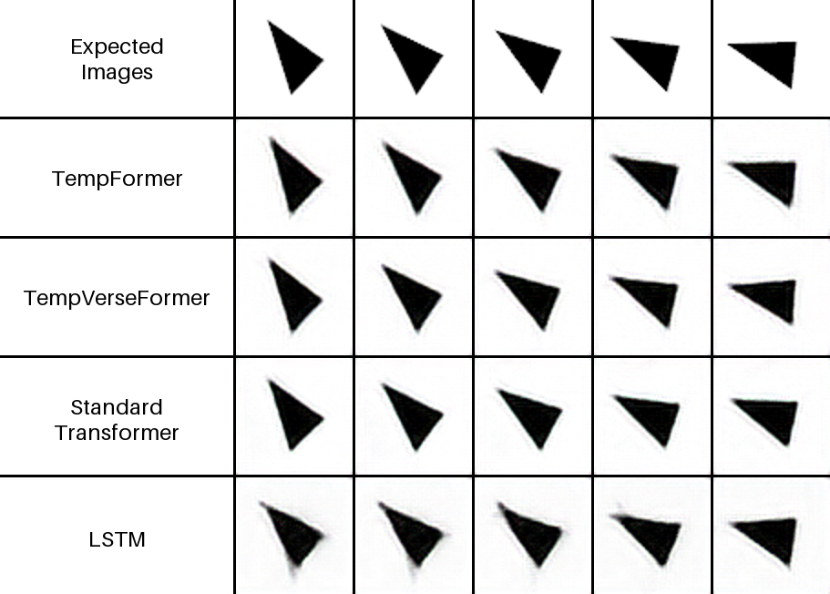

**Figure 2.9 - Five-step predictions for constant rotation.** The complete gallery is retained so
the comparison is not selected around one successful model or frame. Source: Kulyk, published
Figure 6, unchanged [135].

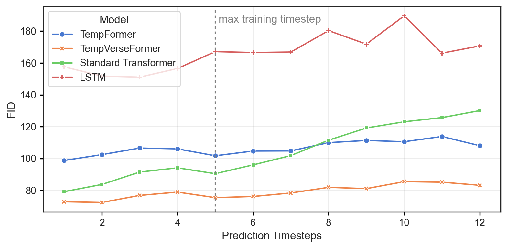

**Figure 2.10 - Constant-rotation FID over prediction depth.** Both temporally chained transformers
remain comparatively stable beyond the five-step training horizon, whereas the standard
transformer and especially the LSTM degrade. Source: Kulyk, published Figure 7, unchanged [135].

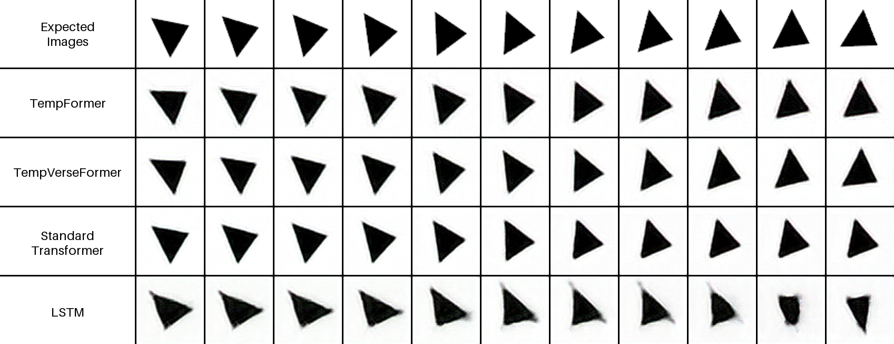

**Figure 2.11 - Eleven-step prediction beyond the training horizon.** The figure illustrates
longer-horizon behaviour but does not separate the causal contribution of reversibility from the
shared temporal-chaining mechanism. Source: Kulyk, published Figure 8, unchanged [135].

TempFormer and TempVerseFormer follow similar long-horizon trajectories in the constant-rotation
curves. Their shared recurrence is a plausible source of that stability, whereas algebraic
reversibility primarily changes the training-memory schedule. A causal quality comparison would
have to hold temporal chaining and optimization exposure fixed while varying only the
reverse-computation mechanism.

The four variable-pattern galleries are retained as a complete group. Keeping only the most
favourable case would turn qualitative illustration into post-hoc selection.

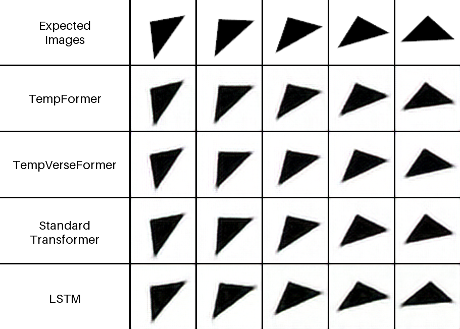

**Figure 2.12 - Predictions under accelerated rotation.** The complete published comparison is
reused unchanged. Source: Kulyk, published Figure 9 [135].

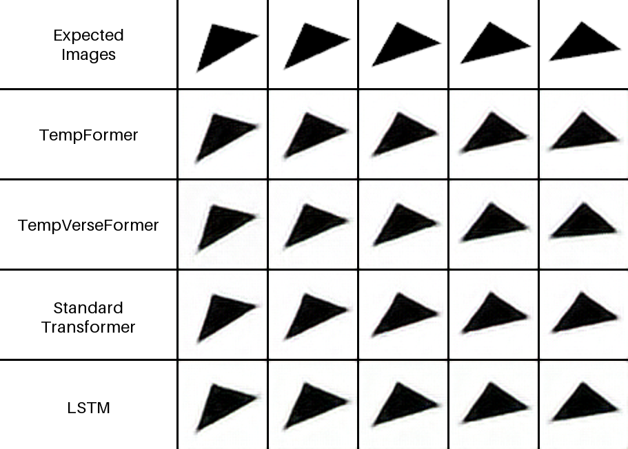

**Figure 2.13 - Predictions under decelerated rotation.** The complete published comparison is
reused unchanged. Source: Kulyk, published Figure 10 [135].

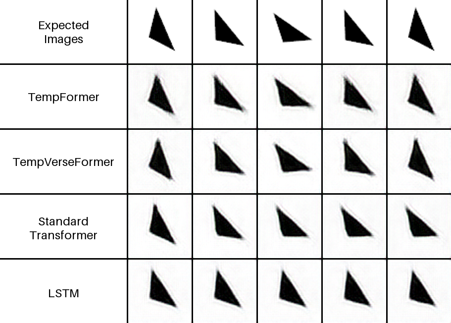

**Figure 2.14 - Predictions under oscillating rotation.** The complete published comparison is
reused unchanged. Source: Kulyk, published Figure 11 [135].

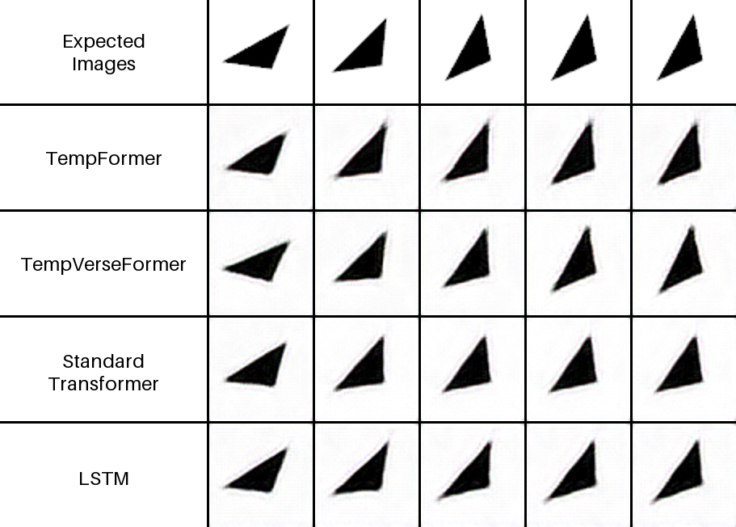

**Figure 2.15 - Predictions under interrupted rotation.** The complete published comparison is
reused unchanged. Source: Kulyk, published Figure 12 [135].

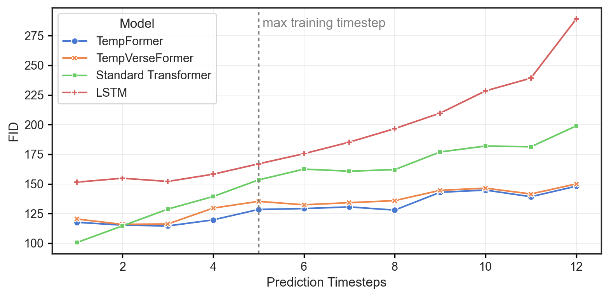

**Figure 2.16 - FID over prediction depth for combined temporal patterns.** The chained
transformers remain close, with TempFormer slightly better in the aggregate reported FID; the
standard transformer and LSTM deteriorate more strongly. Source: Kulyk, published Figure 13,
unchanged [135].

The publication reports one point estimate per configuration and documents one fixed
sequence-generator seed; it does not establish how many independent training runs were attempted.
No across-training-seed interval or clip-cluster inference is supplied. FID at 2,000 sequences
is also a finite-sample point estimate. Consequently, small differences such as 119 versus 123 are
descriptive. The robust conclusion is narrower: the reversible model remains competitive across
the tested dynamics while supporting a different activation-memory regime. It is not the best
predictor under every temporal pattern or endpoint.

Metric disagreement is scientifically informative here. FID compares distributions in a feature
space and can favour a set of diverse samples even when corresponding frames are not close to their
targets [94]. MSE rewards pixel alignment and penalizes a small angular displacement sharply.
SSIM emphasizes local luminance, contrast, and structure [94, 127–129]. An LSTM
can therefore obtain the lowest reported FID for acceleration while having substantially worse MSE
and SSIM. Calling that row the overall winner would conceal the prediction task's paired nature.

The regimes stress different state transitions as well. Constant velocity is well described by a
stationary shift in orientation; acceleration and deceleration require an evolving velocity state;
oscillation requires direction reversal; interruption inserts a temporary zero-velocity phase.
The combined setting changes among several rules. TempVerseFormer performs strongly on stationary,
oscillatory, and interrupted cases but does not dominate the smooth acceleration cases. One
plausible reading is that temporal chaining represents repeated transitions well, whereas
reversibility alone supplies no special inductive bias for estimating angular acceleration. The
data support the pattern, not that causal explanation; a targeted state-probe experiment would be
needed to establish it.

### 2.2.6 External OpenSTL validation

Controlled rotation cannot establish competence on textured scenes or real motion. The temporal
model was therefore integrated into OpenSTL and evaluated under its prescribed splits and metrics
on Moving MNIST, Moving MNIST-CIFAR, KTH Action, and TaxiBJ [1, 124, 126, 154]. The reported comparison spans recurrent ConvLSTM and PredRNN++ [137, 152], together with recurrent-free
ViT and Uniformer baselines.

**Table 2.4 - Published OpenSTL comparisons**

| Dataset | Model | SSIM $\uparrow$ | MSE $\downarrow$ | Best reported point in this comparison |
|---|---|---:|---:|---|
| Moving MNIST | ConvLSTM | 0.929 | 29.80 |  |
|  | **PredRNN++** | **0.951** | **22.06** | SSIM and MSE |
|  | TempVerseFormer | 0.932 | 26.08 |  |
|  | ViT | 0.914 | 35.15 |  |
|  | Uniformer | 0.931 | 30.38 |  |
| Moving MNIST-CIFAR | ConvLSTM | 0.920 | 73.31 |  |
|  | **PredRNN++** | **0.957** | **44.19** | SSIM and MSE |
|  | TempVerseFormer | 0.950 | 50.37 |  |
|  | ViT | 0.936 | 64.94 |  |
|  | Uniformer | 0.944 | 56.96 |  |
| KTH Action | ConvLSTM | 0.898 | 47.65 |  |
|  | **PredRNN++** | **0.912** | **39.84** | SSIM and MSE |
|  | TempVerseFormer | 0.898 | 48.97 |  |
|  | ViT | 0.895 | 56.57 |  |
|  | Uniformer | 0.906 | 44.71 |  |
| TaxiBJ | ConvLSTM | 0.9836 | 0.34 |  |
|  | PredRNN++ | 0.9834 | 0.33 |  |
|  | TempVerseFormer | 0.9835 | **0.31** | MSE |
|  | ViT | 0.9841 | 0.32 |  |
|  | **Uniformer** | **0.9844** | 0.34 | SSIM |

TempVerseFormer is competitive among the reported methods, but its rank changes by dataset.
PredRNN++ leads both endpoints on Moving MNIST, Moving MNIST-CIFAR, and KTH, while Uniformer also
exceeds TempVerseFormer in KTH SSIM and MSE. TaxiBJ is the one case where TempVerseFormer reports
the lowest MSE, $0.31$; Uniformer reports the highest SSIM.

This comparison closes an important but limited gap in the controlled-rotation evidence. It shows
that the temporal architecture can be trained through OpenSTL interfaces spanning object rasters,
textured composites, human actions and gridded flow fields without a task-specific claim of
dominance. It does not isolate the effect of reversible replay: Table 2.4 contains no matched
non-reversible TempFormer arm on these datasets. Nor do the benchmark protocols make a uniquely
relevant view disappear beyond the available context before it is needed again. The evidence thus
supports portability and predictive competence, while the activation-memory claim continues to
rest on direct reversible/non-reversible measurements and the reach mechanism remains a separate
question. Its broader value is showing that the controlled result was not confined to one renderer.

The four datasets test different kinds of competence. Moving MNIST emphasizes translation,
collision, and preservation of digit shape. Adding CIFAR backgrounds introduces texture that is
not coupled to the foreground motion. KTH replaces synthetic digits with articulated human
actions, while TaxiBJ is a gridded flow field rather than an object-rendering problem. Agreement
across all four would be stronger than success on one rotation generator. The published pattern is
more modest: the architecture remains usable across these interfaces, but its relative position
changes with the data.

OpenSTL standardizes much of the data and evaluation plumbing, reducing one source of comparison
error. Training schedules, parameter counts, checkpoint selection, metric reductions, and the
fidelity of each imported baseline still matter. Table 2.4 is consequently the comparison made in
the source study, not a new leaderboard assembled from unrelated papers. Reproducing the complete
benchmark under current OpenSTL versions would be a separate experiment.

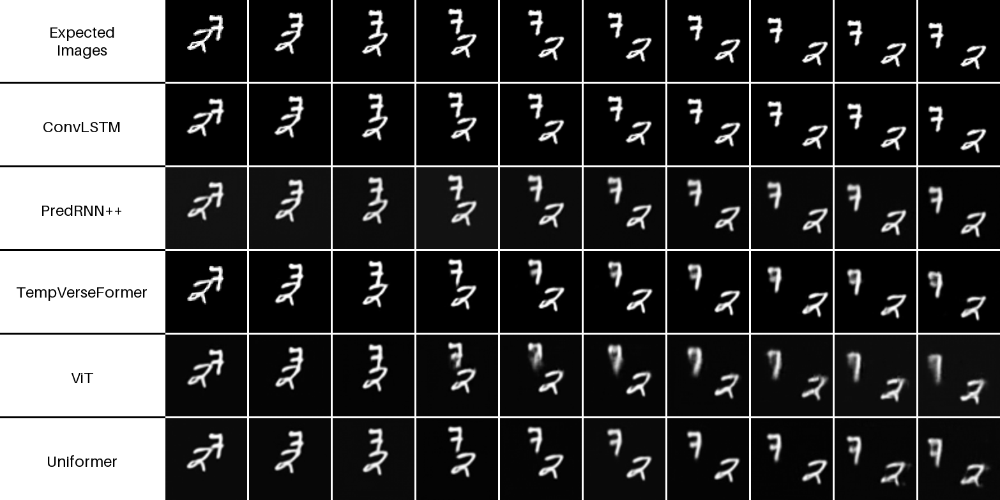

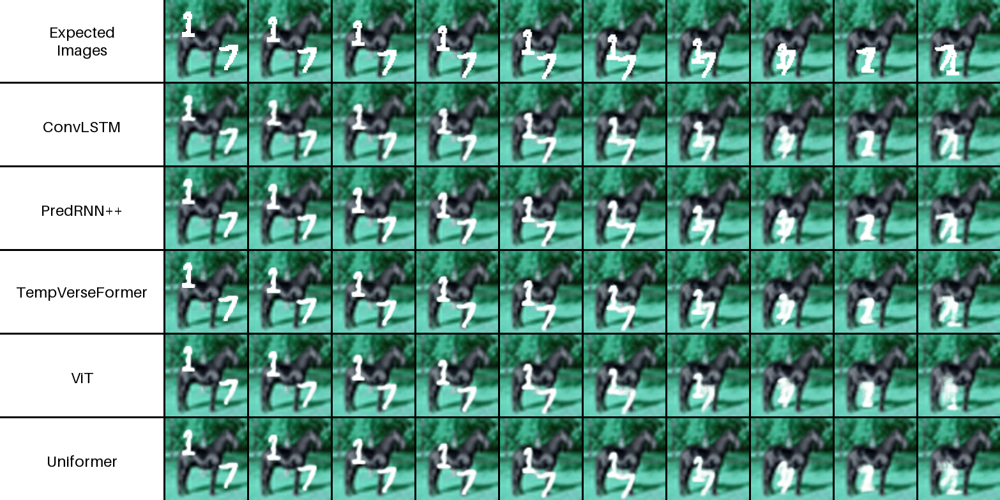

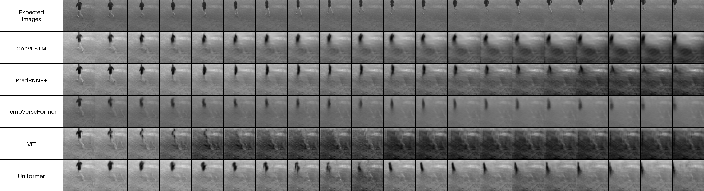

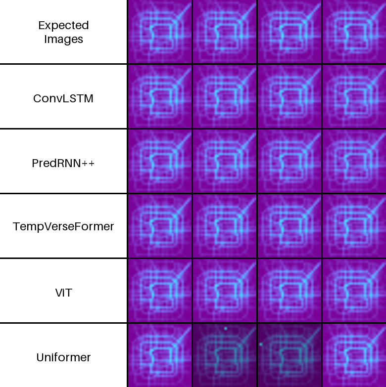

**Figure 2.17 - Qualitative OpenSTL predictions.** Four intact published panels show Moving MNIST,
Moving MNIST-CIFAR, KTH Action, and TaxiBJ. KTH predictions become visibly blurred, whereas the
TaxiBJ flow maps retain clearer structure. Source: Kulyk, published Figures 16-19, assembled without
editing individual panels [135].

The qualitative examples agree with the bounded quantitative interpretation. Digit structure is
generally preserved, though PredRNN++ remains sharper late in the Moving MNIST horizon. KTH motion
is recognizable but blurred. TaxiBJ is visually stronger in the examples shown. The paper supplies
neither a qualitative selection rule nor multiple training seeds or confidence intervals. These
examples establish benchmark competence, not a universal accuracy advantage or evidence for the
context hierarchy studied in Chapters 3 and 4.

None of these datasets makes a distant, temporarily hidden observation the uniquely relevant cause
of a later target. They broaden domain coverage but cannot identify memory reach. That question
requires the purpose-built geometry introduced in Chapter 3.

### 2.2.7 Activation-memory and computation frontier

The primary TempVerseFormer result is the different scaling of temporal-core memory. Published
measurements separate memory attributed to the temporal model from total pipeline allocation,
which also includes the VAE and common components. This separation prevents a constant core curve
from being misreported as zero growth of every device allocation.

**Table 2.5 - Published GPU-memory measurements at the tabulated horizons, batch size 32**

| Prediction steps | Model | Temporal-model memory (GB) | Total pipeline memory (GB) |
|---:|---|---:|---:|
| 1 | TempFormer | 0.85 | 4.11 |
|  | TempVerseFormer | 0.89 | 3.94 |
|  | Standard Transformer | 0.85 | 4.10 |
|  | LSTM | 1.27 | 4.00 |
| 4 | TempFormer | 0.85 | 4.59 |
|  | TempVerseFormer | 0.89 | 3.95 |
|  | Standard Transformer | 0.86 | 4.58 |
|  | LSTM | 1.28 | 4.03 |
| 16 | TempFormer | 2.61 | 6.50 |
|  | TempVerseFormer | 0.89 | 3.98 |
|  | Standard Transformer | 2.60 | 6.51 |
|  | LSTM | 1.28 | 4.13 |

At 16 prediction steps, the reversible temporal core remains at the reported $0.89$ GB, while
the matched TempFormer rises to $2.61$ GB. Total-pipeline memory changes much less dramatically
because the VAE and other common costs remain resident. This is a measured activation-memory
advantage within the reported setup, not a reduction in parameters or optimizer state.

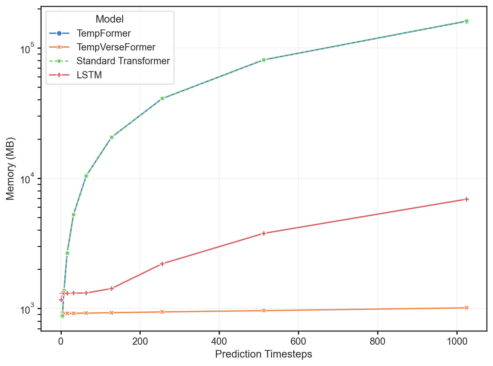

**Figure 2.18 - GPU memory versus prediction depth.** The reversible temporal-model curve remains
near $0.9$ GB over the plotted 1-1,024-step range, while the non-reversible transformer curves
increase. The logarithmic axis and original labels are retained. Source: Kulyk, published Figure
14 in the supplied version, reproduced without modification; author preprint DOI
10.21203/rs.3.rs-6293520/v1 and version-of-record DOI 10.1007/s00521-025-11707-3 [135].

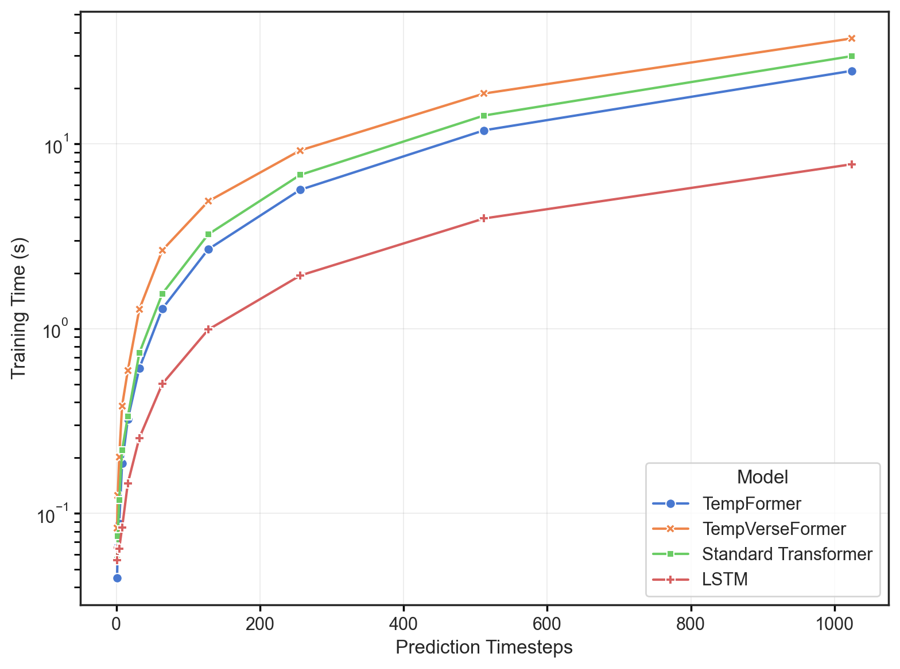

**Figure 2.19 - Training time versus prediction depth.** Reconstructing discarded activations
creates a visible computation premium relative to the matched non-reversible transformer, while all
methods become slower as prediction depth increases. Source: Kulyk, published Figure 15 in the
supplied version, reproduced without modification [135].

The two figures must be read together. Figure 2.18 shows why long temporal differentiation becomes
feasible under a memory ceiling; Figure 2.19 shows its computational price. Reversible replay is a
memory-computation exchange, attractive when the device cannot hold the non-reversible activation
tape and extra arithmetic is acceptable.

Only the 1-, 4-, and 16-step memory points are tabulated with exact numeric values in the paper.
Beyond those tabulated anchors, the published curves extend to 1,024 steps, but the available
article and repository record does not provide the exact high-horizon coordinates or their raw run
artifacts. The dissertation therefore anchors quantitative claims to Table 2.5 and treats the long
curve as published scaling evidence whose pointwise receipts still belong in the author's
experiment ledger.

The tabulated 16-step comparison already demonstrates the operating effect without relying on the
far end of the curve. Relative to TempFormer, TempVerseFormer uses 1.72 GB less reported
temporal-model memory at that point, a reduction of about 66%. At total-pipeline level the
difference is 2.52 GB, or about 39%, because common spatial and training allocations remain. These
two percentages answer different questions and should not be interchanged. The first isolates the
mechanism; the second is closer to the capacity a practitioner observes.

Runtime must be measured on the same footing. A reversible pass performs reconstruction and local
reevaluation, whereas an ordinary pass consumes a stored graph. Wall-clock differences therefore
depend on kernel launch overhead, attention implementation, memory bandwidth, precision, and
device occupancy, not only on asymptotic counts. Figure 2.19 supplies the published empirical
counterweight, but no energy or throughput-normalized comparison was reported.

### 2.2.8 Stochastic replay extension and separate recurrent-core checks

The published temporal model is deterministic inside its reversible stack. Many generative video
transitions are not. They sample a latent innovation, apply stochastic regularization, or receive
a random diffusion state. Discarding that realized input would destroy information required for
reconstruction.

Three dissertation checks address related parts of this problem, but they are not one jointly
executed experiment. A **single reversible convolutional stage** tests store-the-noise
reconstruction over 40 stochastic transitions. Reverse-gradient direction is tested on a
**deterministic multi-level recurrent core**. The memory and runtime frontier in Table 2.6 comes
from a second deterministic three-level training loop. None is part of the published TempVerseFormer
architecture, and none is used to train the Chapter 3 predictor.

For an external-additive stochastic transition,

$$
h_t=F_\theta(h_{t-1})+\sigma\epsilon_t,
\qquad
\epsilon_t\sim\mathcal N(0,I),
\tag{2.16}
$$

knowledge of the realized $\epsilon_t$ is necessary but not sufficient for inversion. If
$F_\theta$ is bijective on the tested state domain, then conditioning on that value gives

$$
h_{t-1}=F_\theta^{-1}(h_t-\sigma\epsilon_t).
\tag{2.17}
$$

The executable single-stage stochastic check injects noise as a conditioning argument inside a
two-branch additive coupling rather than adding it after the complete transition:

$$
y_{1,t}=s_{1,t-1}+F_\theta(s_{2,t-1},\epsilon_t),
\qquad
y_{2,t}=s_{2,t-1}+G_\theta(y_{1,t}),
\tag{2.18}
$$

with conditional inverse

$$
s_{2,t-1}=y_{2,t}-G_\theta(y_{1,t}),
\qquad
s_{1,t-1}=y_{1,t}-F_\theta(s_{2,t-1},\epsilon_t).
\tag{2.19}
$$

The coupling functions need not be invertible; the stored conditioning must merely be replayed
identically. This construction also applies to known actions or level context. A hard forgetting
gate is different: if it overwrites part of a state, the discarded value or sufficient residual
information must be retained. Reversibility cannot recover information that the forward map has
destroyed [110].

Replay memory has three conceptually separate terms:

$$
M_{\mathrm{replay}}(T)
=M_{\mathrm{anchor}}(T)+M_{\mathrm{rng}}(T)+M_{\mathrm{gates}}(T),
\qquad
M_{\mathrm{rng}}(T)=
\begin{cases}
\dfrac{T D_\epsilon b_\epsilon}{8}, & \text{stored innovations},\\[2mm]
\dfrac{T b_{\mathrm{seed}}}{8}, & \text{one independent seed per step},\\[2mm]
M_{\mathrm{counter}}, & \text{fixed counter-based replay state}.
\end{cases}
\tag{2.20}
$$

Here $D_\epsilon$ and $b_\epsilon$ are the number of values in one innovation and their bit width;
$b_{\mathrm{seed}}$ is the stored seed width. These three RNG rows are alternatives, not additive
costs. The measured deterministic frontier has $M_{\mathrm{rng}}=0$, but its replay routine keeps
full-state re-anchors. With spacing $a=\lfloor\sqrt T\rfloor$ and state footprint $D_s$ at
$b_s$ bits,

$$
M_{\mathrm{anchor}}(T)
\approx \left\lceil\frac{T}{a}\right\rceil\frac{D_s b_s}{8}
=O(\sqrt T\,D_s).
\tag{2.20a}
$$

The correct general claim is therefore constant-in-$T$ **transient local activation memory** plus
the declared anchor and replay metadata. It is not constant total memory for every reversible or
stochastic recurrence.

Storing one generator seed per step is sufficient only when the random-number algorithm, draw
order, tensor shape, device semantics, and precision are reproduced. Storing the realized noise is
larger but less sensitive to those hidden dependencies. The choice is another resource trade:
compact seeds improve memory accounting, whereas explicit innovations make the reconstructed
trajectory easier to audit across software changes.

The executable numerical source encodes thresholded checks rather than a common stochastic-core
receipt. Its deterministic single-stage reconstruction thresholds are $10^{-9}$ in fp64 and
$10^{-4}$ for the Lipschitz-constrained fp32 variant. The separate stochastic single-stage check
requires stored-noise drift below $10^{-8}$ and wrong-noise drift above $10^{-2}$. The multi-level
gradient check requires cosine similarity above $0.9999$, but its executed path supplies no
stochastic innovation and is therefore deterministic despite the historical function heading.
Cosine similarity establishes directional agreement; it does not prove bitwise identity or
equality of every gradient component. No standalone frozen output artifact was found for these
source checks, and the first two do not fix a random seed. Exact values from an earlier prose
record are consequently not promoted as immutable numerical receipts.

**Table 2.6 - Measured deterministic multi-level memory and runtime frontier on an RTX 4060 Ti 16 GB**

| Rollout (K) | BPTT peak (MB) | Checkpoint peak (MB) | Reversible peak (MB) | BPTT (ms/step) | Checkpoint (ms/step) | Reversible (ms/step) |
|---:|---:|---:|---:|---:|---:|---:|
| 10 | 3,809 | 1,354 | 1,065 | 549 | 322 | 257 |
| 20 | 6,592 | 1,391 | 1,078 | 399 | 544 | 479 |
| 40 | 12,162 | 1,471 | 1,091 | 740 | 1,028 | 882 |
| 80 | 23,305* | 1,637 | 1,125 | 43,797* | 3,131 | 2,556 |
| 120 | OOM | 1,801 | 1,152 | - | 3,960 | 2,760 |
| 160 | OOM | 1,967 | 1,176 | - | 4,066 | 3,362 |

*The $K=80$ BPTT run exceeded physical GPU memory and spilled into shared host memory under
WDDM; it completed but no longer represented practical device-resident training.*

The comparison includes encoder, deterministic three-level recurrent core, decoder, Adam state,
batch 32, and $64\times64$ inputs. Vanilla BPTT becomes infeasible before $K=120$. Both
checkpointing and reversible replay reach $K=160$, with the measured replay implementation using
less peak memory and time than the checkpoint implementation at the shown points. Its
$\lfloor\sqrt K\rfloor$ anchor spacing retains approximately $O(\sqrt K\,D_s)$ state rather than
an activation tape linear in $K$; fixed model and training terms dominate the near-flat measured
total over this range. These configuration-specific measurements cannot establish that reversible
replay dominates an optimally scheduled or kernel-tuned checkpointing system.

Algebraic inversion also says nothing about forward stability. The seeded executable diagnostic
free-runs an unconstrained coupling and three spectrally constrained variants for 100 steps and
compares $\lVert\delta_{100}\rVert/\lVert\delta_0\rVert$. Its purpose is to distinguish
algebraic reconstruction from perturbation growth: all variants remain invertible, while the
observed growth becomes controlled only under the smaller tested output scales. Because no frozen
T1--T4 output receipt survives, the particular run ratios are not used as headline numerical
evidence. For a residual map $I+F$, only the general upper bound

$$
\operatorname{Lip}(I+F)\le 1+\operatorname{Lip}(F)
\tag{2.21}
$$

follows from the triangle inequality; cancellation may yield smaller realized amplification.
The empirical result is still decisive for interpretation: reversibility enabled state
reconstruction, whereas dynamic stability depended on the learned transition and its constraint
[111, 112].

### 2.2.9 Applicability relative to BPTT and checkpointing

No single reverse-computation schedule is best for every model. Vanilla BPTT is attractive when
the required horizon fits comfortably, because it avoids reconstruction logic. Truncation is a
legitimate modelling choice when dependencies beyond the truncation boundary are intentionally
excluded. Checkpointing works with arbitrary differentiable modules and offers a tunable
storage-recomputation schedule. Reversible replay requires a carefully delimited invertible state,
stable numerical reconstruction, and exact reproduction of stochastic inputs [30, 32, 91, 110, 113, 116].

**Table 2.7 - Selection of a temporal differentiation strategy by binding constraint**

| Method | Horizon-dependent storage | Extra computation | Architectural condition | Gradient scope | Evidence used here | Suitable operating region |
|---|---|---|---|---|---|---|
| Vanilla BPTT | Full activation tape, typically $O(TLD_s)$ | Baseline | None | Full unroll | Published definitions and measured deterministic recurrent-core frontier | Short or moderate horizons that fit memory |
| Truncated BPTT | Bounded by selected truncation | Baseline over retained segment | None | Omits earlier dependencies | Literature comparator | Tasks where a shorter gradient horizon is intended |
| Gradient checkpointing | Schedule-dependent; sublinear schedules are possible | Recomputes checkpointed segments | None beyond deterministic replay of the segment | Full in exact arithmetic | Theory plus measured recurrent-core comparator | General models when modest recomputation is acceptable |
| Reversible replay | One local graph plus terminal/boundary state; measured implementation retains $O(\sqrt T\,D_s)$ anchors; RNG metadata is strategy-dependent if stochastic | Reevaluates inverse and local forward functions | Economical, numerically stable inverse over the retained state | Full in exact arithmetic conditional on replay | Published TempVerse study; deterministic multi-level memory frontier and separate deterministic gradient check; separate single-stage stochastic reconstruction check | Long chains where activation history binds and the transition is naturally reversible |

The inner optimization loop provides a useful negative boundary. Differentiation through iterative
diffusion-model objectives has also been used for reward alignment [117, 118]. In a later dissertation
measurement, differentiating through candidate refinement was compared using naive full-graph,
truncated, checkpointed, and reversible variants for $K\in\{4,8,32,128\}$. The checkpointed and
reversible arms both remained near $5.28$ GB. Reversibility saved only 14 MB, or $0.26\%$ of
peak memory, at $K=128$, while taking about twice the wall-clock time. The per-step candidate and
momentum state was only $0.117$ MB, so trajectory storage was not the binding resource. This is a
dissertation experiment, not evidence from the TempVerseFormer paper.

What matters is the fraction of memory that an inverse can remove. Along the published temporal
core and the deterministic multi-level recurrent frontier, repeated activations are large enough for
reconstruction to change feasibility. In the tested inner optimization loop, second-order local
graphs and common model state dominate, so checkpointing is the better practical choice. Chapter 4
returns to this binding-constraint rule without treating reversibility as a universal architectural
preference.

A practical selection can therefore begin with a memory profile rather than an architecture label.
If the activation tape grows with the required horizon and the transition already has a natural
two-stream state, reversible replay deserves implementation work. If arbitrary modules dominate,
checkpointing offers broader compatibility. When the scientific objective tolerates a shorter
dependency, truncation may be the honest model. Otherwise, changing the optimizer, batch size, or
local attention kernel may remove the bottleneck more directly. The intervention should follow the
measured term in the peak-memory decomposition.

Evidence comes from distinct comparisons. TempVerseFormer directly measures reversible and
non-reversible temporal models but has no checkpointing arm. Table 2.6 supplies that comparator on
a separate deterministic multi-level recurrent core; the single-stage store-the-noise check
validates conditional reconstruction, and the inner-loop experiment supplies a negative boundary.
Checkpointing is thus both a literature comparator and a measured dissertation comparator, never a
baseline retroactively inserted into the published temporal study.

## 2.3 Hierarchical spatial representation and entropy estimation

### 2.3.1 Fixed-patch allocation problem

Making a longer temporal chain differentiable solves only the storage schedule. The next bottleneck
is spatial: where should a visual model spend its representation capacity? A conventional video
transformer partitions a clip into a regular grid of spatio-temporal tubes or cubes, embeds every
cell, and processes the resulting sequence [70, 71]. Regular patching is easy to batch and gives
each token a clear geometric support. Its cost, however, depends on the number of patches rather
than on how much unpredictable content each patch contains.

Smaller supports increase the length of the global sequence and preserve finer boundaries; larger
supports shorten that sequence but ask one latent unit to summarize more heterogeneous content.
Temporal extent creates the same tension. A long tube can encode smooth motion compactly, yet it
may mix an occlusion boundary with frames on either side. Fixed patching chooses one compromise for
every clip and location.

For a clip $X\in\{0,\ldots,255\}^{T\times C\times H\times W}$ and non-overlapping patch support
$(\tau,p_h,p_w)$, the nominal patch count is

$$
N_{\mathrm{patch}}
=\left\lceil\frac{T}{\tau}\right\rceil
 \left\lceil\frac{H}{p_h}\right\rceil
 \left\lceil\frac{W}{p_w}\right\rceil.
\tag{2.22}
$$

An identical count is allocated to a static black region and to a moving, newly exposed contour. This
is not automatically inefficient: regularity may be valuable, and the learned encoder can suppress
redundant content. The allocation becomes questionable when the global model is the expensive
component and local information density is highly non-uniform.

Byte Latent Transformer provides the conceptual precedent. It applies lightweight local processing
to elementary bytes, groups them into latent patches, and spends the heavier global computation on
the shorter latent sequence [72]. V-BLT transfers the
local-global-local pattern to raster video. The reported proof of concept does **not**, however,
implement BLT's dynamic entropy-based boundary selection. It uses fixed
$4\times4\times4$ spatio-temporal patches as specified in the paper [134].

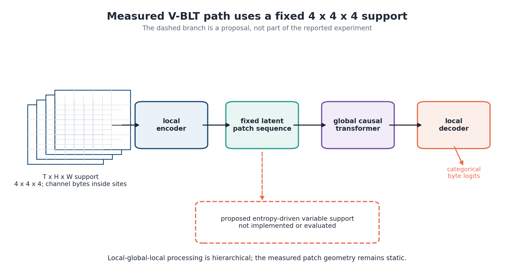

**Figure 2.20 - Fixed-patch tensor and local-global-local processing path.** The solid path is the
published proof of concept. The dashed variable-support branch is a proposed extension and is not
part of its experimental results. Source: author's dissertation-native clarification of the V-BLT
method [134].

This hierarchy differs from the retained-context hierarchy of Chapter 3. V-BLT places local models
around a global representation within the current clip. Chapter 3 packages historical frames at
different spatial resolutions so the predictor can access a longer past. Similar words - local,
global, coarse, fine - describe different tensors and different costs. The distinction is maintained
throughout the remaining chapters.

### 2.3.2 V-BLT architecture

V-BLT operates on **uncompressed raster pixel-channel bytes**. A byte target $x_{t,c,y,x}$ is an
integer in $\{0,\ldots,255\}$. This target interface avoids committing the output to a learned
discrete codebook, as a VQ-VAE would [73]. Nevertheless, the hidden representation remains lossy: convolutions,
projections, attention, and finite latent width still form a learned information bottleneck.

The architecture contains a local encoder $E_\alpha$, a global latent transformer $G_\beta$, and
a local decoder $D_\gamma$. Let $\mathcal P_m(X)$ extract the published fixed
$4\times4\times4$ support indexed by $m$. The local encoder maps each support and its surrounding
local features to a latent patch:

$$
u_m=E_\alpha\bigl(\mathcal P_m(X)\bigr),
\qquad m=1,\ldots,N_{\mathrm{patch}}.
\tag{2.23}
$$

The global model exchanges information among the shorter patch sequence under a temporal causal
mask:

$$
g_{1:N_{\mathrm{patch}}}
=G_\beta\bigl(u_{1:N_{\mathrm{patch}}};M_{\mathrm{causal}},R_{\mathrm{ND}}\bigr),
\tag{2.24}
$$

where $R_{\mathrm{ND}}$ denotes the multi-axis rotary position transform described in Section
2.3.4. Finally, the local decoder combines local-resolution features with the relevant global patch
states and returns 256 logits for every predicted raster byte:

$$
\ell_{t,c,y,x}
=D_\gamma\bigl(r_{t,c,y,x},g_{\pi(t,y,x)}\bigr)
\in\mathbb R^{256}.
\tag{2.25}
$$

Here $r_{t,c,y,x}$ is a local decoder feature and $\pi(t,y,x)$ maps a raster coordinate to its
global support. Cross-attention transmits information between local and patch representations. The
global transformer therefore performs the broad spatio-temporal reasoning, while the local stages
retain and restore spatial detail.

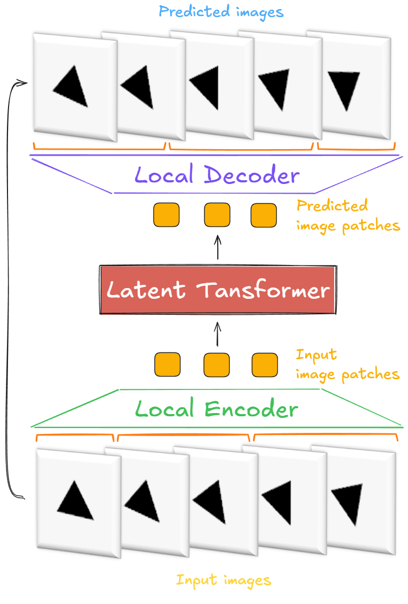

**Figure 2.21 - Published Vision Byte Latent Transformer architecture.** Local encoding and
decoding surround a causal global latent transformer. The figure is reproduced unchanged; the
surrounding text supplies the fixed-patch qualification absent from simplified earlier dissertation
schematics. Source: Kulyk and Mokin, published Figure 3 [134].

The audited public implementation provides a concrete local-global-local path. A convolutional
image encoder reduces spatial resolution, local transformer blocks process raster-level features,
and cross-attention pools information into global patch embeddings. The global transformer applies
its causal mask to those embeddings. A local transformer and transposed-convolutional image decoder
then restore full spatial resolution before the categorical head. This code is valuable for
understanding the interfaces, but it does not supply a complete frozen receipt for the exact
published experiment.

In the inspected source, `patch_ids_from_frames` assigns local positions to global groups; pooling
initializes the global patch queries, and encoder cross-attention updates them from raster-level
features. Decoder cross-attention then returns global information to the local stream before the
image decoder and categorical head. This is not equivalent to replacing each cube by its arithmetic
mean. The local residual stream remains available to the decoder, while the global sequence carries
the broader temporal interaction. Consequently, any compression ratio computed only from the
number of global patches would overstate the information bottleneck: local features also participate
in reconstruction.

That architecture helps interpret the cost result. Heavy global attention is applied after local
aggregation, but local encoding, cross-attention, and decoding still consume computation. A shorter
global sequence can reduce one term without making total cost proportional only to
$N_{\mathrm{patch}}^2$. The published GFLOP comparison is therefore the appropriate empirical
receipt for the complete configured models.

**Table 2.8 - V-BLT component contract and evidence level**

| Component | Input | Output | Function | Status in the published experiment | Evidence level |
|---|---|---|---|---|---|
| Raster interface | $T\times C\times H\times W$ integer bytes | Local feature grid | Preserve a direct categorical byte target | Implemented | Paper and source |
| Fixed patch assignment | Local feature positions grouped by published $4\times4\times4$ support | Patch identifiers | Define global computational units | Reported as implemented | Paper specification; exact run config not archived |
| Local encoder | Raster/local features | Patch embeddings plus residual local features | Aggregate short-range information | Implemented | Paper and source |
| Global latent transformer | Patch sequence | Contextual patch sequence | Model broad spatial and temporal relations | Implemented | Paper and source |
| RoPE-ND | Time, row, column coordinates and Q/K features | Rotated Q/K subspaces | Preserve explicit multi-axis position after flattening | Implemented | Paper equations and source audit |
| Local decoder | Local residuals and global patch states | Full-resolution hidden features | Restore local detail through self- and cross-attention | Implemented | Paper and source |
| Categorical byte head | Hidden feature per byte location | 256 logits | Predict a distribution over byte values | Implemented | Paper and source |
| Entropy map | Categorical logits | Entropy at each byte location | Diagnose predictive dispersion | Measured and visualized | Paper figures and source |
| Dynamic region controller | Entropy map and resource budget | Variable patch support | Allocate future computation by content | Not implemented in the reported study | Proposed only |

The architectural evidence supports a hierarchical representation method. It does not establish
that the model learned semantic patches, that the latent sequence is optimal, or that the same
design scales unchanged to compressed natural video.

### 2.3.3 Causal attention and categorical byte objective

Flattening a clip converts time and space into a single token index, so causal permission must be
defined by frame coordinate rather than by an undifferentiated lower-triangular sequence. If token
$i$ belongs to frame $t_i$ and token $j$ to $t_j$, the global attention mask is

$$
M_{ij}=
\begin{cases}
0, & t_j\le t_i,\\
-\infty, & t_j>t_i.
\end{cases}
\tag{2.26}
$$

Tokens within the same observed frame may attend to one another. Tokens in earlier frames are also
visible, while future-frame tokens are suppressed before softmax. The resulting matrix has dense
diagonal frame blocks and a block-lower-triangular temporal structure. Direct future information
leakage is blocked at the global attention layer; physical plausibility and autoregressive stability
remain learned properties [12].

The block structure is stricter than ordinary bidirectional clip attention and looser than a
pixel-by-pixel raster order. Within-frame exchange is intentional because a frame is treated as one
simultaneously observed spatial field. Across frames, permission follows time. If the input tensor
contains observed and target frames together, the mask must be combined with a loss and data
construction that do not expose target bytes through the local path. The published architecture
diagram and global mask establish the intended causal organization; the absent frozen run receipt
limits a stronger end-to-end leakage audit.

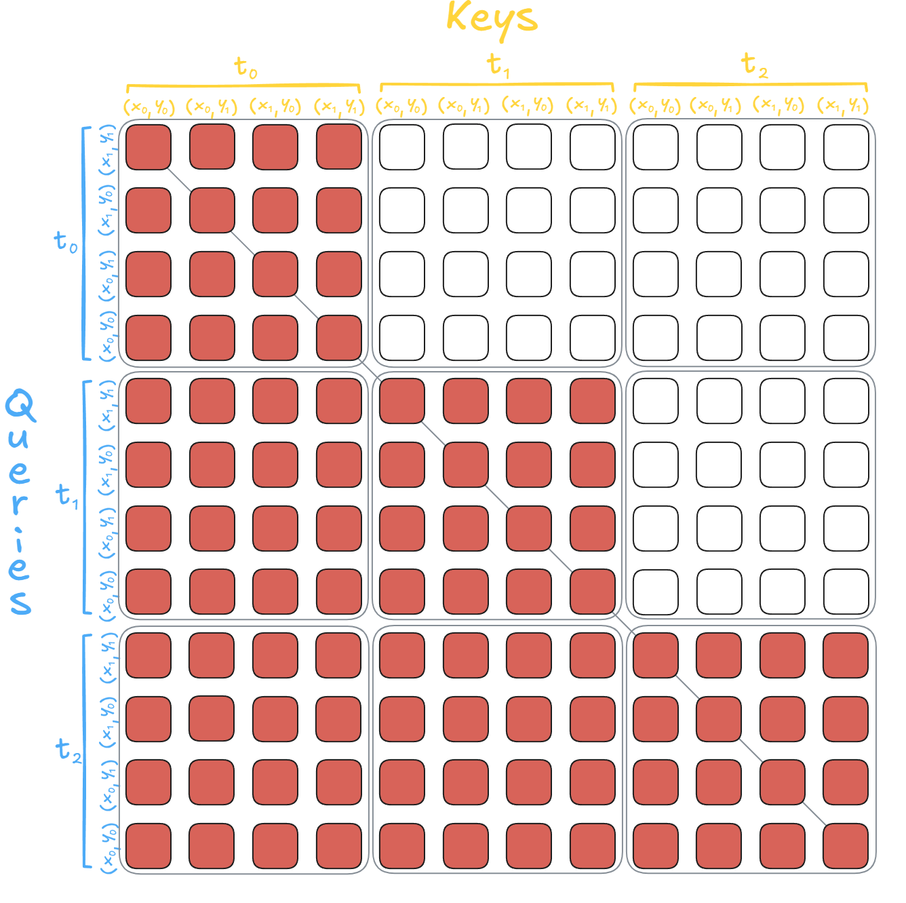

**Figure 2.22 - Causal spatio-temporal attention mask.** Full within-frame and past-frame
connections are permitted, while future-frame connections are masked. Source: Kulyk and Mokin,
published Figure 4, unchanged [134].

For each raster pixel-channel byte $i=(t,c,y,x)$, the head produces logits
$\ell_i\in\mathbb R^{256}$. The categorical distribution is

$$
p_\Theta(x_i=k\mid X_{<t})
=\frac{\exp(\ell_{i,k})}
{\sum_{r=0}^{255}\exp(\ell_{i,r})},
\qquad k\in\{0,\ldots,255\}.
\tag{2.27}
$$

Training minimizes pixel-channel cross-entropy over the supervised positions:

$$
\mathcal L_{\mathrm{byte}}(\Theta)
=-\frac{1}{|\mathcal I|}
\sum_{i\in\mathcal I}
\log p_\Theta(x_i=x_i^{\star}\mid X_{<t_i}),
\tag{2.28}
$$

where $\mathcal I$ contains the target byte locations and $x_i^{\star}$ is the ground-truth
integer. Unlike a scalar MSE head, this interface can represent several plausible byte values at
one location. That modelling flexibility does not guarantee that the probabilities are calibrated,
and it does not remove spatial dependence between neighbouring bytes that are predicted through a
factorized output head.

Equation (2.28) is a sum of conditional marginal byte losses at the supervised locations. Shared
hidden features couple those predictions statistically through the network, but the output head
does not define an explicit joint distribution over all RGB channels and neighbouring pixels at
one future frame. Sampling each byte independently can therefore produce combinations that were
not frequent in the data. An autoregressive local decoder would model those dependencies more
directly at greater sequential cost. V-BLT instead keeps the categorical interface parallel and
uses local attention to coordinate its hidden representation.

The byte objective also fixes the maximum class entropy and avoids a learned-codec confound in the
target. A wrong value can be one intensity level away or 200 levels away, yet cross-entropy
penalizes it according to assigned probability rather than numeric distance. MSE and PSNR are
therefore still needed at evaluation time to describe the geometry of raster error.

Channel semantics require care. The audited training path reshapes the entropy result back to
$[B,T,C,H,W]$; it does not reduce RGB channels to a single map before that point. Single-channel
runs therefore yield one displayed entropy plane directly. A multi-channel visualization would need
an explicitly declared mean, maximum, or other aggregation. The published paper does not document
such a reduction, and the exact run configuration was not recovered, so the dissertation avoids
inventing one.

### 2.3.4 Multidimensional rotary positional encoding

Self-attention is permutation-equivariant before positional information is introduced. Once a
spatio-temporal grid is flattened, a token's order alone does not reveal whether a neighbour lies
one column away, one row away, or one frame away. Absolute embeddings can label each index, while
relative biases can parameterize pairwise displacement [12, 71, 106]. Rotary positional embedding takes
a different route: it rotates query and key feature pairs by a position-dependent phase so their
inner product depends on relative displacement [107].

For one real feature pair $(v_{2j},v_{2j+1})$, define the complex coordinate
$\widetilde v_j=v_{2j}+\mathrm i v_{2j+1}$. At scalar position $p$, one-dimensional RoPE applies

$$
\rho_p(\widetilde v_j)
=\widetilde v_j\exp(\mathrm i p\omega_j),
\qquad
\omega_j=\beta^{-j/K},\quad j=0,\ldots,K-1,
\tag{2.29}
$$

where $\beta$ is conventionally $10{,}000$ and $K$ is the number of complex pairs in the
assigned subspace. For a query at $p$ and key at $q$,

$$
\rho_p(\widetilde q_j)
\overline{\rho_q(\widetilde k_j)}
=\widetilde q_j\overline{\widetilde k_j}
 \exp\bigl(\mathrm i(p-q)\omega_j\bigr).
\tag{2.30}
$$

The content term remains learned, but its positional phase depends on $p-q$, not on either
coordinate independently.

The same operation can be written without complex notation. For frequency $\omega_j$, one feature
pair is multiplied by

$$
\mathbf R_j(p)=
\begin{bmatrix}
\cos(p\omega_j) & -\sin(p\omega_j)\\
\sin(p\omega_j) & \cos(p\omega_j)
\end{bmatrix},
\qquad
\mathbf R_j(p)^\top\mathbf R_j(q)=\mathbf R_j(q-p).
\tag{2.30a}
$$

Orthogonality preserves the norm of each query or key pair. The second identity is the reason a
dot product can express displacement while the content projection remains position dependent.
It is also why coordinate units matter: doubling every spatial index doubles the applied phase at
the same learned frequency.

RoPE-ND allocates disjoint query/key subspaces to the physical axes. For one attention head of real
dimension $d_h$, let $\mathcal A=\{t,y,x\}$, assume $d_h$ is divisible by six, and define
$d_a=d_h/3$. Each axis receives $d_a/2$ complex pairs. If
$q=q_t\|q_y\|q_x$ and $p=(p_t,p_y,p_x)$, then

$$
R_{\mathrm{ND}}(p)q
=R_t(p_t)q_t\;\|\;R_y(p_y)q_y\;\|\;R_x(p_x)q_x.
\tag{2.31}
$$

The implementation audit confirms this disjoint-axis construction. Its frequency precomputation
sets $K=d_h/(2|\mathcal A|)$, creates a meshgrid over time, latent height, and latent width, and
concatenates one phase vector per axis. Token construction then indexes the flattened meshgrid
consistently with frame-major, row-major order. This is the verified interpretation; it replaces
the ambiguous frequency-index ranges in the compact paper derivation.

The equal-axis mathematical construction requires divisibility by six: three axes each consume
pairs of real channels. With head dimension 96, the published configuration satisfies that
requirement. In the inspected source, integer division derives the per-axis pair count and
constructs three equal phase banks, but its present assertion is not algebraically equivalent to
checking $d_h\bmod 6=0$ for every possible head width. Future configurations should enforce the
six-channel condition directly rather than treating the current source check as a general proof.

The corresponding attention logit decomposes into axis-specific terms:

$$
s(q,k;p,r)
=\frac{1}{\sqrt{d_h}}
\sum_{a\in\{t,y,x\}}
q_a^{\top}R_a(r_a-p_a)k_a.
\tag{2.32}
$$

Equation (2.32) shows relative-coordinate dependence along all three axes. Relative phase alone
cannot make the network attend to the same object or recover Euclidean geometry; those behaviours
remain learned and would require targeted ablation or localization evidence.

Disjoint subspaces avoid a subtler ambiguity. If time, row, and column rotations were all applied
to the same feature pair, their phases would add, and different displacement triples could produce
the same total angle. Separate banks allow the attention score to retain one contribution per
axis. The sum in Equation (2.32) can still trade those contributions through learned query and key
content, but the coordinate encoding itself does not collapse them.

Axis allocation also defines a frequency trade-off. If the head width $d_h$ is fixed, adding more
coordinate axes reduces the number of rotary frequency pairs assigned to each one. The three-axis
construction uses $K=d_h/6$ complex pairs per axis. Unequal partitions could reserve more capacity
for time or space, and unused channels could remain unrotated, but those are alternative designs,
not properties evaluated in the paper. The implemented equal split is simple and keeps the axes
disjoint.

For multiresolution tokens, integer row and column indices from two grids should not be compared
without a coordinate convention. A coarse token at index one may cover the same physical region as
several fine indices. One can rotate both levels using normalized coordinates or a shared base-grid
origin. V-BLT uses one latent geometry, so this mapping is not tested there. The issue becomes
relevant to hierarchical context, but the final predictor resolves it through explicit learned
level and frame embeddings rather than importing RoPE-ND.

**Figure 2.23 - Disjoint coordinate subspaces in RoPE-ND.** Time, vertical position, and
horizontal position rotate separate feature pairs; their relative phases enter the attention
score independently. Source: author's verified implementation schematic after the V-BLT equations
and RoFormer [107, 134].

RoPE-ND costs linear arithmetic in feature width per token and avoids materializing a learned dense
pairwise position table. Its use in V-BLT is a representation result. The Chapter 3 predictor uses
learned level, role, and frame embeddings instead; its reach-fidelity effects cannot be attributed
to RoPE-ND.

### 2.3.5 Predictive entropy as a spatial-complexity signal

A categorical byte head yields a complete distribution rather than only a point prediction. Its
dispersion can be summarized locally with Shannon entropy. In bits,

$$
H_i^{(2)}
=-\sum_{k=0}^{255}p_{i,k}\log_2 p_{i,k},
\qquad 0\le H_i^{(2)}\le 8.
\tag{2.33}
$$

A point mass attains the lower bound, whereas a uniform 256-way distribution attains the upper one.
The audited visualization code uses the natural logarithm, producing entropy in nats:

$$
H_i^{(e)}=-\sum_{k=0}^{255}p_{i,k}\ln p_{i,k}
=(\ln2)H_i^{(2)}.
\tag{2.34}
$$

Changing the logarithm base does not alter the ordering of locations, but it changes numeric units and
thresholds. The implementation clamps the visualization at 6 nats, reverses the grayscale so high
entropy appears dark, and scales the result to 0-255. Any quantitative threshold used by a future
controller must therefore specify its log base and preprocessing rather than reading a value from
the rendered image.

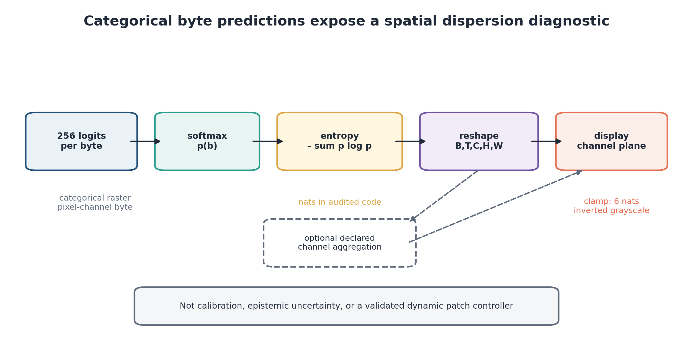

**Figure 2.24 - From categorical logits to a spatial entropy map.** Entropy is computed at each
pixel-channel byte, reshaped to raster coordinates, and only then visualized. The map represents
predictive dispersion; it is not a calibrated probability of error. Source: author's schematic of
the audited V-BLT evaluation path [9, 134].

High predictive entropy may arise because several pixel values are plausible, because the model is
poorly trained, because the input lacks context, or because the example differs from the training
distribution. Without calibration tests and a decomposition of epistemic and aleatoric effects,
the map should not be called calibrated uncertainty [44, 45]. Its defensible role here is a model-internal measure of categorical
dispersion and a candidate proxy for local information demand.

A controller would need more than a visually structured map. Calibration could be checked by
binning predicted byte probabilities or entropy values and measuring realized error; spatial
utility would require comparing allocations induced by entropy with random, motion-based, and
oracle policies at the same token budget. Temporal smoothing might also be necessary, because a
patch boundary that changes every frame introduces overhead and unstable token identities. None of
these controller tests is part of the fixed-patch study.

Channel reduction is a separate modelling decision. Taking the mean of RGB entropies emphasizes
broad ambiguity, while the maximum reacts to one uncertain channel and a luminance transform
changes the target space. The current evidence leaves byte-channel planes explicit. Any later
regioning experiment should declare its reduction before results are observed.

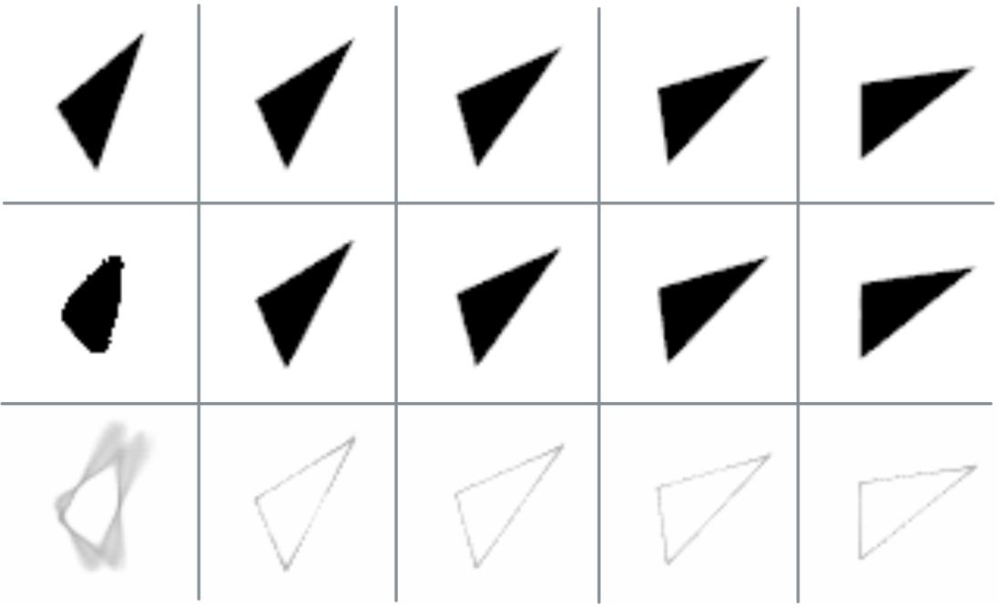

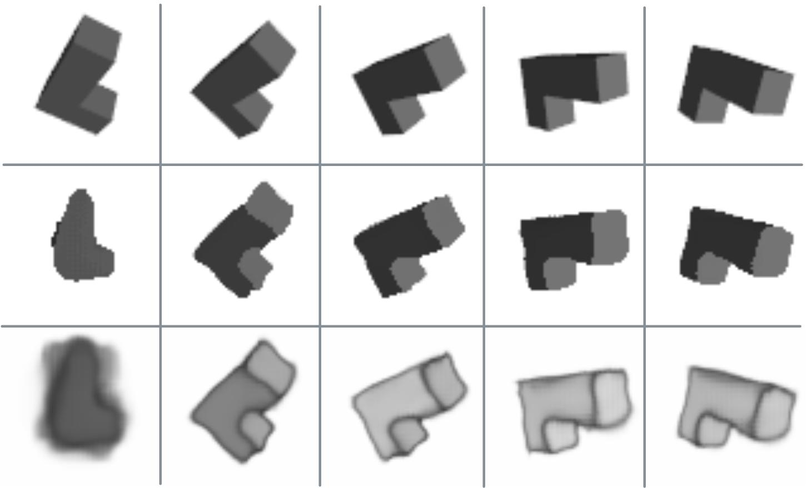

**Figure 2.25 - V-BLT predictions and entropy maps for two-dimensional and three-dimensional
rotation.** Each intact published panel contains ground truth, model predictions, and corresponding
entropy images. Darker regions concentrate around changing contours and newly exposed surfaces;
the first low-context predictions are also visibly weak. Source: Kulyk and Mokin, published Figures
7 and 8, reproduced without pixel modification [134].

The qualitative pattern supports a useful hypothesis. Static backgrounds are easy for the model,
while moving boundaries, occlusion transitions, and early predictions with insufficient context
produce more dispersed byte distributions. Yet the paper reports no quantitative correlation
between entropy and motion magnitude, prediction error, or an oracle allocation. Figure 2.25 is
therefore evidence that meaningful structure appears in the diagnostic, not evidence that an
entropy-driven controller improves compute-quality trade-offs.

### 2.3.6 Experimental results on two-dimensional and three-dimensional rotations

The fixed-patch V-BLT study compared V-BLT with ViViT and UNet-3D on the two procedural rotation
datasets. Model size and GFLOPs describe the reported computational configuration. MSE, SSIM, and
PSNR summarize prediction quality. All are point estimates; the paper gives neither training-seed
variation nor confidence intervals.

**Table 2.9 - Published V-BLT cost and quality point estimates**

| Evidence group | Dataset | Model | Model size (MB) | GFLOPs | MSE $\downarrow$ | SSIM $\uparrow$ | PSNR dB $\uparrow$ |
|---|---|---|---:|---:|---:|---:|---:|
| Computational | - | V-BLT | 6.5 | 51.2 | - | - | - |
|  | - | ViViT | 6.5 | 59.3 | - | - | - |
|  | - | UNet-3D | 24.0 | 70.4 | - | - | - |
| Quality | 2-D shapes | **V-BLT** | - | - | **0.039** | **0.98** | **32.3** |
|  | 2-D shapes | ViViT | - | - | 0.181 | 0.87 | 20.7 |
|  | 2-D shapes | UNet-3D | - | - | 0.125 | 0.88 | 21.8 |
| Quality | 3-D polycubes | V-BLT | - | - | **0.11** | **0.91** | 23.4 |
|  | 3-D polycubes | ViViT | - | - | 0.19 | 0.83 | **24.8** |
|  | 3-D polycubes | UNet-3D | - | - | 0.20 | 0.75 | 20.3 |

V-BLT uses $13.7\%$ fewer reported GFLOPs than ViViT and $27.3\%$ fewer than UNet-3D. The two
6.5 MB entries are equal reported model-size figures. The paper does not state enough about
serialization format or precision to infer identical parameter counts from them. GFLOPs likewise
do not measure latency, throughput, activation memory, or energy on a specific device.

The quality metrics ask different questions. For normalized rasters, frame MSE is commonly
$(CHW)^{-1}\sum_{c,y,x}(\widehat x-x)^2$, while PSNR is
$10\log_{10}(L^2/\mathrm{MSE})$ at peak value $L$. SSIM compares local means, variances, and
cross-covariance rather than only pointwise residuals [94, 127–129]. Values are
comparable across models only when normalization, spatial reduction, channel handling, and
frame/clip aggregation are identical. The paper gives final values but not the complete estimator
receipt.

On the two-dimensional data, V-BLT leads all three reported quality metrics. For the polycubes, it
has the lowest MSE and highest SSIM, while ViViT has the best PSNR, $24.8$ dB versus $23.4$ dB.
The PSNR inversion must remain visible. Because PSNR is ordinarily a monotone transformation of
per-image MSE at fixed dynamic range, a different ordering suggests that the published MSE and PSNR
may use different aggregation or normalization. The available evaluation source computes MSE by
averaging over batch and time and then summing spatial values unless a normalization flag is set,
whereas PSNR is averaged per frame. Without the exact run arguments, one should report the table as
published and avoid combining its metrics into a new scalar ranking.

What the comparison establishes is the viability of the complete V-BLT configuration, not causal
credit for one component. Relative to the baselines, local-global processing, the categorical byte
objective, RoPE-ND and other training details change together. Lower reported GFLOPs and favourable
two-dimensional metrics therefore support the system as tested; they do not isolate the positional
encoding or the byte interface. The mixed three-dimensional ranking is useful precisely because it
prevents configuration-level evidence from being recast as uniform metric dominance.

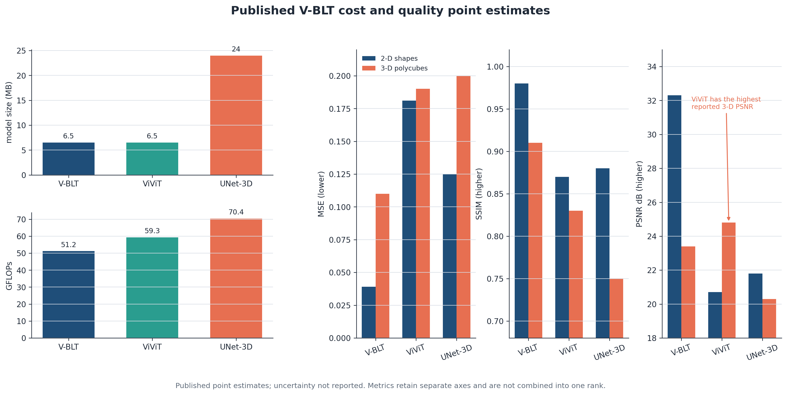

**Figure 2.26 - Published V-BLT cost and quality point estimates (derived).** The chart makes the
3-D ViViT PSNR lead visible and does not imply uncertainty that the source did not report.
Numeric source: published Tables 1 and 2 [134].

Qualitative evidence adds context to the averages. Both V-BLT sequences show a weak first
prediction, especially for the polycube, when the model has limited previous context. Later frames
recover the coarse object and concentrate entropy near changing boundaries. This behaviour is
directly relevant to the dissertation's larger argument: local representation can be efficient,
but no spatial encoder can recover temporal evidence that was never supplied. Chapter 3 isolates
that missing-history problem.

Experimental completeness is limited. The study reports no repeated training seeds, statistical
inference, real-video validation, component ablation, patch-size sweep, scaling law, entropy
calibration, measured entropy-error correlation, or declared qualitative selection rule. A further
configuration distinction emerged during source inspection. The paper specifies fixed
$4\times4\times4$ spatio-temporal patches, while the available public default configuration records
`tile_height: 4`, `tile_width: 4`, and a separate `model.patch_size: 5.0`; no tracked configuration
identifying the published temporal extent of four was located in that default. The public visionBLT
repository provides the implementation and executable configuration surface for reproduction
[173]. The dissertation therefore treats $4\times4\times4$ as the published experimental
specification and requires a reproducing run to override and archive that temporal extent explicitly;
the current default is not substituted for the reported setting.

### 2.3.7 Measured method versus proposed dynamic regioning

The fixed-patch study supports a clear set of claims. V-BLT demonstrates a hierarchical
local-global-local architecture over direct byte targets, fixed spatio-temporal patching, causal
global attention, RoPE-ND, categorical prediction, and spatially structured entropy maps. Each
item was either implemented or reported in that experiment.

Dynamic regioning is a next step. One possible policy would choose a partition
$\Pi_t=\{R_{t,1},\ldots,R_{t,m_t}\}$ under a token budget $B_t$ by minimizing expected predictive
loss plus computation:

$$
\Pi_t^{\star}
\in\arg\min_{\Pi_t:\,|\Pi_t|\le B_t}
\mathbb E\!\left[\mathcal L_{t+1}(\Pi_t)\right]
+\lambda C(\Pi_t),
\tag{2.35}
$$

with entropy used as one input to the policy. The experiment did not instantiate this optimization,
train a boundary predictor, vary patch sizes online, or measure its effect on speed and quality.
Equation (2.35) is consequently a design proposal, not the objective optimized by the reported
model.

**Figure 2.27 - Implemented V-BLT method and proposed adaptive extension.** The measured entropy
diagnostic motivates, but does not validate, variable patch allocation. Source: author's scope
clarification based on the published study and implementation audit.

The result is a measured diagnostic, not an adaptive controller. Direct categorical byte prediction
exposes a spatially resolved dispersion signal inside a hierarchical predictor, and that signal
suggests a testable allocation mechanism. Calibration, policy stability, allocation overhead, and
a controlled compute-quality benefit must be established before dynamic entropy regioning can be
treated as an operating system component.
An operational allocator must also preserve causal token identities as regions split or merge,
define comparable coordinates across region sizes, and count the controller itself in the resource
budget. These are experimental conditions, not incidental implementation details: each can change
the prediction problem or erase an apparent saving. They belong in the acceptance criteria of a
future adaptive-regioning study.

The first decisive experiment would be small: hold the global token budget, backbone, training
schedule, and evaluation clips fixed; compare regular support with one predeclared entropy policy
and a non-learned allocation baseline. Report both predictive metrics and measured runtime. Until
that comparison exists, adaptive regioning belongs in the design space rather than the list of
validated contributions.

## 2.4 Design implications for the hierarchical-context model

### 2.4.1 Results that transfer conceptually

The temporal and spatial methods do not form a serial architecture, yet three lessons carry into
the final model design. First, resource allocation should be expressed against the information the
task requires. TempVerseFormer removes a long activation tape only because the preceding state can
be reconstructed. V-BLT reduces the burden on a global processor by surrounding it with local
transformations, and its entropy maps show that predictive difficulty is spatially uneven in the
controlled examples. Both methods ask which values require expensive persistent representation.

Second, training memory and inference memory are different system variables. Reversible replay
acts on $M_{\mathrm{activations}}$ during differentiation. It does not enlarge the context available
to a deployed predictor. Conversely, retaining more historical states may improve reach at
inference without changing how a single training window is differentiated. For the complete memory
decomposition introduced in Chapter 1,

$$
M_{\mathrm{total}}
=M_{\mathrm{parameters}}+M_{\mathrm{optimizer}}
+M_{\mathrm{activations}}+M_{\mathrm{context/state}}+M_{\mathrm{transient}},
\tag{2.36}
$$

the reversible method targets the third term, while Chapter 3 will intervene in the fourth. This
is the coarse dissertation-level partition used in Chapter 1: parameter-associated training state
includes parameter gradients, while transient memory includes input batches and allocator or
kernel workspace. Equation (2.5a) exposes those grouped quantities separately when profiling an
actual training run. The measured savings are therefore complementary in principle but separately
established. They cannot be multiplied into an end-to-end saving without a joint implementation
and measurement.

Coordinate structure supplies the third lesson. V-BLT shows why time, row, and column should not be
silently collapsed into one index when token geometry changes. Chapter 3 does not adopt RoPE-ND,
but it makes level, frame, role, and anchor geometry explicit through its own embeddings and stream
construction. The transferred principle is explicit geometry, not a claim of shared weights or an
inherited positional module.

One possible future architecture could combine the interfaces: entropy-informed spatial regions
would produce variable visual tokens, a hierarchical context manager would decide which tokens
remain available across time, and reversible blocks could support differentiation through a longer
self-fed rollout. Such a design is coherent, but it would be a new model. It would need common
datasets, matched budgets, ablations of each interface, and an end-to-end resource audit. None of
those joint results is inferred here.

The transfer test used in this dissertation has three questions. Does a result identify a general
constraint, or only a source architecture? Is the receiving model's interface actually compatible
with the method? Has the transferred component been executed and measured under the receiving
model's objective? Activation/context separation and explicit coordinate semantics pass the first
question as design principles. TempVerseFormer blocks and V-BLT tokens do not pass the third for
the Chapter 3 predictor. This simple test prevents conceptual continuity from being mistaken for
experimental integration.

### 2.4.2 Components not executed in Chapter 3

Table 2.10 records the integration status once so later chapters can describe the final predictor
directly. "Possible interface" indicates an engineering location, not a demonstrated benefit.

**Table 2.10 - Validated methods, possible interfaces, and integration status**

| Method or result | Bottleneck addressed | Validated result | Possible interface to a future integrated system | Status in the Chapter 3 predictor |
|---|---|---|---|---|
| Reversible transformer coupling | Layer and temporal-core activation storage | Algebraic state reconstruction; published near-constant temporal-core memory | Replace a deep transition whose activation history binds | Not used |
| Time-agnostic reverse replay | Long differentiated temporal chain | Full reverse-mode traversal with local graph rebuilding; separate deterministic multi-level gradient-direction and memory/runtime checks | Train through a longer self-fed recurrence | Not used; Chapter 3 trains clean individual windows |
| Stochastic store-the-noise extension | Replay of stochastic recurrent transitions | Single-stage, 40-step reconstruction check with correct versus wrong conditioning; explicit metadata accounting; no stochastic multi-level gradient or memory frontier | Replay stochastic latent innovations during long-rollout training | Not used |
| V-BLT local-global-local representation | Uniform expensive processing of raster bytes | Competitive fixed-patch prediction and lower reported GFLOPs in controlled rotations | Produce compact local/global visual tokens before context storage | Not used; Chapter 3 has a separate frozen two-level codec |
| RoPE-ND | Loss of explicit multi-axis coordinates after flattening | Verified axis-disjoint positional transform | Encode physical coordinates for variable-resolution tokens | Not used; learned level/role/frame embeddings are used |
| Predictive byte entropy | Lack of a local model-internal complexity signal | Structured entropy maps in controlled sequences | Input to a future spatial allocation controller | Entropy controller not implemented |
| Dynamic entropy regioning | Content-adaptive spatial computation | No end-to-end result in the reported study | Select variable patch support under a budget | Proposed future work only |

This table also explains why adding familiar module names to the Chapter 3 architecture would make
the dissertation weaker rather than stronger. It would turn separately measured methods into an
unmeasured composite and obscure which experiment supports which claim.

### 2.4.3 Chapter conclusions and transition

The first method in this chapter addresses the activation cost of temporal learning. A reversible
transformer block uses triangular additive coupling, so its two input streams can be recovered from
its outputs without inverting either attention or the MLP. When the block stack is repeated through
time, reverse replay reconstructs one preceding state, rebuilds one local differentiation graph,
accumulates its gradient, and releases the graph. Under the stated deterministic conditions, the
transient recurrent-core activation term is $O(1)$ in temporal depth rather than $O(T)$.

Implementation inspection narrows that result to the correct state. TempVerseFormer's VAE, input
projection, stream duplication, output fusion, and image loss are not jointly invertible. The
repeated doubled transformer state is. This boundary is sufficient to explain the published memory
curve: temporal-model memory remains near $0.89$ GB at the tabulated 1-, 4-, and 16-step points,
while the matched non-reversible transformer reaches $2.61$ GB at 16 steps. Runtime rises because
reconstruction repeats computation. Predictive results are also mixed. TempVerseFormer leads all
reported metrics for constant and interrupted rotations and remains competitive elsewhere, but
TempFormer or LSTM leads several variable-motion endpoints. OpenSTL provides competence evidence,
including the lowest reported TaxiBJ MSE in that comparison, not a universal benchmark win.

The dissertation extensions make two replay requirements explicit without conflating their
receipts. A single-stage stochastic check reconstructs a 40-step trajectory only when the realized
conditioning is retained or reproducibly regenerated. Separately, a deterministic multi-level
check establishes reverse-gradient directional agreement with BPTT, and the deterministic
recurrent-core memory experiment reaches $K=160$ at approximately $1.18$ GB where vanilla BPTT
fails at $K=120$, while checkpointing also remains feasible. A separate inner-loop experiment
shows the other side of the decision:
when trajectory states constitute only $0.28\%$ of peak memory, reversibility saves almost nothing
and costs time. Invertibility is therefore an enabling storage property, not a general stability or
speed guarantee.

The second method addresses visual representation. V-BLT processes raster pixel-channel bytes
through a local encoder, a causal global latent transformer, and a local decoder with a 256-way
categorical output. RoPE-ND assigns disjoint feature subspaces to time, row, and column coordinates,
making relative displacement explicit after flattening. The fixed-patch experiments report lower
GFLOPs than the selected ViViT and UNet-3D baselines and strong MSE/SSIM results on controlled
rotations. ViViT retains the best three-dimensional PSNR, and the absence of seed uncertainty,
ablation, scaling, and exact run receipts limits the strength of model-ranking claims.

Per-byte entropy is the most useful bridge from that experiment to resource allocation. It
concentrates around changing contours, occlusions, and low-context predictions in the published
examples. Still, entropy maps were observed, not used to drive variable patch sizes. The measured
model used the paper's fixed $4\times4\times4$ specification; dynamic entropy-guided regioning
remains a proposal whose computational and predictive benefit has not been tested.

Chapter 2 therefore contributes two independent resource-aware capabilities and their operating
boundaries. One reconstructs intermediate computation to control activation storage. The other
organizes local and global visual processing and exposes a candidate spatial-complexity signal.
Neither capability answers the remaining question: after training is complete and predictions feed
back into the model, which past observations are still accessible when an object or event returns?
Chapter 3 isolates that retained-context problem and constructs competing flat, temporally sampled,
and spatially hierarchical memory packages under fixed budgets.

---

# Chapter 3 — Hierarchical Context Model for Long-Horizon Video Prediction

Chapter 2 addressed two constraints that arise before long-range performance can even be tested: activation storage during temporal differentiation and the spatial allocation of representational capacity. It left a different question unresolved. Which observations remain available once prediction proceeds far beyond the initial input? That question belongs to inference state. A model may be trainable, spatially expressive and locally accurate, yet still fail when evidence for a re-entering object has already left its context window.

Retained context is therefore the controlled variable of Chapter 3. Historical observations may differ in spatial resolution, temporal rate and recency, while a common predictor consumes every package through one joint-attention sequence. The central implementation keeps a long coarse history and a short fine-resolution tail; flat dense history and temporally sparse fine-resolution history serve as controls in the same vocabulary. *Reach* and *fidelity* describe consequences of the supplied package, not separately trained modules. Its package intervention and experimental programme are documented in [136].

Architecturally, the isolation is equally explicit. The final predictor contains neither the reversible temporal model nor V-BLT and RoPE-ND, which operate at other system interfaces. Its representation is a frozen two-level continuous codec, its prediction core is a windowed diffusion transformer or regression control, and its fixed-size context buffers are updated with the model's own outputs. This separation permits an observed effect to be assigned to retained context without suggesting that the dissertation validated one jointly trained end-to-end architecture.

An explicit package still cannot identify its own memory mechanism. The second half of the chapter therefore builds an instrument in which scene geometry determines the relevant history before model output is examined. LoopMom moves a viewport over a toroidal world, allowing an object to disappear and return after a shorter package has forgotten it. Complete frame and object endpoints protect the comparison against sparse-background and survivor-selection artefacts; paired clip-cluster inference respects dependence among frames from the same self-fed rollout. Chapter 4 reports the outcomes. Here the task is to fix what is compared, what is measured and what each comparison can establish.

## 3.1 Retained context as the final model problem

### 3.1.1 From consistency requirements to memory reach

Long-horizon consistency requires more than a plausible continuation of the latest frame. Consider a digit or textured object that moves beyond the viewport. While it remains absent, several visually reasonable worlds are compatible with the current observation. When it returns, however, its position, extent and identity can be constrained by an earlier view. If that view is still available, the task is retrieval-conditioned prediction. Once it has left memory, the same target becomes a prior-driven guess.

Benchmark design can conceal this difference. A short sequence may keep every relevant object continuously visible, while a full-frame average rewards a model that reproduces the background and omits the object. A recurrent state can persist nominally for hundreds of steps after its recoverable content has faded. Conversely, the required observation may remain in storage but be inaccessible to the predictor. Three claims must therefore remain separate: historical evidence was stored; the current predictor could address it; and self-fed generation reused it reliably. Explicit context construction controls the first two. Reliable reuse remains an empirical question.

Re-entry becomes decisive after the relevant appearance has left a dense fine-resolution window. A flat model can lengthen that window, but each additional fine frame has a fixed token cost. A multiresolution package instead keeps many older frames at lower spatial resolution and reserves detailed tokens for the recent past. The coarse history may then contain evidence that a token-matched flat window cannot reach. Compression also removes information, so mere inclusion does not guarantee a better prediction. The model must be tested where missing history and lost detail impose competing limitations.

**Figure 3.1 — Re-entry after the determining appearance leaves a dense context window.** The target object is absent from the recent fine history but remains represented in the longer package. The diagram defines a memory-relevant event; it does not assert that coarse representation preserves enough information to solve it. *Source: dissertation-native conceptual schematic based on the LoopMom geometry specified in Section 3.5.*

Sequence length by itself says little about this mechanism. The relevant variable is *addressable historical reach*: the oldest evidence that can enter the current prediction under a declared package and anchor rule. Reach belongs to the supplied interface, not to a model name, recurrent-state duration or nominal clip length. Accordingly, every stream is specified by its level, temporal spacing, retained slots and exact anchors before a comparison is called matched.

### 3.1.2 Context-package design space

Let $t$ denote the first frame of the target window. A context package at that boundary is a finite set of streams

$$
\mathcal P_t=\left\{\mathcal S_i\right\}_{i=1}^{L},
\qquad
\mathcal S_i=(\ell_i,s_i,n_i,a_i),
\tag{3.1}
$$

where $\ell_i$ identifies the representation level, $s_i$ is the temporal stride, $n_i$ is the retained slot count, and $a_i\ge 1$ is the lag of the most recent anchor. For a regular stream, the lag and frame-index sets are

$$
K_i=\{a_i+j s_i\mid j=0,\ldots,n_i-1\},
\qquad
A_i(t)=\{t-k\mid k\in K_i\}.
\tag{3.2}
$$

Calling a package “48 frames of context” is not precise enough. Two streams can contain the same number of slots yet sample different historical positions. Likewise, two packages can have the same oldest lag while retaining different events between the oldest and newest anchors. Irregular packages are represented by storing $A_i(t)$ directly; the regular tuple in (3.1) is only a compact special case. This formulation prevents anchor geometry from being hard-coded around one temporal stride.

If level $\ell$ has spatial dimensions $H_\ell\times W_\ell$, one frame at that level contributes $q_\ell=H_\ell W_\ell$ tokens. Context cost is then

$$
B_{\mathrm{ctx}}(\mathcal P_t)=\sum_{i=1}^{L}n_i q_{\ell_i}.
\tag{3.3}
$$

The target interface is counted separately. If target level $j$ contains $m_j$ slots, then

$$
B_{\mathrm{tgt}}=\sum_j m_jq_j,
\qquad
B_{\mathrm{total}}=B_{\mathrm{ctx}}+B_{\mathrm{tgt}}.
\tag{3.4}
$$

Each quantity answers a different question. Context tokens measure retained state available to the prediction step; target tokens count the unknown latent cells estimated together; total tokens set the transformer sequence length and therefore affect training and inference work. Context efficiency alone cannot establish end-to-end memory, runtime or attention cost.

For regular streams, the oldest supplied lag gives the package reach

$$
R(\mathcal P_t)=\max_i\max K_i
=\max_i\bigl[a_i+(n_i-1)s_i\bigr].
\tag{3.5}
$$

Reach is nominal: it records the oldest supplied slot, while saying nothing about whether its contents are sufficient or actually used. The exact anchor set remains the primary definition for implemented packages; $R$ is a compact summary used to derive comparison-specific populations. In the executed dense hierarchical packages, the coarse stream covers the 48 immediately preceding frame positions. The temporally sparse control combines recent fine frames with older full-resolution anchors. Its registered “48-frame” label denotes the intended operating-span class, while configuration validation relies on the recorded anchors themselves.

**Figure 3.2 — Three ways to package retained video context.** A dense flat package preserves full spatial detail at every retained time; a spatial hierarchy keeps long coarse history plus a recent fine tail; a temporally sparse package keeps selected full-resolution anchors plus the same recent tail. The 1,088-token temporal package is near-matched to the 1,152-token spatial package, not token-identical. All values refer to context tokens; target tokens are counted separately. *Source: author-generated schematic from the frozen package registry and predictor interface.*

Table 3.1 fixes the semantics used throughout the model and results chapters. “Level” names a representation without presuming semantic abstraction; “stride” names anchor spacing without implying that a token summarizes the intervening motion. In particular, a full-resolution anchor stored every four frames differs from a coarse token observed at every frame. Both extend temporal access, but they discard different information.

**Table 3.1 — Context-package fields and their interpretation.**

| Field | Symbol | Operational meaning | What it does not imply |
|---|---:|---|---|
| Representation level | $\ell_i$ | Frozen codec level and its spatial token grid | Semantic correctness or guaranteed cross-level agreement |
| Temporal stride | $s_i$ | Spacing between regular stream anchors | Temporal averaging, unless the encoder explicitly performs it |
| Retained slots | $n_i$ | Number of stored latent maps in the stream | Equal payload across levels |
| Most recent anchor lag | $a_i$ | Distance from the first target to the newest stored anchor | That all intervening frames are present |
| Anchor set | $A_i(t)$ | Exact historical frames represented by the stream | Successful retrieval from those frames |
| Tokens per slot | $q_{\ell_i}$ | Number of spatial cells at the selected level | Bytes, transformer width or full activation memory |
| Context cost | $B_{\mathrm{ctx}}$ | Sum of stored context tokens | Total sequence length or equal computation |
| Addressable reach | $R$ | Oldest supplied lag under the package geometry | Fidelity, information-theoretic necessity or reliable reuse |

One package vocabulary encompasses several experimental families without turning them into an undifferentiated hierarchy. A single fine stream at stride one is flat dense context. Coarse and fine streams with different spatial grids form a resolution hierarchy. Two fine streams at different temporal rates form temporal packaging without spatial hierarchy. A third codec level increases spatial depth. Those variants share a formal interface, but only declared pairs receive a matched or near-matched comparison licence in Chapter 4.

### 3.1.3 Reach–fidelity hypothesis

Once packages are explicit, the central prediction can be stated without assuming that hierarchy is generally better. Let $Z_t^\star$ be the historical evidence relevant to a target at time $t$, and let $I_t(\mathcal P)$ indicate whether that evidence lies inside the supplied anchors. Let $Q_t(\mathcal P)$ denote the task-relevant information retained after encoding and packaging. The expected error can be organized conceptually as

$$
\mathcal R(\mathcal P)
=\mathbb E\!\left[
\mathcal L\mid I_t(\mathcal P)=0
\right]\Pr[I_t(\mathcal P)=0]
+\mathbb E\!\left[
\mathcal L\mid I_t(\mathcal P)=1,Q_t(\mathcal P)
\right]\Pr[I_t(\mathcal P)=1].
\tag{3.6}
$$

Equation (3.6) is an explanatory decomposition, not a fitted probabilistic model. Missing historical access drives the first term. The second contains representation loss, model error and self-fed degradation after the relevant past is nominally available. Increasing reach can reduce the first term. Preserving spatial detail can reduce part of the second. Neither change is guaranteed to dominate across all tasks.

Several predicted operating regions follow. When a flat window ends before the relevant event but a coarse stream includes it, hierarchy should gain most strongly on records between the two reaches. Once both packages include the event, the advantage may narrow because coarse encoding no longer buys unique access. If identity or fine appearance is decisive, a full-resolution package may recover the advantage even at the same token budget. Temporal subsampling creates a third possibility: it can preserve fine appearance at selected times while omitting changes between anchors.

**Figure 3.3 — Reach and fidelity are separate properties of a context package.** Moving right can include older evidence; moving upward can preserve more task-relevant detail. The relevant-past threshold is defined by a task event, whereas package ordering above that threshold depends on what information the endpoint requires. *Source: dissertation-native conceptual diagram; no empirical crossing is implied.*

These predictions determine what Chapter 4 must show. A positive aggregate effect supports a reach claim only if it concentrates where the longer package alone can address the relevant past. A flat advantage at a larger budget remains compatible with the hypothesis when both packages reach the event and the endpoint rewards fine information. The experiment searches for operating regions among sampled configurations; it never interpolates a universal frontier between them.

## 3.2 Hierarchical latent state

### 3.2.1 Two-level frozen autoencoder

Package arithmetic becomes meaningful only after the representation levels are fixed. The implemented packages operate in a continuous latent space produced by a convolutional autoencoder. For an input frame $x_t\in[-1,1]^{1\times64\times64}$, a shared encoder trunk produces an $8\times8$ feature map. One $1\times1$ projection gives the fine code; a further stride-two encoder stage followed by another projection gives the coarse code:

$$
\mathcal E(x_t)=\left(z_t^{\mathrm c},z_t^{\mathrm f}\right),
\qquad
z_t^{\mathrm c}\in[-1,1]^{16\times4\times4},
\qquad
z_t^{\mathrm f}\in[-1,1]^{16\times8\times8}.
\tag{3.7}
$$

Both projections use a hyperbolic tangent, so the raw latent coordinates are bounded. A coarse frame contains $16\times4\times4=256$ coefficients arranged as 16 spatial tokens; a fine frame contains $16\times8\times8=1{,}024$ coefficients arranged as 64 tokens. The fourfold token ratio is the arithmetic basis for retaining a longer coarse history under a fixed context budget. It does not establish that the coarse code is four times less informative in any general sense.

Each level has its own decoder to the full image:

$$
\hat x_t^{\mathrm c}=\mathcal D_{\mathrm c}(z_t^{\mathrm c}),
\qquad
\hat x_t^{\mathrm f}=\mathcal D_{\mathrm f}(z_t^{\mathrm f}).
\tag{3.8}
$$

Independent decodability prevents the coarse level from being only a residual that is meaningless without the fine code. During codec training, one branch is selected at each update. The selected reconstruction uses an $L_1$ plus mean-squared error, and the coarse branch is multiplied by four so that optimization cannot ignore the lower-token pathway:

$$
\mathcal L_{\mathrm{AE}}=
\begin{cases}
4\bigl(\operatorname{MAE}(x,\hat x^{\mathrm c})+
\operatorname{MSE}(x,\hat x^{\mathrm c})\bigr), & b=\mathrm c,\\[2mm]
\operatorname{MAE}(x,\hat x^{\mathrm f})+
\operatorname{MSE}(x,\hat x^{\mathrm f}), & b=\mathrm f,
\end{cases}
\qquad \Pr(b=\mathrm c)=\Pr(b=\mathrm f)=\tfrac12.
\tag{3.9}
$$

The objective encourages both levels to reconstruct the entire frame. Terms such as “layout” and “detail” summarize their resolution difference; they are not supervised semantic labels. A coarse code may preserve identity information, and a fine code may encode global position. Their actual division of labour is an empirical property that later object-sensitive endpoints can expose.

After codec training, all encoder and decoder parameters are frozen. The predictor therefore receives a fixed coordinate system, and compared packages cannot improve by changing their representation during predictor training. Freezing also prevents pixel-space evaluation losses from leaking into the predictive model. Every decoded comparison uses the same fine decoder within a codec condition; the independently trained codec study later changes the whole frozen interface as a robustness intervention.

Raw latent channels have unequal scales. Diffusion noise would be miscalibrated if unit Gaussian noise were applied directly to coordinates whose standard deviation is much smaller than one. For each level and channel, training-set statistics are therefore fixed and applied to all later splits:

$$
\tilde z_t^{\ell}[c]=
\frac{z_t^{\ell}[c]-\mu_c^{\ell}}
{\max(\sigma_c^{\ell},10^{-4})},
\qquad \ell\in\{\mathrm c,\mathrm f\}.
\tag{3.10}
$$

Only training clips contribute to $\mu_c^{\ell}$ and $\sigma_c^{\ell}$. Held-out and protected populations reuse those constants. Before decoding, a predicted fine code is unstandardized with the matching codec statistics and passed through $\mathcal D_{\mathrm f}$. Normalization is therefore part of the frozen model interface and is applied identically during evaluation.

**Figure 3.4 — Frozen two-level codec and latent tensor dimensions.** Both levels are independently decodable, but they allocate spatial tokens differently: 64 fine cells and 16 coarse cells per frame. Predictor gradients stop at the standardized latent interface. *Source: dissertation-native schematic of the implemented `HierConvAE` architecture.*

**Table 3.2 — Frozen latent-interface specification.**

| Property | Coarse level | Fine level | Consequence for the predictor |
|---|---:|---:|---|
| Latent shape per frame | $16\times4\times4$ | $16\times8\times8$ | Same channel width, different spatial grid |
| Spatial tokens per frame | 16 | 64 | Fine history costs four times as many context tokens per frame |
| Scalar coefficients per frame | 256 | 1,024 | Payload differs even before projection to transformer width |
| Pixel decoder | Independent coarse decoder | Independent fine decoder | Either code can be inspected as a full-frame reconstruction |
| Predictor input scaling | Per-channel training-set z-score | Per-channel training-set z-score | Noise scale and level-wise losses use comparable standardized coordinates |
| Training after codec freeze | None | None | Package comparisons cannot move the latent interface |
| Primary rollout rendering | Diagnostic only | Frozen fine decoder | Main frame metrics share one output path |

The codec is deliberately compact and task-specific, and its grayscale $64\times64$ operating point limits external validity. For the controlled question, however, it supplies two stable, independently interpretable token rates over the same observations. A more elaborate hierarchical codec could change compression loss and model capacity together, making the package mechanism harder to isolate.

### 3.2.2 Stream construction and embeddings

A latent map becomes a token sequence by treating each spatial cell as one token. If $z_{t,h,w}^{\ell}\in\mathbb R^{16}$ is the channel vector at level $\ell$ and spatial position $(h,w)$, the shared content projection is

$$
e_{t,h,w}^{\ell}=W_{\mathrm{in}}z_{t,h,w}^{\ell}+b_{\mathrm{in}}+p_{h,w}^{\ell},
\qquad e_{t,h,w}^{\ell}\in\mathbb R^d,
\tag{3.11}
$$

where $p_{h,w}^{\ell}$ is a learned level-specific spatial embedding. The same linear map $W_{\mathrm{in}}$ projects the 16 codec channels at both resolutions, while separate positional tables account for the $4\times4$ and $8\times8$ grids. The resulting coordinate interface is fixed-grid and learned directly at the two implemented resolutions.

For a package $\mathcal P_t$ and a target window of $W$ frames, tokenization yields one ordered sequence

$$
S_t=
\mathop{\Vert}_{i=1}^{L}
\mathop{\Vert}_{k\in K_i}
\operatorname{Tok}_{\ell_i}(\tilde z_{t-k}^{\ell_i})
\;\Vert\;
\mathop{\Vert}_{j=0}^{W-1}
\left[
\operatorname{Tok}_{\mathrm c}(y_{t+j}^{\mathrm c})
\Vert
\operatorname{Tok}_{\mathrm f}(y_{t+j}^{\mathrm f})
\right].
\tag{3.12}
$$

Here $y$ denotes a noisy target latent during diffusion and a zero placeholder under the regression control. The stream order is deterministic: optional top-level context, coarse context, older fine anchors, recent fine context and then target groups. Ordering alone does not carry all identity information. Every token also receives learned level, role and frame-index embeddings:

$$
h^{(0)}_r=e_r+e_{\mathrm{level}}(\ell_r)+e_{\mathrm{role}}(r_r)
+e_{\mathrm{frame}}(f_r),
\qquad r_r\in\{\mathrm{context},\mathrm{target}\}.
\tag{3.13}
$$

Frame indices are expressed in the local coordinate system of the current prediction step. Under the main 48-frame package, context positions occupy the historical range and four target frames receive the next four indices. The same indexing convention is rebuilt at every rollout step. Its table therefore remains fixed in size as the absolute video time increases. Such re-indexing is useful operationally, though it should not be mistaken for strict temporal translation equivariance.

Arithmetic becomes concrete for the standard $48$-coarse plus $6$-fine configuration. Coarse history contributes $48\times16=768$ tokens. The recent fine tail contributes $6\times64=384$. Four targets contain $16+64=80$ tokens each. Thus

$$
|S_t|=
\underbrace{768+384}_{B_{\mathrm{ctx}}=1{,}152}
+\underbrace{4(16+64)}_{B_{\mathrm{tgt}}=320}
=1{,}472.
\tag{3.14}
$$

The six fine context frames refer to the same six most recent times already represented in the coarse stream. Their purpose is not to add six units of temporal reach. They enrich the recent end of a long, low-token history. A flat 18-frame control replaces both context streams with 18 consecutive fine maps, which also cost 1,152 context tokens. Target groups remain coarse plus fine in both arms, so the central dense comparisons preserve the 320-token target interface.

**Figure 3.5 — Token assembly before joint attention.** The standard spatial package contains 768 coarse-context tokens, 384 recent fine-context tokens and 320 target tokens. Content projection, identity embeddings and adaptive-normalization conditioning are distinct additions. The target interface is fixed for the main 896-, 1,152-, 1,792-, 2,432- and 3,072-token comparisons. *Source: author-generated diagram from the implemented tokenization path.*

Noise and action information are applied through a second, per-token conditioning path. Let $e_\tau(\tau)$ be the sinusoidal-MLP diffusion-time embedding and $e_a(u)$ the learned embedding of an action $u\in\{-1,0,+1\}$. The conditioning vector for token $r$ is

$$
c_r=e_{\mathrm{level}}(\ell_r)+e_{\mathrm{role}}(r_r)+e_{\mathrm{frame}}(f_r)
+
\begin{cases}
e_\tau(0), & r_r=\mathrm{context},\\
e_\tau(\tau)+e_a(u_{t+j}), & r_r=\mathrm{target\ at\ frame}\ t+j.
\end{cases}
\tag{3.15}
$$

Context is clean evidence and is marked with diffusion time zero. Each target frame receives the action that moves the process into that frame. In stride-reduced target configurations, the actions inside a represented temporal block are summed in embedding space. That interface co-changes with coarse target stride and is why the stride-2 B1 study is interpreted as a whole-configuration comparison, not a pure context-stride intervention. The main dense frontier avoids this issue by keeping four coarse and four fine target slots.

Padding is unnecessary in the registered two-level arms because every stream length is fixed by its package. Consequently, a token's role and frame label cannot be inferred from a padding convention or an attention mask. They are explicit inputs. This becomes important when the same backbone is reused across package families: a fine token at lag 47 in the sparse stream and a fine token at lag 6 in the recent tail share the content projection, but their frame embeddings differ. The predictor can therefore learn that two equally detailed observations have different temporal relevance without assigning them different channel semantics.

### 3.2.3 Joint-attention context transfer

Coarse and fine tokens are processed together in one transformer sequence. At no point is a coarse prediction completed and handed to a separate fine stage: coarse context, fine context, noisy coarse targets and noisy fine targets coexist in every block. Each layer can therefore transfer information across levels and roles before either output head is read.

For hidden states $H\in\mathbb R^{B\times S\times d}$, one attention head computes

$$
Q=\operatorname{RMSNorm}(HW_Q),\quad
K=\operatorname{RMSNorm}(HW_K),\quad
V=HW_V,
\qquad
\operatorname{Attn}(H)=
\operatorname{softmax}\!\left(\frac{QK^\top}{\sqrt{d_h}}\right)V.
\tag{3.16}
$$

Queries and keys are normalized per head before scaled dot-product attention [161]. Multiple heads are concatenated and projected in the usual way [12]. Crucially, attention inside the current four-frame prediction step is full. There is no triangular mask that forces target frame $t+1$ to be generated before $t+2$, nor a parent–child mask that restricts fine cells to a predefined coarse cell. The predictor learns cross-level and within-window dependencies from token identity, conditioning and data.

In one operation, the full matrix permits four classes of exchange: context-to-target retrieval, coarse-to-fine transfer, fine-to-coarse correction and interaction among target positions. The first two are central to the memory hypothesis. A fine target cell can attend to an old coarse observation even though no fine observation was retained at that time; the same target can use recent fine tokens for local appearance. Conversely, a coarse target may use recent fine evidence before being committed to the long buffer. Because no head or layer is assigned a retrieval role in advance, attention weights alone cannot prove that retrieval occurred.

Causality is enforced at a different scale. At rollout step $n$, the sequence contains only context from completed steps and the current target block. A future block has not yet been instantiated. The effective relation over rollout blocks is

$$
M^{\mathrm{roll}}_{nm}=
\begin{cases}
0, & m\le n,\\
-\infty, & m>n,
\end{cases}
\tag{3.17}
$$

where $m$ indexes a block that could supply information to block $n$. Equation (3.17) describes structural causality across the unrolled system. Individual WindowDiT layers receive no corresponding block mask: within block $n$, all context and target tokens can attend to one another. Across blocks, generated values move forward only through the context buffers defined in Section 3.4.

Joint denoising still exposes only corrupted target candidates. Every target token supplied to a diffusion call belongs to the current noisy block; under regression, the corresponding position is zero. Clean target latents appear solely on the loss side during training, so the ground-truth value of a later frame is never available as context for an earlier one. The four candidates are coordinated simultaneously while all observed information remains past-conditioned. Calling this interface “non-causal within block” would therefore be misleading.

**Figure 3.6 — Joint attention within a prediction block and structural causality across blocks.** Cross-level transfer is learned through full attention over one token sequence. Temporal causality arises because later blocks do not exist until earlier predictions have been committed to the buffers. *Source: dissertation-native schematic verified against the implemented `WindowDiT` forward path.*

Joint attention provides an information path, not a consistency guarantee. A fine target can use long coarse evidence or ignore it, and coarse and fine outputs may disagree after decoding. Nor is one coarse cell hard-wired to four fine cells. Leaving that correspondence learned avoids a potentially incorrect geometric routing rule and places the burden of proof on the cross-level and object-sensitive evaluation in Chapter 4.

Hard routing is absent, and that has a cost. Attention scales with the square of the complete token sequence, and the model must learn level alignment from fixed positional tables and data. A hand-designed local map would be cheaper, but it would also pre-commit the experiment to a particular spatial correspondence. For the controlled package study, unrestricted transfer is preferable because it leaves historical availability—not an engineered parent–child connection—as the intended intervention. Section 3.4.3 reports the resulting sequence-length cost explicitly.

Package design, rather than transformer wiring, creates the asymmetry. A hierarchical arm supplies old observations only at the coarse level and recent observations at both levels. A flat arm supplies the selected history at fine resolution but retains the same coarse and fine target heads. Consequently, an effect can be interpreted as a property of what historical information was packaged, subject to the remaining codec and optimization qualifications. It cannot be described as evidence for a two-stage coarse-to-fine execution because that architecture was not run.

### 3.2.4 Gradient boundaries and information asymmetry

Three boundaries determine which quantities can change during predictor training. Codec parameters are fixed; context latents are detached observations; and the training graph ends at the current target window. If $\theta$ denotes predictor parameters and $\phi$ denotes codec parameters, then

$$
\nabla_\phi\mathcal L_{\mathrm{pred}}=0,
\qquad
\frac{\partial\mathcal L_{n}}{\partial \hat z_{m}}=0
\quad\text{for }m<n,
\qquad
\nabla_\theta\mathcal L_n\ne0.
\tag{3.18}
$$

The second equality states the single-window credit-assignment rule. During training, contexts are ground-truth latents sampled from the dataset and treated as constants. During evaluation, previously generated latents occupy the buffers, but sampling runs without a gradient graph. The model is therefore exposed to self-fed values only at evaluation in the base protocol. Its long reach is an inference-time state-design property, not the consequence of backpropagating a loss through 152 predicted frames.

Trainable quantities include the shared latent projection, spatial tables, level/role/frame embeddings, action and diffusion-time encoders, adaptive-normalization modules, attention and MLP weights, and the level-specific output heads. The frozen set includes both codec branches and their channel statistics.

Decoded-pixel losses and auxiliary coarse-decoder teaching are absent from predictor training. Consequently, a package with more coarse slots cannot receive a different reconstruction-training signal merely because it exposes that pathway more often.

**Figure 3.7 — Frozen, detached and trainable paths.** Predictor gradients update token projections, embeddings, transformer blocks and output heads. They do not update the codec or propagate across autoregressive windows. *Source: dissertation-native schematic of the implemented optimization graph.*

These boundaries make the package comparison cleaner, but they leave exposure bias intact [25, 26]. A longer package can gradually fill with corrupted self-generated values, so reliable operation must be tested under self-fed rollout and across training seeds. A future multi-window objective could use checkpointing or the reversible replay method of Chapter 2 to control activation storage. Such integration remains future work and contributes no evidence to the present model study.

The same controls narrow the diagnosis of late degradation. With codec adaptation disabled and no gradient crossing rollout windows, failure belongs to the declared package, frozen representation and single-window-trained predictor under repeated self-feeding. Chapter 4 carries that interpretation into every verdict; it cannot identify which untested training intervention might have prevented the error.

## 3.3 Generative prediction core

### 3.3.1 Windowed latent-diffusion objective

With the package and latent interface fixed, the remaining model problem is to predict the next window. The predictor estimates a block of consecutive future latents conditioned on packaged history and recorded controls. With $W=4$, its conditional law is

$$
p_\theta\!\left(
z^{\mathrm c}_{t:t+W-1},z^{\mathrm f}_{t:t+W-1}
\mid \mathcal P_t,u_{t:t+W-1}
\right).
\tag{3.19}
$$

Four-frame windows solve an interface problem. If training predicted only a distant single frame while rollout appended all intervening predictions, training and evaluation would present different temporal layouts. Here the model predicts frames $t$ through $t+3$ together and the rollout advances by four. Buffer shapes and local frame indices therefore agree between training and evaluation. Their values do not: clean ground-truth context is used for training, whereas later rollout steps consume self-generated latents.

Let $z_0=(z_0^{\mathrm c},z_0^{\mathrm f})$ denote a standardized clean target block. A diffusion index $\tau$ is sampled uniformly from $\{1,\ldots,T\}$ with $T=1000$, and one Gaussian-noise realization is drawn for each level. The same $\tau$ is used across the four frames and both levels in a sample:

$$
y_\tau^{\ell}=\alpha_\tau z_0^{\ell}+\sigma_\tau\varepsilon^{\ell},
\qquad
\varepsilon^{\ell}\sim\mathcal N(0,I),
\qquad
\alpha_\tau=\sqrt{\bar\alpha_\tau},\quad
\sigma_\tau=\sqrt{1-\bar\alpha_\tau}.
\tag{3.20}
$$

Schedule coefficients follow the clipped cosine construction of Nichol and Dhariwal [149]:

$$
\bar\alpha_\tau=
\operatorname{clip}\!\left[
\frac{\cos^2\!\left(\frac{\tau/T+s}{1+s}\frac{\pi}{2}\right)}
{\cos^2\!\left(\frac{s}{1+s}\frac{\pi}{2}\right)},
10^{-4},0.9999
\right],
\qquad s=0.008.
\tag{3.21}
$$

Training uses the velocity parameterization [119]:

$$
v_\tau^{\ell}=\alpha_\tau\varepsilon^{\ell}-\sigma_\tau z_0^{\ell},
\qquad \ell\in\{\mathrm c,\mathrm f\}.
\tag{3.22}
$$

Given both noisy target levels, the transformer also receives the clean context package, the normalized timestep and per-frame actions. Only target tokens are read out. Its loss is

$$
\mathcal L_v(\theta)=
\mathbb E\left[
\operatorname{MSE}\!\left(v_\theta^{\mathrm c},v_\tau^{\mathrm c}\right)
+
\operatorname{MSE}\!\left(v_\theta^{\mathrm f},v_\tau^{\mathrm f}\right)
\right].
\tag{3.23}
$$

Each level-wise mean averages batch, channel, target-frame and spatial entries; the two means are then summed. Per-channel standardization in (3.10) is what makes equal level weighting defensible. Without it, a change in raw latent scale would also change the effective optimization emphasis and diffusion signal-to-noise ratio.

Only the target block is diffused. Corrupting context would create a different test—robustness to noisy memory—and would blur the distinction between reach and denoising difficulty. Clean context also matches the first rollout boundary exactly. Later boundaries are harder for another reason: their context contains model outputs, but those values remain fixed conditioning and receive no artificial diffusion time.

The coarse and fine noise tensors are sampled independently even though they share $\tau$. Copying the other head's corruption cannot solve either target, yet both heads operate at the same schedule signal-to-noise ratio. Their clean targets originate from the same frozen frame encoding. Summing the losses trains paired outputs that can both enter future context, while decoded equality and a deterministic coarse-to-fine relation remain unconstrained.

**Figure 3.8 — Prediction-objective interfaces.** A common diffusion time couples the target window and levels to one refinement stage, while level-specific noise is predicted through the velocity target. Context remains clean and incurs no loss. Regression is the capacity-aligned WindowDiT control. The energy route belongs to a separately scaled capability study and is not a third matched result cell. *Source: dissertation-native diagram of the implemented training objectives; diffusion formulation follows [2, 119, 149].*

Energy-based prediction uses a different contract. Context and candidate latents enter one transformer, candidate-token energies are summed to a scalar, and inference updates the candidate along the negative gradient of that scalar with a learned descent-step embedding. Training through the final update requires second-order differentiation. Although this mechanism uses related token roles, its official-code study has different scale, objective and inference dynamics. It is introduced here to define the choice evaluated later, then kept outside the matched regression–diffusion comparison.

Optimization uses AdamW [159] with learning rate $3\times10^{-4}$, weight decay $10^{-4}$, linear warm-up for 2,000 updates, gradient-norm clipping at 1.0 and exponential moving average decay 0.999. The principal regime uses batch 16 for 30,000 updates; a disclosed batch-8, 60,000-update regime processes approximately the same number of examples but is not identical in gradient noise, update count or effective EMA horizon. Training uses bfloat16 where supported, following the mixed-precision principle of retaining higher precision for sensitive operations [162]. Checkpoints contain model, optimizer and EMA state; later-format checkpoints also preserve random-number-generator state.

### 3.3.2 Transformer backbone and conditioning

The WindowDiT backbone contains eight pre-normalized transformer blocks, width $d=384$, six attention heads and an MLP expansion ratio of four. Its two-level variants contain approximately 22.18–22.19 million trainable parameters; the small difference comes from package-specific input and output interfaces. Every package comparison keeps backbone depth and width fixed. Model scale is therefore controlled while the context intervention remains visible.

Token count changes while width and depth stay constant. A larger package consequently receives more observations under the same parameter budget, yet incurs more attention work and may be harder to optimize because gradients coordinate a longer sequence. Parameter matching controls capacity; it cannot equalize training cost. Section 3.4.3 exposes the remaining token and payload difference.

Each block follows adaptive LayerNorm-Zero conditioning from the DiT family [4], building on feature normalization within each sample [160]. A modulation network maps $c_r$ from (3.15) to shift, scale and gate vectors for attention and the MLP. For a hidden token $h$,

$$
\operatorname{mod}(h;\beta,\gamma)=h\odot(1+\gamma)+\beta,
\tag{3.24}
$$

and one block updates

$$
\begin{aligned}
h'&=h+g_1\odot
\operatorname{Attn}\!\left(
\operatorname{mod}(\operatorname{LN}(h);\beta_1,\gamma_1)
\right),\\
h^{+}&=h'+g_2\odot
\operatorname{MLP}\!\left(
\operatorname{mod}(\operatorname{LN}(h');\beta_2,\gamma_2)
\right).
\end{aligned}
\tag{3.25}
$$

For the diffusion head, the block modulation projections are initialized to zero, so the residual blocks begin as identity maps in the adaLN-Zero convention. The regression control uses ordinary initialized block modulation rather than that denoiser-specific zero gating. In both modes, the final adaptive projections and output heads begin at zero. After the eighth block, only target positions are selected. Separate adaptive normalizations and linear heads map the coarse and fine target tokens back to 16 codec channels and reshape them into $4\times4$ and $8\times8$ latent maps.

Conditioning is token-specific rather than pooled once for the whole sequence. Historical tokens carry level, role and local-frame identity with the context-time code; each target group additionally carries its own action and current diffusion time. Adaptive shifts, scales and residual gates are produced from those vectors at every block. This preserves a shared transformer while allowing a coarse context token, a fine context token and a noisy fine target at the same local time to be treated differently.

**Figure 3.9 — Complete predictor from frozen codes to a four-frame latent target.** The shared codec and WindowDiT remain fixed while flat, spatial-hierarchical and temporally sparse context packages change the retained-history interface. Reach and fidelity describe package consequences, not separate architectural blocks. *Source: author-generated schematic from the frozen codec and predictor implementation.*

Camera action is treated as observed control, not privileged semantic guidance. On LoopMom it determines viewport motion and is therefore part of the modeled dynamic system. Omitting it would force the predictor to average over futures generated by different control trajectories, confounding memory with unobserved action uncertainty. Persistent long Moving-MNIST supplies an all-zero action track through the same interface, preserving software compatibility without pretending that its objects are externally controlled.

Output asymmetry appears only in tensor shape. Coarse and fine heads read their own target slices, but both slices have already interacted with every context stream. No decoder sits inside the transformer, no pixel residual bypasses the latent heads, and no predicted coarse image is concatenated into a fine decoder. These details matter because a visually hierarchical diagram can otherwise suggest a serial model that the implementation does not contain.

### 3.3.3 DDIM sampling and inference work

Inference begins with Gaussian noise for every coarse and fine target latent in the four-frame block. Deterministic DDIM sampling [52] evaluates the denoiser on a rounded linear subgrid of the training schedule. Given a current iterate $y_i$ at schedule point $\tau_i$, the velocity output is converted to estimates of clean data and noise:

$$
\hat z_{0,i}=\alpha_{\tau_i}y_i-\sigma_{\tau_i}v_\theta(y_i,\mathcal P_t,u,\tau_i),
\qquad
\hat\varepsilon_i=\sigma_{\tau_i}y_i+\alpha_{\tau_i}v_\theta(y_i,\mathcal P_t,u,\tau_i).
\tag{3.26}
$$

For $\eta=0$, the next iterate is

$$
y_{i+1}=\alpha_{\tau_{i+1}}\hat z_{0,i}
+\sigma_{\tau_{i+1}}\hat\varepsilon_i,
\qquad i=1,\ldots,N_{\mathrm{DDIM}}-1,
\tag{3.27}
$$

and the final clean estimate is returned after the last evaluation. Determinism here means conditional determinism given the initial noise and model. Different initial draws can still produce different samples. Paired stochastic comparisons use common random numbers so that corresponding arms receive aligned noise streams.

Rounding a linear grid from training index 1,000 down to 1 gives the schedule points. A declared 16-step sample therefore makes exactly 16 calls; it does not hide an extra predictor evaluation for initialization or decoding. Unstandardization and the frozen fine decoder follow sampling and are not denoiser calls. The same distinction is used for regression, whose one predictor call per block is followed by the same rendering path.

Default evaluation sets $N_{\mathrm{DDIM}}=16$. One four-frame block then costs 16 network function evaluations, or four evaluations per generated frame. For a rollout with $N_{\mathrm{blk}}$ predicted blocks,

$$
\mathrm{NFE}_{\mathrm{roll}}=N_{\mathrm{DDIM}}N_{\mathrm{blk}}.
\tag{3.28}
$$

The standard 152-frame rollout contains 38 blocks and therefore uses 608 denoiser evaluations. Alternative 8- and 32-step samplers change this work explicitly; they are not relabelled as matched compute. The model parameters and context package can stay fixed while sampling allocation changes, which makes sampler robustness a distinct experimental question.

Candidate count is a separate multiplier. The headline package comparisons use one sampled rollout per registered sampler seed. In the mechanism-selection diagnostic, best-of-eight asks whether at least one of eight candidates covers a target well; it is an oracle coverage statistic, not ordinary deployment error. Eight diffusion candidates at 16 DDIM calls consume 128 predictor evaluations per record, whereas the regression diagnostic uses eight MC-dropout passes. Per-candidate NFE and total candidate-generation work are both reported because “best of eight” does not make the mechanisms compute-matched.

Common random numbers reduce paired Monte Carlo variation but do not make two learned conditional distributions identical. A sampler-seed robustness check changes only the initial diffusion noise after training. An NFE check changes the numerical path through the same learned velocity field. Neither substitutes for a new training seed, and neither establishes that a package effect is insensitive to every possible inference allocation.

**Figure 3.10 — Deterministic DDIM timeline and function-evaluation accounting.** Context and actions are reused at every refinement step. The sampler's stochastic variation comes from its initial noise; inference work scales with declared NFE rather than being hidden inside the term “one prediction.” *Source: dissertation-native schematic of the implemented sampler.*

### 3.3.4 Regression control head

The regression variant uses the same tokenization, backbone dimensions, context package and target geometry. It replaces noisy targets with zeros, fixes the time input at zero, interprets the two output heads as clean latent predictions and minimizes

$$
\mathcal L_{\mathrm{reg}}(\theta)=
\operatorname{SmoothL1}(\hat z^{\mathrm c},z^{\mathrm c})
+\operatorname{SmoothL1}(\hat z^{\mathrm f},z^{\mathrm f}).
\tag{3.29}
$$

Generation requires one network evaluation per four-frame block. The control is thus closely matched in backbone capacity but not in objective or inference work. Diffusion receives a corrupted target and a noise-level condition, predicts velocity and iterates; regression receives zero placeholders, predicts a conditional point estimate and returns once. These co-changes are intrinsic to the mechanism comparison and are reported rather than concealed.

At ordinary evaluation the regression path is deterministic for fixed weights, inputs and arithmetic. MC dropout is activated only for the named best-of-eight coverage diagnostic; it is not used in the principal self-fed rollout. Consequently, a single regression trajectory should not be described as a sample from the same generative family as DDIM. The control asks whether a one-pass conditional estimate can exploit the same packaged history, while the diffusion head asks whether iterative stochastic refinement changes that use.

Regression has two roles. It checks whether a package effect depends on the generative head, and it supplies a deterministic best-of-one operating point. It is not an inferior placeholder whose only purpose is to validate diffusion. Chapter 4 therefore evaluates head-by-package interaction across training seeds instead of assuming that a context package will be used identically by both objectives. Energy-based descent is examined there as a separately scaled capability study; it is not a third matched cell of the WindowDiT comparison.

This separation prevents a common interpretive shortcut. If diffusion exceeds regression on a best-of-eight statistic, the result may reflect multimodal coverage, iterative work, stochastic candidate count or their combination. If regression is stronger in a one-trajectory rollout, that does not invalidate diffusion. The valid conclusion is tied to the declared regime, candidate allocation and endpoint.

## 3.4 Autoregressive rollout and memory update

### 3.4.1 Ring-buffer recurrence

A one-block predictor becomes a long-horizon system only through recurrence. Each completed four-frame block enters the next context, and the process repeats. What persists between calls is the collection of fixed-size latent buffers specified by the active package; the transformer's activation graph ends with the call.

For the principal spatial hierarchy, let $B_n^{\mathrm c}$ hold 48 coarse latents and $B_n^{\mathrm f}$ hold six recent fine latents immediately before rollout block $n$. If the model generates the paired latent block $\hat Z_n^{\ell}=(\hat z_{t_n}^{\ell},\ldots,\hat z_{t_n+W-1}^{\ell})$, the dense update is

$$
B_{n+1}^{\ell}=
\operatorname{tail}_{N_\ell}\!\left(B_n^{\ell}\Vert\hat Z_n^{\ell}\right),
\qquad
t_{n+1}=t_n+W,
\qquad
(N_{\mathrm c},N_{\mathrm f})=(48,6).
\tag{3.30}
$$

The operator $\operatorname{tail}_{N}$ retains the newest $N$ slots after concatenation. With $W=4$, the fine buffer discards four of its six old values and appends four predictions; the coarse buffer performs the same update over 48 slots. Temporal-sparse and stride-reduced configurations use their declared anchor scheduler, so only target slots aligned to the stream's clock are returned to that stream. The dense frontier pairs, which carry the central reach–fidelity claim, update four coarse and four fine targets per block and keep their target interface identical.

Before self-fed generation begins, every compared system receives a common 48-frame ground-truth warm-up. An arm with a shorter context takes the suffix or scheduled anchors required by its package, but it begins predicting at the same absolute frame as all other arms. This common start makes records pairable by clip and horizon. It also avoids giving a short-context arm an earlier and therefore easier prediction boundary.

The operational procedure is summarized below.

**Algorithm 3.1 — Four-frame self-fed rollout with packaged latent memory**

> **Input:** warm-up frames $x_{0:47}$; recorded controls $u_{48:T-1}$; frozen encoder and decoder; training-set normalization statistics; EMA predictor parameters; package $\mathcal P$; sampler allocation.  
> **Output:** decoded predictions $\hat x_{48:T-1}$ and aligned evaluation records.  
> 1. Encode all warm-up frames, standardize both latent levels and initialize every stream from its exact anchor set.  
> 2. Set the first target boundary to $t_0=48$.  
> 3. For rollout block $n=0,1,\ldots$, construct the ordered context tokens from the current stream buffers.  
> 4. Read the four controls $u_{t_n:t_n+3}$ and generate four coarse/fine latent pairs with DDIM or the regression control.  
> 5. Commit the generated slots to the package scheduler; evict slots that no longer belong to the next anchor set. No gradient graph is retained.  
> 6. Unstandardize and decode each predicted fine latent. Save the frame, clip identifier, horizon, geometry labels and all endpoint inputs before continuing.  
> 7. Advance $t_{n+1}=t_n+4$ and repeat until the declared horizon is reached.

On the standard 200-frame LoopMom evaluation clip, the 48-frame warm-up is followed by 38 rollout blocks, giving 152 predicted frames. Later contexts therefore become entirely self-generated. Buffer capacity remains fixed, but the age and quality of its contents change. This is why a model may have nominal access to a long horizon and still lose reliable information during rollout.

**Figure 3.11 — Coarse and fine ring-buffer updates during self-fed rollout.** Each call predicts four latent pairs, then appends and evicts four positions while preserving the 48-coarse/6-fine geometry. The layout matches the training interface; the values progressively move away from the clean-context training distribution. *Source: author-generated schematic of Algorithm 3.1 and the implemented rollout path.*

The recurrence uses the predicted fine latent for rendering and both predicted levels for future conditioning. Returning both levels is essential. A rollout that re-encoded its decoded fine frame at every step would introduce a different round-trip path and would no longer match the trained latent-target interface. The implemented buffers receive the model's direct latent outputs, while decoding remains an evaluation and visualization branch.

### 3.4.2 Anchor geometry and causal semantics

Buffer length is not enough to reconstruct historical meaning. Each stored slot must carry, or be deterministically assigned, the frame it represents. For stream $i$, slot $k$ at target boundary $t$ is anchored at

$$
\alpha_{i,k}(t)=t-a_i-k s_i,
\qquad
\lambda_{i,k}(t)=t-\alpha_{i,k}(t),
\qquad k=0,\ldots,n_i-1.
\tag{3.31}
$$

The lag $\lambda$ makes causal checks simple: every context anchor must be positive, while target anchors occupy the current block. Dense streams have stride one. A stride-$s$ coarse stream uses block-end anchors, and its target return contains $W/s$ coarse slots when $s$ divides the four-frame window. Older full-resolution anchors in the temporally sparse package are selected independently of the recent fine tail. Their positions are stored as a declared list, which avoids silently assuming that every historical stream uses stride four.

For the executed `strided-flat` arm, the older fine anchors are $t-47,t-43,t-39,t-35,t-31,t-27,t-23,t-19,t-15,t-11,t-7$, followed by the dense tail $t-6,\ldots,t-1$. The oldest stored observation is therefore at lag 47, while the registry assigns the package to a nominal 48-position span class. Chapter 4 preserves that registered label for continuity, but exact-anchor statements use the enumerated set. The distinction is small numerically and important methodologically: a span name must never override the actual tensor indices.

The same convention affects stride-reduced coarse context. `hier-s2-min` stores $t-47,t-45,\ldots,t-1$: 24 block-end anchors distributed across 48 frame positions, with oldest lag 47. Its purpose-locked protocol nevertheless uses the registered 48-span label and the predeclared $8<\Delta t\le48$ band. That comparison remains a whole-configuration test; it should not be used to infer a one-frame-precise reach threshold at the band's upper edge.

**Figure 3.12 — Stream-anchor geometry at a four-frame prediction boundary.** Coarse and fine tokens can refer to the same historical frame, while temporally sparse anchors leave gaps. Controls are associated with target transitions rather than with the context as a single summed label. *Source: dissertation-native schematic based on the package registry and batch constructor.*

Anchor geometry also explains the scope of the B1 stride-2 configuration. Its context uses 24 coarse slots at stride two and two recent fine frames, but the implemented target interface returns two coarse target slots instead of four. Target-token count and the action aggregation for coarse slots therefore change with context stride. The configuration is scientifically useful as a tested package, yet it cannot identify a pure stride effect. A fixed-target version exists as a prepared specification only; because it was not executed, Chapter 4 retains whole-configuration wording.

The generic package definition deliberately does not inherit this implementation shortcut. A public geometry object should carry anchor lists or the four stream fields in (3.1), derive reach from them, and validate that the batch constructor returns exactly those times. This makes dense, stride-2 and sparse-fine packages instances of one contract. It also exposes the current registry helper's stride-four historical convention as a compatibility detail rather than a universal rule.
Within a target block, frames are denoised jointly and can exchange information. Across target blocks, Algorithm 3.1 supplies only committed past predictions. In practical terms, the model is causal at four-frame granularity. It is not frame-autoregressive inside the block. This trade-off lowers the number of outer rollout calls and lets the model coordinate short motion over four adjacent frames, while leaving any within-block order to learned joint attention.

Controls follow the same boundary. Action $u_{t+j}$ denotes the transition into target frame $t+j$; it is not attached to the last context frame as a summary of the whole block. When target slots are subsampled, the configured aggregation must be recorded alongside their anchors. Otherwise, two packages could appear to differ only in memory while actually conditioning their coarse targets on different control summaries.

### 3.4.3 Context, target and total cost

The fixed buffers make retained-state memory independent of rollout duration. For package $\mathcal P$ with $C_\ell=16$ codec coefficients per token and element size $b$ bytes, its contiguous latent payload is

$$
M_{\mathrm{payload}}(\mathcal P)=
bC_\ell B_{\mathrm{ctx}}(\mathcal P).
\tag{3.32}
$$

At float32, one token occupies 64 bytes; at float16 or bfloat16 it occupies 32. The principal 48-coarse plus 6-fine state therefore stores 18,432 latent coefficients, or 72 KiB in float32 and 36 KiB in a 16-bit format. A dense 48-frame fine history stores 49,152 coefficients, or 192 KiB in float32. These are exact array payloads, not measurements of Python containers, allocator behaviour or device peak memory.

Projection into transformer width is another materialization. A width-384 bfloat16 context embedding requires $768B_{\mathrm{ctx}}$ bytes. Targets, attention scores, Q/K/V tensors, MLP intermediates, parameters, optimizer state and training activations remain outside that count. Table 3.3 keeps these layers separate.

**Table 3.3 — Exact package, token and context-payload accounting for the principal frontier and B1 interfaces.**

| Package | Exact context description | Nominal reach | Context / target / total tokens | Context latent payload, fp32 / bf16 | Context embeddings at width 384, bf16 | Comparison role |
|---|---|---:|---:|---:|---:|---|
| `flat-short` | 8 contiguous fine frames | 8 | 512 / 320 / 832 | 32 / 16 KiB | 0.375 MiB | B1 flat comparator |
| `hier-s2-min` | 24 stride-2 coarse + 2 recent fine | 48 | 512 / 288 / 800 | 32 / 16 KiB | 0.375 MiB | B1 whole configuration; target differs |
| `flat-min` | 14 contiguous fine frames | 14 | 896 / 320 / 1,216 | 56 / 28 KiB | 0.656 MiB | matched lower flat control |
| `hier-min` | 48 dense coarse + 2 recent fine | 48 | 896 / 320 / 1,216 | 56 / 28 KiB | 0.656 MiB | matched lower hierarchy |
| `flat-budget` | 18 contiguous fine frames | 18 | 1,152 / 320 / 1,472 | 72 / 36 KiB | 0.844 MiB | matched central flat control |
| `hier-long` | 48 dense coarse + 6 recent fine | 48 | 1,152 / 320 / 1,472 | 72 / 36 KiB | 0.844 MiB | principal spatial hierarchy |
| `strided-flat` | 11 older fine anchors + 6 recent fine | registered 48-span class | 1,088 / 320 / 1,408 | 68 / 34 KiB | 0.797 MiB | near-matched temporal package |
| `flat-c1` | 28 contiguous fine frames | 28 | 1,792 / 320 / 2,112 | 112 / 56 KiB | 1.313 MiB | matched intermediate flat control |
| `hier-c1` | 48 dense coarse + 16 recent fine | 48 | 1,792 / 320 / 2,112 | 112 / 56 KiB | 1.313 MiB | matched intermediate hierarchy |
| `flat-c2` | 38 contiguous fine frames | 38 | 2,432 / 320 / 2,752 | 152 / 76 KiB | 1.781 MiB | matched upper flat control |
| `hier-c2` | 48 dense coarse + 26 recent fine | 48 | 2,432 / 320 / 2,752 | 152 / 76 KiB | 1.781 MiB | matched upper hierarchy |
| `flat-long` | 48 contiguous fine frames | 48 | 3,072 / 320 / 3,392 | 192 / 96 KiB | 2.250 MiB | equal-reach dense reference |
| `hier-rich` | 48 dense coarse + 36 recent fine | 48 | 3,072 / 320 / 3,392 | 192 / 96 KiB | 2.250 MiB | matched top-budget hierarchy |

The equal-reach arithmetic yields two transparent ratios. Relative to 48 dense fine frames, 48 coarse frames plus six fine frames use $3{,}072/1{,}152=2.67$ times fewer context tokens; with a two-frame fine tail the factor is $3{,}072/896=3.43$. Their meaning stops at nominal reach efficiency. Equal information, equal error and proportional wall-clock reduction would each require separate evidence.

Self-attention work depends on total sequence length. Ignoring kernel constants, one block has an attention term proportional to

$$
\mathcal C_{\mathrm{attn}}(S,d)=O(S^2d),
\qquad
\frac{\mathcal C_{\mathrm{attn}}(S_1,d)}
{\mathcal C_{\mathrm{attn}}(S_2,d)}
\approx\left(\frac{S_1}{S_2}\right)^2.
\tag{3.33}
$$

For `flat-long` and `hier-long`, the total lengths are 3,392 and 1,472. Their idealized quadratic ratio is about 5.31, but realized runtime and peak memory depend on kernels, precision, batch size and intermediate storage. No end-to-end speedup is inferred from this expression unless a common profiling receipt exists.

**Figure 3.13 — Context, payload and total-token arithmetic at equal nominal 48-frame reach.** Hierarchical packages reduce retained context and total sequence length, while the common target interface remains visible. The bars are exact counts derived from tensor shapes, not performance measurements. *Source: derived from the frozen codec and package registry.*

The resource axis here is context/state memory, distinct from the activation memory studied in Chapter 2. During no-gradient sampling, the rollout stores fixed context plus transient work for the current network call. During single-window training, activation memory depends on the arm's declared sequence length—800 to 3,392 tokens among the observed two-level configurations—while remaining independent of the number of rollout blocks evaluated later. Extending training across many self-fed windows would reintroduce activation growth as a separate constraint. Any joint saving would then require direct measurement.

## 3.5 Evaluation instruments and estimands

### 3.5.1 Why short benchmarks cannot identify the reach mechanism

Explicit packages make reach measurable in principle; an ordinary benchmark may still leave the mechanism unidentified. In canonical Moving-MNIST, digits move and collide within a $64\times64$ image, but the generator normally keeps them inside the frame by reflecting their trajectories at the boundary [124]. Future uncertainty and long rollout error are present. The protocol lacks a clean population in which an observed object leaves short context and later returns under geometry that makes longer-history availability computable.

That distinction changes the interpretation of a null result. If recent frames already contain every visible object, a coarse long-memory stream may have no unique evidence to contribute. A model can still be compared for short-horizon competence, perceptual quality or accumulation of numerical error, but the comparison cannot identify whether hierarchy retrieves beyond a flat window. Conversely, a positive aggregate score on such a task might come from optimization, inductive bias or target-interface differences rather than reach.

Standard image metrics introduce a second problem. Sparse foreground allows background pixels to dominate full-frame MSE, PSNR and even structural similarity. A model that misses a digit can score surprisingly well if most pixels remain dark or easy to predict. Foreground-only error corrects that imbalance but ignores hallucinated content outside the ground-truth mask. Distributional metrics such as FID or FVD address other aspects of realism and diversity, yet they do not identify whether a particular re-entry was supported by available historical evidence [94, 129].

Short benchmarks are therefore retained as competence and boundary instruments, not discarded. Canonical Moving-MNIST and TaxiBJ show whether a temporal predictor can operate on recognizable external protocols [1, 124, 126]. Persistent long Moving-MNIST adds stable object identities and a 300-frame self-fed horizon. Neither provides the exact visibility geometry needed for the central mechanism test. That role belongs to the purpose-built LoopMom generator.

Keeping these roles separate avoids two opposite errors. A synthetic mechanism dataset cannot replace evidence on established prediction tasks, while a standard benchmark cannot identify a memory advantage merely because its test sequence is long. Dataset duration, object persistence and the availability of a geometry-derived counterfactual are different properties. Each table and claim therefore names the property it uses.
The instrument was designed around one criterion: it must create records that are hard for a shorter package, answerable by a longer one, and labelable without inspecting model output. Achieving that criterion requires control over the world, viewport and trajectory rather than greater visual realism. The result is intentionally synthetic. Its strength is identification; its limitation is external scope.

### 3.5.2 LoopMom generator and re-entry geometry

Each LoopMom clip begins with a static world $\mathcal W\in[0,1]^{64\times192}$ whose horizontal dimension is toroidal. A smooth background is formed from four sinusoidal components with integer horizontal frequencies, normalized and scaled to the intensity interval $[0.15,0.50]$. Three MNIST glyphs are then placed at fixed world coordinates by pixelwise maximum composition. Horizontal glyph placement wraps around the torus; vertical placement keeps the 28-pixel source patch within the 64-pixel height. The selected world remains unchanged throughout a clip.

The observed frame is a $64\times64$ viewport. Let $r_t\in\{0,\ldots,191\}$ be its saved left-edge coordinate and $a_t\in\{-1,0,+1\}$ the recorded camera action. The executed motion and observation equations are

$$
r_t=(r_{t-1}+4a_t)\bmod192,
\qquad
x_t(y,x)=\mathcal W\!\left(y,(r_t+x)\bmod192\right).
\tag{3.34}
$$

At every frame, 128 of the 192 world columns lie outside the viewport. The action process has momentum: with probability $p_{\mathrm{hold}}=0.1$ the camera does not move; otherwise it retains its current heading with probability $p_{\mathrm{cont}}=0.9$ and reverses with the remaining probability. A non-hold step moves four pixels. The nominal ballistic traversal time is $192/4=48$ frames, while realized disappearance and return times depend on holds and reversals. Saved positions, not the nominal period, determine every observability label.

Momentum is central to the test. An unbiased random walk tends to remain near its recent position over a tractable clip, creating too few full-world returns. Directed segments carry the viewport around the torus, so content can leave the visible crop and later re-enter. Because the world is static in world coordinates and controls are recorded, its earlier appearance remains a valid source of evidence when it returns. The task does not require guessing an unobserved off-screen change.

The generator saves the realized viewport position at every time step rather than asking the evaluator to replay pseudo-random motion. It also saves the action sequence used for conditioning. This removes a fragile dependency on random-number-library versions and makes visibility labels a deterministic function of the dataset artifact. A hash mismatch or missing pose track is consequently a data-integrity failure, not an invitation to approximate observability from rendered frames.

**Figure 3.14 — LoopMom world geometry and analytic reach comparison.** The viewport exposes one third of a static toroidal world at a time. Panel B illustrates the registered pair-derived interval in which evidence is available to the 48-frame hierarchical package but outside a 14-frame flat package. The pose-indexed mosaic is shown only as a privileged reference because it receives exact future pose and raw pixels. *Source: author-generated schematic from the frozen generator and E2 configuration.*

Two dataset layers support development and protected evaluation. The common training set contains 3,000 clips of 100 frames; predictor training uses clip-disjoint training and validation indices. Evaluation sets contain 500 clips of 200 frames and are generated separately for development, untouched confirmation, sampler robustness, codec robustness and explicit-access analysis. Manifests record purpose, generator commit, random seed, source glyph file, configuration and SHA-256 hashes, consistent with dataset-documentation practice [165]. Protected arrays cannot be opened through the evaluation path without the matching purpose and access log.

MNIST source glyphs follow declared split rules, and the source file is part of each manifest. The digit class is useful as controllable texture and identity, but LoopMom does not expose the class label to the predictor. What the predictor receives is the rendered crop, the frozen latent package and camera action. Privileged world coordinates and raw mosaic construction remain evaluator-only information except in the separately labelled explicit-access reference.

The standard rollout uses 100 evaluation clips from a frozen index range. It warms each arm with the first 48 frames and predicts the remaining 152. The clip duration covers several opportunities for departure and re-entry under the nominal loop scale. Because all arms receive the same frames, actions, prediction boundary and sampler noise where applicable, differences can be paired at the clip and horizon level.

**Figure 3.15 — Multi-frame disappearance and re-entry event.** Recent visual continuity is broken during absence. At re-entry, the evaluator can determine whether the target's foreground columns were visible within each candidate package span. *Source: dissertation-native storyboard derived from the LoopMom generator; illustrative clip only.*

LoopMom concentrates the scientific burden on memory access by keeping world content static and motion one-dimensional. This deliberate narrowing excludes dynamic off-screen objects, three-dimensional occlusion, illumination changes and natural camera motion. Exact memory is not logically necessary either: an MNIST prior can still guess a plausible glyph that was never observed. The instrument offers geometric observability, a directly computable property whose value comes from identification rather than realism.

### 3.5.3 Exact observability and pair-specific reach populations

The evaluator derives visibility from saved viewport coordinates. For the $m$ frames before target time $t$, define the set of world columns covered by the viewport and the target foreground columns as

$$
\begin{aligned}
\operatorname{cov}_m(t)
&=\bigcup_{u=t-m}^{t-1}
\{(r_u+x)\bmod192\mid x=0,\ldots,63\},\\
F(t)&=\{(r_t+x)\bmod192\mid \max_y x_t(y,x)>0.5\},\\
N_m(t)&=F(t)\setminus\operatorname{cov}_m(t),
\qquad
\nu_m(t)=\frac{|N_m(t)|}{|F(t)|}.
\end{aligned}
\tag{3.35}
$$

The threshold 0.5 separates glyph strokes from the generated background, whose intensity does not exceed 0.5 before quantization. Columns, not pixels, are the weighting unit. A wide stroke and a narrow stroke at the same horizontal location therefore contribute one visibility event. If $F(t)$ is empty, the frame is assigned to an explicit foreground-empty population rather than being interpreted through foreground error.

The common hardness axis uses $m=6$ for every arm. Frames with $\nu_6=0$ are easy relative to the recent window; $0<\nu_6\le0.1$ defines the middle stratum; and $\nu_6>0.1$ marks substantial re-entry. Because the same geometric reference is used throughout, stratification remains independent of each model's actual context length and no arm can redefine its own test population.

Hardness alone leaves earlier observability unresolved. Let $v_t(c)$ be the latest time before $t$ at which world column $c$ was inside the viewport, and let $A_t=\{c\in N_6(t):v_t(c)\text{ exists}\}$. The answerability fraction and time-since-visible label are

$$
\rho_t=\frac{|A_t|}{|N_6(t)|},
\qquad
\Delta t_t=
\operatorname*{median}_{c\in A_t}\bigl[t-v_t(c)\bigr].
\tag{3.36}
$$

The explicit conventions are $\rho_t=0$ when $N_6(t)=\varnothing$ and $\Delta t_t=0$ when $A_t=\varnothing$. A record is called answerable when $|N_6(t)|>0$ and $\rho_t\ge0.5$. Thus an all-recent frame cannot enter a positive reach band, and a genuinely unseen re-entry is reported separately instead of being counted as evidence against a memory package.

For a longer package $\mathcal P_l$ and shorter package $\mathcal P_s$, the mechanism-specific population is

$$
\mathcal D_{l:s}^{\mathrm{reach}}=
\left\{(c,t):
R(\mathcal P_s)<\Delta t_t\le R(\mathcal P_l),
\ \rho_t\ge0.5,
\ |F(t)|>0
\right\}.
\tag{3.37}
$$

For `hier-min` versus `flat-min`, the registered band is $14<\Delta t\le48$. The B1 whole-configuration comparison against `flat-short` uses $8<\Delta t\le48$. These bands were derived on the development instrument and frozen before the untouched confirmation set was opened. Other pairs receive their own limits; a generic “hard” label never substitutes for the reach difference of the actual arms.

Using the median time since visibility makes the record label robust to a few foreground columns with unusually old or recent coverage. It also means $\Delta t_t$ is a summary, not a claim that every novel column shares one age. The accompanying $\rho_t$ threshold guards the summary: at least half of the recent-window-novel columns must have an earlier observation before a frame is called answerable. Both quantities are saved, so alternative descriptive strata can be shown without changing the registered inferential population.

**Figure 3.16 — Pair-specific reach-differential population.** The shaded interval contains records for which relevant foreground was seen within the longer package's reach but outside the shorter package's reach. Records beyond both reaches remain useful boundary cases but do not test the proposed reach mechanism. *Source: dissertation-native schematic of the registered geometric estimand.*

Concentration of an advantage in $\mathcal D_{l:s}^{\mathrm{reach}}$ would support the reach interpretation more strongly than an effect spread uniformly across arbitrary horizon bins. The inference stops short of information-theoretic necessity, perfect retrieval or natural-video generalization. Geometry establishes that evidence was available to one package and absent from the other under the defined interface; the neural model must still encode, address and preserve it through self-fed operation.

Three adjacent populations complete the diagnosis. Within both reaches, the comparison mainly probes representation and model use because neither package lacks nominal access. Between reaches, access differs by construction. Beyond both reaches, neither package has the determining observation and performance reflects priors, accidental similarity or other cues. Reporting these groups prevents a strong result in one region from being generalized to the entire rollout.

### 3.5.4 Complete frame and object metrics

No single endpoint is allowed to stand in for all forms of consistency. Let $p,g\in[0,1]^{H\times W}$ be a decoded prediction and target, and choose the population-specific threshold $\tau$. Define predicted, ground-truth and union masks by $P_\tau=\{p>\tau\}$, $G_\tau=\{g>\tau\}$ and $U_\tau=P_\tau\cup G_\tau$. With squared error $e=(p-g)^2$, the four pixel losses are

$$
\begin{aligned}
\operatorname{MSE}_{\mathrm{full}}&=\frac{\sum e}{HW},
&
\operatorname{MSE}_{\mathrm{fg}}&=\frac{\sum e\mathbf 1_{G_\tau}}{|G_\tau|},\\
\operatorname{MSE}_{\mathrm{bg}}&=\frac{\sum e\mathbf 1_{\neg G_\tau}}{|\neg G_\tau|},
&
\operatorname{MSE}_{\mathrm{union}}&=\frac{\sum e\mathbf 1_{U_\tau}}{|U_\tau|}.
\end{aligned}
\tag{3.38}
$$

Each version exposes a different failure. Full-frame MSE retains global image error but can be dominated by background. Ground-truth-foreground MSE focuses on missed or distorted target content, yet it does not penalize a false object drawn elsewhere. Background MSE reveals such hallucination outside the target support. Union MSE scores every pixel occupied by either prediction or target and therefore responds to both omission and extra foreground.

Empty cases are part of the estimand. Foreground MSE and masked foreground sharpness are undefined when $|G_\tau|=0$ and are excluded only from populations explicitly labelled non-empty. They never fall back to full-frame values. Background and union errors are set to zero if their denominator is empty. Foreground precision $|P_\tau\cap G_\tau|/|P_\tau|$ and recall $|P_\tau\cap G_\tau|/|G_\tau|$ use value one when their own denominator is empty; F1 uses zero when precision plus recall is zero. The corresponding non-empty indicators remain in every record so that these conventions cannot be mistaken for observed foreground success.

Thresholds follow the generator and evaluation contract. LoopMom uses $\tau=0.5$ because the smooth background occupies lower intensities and digit strokes extend above this level. Connected components smaller than four pixels are discarded as isolated noise. The persistent-object boundary uses threshold 0.3 and a 30-pixel minimum, values frozen with its detector-reliability gates rather than borrowed from LoopMom.

Foreground sharpness is measured as per-image masked Laplacian energy, using the Laplacian focus-measure family [163]. Computing it within each image avoids confusing sample diversity with the sharpness of a single prediction. SSIM and PSNR remain conventional reconstruction diagnostics [127]. They are secondary because a sparse-background sequence can reward an empty or persistent frame. Visual review is also compulsory: decoded prediction, target and last-context panels are saved from the same records used for numerical analysis. The panels diagnose collapse and qualitative mismatch; they are selected by a declared rule and do not replace inference.

Connected components add object-presence information to the frame endpoints [164]. For LoopMom, predicted and target components are paired by the Hungarian algorithm using cost $1-\operatorname{IoU}$ [125]. Zero-overlap assignments are rejected. If $M$ matches survive, missed objects equal $n_{\mathrm{GT}}-M$ and extras equal $n_{\mathrm{pred}}-M$. Mean overlap and centroid distance are calculated only for accepted matches and are always accompanied by miss, extra and coverage quantities. Otherwise, a model could improve a matched-only score by producing fewer objects.

**Table 3.4 — Complete endpoint suite, population and failure sensitivity.** Arrows indicate the conventional favorable direction; effect signs are harmonized separately for pairwise inference.

| Endpoint | Estimand population | Direction | Empty-case rule | Principal failure detected | Main limitation |
|---|---|---:|---|---|---|
| Full-frame MSE | every decoded frame | ↓ | always defined | global pixel error | background can dominate |
| GT-foreground MSE | non-empty $G_\tau$ | ↓ | undefined on empty GT | missed or distorted target content | ignores false foreground elsewhere |
| GT-background MSE | every frame | ↓ | zero only if denominator empty | hallucination outside GT support | can underweight mislocalized foreground |
| Union-mask MSE | every frame | ↓ | zero only if union empty | misses and extras in one support | threshold-dependent |
| Foreground precision / recall / F1 | every frame with explicit mask flags | ↑ | denominator conventions stated above | false positives / misses / balance | pixel overlap is not object identity |
| Masked Laplacian energy | non-empty GT foreground | ↑, interpreted against codec reference | undefined on empty GT | blur or collapse | can reward high-frequency artefacts |
| GT / predicted component count | every frame | equality | zero is valid | object survival and hallucination | connected components may split or merge |
| Missed / extra components | every frame | ↓ | explicit counts | omission / false objects | no persistent identity |
| Matched component IoU | accepted pairs | ↑ | diagnostic when no pairs | shape and overlap | survivor-selected unless coverage is shown |
| Matched centroid distance | accepted pairs | ↓ | diagnostic when no pairs | localization | survivor-selected unless misses are penalized |
| Object coverage | visible GT objects | ↑ | one when no GT object | detection survival | says nothing about class identity |
| Intention-to-score identity | visible labelled GT objects | ↑ | undefined when none are visible | persistent object identity, including misses | classifier- and assignment-dependent |
| Intention-to-score trajectory error | visible GT objects | ↓ | zero when no GT object | localization and missed objects | frame-diagonal miss penalty is task-defined |

The endpoint suite is intentionally redundant in the statistical sense: several measures react to related errors. Its purpose is diagnostic completeness, not the creation of many independent claims. Registered families define which endpoints are co-primary and control multiplicity accordingly. Secondary metrics can qualify a verdict, but they cannot be selected after observation to reverse it.

### 3.5.5 Persistent-object and benchmark boundaries

LoopMom gives exact visibility labels, but its foreground components do not by themselves establish persistent glyph identity through collision and long self-fed motion. The external boundary therefore uses a corrected long Moving-MNIST generator with two persistent objects, official MNIST train/test glyph separation, saved object identifiers, source classes, boxes and trajectories. Training clips contain 100 frames; development and protected clips contain 348. After 48 warm-up frames, each model predicts 300 frames. Flat and hierarchical packages both use 1,152 context tokens, and three training seeds are evaluated.

Predicted components are not labelled by left-to-right order, which fails when objects cross. Each detection has an intensity-weighted centroid, bounding box and classifier label. For visible ground-truth object $g$ and detection $d$, assignment uses frame diagonal $D=\sqrt{H^2+W^2}$ and

$$
\begin{aligned}
c_{gd}&=\tfrac12\min\!\left(\frac{\lVert q_g-q_d\rVert_2}{D},1\right)
+\tfrac12(1-\operatorname{IoU}_{gd}),\qquad c_{gd}\le0.65,\\
\operatorname{coverage}&=\frac{M}{n_{\mathrm{GT}}},\\
\operatorname{traj}&=
\frac{\sum_{(g,d)\in\mathcal M}\lVert q_g-q_d\rVert_2+(n_{\mathrm{GT}}-M)D}
{n_{\mathrm{GT}}},\\
\operatorname{identity}&=
\frac{\#\{(g,d)\in\mathcal M:\operatorname{class}(g)=\operatorname{class}(d)\}}
{n_{\mathrm{GT,labelled}}}.
\end{aligned}
\tag{3.39}
$$

Hungarian assignment minimizes the joint cost, after which pairs above 0.65 are rejected. Misses receive the frame-diagonal trajectory penalty and count as identity failures whenever the missed object has a label. Extras remain explicit false positives, though they are not inserted into the trajectory or identity denominator. When no GT object is visible, coverage is one and trajectory error zero; identity is undefined if no labelled object is visible. Matched-only trajectory and identity are saved for diagnosis, never substituted for the intention-to-score endpoints.

**Figure 3.17 — Persistent-object assignment and identity tracking.** One-to-one assignment uses localization and overlap rather than horizontal order. Misses remain failures in the intention-to-score trajectory and identity endpoints. *Source: dissertation-native schematic of the frozen E6 evaluator.*

Canonical OpenSTL Moving-MNIST and TaxiBJ occupy a different role. They are useful tests of short-horizon competence and data-interface transfer, particularly for the temporal model introduced earlier, but they do not contain LoopMom's analytic re-entry labels. Table 3.5 prevents these datasets from being blended into one generalization claim.

**Table 3.5 — Evaluation datasets and their evidentiary roles.**

| Instrument | Context → prediction length | Property under examination | Memory demand | Valid role in this dissertation | Claim it cannot support |
|---|---:|---|---|---|---|
| LoopMom development | 48 → 152 | package design, mechanism development and geometry-derived strata | explicit disappearance and re-entry | hypothesis formation and diagnostic evidence | untouched confirmation |
| LoopMom untouched/protected sets | 48 → 152 | exact reach bands, frontier, sampler/codec robustness or privileged access according to purpose | saved poses and pair-specific observability | controlled mechanism confirmation or named robustness study | natural-video superiority |
| Persistent long Moving-MNIST | 48 → 300 | object support, continuity and identity through long self-fed motion | persistent identities but no LoopMom geometry | external synthetic boundary | replication of the LoopMom reach mechanism |
| Canonical Moving-MNIST | protocol-specific short context/target | motion-prediction competence | objects remain within the frame | benchmark competence and negative control | hierarchy equivalence or re-entry benefit |
| TaxiBJ | standard OpenSTL protocol | spatiotemporal field prediction | no object re-entry identity task | external competence | long-memory object consistency |

Changing the dataset changes the question. The persistent-object study tests whether the reach–fidelity interpretation remains useful when identity becomes explicit, while remaining an external synthetic boundary. Natural-video validation would require moving cameras, dynamic hidden content and controlled re-observation labels, or a benchmark whose annotations permit a comparable estimand.

### 3.5.6 Statistical protocol

Pairing is applied before resampling: the same clip and target horizon appear in both arms, and stochastic samplers use common random numbers for registered paired cells [169]. A lower-is-better endpoint uses comparator minus candidate; a higher-is-better endpoint uses candidate minus comparator, so positive effects consistently favour the registered candidate. Pairing reduces noise while leaving the comparison licence unchanged. A near-matched package remains near-matched, and a whole-configuration intervention remains confounded at component level.

The estimand in (3.40) is record-weighted within the frozen population: clips with more eligible frames contribute more records to the point estimate. Cluster resampling leaves that estimand unchanged; each selected clip contributes its complete eligible record set instead of being reduced to an equal-weighted clip mean. Variable numbers of re-entry frames make this distinction consequential, because the two summaries would otherwise appear interchangeable.

Frames from one autoregressive rollout are strongly dependent. Resampling them as independent observations would exaggerate the effective sample size. Let $d_{ci}$ be the aligned effect for record $i$ in clip $c$, let $n_c$ be the number of retained records in that clip, and let $C_b$ be a bootstrap sample of clip identifiers drawn with replacement. For a registered family $j=1,\ldots,J$, the estimators and simultaneous interval are

$$
\begin{aligned}
\widehat\Delta_j
&=\frac{\sum_c\sum_{i\in c}d_{jci}}{\sum_c n_c},\\
\widehat\Delta_j^{*(b)}
&=\frac{\sum_{c\in C_b}\sum_{i\in c}d_{jci}}{\sum_{c\in C_b}n_c},\\
T_b^{\max}
&=\max_j\left|
\frac{\widehat\Delta_j^{*(b)}-\widehat\Delta_j}{\widehat s_j^*}
\right|,
\qquad
\mathrm{CI}_j^{\mathrm{sim}}
=\left[
\widehat\Delta_j-q_{0.95}(T^{\max})\widehat s_j^*,
\widehat\Delta_j+q_{0.95}(T^{\max})\widehat s_j^*
\right].
\end{aligned}
\tag{3.40}
$$

Each bootstrap replicate draws clips and retains every selected frame belonging to those clips. The primary analyses use 10,000 replicates. Studentization places contrasts with different native scales on a comparable statistic before the maximum absolute value is taken. The resulting critical value provides simultaneous 95% coverage for the frozen family instead of treating many marginal intervals as independent discoveries [120–123].

In (3.40), $\widehat s_j^*$ denotes the standard deviation of contrast $j$ across the complete set of bootstrap replicates; it is not re-estimated inside each replicate. The same scale converts the bootstrap deviations to $T_b^{\max}$ and expands the final interval by the family critical value.

Families are frozen by scientific decision, not by file convenience, consistent with prospective registration as a safeguard against undisclosed analytical flexibility [168]. The untouched frontier, sampler allocation, codec robustness and persistent-object endpoints form separate registered groups because they answer different questions. A max statistic is calculated only across the contrasts belonging to that group. Adding or removing an endpoint after seeing its sign would change the family and invalidate the advertised coverage.

Clip-cluster intervals condition on a trained model. Training seeds form a separate uncertainty level [170]; more records from one fitted model add no replication at that level. Seeds are shown individually or summarized with seeds—not clips—as the sampling units, and opposite signs count as heterogeneity even when their average is near zero. Sampler and codec seeds also represent different interventions: resampling initial diffusion noise cannot establish robustness to retraining, while one alternate codec cannot establish universal representation invariance.

Verdicts follow the sign of the simultaneous interval together with the predeclared endpoint direction. An interval entirely above zero supports the registered candidate for that contrast; an interval entirely below zero supports the comparator; overlap with zero remains unresolved. Seed replication can strengthen or qualify that verdict, but thousands of within-clip frames cannot manufacture training-seed replication. This is why clip counts, record counts and model-seed counts appear as separate quantities in Chapter 4.

Population filters are frozen with the contrast. Reach-band analyses require the pair-specific interval, answerability and non-empty foreground. Persistent-object co-primary endpoints use all visible labelled ground-truth objects through their intention-to-score denominators. Missing values are never intersected across arms in a way that retains only jointly successful frames. Record and clip counts, coverage and empty-population counts accompany every inferential table.

Equivalence is not inferred from an interval that crosses zero. It would require a justified smallest effect of interest in the endpoint's native units and reliable measurement under that margin. No such margin was frozen for the central programme, so unresolved means unresolved. Negative and mixed outcomes remain terminal evidence when their registered decision rules are satisfied; they do not trigger an unplanned search for a more favourable population.

## 3.6 Research hypotheses and chapter conclusions

### 3.6.1 Registered hypotheses and expected directions

The model and instruments above support five hypothesis families. They are stated before the results so that a later observation cannot redefine what the package was expected to do.

**H1 — Reach differential.** At the lower matched budgets, the longer hierarchical package should outperform its shorter flat comparator most strongly within $\mathcal D_{l:s}^{\mathrm{reach}}$. Whole-population support is useful, but concentration in the pair-derived band is the mechanistic prediction. Failure inside that band would weaken the reach account even if an aggregate endpoint happened to favour hierarchy.

**H2 — Fidelity recovery.** As a dense flat package approaches the history span of the hierarchical package, preserving full-resolution evidence should become more valuable. The tested budget points may therefore move from hierarchy-favouring to unresolved and then flat-favouring outcomes. The hypothesis does not require monotonicity, a unique crossing or any conclusion between sampled budgets.

**H3 — Package shape.** Temporally sparse fine-resolution anchors and spatially coarse dense history are not assumed to be interchangeable. Under diffusion, the static-world instrument may favour sparse full-resolution anchors because selected old observations retain glyph detail. The comparison is near-matched where its context counts differ, and its direction must be examined across training seeds and against the declared head.

**H4 — Robustness and representation dependence.** Principal package directions should be checked under alternative sampler allocations and an independently trained codec. Persistence of point-estimate direction supports robustness to the named intervention. It does not establish invariance to all samplers, predictor seeds, codecs or datasets, and an unresolved simultaneous interval lowers precision rather than proving equality.

**H5 — Self-fed reliability and external boundary.** Nominal access need not remain trustworthy through a long rollout. A seed-specific early/late pattern therefore requires outcome-independent replication before it can become a boundary claim. On persistent-object long Moving-MNIST, support/trajectory and identity endpoints may separate because a coarse stream can preserve where an object is while losing detail about what it is.

**Table 3.6 — Hypothesis-to-estimand mapping fixed for Chapter 4.**

| Hypothesis | Primary intervention | Primary population or family | Expected informative pattern | Interpretation if not observed |
|---|---|---|---|---|
| H1 Reach differential | matched long hierarchy vs shorter flat package | answerable non-empty pair-specific reach band | positive candidate effect concentrated between reaches | reach account weakened for that pair |
| H2 Fidelity recovery | matched package pairs across sampled token budgets | one simultaneous frontier family | lower hierarchy region, possible unresolved middle, upper flat recovery | no interpolation; report sampled outcomes only |
| H3 Package shape | sparse fine anchors vs dense coarse history | near-matched package contrast, crossed with head and seed | stable direction only if seed and head evidence support it | package use is conditional or heterogeneous |
| H4 Robustness | sampler/NFE grid and independent codec | separately frozen simultaneous families | registered directions persist with disclosed precision | sensitivity localized to the changed interface |
| H5 Self-fed/external boundary | repeated long-loop seeds and persistent objects | fixed early/late contrasts; five object endpoints | replication required for a trust boundary; support may separate from identity | retain negative or mixed verdict without post-hoc rescue |

These hypotheses are conditional by construction. They identify operating regions for a particular frozen codec, predictor family and set of controlled tasks. Chapter 4 can broaden confidence through seeds and protected datasets, but it cannot turn that design into a universal ordering of hierarchical and flat video models.

### 3.6.2 Chapter conclusions

Chapter 3 has converted retained history from an informal architectural intuition into an explicit model variable. A package is defined by representation levels, temporal strides, retained slots and anchor geometry. Context, target and total tokens are counted separately. Reach then identifies which past observations can enter a prediction, while fidelity describes the task-relevant information that survives representation and sampling. The distinction leads to a conditional expectation: hierarchy can help where it uniquely includes the relevant past, whereas dense fine context can recover when both packages reach the event and detail becomes limiting.

The implemented predictor uses a frozen two-level convolutional codec with 16 coarse tokens and 64 fine tokens per frame. Both levels are independently decodable and standardized with training-only channel statistics. Context and target tokens share one joint-attention sequence, allowing cross-level exchange before either output head is read. Four target frames are estimated together; causality arises across rollout blocks because only completed predictions enter the fixed-size buffers. Predictor gradients stop at the codec and at window boundaries.

Windowed latent diffusion supplies the primary generative interface. Four consecutive coarse/fine targets share a diffusion time, use velocity parameterization and are sampled by deterministic DDIM with declared function-evaluation counts. A capacity-aligned regression head changes the objective and inference rule while retaining the package and backbone scale. Its presence lets the results chapter test whether package use depends on the generative mechanism instead of attributing every outcome to context alone.

Autoregressive operation is a fixed-state recurrence. The standard hierarchy retains 48 coarse and six fine latents, predicts four frames, commits them to both buffers and repeats without preserving a cross-window graph. Forty-eight fine frames require 3,072 context tokens; 48 coarse frames with two or six fine frames require 896 or 1,152. The corresponding 3.43- and 2.67-fold reductions describe nominal reach at the context interface. They do not assert equal information, equal error or a proportional reduction in end-to-end VRAM.

Measurement is equally important. LoopMom creates analytically observable disappearance and re-entry over a static toroidal world. Saved poses make answerability, time since visibility and pair-specific reach bands computable before model output is examined. Full-frame, foreground, background, union, component and persistent-object endpoints expose complementary failures. Resampling uses clips as units and retains their autocorrelated frames; registered contrast families receive simultaneous max-statistic intervals; training seeds remain a separate uncertainty level.

At the systems level, the earlier methods remain complementary: spatial allocation and activation storage are controlled at interfaces outside the present experiment. Chapter 3 isolates context/state memory and supplies the competing packages needed to test it. With interfaces, hypotheses and estimands fixed, Chapter 4 can now answer the empirical question that motivated the design: where does longer hierarchical reach pay, and where does the fidelity retained by flat context become more valuable?

---

# Chapter 4 — Experimental Validation and Operating-Region Decisions

The model developed in Chapter 3 makes a concrete choice unavoidable. Under a finite context
budget, some observations can be retained at full spatial resolution, some can be compressed, and
some must be discarded. The resulting packages differ in more than size. They expose different
parts of the past, preserve different kinds of detail, and may interact differently with the
prediction head. Consequently, the experiments in this chapter are organised around decisions:
which generation mechanism to use, when longer addressable history is valuable, where spatial
detail becomes the limiting factor, and how robust those conclusions remain when another source
of variation is introduced.

The central evidence comes from LoopMom, whose viewport geometry identifies when information
needed at re-entry was previously visible. A protected persistent-object Moving-MNIST study then
tests a different question: whether the same package distinction separates spatial continuity from
object identity. Short Moving-MNIST and TaxiBJ play narrower roles as competence boundaries. They
are useful precisely because neither reproduces the main re-entry mechanism.

Results are reported in four evidence classes. Development studies select mechanisms and expose
candidate regularities. Untouched confirmation evaluates frozen checkpoints and comparisons once
on a hash-pinned holdout. Robustness studies change the sampler or latent representation without
redefining the primary result. Boundary studies change the task, information interface, or rollout
regime to establish where the interpretation stops. Keeping those roles separate prevents a long
experimental programme from turning into a single undifferentiated collection of scores.

The principal conclusion can be stated in one sentence, but it requires the full chapter to
justify it: hierarchy buys reach when relevant history would otherwise be absent; flat context
buys fidelity when the required span is already available. The statement describes measured
operating regions, not an architectural ranking.

## 4.1 Experimental map and comparison logic

### 4.1.1 Research questions, datasets, and evidence levels

Four questions determine the experimental sequence. First, does the stochastic diffusion head
offer a useful benefit over direct regression, and is an energy-based alternative reachable at
the available scale? Second, for packages with equal or explicitly near-equal context budgets,
does extending the addressable history improve prediction specifically on records that require
that history? Third, after the flat window approaches the same span, does retaining full-resolution
detail reverse the ordering? The last question concerns scope: do the main directions persist
across training seeds, sampling choices, an independently trained codec, and a persistent-object
task?

LoopMom is the mechanism-identification instrument for the middle two questions. A
$64\times64$ viewport traverses a $192\times64$ toroidal world containing texture and digit
sprites. Two thirds of the world are outside the viewport at a given instant, and relevant content
re-enters after approximately 48 frames at the principal operating point. Saved viewport
positions allow the evaluator to locate the last observation of each visible world column. This
is exact geometric observability. Information-theoretic necessity remains unestablished because
the digit prior can make unobserved content partly predictable.

Persistent-object long Moving-MNIST changes both scene semantics and the evaluation target. Its
48-frame ground-truth warm-up is followed by 300 self-fed predictions. Generator-provided object
IDs, glyph classes, boxes, and trajectories support one-to-one Hungarian assignment [125],
explicit misses and extras, trajectory penalties, identity accuracy with a fixed ground-truth
denominator, and coverage. The study is an external synthetic boundary. It cannot be treated as a
replication of LoopMom's world-coordinate geometry.

Canonical OpenSTL Moving-MNIST 10-to-10 and TaxiBJ 4-to-4 answer smaller questions. Moving-MNIST
checks whether the general predictor functions on a standard short-horizon sequence benchmark
[124, 141]. TaxiBJ checks whether the unchanged stack can process
real spatio-temporal flow grids under the benchmark protocol. Neither task contains the long
off-screen re-entry event needed to confirm the reach mechanism.

**Table 4.1 — Research-question and evidence map.** Training seeds are distinguished from sampler
seeds and codec interventions. “Terminal role” states how a result is used in the argument; it is
not a quality label.

| Study | Question | Dataset and population | Intervention | Seeds or variants | Evidence class | Terminal role |
|---|---|---|---|---|---|---|
| Mechanism study | Which generation rule is useful under each inference regime? | LoopMom development pool | regression versus diffusion at closely matched capacity; official-code energy model tested separately | one regression model, one diffusion model, two energy recipes; diffusion NFE 4/8/16 | development | diffusion selected for stochastic coverage; regression retained as deterministic control; energy descent characterised as negative at the tested scale |
| E2 | Does hierarchy retrieve content beyond a shorter flat window, and where does flat fidelity recover? | hash-pinned untouched LoopMom holdout | registered flat–hierarchical pairs over the tested budget frontier | pair-specific training seeds 0–2 | untouched confirmation | hierarchy confirmed at 896 and 1,152; 1,792 unresolved; flat confirmed at 2,432 and 3,072 |
| B1 within E2 | Does the complete 512-token stride-2 configuration outperform a short flat configuration? | same protected holdout | context and target interface change together | training seeds 0–1 | untouched whole-configuration comparison | configuration confirmed; no pure stride estimate |
| E4b | Does package preference survive prediction-head and seed changes? | adaptively used LoopMom development pool | temporal full-resolution anchors versus spatially coarse history, crossed with diffusion and regression | training seeds 0–4 | development factorial | stable temporal-package direction under diffusion; heterogeneous regression and interaction |
| E5a | Does the seed-0 late self-fed inversion replicate? | registered long-loop population | same long-reach pair at two new seeds | training seeds 0–2 | registered replication | early benefit repeats; late inversion does not replicate |
| E7c | Are the central directions sensitive to sampling allocation? | purpose-locked LoopMom robustness set | NFE 8/16/32 and sampler seeds 0–2 on frozen seed-0 checkpoints | five sampler/NFE variants | robustness | all directions retained; upper inversion loses family-wise precision under two sampler seeds |
| E7a | Do the directions survive another latent representation? | purpose-locked LoopMom robustness set | new codec, new normalization, and retrained predictors | predictor seed 0; one alternate codec | robustness | codec-directionally robust; upper inversion unresolved for the alternate codec |
| E8a | What remains when historical access is explicit? | purpose-locked LoopMom reference set | raw warm-up mosaic queried with exact future pose | deterministic spans K6/K14/K38/K48 | privileged reference | separates storage and addressability from learned self-fed reuse |
| E6 | Does package form separate support from identity on persistent objects? | protected long Moving-MNIST, 100 clips | matched 1,152-token flat and hierarchical packages | training seeds 0–2 | external boundary | hierarchy favours support/continuity; flat favours identity; absolute task remains difficult |
| Competence studies | Does the stack operate outside the main instrument? | Moving-MNIST 10-to-10 and TaxiBJ 4-to-4 | dataset and protocol change | one reported training seed per arm | descriptive boundary | competence and negative-control evidence only |

**Figure 4.1 — Experimental coverage and evidence roles.** Blue entries are untouched
confirmations, neutral entries are development, robustness, replication, or boundary studies, and
red-tinted entries are explicitly non-executed cells. A blank cell is not a zero effect. This is a
compact visual index of coverage; Table 4.2 is the authoritative readable registry for interfaces,
seeds, and evidence status. Neither display implies results for unexecuted Cartesian combinations.
*Source and status: author-generated evidence-synthesis matrix from the frozen configuration/evidence
registry and terminal programme reports; generated by `scripts/make_dissertation_foundation_figures.py`.*

The complete programme contains many model files, evaluation jobs, and endpoint arrays. They do
not all belong in the main argument. Table 4.2 therefore groups executions that share the same
scientific interface; run identifiers, secondary metric cells, checksums, and access receipts are
reserved for the configuration-and-evidence appendix. The table has the function served by a
component matrix in an ablation study: it shows which combinations were actually observed and,
equally important, which tempting Cartesian comparisons do not exist.

**Table 4.2 — Executed component and configuration matrix.** “C/F” gives coarse/fine context
slots. A number after `s` is context stride; `d` means dense. The original codec is denoted C0 and
the independently trained codec C1. DDIM-16 with sampler seed 0 is the default unless the sampler
column states otherwise. Rows marked **not executed** support no empirical claim.

| Study or arm group | Codec | Package; C/F; stride; reach | Context / target / total tokens | Head | Target interface | Sampler / work | Dataset | Training seeds | Evidence level and status |
|---|---|---|---:|---|---|---|---|---|---|
| `hier-short` / `flat-short` | C0 | 6C+6F, d, R6 / 8F, d, R8 | 480/320/800 vs 512/320/832 | diffusion | four dense targets | DDIM-16 | LoopMom | 0–1 | near-matched lower diagnostic; seed 1 favours flat |
| B1 `hier-s2-min` / `flat-short` | C0 | 24C+2F, s2, R48 / 8F, d, R8 | 512/288/800 vs 512/320/832 | diffusion; regression at seed 0 in development | B1 uses stride-2 targets and auxiliary interface | DDIM-16; one-pass regression | LoopMom | diffusion 0–1; regression 0 | whole-configuration effect confirmed under diffusion |
| `spat18` / `flat-budget` | C0 | 18C+6F, d, R18 / 18F, d, R18 | 672/320/992 vs 1,152/320/1,472 | diffusion and regression | four dense targets | DDIM-16 / one pass | LoopMom | 0 | fixed-span abstraction diagnostic |
| `hier-min` / `flat-min` | C0 | 48C+2F, d, R48 / 14F, d, R14 | 896/320/1,216 both | diffusion | four dense targets | DDIM-16 | LoopMom | 0–1 | untouched lower reach confirmation |
| `hier-long` / `flat-budget` | C0 | 48C+6F, d, R48 / 18F, d, R18 | 1,152/320/1,472 both | diffusion; regression control | four dense targets | DDIM-16 / one pass | LoopMom | diffusion 0–4 for hierarchy, 0–2 flat; regression 0–4 hierarchy, 0–1 flat | untouched interior confirmation plus development controls |
| `strided-flat` / `hier-long` | C0 | 11 stride-4 F anchors+6F, R48 / 48C+6F, d, R48 | 1,088/320/1,408 vs 1,152/320/1,472 | diffusion and regression | four dense targets | DDIM-16 / one pass | LoopMom | 0–4 | five-seed near-matched head × package factorial |
| `hier3` / `hier-long` | C0 | 48 top+24C+9F / 48C+6F; R48 | 1,152/336/1,488 vs 1,152/320/1,472 | diffusion | three-level target allocation differs | DDIM-16 | LoopMom | 0 | depth-plus-objective/allocation diagnostic; three-level arm worse |
| `hier-c1` / `flat-c1` | C0 | 48C+16F, R48 / 28F, R28 | 1,792/320/2,112 both | diffusion | four dense targets | DDIM-16 | LoopMom | 0 | untouched point unresolved |
| `hier-c2` / `flat-c2` | C0 | 48C+26F, R48 / 38F, R38 | 2,432/320/2,752 both | diffusion | four dense targets | DDIM-16 | LoopMom | 0 in B16×30k and B8×60k | flat confirmed in both optimizer regimes |
| `hier-rich` / `flat-long` | C0 | 48C+36F, R48 / 48F, R48 | 3,072/320/3,392 both | diffusion | four dense targets | DDIM-16 | LoopMom | 0–1, B8×60k | flat confirmed at equal nominal reach |
| E5a long-loop pair | C0 | long-reach hierarchy / dense comparator; registered R224 contrast | registered pair | diffusion | long-loop rollout | registered sampler | long-loop LoopMom | 0–2 | early benefit replicated; late inversion not replicated |
| E7c sampler family | C0 | four registered contrasts spanning 896–2,432 | as above | diffusion | unchanged | NFE 8/16/32, sampler seeds 0–2 | protected LoopMom | predictor seed 0 | 20-effect robustness family; directionally robust |
| E7a codec family | C1, with C0 controls | seven predictors forming four registered contrasts | as above | diffusion | unchanged | DDIM-16 | protected LoopMom | predictor seed 0 | eight-effect whole-codec family; directionally robust |
| E8a raw reference | raw pixels and C0 neural references | pose-indexed mosaic K6/K14/K38/K48 | not token matched | raw lookup plus diffusion references | exact future pose supplied | direct lookup / DDIM-16 | protected LoopMom | deterministic / neural seed 0 | privileged reference, not a model ablation |
| E6 flat / hierarchy | C0 | 18F, R18 / 48C+6F, R48 | 1,152 context tokens each | diffusion | 300 self-fed targets after 48 warm-up frames | registered sampler | persistent long Moving-MNIST | 0–2 | external mixed boundary |
| `mm-flat` / `mm-hier` | fresh benchmark codec | 10F / 10C+6F | 640 vs 544 context tokens | diffusion | OpenSTL 10→10 | best-of-1 | Moving-MNIST | 0 | descriptive short-horizon negative control |
| TaxiBJ four-arm cell | fresh two-channel codec | 4F / 4C+1F equivalent | 256 vs 128 context tokens | diffusion and regression | OpenSTL 4→4 | DDIM / one pass | TaxiBJ | 0 | descriptive real-data competence boundary |
| B1 fixed-target control | — | stride-2 versus short flat at fixed target interface | — | — | would isolate target co-change | — | LoopMom | — | **not executed; unnecessary under retained configuration-level wording** |
| `flat-320`, `hier-s4-min`, `hier3-reg` | — | proposed grid-completion cells | — | — | — | — | LoopMom | — | **not executed / out of scope** |
| E5b and E9 | — | post-failure localisation / counterfactual extension | — | — | — | — | proposed extensions | — | **not authorised; E9 terminally skipped after programme freeze** |

The matrix exposes three facts that a chronology can hide. The primary frontier uses one frozen
two-level representation and one diffusion head, restricting it to a package sweep. Broader
seed coverage is strongest for the package-shape factorial, whereas codec robustness deliberately
uses one predictor seed. Finally, the red rows are structural gaps created by the chosen scope.
They must not be interpreted as missing negative results.

### 4.1.2 Budget vocabulary and comparison rules

An experimental pair is *matched* only with respect to resources named in advance. For the main
frontier, matched means equal context-token count, equal target interface, equal total sequence
length, the same frozen codec, the same predictor family, and paired evaluation records. A
near-matched pair differs in a disclosed direction: `strided-flat` uses 1,088 context tokens while
`hier-long` uses 1,152, so the 64-token deficit favours the temporal-package control. A
whole-configuration comparison allows several interfaces to change together. B1 falls into this
last category because its context stride, target stride, number of target slots, auxiliary loss,
sequence length, and optimisation load are coupled.

Training expenditure also needs a name. B16×30k and B8×60k each process approximately 480,000
examples, but their numbers of optimiser updates, minibatch grouping, gradient noise, and
effective exponential-moving-average horizons differ. The 60,000-update result is therefore a
separate optimiser-regime control, not “twice the data” or a closer estimate of asymptotic
performance. Likewise, a diffusion candidate produced with 16 DDIM evaluations costs more
inference work than one regression pass.

For a metric $m$, all displayed effects are oriented so that a positive value favours the
registered candidate:

$$
\Delta_m=
\begin{cases}
\bar m_{\mathrm{comparator}}-\bar m_{\mathrm{candidate}}, & m\text{ is lower-is-better},\\[2mm]
\bar m_{\mathrm{candidate}}-\bar m_{\mathrm{comparator}}, & m\text{ is higher-is-better}.
\end{cases}
\tag{4.1}
$$

The orientation makes heterogeneous endpoint panels readable, while the metrics remain
incommensurate. A difference of 0.01 in union-mask MSE is not directly comparable to a difference of
0.01 in identity accuracy. For the upper frontier, the registered candidate is the flat package,
so positive robustness effects there favour flat even though the primary E2 table is written as
flat loss minus hierarchical loss.

Paired effects are computed from aligned clip and horizon records. Confidence intervals resample
clips and retain every eligible frame inside a sampled clip, preserving the dependence created by
self-fed rollout. Intervals for one trained model therefore quantify data uncertainty conditional
on that model. Training seeds form another level of uncertainty and are shown separately; where a
seed summary is reported, seeds rather than frames or clips are the units. Registered families use
a studentized maximum statistic, so their simultaneous intervals protect the family rather than a
sequence of marginal claims. An interval crossing zero is called unresolved. It is not evidence
of equivalence.

These rules constrain the prose that follows. A matched pair can support a package comparison; a
near-match carries a directional resource qualification; a whole-configuration pair supports
only the joint intervention. No conclusion is transferred from one licence to another merely
because the arm names look similar.

## 4.2 Selection of the generation mechanism

### 4.2.1 Regression and diffusion under controlled capacity

The context study needs a prediction head, yet selecting one by habit would build an unnecessary
assumption into every later comparison. Regression and diffusion were therefore evaluated on the
same single-step conditioning problem before the package frontier was interpreted. Both use a
transformer of width 256 with six blocks and eight attention heads. Their parameter counts are
7.27 and 7.53 million, respectively; context contains six frames at both latent levels, and the
target occurs four actions after the last context frame. Per-channel and per-level latent
standardisation is shared. Without it, unit-scale diffusion noise overwhelms the smaller raw
latent scale and changes the apparent ordering for reasons unrelated to temporal modelling.

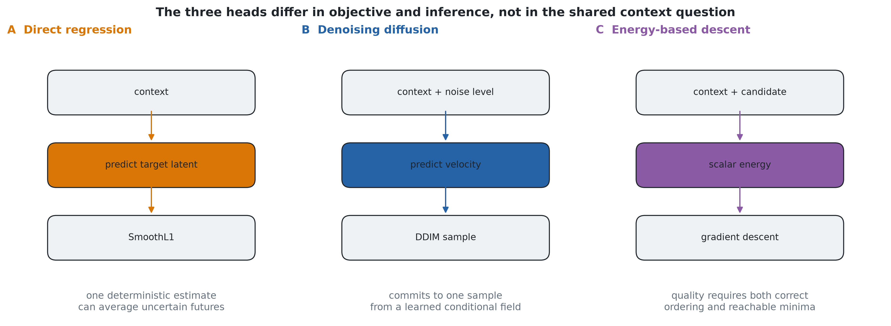

**Figure 4.2 — Generation objectives under the shared context question.** Regression maps the
package directly to clean target latents. Diffusion predicts the velocity of a noisy target and
uses a declared DDIM schedule. The energy-based head scores a candidate and updates that candidate
by gradient descent. The diagram compares interfaces; total inference work differs.
*Source and status: author-generated implementation-informed schematic from the audited regression,
diffusion, and EBT interfaces in `hvp_rev`; generated by `scripts/make_dissertation_missing_figures.py`.*

Best-of-$N$ is used only as an oracle coverage diagnostic. For each record, the decoded sample
with the smallest foreground MSE against ground truth is selected. One regression candidate costs
one stochastic MC-dropout network evaluation, whereas a diffusion candidate costs the declared
number of DDIM evaluations. Best-of-eight at 16 NFE therefore uses eight regression evaluations
and 128 diffusion evaluations. In general, the network-evaluation counts are

$$
W_{\mathrm{reg}}(N)=N,
\qquad
W_{\mathrm{diff}}(N,K)=NK,
\tag{4.2}
$$

where $K$ is the number of DDIM evaluations per candidate. The models are closely matched in capacity and conditioning, but
not in total work. That distinction matters more than the label “matched mechanism study.”

**Table 4.3 — Generation-mechanism decision evidence.** Foreground MSE is lower-is-better and
foreground sharpness is higher-is-better. The NFE sensitivity values come from a smaller frozen
evaluation receipt and are not pooled with the six-batch main row.

| Regime | Regression | Diffusion | Persistence or reference | Licensed reading |
|---|---:|---:|---:|---|
| Single step, best-of-8 foreground MSE, all | 0.0664 | **0.0512** | persistence 0.2367 | diffusion has better oracle coverage at the reported unequal total work |
| Single step, easy subset | 0.0232 | **0.0120** | — | both learn the conditioned motion; diffusion remains lower |
| Single step, hard novel-strip subset | 0.1808 | **0.1549** | — | the larger separation occurs where a committed hypothesis is required |
| Mean over eight candidates | 0.0714 | **0.0640** | — | diffusion also improves the sample mean in this study |
| Single step, foreground sharpness | 0.1591 | **0.1886** | persistence 0.0515 | diffusion samples are sharper in the coverage regime |
| Best-of-8 foreground MSE, 4 NFE per diffusion candidate | 0.0680 | **0.0546** | — | diffusion direction persists at the smallest tested diffusion allocation |
| Best-of-8 foreground MSE, 8 NFE | 0.0680 | **0.0514** | — | sensitivity, not an equal-work comparison |
| Best-of-8 foreground MSE, 16 NFE | 0.0680 | **0.0503** | — | more denoising work gives a modest additional gain |
| Self-fed best-of-1, matched hierarchical package | **0.1682** | 0.1848 | paired diffusion-minus-regression interval [0.0110, 0.0227] | direct regression is better in deterministic rollout |
| Self-fed best-of-1, matched flat package | **0.2015** | 0.2038 | — | the rollout reversal is not confined to the hierarchical arm |

The single-step result is coherent with the usual distinction between conditional mean prediction
and stochastic hypothesis coverage in video prediction [130, 131]. No general diffusion-accuracy ranking follows. Once a single sampled output is
fed back for 152 frames, the ranking reverses. `reg-long` records foreground MSE 0.1682 compared
with 0.1848 for the diffusion `hier-long` model, while their foreground sharpness values are nearly
equal at 0.0741 and 0.0729. At the flat package the numerical gap is smaller, but regression again
has lower error.

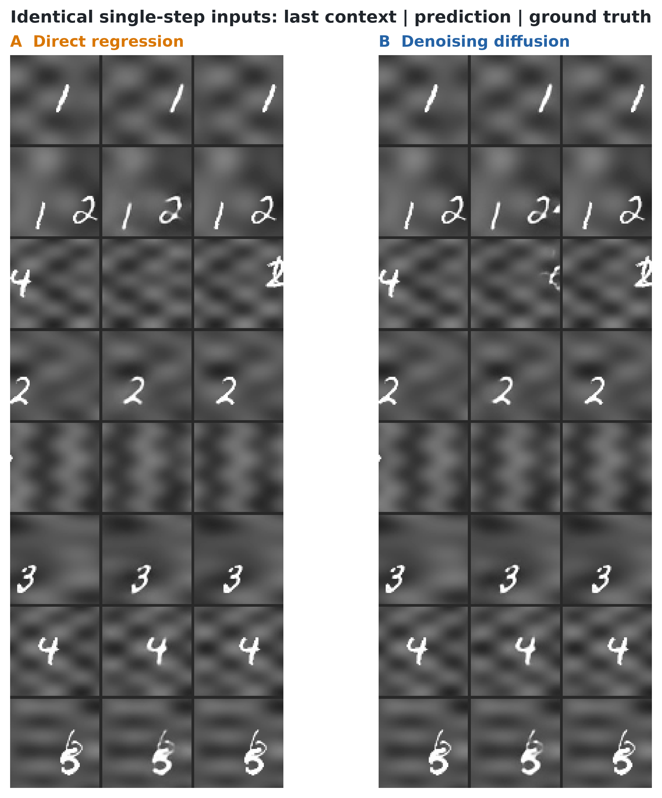

**Figure 4.3 — Single-step predictions on identical inputs.** The rows illustrate the registered
single-step setting; they are not selected to establish the ranking. The aggregate results in
Table 4.3 determine the decision. In particular, these examples must not be extrapolated to the
later self-fed regime, where regression performs better. *Source and status: artifact-derived composite;
image sources:
`logs_rhcp/step1_mech_clean_reg.png` and `logs_rhcp/step1_mech_clean_diff.png`; composite generated
without selective frame replacement by `scripts/make_dissertation_missing_figures.py`.*

The apparent contradiction is a useful boundary. Best-of-eight asks whether at least one sampled
future covers the observed outcome when an oracle can inspect ground truth. Best-of-one rollout
asks whether one committed prediction remains stable after repeated feedback. Those are different
estimands. Diffusion is retained for the fixed-budget frontier because the primary scientific
question includes stochastic coverage, while regression remains the deterministic control and is
reported wherever the inference regime changes.

### 4.2.2 Energy-based descent as a characterised negative

An energy-based transformer offers another route to generation: learn a scalar energy rather than a normalized probability [84, 85],
$E_\phi(c,z)$ for context $c$ and candidate future $z$, then update the candidate according
to

$$
z^{(k+1)}=z^{(k)}-\alpha_k\nabla_zE_\phi(c,z^{(k)})+\eta_k,
\tag{4.3}
$$

where $\eta_k$ is the registered Langevin term when that recipe uses noise [89, 90]. Score matching connects related energy gradients to data-density gradients [86, 87]. The attraction is
conceptual as well as computational. Extra descent steps could, in principle, spend more
inference work on a difficult re-entry. Yet two capabilities must both hold. The energy must order meaningful
candidates correctly, and descent from the prescribed initialisation must reach the structured
region of the landscape.
At a 14.66-million-parameter scale, the study adapted the official Energy-Based Transformer
implementation [88] and evaluated two published recipe families. The S2 recipe
converges to a loss near 0.597 but places the batch-mean candidate below the target on every one of
21 recorded probes. S1 changes the ordering: from updates 6,000 through 20,000, the target has the
lowest energy on fifteen consecutive probes, with a target-below-mean gap between 0.22 and 3.09.
Ordering can therefore be learned at this scale.

Generation still fails. S1 cold-descent foreground sharpness reaches at most 0.0345, while its
paper-style best-of-four probes remain between 0.0102 and 0.0154. Both lie below the predeclared
approximately 0.08 threshold for visible structure and far below the roughly 0.24 decoded-target
reference. More descent steps and the publication-style sampler do not restore a structured
future. The negative result is two-sided: S2 fails ordering and reachability; S1 repairs ordering
without repairing reachability.

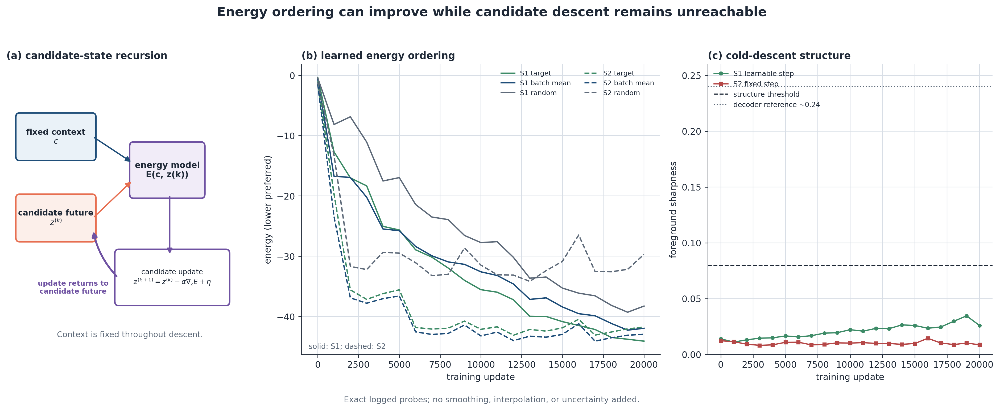

**Figure 4.4 — Energy ordering and descent reachability.** Panel (a) shows the corrected
candidate-state recursion. Panel (b) separates the recipe that learns target-below-mean ordering
from the one that does not. Panel (c) shows that correct ordering is insufficient: cold descent
remains below the registered structure threshold. The figure supports a capability diagnosis, not
an impossibility theorem. *Source and status: artifact-derived diagnostic; numeric source:
`logs_rhcp/ebt_scaled_s1.log` and
`logs_rhcp/ebt_scaled_s2.log`; these are hash-listed legacy receipts, not E2--E8 RunSpec
artifacts.*

Scale prevents a stronger conclusion. The tested runs use fewer updates and a smaller effective
batch than the reference large-video configuration, and S1 sharpness rises slightly during
training. The evidence therefore says that energy descent did not produce structured video at the
reachable scale, even after the ordering criterion succeeded. Energy-based generation at larger
scales remains an open case, and the result does not challenge studies using larger pretrained
representations and hardware.

### 4.2.3 Mechanism decision

The three mechanisms leave two viable heads. Diffusion is used for the untouched package
frontier because it gives the strongest stochastic single-step coverage in the controlled study.
Regression remains a necessary control because it is better in deterministic self-fed best-of-one
rollout. Energy-based descent is closed as a characterised negative for this programme: pursuing
it would test scale rather than answer the context-packaging question.

No universal head ranking follows from these studies. The relevant decision is conditional on how
predictions will be sampled and reused.

That decision also fixes the licence of every later result. The frontier measures package effects
for diffusion with declared denoising work; regression cells ask whether a direction survives a
deterministic one-pass head. They are complementary tests, not interchangeable replications.
Keeping both visible prevents stochastic coverage from being attributed to context geometry and
prevents a stable regression rollout from being mistaken for evidence against diffusion in its
intended sampling regime.

## 4.3 Hierarchical reach under a fixed context budget

### 4.3.1 Untouched reach-differential confirmation

The development pool had already influenced model selection and the reach hypothesis. A valid
confirmation therefore required new data rather than another analysis of the same clips. The E2
holdout, `loopmom-confirmation_holdout-20260712-e033abee6e04`, was generated and hash-pinned after
the checkpoints, package pairs, reach bands, endpoints, table layouts, and interpretation rules
had been frozen, applying a protected-holdout principle to prevent adaptive reuse [167]. Training and monitoring loaders reject the protected split, and its opening is
recorded through a purpose-specific access log.

For `hier-min` and `flat-min`, context, target, and total token counts are exactly matched. The
flat package stores 14 contiguous fine frames; the hierarchical package stores 48 coarse frames
and two recent fine frames. The primary reach population contains non-empty, answerable records
whose relevant novel content was last visible at lag

$$
14<\Delta t_i\le48.
\tag{4.4}
$$

Operationally, eligibility also requires a finite lag, at least 0.5 observed foreground fraction,
and non-empty ground-truth foreground. Let

$$
e_{ci}=\mathbf 1\!\left(
14<\Delta t_{ci}\le48,\;
\mathrm{seen}_{ci}\ge0.5,\;
\mathrm{fg}_{ci}\ne\varnothing,\;
\Delta t_{ci}\text{ finite}
\right).
\tag{4.5}
$$

If $d_{ci}=m_{ci}^{\mathrm{flat}}-m_{ci}^{\mathrm{hier}}$ is the foreground-error difference
for frame record $i$ of clip $c$, the paired reach estimand is

$$
\widehat{\Delta}_{\mathrm{reach}}=
\frac{\sum_c\sum_{i\in c}e_{ci}\,d_{ci}}
{\sum_c\sum_{i\in c}e_{ci}}.
\tag{4.6}
$$

Frames remain inside their clips during resampling. This matters because a later frame inherits
errors and generated state from earlier predictions; treating 1,006 eligible records as
independent would overstate precision.

The seed-0 effect is +0.0980 with a 95% clip-cluster interval [0.0788, 0.1179]. Seed 1 gives
+0.0914 [0.0736, 0.1098]. Both estimates are substantially larger than their whole-population
effects, +0.0474 [0.0354, 0.0595] and +0.0436 [0.0326, 0.0549]. The effect is therefore not merely
positive on average. It concentrates in the population for which the relevant history is
available only to the longer package.

The optional optimisation-stage diagnostic clarifies why an earlier small study could have missed
the mechanism. At 6,000 updates, hard-bin single-step effects are unresolved on both training
seeds; at 20,000 updates they are +0.0135 and +0.0143 with intervals excluding zero. Each budget
is a separate fully annealed training schedule, so the observation concerns sufficient
optimisation, not a checkpoint trajectory within one run.

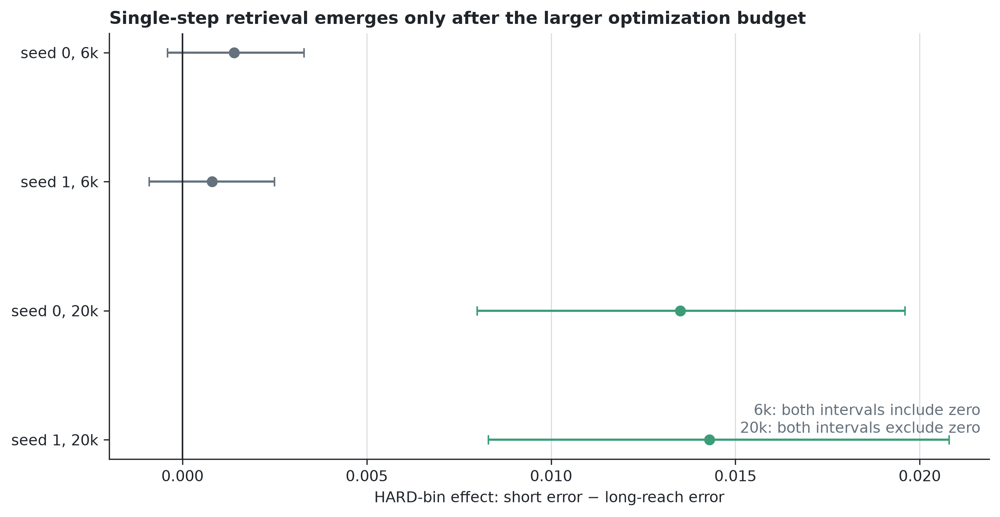

**Figure 4.5 — Conditional development diagnostic for optimisation sufficiency.** Retrieval is
not resolved in the two 6,000-update runs and is positive in both 20,000-update runs. This figure
is development evidence and remains outside the untouched E2 family. *Source and status:
artifact-derived development diagnostic; numeric sources: the four
frozen `logs_rhcp/mem_gate_full_s0*.log` and `logs_rhcp/mem_gate_full_s1*.log` records at 6,000 and
20,000 updates.*

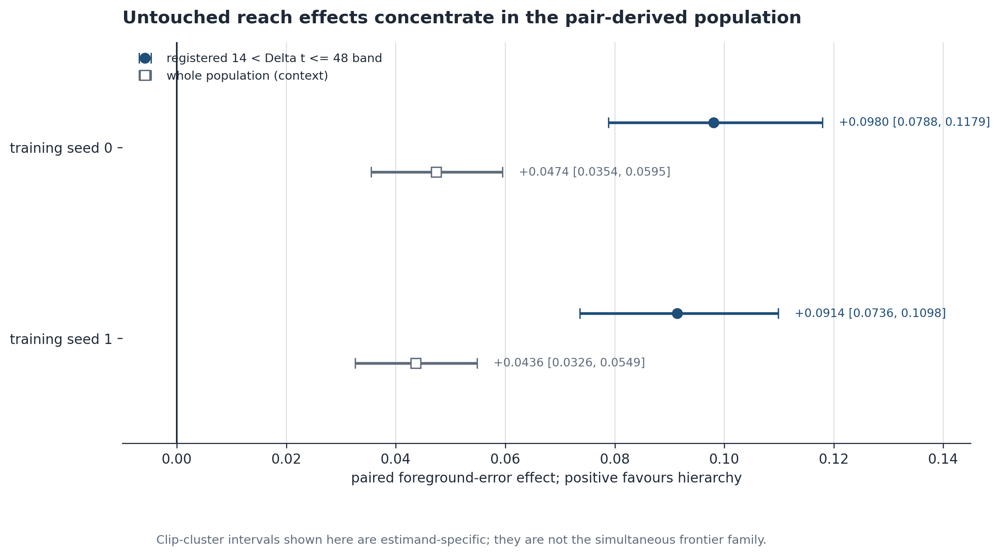

**Figure 4.6 — Untouched pair-specific reach effects.** The primary marks show the registered
$14<\Delta t\le48$ population; lighter marks show the whole-population effect for context. The
figure makes the different estimands visible rather than presenting four intervals as one
inferential family. *Source and status: artifact-derived untouched result; numeric source: frozen
`artifacts/confirmation_e2/results.json` and the E2
results record.*

The B1 pair provides a second, qualified confirmation. Its registered population is
$8<\Delta t_i\le48$, and the two seed effects are +0.0692 [0.0543, 0.0845] and +0.0743
[0.0588, 0.0899]. Whole-population effects are +0.0340 and +0.0381. B1 changes more than context
reach, however. Its stride-2 target interface, target-token count, auxiliary loss, and training
load differ from `flat-short`. The result confirms the complete configuration. It cannot be used
as an isolated causal estimate of temporal stride.

### 4.3.2 Whole-population and endpoint support

Foreground-only error could conceal a model that predicts the object at the correct location but
also creates false objects elsewhere. The untouched pair was therefore evaluated with the
complete metric suite defined in Chapter 3. Table 4.4 reports the registered reach band rather
than selecting favourable endpoints after inspection. The sign convention is harmonised so that
positive values favour `hier-min`; for missed and extra components, the reported value is the
number avoided by the hierarchical package.

**Table 4.4 — Complete endpoint support in the untouched $14<\Delta t\le48$ population.** Each
row contains 1,006 frame records from 96 clips. Intervals are paired clip-cluster intervals for the
named trained model; the two seed columns are not pooled.

| Endpoint | Seed 0 effect [95% CI] | Seed 1 effect [95% CI] | What the endpoint rules out |
|---|---:|---:|---|
| Non-empty GT-foreground MSE | +0.0980 [0.0788, 0.1179] | +0.0914 [0.0736, 0.1098] | failure on the re-entering object itself |
| Union-mask MSE | +0.0808 [0.0632, 0.0987] | +0.0773 [0.0613, 0.0940] | improvement obtained only by ignoring hallucinated support |
| Full-frame MSE | +0.0045 [0.0033, 0.0058] | +0.0042 [0.0032, 0.0052] | contradiction with aggregate image error |
| GT-background MSE | +0.0013 [0.0006, 0.0019] | +0.0012 [0.0006, 0.0017] | a foreground gain purchased by worse background reconstruction |
| Foreground precision | +0.1550 [0.1027, 0.2066] | +0.0691 [0.0051, 0.1317] | uncontrolled false-positive area |
| Foreground recall | +0.2708 [0.2180, 0.3238] | +0.2539 [0.2060, 0.3029] | an apparently sharp result that omits much of the object |
| Foreground F1 | +0.2458 [0.1975, 0.2954] | +0.2342 [0.1893, 0.2801] | precision–recall imbalance |
| Missed components avoided | +0.4911 [0.3686, 0.6102] | +0.5527 [0.4315, 0.6699] | lower pixel error caused by deleting difficult instances |
| Extra components avoided | +0.3231 [0.1530, 0.4915] | +0.1968 [0.0334, 0.3701] | benefit accompanied by duplicate objects |
| Component coverage | +0.2622 [0.1968, 0.3264] | +0.2992 [0.2370, 0.3605] | selective scoring of easy surviving components |

Agreement across union, background, recall, misses, extras, and coverage makes the reach result
stronger than a foreground-MSE difference alone. It also narrows the interpretation. The package
improves more than blur inside a supplied mask; it more often reconstructs a coherent object
where a shorter window has lost the relevant scene content.

### 4.3.3 Interpretation of reach

The pair-derived band is the decisive feature of the experiment. A generic late-horizon analysis
would mix events whose required evidence is present in both packages, absent from both, or
available only to one. LoopMom's saved geometry removes that mixture. The larger band-specific
effect, repeated across two training seeds and supported by false-positive-sensitive metrics,
matches the mechanism predicted in Chapter 3.

What stands out is the locality of the claim. Exact geometry says that a world column was visible
within one package's nominal reach. Geometry alone cannot show lossless encoding, exclude
reconstruction from a learned prior, or establish the same causal relationship in natural
video. Those stronger statements would require counterfactual worlds that share the short visible
context but differ in hidden re-entry content. The present evidence is sufficient for a tested
reach mechanism, not for information-theoretic necessity.

The same logic suggests a requirement for future benchmarks. A late frame is informative only if
the evaluator can establish when its relevant content was last observed and which packages could
still address that observation. Without that record, a horizon-conditioned effect mixes reach,
fidelity, scene difficulty, and accumulated rollout error. LoopMom solves the identification
problem analytically; natural-video studies will need logged camera geometry, annotated
disappearance and re-entry events, or counterfactual sequences that provide an equally auditable
population.

That requirement is methodological, not tied to the LoopMom generator itself; the estimand can be
carried to any task whose observation history is recorded with sufficient precision.

## 4.4 Reach–fidelity frontier and memory efficiency

### 4.4.1 Simultaneous tested frontier

Reach is valuable only while it changes which relevant observations are available. Once the flat
package can retain most or all of the needed span, its full-resolution history may become more
useful than a compressed stream. The untouched E2 family tests this proposition at discrete
budgets. Every listed interval is produced by one studentized max-statistic clip-cluster family
with critical value 2.741; therefore the decisions do not arise from choosing separate marginal
tests after seeing the outcome.

**Table 4.5 — Untouched tested frontier and equal-reach context-state accounting.** Panel A
contains the complete simultaneous decision family. Panel B, introduced in Section 4.4.2, reports
the exact storage arithmetic used to interpret its lower-budget points.

**Panel A: simultaneous tested frontier**

| Context budget | Flat package / nominal reach | Hierarchical package / nominal reach | Seed and optimiser regime | Flat loss − hierarchical loss | Simultaneous 95% CI | Decision |
|---:|---|---|---|---:|---:|---|
| 480 vs 512 | `flat-short` / 8 | `hier-short` / 6 | seed 0, B16×30k | −0.0038 | [−0.0081, +0.0005] | unresolved near-match |
| 480 vs 512 | `flat-short` / 8 | `hier-short` / 6 | seed 1, B16×30k | −0.0060 | [−0.0105, −0.0015] | flat favoured; near-match |
| 896 | `flat-min` / 14 | `hier-min` / 48 | seed 0, B16×30k | +0.0474 | [+0.0305, +0.0642] | hierarchy confirmed |
| 896 | `flat-min` / 14 | `hier-min` / 48 | seed 1, B16×30k | +0.0436 | [+0.0280, +0.0592] | hierarchy confirmed |
| 1,152 | `flat-budget` / 18 | `hier-long` / 48 | seed 0, B16×30k | +0.0195 | [+0.0070, +0.0320] | hierarchy confirmed |
| 1,152 | `flat-budget` / 18 | `hier-long` / 48 | seed 1, B16×30k | +0.0389 | [+0.0228, +0.0549] | hierarchy confirmed |
| 1,152 | `flat-budget` / 18 | `hier-long` / 48 | seed 2, B16×30k | +0.0307 | [+0.0159, +0.0455] | hierarchy confirmed |
| 1,792 | `flat-c1` / 28 | `hier-c1` / 48 | seed 0, B16×30k | +0.0084 | [−0.0013, +0.0181] | unresolved |
| 2,432 | `flat-c2` / 38 | `hier-c2` / 48 | seed 0, B16×30k | −0.0150 | [−0.0260, −0.0039] | flat confirmed |
| 2,432 | `flat-c2` / 38 | `hier-c2` / 48 | seed 0, B8×60k | −0.0122 | [−0.0213, −0.0032] | flat confirmed in separate optimiser regime |
| 3,072 | `flat-long` / 48 | `hier-rich` / 48 | seed 0, B8×60k | −0.0129 | [−0.0217, −0.0041] | flat confirmed |
| 3,072 | `flat-long` / 48 | `hier-rich` / 48 | seed 1, B8×60k | −0.0134 | [−0.0215, −0.0053] | flat confirmed |

The two lower near-match rows compare 480 and 512 tokens and cannot define an exact-budget edge.
Among exact-budget pairs, 1,152 is the largest
tested family-wise-confirmed hierarchy-favouring budget, while 2,432 is the smallest tested
family-wise-confirmed flat-favouring budget. The 1,792 point remains unresolved.

**Figure 4.7 — Untouched reach–fidelity frontier.** Positive effects favour hierarchy. The figure
shows per-seed estimates and simultaneous intervals at tested budgets only. No line joins the
points, no shaded winning band includes 1,792, and the explanatory reach annotation is not a
fitted crossing.
*Source and status: artifact-derived untouched result from
`artifacts/confirmation_e2/results.json`; rendered by `scripts/make_rft_result_figures.py`.*

A sentence such as “the switch occurs between 1,792 and 2,432” would overstate the design.
An unresolved interval leaves the true effect open, and the experiment provides no monotonicity
constraint. The defensible bracket is coarser: the largest confirmed hierarchy point is 1,152 and
the smallest confirmed flat point is 2,432. Anything about the curve between them remains unknown.

### 4.4.2 Exact token and payload arithmetic

The frontier is meaningful because its context cost is explicit. With the frozen codec, a fine
frame contains $8\times8=64$ tokens and a coarse frame contains $4\times4=16$. For package
$\mathcal P$, the context-token reduction relative to dense fine storage at the same nominal
span is

$$
G_{\mathrm{ctx}}(\mathcal P)=
\frac{48q_{\mathrm f}}
{n_{\mathrm c}q_{\mathrm c}+n_{\mathrm f}q_{\mathrm f}},
\qquad q_{\mathrm f}=64,\quad q_{\mathrm c}=16.
\tag{4.7}
$$

**Panel B: context-state cost at equal nominal 48-frame reach.** Each token carries 16 codec
coefficients. Payload columns are contiguous array sizes for one example and one context package;
the batch dimension is excluded. They also exclude target tokens, attention and MLP intermediates,
parameters, optimiser state, allocator overhead, and training activations.

| Package | Token arithmetic | Context tokens | Latent payload fp32 | Latent payload fp16/bf16 | Materialised width-384 embeddings, bf16 | Relative context cost |
|---|---:|---:|---:|---:|---:|---:|
| 48 dense fine frames | $48\times64$ | 3,072 | 192 KiB | 96 KiB | 2.250 MiB | 1.00× |
| 48 coarse + 6 recent fine | $48\times16+6\times64$ | 1,152 | 72 KiB | 36 KiB | 0.844 MiB | 2.67× fewer |
| 48 coarse + 2 recent fine | $48\times16+2\times64$ | 896 | 56 KiB | 28 KiB | 0.656 MiB | 3.43× fewer |

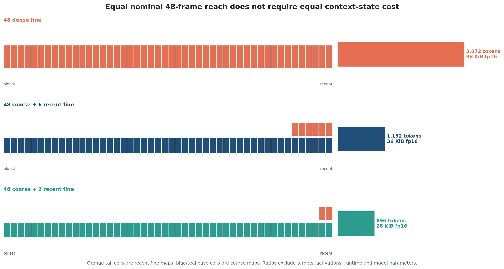

**Figure 4.8 — Equal-reach context-state arithmetic.** All three packages address a nominal
48-frame span, but they do not retain equal information. The ratios describe context tokens and
their direct payloads, not end-to-end memory or speed.
*Source and status: author-generated exact-arithmetic diagram derived from frozen package geometry
and Table 4.5; generated by `scripts/make_restructured_ch2_ch4_figures.py`.*

The arithmetic supports two distinct claims. First, hierarchy makes 48-frame addressability
possible at budgets where a flat fine-only window reaches only 14 or 18 frames. Second, the same
addressable span requires 2.67 to 3.43 times fewer context tokens than 48 fine frames. Equal
performance with fewer tokens remains untested. Prediction quality depends on which details the
task needs, as the upper frontier and E6 later demonstrate.

Token and payload ratios also should not be read as measured runtime ratios. Materialised context
state grows linearly with the number of tokens, whereas attention work depends on the complete
context-plus-target sequence and its implementation. Batch size, precision, kernels, and temporary
buffers can further change peak memory. The value of Table 4.5 is narrower and more durable: it
makes the retained-state economy exact, auditable, and independent of a particular GPU trace.

### 4.4.3 Reach and fidelity as an operating-region interpretation

At 896 and 1,152 tokens, the flat window excludes relevant re-entry history that the coarse stream
retains. Compression trades some spatial detail for access, and access is the binding constraint.
The pair-specific result in Section 4.3 makes that mechanism observable rather than merely
plausible. At 3,072 tokens, both packages reach 48 frames. Extra coarse redundancy no longer buys
an exclusive part of the past, while the flat package preserves every retained frame at fine
resolution. The abstraction cost becomes visible.
The 2,432-token result belongs between those clean cases. Flat reaches 38 frames and hierarchy
reaches 48, yet flat is confirmed in the primary E2 family. On this static world, an old fine
observation can preserve digit appearance and exact texture better than a denser coarse history.
No general 38-frame sufficiency threshold follows. The sampler and codec studies will
show that the upper effect is smaller and less precise than the lower reach effects.

Task priorities change the decision. A navigation or occupancy predictor may value whether an
object continues to occupy the right region even when its fine identity is imperfect. A
digit-preserving generator can fail if it places a moving object correctly but changes which
digit it is. The first objective can tolerate spatial abstraction after long history; the second
may prefer dense fine storage once the needed span fits. Reach and fidelity are therefore two
questions asked in sequence, not two scalar terms whose weights can be inferred from this one
frontier.

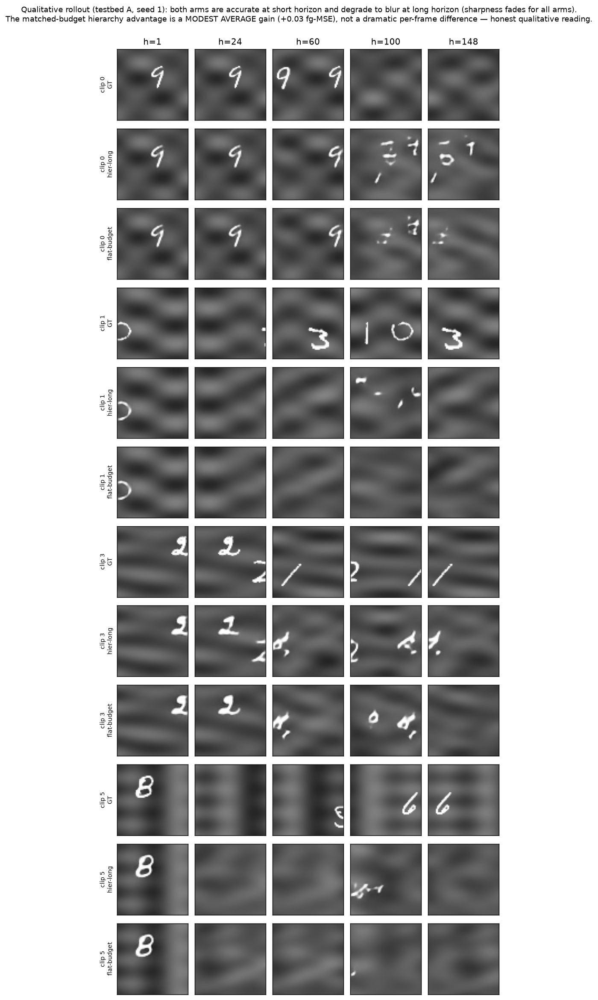

**Figure 4.9 — Fixed-index qualitative rollouts.** The plotting script hard-codes clip indices
0, 1, 3, and 5 and horizon indices 1, 24, 60, 100, and 148. The strip illustrates the modest
average advantage in the reach-limited region and also shows late blur in both arms. Because the
source lacks a registered representative-quantile rule for choosing those indices, the panel is
descriptive only. Paired endpoint analysis determines the comparison. *Source and status:
artifact-derived fixed-index gallery from
frozen LoopMom arrays, the frozen hierarchical codec, and seed-1 30,000-step `hier-long` and
`flat-budget` checkpoints; rendered by `scripts/make_samples.py`.*

No continuous line should be fitted through the budget points. Such a line would quietly assume
monotonicity, comparable seed precision, and a single transition that the experiment did not
establish. The result is a set of operating-region decisions: hierarchy at the tested lower and
interior budgets, unresolved evidence at 1,792, and flat recovery at the tested upper budgets.

## 4.5 Context-package shape and model interaction

### 4.5.1 Spatial hierarchy versus temporal subsampling

The matched frontier establishes that cheap coarse tokens can buy useful reach. Whether spatial
coarsening is the best use of a fixed number of tokens remains a separate question. A
full-resolution temporal anchor also reaches into the past, but leaves intervals between stored
frames. Comparing those packages separates two kinds of loss: spatial compression discards detail
at every old time step; temporal subsampling preserves the selected frames but discards
intermediate dynamics.

The central package-shape pair uses `strided-flat`, with eleven stride-4 fine anchors plus six
recent fine frames, and `hier-long`, with 48 dense coarse frames plus the same six-frame fine tail.
Both have nominal reach 48. Their budgets are close but not identical: 1,088 and 1,152 context
tokens. Since the temporal package receives fewer tokens, the imbalance favours the temporal
control rather than the spatial hierarchy.

Seed-resolved results make the prediction head impossible to ignore. Under diffusion, every one
of five training seeds favours the temporally sparse full-resolution package. Under regression,
the direction changes across seeds. Table 4.6 keeps those levels of uncertainty separate.

**Table 4.6 — Five-seed head × package factorial.** Positive package effects favour temporal
full-resolution anchors over spatially coarse dense history. Clip intervals condition on one
trained model; the final three rows use training seeds as units.

| Training seed or summary | Diffusion package effect [clip 95% CI] | Regression package effect [clip 95% CI] | Head × package interaction [clip 95% CI] |
|---:|---:|---:|---:|
| 0 | +0.0197 [+0.0143, +0.0252] | +0.0107 [+0.0062, +0.0158] | −0.0089 [−0.0151, −0.0025] |
| 1 | +0.0046 [+0.0007, +0.0084] | −0.0104 [−0.0146, −0.0062] | −0.0150 [−0.0199, −0.0104] |
| 2 | +0.0111 [+0.0070, +0.0151] | −0.0208 [−0.0270, −0.0150] | −0.0319 [−0.0401, −0.0245] |
| 3 | +0.0075 [+0.0037, +0.0114] | +0.0248 [+0.0181, +0.0323] | +0.0173 [+0.0106, +0.0245] |
| 4 | +0.0060 [+0.0027, +0.0092] | −0.0166 [−0.0229, −0.0108] | −0.0226 [−0.0297, −0.0160] |
| Across-seed mean | +0.0098 | −0.0024 | −0.0122 |
| Across-seed SD | 0.0060 | 0.0195 | 0.0186 |
| Across-seed t95 interval | [+0.0023, +0.0173] | [−0.0266, +0.0217] | [−0.0353, +0.0109] |

**Figure 4.10 — Package effects across prediction heads and training seeds.** Per-seed bars are
clip-cluster intervals. Shaded summaries use five training seeds, which are a different
uncertainty level. Diffusion consistently favours temporal anchors; regression and the interaction
change sign.
*Source and status: artifact-derived robustness result from
`artifacts/e4b_head_package/results.json`; rendered by `scripts/make_rft_result_figures.py`.*

The stable diffusion direction is informative but specific. LoopMom's hidden world is static
between observations, making stride-4 anchors unusually safe: nothing moves while the viewport is
elsewhere. On a process whose hidden state changes between anchors, temporal subsampling can alias
the motion that a dense coarse stream would retain. The experiment therefore locates an operating
point. Evidence from this static instrument is insufficient to rank temporal and spatial
compression across video tasks.

The fixed-span spatial probe provides another useful control. At an 18-frame window, replacing
older fine history with coarse history reduces context tokens from 1,152 to 672. Under diffusion,
the coarse package has an error cost of 0.0082, with full-minus-coarse effect −0.0082
[−0.0115, −0.0050]. Under regression the effect is +0.0008 [−0.0013, +0.0029], unresolved. This
provides no intrinsic “coarse abstraction is better” claim. Spatial abstraction is lossy;
its value is economic when the saved tokens can be used to extend the window.

**Table 4.7 — Context-form evidence map and comparison licences.** Rows answer different causal
questions and must not be treated as one fully crossed factorial.

| Question | Executed comparison | What is held fixed or isolated | Remaining co-change | Licence and evidence level | Supported conclusion |
|---|---|---|---|---|---|
| Reach beyond a flat window | `hier-min` versus `flat-min` | context, target and total tokens; codec, head, clips; pair-derived reach band | nominal reach and old-history resolution change together | **MATCHED**, untouched E2 | benefit concentrates where only hierarchy addresses the relevant past |
| Fixed-span spatial abstraction | `spat18` versus `flat-budget`, separately by head | 18-frame span, recent fine tail, codec and evaluation records | coarse package uses 672 rather than 1,152 tokens | **DEVELOPMENT DIAGNOSTIC** | coarse history has a small cost under diffusion and is unresolved under regression; no intrinsic abstraction win |
| Temporal versus spatial compression | `strided-flat` versus `hier-long` | nominal 48-frame reach, six-frame fine tail, backbone, codec, training protocol | temporal sparsity versus spatial coarsening; 1,088 versus 1,152 tokens | **NEAR-MATCHED DEVELOPMENT FACTORIAL**, five seeds | temporal anchors are stable under diffusion; regression and cross-head interaction are heterogeneous |
| Spatial × temporal stride-2 package | `hier-s2-min` versus `flat-short` | 512 context tokens and paired records | target stride, target slots/tokens, auxiliary loss, total sequence length, optimisation load | **WHOLE CONFIGURATION**, untouched E2 | complete B1 configuration wins; pure context-stride effect is unidentified |
| Added representational depth | `hier3` versus `hier-long` | 1,152 context tokens, nominal reach, diffusion backbone | target allocation, objective load, fine/coarse allocation, top-level information floor | **DEVELOPMENT DIAGNOSTIC**, seed 0 | three-level probe is worse by −0.0196 [−0.0248, −0.0146]; no general depth law |
| Stream contribution | coarse/fine blinding and `hier3` top blinding | trained model and rollout records | zeroing a stream is out of distribution | **DEVELOPMENT DIAGNOSTIC** | coarse removal harms re-entry; fine removal causes rendering collapse; tested top stream adds little; magnitudes are not information accounting |
| Budget allocation | E2 frontier | codec, head, endpoint family and discrete package pairs | seed coverage varies by budget; no continuous dose response | **UNTOUCHED SIMULTANEOUS FAMILY** | spend tokens on reach while history is absent; preserve fine detail after reach is available |

Two comparisons in the table are easily misread. The third-level arm keeps the context budget at
1,152 but changes loss allocation and target tokens as well as depth. Its poorer result is evidence
against that complete probe, not against hierarchical depth as a concept. Stream blinding is even
more local: a zeroed input lies outside the trained distribution. It can show that removing a
stream destroys a capability, but it cannot assign an information value to the stream.

### 4.5.2 Prediction-head interaction

The regression column shows heterogeneity, not a tie. Two seeds materially favour temporal anchors and
three favour spatial hierarchy; the across-seed interval is wide because the direction changes.
Calling that pattern equivalent would require a prespecified smallest effect of interest and an
interval wholly contained inside it. Neither condition holds. The correct term is training-seed
heterogeneity.
The interaction behaves similarly. Four per-seed estimates are negative and one is positive, but
the seed-level t interval [−0.0353, +0.0109] crosses zero. An early hypothesis that regression
would produce a stable shift toward spatial coarsening therefore fails. Package utilisation is not
only a property of stored tokens; it depends on the objective, sampling rule, and optimisation
trajectory that teach the model to use them.

Under diffusion, the result is much cleaner. All five effects are positive and the seed-level
interval excludes zero. On this static-world instrument, a sparse set of old fine anchors carries
more useful detail than a dense old coarse stream at nearly the same budget. The finding does not
weaken the main hierarchy result. `strided-flat` is itself multirate: it combines old stride-4
anchors with a dense recent tail. The main hierarchy result remains intact. What changes is the form of hierarchy—from multiple spatial
resolutions to multiple temporal rates.

Two features may explain why the head changes the package ordering, although the factorial cannot
separate them. Diffusion learns to denoise targets across a distribution of noise levels and spends
multiple evaluations on each prediction; regression maps the same conditioning state directly to
one estimate. Either training objective or inference path may alter how strongly the model relies
on sparse old anchors. The observed interaction establishes that package utility is conditional on
the head, while the mechanism causing that dependence remains unidentified.

For model selection, the diffusion result licenses temporal anchors on this controlled static
world, while the heterogeneous regression result calls for seed-resolved validation before that
choice is transferred. A moving hidden world would be the decisive extension: if meaningful state
changes occur between stride-4 anchors, temporal sparsity should lose information that a dense
coarse stream retains. Such a crossed dynamic test would distinguish an instrument-specific
advantage from a broader package principle without changing the confirmed spatial-hierarchy
frontier.

Until then, package shape should be selected jointly with the prediction head and validated across
training seeds, not chosen as an isolated preprocessing decision.

## 4.6 Robustness of the principal directions

### 4.6.1 Sampler allocation and randomness

The untouched frontier uses deterministic DDIM-16 with one registered sampling seed. A result
caused by that one denoising allocation would be fragile even if its clip interval were narrow.
E7c therefore freezes four seed-0 predictor contrasts before opening a new purpose-locked set: the
896-token reach effect, the 1,152-token interior effect, the 1,088-versus-1,152 package-shape
effect, and the 2,432-token flat-fidelity inversion. Each is evaluated at NFE 8, 16, and 32 with
sampler seed 0, and at NFE 16 with sampler seeds 1 and 2.
All 20 point estimates retain the registered direction. For the first three contrasts, every
simultaneous lower bound is above zero. The 2,432-token inversion is positive and family-wise
resolved for all three NFE allocations at sampler seed 0, but its intervals include zero at
sampler seed 1 (+0.0098 [−0.0001, +0.0196]) and seed 2 (+0.0077 [−0.0013, +0.0167]). Eighteen of
the twenty family-wise intervals are therefore clean.

**Figure 4.11 — Robustness to denoising work and sampler randomness.** Every point estimate keeps
its registered direction. Open points identify the two upper-inversion intervals that include
zero. The result is directional robustness, not sampler invariance.
*Source and status: artifact-derived robustness result from
`artifacts/e7c_sampler_nfe/results.json`; rendered by `scripts/make_rft_result_figures.py`.*

Changing NFE from 8 to 32 barely changes the reach contrast: estimates remain between +0.0465 and
+0.0478. The upper effect is smaller, between +0.0077 and +0.0122, which explains why modest
sampling variation changes its family-wise decision. Full-frame, background, union-mask, recall,
and F1 directions agree across all variants, while component-count diagnostics do not improve in
every cell. Robustness belongs to the principal directions, not to every endpoint.

The intervention is deliberately conditional on the trained predictors. It tests whether the
reported direction is an artefact of one sampler seed or one denoising budget; it cannot replace
replication across training seeds. Its most useful result is the contrast in scale. The large lower
reach effect is effectively unchanged across the NFE range, whereas the smaller upper inversion
sits close enough to zero for sampler randomness to alter the simultaneous verdict. Robustness is
therefore strongest precisely where the mechanism-identification evidence is strongest.

This justifies retaining the registered sampler for the main estimate while reporting the upper
decision as the less stable part of the frontier.

That distinction matters for interpretation: sampler robustness narrows an inference-time concern,
whereas training-seed replication tests a separate source of uncertainty.

### 4.6.2 Independently trained codec

E7a intervenes earlier in the pipeline. A second codec is trained independently, new latent
normalisation is computed, and seven seed-0 predictors are retrained. Reconstruction error,
coordinate geometry, scale, and predictor optimisation all change together. The experiment is
therefore a whole-codec robustness study; one cannot attribute any numerical difference to a
single property of the latent space.

**Table 4.8 — Direction and simultaneous status across sampler and codec interventions.** Positive
effects favour the registered candidate; for the 2,432 contrast that candidate is flat context.

| Intervention | 896 reach | 1,152 interior | 1,088 temporal vs 1,152 spatial | 2,432 flat inversion | Registered reading |
|---|---:|---:|---:|---:|---|
| DDIM NFE 8, sampler 0 | +0.0478 [0.0323, 0.0634] | +0.0152 [0.0045, 0.0259] | +0.0276 [0.0171, 0.0381] | +0.0115 [0.0016, 0.0214] | all family-wise resolved |
| DDIM NFE 16, sampler 0 | +0.0465 [0.0310, 0.0621] | +0.0146 [0.0041, 0.0251] | +0.0283 [0.0172, 0.0394] | +0.0117 [0.0018, 0.0217] | all family-wise resolved |
| DDIM NFE 32, sampler 0 | +0.0471 [0.0317, 0.0625] | +0.0140 [0.0036, 0.0245] | +0.0292 [0.0182, 0.0403] | +0.0122 [0.0022, 0.0221] | all family-wise resolved |
| DDIM NFE 16, sampler 1 | +0.0482 [0.0325, 0.0638] | +0.0201 [0.0086, 0.0315] | +0.0251 [0.0160, 0.0342] | +0.0098 [−0.0001, 0.0196] | upper effect unresolved |
| DDIM NFE 16, sampler 2 | +0.0466 [0.0314, 0.0618] | +0.0200 [0.0087, 0.0313] | +0.0221 [0.0133, 0.0309] | +0.0077 [−0.0013, 0.0167] | upper effect unresolved |
| Original-codec controls on E7a set | +0.0494 [0.0339, 0.0649] | +0.0283 [0.0169, 0.0397] | +0.0253 [0.0163, 0.0343] | +0.0150 [0.0065, 0.0235] | all family-wise resolved |
| Independently trained codec | +0.0521 [0.0374, 0.0669] | +0.0439 [0.0310, 0.0569] | +0.0112 [0.0039, 0.0184] | +0.0079 [−0.0006, 0.0165] | upper effect unresolved |

**Figure 4.12 — Original- and alternate-codec effects.** Seven of eight simultaneous intervals
exclude zero. The alternate codec preserves the upper point-estimate direction with lower
precision.
*Source and status: artifact-derived robustness result from
`artifacts/e7a_codec_robustness/results.json`; rendered by `scripts/make_rft_result_figures.py`.*

The alternate codec strengthens the lower and interior reach effects descriptively, while the
package-shape and upper effects shrink. Codec seed is not an inferential replicate, so these
changes should not be averaged or explained post hoc. The licensed conclusion is narrower: four
principal directions survive a complete replacement of one continuous latent interface at the
point-estimate level, and three remain family-wise clean. The upper flat-fidelity inversion is the
consistent precision boundary in both robustness programmes.

## 4.7 Boundary and negative evidence

### 4.7.1 Failed self-fed trust-boundary replication

Addressable history can be present yet fail during long self-fed generation. A seed-0 long-loop
study appeared to show exactly such a boundary: hierarchy helped early, then became worse after
approximately 24 frames. Because that pattern could easily become an attractive narrative after
inspection, E5a registered its required direction before training two additional seeds. The test
did not ask whether any late difference existed. It asked whether the early-positive,
late-negative pattern repeated.
At horizons 1–24, hierarchy is positive at every seed: +0.0204 [0.0133, 0.0279], +0.0082
[0.0035, 0.0133], and +0.0230 [0.0150, 0.0315]. At horizons 61–256, seed 0 is negative at −0.0064
[−0.0095, −0.0032]. The two new seeds instead favour hierarchy, +0.0074 [0.0038, 0.0112] and
+0.0087 [0.0035, 0.0139]. The required late direction fails twice.

**Figure 4.13 — Registered early and late long-loop effects.** The early benefit repeats across
three training seeds. The late inversion appears only at seed 0 and reverses at both replication
seeds. Verdict text is placed outside the intervals so that it cannot be mistaken for another
estimate.
*Source and status: artifact-derived registered replication result from
`artifacts/e5a_trust_replication/results.json`; rendered by `scripts/make_rft_result_figures.py`.*

Accordingly, the terminal verdict is **NOT REPLICATED**. No stable approximately-24-frame trust boundary is
established, and the gated localisation study was not authorised. A conceptual distinction still
survives: storing an observation and reusing it reliably after repeated prediction are different
problems. What failed is the proposed numerical law, not the possibility of self-fed degradation.
Turning the two positive replication effects into a replacement theory would repeat the same
post-hoc mistake in the other direction.

The failure changes the dissertation’s recommendation. Early self-fed benefit may be reported as
replicated, but rollout age cannot be used as a calibrated switch from hierarchical to flat memory.
Nor is seed 0 evidence for a universal decay time. Localising why that run differs would require a
new registered question, additional seeds, and diagnostics chosen before their outcomes were seen.
Because the confirmed frontier and external boundary already answer the dissertation’s design
questions, opening that branch would add exploratory explanation rather than necessary evidence.

Stopping at the failed registered prediction also protects the distinction between a useful
negative result and an unconstrained search for a replacement pattern.

The original boundary is therefore retired. Its early component survives as evidence, while its
fixed late switch is excluded from the design rule.

### 4.7.2 Privileged raw-memory reference

The learned models mix at least three difficulties: compressing a past frame, addressing the
right stored content, and propagating predictions without drift. E8a removes most of the first two.
A world-coordinate mosaic stores raw warm-up pixels and is queried using the exact saved future
viewport pose. Its K6, K14, K38, and K48 variants differ only in how much warm-up history
contributes to the mosaic. K6 supplies descriptive storage and coverage context; the registered
simultaneous reach contrasts compare K14 and K38 with K48 alongside the four neural references.

**Figure 4.14 — Explicit pose-indexed storage and access.** The left panel reports stored-world
and future-crop coverage by history span. The right panel compares raw K48 with shorter raw spans
and four learned references under one simultaneous family. The mosaic is visually separated from
the matched-budget frontier because it receives raw pixels and exact future pose.
*Source and status: artifact-derived privileged-access reference from
`artifacts/e8a_pose_mosaic/results.json`; rendered by `scripts/make_rft_result_figures.py`.*

K48 reaches foreground MSE 0.0494, full-frame MSE 0.0027, and foreground recall 0.8438. The four
neural references have foreground MSE between 0.1628 and 0.1862. Neural-minus-K48 effects are
+0.1219 for `hier-min`, +0.1368 for `hier-long`, +0.1134 for `strided-flat`, and +0.1310 for
`flat-c2`; all simultaneous lower bounds exceed zero. Increasing raw storage also matters:
K14-minus-K48 is +0.0723 [0.0548, 0.0898], and K38-minus-K48 is +0.0210 [0.0096, 0.0325]. Median
stored world coverage rises from 80 columns at K6 to 154 at K48, while mean observed future-crop
coverage rises from 0.454 to 0.809.

This is not a competitive baseline. The mosaic has no token constraint, receives future pose,
stores lossless observed pixels, avoids a learned decoder, and has no self-fed hidden state. Its
value is diagnostic. Even when a neural package has nominal geometric reach, a large gap remains
between potential access and learned reuse.

K6 is retained for descriptive coverage context, not as a member of the registered simultaneous
contrast family. That separation keeps the reference honest: longer raw storage improves access,
while the neural gap shows how much remains after storage alone is solved.

### 4.7.3 Persistent-object support–identity boundary

LoopMom makes reach measurable, but its static world and viewport coordinates do not test whether
an object retains its identity through collision and long self-fed motion. E6 changes that. Three
flat and three hierarchical predictors are trained with the same codec, head, 1,152-token context
budget, and 48-frame warm-up. Evaluation covers 300 generated frames on 100 protected clips. The
generator uses the official train/test glyph split and exposes persistent object metadata only to
the evaluator.
All detections are assigned one-to-one to visible ground-truth objects using the frozen Hungarian
cost. A missed object is a failure in the identity denominator and receives a trajectory penalty;
extras remain explicit. Consequently, a model cannot improve identity accuracy by producing only
easy survivors. The fifteen co-primary effects—five endpoints over three seeds—form one
simultaneous max-statistic family.

**Table 4.9 — E6 relative effects and absolute performance.** Positive effects favour hierarchy
for every endpoint after sign harmonisation. Absolute cells are flat / hierarchy. Identity and
coverage are proportions; trajectory error is measured in pixels.

**Panel A: simultaneous paired effects**

| Seed | Foreground MSE | Union-mask MSE | Trajectory error | Identity accuracy | Object coverage |
|---:|---:|---:|---:|---:|---:|
| 0 | +0.0036 [−0.0074, +0.0146] | +0.0102 [+0.0019, +0.0185] | +2.4786 [+0.2130, +4.7443] | −0.0762 [−0.1106, −0.0418] | +0.0304 [+0.0016, +0.0591] |
| 1 | −0.0031 [−0.0127, +0.0065] | +0.0122 [+0.0052, +0.0192] | +1.4223 [−1.0646, +3.9092] | −0.0561 [−0.0934, −0.0188] | +0.0159 [−0.0163, +0.0482] |
| 2 | −0.0024 [−0.0131, +0.0083] | +0.0169 [+0.0093, +0.0245] | +4.1325 [+1.5271, +6.7380] | −0.0647 [−0.0955, −0.0338] | +0.0498 [+0.0161, +0.0834] |

**Panel B: absolute endpoint values**

| Seed | Union-mask MSE, flat / hierarchy | Trajectory error, flat / hierarchy | Identity accuracy, flat / hierarchy | Coverage, flat / hierarchy |
|---:|---:|---:|---:|---:|
| 0 | 0.6861 / 0.6759 | 42.19 / 39.71 | 0.214 / 0.138 | 0.619 / 0.650 |
| 1 | 0.6901 / 0.6779 | 40.20 / 38.77 | 0.244 / 0.188 | 0.646 / 0.662 |
| 2 | 0.6931 / 0.6763 | 43.79 / 39.65 | 0.222 / 0.158 | 0.599 / 0.649 |

**Figure 4.15 — Support/continuity versus identity in persistent-object long Moving-MNIST.**
Positive effects favour hierarchy. Union-mask error is lower for hierarchy at every seed;
trajectory and coverage are clean at seeds 0 and 2 and directionally positive but unresolved at
seed 1. Identity favours flat context on all three seeds.
*Source and status: artifact-derived registered external-boundary result from
`artifacts/phasec_v2/results.json`; rendered by `scripts/make_rft_result_figures.py`.*

The registered verdict is **MIXED BOUNDARY**. Hierarchy preserves spatial support more reliably:
where an object is, whether it remains represented, and how its trajectory continues. Flat
context preserves digit identity better. Foreground-only MSE is unresolved and changes sign,
which confirms why one masked pixel score could not have carried the conclusion.

Absolute values change the tone of the result. Identity ranges only from about 0.14 to 0.24,
coverage from about 0.60 to 0.66, and trajectory error remains close to forty pixels. Neither arm
solves the 300-frame task. The relative division of labour is meaningful because it is consistent
across endpoints and seeds; it should not be mistaken for high absolute capability.

This combination of relative and absolute evidence is essential for method selection. A system
that values occupancy may rationally choose the hierarchical package despite weak identity, while
an identity-critical application would reject both arms until absolute performance improves. E6
therefore supplies a boundary to the reach result, not a claim that either representation is ready
for persistent-object deployment.

### 4.7.4 Short-horizon and real-data competence boundaries

Canonical Moving-MNIST 10-to-10 contains no off-screen re-entry. The flat diffusion arm uses ten
fine frames and 640 context tokens; the hierarchical arm uses ten coarse and six fine frames for
544 tokens. Their OpenSTL-convention MSE values are 180.91 and 181.29, with SSIM 0.7625 and
0.7607. Both beat persistence, which records MSE 286.28 and SSIM 0.6528, but both remain far behind
specialised deterministic OpenSTL predictors whose quoted MSE values lie around 22–30. The result
is a competence check and a negative control: with no re-entry demand, the extra hierarchical span
has little reason to help.

TaxiBJ supplies real data but not long memory. Under the standard four-input/four-output protocol,
the flat regression arm records MSE 0.3642, MAE 14.96, SSIM 0.9781, and PSNR 39.83. The
hierarchical regression arm uses half as many context tokens—128 instead of 256—but has MSE 0.4170.
Diffusion is weaker in best-of-one evaluation for both packages, with MSE 0.4986 and 0.5152. The
flat regression model falls within the quoted benchmark band on some metrics, but one training
seed and an unchanged general-purpose architecture are not grounds for a leaderboard claim.

Together, the two studies place a useful lower boundary around the main result. A hierarchy
designed to buy temporal reach may add no quality when the required history is already present in
a short window. Token economy remains measurable, but economy and accuracy are different outcomes.
Moving-MNIST and TaxiBJ therefore support neither natural-video generalisation nor a universal
hierarchy benefit. They show that the stack runs beyond LoopMom and that unnecessary abstraction
can cost fidelity.

Neither comparison is an exact replica of the LoopMom frontier. The Moving-MNIST packages use 640
and 544 context tokens, and the TaxiBJ hierarchical arm uses half the flat arm’s context budget;
dataset, horizon, and task semantics also change. These are intentionally descriptive competence
checks. Their role is to catch gross failure of the shared implementation and to show that token
economy can coexist with a small or negative quality change when long reach is unnecessary. A
natural-video hierarchy claim would require a purpose-built long-memory population, matched
interfaces, and the same cluster-aware inferential discipline used for LoopMom.

Their numerical scores therefore remain in their own descriptive rows instead of being pooled
with the matched frontier or assigned inferential weight there.

## 4.8 System-level method-selection rule

### 4.8.1 Diagnose the binding constraint

The results do not identify one model that should replace all others. They identify a sequence of
questions that should precede architecture selection. The first question is about the task, not
the model: which failure is costly? A system that must maintain occupancy, geometry, or trajectory
can tolerate different losses from one that must preserve a person's face, a digit class, or fine
texture. That criterion determines whether support or identity is the relevant notion of
consistency.

Next, test whether the necessary past is present. If re-entry evidence lies outside the current
flat window, increasing local fidelity cannot recover it. A spatially coarse dense history or a
temporally sparse set of fine anchors can buy reach, and the choice between them depends on how
the hidden state evolves. Dense coarse history is safer when motion between anchors matters;
sparse fine anchors are effective when old states remain stable and precise appearance is useful.

Once both packages cover the relevant span, the diagnosis changes. Upper-budget LoopMom results
and E6 identity accuracy show that additional abstraction can discard what the task values. At
that point a flat or richer fine-resolution package is preferable, provided its context-state
cost fits. The model should not continue compressing merely because hierarchy helped at a smaller
budget.

A separate question arises during training: does differentiation through the desired temporal
process exceed the activation-memory budget? If the final predictor is trained on bounded windows,
as in Chapter 3, a reversible temporal chain is unnecessary. If long temporal differentiation is
required, checkpointing and reversible replay become candidate interventions. They operate on
activations, not on the context state measured in this chapter.

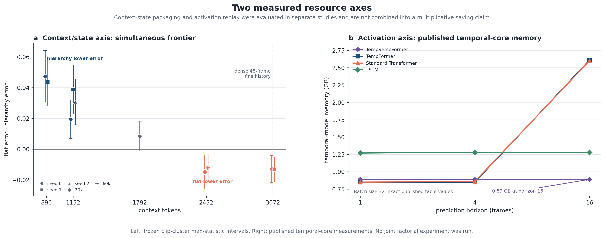

**Figure 4.16 — Two independently measured resource axes.** Panel A summarises the context-state
frontier established in this chapter. Panel B reproduces the activation-memory scaling evidence
from the reversible temporal study. The panels are not a joint factorial, their savings are not
added or multiplied, and reversible replay is not part of the Chapter 3 predictor.
*Source and status: author-generated evidence synthesis. Panel A redraws frozen E2 frontier values;
Panel B redraws exact published TempVerseFormer table values [135]. No published figure pixels are reused.*

Spatial allocation adds a final, prospective branch. Predictive entropy from the fixed-patch V-BLT
study can mark where the model is uncertain or locally complex, but the published evidence does
not validate a dynamic controller. Entropy-informed variable regioning should therefore enter the
decision tree as a candidate adaptive policy whose end-to-end compute–quality benefit remains to
be measured.

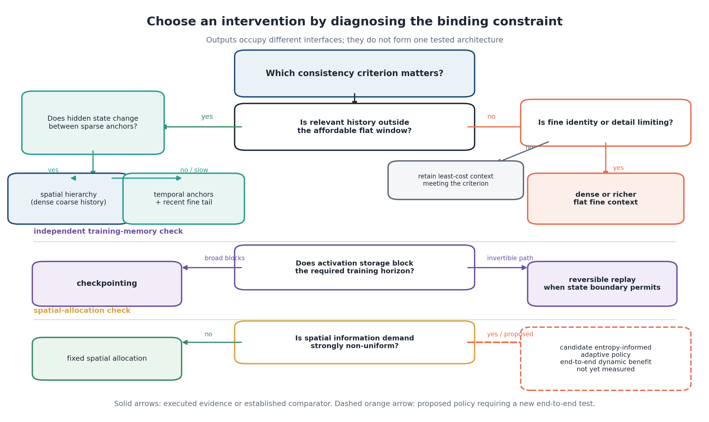

**Figure 4.17 — Binding-constraint decision flow.** The flow converts measured boundaries into a
method-selection procedure. Context hierarchy, dense context, checkpointing, reversibility, and
entropy-informed allocation occupy different system interfaces; no leaf is a universal winner.
*Source and status: author-generated conceptual decision flow from the operating-region evidence
and scope boundaries in Chapters 2--4; generated by `scripts/make_restructured_ch2_ch4_figures.py`.*

### 4.8.2 Package applicability matrix

**Table 4.10 — Applicability of the developed and comparator interventions.** Evidence level
distinguishes measured methods from design candidates. “Cost” names the principal trade-off, not
an exhaustive implementation budget.

| Intervention | Controlled resource or interface | Principal benefit | Cost or failure mode | Evidence level in this dissertation | Suitable operating region |
|---|---|---|---|---|---|
| Dense flat context | context/state memory | preserves full spatial identity and texture at every retained time | reach grows linearly with fine-token cost | executed comparator; confirmed at the tested upper frontier and favoured for E6 identity | relevant span fits and fine identity/detail is limiting |
| Spatial hierarchical context | context/state memory | dense long history at one quarter of the per-frame token cost in the frozen codec | old detail is compressed; abstraction costs appear after reach saturates | executed and untouched-confirmed at 896/1,152; external support/continuity boundary | important past lies outside the affordable fine window; support or trajectory matters |
| Temporal subsampling with recent fine tail | context/state memory | retains old full-resolution anchor frames efficiently | aliases changes between anchors and gives no dense decodable old stream | five-seed diffusion-stable development result on a static world | hidden state changes slowly between anchors and appearance at selected times matters |
| Spatio-temporal stride-2 package | context and target configuration | cheapest tested complete configuration with nominal 48-frame reach | context and target interfaces co-change; pure stride effect unidentified | untouched whole-configuration confirmation | use only as the measured complete interface, not as evidence for stride alone |
| Entropy-informed adaptive spatial representation | candidate representation allocator | could direct fine capacity toward locally complex regions | policy overhead, calibration, routing stability, and end-to-end gain unmeasured | predictive entropy maps measured under fixed patches; dynamic allocation proposed | future systems with strongly non-uniform spatial demand |
| Gradient checkpointing | activation memory | broadly applicable recomputation without invertible layers | recomputation schedule and residual stored activations | established comparator; no direct Chapter 3 factorial | activation storage binds and arbitrary non-invertible blocks must be retained |
| Reversible temporal replay | activation memory | reconstructs intermediate temporal states instead of storing the full activation tape | invertibility and numerical constraints, replay computation, deterministic re-anchors, and strategy-dependent RNG metadata | published deterministic TempVerse result; deterministic multi-level memory frontier and separate gradient check; separate single-stage stochastic reconstruction check; not in Chapter 3 | long temporal differentiation is required and reversible state boundaries can be enforced |
| Privileged explicit memory | storage/addressing interface | shows the potential of lossless history and exact querying | raw storage, exact pose, and non-deployable information advantage | executed diagnostic reference | mechanism analysis or an upper access reference, not a fair model comparison |

The matrix prevents two common category errors. A context package cannot solve activation growth
through a long training graph, and reversible replay cannot make a missing observation available
at inference. Similarly, only an executed policy with a measured computation–quality trade-off can
turn an entropy map into a validated dynamic allocator.

### 4.8.3 Relationship among the developed methods

The methods occupy adjacent interfaces in one systems methodology. Consistency criteria define
what must be preserved. Reversible temporal computation reduces the activation cost when the loss
must differentiate through a long process. V-BLT and RoPE-ND investigate hierarchical visual
representation, coordinate structure, and predictive dispersion. The final predictor manipulates
which historical latent observations remain addressable under an explicit context budget. Chapter
4 turns the last design space into empirical operating regions and uses the earlier results only
where their resource terms genuinely meet.

They have not been executed as one jointly trained architecture. In particular, the final
hierarchical predictor contains neither TempVerseFormer nor V-BLT/RoPE-ND, and no experiment shows
that reversible activation savings multiply with hierarchical context savings. A future integrated
system is technically plausible; it is not needed to make the present dissertation coherent.

Composition would create new questions rather than merely add known gains. A joint system would
need to hold prediction quality, total computation, replay metadata, and context payload fixed
while testing whether each component still contributes at its intended interface. Until such a
factorial exists, the defensible output is a modular selection rule: combine methods only after
their separate bottlenecks are observed in the target workload.

## 4.9 Software toolkit and practical application

### 4.9.1 Software architecture

The software follows the same separation as the scientific argument. The supported `hvp` package
provides side-effect-free interfaces for context descriptions and geometric reach, complete frame
and persistent-object evaluation, clip-cluster and simultaneous statistics, content-addressed
provenance, and outcome-independent experiment authorisation. Package import is side-effect-free:
it loads no dataset, initialises no CUDA context, contacts no experiment service, and starts no run. The public command-line
surface in version 0.3.0 is deliberately read-only: it reports the package version and checks an
experiment gate. Training and evaluation remain controlled research workflows rather than an
advertised stable CLI.

The frozen `hvp_rev` namespace contains the implementation that produced the registered evidence.
It retains historical trainers and compatibility paths because reorganising them could alter
batch construction, random-number consumption, optimiser trajectories, diffusion sampling, or
checkpoint readability. Public adapters and parity tests expose only the stable concepts. This is
less elegant than replacing the old code wholesale, but it protects the evidentiary link between
the manuscript and the computations that generated it.

Experiment controllers and figure scripts live under `scripts/`; frozen scientific configurations
and the fail-closed authorisation ledger live under `experiments/`. A `RunSpec` binds study, arm,
seed, data, codec, source revision, and relevant hyperparameters to a content-derived identity.
Accepted new runs write immutable artifacts atomically and preserve model, optimiser, EMA, and RNG
state. Protected data require a matching purpose string and append-only access record. W&B acts as
a cloud mirror and health trace; the local NPZ/JSON evidence is the source of truth.

Reproducibility checks operate at several levels. Interface validators reject incompatible package
comparisons. Metric tests cover empty masks, false positives, persistent-object assignment, misses,
extras, and coverage. Scientific configuration checks fail closed for terminal, skipped,
unregistered, or unattested studies. At the recorded release gate, ten scientific configurations
passed authorisation validation, 83 CPU tests passed, Python compilation succeeded, and the
versioned wheel built and installed in an isolated target. Those checks support auditability. They
do not make large local datasets and checkpoints publicly downloadable; external availability
requires archive URLs, licences, hashes, and tested download instructions.

A complete public reproduction would therefore add an archival layer to the existing scientific
one: stable artifact URLs, licence and size metadata, checksum-verifying download commands, and a
clean-clone figure build. The current toolkit can validate identities and comparison rules once
those assets are present. It should not be described as independently reproducible from the public
repository until that retrieval path has also been tested.

### 4.9.2 Implementation and educational use

The toolkit is useful in two ways. For research, it provides reusable generators, package
interfaces, rollout evaluators, and statistical routines that keep mechanism tests distinct from
benchmark scoring. A new package can be added only after its anchor geometry, context/target token
counts, comparison licence, and evaluation population are explicit. That discipline is a practical
result of the dissertation, not merely administrative support for it.

For teaching, the code separates concepts that are often collapsed in demonstrations: a long
window versus a compressed memory, stochastic coverage versus deterministic rollout, clip-level
uncertainty versus training-seed variation, and positive evidence versus a failed replication.
Small procedural datasets make those distinctions observable without a large hardware cluster.

Documented implementation acts report use at ORNETIKA LLC and in the educational process of
Vinnytsia National Technical University, dated 14 October 2025 and 19 September 2025. Their
approved scope concerns the reversible-transformer and entropy-tokenisation methods. They should
not be rewritten as deployment validation of the Chapter 3 predictor. Final administrative
appendices must reproduce the signed wording and scans supplied by the author.

For practical transfer, this distinction sets a useful standard. The software demonstrates how to
define packages, enforce evidence roles, and audit endpoints; the signed acts establish only the
uses they name. Any later claim of operational adoption of the hierarchical predictor should add a
separate implementation record describing the deployed configuration, data, hardware, and
evaluation criterion. Educational use can proceed with the controlled generators because their
purpose is methodological visibility, not domain performance.

## 4.10 Limitations and threats to validity

### 4.10.1 Internal and construct validity

The strongest internal-validity feature is the pair-specific observability instrument. It tests
whether the package benefit grows on records whose relevant past is available only to the longer
package. Still, spatial resolution and nominal reach change together in the central matched pair.
The reach band makes reach the best-supported explanation, but the package comparison still changes
more than time alone. Counterfactual hidden worlds would be needed
to distinguish observed history from a strong prior that guesses the same content.
B1 has a sharper confound. Its target stride, target slots, auxiliary objective, sequence length,
and optimisation load change with context stride. The whole configuration is valid and confirmed,
but any sentence assigning its effect solely to stride would exceed the design. The depth probe
has an analogous boundary because representational depth, target allocation, and training load are
not separated.

Metric construction can also change the answer. Sparse scenes make full-frame MSE and SSIM
background dominated, while ground-truth-foreground MSE ignores hallucinated objects outside the
mask. The complete endpoint suite mitigates these blind spots but cannot define task value
universally. Thresholded components depend on a segmentation threshold and minimum size. E6 adds
classifier and assignment assumptions even though its one-to-one matching, fixed denominator, and
coverage endpoint prevent the most serious survivor bias. The persistence of difficult absolute
values is a warning against reading clean relative intervals as solved prediction.

Qualitative evidence is intentionally secondary. A fixed-index gallery makes the displayed sample
reproducible, but selection uncertainty remains without a registered representative-quantile rule;
in any case, a small gallery cannot represent the joint distribution of
errors. Likewise, the raw mosaic is informative because it removes learned addressing, but its
privileged future pose and lossless storage exclude it from the model ranking.

The energy result has a different provenance limitation. Its plots come from hash-listed legacy
logs rather than the content-addressed schema used by E2–E8, and its feasible scale remains below
the reference large-video training configuration. It is sufficient to close that branch for the
current programme, not to establish a general failure of energy-based modelling.

### 4.10.2 Statistical and external validity

Training-seed coverage is uneven by design. The primary 896-token result has two seeds; the
1,152-token result has three; the package-shape factorial has five; middle and upper points have
one or two. Clip-cluster intervals quantify uncertainty over clips conditional on each trained
model and cannot substitute for seed replication. The unresolved 1,792 point and the reduced
precision of upper robustness effects should therefore remain visible wherever the frontier is
summarised.
Sampler robustness uses frozen seed-0 checkpoints. Codec robustness uses one independently trained
codec and predictor seed 0. These studies reject simple explanations based on one DDIM allocation
or one latent-codec initialisation, but they do not establish invariance across model families,
larger seed panels, discrete tokenisers, or different spatial scales. Nor does the experiment
identify which change inside the alternate codec caused the smaller upper effect.

External validity is the largest scientific limitation. LoopMom is synthetic and static; it was
built to make the reach mechanism observable, not to mimic natural video. Persistent long
Moving-MNIST adds object identity, collision, and long self-fed motion, but remains a digit
generator. TaxiBJ is real data, although its four-frame horizon lacks a re-entry-memory demand.
No natural-video disappearance/reappearance benchmark is used to confirm the main claim.

The budget frontier is discrete. It supports confirmed tested points and a family-wise bracket,
not a unique crossing, monotonic curve, or asymptotic law. Context-token ratios quantify direct
state storage and materialised embeddings, not wall time, attention FLOPs, total GPU memory, or
equal performance. No equivalence test was registered, so an unresolved interval must never be
translated into “the methods are the same.”

Finally, the dissertation-level resource synthesis joins conclusions, not experiments. Reversible
replay was not inserted into the hierarchical predictor, and adaptive entropy-driven regioning was
not implemented there. Their joint benefit and any multiplicative memory saving remain future
questions. The current result is stronger for stating that separation plainly.

### 4.10.3 Chapter conclusions

The experiment programme yields a decision framework rather than a winning architecture. Under a
controlled single-step oracle-coverage regime, diffusion covers the target distribution better
than the closely matched regression head at the reported, unequal total inference work. During
deterministic self-fed best-of-one rollout, regression is better. Energy-based descent fails to
reach structured targets at the tested scale even when one recipe learns the desired energy
ordering. Generation mechanism must therefore be selected with the inference regime attached.

Untouched LoopMom evidence supports the proposed reach mechanism. Hierarchical packages are most
useful on records whose relevant re-entry evidence lies outside the flat window and inside the
longer package. Complete foreground, union, background, component, and coverage endpoints agree
with that direction, making a background or false-positive artefact unlikely.

The tested budget frontier has two distinct regions. Hierarchy is confirmed at 896 and 1,152
context tokens; the 1,792-token comparison is unresolved; flat context is confirmed at 2,432 and
3,072. At equal nominal 48-frame reach, the two confirmed hierarchical packages use 2.67 and 3.43
times fewer context tokens than dense fine history. These are reach-efficiency ratios. They do not
state equal performance, information, compute, or total memory.

Package form also matters. Sparse full-resolution anchors are stable across five diffusion seeds
on the static LoopMom world, whereas regression package effects and the head interaction change
direction. Spatial and temporal compression are not interchangeable. The most economical
representation depends on what can happen between stored anchors and which prediction objective
learns to use the package.

Robustness and boundary studies narrow the claim without overturning it. The principal directions
survive the registered sampler/NFE grid and one independently trained codec at the point-estimate
level, although the upper flat-fidelity inversion loses family-wise precision in several variants.
The proposed late self-fed trust boundary fails to replicate. Privileged raw access reveals a
large remaining addressing-and-reuse gap. On persistent objects, hierarchy improves spatial
support and continuity while flat context preserves identity; neither system performs well enough
to call the task solved.

Short Moving-MNIST and TaxiBJ results add competence evidence, not confirmation of long-range
memory. Their limited horizons and unmatched context budgets keep them outside the central causal
claim. Natural-video disappearance and re-entry, broader codec and seed panels, and a registered
test near 1,792 tokens remain the most direct routes to a wider operating-region conclusion.

The resulting design rule is practical. Establish the task-relevant consistency criterion. Buy
reach when the needed past is missing; preserve fine detail when that past already fits. If the
training tape, rather than retained context, is the binding resource, use checkpointing or
reversible replay as a separate intervention. Entropy-informed dynamic spatial allocation remains
a promising policy, but its end-to-end benefit has not yet been measured.

In short: compress what must remain addressable, retain detail where identity depends on it, and
reconstruct activations only when long temporal differentiation makes storage the constraint.

---

# General Conclusions

The dissertation treated long-horizon video prediction as a problem of allocating limited resources to the information a task must preserve. Three constraints were separated: activation storage during temporal learning, spatial capacity within a visual representation, and retained context during inference. The developed methods intervene at different interfaces. TempVerseFormer reconstructs a verified temporal transformer state during the backward pass; V-BLT studies local–global raster-byte representation and predictive entropy; the final hierarchical-context model compares coarse and fine retained histories under explicit budgets. Their connection is a systems methodology, not one jointly evaluated neural pipeline.

That separation changes the design question. A system may fail because the relevant event has left its context, because fine evidence was compressed, or because the desired training horizon cannot fit in activation memory. Those failures call for different interventions. Accordingly, the work moves from consistency criteria to resource diagnosis and then to operating-region evidence: first establish what must remain correct, identify the binding constraint, and only then choose the memory or representation mechanism.

Six task-aligned results establish that the research aim was achieved.

1. **The system problem and its consistency criteria were formalized.** Video prediction was represented as a partially observed dynamic process whose frames reveal only a viewport of the latent world state. Autoregressive feedback turns an early prediction error into a change in the later input distribution, so single-frame similarity cannot by itself characterize long-horizon behavior. A task-level framework distinguishes appearance, identity, geometry and support, temporal continuity, trajectory, false foreground, and cross-level agreement. Although overlapping, these criteria expose different failures: a predictor can place an object correctly while changing its identity, preserve local smoothness while following the wrong trajectory, or reconstruct fine recent appearance without retaining the earlier observation needed at re-entry. Storage, addressability, and reliable reuse are also separated. Resource statements were therefore assigned to parameter, optimizer, activation, context/state, or transient memory instead of being summarized as one generic saving. This decomposition supplied the requirements used in the later controlled comparisons: causal processing, explicit cost accounting, self-fed evaluation, mechanism-sensitive populations, and endpoints that penalize both omissions and hallucinations.

2. **A reversible temporal-computation method and its applicability boundary were established.** Additive coupling permits the persistent doubled transformer state to be reconstructed from the terminal state during backward execution. Implementation inspection confines that exact inverse to the repeated transformer chain; the VAE, learned input projection, output fusion, decoder, and loss interface remain outside it. Within the reported measurements, temporal-model memory stays near 0.89 GB at one, four, and sixteen prediction steps, while matched non-reversible transformer variants reach approximately 2.60–2.61 GB at sixteen steps. The published long-horizon plot remains near 1 GB through the displayed 1,024-step range, although raw high-horizon coordinates are unavailable and no finer numerical claim is made from the image.

   The saving has a price. Reverse replay increases training time, and predictive quality is mixed across the controlled motion regimes and OpenSTL datasets. Separate dissertation checks examine stochastic single-stage reconstruction, deterministic multilevel gradient agreement, and a deterministic multilevel memory frontier; no one frozen receipt combines all three properties. Replay metadata, deterministic re-anchors, and numerical drift therefore belong in any deployment cost. The method is best read as an activation-memory option when a loss must differentiate through a long temporal process and the reversible state boundary can be enforced. It neither proves that reversibility improves forecasting universally nor explains the hierarchical-context effects reported later.

3. **A hierarchical raster-byte representation, multidimensional positional method, and spatial-complexity signal were developed.** V-BLT applies local encoding, global latent processing, and local decoding to uncompressed raster pixel-channel bytes. Its 256-way categorical objective avoids a learned output vocabulary, while RoPE-ND assigns disjoint rotary subspaces to temporal and spatial coordinates so that their relative positions enter attention without collapsing the axes. The published proof of concept evaluates fixed $4\times4\times4$ spatio-temporal packages on rotating 2-D triangles and 3-D polycubes. Reported cost and quality point estimates compare favorably with the listed ViViT and UNet-3D configurations on several measures, although equal reported model-size figures do not establish equal serialized size and ViViT retains the best reported 3-D PSNR.

   Categorical predictive entropy produces per-byte maps that visually concentrate around difficult object regions and early uncertain predictions. That is a complexity signal, not a calibrated uncertainty estimate. More importantly, the experiment did not use entropy to resize regions or route computation: patch geometry remained fixed throughout training and inference. Nonuniform allocation is therefore a motivated next method, not an accomplished saving. Establishing it would require a specified controller, a fixed work or payload budget, quantitative entropy–dynamics and calibration tests, and an end-to-end comparison with fixed patches. The public visionBLT repository makes the implementation available; a reproducing run should explicitly archive the published temporal package size, commit, configuration, and checkpoint rather than substitute the current default.

4. **The central hierarchical-context predictor was specified as a controlled model family.** A frozen two-level codec supplies independently decodable coarse and fine states. Context tokens and noisy target tokens enter a shared joint-attention diffusion transformer, while autoregressive ring buffers return decoded predictions to both streams after each generated window. A package records its spatial level, temporal stride, frame count, and anchor geometry; this makes its addressable history calculable before a result is observed. Context tokens, target tokens, total sequence length, latent payload, and inference work are reported separately, avoiding the misleading use of one “budget” for several different costs.

   The controlled family matters because a comparison is only interpretable when its licence is explicit. Exact matches isolate package geometry under a common codec, head, target interface, and paired population. Near-matches disclose which arm receives the resource advantage, while whole-configuration studies support only their coupled intervention. Frozen codec boundaries and detached context paths further restrict where gradients can alter the system. The final predictor itself contains neither V-BLT/RoPE-ND nor TempVerseFormer. Its long-horizon behavior can consequently be attributed to the tested retained-history interfaces without pretending that the earlier methods were jointly trained or that their separately measured resource savings multiply.

   That controlled boundary makes the final model the dissertation’s empirical core: its principal intervention and measured outcome remain aligned.

5. **An evaluation methodology was developed for effects that depend on historical reach.** LoopMom provides a known toroidal world, viewport path, and re-entry geometry. That structure makes the last relevant observation identifiable and permits pair-specific populations whose evidence lies beyond the shorter package’s reach but within the longer one’s reach. Eligibility also excludes empty or unanswerable records. Complete frame and object endpoints distinguish missing content from extra foreground, while the persistent-object extension separates coverage, identity, and trajectory through one-to-one assignment with misses retained in the denominator.

   Statistical units follow the rollout process. Paired effects are computed from aligned records, but clips—not individual frames—are resampled so that inherited self-fed errors remain clustered; training seeds form a separate uncertainty level. Registered comparison families receive simultaneous maximum-statistic intervals. Development, untouched, purpose-locked, protected, robustness, and boundary populations retain distinct roles, and unresolved or failed results remain in the terminal record. This protocol turns the proposed reach mechanism into a falsifiable comparison rather than relying on late-horizon averages or selected qualitative examples.

   It also provides a reusable template for future long-memory datasets whose relevant history can be logged or annotated explicitly.

6. **Operating regions of hierarchical and flat context were identified.** The strongest evidence is local to the mechanism. On the untouched reach-differential population, hierarchical context improves the registered endpoint by 0.0980 and 0.0914 across two training seeds, with supporting gains in union-mask error, precision, recall, missed and extra components, and coverage. Simultaneous analysis confirms hierarchy at 896 and 1,152 context tokens, leaves 1,792 unresolved, and confirms dense flat context at 2,432 and 3,072. No interpolated crossing is inferred. At nominal 48-frame reach, 48 dense fine frames require 3,072 context tokens; packages with 48 coarse frames plus six or two recent fine frames require 1,152 or 896. The corresponding 2.67- and 3.43-fold reductions establish reach efficiency at the tested interface, not equal performance, compute, or total-memory savings.

   Package shape and prediction mechanism refine that frontier. Sparse full-resolution temporal anchors outperform dense coarse history across five diffusion seeds on the static LoopMom world, whereas regression effects and the head-by-package interaction vary across training seeds. Sampler/NFE changes preserve all principal point-estimate directions; an independently trained codec does the same, though several upper effects lose family-wise precision. The early self-fed hierarchy benefit replicates across three seeds, but the proposed late inversion does not. A privileged raw mosaic shows that exact storage and addressing remain much easier than learned reuse.

   The external persistent-object study supplies the clearest boundary. Hierarchy preserves spatial support and continuity more effectively, whereas flat context preserves digit identity; absolute coverage, identity, and trajectory values show that neither system solves the 300-frame task. Short Moving-MNIST and TaxiBJ add competence evidence but no long-reentry confirmation. Taken together, these results support the conditional rule “hierarchy buys reach; flat context buys fidelity” over the sampled regimes. They do not establish a universal architecture ranking. The practical choice depends on whether relevant history is absent, fine identity is already the limiting factor, or the bottleneck lies in the training graph instead of retained context.

## Practical significance

The work provides a reusable experimental and software framework for designing long-horizon predictors. Configurations encode package anchors, costs, datasets, samplers, codec identities, and evidence purposes. Fail-closed authorization, content-addressed run specifications, immutable artifacts, complete endpoint implementations, compatibility checks, and artifact-derived reporting reduce semantic drift between experiments and manuscripts. Controlled generators allow a new method to be tested where its proposed mechanism is observable before more expensive natural-video evaluation.

The resulting selection rule is operational. When the required event lies outside the fine window, preserve longer state through hierarchy or another compression mechanism. When both packages reach the event and fine identity matters, retain dense detail. If a desired training loss differentiates through a long chain and activations dominate memory, compare checkpointing with a verified reversible core, including replay time and metadata. Predictive entropy can inform a future allocation policy, but it should not be counted as a saving until that policy is executed and measured.

For education and research transfer, the separation of interfaces is as useful as the individual model implementations. Students and practitioners can vary a context package without rewriting the predictor, inspect which endpoint detects a failure, and distinguish an artifact receipt from an exploratory plot. **[AUTHOR INPUT: insert only the implementation acts and covered components supported by signed institutional documents in the final version.]**

## Limitations and directions for further research

External validity remains the strongest limitation. LoopMom and persistent long Moving-MNIST were designed to isolate memory phenomena; they do not reproduce the textures, camera cuts, nonrigid motion, multi-object interaction, or latent ambiguity of natural video. OpenSTL results establish competence only for the methods and datasets directly evaluated in the corresponding source experiment. A next study should construct a natural-video or interactive-world protocol with auditable long-range evidence and identity-sensitive endpoints instead of relying on a generic leaderboard average.

Spatial adaptation is incomplete. The V-BLT experiment measured a fixed-patch model and entropy maps, not a controller that changes regions, tokens, or computation. Future work should specify such a policy, hold total work or payload fixed, evaluate calibration and spatial association quantitatively, and compare end-to-end quality against fixed patches. Any rerun from the public repository should freeze the reported $4\times4\times4$ specification, source commit, configuration, and checkpoint as one reproducibility receipt.

The reversible method deserves a direct comparison with modern checkpoint schedules under the same model, precision, horizon, and memory budget. Stochastic replay metadata and numerical drift should be included in the cost. If future integration is pursued, an optional multi-window objective could test whether reversible rollout training improves the hierarchical predictor; until then, activation and context savings remain separately measured axes.

Finally, the tested context budgets sample a frontier but do not estimate a universal Pareto curve. More seeds near the unresolved 1,792-token point, additional independently trained codecs, broader package shapes, and natural-video tasks would refine the boundary. Such experiments should preserve the central discipline of this dissertation: diagnose the binding constraint first, then test one intervention where its mechanism can be observed.

---

# References

External sources retain stable numeric identifiers across the assembled dissertation. In-text citations use square brackets throughout.

1. Tan C., Li S., Gao Z., et al. OpenSTL: A Comprehensive Benchmark of Spatio-Temporal Predictive Learning. *NeurIPS 36 (D&B)*, 2023.
2. Ho J., Jain A., Abbeel P. Denoising Diffusion Probabilistic Models. *NeurIPS 33*, 2020.
3. Rombach R., Blattmann A., Lorenz D., Esser P., Ommer B. High-Resolution Image Synthesis with Latent Diffusion Models. *CVPR*, 2022.
4. Peebles W., Xie S. Scalable Diffusion Models with Transformers (DiT). *ICCV*, 2023.
5. Згуровський М. З., Панкратова Н. Д. *Основи системного аналізу: підручник*. Київ: Видавнича група BHV, 2007. 544 с. ISBN 978-966-552-153-2.
6. Zgurovsky M. Z., Pankratova N. D. *System Analysis: Theory and Applications*. 1st ed. Springer Berlin, Heidelberg, 2007. XXII, 447 p. DOI: 10.1007/978-3-540-48880-4.
7. Mesarović M. D., Macko D., Takahara Y. *Theory of Hierarchical, Multilevel Systems*. Academic Press, 1970.
8. Simon H. A. The Architecture of Complexity. *Proceedings of the American Philosophical Society* 106(6):467–482, 1962.
9. Shannon C. E. A Mathematical Theory of Communication. *Bell System Technical Journal* 27:379–423, 623–656, 1948.
10. Kalman R. E. A New Approach to Linear Filtering and Prediction Problems. *Journal of Basic Engineering* 82(1):35–45, 1960.
11. Ashby W. R. *An Introduction to Cybernetics*. Chapman & Hall, 1956.
12. Vaswani A., Shazeer N., Parmar N., et al. Attention Is All You Need. *NeurIPS 30*, 2017.
13. Dao T., Fu D. Y., Ermon S., Rudra A., Ré C. FlashAttention: Fast and Memory-Efficient Exact Attention with IO-Awareness. *NeurIPS 35*, 2022.
14. Dai Z., Yang Z., Yang Y., Carbonell J., Le Q. V., Salakhutdinov R. Transformer-XL: Attentive Language Models Beyond a Fixed-Length Context. *ACL*, 2019.
15. Rae J. W., Potapenko A., Jayakumar S. M., Lillicrap T. P. Compressive Transformers for Long-Range Sequence Modelling. *ICLR*, 2020.
16. Wu Y., Rabe M. N., Hutchins D., Szegedy C. Memorizing Transformers. *ICLR*, 2022.
17. Kitaev N., Kaiser Ł., Levskaya A. Reformer: The Efficient Transformer. *ICLR*, 2020.
18. Beltagy I., Peters M. E., Cohan A. Longformer: The Long-Document Transformer. arXiv:2004.05150, 2020.
19. Gu A., Dao T. Mamba: Linear-Time Sequence Modeling with Selective State Spaces. arXiv:2312.00752, 2023.
20. Saxena V., Ba J., Hafner D. Clockwork Variational Autoencoders. *NeurIPS 34*, 2021.
21. Harvey W., Naderiparizi S., Masrani V., Weilbach C., Wood F. Flexible Diffusion Modeling of Long Videos (FDM). *NeurIPS 35*, 2022.
22. Po R., Nitzan Y., Zhang R., Chen B., Dao T., Shechtman E., Wetzstein G., Huang X. Long-Context State-Space Video World Models. arXiv:2505.20171, 2025.
23. Oshima Y., Iwasawa Y., Suzuki M., Matsuo Y., Furuta H. WorldPack: Compressed Memory Improves Spatial Consistency in Video World Modeling. arXiv:2512.02473, 2025.
24. Wu T., Yang S., Po R., Xu Y., Liu Z., Lin D., Wetzstein G. Video World Models with Long-term Spatial Memory. arXiv:2506.05284, 2025.
25. Ranzato M., Chopra S., Auli M., Zaremba W. Sequence Level Training with Recurrent Neural Networks (exposure bias). *ICLR*, 2016.
26. Bengio S., Vinyals O., Jaitly N., Shazeer N. Scheduled Sampling for Sequence Prediction with Recurrent Neural Networks. *NeurIPS 28*, 2015.
27. Huang X., Li Z., He G., Zhou M., Shechtman E. Self Forcing: Bridging the Train-Test Gap in Autoregressive Video Diffusion. *NeurIPS 2025* (spotlight); arXiv:2506.08009.
28. Werbos P. J. Backpropagation Through Time: What It Does and How to Do It. *Proceedings of the IEEE* 78(10), 1990.
29. Williams R. J., Peng J. An Efficient Gradient-Based Algorithm for On-Line Training of Recurrent Network Trajectories (truncated BPTT). *Neural Computation* 2(4), 1990.
30. Chen T., Xu B., Zhang C., Guestrin C. Training Deep Nets with Sublinear Memory Cost. arXiv:1604.06174, 2016.
31. Griewank A., Walther A. Algorithm 799: revolve — An Implementation of Checkpointing for the Reverse or Adjoint Mode of Computational Differentiation. *ACM TOMS* 26(1), 2000.
32. Gomez A. N., Ren M., Urtasun R., Grosse R. B. The Reversible Residual Network: Backpropagation Without Storing Activations. *NeurIPS 30*, 2017.
33. Koutník J., Greff K., Gomez F., Schmidhuber J. A Clockwork RNN. *Proceedings of Machine Learning Research* 32(2):1863–1871, ICML, 2014.
34. Kim T., Ahn S., Bengio Y. Variational Temporal Abstraction. *NeurIPS 32*, 2019.
35. Zakharov A., Guo Q., Fountas Z. Long-Horizon Video Prediction Using a Dynamic Latent Hierarchy. arXiv:2212.14376, submitted 2022, revised 2023.
36. Yan W., Hafner D., James S., Abbeel P. Temporally Consistent Transformers for Video Generation (TECO). *ICML*, 2023.
37. Chandratreya I. P., Charatan D., Van Hoorick B., Zakharov S., Guizilini V., Isola P., Sitzmann V. MilliVid: Hierarchical Latents for Long-Range Consistency in Video Generation. arXiv:2606.09056, 2026.
38. Liu Y., Zhang K., Li Y., Yan Z., Gao C., Chen R., Yuan Z., Huang Y., Sun H., Gao J., He L., Sun L. Sora: A Review on Background, Technology, Limitations, and Opportunities of Large Vision Models. arXiv:2402.17177, 2024.
39. Lipton Z. C. The Mythos of Model Interpretability. *Communications of the ACM* 61(10), 2018.
40. Rudin C. Stop Explaining Black Box Machine Learning Models for High Stakes Decisions and Use Interpretable Models Instead. *Nature Machine Intelligence* 1, 2019.
41. von Bertalanffy L. *General System Theory: Foundations, Development, Applications*. George Braziller, 1968.
42. Goodfellow I., Pouget-Abadie J., Mirza M., et al. Generative Adversarial Networks. *NeurIPS 27*, 2014.
43. Kingma D. P., Welling M. Auto-Encoding Variational Bayes. *ICLR*, 2014.
44. Kendall A., Gal Y. What Uncertainties Do We Need in Bayesian Deep Learning for Computer Vision? *NeurIPS 30*, 2017.
45. Guo C., Pleiss G., Sun Y., Weinberger K. Q. On Calibration of Modern Neural Networks. *Proceedings of Machine Learning Research* 70:1321–1330, ICML, 2017.
46. Bhadra S., Kelkar V. A., Brooks F. J., Anastasio M. A. On Hallucinations in Tomographic Image Reconstruction. *IEEE Transactions on Medical Imaging* 40(11):3249–3260, 2021. DOI: 10.1109/TMI.2021.3077857.
47. Ebel P., Sainte Fare Garnot V., Schmitt M., Wegner J. D., Zhu X. X. UnCRtainTS: Uncertainty Quantification for Cloud Removal in Optical Satellite Time Series. *IEEE/CVF Conference on Computer Vision and Pattern Recognition Workshops*, pp. 2086–2096, 2023. DOI: 10.1109/CVPRW59228.2023.00202.
48. Huot F., Hu R. L., Goyal N., Sankar T., Ihme M., Chen Y.-F. Next Day Wildfire Spread: A Machine Learning Data Set to Predict Wildfire Spreading From Remote-Sensing Data. *IEEE Transactions on Geoscience and Remote Sensing* 60:1–13, 2022. DOI: 10.1109/TGRS.2022.3192974.
49. Shaddy B., Ray D., Farguell A., et al. Generative Algorithms for Fusion of Physics-Based Wildfire Spread Models with Satellite Data for Initializing Wildfire Forecasts. *Artificial Intelligence for the Earth Systems* 3(3):e230087, 2024. DOI: 10.1175/AIES-D-23-0087.1.
50. Bond-Taylor S., Leach A., Long Y., Willcocks C. G. Deep Generative Modelling: A Comparative Review of VAEs, GANs, Normalizing Flows, Energy-Based and Autoregressive Models. *IEEE TPAMI* 44(11), 2022.
51. Ji Z., Lee N., Frieske R., et al. Survey of Hallucination in Natural Language Generation. *ACM Computing Surveys* 55(12), 2023.
52. Song J., Meng C., Ermon S. Denoising Diffusion Implicit Models. *ICLR*, 2021.
53. OpenAI (Brooks T., Peebles B., et al.). Video Generation Models as World Simulators (Sora technical report), 2024.
54. Ho J., Salimans T., Gritsenko A., Chan W., Norouzi M., Fleet D. J. Video Diffusion Models. *NeurIPS 35*, 2022.
55. Blattmann A., Rombach R., Ling H., Dockhorn T., Kim S. W., Fidler S., Kreis K. Align Your Latents: High-Resolution Video Synthesis with Latent Diffusion Models. *CVPR*, 2023.
56. Blattmann A., Dockhorn T., Kulal S., et al. Stable Video Diffusion: Scaling Latent Video Diffusion Models to Large Datasets. arXiv:2311.15127, 2023.
57. Singer U., Polyak A., Hayes T., et al. Make-A-Video: Text-to-Video Generation without Text-Video Data. *ICLR*, 2023.
58. Ho J., Chan W., Saharia C., et al. Imagen Video: High Definition Video Generation with Diffusion Models. arXiv:2210.02303, 2022.
59. Villegas R., Babaeizadeh M., Kindermans P.-J., et al. Phenaki: Variable Length Video Generation from Open Domain Textual Descriptions. arXiv:2210.02399, 2022.
60. Yu L., Lezama J., Gundavarapu N. B., et al. MAGVIT: Masked Generative Video Transformer. *CVPR*, 2023.
61. Yu L., Lezama J., Gundavarapu N. B., et al. Language Model Beats Diffusion — Tokenizer Is Key to Visual Generation. *ICLR*, 2024.
62. Bruce J., Dennis M., Edwards A., et al. Genie: Generative Interactive Environments. *ICML*, 2024.
63. Hu A., Russell L., Yeo H., et al. GAIA-1: A Generative World Model for Autonomous Driving. arXiv:2309.17080, 2023.
64. Ha D., Schmidhuber J. World Models. arXiv:1803.10122, 2018.
65. Hafner D., Lillicrap T., Ba J., Norouzi M. Dream to Control: Learning Behaviors by Latent Imagination. *ICLR*, 2020.
66. Hafner D., Pasukonis J., Ba J., Lillicrap T. Mastering Diverse Domains through World Models. arXiv:2301.04104, 2023.
67. Micheli V., Alonso E., Fleuret F. Transformers Are Sample-Efficient World Models. *ICLR*, 2023.
68. Pasukonis J., Lillicrap T., Hafner D. Evaluating Long-Term Memory in 3D Mazes (Memory Maze). arXiv:2210.13383, 2022.
69. Dosovitskiy A., Beyer L., Kolesnikov A., et al. An Image is Worth 16×16 Words: Transformers for Image Recognition at Scale (ViT). *ICLR*, 2021.
70. Arnab A., Dehghani M., Heigold G., et al. ViViT: A Video Vision Transformer. *ICCV*, 2021.
71. Liu Z., Ning J., Cao Y., et al. Video Swin Transformer. *CVPR*, 2022.
72. Pagnoni A., Pasunuru R., Rodriguez P., et al. Byte Latent Transformer: Patches Scale Better Than Tokens. arXiv:2412.09871, 2024.
73. van den Oord A., Vinyals O., Kavukcuoglu K. Neural Discrete Representation Learning (VQ-VAE). *NeurIPS 30*, 2017.
74. Yan W., Zhang Y., Abbeel P., Srinivas A. VideoGPT: Video Generation using VQ-VAE and Transformers. arXiv:2104.10157, 2021.
75. Razavi A., van den Oord A., Vinyals O. Generating Diverse High-Fidelity Images with VQ-VAE-2. *NeurIPS 32*, 2019.
76. Child R. Very Deep VAEs Generalize Autoregressive Models and Can Outperform Them on Images. *ICLR*, 2021.
77. Vahdat A., Kautz J. NVAE: A Deep Hierarchical Variational Autoencoder. *NeurIPS 33*, 2020.
78. Sønderby C. K., Raiko T., Maaløe L., Sønderby S. K., Winther O. Ladder Variational Autoencoders. *NeurIPS 29*, 2016.
79. Peng Z., Ma J., Sun H., et al. Compression and Retrieval: Implicit Memory Retrieval for Video World Models. arXiv:2606.23105, 2026.
80. Yu J., Gao J., Bai J., et al. MemLearner: Learning to Query Context Memory for Video World Models. arXiv:2606.31734; ECCV 2026.
81. Wei Z., Guo X., Li X., et al. Geometry-Aware Implicit Memory for Video World Models. arXiv:2606.02436, 2026.
82. Zhang S., Zhang Z., Huang S., et al. MBench: A Comprehensive Benchmark on Memory Capability for Video World Models. arXiv:2606.00793, 2026.
83. Chen H., Zhou K., Hua H., et al. MemoBench: Benchmarking World Modeling in Dynamically Changing Environments. arXiv:2606.27537, 2026.
84. LeCun Y., Chopra S., Hadsell R., Ranzato M., Huang F. A Tutorial on Energy-Based Learning. In *Predicting Structured Data*, MIT Press, 2006.
85. Ackley D. H., Hinton G. E., Sejnowski T. J. A Learning Algorithm for Boltzmann Machines. *Cognitive Science* 9(1), 1985.
86. Hyvärinen A. Estimation of Non-Normalized Statistical Models by Score Matching. *JMLR* 6, 2005.
87. Song Y., Ermon S. Generative Modeling by Estimating Gradients of the Data Distribution. *NeurIPS 32*, 2019.
88. Gladstone A., Nanduru G., Islam M. M., Han P., Ha H., Chadha A., Du Y., Ji H., Li J., Iqbal T. Energy-Based Transformers are Scalable Learners and Thinkers. arXiv:2507.02092, 2025.
89. Du Y., Mordatch I. Implicit Generation and Modeling with Energy-Based Models. *NeurIPS 32*, 2019.
90. Nijkamp E., Hill M., Zhu S.-C., Wu Y. N. On Learning Non-Convergent Non-Persistent Short-Run MCMC Toward Energy-Based Model. *NeurIPS 32*, 2019.
91. Chen R. T. Q., Rubanova Y., Bettencourt J., Duvenaud D. Neural Ordinary Differential Equations. *NeurIPS 31*, 2018.
92. Mangalam K., Fan H., Li Y., et al. Reversible Vision Transformers. *CVPR*, 2022.
93. Khalil H. K. *Nonlinear Systems* (3rd ed.). Prentice Hall, 2002.
94. Heusel M., Ramsauer H., Unterthiner T., et al. GANs Trained by a Two Time-Scale Update Rule Converge to a Local Nash Equilibrium (FID). *NeurIPS 30*, 2017.
95. Saharia C., Chan W., Chang H., et al. Palette: Image-to-Image Diffusion Models. *SIGGRAPH*, 2022.
96. Ruiz N., Li Y., Jampani V., et al. DreamBooth: Fine Tuning Text-to-Image Diffusion Models for Subject-Driven Generation. *CVPR*, 2023.
97. Hu E. J., Shen Y., Wallis P., et al. LoRA: Low-Rank Adaptation of Large Language Models. *ICLR*, 2022.
98. Zhang L., Rao A., Agrawala M. Adding Conditional Control to Text-to-Image Diffusion Models (ControlNet). *ICCV*, 2023.
99. Hertz A., Voynov A., Fruchter S., Cohen-Or D. Style Aligned Image Generation via Shared Attention. *CVPR*, 2024.
100. Marr D. *Vision: A Computational Investigation into the Human Representation and Processing of Visual Information*. W. H. Freeman, 1982.
101. Radford A., Kim J. W., Hallacy C., et al. Learning Transferable Visual Models From Natural Language Supervision (CLIP). *ICML*, 2021.
102. Hessel J., Holtzman A., Forbes M., Le Bras R., Choi Y. CLIPScore: A Reference-free Evaluation Metric for Image Captioning. *EMNLP*, pp. 7514–7528, 2021. DOI: 10.18653/v1/2021.emnlp-main.595.
103. Otani M., Togashi R., Sawai Y., et al. Toward Verifiable and Reproducible Human Evaluation for Text-to-Image Generation. *CVPR*, pp. 14277–14286, 2023.
104. Thrush T., Jiang R., Bartolo M., et al. Winoground: Probing Vision and Language Models for Visio-Linguistic Compositionality. *CVPR*, pp. 5238–5248, 2022.
105. Goodfellow I., Bengio Y., Courville A. *Deep Learning*. MIT Press, 2016.
106. Shaw P., Uszkoreit J., Vaswani A. Self-Attention with Relative Position Representations. *NAACL*, 2018.
107. Su J., Ahmed M., Lu Y., et al. RoFormer: Enhanced Transformer with Rotary Position Embedding. *Neurocomputing* 568, 2024 (arXiv:2104.09864, 2021).
108. Rajbhandari S., Rasley J., Ruwase O., He Y. ZeRO: Memory Optimizations Toward Training Trillion Parameter Models. *SC20*, 2020.
109. Korthikanti V., Casper J., Lym S., McAfee L., Andersch M., Shoeybi M., Catanzaro B. Reducing Activation Recomputation in Large Transformer Models. arXiv:2205.05198, 2022.
110. MacKay M., Vicol P., Ba J., Grosse R. B. Reversible Recurrent Neural Networks. *NeurIPS 31*, 2018.
111. Behrmann J., Grathwohl W., Chen R. T. Q., Duvenaud D., Jacobsen J.-H. Invertible Residual Networks (i-ResNet). *ICML*, 2019.
112. Behrmann J., Vicol P., Wang K.-C., Grosse R., Jacobsen J.-H. Understanding and Mitigating Exploding Inverses in Invertible Neural Networks. *AISTATS*, 2021.
113. Maclaurin D., Duvenaud D., Adams R. P. Gradient-Based Hyperparameter Optimization Through Reversible Learning. *ICML*, 2015.
114. Wallace B., Gokul A., Ermon S., Naik N. End-to-End Diffusion Latent Optimization Improves Classifier Guidance (DOODL). *ICCV*, 2023.
115. Wallace B., Gokul A., Naik N. EDICT: Exact Diffusion Inversion via Coupled Transformations. *CVPR*, 2023.
116. Zhuang J., Dvornek N. C., Tatikonda S., Duncan J. S. MALI: A Memory-Efficient and Reverse-Accurate Integrator for Neural ODEs. *ICLR*, 2021.
117. Prabhudesai M., Goyal A., Pathak D., Fragkiadaki K. Aligning Text-to-Image Diffusion Models with Reward Backpropagation (AlignProp). arXiv:2310.03739, 2023.
118. Clark K., Vicol P., Swersky K., Fleet D. J. Directly Fine-Tuning Diffusion Models on Differentiable Rewards (DRaFT). *ICLR*, 2024.
119. Salimans T., Ho J. Progressive Distillation for Fast Sampling of Diffusion Models. *ICLR*, 2022.
120. Efron B. Bootstrap Methods: Another Look at the Jackknife. *The Annals of Statistics* 7(1):1–26, 1979.
121. Cameron A. C., Gelbach J. B., Miller D. L. Bootstrap-Based Improvements for Inference with Clustered Errors. *Review of Economics and Statistics* 90(3):414–427, 2008.
122. Westfall P. H., Young S. S. *Resampling-Based Multiple Testing: Examples and Methods for p-Value Adjustment*. Wiley, 1993.
123. Romano J. P., Wolf M. Exact and Approximate Stepdown Methods for Multiple Hypothesis Testing. *Econometrica* 73(4):1237–1282, 2005.
124. Srivastava N., Mansimov E., Salakhutdinov R. Unsupervised Learning of Video Representations using LSTMs (Moving MNIST). *ICML*, 2015.
125. Kuhn H. W. The Hungarian Method for the Assignment Problem. *Naval Research Logistics Quarterly* 2(1–2):83–97, 1955. DOI: 10.1002/nav.3800020109.
126. Zhang J., Zheng Y., Qi D. Deep Spatio-Temporal Residual Networks for Citywide Crowd Flows Prediction (TaxiBJ). *AAAI*, 2017.
127. Wang Z., Bovik A. C., Sheikh H. R., Simoncelli E. P. Image Quality Assessment: From Error Visibility to Structural Similarity. *IEEE Transactions on Image Processing* 13(4):600–612, 2004. DOI: 10.1109/TIP.2003.819861.
128. Zhang R., Isola P., Efros A. A., Shechtman E., Wang O. The Unreasonable Effectiveness of Deep Features as a Perceptual Metric. *CVPR*, 2018.
129. Unterthiner T., van Steenkiste S., Kurach K., et al. Towards Accurate Generative Models of Video: A New Metric and Challenges. arXiv:1812.01717, 2019.
130. Denton E., Fergus R. Stochastic Video Generation with a Learned Prior (SVG). *ICML*, 2018.
131. Lee A. X., Zhang R., Ebert F., et al. Stochastic Adversarial Video Prediction (SAVP). arXiv:1804.01523, 2018.
132. Alonso E., Jelley A., Micheli V., et al. Diffusion for World Modeling: Visual Details Matter in Atari (DIAMOND). *NeurIPS 37*, 2024.

133. Kulyk L. R., Mokin O. B. Methods for Ensuring Consistent Generation in Diffusion Models. *Visnyk of Vinnytsia Politechnical Institute*, No. 4, pp. 75–85, 2024. DOI: 10.31649/1997-9266-2024-175-4-75-85.
134. Kulyk L. R., Mokin O. B. Scaling Video Prediction with Spatio-Temporal Patches. *Visnyk of Vinnytsia Politechnical Institute*, No. 5, pp. 129–139, 2025. DOI: 10.31649/1997-9266-2025-182-5-129-139.
135. Kulyk L. Temporal Modeling with Reversible Transformers. *Neural Computing and Applications* 38, article 30, 2026. DOI: 10.1007/s00521-025-11707-3.
136. Kulyk L. R. When Does Hierarchical Video Memory Pay? Reach–Fidelity Trade-offs under Fixed Context Budgets. Manuscript in preparation, 2026. **[AUTHOR INPUT: replace with the final author list, venue and publication status at submission.]**
137. Shi X., Chen Z., Wang H., Yeung D.-Y., Wong W.-K., Woo W.-C. Convolutional LSTM Network: A Machine Learning Approach for Precipitation Nowcasting. *NeurIPS 28*, 2015.
138. Wang Y., Long M., Wang J., Gao Z., Yu P. S. PredRNN: Recurrent Neural Networks for Predictive Learning Using Spatiotemporal LSTMs. *NeurIPS 30*, 2017.
139. Wang Y., Jiang L., Yang M.-H., Li L.-J., Long M., Fei-Fei L. Eidetic 3D LSTM: A Model for Video Prediction and Beyond. *ICLR*, 2019.
140. Le Guen V., Thome N. Disentangling Physical Dynamics from Unknown Factors for Unsupervised Video Prediction. *CVPR*, pp. 11474–11484, 2020.
141. Gao Z., Tan C., Wu L., Li S. Z. SimVP: Simpler Yet Better Video Prediction. *CVPR*, pp. 3170–3180, 2022.
142. Gao Z., Shi X., Wang H., Zhu Y., Wang Y. B., Li M., Yeung D.-Y. Earthformer: Exploring Space-Time Transformers for Earth System Forecasting. *NeurIPS 35*, 2022.
143. Rao Y., Zhao W., Liu B., Lu J., Zhou J., Hsieh C.-J. DynamicViT: Efficient Vision Transformers with Dynamic Token Sparsification. *NeurIPS 34*, 2021.
144. Ryoo M. S., Piergiovanni A. J., Arnab A., Dehghani M., Angelova A. TokenLearner: Adaptive Space-Time Tokenization for Videos. *NeurIPS 34*, 2021.
145. Yin H., Vahdat A., Alvarez J. M., Mallya A., Kautz J., Molchanov P. A-ViT: Adaptive Tokens for Efficient Vision Transformer. *CVPR*, pp. 10809–10818, 2022.
146. Bolya D., Fu C.-Y., Dai X., Zhang P., Feichtenhofer C., Hoffman J. Token Merging: Your ViT but Faster. *ICLR*, 2023.
147. Dehghani M., Djolonga J., Mustafa B., et al. Patch n' Pack: NaViT, a Vision Transformer for Any Aspect Ratio and Resolution. *NeurIPS 36*, 2023.
148. Beyer L., Izmailov P., Kolesnikov A., et al. FlexiViT: One Model for All Patch Sizes. *CVPR*, pp. 14496–14506, 2023.
149. Nichol A. Q., Dhariwal P. Improved Denoising Diffusion Probabilistic Models. *Proceedings of Machine Learning Research* 139:8162–8171, ICML, 2021.
150. Villar-Corrales A., Karapetyan A., Boltres A., Behnke S. MSPred: Video Prediction at Multiple Spatio-Temporal Scales with Hierarchical Recurrent Networks. *BMVC*, paper 34, 2022. arXiv:2203.09303.
151. Yin S., Wu C., Yang H., et al. NUWA-XL: Diffusion over Diffusion for eXtremely Long Video Generation. *ACL*, pp. 1309–1320, 2023. DOI: 10.18653/v1/2023.acl-long.73.
152. Wang Y., Gao Z., Long M., Wang J., Yu P. S. PredRNN++: Towards a Resolution of the Deep-in-Time Dilemma in Spatiotemporal Predictive Learning. *Proceedings of Machine Learning Research* 80:5123–5132, ICML, 2018.
153. Tan C., Gao Z., Wu L., Xu Y., Xia J., Li S., Li S. Z. Temporal Attention Unit: Towards Efficient Spatiotemporal Predictive Learning. *CVPR*, pp. 18770–18782, 2023.
154. Schuldt C., Laptev I., Caputo B. Recognizing Human Actions: A Local SVM Approach. *International Conference on Pattern Recognition*, Vol. 3, pp. 32–36, 2004. DOI: 10.1109/ICPR.2004.1334462.
155. Babaeizadeh M., Saffar M. T., Nair S., Levine S., Finn C., Erhan D. FitVid: Overfitting in Pixel-Level Video Prediction. arXiv:2106.13195, 2021.
156. Voleti V., Jolicoeur-Martineau A., Pal C. MCVD: Masked Conditional Video Diffusion for Prediction, Generation, and Interpolation. *NeurIPS 35*, 2022.
157. Höppe T., Mehrjou A., Bauer S., Nielsen D., Dittadi A. Diffusion Models for Video Prediction and Infilling. *Transactions on Machine Learning Research*, 2022. arXiv:2206.07696.
158. Ge S., Hayes T., Yang H., et al. Long Video Generation with Time-Agnostic VQGAN and Time-Sensitive Transformer. *ECCV*, pp. 102–118, 2022.
159. Loshchilov I., Hutter F. Decoupled Weight Decay Regularization. *ICLR*, 2019.
160. Ba J. L., Kiros J. R., Hinton G. E. Layer Normalization. arXiv:1607.06450, 2016.
161. Zhang B., Sennrich R. Root Mean Square Layer Normalization. *NeurIPS 32*, 2019.
162. Micikevicius P., Narang S., Alben J., et al. Mixed Precision Training. *ICLR*, 2018. arXiv:1710.03740.
163. Pech-Pacheco J. L., Cristóbal G., Chamorro-Martínez J., Fernández-Valdivia J. Diatom Autofocusing in Brightfield Microscopy: A Comparative Study. *International Conference on Pattern Recognition*, Vol. 3, pp. 314–317, 2000. DOI: 10.1109/ICPR.2000.903548.
164. Rosenfeld A., Pfaltz J. L. Sequential Operations in Digital Picture Processing. *Journal of the ACM* 13(4):471–494, 1966. DOI: 10.1145/321356.321357.
165. Gebru T., Morgenstern J., Vecchione B., et al. Datasheets for Datasets. *Communications of the ACM* 64(12):86–92, 2021. DOI: 10.1145/3458723.
166. Pineau J., Vincent-Lamarre P., Sinha K., et al. Improving Reproducibility in Machine Learning Research: A Report from the NeurIPS 2019 Reproducibility Program. *Journal of Machine Learning Research* 22(164):1–20, 2021.
167. Dwork C., Feldman V., Hardt M., Pitassi T., Reingold O., Roth A. Generalization in Adaptive Data Analysis and Holdout Reuse. *NeurIPS 28*, 2015.
168. Nosek B. A., Ebersole C. R., DeHaven A. C., Mellor D. T. The Preregistration Revolution. *Proceedings of the National Academy of Sciences* 115(11):2600–2606, 2018. DOI: 10.1073/pnas.1708274114.
169. Glasserman P. *Monte Carlo Methods in Financial Engineering*. Springer, 2003. DOI: 10.1007/978-0-387-21617-1.
170. Bouthillier X., Delaunay P., Bronzi M., et al. Accounting for Variance in Machine Learning Benchmarks. *Proceedings of Machine Learning and Systems* 3:747–769, 2021.
171. Kulyk L. *Simple Shape Dataset Toolbox: Procedural 2-D and 3-D Shape-Sequence Generators*. Software repository, MIT License, 2026. Available at: https://github.com/leo27heady/simple-shape-dataset-toolbox.
172. Kulyk L. *TempVerseFormer: Temporal Modeling with Reversible Transformers*. Software repository, MIT License, 2026. Available at: https://github.com/leo27heady/TempVerseFormer.
173. Kulyk L. *visionBLT: Vision Byte Latent Transformer Implementation*. Software repository, 2026. Available at: https://github.com/leo27heady/visionBLT.
174. Hertzmann A. Toward a Theory of Perspective Perception in Pictures. *Journal of Vision* 24(4):23, 2024. DOI: 10.1167/jov.24.4.23.

---

# Appendices

The appendices preserve audit material that would interrupt the main scientific argument if it
were repeated there. They do not enlarge the scope of the reported experiments. Where an item
depends on an institutional record, permission decision, or final venue status, the required
author input is stated explicitly rather than inferred from the repository.

## Appendix A — Publications, dissertation results, and personal contribution

The labels in this appendix follow the publication list in the front matter. They are not the
order in which the scientific body is organized.

| Publication | Dissertation role | Results carried into the dissertation | Applicant contribution | Qualification retained |
|---|---|---|---|---|
| **[A1]** Kulyk and Mokin, *Scaling Video Prediction with Spatio-Temporal Patches* | Chapter 2 spatial-representation method | fixed `4 x 4 x 4` raster-byte packages, local/global/local V-BLT processing, RoPE-ND, categorical prediction, entropy maps, published cost and quality point estimates | method and software development, procedural experiments, quantitative and qualitative analysis, manuscript preparation; supervisor contribution to systems framing and review | dynamic entropy-driven regioning was proposed but not executed; the available default source configuration does not independently establish the published temporal patch length |
| **[A2]** Kulyk, *Temporal Modeling with Reversible Transformers* | Chapter 2 activation-memory method | reversible transformer core, temporal chaining, controlled rotation results, OpenSTL comparisons, memory and runtime evidence | sole-author design, implementation, experiments, analysis, and manuscript | exact reconstruction applies to the persistent doubled transformer state; encoder/decoder, learned projections, fusion, and loss lie outside the reversible boundary; quality is mixed and replay costs computation |
| **[A3]** Kulyk and Mokin, *Methods for Ensuring Consistent Generation in Diffusion Models* | Chapter 1 conceptual starting point | appearance/style, identity, geometry/shape, and conceptual consistency; comparison of input-, weight-, structure-, inversion-, and attention-based controls | technical review, synthesis, and proposal of the conceptual-consistency category; supervisor contribution to scientific framing and editorial review | qualitative static-image review, not a systematic review or temporal experiment; the dissertation extends its criteria to video instead of treating them as ready-made temporal evidence |
| **[A4]** Kulyk, *When Does Hierarchical Video Memory Pay?* | Chapters 3–4 empirical core | explicit context packages, LoopMom observability, complete endpoints, clip-cluster inference, tested reach–fidelity frontier, robustness, negative replication, and persistent-object boundary | model, generators, evaluation and statistical software, experiment design and execution, artifact curation, analysis, and manuscript | **[AUTHOR INPUT: verify the final authorship, venue, bibliographic status, and contribution statement before submission.]** |

Dissertation-only work includes the cross-method systems synthesis, the implementation-boundary
audit of TempVerseFormer and V-BLT, the explicit distinction between context/state and activation
memory, the stochastic reversible-replay extension where identified in Chapter 2, and the
publication-independent operating-region decision rule. These additions must not be attributed
retroactively to the published papers.

## Appendix B — Administrative records and implementation acts

The final institutional version must insert verified records for the two state-budget research
projects, the applicant's role in each project, six conference publications, and the aggregate
publication statement. It must also reproduce the signed implementation acts rather than
paraphrasing them from memory.

| Required record | Repository status | Required author action |
|---|---|---|
| UDC and title-page wording | provisional value in the front matter | verify against the approved VNTU record |
| State-budget project 1 | no authoritative number or signed wording in the repository | insert title, number, dates, and applicant role |
| State-budget project 2 | no authoritative number or signed wording in the repository | insert title, number, dates, and applicant role |
| Conference publications | incomplete administrative list | supply all six entries and confirm whether DSMSI-2023 belongs |
| Article [A4] status | manuscript complete; venue field open | insert final venue, author list, and status |
| ORNETIKA LLC implementation act | date and scientific scope described in Chapter 4 | insert the signed scan and assigned appendix letter; preserve the act's exact scope |
| VNTU educational implementation act | date and scientific scope described in Chapter 4 | insert the signed scan and assigned appendix letter; preserve the act's exact scope |
| Final document statistics | unavailable before institutional typesetting | insert total and main-text pages, figure/table counts, reference count, and appendix letters |
| Reused-figure licences | author ownership declaration and source licences recorded | no further permission action for the retained author-created CC BY figures; preserve attribution in final typesetting |

## Appendix C — Complete configuration and evidence registry

The complete arm-level registry is maintained in
[`APPENDIX_CH4_CONFIGURATION_AND_EVIDENCE_REGISTRY.md`](../rewrite/appendices/APPENDIX_CH4_CONFIGURATION_AND_EVIDENCE_REGISTRY.md).
It is part of the review package and should be appended without changing its numerical cells when
the institutional document is assembled. The registry contains:

1. comparison licences and prohibited interpretations;
2. the observed LoopMom package grid and structurally absent cells;
3. exact context, target, total-token, payload, optimization, and available hardware receipts;
4. the untouched simultaneous frontier and pair-derived reach effects;
5. the five-seed head-by-package factorial;
6. package-shape, depth, and stream-blinding diagnostics;
7. sampler/NFE and independently trained codec families;
8. the failed self-fed replication, explicit-access reference, persistent-object boundary, and
   short-horizon competence studies;
9. artifact paths, access records, and terminal programme states.

The registry is normative for run identities and secondary numerical receipts. Tables in Chapter
4 are curated views of it. A discrepancy must be resolved by the frozen JSON/NPZ artifact and its
manifest, not by selecting whichever prose value is more convenient.

## Appendix D — Evidence and provenance index

| Evidence role | Human-readable record | Machine-readable or access record |
|---|---|---|
| Untouched E2 confirmation | `docs/confirmation/E2_RESULTS.md` | `artifacts/confirmation_e2/` and its dataset manifest |
| E5a registered replication | `docs/confirmation/E5A_RESULTS.md` | `artifacts/e5a_trust_replication/results.json` and completion validation |
| E6 persistent-object boundary | `docs/confirmation/E6_PHASEC_V2_RESULTS.md` | protected E6 result artifacts referenced by the release manifest |
| E7a codec robustness | `docs/confirmation/E7A_RESULTS.md` | experiment manifest, completion validation, and frozen result artifacts |
| E7c sampler/NFE robustness | `docs/confirmation/E7C_RESULTS.md` | `artifacts/e7c_sampler_nfe/results.json`, access log, and completion validation |
| E8a explicit-access reference | `docs/confirmation/E8A_RESULTS.md` | experiment manifest and frozen reference artifacts |
| Programme closure | `docs/FINAL_PROGRAMME_REPORT_2026-07-18.md` | `artifacts/release_manifest_2026-07-19.json` and `experiments/authorization.json` |
| Release checks | `docs/RELEASE_QA_REPORT_2026-07-18.md` | source revision and file hashes in the release manifest |

Development, untouched confirmation, registered replication, robustness, privileged reference,
and external boundary are different evidence roles. Their artifacts may be stored in one release,
but their inferential licences do not merge.

## Appendix E — Statistical reporting contract

Every paired analysis retains the clip as the resampling unit. Frames within a sampled clip remain
together, and training seeds are never replaced by a larger number of rollout frames. The minimum
report for an inferential contrast consists of: candidate and comparator; comparison licence;
population filter; clip and record counts; endpoint and favorable direction; point estimate;
interval type; registered family; training seed; sampler allocation; codec identity; and terminal
decision. Empty-mask rules and assignment denominators travel with the endpoint definition.

The maximum-statistic families are frozen separately for the untouched frontier, sampler study,
codec study, and persistent-object study. An interval containing zero is reported as unresolved,
not equivalent. A seed-level summary uses seeds as its units and is visibly distinguished from a
clip-cluster interval conditional on one trained model.

## Appendix F — Supplementary method and negative-result material

The following material remains available for a full institutional appendix or article
supplement:

- the six detailed controlled-rotation metric tables and the four unchanged variable-motion
  TempVerseFormer galleries;
- the verified reversible-state contract, numerical reconstruction tolerance, gradient-direction
  tests, stochastic replay metadata, and the distinction between measured and extrapolated memory
  points;
- exact V-BLT tensor, mask, RoPE-ND, entropy-channel aggregation, published-table, and
  source-configuration audit receipts;
- the complete energy-based transformer ordering and descent logs, including the corrected
  candidate-state update diagram;
- secondary sampler, codec, foreground, component, and raw-access endpoint tables;
- additional qualitative sequences chosen by fixed indices or a declared aggregate-quantile rule.

No supplementary gallery may be reduced to only the motion pattern or seed that looks best. A
derived chart must name its numeric source and must not add uncertainty that the source did not
report.

## Appendix G — Software and reproduction map

The public `hvp` namespace defines stable context, evaluation, provenance, and validation
interfaces. The frozen `hvp_rev` namespace retains the evidence-producing implementations and
compatibility paths. `experiments/` contains authorization and scientific configurations;
`artifacts/` contains immutable evidence; `scripts/` contains controlled runners and figure/table
generators. Local artifacts, rather than an experiment-tracking service, are the source of truth.

The operational reproduction guide is
[`REPRODUCIBILITY.md`](../../REPRODUCIBILITY.md), and the more detailed supplementary instructions
are in [`REPRODUCIBILITY_APPENDIX.md`](../../supplement/REPRODUCIBILITY_APPENDIX.md). Before a
public archival release, a clean-clone check must additionally verify downloadable dataset and
checkpoint URLs, expected sizes, hashes, licences, and third-party notices. A local passing test
suite cannot substitute for public retrievability.

Three public repositories preserve the earlier-method reproduction routes:

| Component | Public source | Reproduction role |
|---|---|---|
| Procedural 2-D/3-D rotation data | [simple-shape-dataset-toolbox](https://github.com/leo27heady/simple-shape-dataset-toolbox) [171] | generators, metadata, and command-line dataset creation |
| Reversible temporal modelling | [TempVerseFormer](https://github.com/leo27heady/TempVerseFormer) [172] | model code, train/evaluate/memory-test configurations, checkpoints, and experiment links |
| Byte-level visual modelling | [visionBLT](https://github.com/leo27heady/visionBLT) [173] | V-BLT implementation and executable configuration surface |

Repository availability and historical identity are recorded separately. A new run is reproducible
when its commit, environment, data manifest, configuration, seeds, and checkpoint hashes are fixed.
That run need not be described as byte-identical to a published run whose exact historical manifest
was not archived. The distinction protects the published receipt while giving a concrete route for
independent execution.

## Appendix H — Figure provenance and permissions

The machine-readable figure records are split between the
[Chapter 1 extraction and generation ledger](../../figures/restructured/figure_provenance.json),
the [Chapter 2–4 extraction and generation ledger](../../figures/restructured/ch2_ch4_figure_provenance.json),
and the [pre-existing repository-figure ledger](../../figures/restructured/existing_figure_provenance.json).
All three use the same versioned record contract: figure and file identity, asset class, byte size,
SHA-256 digest, raster or vector dimensions, modification and rights status, permission status,
caption attribution, and scientific role. Every reused published figure additionally records the
source paper, original figure number and page,
extraction method, SHA-256 hash, pixel dimensions, modification status, caption attribution, and
permission status. Author-generated figures retained from earlier dissertation passes are also
hash-locked and linked to their generator and numerical or conceptual source.
An extracted source panel retains the published appearance. Direct image objects remain
byte-identical where the PDF permits direct extraction; figures with a soft mask are reconstructed
losslessly into PNG without cropping or redrawing. Placement, surrounding whitespace, and the
dissertation caption may change; labels, content, and evidentiary meaning may not.

**Appendix Figure H.1 — Historical source illustration of reverse diffusion.** The published drawing communicates progressive denoising but uses simplified $q$-notation. In the dissertation's formal specification, the learned generative transition is written $p_\theta(x_{t-1}\mid x_t)$, distinct from forward-process and posterior $q$-distributions. *Source: Kulyk and Mokin [133], original Figure 3; author-created artwork reused unchanged under CC BY 4.0. Conceptual illustration, not the authoritative mathematical definition.*

The provenance tooling recomputes file hashes, byte sizes, and dimensions, checks each
linked image against exactly one ledger record and numbered caption, verifies generator hashes,
and compares unchanged published assets with the supplied source image object or author-source
file. The retained published artwork is author-created and is covered by the recorded CC BY 4.0
source licences or the author's source-artwork declaration. The two LoopMom qualitative composites
are also author-created; their MNIST-derived glyphs are dataset content rather than copied publisher
artwork, and the Moving-MNIST citation plus local data manifests record that origin. No separate
publisher-figure permission remains open for these assets.

Dissertation-native schematics are generated in both high-resolution PNG and vector PDF where
practical. Their source notes distinguish conceptual diagrams from artifact-derived plots. The
final typeset manuscript should test them at actual page width, in greyscale, and under a common
color-vision simulation before deposit.

## Appendix I — Terminal open items

The scientific programme is closed for the claims made in the dissertation. E9 is recorded as
`SKIPPED_POST_FREEZE_NO_INCREMENTAL_UTILITY`; the B1 fixed-target control remains unexecuted and is
not needed while B1 is described permanently as a whole-configuration comparison. No additional
GPU experiment is required.

Open work is authorial or institutional: confirm the fields in Appendix B, translate the approved
English text if required, apply the VNTU template, insert signed
records, update live cross-references, and perform page-by-page render inspection. These steps can
change presentation and administrative completeness. They must not change the frozen experiment
verdicts or broaden the claim scope.

---

# Supplementary Appendix — Chapter 4 Configuration and Evidence Registry

## Purpose and reading rules

This is the publication-facing appendix for Chapter 4. It replaces experiment chronology with a
curated registry of completed configurations, inferential families, resource fields, and evidence
bindings. It must be read with three rules:

1. an arm-level score is descriptive unless a paired comparison and interval are shown;
2. rows with different comparison licences are not cells of one causal factorial; and
3. **NOT_EXECUTED / OUT_OF_SCOPE** means that the frozen programme closed without that cell. It is
   not a pending result and cannot support a claim.

Effects follow the convention printed above each table. Clip-cluster intervals condition on a
trained model; training-seed summaries use training seeds as units. The primary evidence remains
the immutable result artifacts identified at the end of this appendix.

## A. Comparison licences

| Licence | Permitted reading | Prohibited reading |
|---|---|---|
| **MATCHED** | effect of the registered package pair at the named matched budget and interface | universal architectural superiority |
| **NEAR_MATCHED** | direction under the disclosed small budget difference | exact equal-budget causal effect |
| **MATCHED_CAPACITY** | mechanism comparison with closely matched backbone capacity and shared context | identical objectives or inference work |
| **WHOLE_CONFIGURATION** | performance of the complete executed configuration | effect of one co-changing component |
| **DEVELOPMENT_FACTORIAL** | seed-resolved effect and interaction on the adaptively used pool | untouched confirmation |
| **DEVELOPMENT_DIAGNOSTIC** | mechanism diagnosis with all stated confounds retained | claim-grade causal law |
| **ROBUSTNESS_ONLY** | sensitivity of already selected contrasts to the named intervention | new model selection or broader generalization |
| **REGISTERED_REPLICATION** | outcome-independent replication verdict for the frozen prediction | exploratory reinterpretation after failure |
| **PRIVILEGED_REFERENCE** | diagnostic value of explicit addressing or additional information | token-matched model ranking |
| **EXTERNAL_BOUNDARY** | scope behavior on a changed task and endpoint set | direct replication of LoopMom geometry |
| **DESCRIPTIVE_BOUNDARY** | competence or failure outside the central mechanism | equivalence, superiority, or mechanism confirmation |

## B. Complete observed LoopMom configuration grid

All scores below are foreground MSE over the 152-frame autoregressive rollout after the 48-frame
ground-truth warm-up; lower is better. Multi-seed entries show the mean and range over the executed
files named by the seed-coverage column; the four E4b cells were recomputed from the frozen input
artifacts so all five seeds are represented. They are descriptive receipts, not substitutes for the
paired, seed-resolved effects in Sections D–G. Resolution depth counts spatial levels;
`strided-flat` has one spatial level but two temporal rates. Except where stated, the regime is
B16×30k, bf16, EMA 0.999.

The **configuration row ID** is the stable one-to-one join key between Tables B.1 and B.2; repeated
arm names under different execution regimes receive distinct row IDs.

**Table B.1 — Package geometry and interface fields.**

| ID | Arm and package | Head | Reach | Context | Total | Spatial / rate depth |
|---|---|---|---:|---:|---:|---|
| LM01 | `hier-short`: 6 coarse + 6 fine | diffusion | 6 | 480 | 800 | 2 / 1 |
| LM02 | `flat-short`: 8 fine | diffusion | 8 | 512 | 832 | 1 / 1 |
| LM03 | `flat-short-reg`: 8 fine | regression | 8 | 512 | 832 | 1 / 1 |
| LM04 | `hier-s2-min`: 24 stride-2 coarse + 2 fine | diffusion | 48 | 512 | 800 | 2 / 2 |
| LM05 | `hier-s2-min-reg` | regression | 48 | 512 | 800 | 2 / 2 |
| LM06 | `spat18`: 18 coarse + 6 fine | diffusion | 18 | 672 | 992 | 2 / 1 |
| LM07 | `spat18-reg` | regression | 18 | 672 | 992 | 2 / 1 |
| LM08 | `flat-min`: 14 fine | diffusion | 14 | 896 | 1,216 | 1 / 1 |
| LM09 | `hier-min`: 48 coarse + 2 fine | diffusion | 48 | 896 | 1,216 | 2 / 1 |
| LM10 | `strided-flat`: 11 stride-4 fine anchors + 6 fine | diffusion | 48 | 1,088 | 1,408 | 1 / 2 |
| LM11 | `strided-flat-reg` | regression | 48 | 1,088 | 1,408 | 1 / 2 |
| LM12 | `flat-budget`: 18 fine | diffusion | 18 | 1,152 | 1,472 | 1 / 1 |
| LM13 | `flat-budget` | diffusion | 18 | 1,152 | 1,472 | 1 / 1 |
| LM14 | `reg-flat` | regression | 18 | 1,152 | 1,472 | 1 / 1 |
| LM15 | `hier-long`: 48 coarse + 6 fine | diffusion | 48 | 1,152 | 1,472 | 2 / 1 |
| LM16 | `hier-long` | diffusion | 48 | 1,152 | 1,472 | 2 / 1 |
| LM17 | `reg-long` | regression | 48 | 1,152 | 1,472 | 2 / 1 |
| LM18 | `hier3`: 48 top + 24 coarse + 9 fine | diffusion | 48 | 1,152 | 1,488 | 3 / 1 |
| LM19 | `flat-c1`: 28 fine | diffusion | 28 | 1,792 | 2,112 | 1 / 1 |
| LM20 | `hier-c1`: 48 coarse + 16 fine | diffusion | 48 | 1,792 | 2,112 | 2 / 1 |
| LM21 | `flat-c2`: 38 fine | diffusion | 38 | 2,432 | 2,752 | 1 / 1 |
| LM22 | `hier-c2`: 48 coarse + 26 fine | diffusion | 48 | 2,432 | 2,752 | 2 / 1 |
| LM23 | `flat-c2` | diffusion | 38 | 2,432 | 2,752 | 1 / 1 |
| LM24 | `hier-c2` | diffusion | 48 | 2,432 | 2,752 | 2 / 1 |
| LM25 | `flat-long`: 48 fine | diffusion | 48 | 3,072 | 3,392 | 1 / 1 |
| LM26 | `hier-rich`: 48 coarse + 36 fine | diffusion | 48 | 3,072 | 3,392 | 2 / 1 |

**Table B.2 — Execution, outcome, and evidence fields.**

| ID | Temporal / spatial factor | Executed seeds | Regime | Descriptive fg-MSE | Sharpness | Licence / role |
|---|---|---|---|---:|---:|---|
| LM01 | 1 / 2 | 0–1 | B16×30k | 0.2258 (0.2257–0.2260) | 0.0394 | near-matched lower reference |
| LM02 | 1 / 1 | 0–1 | B16×30k | 0.2215 (0.2206–0.2224) | 0.0426 | lower/B1 comparator |
| LM03 | 1 / 1 | 0 | B16×30k | 0.2205 | 0.0373 | B1 regression comparator |
| LM04 | 2 / 2 | 0–1 | B16×30k | 0.1881 (0.1869–0.1893) | 0.0712 | whole configuration B1 |
| LM05 | 2 / 2 | 0 | B16×30k | 0.1566 | 0.0831 | whole configuration B1 |
| LM06 | 1 / 2 | 0 | B16×30k | 0.2120 | 0.0498 | fixed-span diagnostic |
| LM07 | 1 / 2 | 0 | B16×30k | 0.2008 | 0.0480 | fixed-span diagnostic |
| LM08 | 1 / 1 | 0–1 | B16×30k | 0.2104 (0.2102–0.2106) | 0.0515 | matched 896 comparator |
| LM09 | 1 / 2 | 0–1 | B16×30k | 0.1725 (0.1706–0.1744) | 0.0848 | matched 896 candidate |
| LM10 | 4 / 1 | 0–4 | B16×30k | 0.1638 (0.1622–0.1652) | 0.0944 | near-matched package factorial |
| LM11 | 4 / 1 | 0–4 | B16×30k | 0.1657 (0.1574–0.1745) | 0.0823 | near-matched package factorial |
| LM12 | 1 / 1 | 0–2 | B16×30k | 0.2042 (0.2038–0.2046) | 0.0582 | matched 1,152 comparator |
| LM13 | 1 / 1 | 0 | B8×60k | 0.2032 | 0.0592 | optimizer-regime diagnostic |
| LM14 | 1 / 1 | 0–1 | B16×30k | 0.2009 (0.2004–0.2015) | 0.0514 | deterministic flat reference |
| LM15 | 1 / 2 | 0–4 | B16×30k | 0.1736 (0.1682–0.1848) | 0.0836 | matched 1,152 candidate |
| LM16 | 1 / 2 | 0 | B8×60k | 0.1666 | 0.0899 | optimizer-regime diagnostic |
| LM17 | 1 / 2 | 0–4 | B16×30k | 0.1632 (0.1503–0.1870) | 0.0777 | package factorial spatial arm |
| LM18 | 1 / 2×2 | 0 | B16×30k | 0.2044 | 0.0564 | depth-plus-objective/allocation diagnostic |
| LM19 | 1 / 1 | 0 | B16×30k | 0.1876 | 0.0737 | matched frontier comparator |
| LM20 | 1 / 2 | 0 | B16×30k | 0.1799 | 0.0779 | matched frontier candidate |
| LM21 | 1 / 1 | 0 | B16×30k | 0.1703 | 0.0893 | matched frontier comparator |
| LM22 | 1 / 2 | 0 | B16×30k | 0.1820 | 0.0771 | matched frontier candidate |
| LM23 | 1 / 1 | 0 | B8×60k | 0.1708 | 0.0889 | matched optimizer-regime comparator |
| LM24 | 1 / 2 | 0 | B8×60k | 0.1785 | 0.0795 | matched optimizer-regime candidate |
| LM25 | 1 / 1 | 0–1 | B8×60k | 0.1572 (0.1564–0.1580) | 0.0993 | matched equal-reach comparator |
| LM26 | 1 / 2 | 0–1 | B8×60k | 0.1691 (0.1687–0.1695) | 0.0893 | matched equal-budget hierarchy |

### Structurally absent cells

| Proposed cell | Status | Consequence |
|---|---|---|
| `flat-320` | **NOT_EXECUTED / OUT_OF_SCOPE** | no 320-token frontier point is claimed |
| `hier-s4-min` | **NOT_EXECUTED / OUT_OF_SCOPE** | no stride-4 coarse “edge law” is claimed |
| `hier3-reg` | **NOT_EXECUTED / OUT_OF_SCOPE** | no cross-head third-level conclusion is claimed |
| E5b/E5c localization | **NOT_AUTHORIZED after E5a** | the failed late-inversion replication is terminal |
| E9 | **SKIPPED_POST_FREEZE_NO_INCREMENTAL_UTILITY** | no further GPU evidence is required for the present claims |
| B1 fixed-target control | **NOT_EXECUTED / OUT_OF_SCOPE** | B1 remains permanently a whole-configuration result |

## C. Resource and protocol accounting

The standard rollout predictor has approximately 22.19 M trainable parameters. The third-level
probe adds approximately 0.30 M level-specific I/O parameters; its frozen top-level autoencoder
tap is a separately disclosed component. B16×30k and B8×60k both process approximately 480,000
training examples, but they are not the same optimizer regime.

Each spatial token contains 16 frozen-codec coefficients. The exact context-only array payload and
the width-384 embedding materialization are:

| Package | Tokens | Latent fp32 | Latent fp16/bf16 | Width-384 bf16 embeddings |
|---|---:|---:|---:|---:|
| 48 dense fine frames | 3,072 | 192 KiB | 96 KiB | 2.250 MiB |
| 48 coarse + 6 fine | 1,152 | 72 KiB | 36 KiB | 0.844 MiB |
| 48 coarse + 2 fine | 896 | 56 KiB | 28 KiB | 0.656 MiB |

These are context-state payloads, not peak VRAM. They exclude targets, attention/MLP
intermediates, allocator overhead, parameters, optimizer state and training activations; fp32
embeddings double the bf16 values.

| Regime / head | Batch | Updates | Approx. examples | EMA | NFE per rollout step | NFE per 38-step / 152-frame rollout | Interpretation |
|---|---:|---:|---:|---:|---:|---:|---|
| B16×30k diffusion | 16 | 30,000 | 480,000 | 0.999 | 16 default | 608 default | primary frontier regime |
| B8×60k diffusion | 8 | 60,000 | 480,000 | 0.999 | 16 default | 608 default | matched-example optimizer-regime control |
| B16×30k regression | 16 | 30,000 | 480,000 | 0.999 | 1 | 38 | deterministic rollout control |

Measured step time and peak VRAM were not captured for every arm under one profiling protocol.
Unmeasured fields are therefore reported as **NR**, not estimated.

| Arm | Context / total tokens | Measured seconds per training step | Measured peak VRAM | Scope |
|---|---:|---:|---:|---|
| `hier-s2-min` | 512 / 800 | 0.19–0.23 | 3.8 GB | B16 bf16 chain logs |
| `strided-flat` | 1,088 / 1,408 | 0.37–0.42 | 6.3 GB | B16 bf16 chain logs |
| `hier3` | 1,152 / 1,488 | 0.41–0.48 | 6.5 GB | B16 bf16 chain logs |
| `flat-c2` | 2,432 / 2,752 | 0.82–0.84 | 11.8 GB | B16 bf16 chain logs |
| all other arms | as in Section B | NR | NR | no cross-arm estimate is substituted |

Selected programme-level GPU charges that have independently recorded totals are E2 successful
evaluations (4.2169 h, plus approximately 0.01 h conservatively charged for an aborted pre-metric
attempt), E4a's two new regression cells (6.1228 h), E4b seeds 3–4 (24.9922 h), and E6's six
training/evaluation cells (20.5127 h). These are programme accounting receipts, not comparable
per-arm runtime benchmarks.

## D. Untouched frontier family

Effects are flat loss minus hierarchical loss, so positive values favor hierarchy. All intervals
belong to one studentized max-statistic clip-cluster family (critical value 2.741).

| Frozen contrast | Budget and regime | Seed | Effect | Simultaneous 95% CI | Decision |
|---|---|---:|---:|---|---|
| `hier-short` vs `flat-short` | 480 vs 512, B16×30k | 0 | −0.0038 | [−0.0081,+0.0005] | unresolved near-match |
| `hier-short` vs `flat-short` | 480 vs 512, B16×30k | 1 | −0.0060 | [−0.0105,−0.0015] | flat favored; near-match |
| `hier-min` vs `flat-min` | 896, B16×30k | 0 | +0.0474 | [+0.0305,+0.0642] | hierarchy confirmed |
| `hier-min` vs `flat-min` | 896, B16×30k | 1 | +0.0436 | [+0.0280,+0.0592] | hierarchy confirmed |
| `hier-long` vs `flat-budget` | 1,152, B16×30k | 0 | +0.0195 | [+0.0070,+0.0320] | hierarchy confirmed |
| `hier-long` vs `flat-budget` | 1,152, B16×30k | 1 | +0.0389 | [+0.0228,+0.0549] | hierarchy confirmed |
| `hier-long` vs `flat-budget` | 1,152, B16×30k | 2 | +0.0307 | [+0.0159,+0.0455] | hierarchy confirmed |
| `hier-c1` vs `flat-c1` | 1,792, B16×30k | 0 | +0.0084 | [−0.0013,+0.0181] | unresolved |
| `hier-c2` vs `flat-c2` | 2,432, B16×30k | 0 | −0.0150 | [−0.0260,−0.0039] | flat confirmed |
| `hier-c2` vs `flat-c2` | 2,432, B8×60k | 0 | −0.0122 | [−0.0213,−0.0032] | flat confirmed; separate optimizer regime |
| `hier-rich` vs `flat-long` | 3,072, B8×60k | 0 | −0.0129 | [−0.0217,−0.0041] | flat confirmed |
| `hier-rich` vs `flat-long` | 3,072, B8×60k | 1 | −0.0134 | [−0.0215,−0.0053] | flat confirmed |

The exact pair-derived reach effects for `hier-min` versus `flat-min` are +0.0980
[+0.0788,+0.1179] and +0.0914 [+0.0736,+0.1098] at seeds 0/1. For B1 versus
`flat-short`, the whole-configuration reach-band effects are +0.0692 [+0.0543,+0.0845] and
+0.0743 [+0.0588,+0.0899].

## E. Five-seed head × package factorial

Positive package effects favor `strided-flat` over `hier-long`. The two packages have the same
nominal reach but 1,088 versus 1,152 context tokens; the deficit favors the temporal package.

The absolute per-seed cells below are foreground MSE over the complete 152-frame rollout. They
make the factorial auditable without forcing reconstruction from effects.

| Seed | Diffusion temporal (`strided-flat`) | Diffusion spatial (`hier-long`) | Regression temporal (`strided-flat-reg`) | Regression spatial (`reg-long`) |
|---:|---:|---:|---:|---:|
| 0 | 0.1652 | 0.1848 | 0.1574 | 0.1682 |
| 1 | 0.1644 | 0.1690 | 0.1606 | 0.1503 |
| 2 | 0.1636 | 0.1747 | 0.1736 | 0.1528 |
| 3 | 0.1638 | 0.1713 | 0.1622 | 0.1870 |
| 4 | 0.1622 | 0.1682 | 0.1745 | 0.1579 |

| Seed | Diffusion temporal effect | Regression temporal effect | Head × package interaction |
|---:|---:|---:|---:|
| 0 | +0.0197 [+0.0143,+0.0252] | +0.0107 [+0.0062,+0.0158] | −0.0089 [−0.0151,−0.0025] |
| 1 | +0.0046 [+0.0007,+0.0084] | −0.0104 [−0.0146,−0.0062] | −0.0150 [−0.0199,−0.0104] |
| 2 | +0.0111 [+0.0070,+0.0151] | −0.0208 [−0.0270,−0.0150] | −0.0319 [−0.0401,−0.0245] |
| 3 | +0.0075 [+0.0037,+0.0114] | +0.0248 [+0.0181,+0.0323] | +0.0173 [+0.0106,+0.0245] |
| 4 | +0.0060 [+0.0027,+0.0092] | −0.0166 [−0.0229,−0.0108] | −0.0226 [−0.0297,−0.0160] |

| Estimand | Across-seed mean | SD | t95 interval | Terminal reading |
|---|---:|---:|---|---|
| diffusion package effect | +0.0098 | 0.0060 | [+0.0023,+0.0173] | temporal package stable across five tested seeds |
| regression package effect | −0.0024 | 0.0195 | [−0.0266,+0.0217] | heterogeneous; not equivalence |
| head × package interaction | −0.0122 | 0.0186 | [−0.0353,+0.0109] | sign-changing; no directional head law |

## F. Diagnostic context-form cells

| Diagnostic | Result | Licence and limitation |
|---|---|---|
| fixed 18-frame spatial abstraction, diffusion | `flat-budget` minus `spat18` = −0.0082 [−0.0115,−0.0050] | spatial coarsening saves 42% of context tokens but has a small diffusion cost |
| fixed 18-frame spatial abstraction, regression | `reg-flat` minus `spat18-reg` = +0.0008 [−0.0013,+0.0029] | unresolved at one training seed; not equivalence |
| depth-plus-objective/allocation | two-level `hier-long` error minus three-level `hier3` error = −0.0196 [−0.0248,−0.0146] | the three-level probe is worse, but target loss allocation, optimization load, stream allocation and top-level floor are inseparable; not “depth hurts” |
| blind coarse stream | ALL fg-MSE rises to 0.2236; hard re-entry increase +0.073 versus +0.022 at h1–8 | zeroing is out of distribution; direction supports retrieval use but magnitude is not information accounting |
| blind fine stream | h1–8 fg-MSE 0.2427; sharpness 0.0086 | renderer collapse plus OOD brittleness; no clean quantitative attribution |
| blind `hier3` top stream | ALL increase +0.0035 | tested top stream contributes little under this allocation; not a general top-level null |

## G. Sampler/NFE robustness family

Positive effects use the registered direction for each contrast: hierarchy for 896/1,152,
temporal packaging for 1,088-vs-1,152, and flat context for the 2,432 inversion.

| Contrast | NFE/step | Sampler seed | NFE/clip | Effect | Simultaneous 95% CI |
|---|---:|---:|---:|---:|---|
| 896 reach | 8 | 0 | 304 | +0.0478 | [+0.0323,+0.0634] |
| 896 reach | 16 | 0 | 608 | +0.0465 | [+0.0310,+0.0621] |
| 896 reach | 32 | 0 | 1,216 | +0.0471 | [+0.0317,+0.0625] |
| 896 reach | 16 | 1 | 608 | +0.0482 | [+0.0325,+0.0638] |
| 896 reach | 16 | 2 | 608 | +0.0466 | [+0.0314,+0.0618] |
| 1,152 interior | 8 | 0 | 304 | +0.0152 | [+0.0045,+0.0259] |
| 1,152 interior | 16 | 0 | 608 | +0.0146 | [+0.0041,+0.0251] |
| 1,152 interior | 32 | 0 | 1,216 | +0.0140 | [+0.0036,+0.0245] |
| 1,152 interior | 16 | 1 | 608 | +0.0201 | [+0.0086,+0.0315] |
| 1,152 interior | 16 | 2 | 608 | +0.0200 | [+0.0087,+0.0313] |
| package shape | 8 | 0 | 304 | +0.0276 | [+0.0171,+0.0381] |
| package shape | 16 | 0 | 608 | +0.0283 | [+0.0172,+0.0394] |
| package shape | 32 | 0 | 1,216 | +0.0292 | [+0.0182,+0.0403] |
| package shape | 16 | 1 | 608 | +0.0251 | [+0.0160,+0.0342] |
| package shape | 16 | 2 | 608 | +0.0221 | [+0.0133,+0.0309] |
| 2,432 inversion | 8 | 0 | 304 | +0.0115 | [+0.0016,+0.0214] |
| 2,432 inversion | 16 | 0 | 608 | +0.0117 | [+0.0018,+0.0217] |
| 2,432 inversion | 32 | 0 | 1,216 | +0.0122 | [+0.0022,+0.0221] |
| 2,432 inversion | 16 | 1 | 608 | +0.0098 | [−0.0001,+0.0196] |
| 2,432 inversion | 16 | 2 | 608 | +0.0077 | [−0.0013,+0.0167] |

Terminal verdict: **DIRECTIONALLY_ROBUST**. This is checkpoint-only robustness conditional on
training seed 0, not training-seed or dataset robustness.

## H. Alternate-codec robustness family

| Codec | Contrast | Effect | Simultaneous 95% CI |
|---|---|---:|---|
| original | 896 reach | +0.0494 | [+0.0339,+0.0649] |
| original | 1,152 interior | +0.0283 | [+0.0169,+0.0397] |
| original | package shape | +0.0253 | [+0.0163,+0.0343] |
| original | 2,432 inversion | +0.0150 | [+0.0065,+0.0235] |
| alternate | 896 reach | +0.0521 | [+0.0374,+0.0669] |
| alternate | 1,152 interior | +0.0439 | [+0.0310,+0.0569] |
| alternate | package shape | +0.0112 | [+0.0039,+0.0184] |
| alternate | 2,432 inversion | +0.0079 | [−0.0006,+0.0165] |

Terminal verdict: **CODEC_DIRECTIONALLY_ROBUST**. The alternate row changes codec weights,
reconstruction, latent geometry and normalization together and remains conditional on predictor
seed 0.

## I. Registered negative, privileged reference, and external boundary

### I.1 Self-fed reliability replication

| Training seed | Early h1–24 | Late h61–256 |
|---:|---:|---:|
| 0 | +0.0204 [+0.0133,+0.0279] | −0.0064 [−0.0095,−0.0032] |
| 1 | +0.0082 [+0.0035,+0.0133] | +0.0074 [+0.0038,+0.0112] |
| 2 | +0.0230 [+0.0150,+0.0315] | +0.0087 [+0.0035,+0.0139] |

Terminal verdict: **NOT_REPLICATED**. No stable late trust boundary is established.

### I.2 Privileged pose-indexed raw-memory family

| Effect | Estimate | Simultaneous 95% CI |
|---|---:|---|
| raw K14 minus raw K48 | +0.0723 | [+0.0548,+0.0898] |
| raw K38 minus raw K48 | +0.0210 | [+0.0096,+0.0325] |
| `hier-min` minus raw K48 | +0.1219 | [+0.1031,+0.1407] |
| `hier-long` minus raw K48 | +0.1368 | [+0.1190,+0.1545] |
| `strided-flat` minus raw K48 | +0.1134 | [+0.0944,+0.1324] |
| `flat-c2` minus raw K48 | +0.1310 | [+0.1122,+0.1498] |

Terminal verdict: **RAW_ACCESS_CEILING_CI_CLEAN**. Exact future poses and raw warm-up pixels make
this a privileged reference rather than a neural baseline.

### I.3 Persistent-object long Moving-MNIST

For lower-is-better endpoints (foreground MSE, union MSE, trajectory error), effects are
flat minus hierarchy. For higher-is-better endpoints (identity accuracy, coverage), effects are
hierarchy minus flat. Positive therefore favors hierarchy for every column without changing any
endpoint denominator.

| Seed | Foreground MSE | Union MSE | Trajectory error | Identity accuracy | Coverage |
|---:|---:|---:|---:|---:|---:|
| 0 | +0.0036 [−0.0074,+0.0146] | +0.0102 [+0.0019,+0.0185] | +2.4786 [+0.2130,+4.7443] | −0.0762 [−0.1106,−0.0418] | +0.0304 [+0.0016,+0.0591] |
| 1 | −0.0031 [−0.0127,+0.0065] | +0.0122 [+0.0052,+0.0192] | +1.4223 [−1.0646,+3.9092] | −0.0561 [−0.0934,−0.0188] | +0.0159 [−0.0163,+0.0482] |
| 2 | −0.0024 [−0.0131,+0.0083] | +0.0169 [+0.0093,+0.0245] | +4.1325 [+1.5271,+6.7380] | −0.0647 [−0.0955,−0.0338] | +0.0498 [+0.0161,+0.0834] |

Terminal verdict: **MIXED_BOUNDARY**. Positive favors hierarchy. Hierarchy better preserves
support and continuity; flat context better preserves identity; foreground-only error is
unresolved and neither system solves the task.

## J. Evidence-to-artifact bindings

| Study | Frozen result artifact | SHA-256 |
|---|---|---|
| E2 untouched confirmation | `artifacts/confirmation_e2/results.json` | `85d01085e9ac074cd099e7b611101b30b7b7112b1f0230ea9163d9825cf2166e` |
| E4b head × package | `artifacts/e4b_head_package/results.json` | `eb917d948d852d022b872532b826bdb20fc1f17ecfddb55a76446f1821bc9e89` |
| E5a replication | `artifacts/e5a_trust_replication/results.json` | `c38244c207c24c17d6081a2dc75004b6ae96c63c7814d1cfdfbd87bb8ab5414b` |
| E7c sampler/NFE | `artifacts/e7c_sampler_nfe/results.json` | `93eef5069598b099f62013384e6d91978d7c9996f8fd4f67ab790486758054e6` |
| E7a alternate codec | `artifacts/e7a_codec_robustness/results.json` | `3f113628babb58cd9adf5223f04a28cc7bb54b59a451b6f5f9aa4ac8d2dd7173` |
| E8a pose mosaic | `artifacts/e8a_pose_mosaic/results.json` | `74b9357f950fbfa4e94160852c53205398f8efad8c2c453b1d8a726be22148be` |
| E6 persistent objects | `artifacts/phasec_v2/results.json` | `75a628ca6f2fa87e74e67bbe7b95d4acee6e0f35969d28fe97e72b0b40e981c7` |
| E6 completion validator | `artifacts/phasec_v2/completion_validation.json` | `091206aa6e2b1a9cf39f9cd4d921a2da8611216f8ecaf56e9bccb48d454915d8` |

The hash in a release manifest is the authority if this appendix and a later public archive ever
disagree. Dashboard records are mirrors; manuscript conclusions are regenerated from the frozen
local artifacts.

## K. Development mechanism and inference-allocation receipt

The corrected mechanism receipt executes regression and diffusion only. Although the harness also
prints the parameter count of an instantiated 7.28 M energy model, its mode list is
`('reg','diff')`; no energy result from that harness is admissible. Regression (7.27 M parameters)
was trained for 6,000 steps and diffusion (7.53 M) for 8,000 steps with the same six-frame,
two-level context interface. The principal held-out table uses six batches of 48 records and eight
candidates per record.

| Executed head | Best-of-8 fg-MSE, all | Easy | Hard novel strip | Mean over 8 candidates | Best-of-8 fg-sharpness |
|---|---:|---:|---:|---:|---:|
| regression with MC dropout | 0.0664 | 0.0232 | 0.1808 | 0.0714 | 0.1591 |
| diffusion, v-prediction + DDIM-16 | 0.0512 | 0.0120 | 0.1549 | 0.0640 | 0.1886 |
| persistence reference | 0.2367 | — | — | — | 0.0515 |

One regression candidate is one MC-dropout forward. One diffusion candidate is the declared number
of DDIM network evaluations. Consequently, best-of-8 does **not** equalize total inference work:

| Per-candidate NFE | Regression best-of-8 fg-MSE | Diffusion best-of-8 fg-MSE | Total regression / diffusion evaluations per record |
|---:|---:|---:|---:|
| 4 | 0.0680 | 0.0546 | 8 / 32 |
| 8 | 0.0680 | 0.0514 | 8 / 64 |
| 16 | 0.0680 | 0.0503 | 8 / 128 |

This NFE sweep uses two batches of 48 records, so its 16-NFE value is not substituted for the
six-batch main-table value. The licensed conclusion is matched-capacity/interface coverage plus
diffusion inference-allocation sensitivity, not equal-total-work superiority.

| Receipt | SHA-256 | Provenance class |
|---|---|---|
| `logs_rhcp/step1_mech_clean2.log` | `5333f8e8b74b38c6e9608b11f82e4f2494fa3425b31be75e1c6877cb622953e8` | hash-listed legacy log; not a content-addressed RunSpec result JSON/NPZ |

## L. Energy-based capability receipts

The energy-based evidence is a separate official-code adaptation, not a third matched-capacity
cell in Section K. Both S1 and S2 use the paper's `xxs` shape (width 384, 6 layers, 6 heads, FFN
multiplier 4), 16 context frames, 14.66 M parameters, effective fresh batch 128, 20,000 steps,
5,000-step warm-up, fp32, and one RTX 4060 Ti 16 GB. Their purpose is to separate energy-landscape
ordering from candidate-descent reachability.

| Recipe | Landscape-ordering receipt | Optimization / scale receipt | Descent-output receipt | Terminal reading |
|---|---|---|---|---|
| S2, fixed $\alpha=15.97$ | batch mean has lower energy than target on 21/21 probes; post-warm-up gap approximately 0.6–1.2 | loss approximately 0.597 | cold $d_{\mathrm{tgt}}=1.264$–1.292; fg-sharpness 0.0081–0.0144 | persistently misordered and unstructured |
| S1, learnable $\alpha:23.95\rightarrow33.27$ | target lowest on 15 consecutive probes from 6,000–20,000 steps; target-below-mean gap +0.22 to +3.09 | final loss 0.3614 | cold $d_{\mathrm{tgt}}=1.123$–1.166; cold fg-sharpness maximum 0.0345; paper-style best-of-4 $d_{\mathrm{tgt}}=1.186$–1.260 and sharpness 0.0102–0.0154 | ordering repaired; reachability still fails at tested scale |

The structured-output threshold was approximately 0.08 and the AE round-trip sharpness reference
was approximately 0.24. These values scope the observed collapse; they do not prove an impossibility
result for larger models, longer training, or different initializations.

| Receipt | SHA-256 | Provenance class |
|---|---|---|
| `logs_rhcp/ebt_scaled_s1.log` | `d1794167a4e9d6640cfd2c2ddd44965a7a7c71a572cdff4c823c45c2287e3365` | hash-listed legacy log; not a content-addressed RunSpec result JSON/NPZ |
| `logs_rhcp/ebt_scaled_s2.log` | `763221c3fe6bffea9d82270a768c1f0ea9db770edbdd9b88db89fd4748bd0568` | hash-listed legacy log; not a content-addressed RunSpec result JSON/NPZ |

## M. Chapter 2 reversible-memory and numerical-validation provenance

The retained end-to-end **deterministic** training-loop frontier was measured on an RTX 4060 Ti
16 GB with encoder, three-level core, decoder, and Adam active (batch 32, 64×64 resolution,
three levels). The asterisk denotes WDDM shared-memory spill beyond physical VRAM, not a valid
in-core GPU operating point. No stochastic innovations are supplied by this frontier path.

| Horizon $K$ | BPTT MB | Checkpoint MB | Reversible MB | BPTT ms | Checkpoint ms | Reversible ms |
|---:|---:|---:|---:|---:|---:|---:|
| 10 | 3,809 | 1,354 | 1,065 | 549 | 322 | 257 |
| 20 | 6,592 | 1,391 | 1,078 | 399 | 544 | 479 |
| 40 | 12,162 | 1,471 | 1,091 | 740 | 1,028 | 882 |
| 80 | 23,305* | 1,637 | 1,125 | 43,797* | 3,131 | 2,556 |
| 120 | OOM | 1,801 | 1,152 | — | 3,960 | 2,760 |
| 160 | OOM | 1,967 | 1,176 | — | 4,066 | 3,362 |

The defensible description is an approximately horizon-independent reversible **total peak
allocation over the tested range**, with a modest measured edge over the implemented per-step
checkpoint comparator—not a universal constant-memory or universal speed theorem. The replay
routine uses spacing $\lfloor\sqrt K\rfloor$ and retains approximately $O(\sqrt K\,D_s)$ full-state
anchors; only its transient local activation graph is constant in $K$ under the stated model.

The separate energy-descent inner-loop panel shows why reversibility is not automatically useful
everywhere. At $K=128$, checkpointing uses 5.296 GB and 7.85 s/step, whereas reversible replay uses
5.282 GB and 15.37 s/step: only 14 MB (0.26%) is saved because other tensors dominate. The same
receipt reports CPU-fp64 gradient cosine greater than 0.999999 between reversible and checkpointed
variants. This is a numerical check for that implementation, not a general proof.

| Receipt / source | SHA-256 | Provenance limitation |
|---|---|---|
| `logs_rhcp/panelA_memfrontier.md` | `1349487ab314faac443dfb296269d88fa26a8a1a92d75d4c48256e4155bde81c` | measured legacy receipt; not a content-addressed result artifact |
| `logs_rhcp/mem_panel.md` | `8d863d8015770278d40767aac5ea994701e42e21accadce8b377723a93fe13c5` | measured legacy receipt; contains the inner-loop gradient-cosine statement |
| `hvp_rev/theory.py` | `0928c9b42c6f719048cfb872251650cf3fe5510232f887cfffe4f654a30fa0bd` | executable numerical-check source only; no standalone frozen T1–T4 output artifact was found |

The source contains four distinct checks. T1 tests deterministic reconstruction of one reversible
convolutional stage at thresholds $10^{-9}$ (fp64) and $10^{-4}$ (Lipschitz-constrained fp32). T2
tests 40-step store-the-noise reconstruction on one stage, requiring correct-noise drift below
$10^{-8}$ and wrong-noise drift above $10^{-2}$. T3 is a seeded 100-step perturbation-growth
diagnostic. T4 constructs a deterministic multi-level RHCP and requires reverse-replay/BPTT
gradient cosine above $0.9999$; despite its historical heading, the executed T4 path passes no
stochastic innovation. The memory table above is a separate deterministic training-loop
experiment. These scopes must not be merged into a single stochastic hierarchical result.

The absence of a standalone frozen T1–T4 output file is a review-edition provenance limitation,
not permission to reconstruct numerical results from prose. T1 and T2 also do not set an explicit
random seed. A future public release may add a seeded output receipt after rerunning the fixed
source, but the present dissertation cites only the encoded thresholds, measured legacy logs, and
source status above.
