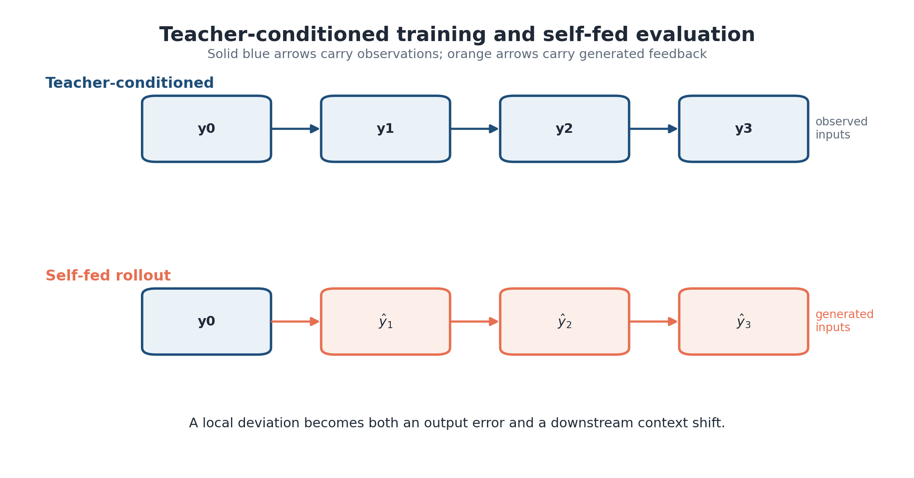
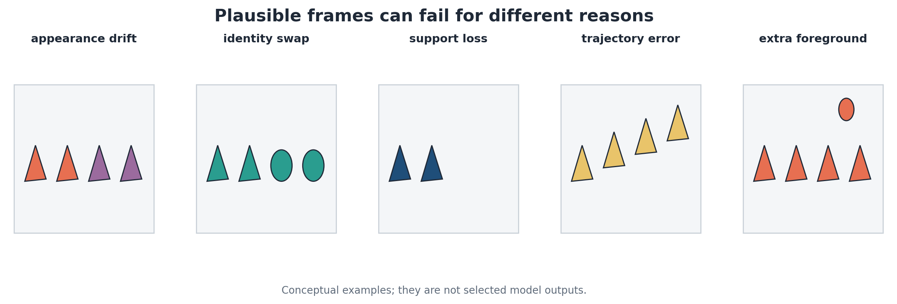
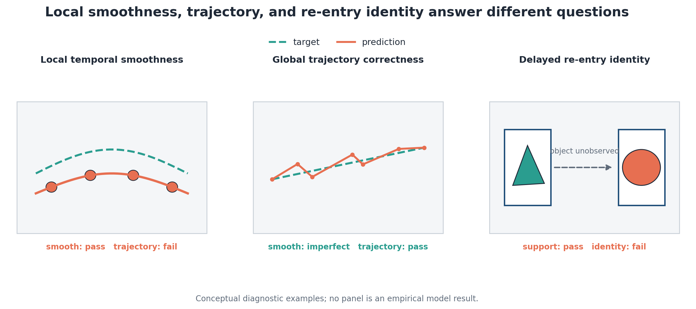
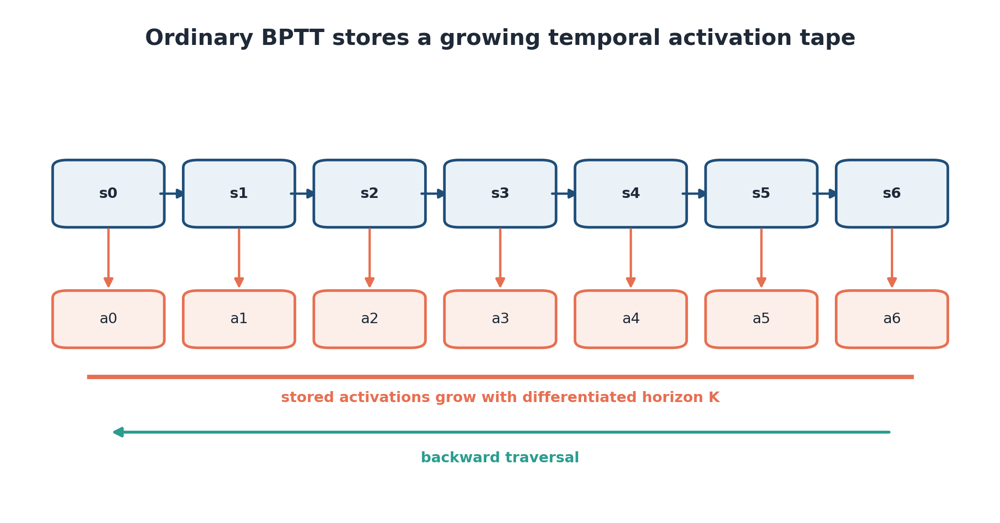

# Chapter 1 — Systems Analysis and Consistency Requirements of Long-Horizon Video Prediction

The Introduction identified three resource bottlenecks, but it left two terms deliberately informal: *the state that should be remembered* and *the consistency that should be preserved*. Both must be defined before selecting a model. A long context is useless if it contains the wrong information; a visually convincing frame is insufficient if it contradicts the process that produced the preceding frames. This chapter establishes the system boundary, turns consistency into a set of observable criteria, and derives the requirements used by the methods and experiments that follow.

## 1.1 Video prediction as a partially observed dynamic system

### 1.1.1 System boundary, state, observations, and controls

Consider an evolving scene whose complete physical and semantic state at discrete time $t$ is denoted by $x_t$. It may include object geometry, identity, pose, velocity, lighting, camera state, and variables that never appear directly in the image. An optional control $u_t$ represents a camera action, an agent action, or another measured input. Process disturbance $w_t$ covers stochastic dynamics and unmodelled influences. The video frame is an observation of the world state, not the state itself. With observation operator $h$, sensor or rendering noise $v_t$, and viewport parameters included either in $x_t$ or $u_t$, the transition–observation pair is

$$
\begin{aligned}
x_{t+1}&=f(x_t,u_t,w_t),\\
y_t&=h(x_t,v_t), \qquad y_t\in\mathbb{R}^{H\times W\times C}.
\end{aligned}
\tag{1.1}
$$

This distinction is central. Two world states can generate similar frames, and one state can contain objects that lie entirely outside the current viewport. Occlusion creates the same ambiguity inside the frame. Even a noiseless renderer is therefore only partially observed when $h$ discards state. Classical filtering represents the ambiguity through a belief over hidden states [10]; learned video predictors inherit the issue even when they carry no explicit belief. From a systems perspective, prediction quality consequently depends on *observability over an interval*, not only on what is visible now. A state component may be absent from $y_t$ and still be inferable from the sequence $y_{t-r:t}$. The required interval varies by component: velocity may be estimated from two nearby positions, while an object's identity after a long disappearance may depend on a much earlier view. Observability is thus package-dependent. A 14-frame dense context and a 48-frame coarse context expose different information even when both feed the same predictor.

The familiar Markov assumption should also be attached to a representation. The physical state $x_t$ may be Markov even when the observed frame $y_t$ is not. A learned state $m_t$ is sufficient only if it preserves all historical information needed for the future criterion. In practice that sufficiency is task-relative: a coarse silhouette may be enough to continue location and motion but insufficient to recover which digit produced it. The later support–identity split is therefore compatible with one package being sufficient for one endpoint and insufficient for another.

Partial observability creates several uncertainty classes. *Process uncertainty* concerns alternative valid transitions from a known state. *Observation uncertainty* follows from crop, occlusion, sensor effects, or an information-losing codec. *State-estimation uncertainty* arises because different hidden states explain the observed history. *Model uncertainty* reflects limited data, optimization, or capacity. Finally, *feedback uncertainty* is endogenous: predictions become observations for the model and carry earlier mistakes forward. These classes are analytically useful even when a deterministic network emits one tensor, because they locate the source of a failure and the evidence needed to reduce it [44, 45].

**Figure 1.1 — System boundary for long-horizon video prediction.** The predictor receives observations and optional controls, while the world transition continues outside the model. The diagram should be read from the distinction between latent world evolution and the narrower observation/feedback path. *Source: dissertation-native systems schematic; routing verified for this revision.*

Figure 1.1 places the predictor inside the observation loop. A context-construction operator $C_t$ selects or compresses past observations into a model state $m_t=C_t(y_{\leq t},u_{\leq t})$. The predictor with parameters $\theta$ produces a distribution over a future window,

$$
p_{\theta}\!\left(\widehat y_{t+1:t+K}\mid m_t,u_{t:t+K-1}\right).
\tag{1.2}
$$

For a task loss $\mathcal{L}$, multi-step prediction seeks parameters and a context policy that reduce expected risk across horizons,

$$
\min_{\theta,C}\;\mathbb{E}\!\left[
\sum_{k=1}^{K}\lambda_k
\mathcal{L}\!\left(\widehat y_{t+k},y_{t+k};x_{t+k}\right)
\right],
\tag{1.3}
$$

where the semicolon emphasizes that the endpoint can depend on latent task properties—identity or true support, for example—even though the predictor sees only images. The weights $\lambda_k$ need not be uniform. A short controller may care most about immediate error, whereas a memory study intentionally upweights events whose relevant evidence lies in the distant past.

**Figure 1.2 — Hidden state versus viewport observation.** An object can remain part of the world while absent from every current context frame; successful re-entry prediction then depends on retained earlier evidence rather than present-frame visibility. *Source: dissertation-native conceptual storyboard.*

Figure 1.2 illustrates why “previous frames” and “system state” are not interchangeable. The camera sees a rectangular crop of a larger cyclic world. When an object leaves that crop, its latent position and appearance persist. A model with a short flat window may infer plausible motion but cannot recover an earlier appearance that is no longer represented. A model with a long low-resolution stream can still address the event, although it may have discarded identity detail. In later chapters, this simple geometry becomes an exact experimental instrument rather than serving only as an analogy.

Controls require equally careful treatment. If future camera actions are supplied, the model predicts a controlled observation sequence; if they are absent, camera motion becomes part of the uncertainty. A comparison is invalid when one arm receives privileged actions, coordinates, raw frames, or target-aligned latents that another arm lacks. The system boundary must therefore record inputs as well as parameter count. Much of Chapter 3 is devoted to making those interfaces explicit.

There is a related distinction between forecasting and reconstruction. In forecasting, the target has not been observed and alternative futures may be valid. In reconstruction or conditional editing, a future-aligned structural signal can remove part of that ambiguity. Metrics and qualitative examples cannot be transferred without recognizing the difference. A model that uses future contours may demonstrate controlled synthesis, but it is not a comparator for an autonomous predictor unless the contour is available to both systems at inference.

### 1.1.2 Self-fed prediction and the growth of uncertainty

Training commonly conditions on ground-truth history. Autoregressive evaluation does not. Once the first prediction is generated, later contexts contain model output, and the recurrence becomes

$$
\widehat y_{t+k}
\sim p_{\theta}\!\left(
\widehat y_{t+k}\mid
C_{t+k-1}(y_{\leq t},\widehat y_{t+1:t+k-1}),
u_{\leq t+k-1}
\right).
\tag{1.4}
$$

The change is deeper than accumulating numerical error. A slightly displaced object alters masks, attention correspondences, and the input distribution presented to the next step. If it leaves the viewport one frame too early, later predictions receive different evidence from the ground-truth process. Exposure bias and scheduled or self-conditioned training address related sequence-level mismatches [25–29], but they cannot restore past information absent from the retained context. Local linearization clarifies why stability also changes with the rollout state. If a deterministic recurrence is written as $\widehat s_{t+1}=F_\theta(\widehat s_t)$, a perturbation evolves approximately under the product of Jacobians along the generated trajectory [93]. Contraction can suppress a small deviation; expansion can amplify it; a structural event such as object disappearance can change the relevant regime entirely. An average error-versus-horizon curve can therefore mix qualitatively different phases. The registered self-fed analysis later separates an early interval from the proposed late boundary, and replication shows that the apparent late inversion is not stable across seeds.

Error can also appear deceptively stable. A predictor that gradually removes uncertain foreground may converge to an easy background state. Pixel error then stops growing rapidly, but the sequence has lost the object. Conversely, a stochastic model can maintain multiple plausible futures and score poorly under a pointwise metric even when one sample is valid [130, 131, 155]. Complete endpoints and explicit candidate-count rules are required to distinguish these cases.

**Figure 1.3 — Teacher-conditioned training and self-fed rollout.** Under self-feeding, one local error changes every downstream context; the figure separates direct pixel deviation from the induced distribution shift. *Source: dissertation-native conceptual schematic.*

Uncertainty grows through at least three channels. Process uncertainty reflects alternative future world transitions. Observation uncertainty follows from occlusion, crop geometry, sensor noise, or lossy encoding. Model-induced uncertainty is created by imperfect inference and then reintroduced through feedback. Diffusion models explicitly represent a conditional distribution [2, 52], yet sampling cannot recover information absent from every candidate's context; additional samples may increase diversity without restoring identity. Self-fed evaluation is consequently part of the construct being measured. Single-step best-of-(k) performance asks whether a mechanism can cover an immediate target when several candidates are allowed. Best-of-one rollout asks whether one generated trajectory remains useful as its own future context. Chapter 4 keeps these regimes separate because a stochastic head can look strong under candidate selection and still degrade rapidly under deterministic deployment.

Teacher forcing, rollout training, and retained memory should not be treated as substitutes. Teacher forcing controls the inputs used during optimization. Rollout objectives control how far generated states participate in the loss. Context design controls what historical information is exposed at each step. A study can improve any one of these while leaving the others unchanged. The final hierarchy effects are measured under common rollout procedures, so their interpretation rests on context reach rather than a different exposure schedule.

### 1.1.3 Resource-constrained multi-criteria formulation

The predictor is constrained by several memory terms that occur at different times and locations. A useful accounting identity is

$$
M_{\mathrm{total}}
=M_{\mathrm{parameters}}
+M_{\mathrm{optimizer}}
+M_{\mathrm{activations}}
+M_{\mathrm{context/state}}
+M_{\mathrm{transient}}.
\tag{1.5}
$$

Parameter and optimizer terms depend mainly on model size, precision, and training algorithm [108]. Activation memory stores or reconstructs intermediate values required for gradients. Context or state memory holds historical information used by prediction. Transient memory includes attention workspaces, sampler buffers, decoded candidates, and framework allocations. Summing them is useful for hardware feasibility; treating them as one design variable is not.

**Figure 1.4 — Locations of system memory costs.** Activation storage lies on the differentiated training path, whereas retained context lies on both training and inference paths. The two can change independently. *Source: dissertation-native systems schematic.*

Figure 1.4 explains why the methods in this dissertation are related without forming one inseparable model. Reversible temporal replay modifies the activation term inside a differentiable chain. Hierarchical context packaging modifies the retained-state term by changing how much history is represented at each resolution. V-BLT changes the spatial unit processed by local and global modules. Their costs could interact in a future integrated system, but the reported experiments measure them separately.

Let the vector of consistency losses be

$$
\boldsymbol{\ell}(\widehat Y,Y)
=\bigl(
\ell_{\mathrm{frame}},
\ell_{\mathrm{support}},
\ell_{\mathrm{identity}},
\ell_{\mathrm{trajectory}},
\ell_{\mathrm{extra}},
\ell_{\mathrm{cross}}
\bigr).
\tag{1.6}
$$

The design problem is multi-objective. One practical formulation minimizes a scalarization chosen for a declared task while imposing resource limits:

$$
\begin{aligned}
\min_{\theta,C,a}\quad &
\mathbb{E}\!\left[\boldsymbol{\alpha}^{\mathsf T}
\boldsymbol{\ell}(\widehat Y,Y)\right] \\
\text{subject to}\quad &
M_{\mathrm{context/state}}(C)\leq B_{\mathrm{ctx}},\\
&M_{\mathrm{activations}}(\theta,a,K)\leq B_{\mathrm{act}},\\
&\operatorname{Work}(\theta,C,a,K)\leq B_{\mathrm{work}}.
\end{aligned}
\tag{1.7}
$$

Here $a$ denotes the training or inference algorithm, and $\boldsymbol{\alpha}$ expresses task priorities. Different weights can choose different winners. A surveillance task may penalize missing support heavily; an identity-preserving editor may tolerate small spatial error but reject an object substitution. The dissertation therefore reports endpoint patterns and operating regions, not only one aggregate optimum.

Resource constraints also have different scaling variables. Parameter memory grows with model size, activation memory with the differentiated graph, context memory with the retained package, and attention work with the sequence presented to a block. A context intervention may reduce both state storage and attention work, but only if token representations, precision, batch size, and target length are held comparable. Reporting “tokens” alone is incomplete when a coarse token and a fine latent carry different payloads, so Chapter 3 records token count and byte payload separately. Pareto reasoning must likewise remain discrete. Configuration (a) dominates (b) only if it is no worse on every declared objective and strictly better on at least one, under compatible evidence. The tested packages sample only a handful of budgets, leaving a continuous curve unidentified. In particular, the unresolved 1,792-token point prevents coloring an interpolated interval as a confirmed hierarchical region. Here, “frontier” denotes simultaneous comparisons at tested points, not a fitted phase transition.

| Resource term | Stored object | Dominant phase | Intervention examined here | Common confound |
|---|---|---|---|---|
| Parameters | learned weights | training and inference | capacity held fixed within matched comparisons | architecture changes with budget |
| Optimizer | moments and gradients | training | accounted but not directly optimized | precision and sharding |
| Activations | intermediate differentiated states | training | checkpointing or reversible replay | extra recomputation omitted |
| Context/state | retained observations or latent state | training and inference | flat, hierarchical, or subsampled packages | reach and fidelity co-change |
| Transient | attention and sampler workspaces | both | measured through total work/NFE where relevant | peak allocation mistaken for persistent state |

**Table 1.1 — Resource terms and their control interfaces.** The table distinguishes the quantity an intervention changes from nearby costs that may remain unchanged.

This formulation supplies the first design rule: a method should be judged against the resource that actually binds. It also creates a stricter requirement. Before optimizing consistency, the criteria themselves must be separated.

## 1.2 Consistency as a multi-criteria property

### 1.2.1 Why one quality score is insufficient

“Consistency” is sometimes used as a synonym for visual quality, temporal smoothness, or agreement with a prompt. Those meanings overlap, but they are not equivalent. A blurred object can follow the correct path. Sharpness offers no protection against a smooth identity change. Even low average error can conceal the disappearance of the only moving object when the background dominates. The metric should follow the failure, not the other way around.

Mean squared error measures pointwise deviation and remains valuable when pixels are aligned. SSIM adds local luminance, contrast, and structural terms [127]. LPIPS compares deep features [128], while FID and FVD summarize distribution-level feature statistics [94, 129]. Each compresses information differently. None directly states whether a particular object survived an occlusion, whether foreground was hallucinated, or whether the model recovered the appearance that was visible forty frames earlier.

**Figure 1.5 — Conceptual multi-step consistency landscape.** Similar short-frame scores can conceal different long-horizon failure modes; the diagram is explanatory and does not report an empirical frontier. *Source: dissertation-native conceptual figure.*

Figure 1.5 should be read horizontally and vertically. Along the horizon, self-fed errors accumulate and the available context changes. Across criteria, image fidelity can decline independently of support, identity, or trajectory. The central empirical result later follows the same logic: hierarchical context can improve *where* an object is supported while dense context better preserves *what* the object is. Calling one arm simply “more consistent” would lose that boundary. Background imbalance makes the issue measurable. In a sparse scene, most pixels are easy background, so predicting empty space can achieve a respectable full-frame MSE while failing on every object pixel. Foreground-only MSE corrects the weighting but can still ignore hallucinated objects outside the ground-truth mask [46, 51]. Union-mask error includes both regions but changes its denominator with the prediction. Precision, recall, miss, and extra rates expose different directions of failure. Their empty cases must be defined before evaluation because a rollout may contain frames with no visible object.

**Figure 1.6 — Illustrative SDXL outputs and the limits of single-image inspection.** The four unrelated outputs demonstrate visual diversity, but they do not constitute a consistency test because no common subject, style, geometry, or trajectory invariant was declared. *Source: Kulyk and Mokin [133], original Figure 1; artwork assembled by L. Kulyk from locally generated SDXL outputs; reused under CC BY 4.0. Non-evidentiary illustration.*

Visual plausibility is therefore only the entry condition. A consistency claim begins when two or more outputs are linked by an invariant that can fail. Figure 1.6 is useful precisely because it shows the opposite case: appealing individual samples offer no basis for deciding whether appearance, identity, geometry, or temporal state has been preserved.

Distribution metrics answer yet another question. FID compares first and second moments of feature embeddings across image sets [94]; FVD extends the idea to spatio-temporal features [129]. Both depend on the feature extractor and sample size, and neither pairs an individual forecast with its ground-truth trajectory. They are appropriate for generative realism but insufficient for a pair-specific claim about a particular historical observation. Human evaluation can reveal semantic or aesthetic failures outside automated metrics, yet it introduces protocol, sampling, and rater uncertainty [103]. A dissertation example alone is no human study, and a post-hoc explanation cannot replace an operational criterion [39, 40]. The controlled chapters therefore use distribution metrics where the source experiment reports them, paired endpoints where geometry provides correspondence, and qualitative rows chosen by a registered clip identifier, median effect, or declared quantile. An image may illustrate a mechanism; the numerical population carries the claim.

A vector criterion makes the distinction explicit. For evaluation unit (i) and horizon (k), let

$$
\mathbf q_{ik}
=\left(
q^{\mathrm{frame}}_{ik},
q^{\mathrm{support}}_{ik},
q^{\mathrm{identity}}_{ik},
q^{\mathrm{trajectory}}_{ik},
q^{\mathrm{extra}}_{ik}
\right).
\tag{1.8}
$$

Directions are standardized only for comparison; their meanings remain separate. A task may define acceptability as a region in this space rather than a weighted sum. That is often the safer interpretation because weights can conceal a catastrophic component behind several modest gains.

### 1.2.2 Appearance, object, and conceptual consistency

The earlier analysis of diffusion-based image generation distinguished style or appearance, object identity, shape or geometry, and a proposed category called conceptual consistency [133]. That qualitative study reviewed control interfaces and argued that the invariant required by a set of related images determines which method is suitable. It supplied no systematic-review protocol, dataset, operational metric, or temporal experiment, so the present dissertation uses it as a clearly identified conceptual starting point. Appearance consistency concerns attributes such as color palette, texture, illumination, and rendering style. Identity consistency is narrower: the same subject should remain recognizable despite pose, view, or background change. Geometry concerns contour, spatial arrangement, and structural relations. Conceptual consistency, as proposed in [133], refers to preservation of a higher-level semantic idea across outputs that may vary in surface appearance. The dimensions overlap. A face identity depends partly on geometry and texture; a stylized sequence can preserve concept while changing both.

**Figure 1.7 — Overlapping consistency criteria.** Appearance, identity, geometry, and concept are shown as dimensions that a task can weight simultaneously, not as mutually exclusive classes. *Source: dissertation-native synthesis informed by [133].*

The value of Figure 1.7 lies in the intersections. A method that copies a reference image may preserve palette and local texture but also copy unwanted pose. Fine-tuning or low-rank adaptation can bind subject attributes into model parameters [96, 97], yet it changes the model rather than supplying a per-sample structural constraint. ControlNet supplies geometry through an auxiliary condition [98]; its strongest guarantee concerns layout, not exact identity. Shared-attention methods can align style across images while allowing objects to change [99]. Each interface controls something different.

**Figure 1.8 — Local visual input and integrated scene understanding.** The two-stage analogy separates information available in a current view from a broader interpretation informed by prior knowledge. It motivates the distinction among appearance, identity, geometry, and concept but does not establish a cognitive or neural architecture. *Source: Kulyk and Mokin [133], original Figure 5; artwork by L. Kulyk, conceptually informed by Hertzmann [174]; reused under CC BY 4.0. Heuristic illustration.*

The analogy in Figure 1.8 is deliberately limited. A current observation can be locally detailed while remaining insufficient for a stable account of the scene; integration depends on information carried across views or time. Learned video models do not reproduce human perception, but they face the same information-level question: which earlier evidence is still available when the current crop no longer contains it? This link motivates the later move from static-image criteria to retained temporal state without treating a perceptual sketch as experimental support.

| Criterion | Typical failure in generated video | Representative endpoint | What the endpoint can miss |
|---|---|---|---|
| Appearance/style | color, texture, or illumination drifts | feature or style similarity | correct score with wrong object identity |
| Identity | object changes class or instance after occlusion | assignment-based identity accuracy | spatial support may still be wrong |
| Geometry/support | contour collapses, object disappears, or extra foreground appears | overlap, coverage, precision/recall, miss and extra rates | fine attributes inside support |
| Concept/semantics | sequence contradicts the intended relation or event | task classifier, structured relation, or human protocol | temporal continuity and localization |
| Trajectory | motion is smooth but follows the wrong path | centroid or pose error over time | appearance and internal structure |
| Cross-level agreement | coarse state and fine prediction describe different events | decoded cross-level discrepancy | both levels may be jointly wrong |

**Table 1.2 — Consistency criteria, observable failures, and metric blind spots.** No endpoint is treated as a complete substitute for the others.

The criteria are relational rather than intrinsic labels attached to an image. Identity requires a reference instance or persistent object record; geometry requires a support, contour, or relation against which displacement can be judged; conceptual consistency requires an explicit task predicate or a defensible evaluation protocol. A perceptual embedding may contribute evidence for several dimensions, but that overlap does not make the dimensions interchangeable. What matters is whether the endpoint changes when the failure of interest occurs and remains stable under nuisance variation that the task permits. This requirement is stricter than choosing the metric most correlated with visual preference [39, 40, 103, 104].

One implication is methodological: a comparison should declare the invariant before showing examples. Qualitative selection otherwise tends to favor a method's natural strength. A style-controlled example can make geometry look adequate; a trajectory plot can hide identity substitution. Chapter 4 therefore uses registered populations and selection rules for rollouts, while complete tables retain the less flattering endpoints.

The control interface changes the cost of consistency. Image-to-image conditioning supplies a reference each time and is simple to deploy when such a reference exists [95]. DreamBooth and LoRA store a subject or style in adapted parameters [96, 97]; repeated identities can then be generated without sending the full reference, but adaptation consumes data and optimization. Structural control supplies edges, depth, pose, or segmentation [98]. Inversion methods estimate a latent or noise state for an existing image, providing strong edit control at additional inference cost [114, 115]. Shared-attention methods couple features among samples [99]. None is universally strongest because each assumes different information at the system boundary.

Conceptual consistency is especially difficult to operationalize. CLIP-based similarity can measure alignment in a joint embedding space [101, 102], yet compositional probes show that high global similarity need not capture relations or ordering [104]. A task-specific structured predicate is often more defensible: for example, whether the same object remains left of another, or whether an expected action completes. Here the category prevents semantic process failures from being mistaken for style or geometry errors; no universal conceptual score is proposed.

### 1.2.3 Temporal and trajectory consistency

Adding time changes the criteria in two ways. First, values should remain coherent between adjacent frames. Second, the sequence should follow a valid long-range process. Local smoothness addresses the former but can fail the latter: a vehicle may drift smoothly off its road, or a rotating object may decelerate continuously when the true dynamics require acceleration. Temporal consistency is thus necessary and insufficient.

Adjacent-frame measures and trajectory measures operate at different scales. Frame differences, optical-flow residuals, or acceleration penalties can detect flicker and abrupt motion, but a low value may reward an increasingly biased path. A long-range endpoint instead compares the generated process with a task reference over an interval or at a delayed event. Its construction must allow valid stochastic variation: when several futures are admissible, deviation from one recorded pixel path need not be a consistency failure. Controlled generators are valuable here because the accepted dynamics and object correspondence can be stated explicitly, while natural-video evaluation usually requires broader perceptual or task-level tolerances [39, 40, 130, 131].

**Figure 1.9 — Distinct failures with superficially plausible frames.** The montage contrasts appearance drift, identity substitution, support loss, trajectory deviation, and extra-foreground hallucination. *Source: dissertation-native conceptual examples; not empirical model outputs.*

Let $c_t\in\mathbb R^2$ be an object's ground-truth centroid and $\widehat c_t$ its assigned predicted centroid. For observed object frames $\mathcal T_i$, one trajectory endpoint is

$$
L_{\mathrm{traj}}^{(i)}
=\frac{1}{|\mathcal T_i|}
\sum_{t\in\mathcal T_i}
\left\|\widehat c_{it}-c_{it}\right\|_2.
\tag{1.9}
$$

This error detects displacement but not an identity swap between nearby objects. Assignment must be persistent or identity-aware, and unmatched predictions need an explicit penalty. Conversely, an identity classifier can recognize a digit whose predicted position is badly wrong. The combination of support, assignment, identity, and trajectory endpoints is what makes the persistent-object boundary interpretable.

Identity across time also requires an assignment rule. Framewise nearest-neighbour matching can swap labels when two objects cross. Persistent matching constrains associations over a clip, but it must decide what happens when an object is missed or an extra object appears. Hungarian assignment solves the per-frame minimum-cost correspondence [125]; the persistent-object evaluation augments it with metadata and declared penalties so that disappearing predictions do not receive a favorable identity score simply by remaining unassigned. Re-entry adds a temporal asymmetry to this correspondence. Before disappearance, the context contains direct appearance evidence. During absence, location can sometimes be propagated from dynamics while appearance survives only in memory. After re-entry, geometry and identity become observable again, but a correct-looking object may have been reconstructed from a learned prior instead of retrieved from the specific earlier frame. Exact observability cannot distinguish internal retrieval from a lucky prior on one clip. Paired populations and multiple seeds reduce that alternative explanation; the privileged raw-memory reference clarifies the upper bound on access.

For a binary ground-truth foreground mask $G_t$ and predicted mask $P_t$, overlap alone can be misleading when both are empty. The later endpoint suite therefore includes the ground-truth-normalized miss and extra fractions

$$
r_{\mathrm{miss}}(t)=\frac{|G_t\setminus P_t|}{|G_t|},
\qquad
r_{\mathrm{extra}}(t)=\frac{|P_t\setminus G_t|}{|G_t|},
\tag{1.10}
$$

with declared empty-case rules. The fixed denominator makes an extra object visible instead of rewarding a large predicted union. Identity and trajectory are then evaluated on assigned objects rather than inferred from the mask score.

**Figure 1.10 — Operational separation of temporal smoothness, trajectory correctness, and re-entry identity.** Smooth adjacent motion can still be globally wrong; delayed re-entry adds an identity requirement that local differences cannot measure. *Source: dissertation-native conceptual figure.*

Self-fed evaluation is essential to this operationalization. Teacher-conditioned prediction can reintroduce the correct object and position at every step, concealing whether the model's own state survives an absence. Under autoregressive rollout, errors before disappearance alter both the inferred trajectory and the context available at re-entry [25–29]. The later analysis therefore separates event phases and keeps frames clustered within their originating clips. A trajectory conclusion is then attached to the interval and population where it was measured, instead of being inferred from a visually smooth example or from an average over unrelated phases.

### 1.2.4 Hierarchical and cross-level consistency

Hierarchy introduces another relation to evaluate, but only for a system that exposes distinct levels with a defined correspondence. A coarse state can encode broad support or slow motion while a fine state carries edges, texture, or identity cues. If the two refer to different times, viewports, or semantic roles, disagreement may be correct rather than pathological. Cross-level consistency therefore begins with an alignment contract: which levels describe the same event, how their coordinates map, and what information survives the projection used for comparison. Multiscale architectures have demonstrated the value of slow and fast or coarse and fine representations [20, 35–37, 150], yet the presence of such levels supplies no automatic consistency guarantee.

Suppose a model retains a coarse latent state $z_t^c$ and predicts a fine state $z_t^f$. If both are independently decodable, their generated observations should agree at the scale shared by the two levels. A generic discrepancy can be written as

$$
L_{\mathrm{cross}}(t)
=d\!\left(
D_c(z_t^c),
\mathcal S\bigl(D_f(z_t^f)\bigr)
\right),
\tag{1.11}
$$

where $D_c$ and $D_f$ decode the levels, $\mathcal S$ maps fine output to the coarse comparison scale, and $d$ is a declared distance. The equation defines agreement, not correctness. Two levels can agree on the same wrong object.

The choice of $\mathcal S$ and $d$ determines what contradiction is visible. Downsampling a fine prediction may preserve occupancy while erasing the stroke that distinguishes one digit from another. Pixel distance is sensitive to small registration errors; feature distance can ignore a geometric displacement that matters to control. When a coarse code is not independently decodable, latent alignment or cross-attention diagnostics can still be used, but their interpretation depends more heavily on the learned representation. Decoded agreement is consequently most useful as one endpoint alongside level-specific correctness, not as a replacement for it.

**Figure 1.11 — Consistent and contradictory predictions across representational levels.** A hierarchy is useful only when levels exchange compatible information; multiple resolutions alone do not guarantee coherence. *Source: dissertation-native conceptual figure.*

Figure 1.11 also separates two meanings of hierarchy used later. V-BLT contains a local–global–local processing hierarchy inside a representation; the central predictor retains multirate coarse and fine context streams across time. Those architectures can share a systems principle—different capacities at different scales—without sharing tensors, objectives, or experimental evidence. Cross-level consistency may be enforced explicitly, measured after decoding, or left to joint attention, and each choice has a cost. A penalty can encourage agreement by making the fine level copy coarse errors. Separate decoders expose disagreement but introduce codec sensitivity. Joint attention permits information exchange without guaranteeing semantic alignment. The Chapter 3 model uses a shared predictor over both streams and freezes the codec; Chapter 4 then tests whether package differences persist with an independently trained codec.

Three checks follow for a hierarchical predictor. First, each level should be evaluated for the property it is expected to preserve; a coarse occupancy map should not be penalized for absent texture. Agreement is then tested only over their shared information. Finally, the fine output must still be compared with ground truth, because perfect internal coherence can describe the wrong future. In the present experiments, hierarchy is judged primarily through observable decoded endpoints and package-level effects. Equation (1.11) formalizes the additional cross-level criterion but is not promoted to a headline result without a registered empirical test.

### 1.2.5 From static control criteria to video requirements

The static criteria survive in video, but their observability changes. Appearance and identity must be checked across time and after occlusion. Geometry becomes support and motion as well as contour. Concept becomes an event or relation that unfolds over a sequence. Structure supplied at every frame can prevent one class of error, whereas a predictor with no future condition must infer structure from dynamics and retained state.

**Figure 1.12 — From static-image invariants to video requirements.** Static appearance, identity, geometry, and concept remain relevant, while time adds local continuity, trajectory, re-entry recovery, and cross-level agreement. *Source: dissertation-native synthesis.*

Figure 1.12 distinguishes inheritance from extension. A reference image can establish appearance or identity at one instant, but video introduces ordering and delayed verification: the object observed at $t=3$ may not be judged again until $t=40$. During that interval, the predictor receives its own outputs and the evidence available to its context changes. Trajectory and re-entry criteria are therefore temporal constructs, while cross-level agreement applies only when a model exposes more than one representational level. The figure transfers a vocabulary, not empirical results from static generation.

**Figure 1.13 — Forward diffusion as progressive corruption.** The noise index describes diffusion time, not the temporal coordinate of a video sequence. The diagram introduces the corruption process used to train a denoising model and does not report an experiment. *Source: Kulyk and Mokin [133], original Figure 2; author-created schematic based on the DDPM formulation [3]; reused under CC BY 4.0.*

The distinction in Figure 1.13 prevents a common notational confusion. Diffusion time indexes a sequence of noise levels applied to one modelled sample; video time indexes successive states of an evolving scene. A video diffusion predictor may contain both axes. Its denoiser is then called at several noise levels for a target that also occupies one or more future video positions, so temporal consistency cannot be inferred from denoising convergence alone.

> **Reserved author-supplied video-generation example.** Insert a short fixed sequence only when its clip or prompt, model and checkpoint, seed, sampler, frame indices, and output hashes are available. The example should illustrate one declared temporal invariant or failure and be captioned “qualitative illustration; not used for inference.” It remains unnumbered and is not counted as evidence until populated.

Five control interfaces summarize the reviewed methods: a reference can enter through the input, modify parameters, supply an explicit structure, initialize a latent or noise trajectory, or couple attention statistics. Their relative value depends on what is known at inference. A future edge map is powerful but privileged in an unconditional forecast; parameter adaptation can preserve a subject but is expensive per identity; inversion controls edits of an existing sample but is not equivalent to predicting an unseen future [95–99, 114, 115].

**Figure 1.14 — Structural conditioning controls geometry more directly than identity.** A Canny-derived condition enters the denoising network alongside text and latent state. The hand-drawn path identifies the conditioning interface; it is not a literal execution trace and does not show identity preservation or long-context retrieval. *Source: Kulyk and Mokin [133], original Figure 7; artwork and locally generated examples by L. Kulyk; ControlNet method from Zhang et al. [98]; reused under CC BY 4.0.*

**Figure 1.15 — Shared style across changing subjects.** The generated subjects differ while color, pixel-art treatment, and accessory pattern remain similar. The example illustrates appearance/style consistency, not preservation of one object's identity. *Source: Kulyk and Mokin [133], original Figure 9; locally generated and assembled by L. Kulyk; StyleAligned method from Hertz et al. [99]; reused under CC BY 4.0.*

Read together, Figures 1.11 and 1.12 expose an asymmetry that a single score would hide. Structural conditioning often constrains *where* content appears, whereas shared features or reference adaptation constrain *what it looks like*. Their mechanisms and tasks differ from multirate video context, so the figures provide no evidence for the later hierarchy experiment. They establish a more general design lesson: control at one interface can preserve one invariant while leaving another weak.

**Figure 1.16 — Five interfaces for controlling related generations.** Reference input, parameter adaptation, structural conditioning, latent/noise inversion, and shared attention act at different points in a generative system and therefore preserve different invariants. *Source: dissertation-native synthesis of [95–99, 133].*

The interface map in Figure 1.16 also defines a comparison boundary. A method given future structure answers a conditional-synthesis question; a self-fed predictor must generate that structure from its current state. Parameter and latent interventions store information in different places, with different update and inference costs. Consequently, a video requirement should specify both the invariant and the information legally available when it is assessed. Otherwise, strong control can be mistaken for autonomous temporal memory.

**Figure 1.17 — Support and identity as independent axes.** Two predictions can occupy the same support yet differ in identity, or preserve identity while losing spatial continuity. This separation anticipates the Chapter 4 persistent-object analysis without asserting a shared causal mechanism. *Source: dissertation-native conceptual figure.*

For the present problem, the important criterion is delayed reuse. When an object disappears, the model must preserve enough state for the relevant property to be recoverable after re-entry. Fine context is naturally suited to appearance and identity, but a fixed fine-token budget limits temporal span. Coarse context can cover a longer interval, although downsampling removes high-frequency evidence. The reach–fidelity hypothesis emerges directly from the consistency taxonomy: retained history determines whether evidence is present, and representational detail determines what can be recovered from it.

A useful evaluation order follows. First establish whether the event was observable to each package. Then measure support and false foreground, because a missing object makes identity and trajectory conditional. Next evaluate assigned identity and motion. Finally inspect full-frame and perceptual quality as complementary summaries. Reversing this order encourages a high aggregate score to dominate the interpretation before the memory-dependent criterion is tested.

The expected benefit is deliberately conditional. It should appear where the flat window lacks the relevant past, then weaken or reverse when both packages reach the event and fine detail becomes the limiting factor. Chapter 3 turns that prediction into package geometry and an estimand; Chapter 4 tests it without interpolating a universal crossing.

## 1.3 Three bottlenecks behind long-horizon inconsistency

### 1.3.1 Activation growth during temporal learning

Backpropagation through time expands a recurrent computation into a directed acyclic graph [28, 29, 105]. If one temporal step creates activations of size $A$, retaining every intermediate value for a horizon $K$ gives the leading-order relation

$$
M_{\mathrm{act}}^{\mathrm{BPTT}}(K)=\Theta(KA),
\tag{1.12}
$$

in addition to parameters, optimizer state, inputs, and temporary workspaces. Transformer layers can make $A$ large because attention projections, normalization outputs, and feed-forward intermediates are required by automatic differentiation. A model may therefore fit a short window and fail before its training objective reaches the horizon of interest.

**Figure 1.18 — Activation-tape growth under ordinary temporal backpropagation.** Increasing the differentiated horizon extends the stored graph even when the recurrent state dimension stays fixed. *Source: dissertation-native conceptual schematic.*

Checkpointing stores selected boundary states and recomputes missing segments during the backward pass [30, 31, 108, 109]. Reversible coupling takes another route: if a block input can be reconstructed from its output, the block need not retain the same activation tape [32, 92]. Both methods exchange storage for computation; their value depends on whether saved activations dominate the additional replay work and metadata. The bottleneck here is deliberately *temporal learning*, not long inference. A compact autoregressive state can roll forward for many steps without building a gradient graph. Conversely, a model trained on a long differentiable objective can exhaust memory even if its inference context contains one tensor. Chapter 2 verifies this exchange and the TempVerseFormer state boundary. Chapter 3 uses windowed training for the final predictor, with ordinary gradient flow confined to each training window.

The differentiated horizon, rather than the deployed rollout length by itself, is the controlling variable. Truncating the graph changes which delayed dependencies receive gradient. Checkpointing can preserve the objective while selecting a storage–recomputation schedule, whereas a reversible core reconstructs compatible internal states and still retains non-invertible boundaries, parameters, gradients, and replay metadata. Their asymptotic descriptions therefore apply to scoped components. A practical comparison must report peak memory and time at the same horizon, batch, precision, and model interface; otherwise a smaller activation term can be hidden by unrelated constant allocations.

Peak memory must also be scoped. Measuring only the temporal model isolates activation scaling while excluding the VAE, optimizer, batch, and framework footprint. Measuring the complete pipeline answers hardware feasibility but can hide a constant temporal term beneath a large encoder. Both views are legitimate if named. The TempVerseFormer discussion retains the reported temporal-model and pipeline measurements separately and places runtime beside memory, preventing replay from appearing as a free reduction.

Numerical reversibility is not identical to algebraic invertibility. Additive coupling has an exact inverse over real arithmetic, while finite precision, nondeterministic kernels, dropout, and stochastic transitions can break bitwise reconstruction. Replaying stochastic functions requires their random state or sampled noise; storing that metadata creates its own horizon-dependent term. A trustworthy claim therefore needs the inverse equations, the persistent-state boundary, a reconstruction tolerance, and a gradient comparison against ordinary autograd.

### 1.3.2 Uniform spatial allocation

A fixed patch grid is simple, parallel, and easy to batch [69–71]. Its token count for a video with $T$ frames and non-overlapping spatial patches $p_h\times p_w$ is

$$
N_{\mathrm{fixed}}
=T\left\lceil\frac{H}{p_h}\right\rceil
\left\lceil\frac{W}{p_w}\right\rceil.
\tag{1.13}
$$

Every patch receives one token even if it contains only static background. Smaller patches preserve detail but increase global sequence length; larger patches reduce cost and mix distinct structures. Three-dimensional tubes add a temporal size $p_t$, which reduces temporal tokens at the risk of combining changes that should remain separable [70, 71].

**Figure 1.19 — Uniform spatial allocation on a nonuniform scene.** Static background and changing boundaries consume equal grid capacity despite different predictive complexity. *Source: dissertation-native conceptual figure.*

Nonuniformity is both spatial and predictive. A large uniform region may be cheap to forecast even when it occupies most of the image, while a narrow boundary can determine shape, motion, and later identity. Camera movement reverses the situation by turning background into newly revealed content. A fixed grid cannot react to either case, but it offers stable tensor shapes, straightforward causal masks, and efficient batched kernels. The design problem is therefore not to remove regular patches on principle. It is to determine whether a measurable complexity signal can justify spending a limited global budget differently without losing those implementation advantages.

Information density offers a possible signal for allocation. A categorical predictor that is confident about a constant region has a concentrated distribution; a moving edge can produce a broader one. Predictive entropy, however, also changes with model misspecification, limited context, and multimodal futures. It provides neither calibrated uncertainty [44, 45] nor proof that changing token sizes will improve a compute–quality frontier. A dynamic allocator would need a causal aggregation rule, a fixed compute budget, routing and merge operations, and an end-to-end comparison against the same fixed-grid model. The V-BLT experiment in Chapter 2 stops earlier: it validates fixed raster-byte packages, multidimensional positions, and entropy maps. Those maps motivate adaptive regioning but do not validate the controller.

There is a second allocation issue inside the hierarchy. A local encoder and decoder can keep elementary raster detail away from the expensive global transformer. That lowers global sequence length without requiring every byte to become one global token. Whether this saves wall-clock time depends on local work, memory movement, hardware utilization, and batch shape—not GFLOPs alone. The published point estimates support a proof of concept, not a scaling law.

Although V-BLT packages are spatio-temporal, this bottleneck is spatial: it concerns where a model spends local and global capacity. Chapter 3 addresses a different decision—how many historical frames to preserve at coarse and fine resolution.

### 1.3.3 Limited retained-context reach

Let a context package at decision time $t$ expose a set of source anchors $\mathcal A_t$. Its nominal reach is the age of the earliest addressable anchor,

$$
R(C_t)=t-\min_{\tau\in\mathcal A_t}\tau.
\tag{1.14}
$$

Nominal reach says that an event is represented somewhere in the package. Whether the representation retains the required feature and whether the predictor uses it remain separate questions. Three stages must therefore be distinguished: information can be stored, made addressable to the model, and reliably reused during self-fed generation. The privileged raw-memory reference in Chapter 4 is useful precisely because it separates the first two from learned retrieval.

The scalar $R(C_t)$ also hides anchor density. Two packages can share the same earliest time while one contains every intervening frame and the other contains only periodic samples. Target-window geometry matters as well: a source may be old enough to count toward nominal span yet be causally unavailable to an earlier target inside a jointly predicted window. For this reason, Chapter 3 derives reach from each stream's explicit anchor mapping and evaluates a package pair on the frames for which the relevant source is legally visible to one arm but absent from the other. Frame count alone cannot establish that relation.

**Figure 1.20 — A relevant appearance outside a dense fine-context window.** The long coarse stream retains temporal addressability at lower spatial fidelity; the flat window retains detail only over its shorter span. *Source: dissertation-native schematic; temporal scale is explanatory.*

At a fixed token budget, increasing reach usually changes fidelity or sampling density. A flat fine stream allocates all tokens to recent high-resolution frames. A spatial hierarchy can preserve many older coarse frames plus a short fine tail. Temporal subsampling keeps fine resolution at selected times but can miss events between anchors. Even with similar token counts, the packages expose different events because their anchor geometry differs. Reach becomes identifiable only on examples where comparators differ. If an object never leaves the recent window, a long memory may be unused; if the relevant evidence predates both packages, neither arm has an access advantage. The central experiment therefore derives a pair-specific population from exact scene and viewport geometry: the evidence lies beyond the shorter package's reach but within the longer one's. Aggregate performance remains supporting evidence, not the primary mechanism test.

Compression changes more than storage. Spatial downsampling can remove strokes that distinguish two digits; temporal subsampling can skip the moment at which direction changes; learned retrieval can fail even when the source is stored. These are different failure paths. The package-shape experiment compares spatial hierarchy with temporally sparse fine frames at a near-matched budget so that “longer reach” is not treated as one undifferentiated design.

Reliable reuse is the strongest and most empirical of the three terms. A stored tensor proves persistence, and an anchor map proves addressability; neither proves that a learned predictor consults the source when a prior would generate a plausible alternative. Concentrating effects on a reach-differential population provides evidence for reuse because the arms differ exactly where the required observation becomes available. The inference remains conditional on the generator and endpoints, which is why aggregate clips, an independent codec, and a persistent-object dataset are retained as complementary rather than interchangeable tests.

### 1.3.4 Causal map from bottlenecks to interventions

**Figure 1.21 — Causal map of the dissertation.** Activation growth, uniform spatial allocation, and limited retained reach are addressed at different interfaces. TempVerseFormer and V-BLT are separately validated methods; the hierarchical-context predictor is the final empirical core. *Source: dissertation-native systems synthesis.*

Figure 1.21 connects the developed works by system interface without presenting an untested end-to-end architecture. The left branch changes how gradients are computed through a temporal state; the middle branch changes how visual bytes are represented and how positional structure is encoded; the right branch changes which coarse and fine histories enter prediction. All three are judged against the consistency criteria above, and only the right branch is integrated into the final matched-budget model. This relation is familiar in systems engineering: compatible interventions can address separate constraints even when their combinations remain untested. Explicit interfaces and evidence levels then allow the final chapter to select a method after diagnosing the binding resource. Compatibility here concerns interfaces; compounded savings remain unmeasured. Activation and context costs were obtained in separate systems and therefore stay on separate axes. Any future integration would need its own end-to-end memory, computation, quality, and causal-attribution tests before the separate effects could be combined.

The map is causal in the sense of a diagnosis–intervention–measurement chain. Activation growth is diagnosed by scaling the differentiated horizon and measured through memory and replay time. Spatial allocation is examined through fixed local/global processing and entropy structure, while retained reach is identified through package anchors and re-entry populations. A gain at one branch cannot validate another branch because the manipulated variable, resource account, and endpoint differ. This separation also explains the chapter order: the first two interventions can be validated independently, after which the final model isolates the context decision that remains unresolved.

## 1.4 Existing methods and unresolved gap

### 1.4.1 Long-horizon temporal modelling and memory-efficient training

Recurrent video predictors compress the past into a hidden state. ConvLSTM introduced convolutional gates for spatio-temporal forecasting [137], and later models such as PredRNN, PredRNN++, E3D-LSTM, and PhyDNet added memory pathways, three-dimensional recurrence, or physics-informed decomposition [138–140, 152]. Their state can be compact at inference, but long training still depends on BPTT, truncation, or curriculum choices; a recurrent bottleneck may also forget detail that was not optimized for delayed reuse. Feed-forward predictors provide an important counterpoint. SimVP shows that strong spatio-temporal prediction can emerge from an encoder–translator–decoder without recurrent rollout inside the training window [141]. The Temporal Attention Unit combines spatial attention with temporal differential modelling [153], while Earthformer structures space–time interactions through cuboid attention [142]. These results challenge the assumption that architectural complexity is always necessary, yet leave long-context selection unresolved. A model can excel on a short benchmark while lacking evidence that has already left its input window.

The literature separates more cleanly by state and gradient than by architecture name. Recurrent and state-space models define a bounded state update at inference [19, 137–140], but training that update through many steps still creates a long dependency path unless gradients are truncated or reconstructed. A transformer with an explicit context exposes more past items directly and pays for their interactions, while a feed-forward window model avoids a recurrent training chain by restricting the objective. These choices control different quantities: inference-state size, addressable observations, per-step work, and differentiated horizon. Treating any one of them as “long-term memory” leaves the comparison underspecified.

Transformer predictors expose wider interactions and parallel training [12, 69–71]. Factorized attention, local windows, sparse patterns, and efficient kernels reduce particular costs [13, 17, 18, 70, 71], while state-space models replace quadratic attention with recurrent or convolutional structure [19]. Activation growth through a long differentiated recurrence nevertheless remains a separate problem: efficient attention reduces work inside a step but supplies no backward-storage policy. Rollout-aware objectives address the training distribution instead. Scheduled sampling, sequence-level training, and self-forcing expose the model to its own predictions or align training and inference distributions [25–29]. They can improve self-fed stability, although differentiating through additional generated steps increases activation storage. Truncated gradients cap that burden by changing the objective. Checkpointing preserves the objective and recomputes activations [30, 31]; reversible residual blocks reconstruct inputs from outputs and can approach constant retained activations across a compatible chain [32, 92]. Both pay in recomputation, while reversible blocks add numerical and architectural constraints [110–112].

Checkpointing is broadly applicable because it can place boundaries around ordinary modules, and its schedule allows a continuous trade between stored checkpoints and replay. Reversible computation can remove more internal storage from a compatible repeated block but constrains the state transformation and requires deterministic or replayable operations. Neither method decides which observations the forward model retains. Conversely, sparse or cached context can extend inference access while leaving the backward graph untouched. This division is the unresolved systems issue behind Chapter 2: memory-efficient training should be compared on the same temporal objective and timing boundary, then interpreted as one available intervention rather than as evidence of long-context recall.

TempVerseFormer belongs to the last group but must be located precisely. Its additive-coupling transformer state is replayed backward, while the encoder, decoder, learned projections, and output loss are handled outside the exact inverse. The method tests whether a temporal transform can be repeated for longer horizons without retaining a conventional tape. Its evidence concerns activation scaling and measured prediction quality; predictive supremacy and cost-free reversibility across arbitrary video architectures remain untested.

World-model research provides a complementary perspective. Latent imagination models learn compact recurrent dynamics for control [64–67, 132]; generative video models use adversarial, latent-variable, autoregressive, diffusion, or masked objectives [42, 43, 50, 54–63, 74, 151, 156–158]. Their main result is often prediction or control quality, while activation-memory measurements are secondary or absent. One-step or short-window objectives offer another practical choice: they train a transition locally and rely on repeated inference, as the final predictor does, but leave the complete rollout loss outside optimization. Reversible replay matters only when the research or application requires gradients through that longer chain. The unresolved training question is therefore conditional: when such an objective is required and activation storage binds, what is the measured exchange among storage, replay, and predictive quality?

### 1.4.2 Adaptive and hierarchical visual representation

Patch tokenization makes images compatible with transformers by mapping regular regions to a sequence [69], and video transformers extend the operation in space and time [70, 71]. A fixed grid offers deterministic tensor shapes and efficient batching, which explains its persistence. Its weakness appears when predictive complexity is highly nonuniform: the grid cannot spend more global computation on a moving contour without spending the same amount on background at that resolution. Several model families relax the allocation. Multiscale convolutional and transformer hierarchies reduce spatial resolution while increasing feature depth [71, 77, 78]. Dynamic pruning removes tokens judged unimportant; TokenLearner constructs a compact learned set; adaptive-depth transformers stop examples or tokens early; token merging combines similar representations [143–146]. NaViT and FlexiViT vary aspect ratio or patch size across training and inference [147, 148]. All alter token count or compute, though their selection signals and objectives differ from predictive entropy over raster bytes.

Fixed multiscale hierarchies and sample-adaptive token policies solve related but distinct allocation problems. A feature pyramid predetermines where resolutions change and gives every example the same processing graph. Pruning, merging, or learned token selection changes the active representation according to content, but its policy may discard a small object before the global model can use it. Variable input patches alter geometric support; adaptive depth changes computation while retaining the token grid. Comparison therefore requires more than reporting the final number of tokens. Selection overhead, routing stability, information discarded before selection, and the location of the expensive global operator determine whether a nominal reduction becomes useful system work [143–148].

Byte-level models avoid a fixed semantic vocabulary and predict elementary discrete values [72, 73]. BLT groups text bytes into latent patches so that a global model operates at a lower rate [72]. V-BLT adapts a local–global–local pattern to raster pixel-channel bytes and adds multidimensional positional coordinates [134]. The resulting categorical distribution at each output byte supports direct entropy calculation. Losslessness of the hidden representation is unestablished because learned local encoders and latent bottlenecks remain; “byte stream” here means raster intensities laid out as bytes, not a compressed video bitstream. Position becomes a structural requirement once multiple axes are flattened. Absolute embeddings can bind a model to trained sizes; relative attention and rotary embeddings encode relations more directly [106, 107]. For three coordinates, RoPE-ND assigns disjoint feature subspaces to time, height, and width, then rotates each subspace with its coordinate-dependent phase. It preserves relative phase differences within each axis and supplies coordinate structure to attention, without guaranteeing correct routing or hierarchy.

The byte interface has a specific analytical advantage and a practical cost. A 256-way output distribution makes Shannon entropy directly computable at each pixel-channel byte, avoiding a learned semantic codebook at the target. At the same time, local encoding and decoding remain necessary to prevent the global sequence from expanding to every raster byte. The resulting hierarchy must be evaluated as a whole: a smaller global sequence can coexist with substantial local computation, and equal reported model-size figures need not imply identical serialized parameters or runtime behavior. Categorical outputs make the complexity signal available; they do not alone establish an efficient adaptive allocation.

Adaptive allocation remains the open step. A qualitative entropy map can show where the model's categorical predictions are broad. Establishing a dynamic policy would require a rule that changes regions or computation, a fixed resource budget, a comparator, and an end-to-end quality–cost evaluation. The reported V-BLT experiment stops before that controller, so Chapter 2 separates the implemented method from the proposed direction. The source record adds a specific reproducibility qualification: the publication specifies fixed $4\times4\times4$ spatio-temporal cubes, whereas the available default implementation records $4\times4$ spatial tiles and temporal `patch_size: 5.0`. No frozen paper-run configuration presently reconciles the difference. Accordingly, $4\times4\times4$ is treated as the published experimental specification, and the repository-default mismatch is reported in the provenance appendix.

A later adaptive study would also need to test whether entropy remains useful after conditioning and model capacity change. Broad predictions may mark motion boundaries, genuine ambiguity, missing context, or simply an undertrained local decoder. Calibration is relevant if the value is interpreted probabilistically, while allocation utility can be tested directly even without full calibration. Those are separate questions. The present contribution supplies the fixed-patch architecture, coordinate formulation, and observed signal from which such a policy can be designed; it leaves policy learning, causal routing, and the measured compute–quality gain open.

### 1.4.3 Context memory, retrieval, and multirate hierarchy

Long context can be obtained by enlarging a dense window, compressing old states, retrieving selected memories, or updating a recurrent summary. Transformer-XL caches earlier hidden states [14]; Compressive Transformer adds a lower-rate compressed memory [15]; Memorizing Transformers retrieve approximate nearest-neighbour values [16]. Longformer and Reformer modify attention patterns or representation to reduce sequence cost [17, 18]. These methods separate storage from access, while leaving open how spatial identity survives in video. Hierarchical temporal models add multiple update rates: Clockwork RNN partitions hidden units by clock [33], Variational Temporal Abstraction learns temporal segments [34], and Clockwork VAE represents video at nested temporal scales [20]. Dynamic latent hierarchy and TECO similarly exploit slow and fast variables for longer prediction [35, 36], while Flexible Diffusion Modeling conditions long video generation on flexible subsets of frames [21]. Together they motivate multirate state. The matched package-by-budget reach intervention remains missing.

Recent video world models make memory an explicit subsystem. Long-context state-space video models extend the sequential backbone [22]; WorldPack compresses spatial memory [23]; long-term spatial memory, compression-and-retrieval, learned context querying, and geometry-aware memory propose different storage or retrieval interfaces [24, 79–81]. Multiscale recurrent prediction also predates the present package intervention, including explicitly hierarchical spatio-temporal scales in MSPred [150]. MBench and MemoBench evaluate memory capability across scenarios [82, 83]. MilliVid is the closest architectural comparator because it uses hierarchical coarse-to-fine latents to maintain long-range consistency [37]. Its existence removes hierarchy itself from the novelty claim. The contribution of Chapters 3–4 is the controlled package intervention, exact analytic observability, registered pair-derived populations, and measured lower and upper inversions.

These approaches can be compared along four decisions. A *storage policy* decides which observations or states persist. An *addressing policy* decides what the predictor can query at the current step. A *representation policy* decides the spatial and semantic detail stored in each item. A *learning policy* decides whether the model is trained to use memory under the same conditions encountered during rollout. Two systems can share a storage budget and differ on every other decision. The central package intervention fixes the predictor and training recipe as far as the comparison permits, then changes the spatial level and temporal anchors exposed as context.

Retrieval is attractive when only a few past items matter. Nearest-neighbour or learned query mechanisms can scale to large stores [16, 79, 80], but retrieval introduces selection error and an indexing cost. Compressed recurrent state avoids a growing store but must decide online what to forget. Dense attention exposes all retained items and pays in sequence work. Multirate packaging occupies a middle position: the coarse stream is deterministic and always addressable, while its fidelity is deliberately reduced. That determinism makes package geometry auditable and supports an exact reach calculation. Temporal subsampling is often grouped with hierarchy because both extend span, yet their information losses differ. Uniform subsampling preserves full spatial detail at selected instants and discards intervening states. Spatial hierarchy preserves every selected time at lower resolution and can add a recent fine tail. A sudden motion event favors temporal density; an identity cue favors spatial detail. Chapter 4 therefore includes a near-matched package-shape comparison that separates spatial hierarchy from span alone.

Comparison licences are therefore part of the scientific method. A *matched* comparison holds the intended interface constant and changes one factor. Under a *near-matched* licence, a small cost difference is accepted to test package shape. *Whole-configuration* comparisons report useful system results when several interfaces co-change, without assigning the effect to one component. By contrast, a *privileged reference* supplies information unavailable to learned arms and establishes an access boundary instead of a fair architectural ranking. Naming these licences is more informative than describing every experiment as an ablation.

Benchmarks also shape what can be inferred. Moving MNIST tests controlled motion and remains useful for competence [124]. Memory Maze evaluates long-term memory in a navigable environment [68]. Video quality benchmarks measure realism or average prediction but may not reveal whether a precise re-entry frame was inside one package's reach. A mechanism study needs a generator whose latent geometry is known, followed by external boundary tasks that change the data-generating assumptions. LoopMom and persistent long Moving-MNIST serve those two roles, while natural video remains necessary for external validity. Its texture, camera cuts, nonrigid motion, interacting objects, and uncertain latent state make a single reach mechanism harder to identify because the required historical observation is rarely known exactly. The programme therefore assigns asymmetric roles: controlled geometry for causal identification, persistent objects for a changed synthetic boundary, and OpenSTL datasets for competence where an earlier source directly evaluated them. Future natural-video work should retain this division of evidence instead of replacing controlled identification with a leaderboard average.

| Bottleneck | Representative approaches | Resource directly controlled | Typical evidence | Unresolved issue addressed here |
|---|---|---|---|---|
| Activation growth | truncation, checkpointing, reversible residual or transformer blocks [28–32, 92] | retained differentiated activations | peak memory, replay cost, gradient agreement | verified temporal-state boundary and applicability |
| Uniform spatial allocation | multiscale encoders, pruning, learned tokens, merging, variable patches [71, 72, 143–148] | spatial/global token work | accuracy or quality versus tokens/FLOPs | raster-byte entropy signal separated from untested adaptive policy |
| Limited retained reach | cached, compressed, retrieved, recurrent, or hierarchical memory [14–24, 33–37, 79–83] | addressable history and representation detail | benchmark quality or memory recall | matched-budget reach population and reach–fidelity inversion |
| Rollout inconsistency | scheduled sampling, self-forcing, rollout objectives [25–29] | train–test exposure and differentiated horizon | self-fed quality | distinguish objective exposure from context reach and activation cost |
| Metric blindness | frame, perceptual, distributional, object, and benchmark suites [94, 120–131] | evaluation construct | aggregate scores and task endpoints | complete false-positive-sensitive and clip-cluster protocol |

**Table 1.3 — Literature organized by the resource or construct it controls.** Grouping by bottleneck exposes where methods are complementary and where apparently similar “memory” claims refer to different quantities.

The literature supports the dissertation's system decomposition but leaves the final question open. Hierarchical models show that multiple scales can work; reversible models show that activations can be reconstructed; adaptive-token methods show that uniform allocation can be relaxed. The remaining task is to define the evidence available for each intervention and measure when retained hierarchy pays under an explicit budget.

## 1.5 Problem decomposition and requirements for the developed methods

### 1.5.1 Derived design requirements

Across model families, the analysis yields the following requirements.

1. **Causal semantics must be explicit.** Each token or latent may use only the observations, controls, and generated states allowed at its prediction time. A diagram is insufficient; masks and anchor mappings require mathematical or code-level definitions.
2. **Resources must be accounted at their interface.** Context, target, payload, total sequence length, activation storage, and transient sampler work should not be collapsed into one token or memory number.
3. **Consistency must be evaluated by failure type.** Frame fidelity, missing support, extra foreground, identity, trajectory, and cross-level disagreement require separate endpoints with declared empty cases.
4. **A long-memory claim requires a reach-identifying population.** The relevant evidence should be within one compared package and outside another, or the analysis must be labelled aggregate rather than mechanistic.
5. **Comparisons must state what co-changes.** Matched capacity, near-matched package shape, whole-configuration interfaces, and privileged references answer different questions.
6. **Uncertainty must preserve dependence.** Rollout frames remain within resampled clips; training seeds are reported separately; registered families receive simultaneous inference.
7. **Measured and proposed components must be visually and verbally distinct.** This applies especially to adaptive entropy regioning and any future combination of reversibility with the hierarchical predictor.

Together, the requirements turn broad ambitions into reviewable contracts and prevent a seemingly unified architecture from masking several untested links. They also impose an order: causality and resource accounting define admissible systems; endpoint completeness defines success; the reach population and uncertainty model determine whether a mechanism is identifiable. Only after those conditions are fixed can a package comparison support a design rule.

Documentation follows the same contract. Stream anchors belong in configuration, not in prose derived from a hard-coded stride. Random-number state, sampler steps, codec identity, dataset purpose, and checkpoint hash are part of the experiment definition when they can change a conclusion. Evidence figures should be generated from the same frozen tables used for inference; hand-entered headline values create a second, drift-prone source of truth. Protected datasets need purpose and access logs so that an untouched label remains meaningful.

Visual evidence needs an equally explicit status. A conceptual diagram may explain a mechanism but cannot be styled as measured evidence. A chart derived from a published table carries only the reported point estimates; adding synthetic error bars would manufacture certainty. Published figures remain unchanged and are attributed at their original source, while dissertation-native companions clarify state boundaries or tensor shapes. These rules are substantive: they prevent a polished page from implying an experiment that did not occur.

Internal consistency adds one final requirement. A claim should survive translation among the research task, method definition, chapter conclusion, and General Conclusions. If its scope expands at one location—fixed patches becoming adaptive regions, for example—the dissertation becomes inconsistent even when each sentence sounds plausible. The final audit checks these mappings mechanically and scientifically.

### 1.5.2 Research hypotheses

The hypotheses arise from the bottlenecks, independent of publication order.

Each hypothesis links one proposed mechanism to an observation that could limit it. A lower memory reading alone is insufficient for H1 unless reconstruction and gradient behavior remain acceptable. Spatially structured entropy supports H2 as a complexity diagnostic, but no dynamic-allocation benefit follows without a controller experiment. Comparisons at different reach conditions are required for H3 and H4 because the same package may be favored for distant support and disfavored for fine identity. Robustness under H5 asks whether those directions survive interface changes; it is not a request that every interval reach significance.

| Hypothesis | Mechanism prediction | Evidence required | Falsifying or limiting result |
|---|---|---|---|
| H1: reversible temporal replay reduces activation growth | intermediate doubled states can be reconstructed instead of stored | inverse and gradient checks; memory and time versus horizon | non-reversible interfaces dominate, instability, or replay cost outweighs storage |
| H2: raster-byte hierarchy exposes nonuniform predictive complexity | local/global processing predicts categorical bytes and entropy varies spatially | fixed-patch quality/cost and faithfully rendered entropy | no useful spatial structure or no advantage over comparators |
| H3: hierarchy buys reach under a fixed context budget | coarse frames preserve addressable distant evidence beyond a short fine window | pair-specific population with matched/declared budget | no benefit where reach differs |
| H4: flat context recovers when fidelity binds | once both packages reach the event, dense fine history preserves more detail | upper tested budget comparisons and identity-sensitive boundary | hierarchy remains superior across all sampled fidelity regimes |
| H5: principal directions are not artifacts of one sampler or codec | reach/fidelity pattern persists under controlled interface changes | registered sampler/NFE and independent-codec studies | sign reversal or loss of precision sufficient to leave the claim unresolved |

**Table 1.4 — Research hypotheses and their evidence conditions.** H2 concerns the evaluated fixed-patch representation and entropy observation; it does not presuppose that dynamic regioning improves performance.

H1 concerns activation memory and makes no prediction that reversibility improves image quality. A useful complexity signal is sufficient for H2 even if an adaptive controller remains future work. Together, H3 and H4 express the reach–fidelity interpretation at sampled operating points, not as a continuous law. Robustness under H5 permits an honest unresolved result. The hypotheses are deliberately non-cumulative: because the final predictor executes neither earlier method, H3 remains logically independent of H1 and H2. Conversely, a useful reversible core or entropy map remains a contribution if a particular context package is inferior. The resulting dependency graph is conceptual—Chapter 1 defines criteria, Chapter 2 validates two available interventions, Chapter 3 isolates retained context, and Chapter 4 chooses among operating regions. No serial neural pipeline is implied.

### 1.5.3 Chapter conclusions and transition

Long-horizon video prediction is a partially observed, self-fed system. The predictor sees frames rather than complete world state, and its own outputs alter later inputs. Consistency must therefore be specified across appearance, identity, geometry, support, trajectory, false foreground, and cross-level agreement. Aggregate frame quality is necessary evidence, but it cannot identify every failure that matters after disappearance and re-entry.

Three resource constraints were separated. Activation memory grows along a differentiated temporal chain, uniform spatial tokens can misallocate capacity inside a scene, and retained context limits which earlier observations remain addressable at inference. Applying the word *memory* to all three obscures their distinct scaling variables. The literature offers an intervention at each interface: reversible and checkpointed computation exchange storage for replay; adaptive or hierarchical representations alter spatial tokenization and global work; compressed, retrieved, recurrent, and multirate memories extend temporal access. Their coexistence supports a method-selection framework whose claims are tied to the tested interface, not a claim of one integrated model.

Consistency occupies a different role: it is the task-dependent outcome against which resource-allocation decisions are judged, not a fourth resource beside memory and computation. More history is beneficial only if it improves the endpoint that matters; finer detail helps only when the relevant event is already present; a longer differentiated horizon is justified only when the objective warrants its replay cost. The dissertation's central contribution is therefore an operating-region argument supported by mechanism-specific evidence.

Several conclusions remain intentionally asymmetric. The reversible method has a strong activation-scaling result but mixed predictive rankings. V-BLT has encouraging controlled point estimates and informative entropy maps but no adaptive-policy experiment or uncertainty analysis. Hierarchical context has untouched and robustness evidence for a reach-limited advantage, alongside confirmed flat-context recovery at larger budgets. Preserving those asymmetries is essential. A narrative that makes every method uniformly successful would be smoother and scientifically weaker.

The chapter has also fixed the meaning of the central terms used later. *Reach* is an anchor-based property of an exposed context package. *Fidelity* is the task-relevant information retained by that representation. *Reuse* describes learned behavior under self-feeding, whereas storage merely preserves a value. *Consistency* is a set of endpoints, not a visual impression. These definitions connect otherwise distinct methods through a common language and determine the burden of proof: resource claims require accounting, mechanism claims require an identifying population, and generalization claims require a changed data-generating setting with endpoints that retain the same meaning and causal interface.

Two bottlenecks now require concrete methods: activation storage during temporal training and spatial allocation inside a visual representation. Solving either one still leaves open which past frames the final predictor can address. Chapter 2 develops those sibling interventions, Chapter 3 isolates retained context, and Chapter 4 tests the resulting operating regions.
