# Chapter 2 — Methods for Feasible Temporal Training and Adaptive Spatial Representation

Chapter 1 separated three resource constraints that are often collapsed into the single phrase
"long-horizon video modelling." One arises from the activation tape retained while gradients pass
through a long temporal process. Another concerns how representational capacity is distributed
across the visual field. The third is the history available when a trained predictor runs
autonomously. Here, the first two become the subjects of analysis; retained history becomes the central model
problem in Chapter 3.

At the system level, the methods occupy different interfaces. Reversible temporal computation changes how
intermediate states are supplied to reverse-mode differentiation, exchanging storage for
reconstruction. Vision Byte Latent Transformer (V-BLT), together with multidimensional rotary
positional encoding, changes how raster information is transformed around a global temporal model;
it studies local-global processing and a model-internal signal of spatial complexity. These are
sibling interventions, not stages of one network, and neither appears inside the later
hierarchical-context predictor. Their common design question is nevertheless concrete: under a
bounded capacity, which information must stay explicit, and which can be reconstructed or
represented more compactly?

Evidence begins with two controlled procedural testbeds whose motion laws, rendering, and targets
are observable. Architectural behaviour can then be examined without the uncontrolled variation
of natural video. Standard spatio-temporal benchmarks broaden the test of the temporal method.
Synthetic mechanism identification and broader competence remain different evidentiary roles.

## 2.1 Shared controlled experimental foundation

### 2.1.1 Why controlled procedural video is used

A prediction error in natural video can have several causes at once: an object may be occluded,
the camera may move, illumination may change, or the future may genuinely be multimodal. Such
variation is essential for external validation, but it is awkward when the immediate question is
whether a model has learned a particular temporal transformation. Procedural video narrows that
question. The generator exposes the state variables that determine each frame, and a new sequence
can be sampled without collecting another recording.

Let a procedural scene state be $s_t$, let $u_t$ contain the chosen motion parameters, and let
$\mathcal R$ denote the renderer. A deterministic sequence has the form

$$
s_{t+1}=f(s_t,u_t),
\qquad
x_t=\mathcal R(s_t),
\tag{2.1}
$$

where $x_t$ is the rendered raster frame. Because $f$ and $\mathcal R$ are known, one can alter
angular velocity, acceleration, interruption, object structure, or initial pose independently.
Procedural sampling also avoids a small fixed training corpus: random initial geometry and motion
parameters yield an effectively unbounded stream of sequences. Reproducibility follows from the
generator version, parameter ranges, random-number state, and rendering configuration rather than
from a manually assembled list of video files.

That control is the point.

Known state is useful for diagnosis as well as generation. A failure can be located against the
motion law: the predicted object may rotate at the wrong rate, reverse too early, lose a face
during occlusion, or drift despite a stationary camera. Natural-video metrics usually merge those
events into one residual. Here the generator makes the distinction visible, even when the reported
endpoint remains image based. Controlled sequences also permit paired evaluation because two
models can receive exactly the same initial pose and subsequent targets. The pairing reduces
variation across evaluated clips; it does not replace independent training runs.

The gain in control carries a cost. Black backgrounds, isolated objects, and prescribed motion
laws simplify segmentation and reduce the diversity of textures, interactions, and camera effects.
A model may therefore perform well by exploiting regularities that would fail in natural video.
These data can show whether a mechanism works under controlled conditions; general video
competence requires a broader test. That distinction determines the dataset ladder used throughout
the dissertation: simple rotations are followed by OpenSTL tasks, then by purpose-built long-memory
tests whose difficulty comes from loss of observable history rather than visual clutter [1].

### 2.1.2 Rotating two-dimensional shapes

The common procedural idea in the temporal and byte-level studies is a rotating triangle rendered
at $64\times64$ pixels. Each sequence starts from a randomly generated triangular geometry and a
random initial orientation. The object is centred, the camera remains fixed, and the angle evolves
at discrete frame times. For a constant-velocity sequence,

$$
\theta_{t+1}=\theta_t+\omega,
\tag{2.2}
$$

with direction sampled clockwise or counter-clockwise. In the temporal-modelling experiments,
$\lvert\omega\rvert$ was sampled between $5^\circ$ and $20^\circ$ per step. Additional regimes
changed $\omega_t$ by acceleration or deceleration, reversed its sign periodically, interrupted it
for a sampled interval, or combined these patterns. Frames were rendered as $64\times64$ RGB
images for that study; the context contained 12 frames, the training curriculum increased the
prediction depth from one to five, and evaluation extended to 12 predicted steps [135]. The public
simple-shape toolbox supplies the two- and three-dimensional procedural generators, metadata
records, and command-line entry points needed to regenerate this dataset family [171].

**Figure 2.1 - Procedurally generated rotating two-dimensional triangle.** The sequence isolates
constant planar rotation while varying geometry, initial orientation, and angular velocity between
samples. Source: Kulyk and Mokin, *Scaling Video Prediction with Spatio-Temporal Patches*, published
Figure 5; reused unchanged, subject to the figure-provenance ledger [134].

The V-BLT study also used 12-frame $64\times64$ rotating-shape sequences, although its archived
paper describes constant rotation for the two-dimensional experiment. The temporal study includes
a broader set of variable-rotation laws and a separately documented curriculum. The two
publications did not freeze one common cross-paper manifest that matches generator commit,
rendering mode, channel convention, parameter ranges, random splits, conditioning, and target
construction byte for byte. The defensible description is therefore a
**shared procedural rotation family**, not an identical dataset. Common object geometry supports
the conceptual progression developed here, while FID, MSE, SSIM, and PSNR remain interpretable only
within the source study that produced them. This distinction does not prevent reproduction: the
generator repository is public, but each rerun must record its own configuration and seed manifest
rather than retroactively treating the two historical datasets as byte-identical [171].

A triangle is more diagnostic than a rotationally symmetric disk because its vertices make angular
phase observable in every non-degenerate frame. At the same time, centring the object on a black
background removes translation, camera motion, clutter and most appearance variation. The test can
therefore expose drift in angular dynamics and long-rollout stability, but it cannot establish
identity preservation through occlusion or natural-scene interference. Those limitations motivate
the polycube and OpenSTL evaluations that follow.

### 2.1.3 Rotating three-dimensional polycubes

The three-dimensional testbed increases structural variation without giving up procedural control.
A polycube is assembled from $n\in\{2,\ldots,6\}$ face-connected unit cubes selected from canonical
forms. The object is centred in a fixed-camera scene and assigned random initial rotations about all
three axes. A sampled angular-velocity vector then updates orientation:

$$
\boldsymbol\theta_{t+1}
=\boldsymbol\theta_t+\boldsymbol\omega,
\qquad
\boldsymbol\theta_t=(\theta^x_t,\theta^y_t,\theta^z_t).
\tag{2.3}
$$

Unlike the planar silhouette, a polycube reveals and hides surfaces as it rotates. The predictor
must preserve the arrangement of constituent cubes while accounting for self-occlusion, projected
geometry, and changes in shading. These properties make the sequence a more demanding test of
local-global visual representation, even though its background and motion law remain simple.

Occlusion gives this testbed a second role. A surface that disappears from the rendered view may
later return, so moving only the visible contour cannot produce a plausible sequence. Hidden object
structure constrains what should reappear. Even so, the tested clips are short and their rotation
rule is regular. They lack the long unobserved interval later used to identify context reach.
Polycubes increase spatial and view-dependent difficulty without substituting for LoopMom or
persistent long Moving-MNIST.

The rendering also separates geometric error from photographic variation more cleanly than a
natural scene would. Face visibility, projected edge length, and illumination change with pose,
while background and camera remain controlled. MSE, SSIM, and PSNR are consequently interpretable
as within-protocol comparisons, although no one metric is sufficient evidence of recovered
three-dimensional structure.

**Figure 2.2 - Procedurally generated rotating three-dimensional polycube.** Fixed-camera rendering
exposes changes in pose, visible faces, self-occlusion, and shading while keeping the motion law
known. Source: Kulyk and Mokin, published Figure 6; reused unchanged [134].

The fixed-patch study used the polycube data to evaluate V-BLT, ViViT, and a three-dimensional
U-Net; the published TempVerseFormer experiment used no polycubes. Accordingly, each method retains
its own empirical population instead of being presented as though one benchmark covered all of
them.

### 2.1.4 Dataset progression across the dissertation

The complete experimental programme moves along two different axes: visual complexity and
identifiability of long-range memory. OpenSTL adds established synthetic and real spatio-temporal
tasks. LoopMom and persistent long Moving-MNIST, introduced in Chapter 3, instead create events for
which the useful observation can leave a short dense context and later become relevant again. The
latter tests are visually simpler than KTH, yet sharper for the question of retained reach.

**Figure 2.3 - Progression of experimental instruments.** Controlled rotations isolate known
dynamics; OpenSTL broadens the visual domain; LoopMom and persistent long Moving-MNIST make missing
history the experimental variable. The diagram distinguishes visual realism from memory demand.
Source: author's synthesis of the reported experimental programme.

**Table 2.1 - Dataset roles and evidence boundaries**

| Dataset or family | Controlled phenomenon | Method evaluated here | Reported endpoints | Role in the dissertation | Main limitation |
|---|---|---|---|---|---|
| Rotating 2-D triangles | Constant and, for the temporal study, variable angular dynamics | TempVerseFormer; V-BLT in separate configurations | FID, MSE, SSIM; V-BLT also PSNR and entropy maps | Mechanism isolation and short-to-moderate temporal extrapolation | Synthetic silhouettes; cross-paper generator identity not established |
| Rotating 3-D polycubes | Three-axis rotation, self-occlusion, shading, object structure | V-BLT, ViViT, UNet-3D | MSE, SSIM, PSNR, entropy maps | Harder controlled representation test | Synthetic fixed-camera scenes; no seed inference |
| Moving MNIST | Digit translation and collision | TempVerseFormer and OpenSTL baselines | MSE, SSIM | Standard synthetic competence check | Short protocol does not isolate long-memory reach |
| Moving MNIST-CIFAR | Moving digits over textured backgrounds | TempVerseFormer and OpenSTL baselines | MSE, SSIM | Visual-background stress test | Still procedurally composed |
| KTH Action | Human motion | TempVerseFormer and OpenSTL baselines | MSE, SSIM | Real-video competence boundary | Low resolution and constrained actions; predictions blur |
| TaxiBJ | Urban flow fields | TempVerseFormer and OpenSTL baselines | MSE, SSIM | Real spatio-temporal field prediction | Not object-centric natural video |
| LoopMom | Disappearance, world-loop re-entry, exact observability | Chapter 3 predictor configurations | Complete-frame and object-aware endpoints | Causal identification of reach under fixed context budgets | Purpose-built synthetic world |
| Persistent long Moving-MNIST | Long-lived identities, coverage, trajectories | Flat and hierarchical Chapter 3 configurations | Identity, coverage, continuity, trajectory and frame endpoints | External synthetic reach-fidelity boundary | Absolute task performance remains difficult |

Each row in Table 2.1 answers a different question. OpenSTL tests broader competence, whereas
LoopMom identifies a reach mechanism under exact geometry; neither result can stand in for the
other. Persistent long Moving-MNIST adds an object-level boundary without becoming natural-video
validation.

The studies also differ in their experimental units. A procedural generator seed determines a
stream of evaluated sequences; a training seed determines initialization, data order, and other
stochastic optimization choices. Holding the generator seed fixed across models improves paired
comparability of the evaluated clips, but it does not measure variation across trained models.
Neither early paper reports the seed-level uncertainty that is later required for the central
context-package comparisons. Their numerical results are therefore retained as published point
estimates. Chapters 3 and 4 use clips as resampling clusters and training seeds as a separate
uncertainty level rather than retrofitting confidence intervals onto these earlier data.

Metric scales are similarly local to a protocol. An MSE of $0.02$ on normalized synthetic RGB
frames and an OpenSTL MSE of $26.08$ are not contradictory; they reflect different value ranges,
reductions, and dataset conventions. SSIM is closer in numerical range but still depends on window,
channel, and aggregation settings. The dissertation compares models within the source table whose
preprocessing and evaluation code they share, rather than placing all datasets on one synthetic
quality axis.

The ladder therefore separates competence from causal identification. Rotation and OpenSTL ask
whether the temporal and spatial methods work on known transformations and recognized prediction
tasks. LoopMom and persistent long Moving-MNIST later ask which historical evidence remains
available when a target returns. With these roles fixed, the first engineering problem can be posed
cleanly: how can a temporal model be differentiated through a longer chain without retaining the
entire activation history?

## 2.2 Reversible temporal modelling

### 2.2.1 Activation memory in long temporal chains

Consider a parameterized transition $h_t=\Phi_\theta(h_{t-1},c_t)$, where
$h_t\in\mathbb R^{D_s}$ is the temporal state and $c_t$ denotes known conditioning. A loss may
depend on one terminal
state, several decoded states, or the complete trajectory. Standard backpropagation through time
applies reverse-mode differentiation to the unrolled composite map [28]. Its
gradient is not problematic in definition. The practical difficulty is supplying each reverse
step with the forward values needed to evaluate the local vector-Jacobian product.

Let $A_l$ denote the activation footprint of layer $l$ inside one transition. A direct autograd
implementation retains an activation tape whose leading term is

$$
M_{\mathrm{act}}^{\mathrm{BPTT}}(T)
\approx
T\sum_{l=1}^{L} A_l,
\tag{2.4}
$$

in addition to parameters, gradients, optimizer state, the current recurrent state, input batches,
and allocator workspace. If $A_l=\alpha_lND$ for $N$ tokens of width $D$, then
$M_{\mathrm{act}}^{\mathrm{BPTT}}=O(TLND)$ when the layer footprints are comparable. This is an
activation-memory statement; the quadratic arithmetic of self-attention inside one transition and
the fixed terms in total GPU allocation lie outside it.

The corresponding forward and backward work can be written schematically as

$$
C_{\mathrm{BPTT}}(T)
=T\bigl(C_{\Phi}^{\mathrm{fwd}}+C_{\Phi}^{\mathrm{bwd}}\bigr).
\tag{2.5}
$$

Truncated BPTT reduces both storage and gradient horizon, thereby changing the objective whenever
the omitted dependencies matter [29]. Gradient checkpointing preserves the
full-horizon derivative in exact arithmetic by storing selected boundary states and recomputing
the intervening segments [30, 31]. Reversible replay
uses a more specialized opportunity: if the previous state can be reconstructed from the next
state and replay information, most temporal boundary states need not be stored at all.

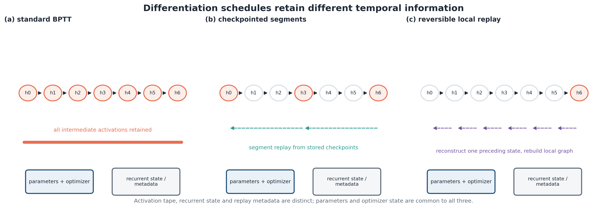

**Figure 2.4 - Storage schedules for differentiation through time.** Vanilla BPTT retains the
activation history, checkpointing retains selected boundaries, and reversible replay reconstructs
the preceding state before rebuilding one local graph. Source: author's schematic after BPTT,
checkpointing, and reversible-network literature [28, 30, 32].

The relevant design objective is therefore not "minimum memory" in the abstract. Parameters and
optimizer tensors may dominate a small model; attention workspace may dominate another. The method
pays only when the avoidable activation trajectory is a material part of peak memory.

A more useful peak-memory model separates fixed and horizon-dependent terms:

$$
M_{\mathrm{peak}}(T)
=M_{\mathrm{param}}+M_{\mathrm{grad}}+M_{\mathrm{opt}}
+M_{\mathrm{input}}+M_{\mathrm{workspace}}(T)+M_{\mathrm{tape}}(T).
\tag{2.5a}
$$

Reversibility acts principally on $M_{\mathrm{tape}}$; attention-score workspace, the current
state, parameter gradients, and optimizer tensors remain. In a fixed-window recurrence,
self-attention also has two distinct scaling variables. Attention within one $N$-token transition
costs $O(N^2)$ in its conventional form, and repeating that transition for $T$ predicted shifts
costs $O(TN^2)$. One full-attention operation over a concatenated $TN$-token sequence would instead
cost $O(T^2N^2)$. TempVerseFormer concerns the activation history of the repeated fixed-width
operator, leaving other long-sequence attention bottlenecks to separate interventions.

This distinction explains why efficient attention and reversible replay can coexist. Sparse,
linear, or IO-aware attention changes the local transition cost and workspace [12, 13]. Replay changes how those local transitions are
differentiated across repeated time. Treating one as a substitute for the other would conflate
sequence length inside a step with the number of differentiated steps.

### 2.2.2 Reversible transformer block

An additive-coupling block divides a state into two streams, applies arbitrary differentiable
functions to one stream at a time, and updates the other by addition. In a canonical notation,

$$
y_1=x_1+F_\theta(x_2),
\tag{2.6}
$$

$$
y_2=x_2+G_\theta(y_1).
\tag{2.7}
$$

No inverse of $F_\theta$ or $G_\theta$ is required. Given $y_1$ and $y_2$, the inputs follow
in reverse order:

$$
x_2=y_2-G_\theta(y_1),
\tag{2.8}
$$

$$
x_1=y_1-F_\theta(x_2).
\tag{2.9}
$$

Substitution proves exact reconstruction in real arithmetic. TempVerseFormer instantiates one
coupling function with multi-head self-attention and the other with a feed-forward network,
including pre-normalization. The released implementation uses the algebraically equivalent stream
ordering $O_2=I_2+F(I_1)$, $O_1=I_1+G(O_2)$. Names change; the triangular dependency and the
inverse do not. Dropout is absent in the audited block. The replay utility contains block-level
random-seed hooks, but the repeated stack inspected here is deterministic; the available
implementation record does not validate time-indexed stochastic replay across repeated temporal
calls.

**Figure 2.5 - Additive reversible transformer block.** The second coupling is evaluated only
after the first update, so subtraction in the opposite order reconstructs both input streams.
Source: Kulyk, *Temporal Modeling with Reversible Transformers*, published Figure 2, adapted there
from RevViT; reproduced here without pixel modification [32, 92, 135].

Reconstruction and differentiation are separate operations. During the backward pass, the block
first evaluates $G_\theta(y_1)$ to recover $x_2$, recreates the local graph for that evaluation,
and accumulates its parameter and input gradients. It then evaluates $F_\theta(x_2)$, recovers
$x_1$, and completes the local vector-Jacobian product. The graph is released before the previous
block is processed. This is why a reversible block can save activation storage even though its
backward pass performs extra forward computations [32].

Finite precision weakens the word "exact." Each subtraction uses a recomputed floating-point value,
and round-off can accumulate across depth or time. Normalization, stochastic layers, mixed
precision, and non-deterministic kernels add implementation constraints. Algebraic invertibility
therefore establishes a valid reconstruction formula; numerical agreement must still be measured.
Numerical agreement is therefore measured by the dissertation-level recurrence tests in Section
2.2.8 rather than inferred from the block equations.

The block can also be read as a composition of two shear transformations. The first maps
$(x_1,x_2)\mapsto(x_1+F(x_2),x_2)$; the second maps
$(y_1,x_2)\mapsto(y_1,x_2+G(y_1))$. Where the functions are differentiable, each Jacobian is
block triangular with unit diagonal, so

$$
\det J_{R_\theta}=1.
\tag{2.9a}
$$

Volume preservation clarifies both the strength and the limitation of additive coupling. The
complete state is recoverable, but the transition cannot simply forget nuisance information as a
many-to-one recurrent gate can [110]. Compression or forgetting must happen at
a non-reversible boundary or be represented with explicit side information. Nor does unit
determinant bound the largest singular value: one direction may expand strongly while another
contracts. Dynamic stability must therefore be tested independently.

The reversible-state boundary is especially important in TempVerseFormer. The published diagram
contains a variational encoder and decoder, linear projections, duplication of a projected stream,
normalization, and output fusion. Those operations are useful interfaces, but they are not all
bijections. The audited implementation confirms the following contract.

**Table 2.2 - Verified reversible-state contract of the released TempVerseFormer implementation**

| Tensor or operation | Implemented transformation | Algebraically invertible from its output alone? | What reverse differentiation retains or recomputes | Included in the exact state-replay claim? |
|---|---|---:|---|---:|
| Image frame to VAE latent | Convolutional variational encoder, $x\mapsto z$ | No | Ordinary autograd values or frozen/precomputed latent, depending on training mode | No |
| Latent input projection | $256$-dimensional latent to $768$-dimensional embedding plus learned position | Not established as bijective | Boundary input is handled by ordinary autograd in the default mode | No |
| Stream creation | Concatenation $[e,e]$ of two identical $768$-dimensional streams | No; duplication is injective but not a two-stream bijection onto the codomain | Projected embedding exists at the core boundary | No |
| Repeated temporal state | Additive-coupling stack over the doubled embedding | Yes in exact arithmetic for the audited deterministic block; any future stochastic conditioning would also have to be replayed | Terminal doubled state; local block functions are reevaluated | Yes |
| Output normalization and fusion | $2\times768$ state to a $256$-dimensional latent | No | Ordinary autograd boundary values in the default mode; the alternative utility stores non-reversible boundaries | No |
| VAE decoding and image loss | Latent to pixels followed by MSE/LPIPS/KL terms | No | Standard loss graph at the boundary | No |

Table 2.2 narrows the valid claim to the persistent doubled transformer state. The complete
VAE-to-VAE prediction pipeline is non-invertible, yet the repeated core is precisely where a
temporal activation tape would otherwise grow. Its reconstruction therefore supports the measured
activation-memory result without implying that the final image prediction determines every
intermediate operation.

### 2.2.3 Temporal chaining and TempVerseFormer

TempVerseFormer places the reversible stack between a spatial encoder and decoder. An input window
of $N$ frames is encoded frame by frame into continuous latent vectors. In the published
configuration, each $64\times64$ RGB frame is mapped to a 256-dimensional latent state. A learned
linear projection expands each state to 768 features, position embeddings identify the $N$
locations in the window, and the projected sequence is duplicated to form the two coupling streams.
The temporal core contains eight reversible transformer blocks with eight attention heads [135].

**Figure 2.6 - Complete TempVerseFormer architecture.** A variational image encoder and decoder
surround the repeated reversible temporal core. The detailed published diagram is retained at full
or landscape page width; its inclusion does not imply that the VAE and projection boundaries are
invertible. Source: Kulyk, published Figure 3, reproduced without pixel modification [135].

Let $e_\phi$ and $d_\psi$ denote the VAE encoder and decoder, $P_{\mathrm{in}}$ the input
projection and duplication interface, $P_{\mathrm{out}}$ the terminal normalization and fusion,
and $R_\theta$ one application of the reversible transformer stack. For an encoded context
$z^{(0)}=(e_\phi(x_1),\ldots,e_\phi(x_N))$, the implemented recurrence can be written as

$$
q^{(0)}=P_{\mathrm{in}}(z^{(0)}),
\qquad
q^{(r+1)}=R_\theta(q^{(r)}),\quad r=0,\ldots,T-1,
\tag{2.10}
$$

followed by

$$
\widehat z^{(T)}=P_{\mathrm{out}}(q^{(T)}),
\qquad
\widehat x^{(T)}=d_\psi(\widehat z^{(T)}).
\tag{2.11}
$$

Here $q^{(r)}\in\mathbb R^{B\times N\times 1536}$ is the persistent doubled state to which the
inverse applies. The released implementation repeats the same stack $T$ times before applying
the output fusion once. It does not decode and re-encode an image between temporal iterations.
This detail resolves an ambiguity in a literal reading of the published chaining diagram: the
feedback loop is a recurrence in the projected transformer state, while the VAE and fusion
operations form non-reversible boundaries around that loop.

The state dimension is held fixed as the shift grows. Temporal depth therefore counts repeated
applications of one window operator, not an ever longer token sequence. Parameter sharing is
complete across those applications. Gradients from the terminal decoded window must nevertheless
traverse every repeated transition, which is why the activation history grows under ordinary
autograd even though the number of learned temporal parameters does not.

**Figure 2.7 - Temporal chaining of a fixed-width latent window.** Each application advances the
window representation toward a time-shifted target, and the terminal hidden state is exposed to the
output projection after the requested prediction depth. Source: Kulyk, published Figure 4,
reproduced without pixel modification [135].

Training uses a context of 12 frames and a curriculum in which the shift $T$ increases from one
to five. The decoded output window is compared with the corresponding time-shifted target window.
Equation (16) in the published paper reports a three-term objective [135]:

$$
\mathcal L_{\mathrm{paper}}
=\lambda_{\mathrm{MSE}}\mathcal L_{\mathrm{MSE}}
+\lambda_{\mathrm{LPIPS}}\mathcal L_{\mathrm{LPIPS}}
+\lambda_{\mathrm{KL}}D_{\mathrm{KL}}
\bigl(q_\phi(z\mid x)\,\|\,\mathcal N(0,I)\bigr).
\tag{2.12}
$$

The inspected `train_default` implementation is more explicit than that published notation. It
computes prediction-image MSE and a second MSE between the input images and their VAE
reconstruction, then adds prediction LPIPS and KL:

$$
\mathcal L_{\mathrm{code}}
=\mathcal L_{\mathrm{pred\text{-}MSE}}
+\mathcal L_{\mathrm{input\text{-}VAE\text{-}MSE}}
+\lambda_{\mathrm{LPIPS}}\mathcal L_{\mathrm{LPIPS}}
+\lambda_{\mathrm{KL}}D_{\mathrm{KL}}.
\tag{2.12a}
$$

Thus the fourth term is an implementation detail, not a term that should be attributed to the
paper's Equation (16). MSE and LPIPS supervise the decoded prediction, while the input
reconstruction and KL terms shape the spatial latent interface [43, 128]. The paper reports unit
weights for MSE and LPIPS and a KL weight annealed to $10^{-3}$. The released training code instead
sets its maximum KL coefficient to $10^{-4}$. The public TempVerseFormer repository provides
training, evaluation, memory-test configurations, checkpoints, and experiment-tracking links for
independent reproduction [172]. The numerical tables below nevertheless remain quotations of the
published experiment rather than newly rerun values; any fresh run should identify its commit and
configuration, including the KL schedule, instead of silently equating the current default with the
historical publication setup.

Non-causal self-attention is used inside each 12-token window. That choice allows each location in
the input window to interact with the complete supplied window while the temporal shift is learned
at the level of the repeated operator. It also means the core is not a token-by-token causal
language model. Causality is imposed by the construction of input and target windows: future target
frames are not part of the input. The distinction becomes important later, because Chapter 3 uses
explicitly causal retained-context packages and an autoregressive rollout rather than this
fixed-window transition.

The reported architecture-cost table provides another reason to separate accuracy from the memory
claim. TempVerseFormer is listed at 60 million parameters, $0.98$ GFLOPs, and 488 million MACs;
the matched TempFormer and standard transformer are each listed at 57 million parameters,
$1.37$ GFLOPs, and 684 million MACs. The LSTM row reports 76 million parameters, $0.98$ GFLOPs,
and 2.6 million MACs. These source values are reproduced as published, but the LSTM FLOP/MAC pair
does not follow the usual two-FLOP-per-MAC convention. They should not be used to derive a new
hardware-efficiency ranking without the exact profiler settings. The activation-memory result is
supported directly by allocation measurements instead.

### 2.2.4 Time-agnostic backpropagation

Temporal chaining creates a repeated reversible state, but memory is reduced only if training
actually avoids retaining the ordinary activation graph. The time-agnostic procedure separates
forward prediction from reverse differentiation. During the forward phase, the recurrent core is
evaluated under a no-gradient context, intermediate block activations are discarded, and the
terminal state $q^{(T)}$ is retained. During the backward phase, each preceding state is recovered
algebraically, the corresponding local forward computation is rebuilt with gradient tracking, its
vector-Jacobian products are accumulated, and the local graph is freed.

**Figure 2.8 - Time-agnostic backpropagation through the reversible temporal state.** The forward
trajectory discards core activations; reverse replay reconstructs one state and one local graph at
a time. The figure applies to the verified recurrent core, not to the VAE and projection interfaces.
Source: Kulyk, published Figure 5, reused unchanged [135].

For a trajectory loss $\mathcal L=\sum_{t=1}^{T}\ell_t(q^{(t)})$, define the adjoint
$a_t=\partial\mathcal L/\partial q^{(t)}$. Reverse-mode differentiation gives

$$
a_{t-1}
=\frac{\partial\ell_{t-1}}{\partial q^{(t-1)}}
+\left(\frac{\partial R_\theta(q^{(t-1)})}{\partial q^{(t-1)}}\right)^{\!\top}a_t,
\tag{2.13}
$$

and the parameter gradient is

$$
\nabla_\theta\mathcal L
=\sum_{t=1}^{T}
\left(\frac{\partial R_\theta(q^{(t-1)})}{\partial\theta}\right)^{\!\top}a_t.
\tag{2.14}
$$

Reversible replay leaves these derivatives unchanged and changes only how $q^{(t-1)}$, and hence
the local Jacobian products, are obtained. Starting from $q^{(t)}$, the algorithm evaluates
$R_\theta^{-1}$ with the same parameters and replay inputs. It then reevaluates
$R_\theta(q^{(t-1)})$ under autograd and applies (2.13)-(2.14). The derivative is the ordinary
reverse-mode derivative of the reconstructed trajectory, up to finite-precision reconstruction
and recomputation differences.

**Algorithm 2.1 - Reverse replay through a deterministic reversible temporal core**

1. Compute $q^{(0)}=P_{\mathrm{in}}(e_\phi(x_{1:N}))$ with the required boundary graph.
2. For $t=1,\ldots,T$, evaluate $q^{(t)}=R_\theta(q^{(t-1)})$ without retaining the core's
   intermediate activations.
3. Apply $P_{\mathrm{out}}$, decode the terminal prediction, evaluate the loss, and obtain the
   terminal adjoint $a_T$ through the non-reversible output boundary.
4. For $t=T,\ldots,1$, reconstruct $q^{(t-1)}=R_\theta^{-1}(q^{(t)})$.
5. Reevaluate $R_\theta(q^{(t-1)})$ with gradient tracking, accumulate the parameter gradient and
   compute $a_{t-1}$.
6. Release the local graph before processing $t-1$, then propagate the recovered gradient through
   the ordinary input-projection and VAE boundary.

Two details are easy to miss in this schedule. First, model parameters are shared across temporal
applications. Their gradients are therefore accumulated over reverse steps before the optimizer
updates them; replay does not create a separate parameter copy for each time index. Second, the
non-reversible boundaries are differentiated in the usual way. A memory claim for the core is
compatible with storing the projected input, terminal fusion values, and loss graph. Omitting those
terms from the statement would turn a scoped complexity result into an inaccurate whole-pipeline
claim.

The reverse step must also recreate the same local function that produced the forward state.
Weights cannot change between the forward and reconstructed evaluations. Any data-dependent branch,
dropout mask, random augmentation, or nondeterministic operation inside the state transition must
be fixed or replayed. Batch-normalization statistics would need similar care; the audited block
uses normalization without running-state updates inside the coupling functions. These are
implementation conditions, not cosmetic reproducibility preferences. If the reevaluated map
differs, the subtraction no longer reconstructs the state on which the original loss depended.

The following result states the memory claim at the level justified by this algorithm.

**Lemma 2.1 (activation-tape complexity).** Let $R_\theta$ be a deterministic reversible
transition consisting of $L$ additive-coupling blocks, and let $D_s$ be the complete state
footprint at one block. Suppose the loss boundary and all conditioning needed for replay occupy
memory independent of $T$. A transition-level replay schedule has the conservative peak bound
$O(LD_s)$, while the audited blockwise schedule releases each reconstructed block graph before
processing the preceding block and therefore has a tighter transient-graph bound $O(D_s)$, apart
from retained state and bookkeeping. Both bounds are $O(1)$ in temporal depth $T$; a direct BPTT
tape requires $O(TLD_s)$.

**Proof.** A direct BPTT execution retains the values needed by each of the $L$ block graphs at
each of the $T$ transitions, yielding $T\sum_l A_l=O(TLD_s)$. Reverse replay retains the
terminal recurrent state and processes temporal indices sequentially in descending order. At one
index it reconstructs the preceding state and instantiates no more than one transition's local
graph, giving the conservative $O(LD_s)$ bound. In the inspected implementation, the blocks of
that transition are replayed in reverse order and each local graph is released immediately, so at
most one block graph is live and the transient contribution tightens to $O(D_s)$. Parameters,
gradients, optimizer state, retained recurrent state, the non-reversible boundary graph, and replay
metadata are common additive terms and are excluded from the transient-graph statement. Hence its
dependence on $T$ is constant under the stated assumptions. $\square$

The assumption on replay information is exact for the deterministic published block because the
audited attention and MLP contain no dropout. It is not exact for a stochastic recurrence unless
the realized random variables can be reproduced. Section 2.2.8 makes that extra term explicit.

Lemma 2.1 deliberately concerns peak transient activations. At least one complete recurrent state
must remain available, and the local inverse itself may require workspace. Attention kernels can
also allocate temporary score or softmax buffers whose size depends on the fixed window length.
Those terms can be substantial, but they do not grow with the number of repeated temporal
applications under the stated operator. Measuring both temporal-core and total allocation is the
empirical check that the distinction survives the actual software stack.

Replay saves storage, not arithmetic. Each discarded transition is evaluated again during the
reverse pass. In a simplified cost model,

$$
C_{\mathrm{rev}}(T)
\approx T\bigl(2C_{R}^{\mathrm{fwd}}+C_{R}^{\mathrm{local-bwd}}\bigr),
\tag{2.15}
$$

where one forward evaluation generates the trajectory and another reconstructs the local graph.
Kernel reuse and implementation details change the observed multiplier, but they cannot remove
the storage-recomputation exchange. The published runtime evidence in Section 2.2.7 is therefore
part of the result, not an incidental implementation detail.

### 2.2.5 Controlled temporal-pattern results

The controlled evaluation compared four systems: the reversible TempVerseFormer, a matched
non-reversible TempFormer with temporal chaining, a standard transformer without the same repeated
chaining interface, and an encoder-decoder LSTM. TempFormer and TempVerseFormer both used eight
blocks, eight attention heads, and 768 hidden features. All models shared the VAE interface and
were trained for 30,000 updates on one NVIDIA RTX 4060 Ti. Evaluation used 2,000 procedurally
generated sequences and a fixed generator seed across models [135].

**Table 2.3 - Published predictive point estimates by rotation regime**

| Regime | Model | FID $\downarrow$ | MSE $\downarrow$ | SSIM $\uparrow$ |
|---|---|---:|---:|---:|
| Constant | TempFormer | 103 | 0.023 | 0.84 |
|  | **TempVerseFormer** | **75** | **0.018** | **0.88** |
|  | Standard Transformer | 87 | 0.030 | 0.86 |
|  | LSTM | 157 | 0.080 | 0.76 |
| Accelerated | **TempFormer** | 90 | **0.021** | **0.857** |
|  | TempVerseFormer | 87 | 0.028 | 0.853 |
|  | Standard Transformer | 95 | 0.030 | 0.851 |
|  | **LSTM** | **86** | 0.048 | 0.821 |
| Decelerated | TempFormer | 90 | **0.025** | **0.86** |
|  | TempVerseFormer | 87 | 0.036 | 0.84 |
|  | Standard Transformer | 86 | 0.036 | 0.85 |
|  | **LSTM** | **85** | 0.039 | 0.84 |
| Oscillating | TempFormer | 130 | 0.024 | 0.82 |
|  | TempVerseFormer | 112 | **0.021** | **0.84** |
|  | Standard Transformer | 119 | 0.068 | 0.78 |
|  | **LSTM** | **108** | 0.081 | 0.77 |
| Interrupted | TempFormer | 98 | 0.034 | 0.83 |
|  | **TempVerseFormer** | **91** | **0.032** | **0.84** |
|  | Standard Transformer | 99 | 0.056 | 0.80 |
|  | LSTM | 107 | 0.060 | 0.79 |
| Combined | **TempFormer** | **119** | 0.060 | **0.79** |
|  | TempVerseFormer | 123 | **0.059** | 0.78 |
|  | Standard Transformer | 127 | 0.086 | 0.77 |
|  | LSTM | 156 | 0.089 | 0.74 |

Bold values mark the best reported point estimate for each metric and regime; ties are not
manufactured where the paper reports different rounded values. The pattern is mixed. On constant
and interrupted rotations, TempVerseFormer leads all three metrics. It also has the best MSE and
SSIM for oscillation, although the LSTM reports a slightly lower FID. For acceleration and
deceleration, the matched non-reversible TempFormer leads MSE and SSIM, while the LSTM gives the
lowest FID. Under combined dynamics, TempFormer leads FID and SSIM and TempVerseFormer leads only
MSE.

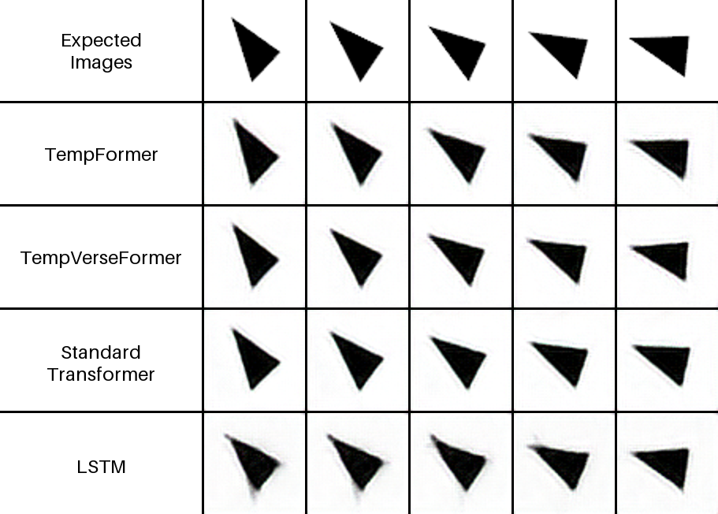

**Figure 2.9 - Five-step predictions for constant rotation.** The complete gallery is retained so
the comparison is not selected around one successful model or frame. Source: Kulyk, published
Figure 6, unchanged [135].

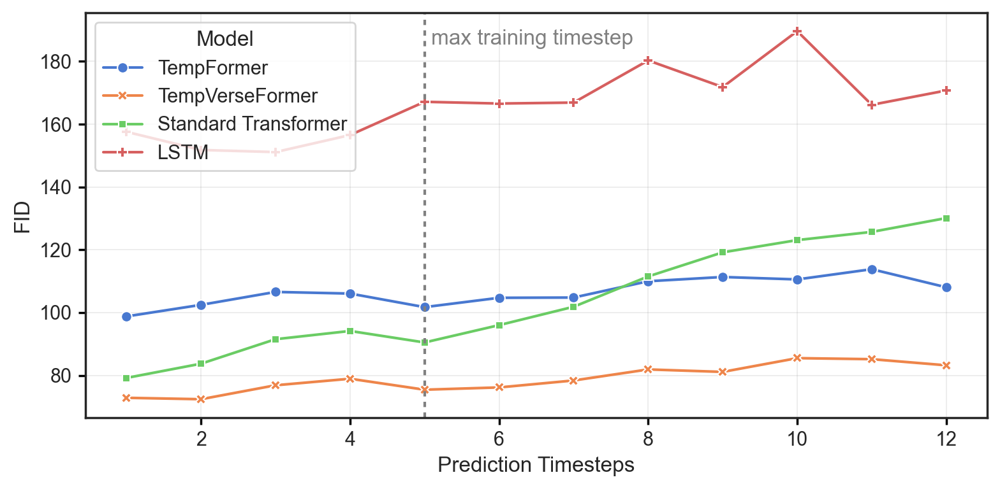

**Figure 2.10 - Constant-rotation FID over prediction depth.** Both temporally chained transformers
remain comparatively stable beyond the five-step training horizon, whereas the standard
transformer and especially the LSTM degrade. Source: Kulyk, published Figure 7, unchanged [135].

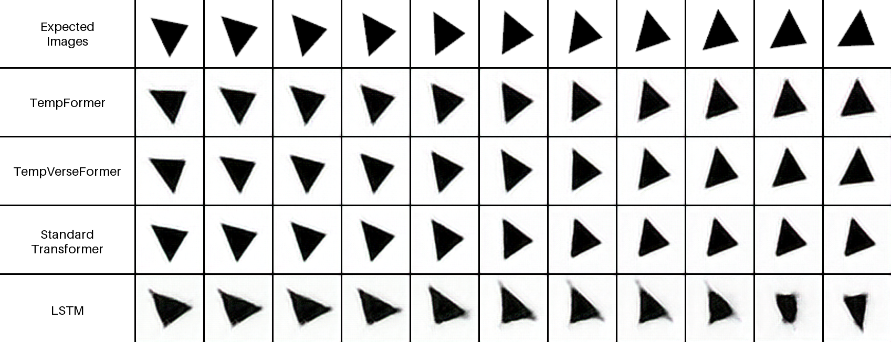

**Figure 2.11 - Eleven-step prediction beyond the training horizon.** The figure illustrates
longer-horizon behaviour but does not separate the causal contribution of reversibility from the
shared temporal-chaining mechanism. Source: Kulyk, published Figure 8, unchanged [135].

TempFormer and TempVerseFormer follow similar long-horizon trajectories in the constant-rotation
curves. Their shared recurrence is a plausible source of that stability, whereas algebraic
reversibility primarily changes the training-memory schedule. A causal quality comparison would
have to hold temporal chaining and optimization exposure fixed while varying only the
reverse-computation mechanism.

The four variable-pattern galleries are retained as a complete group. Keeping only the most
favourable case would turn qualitative illustration into post-hoc selection.

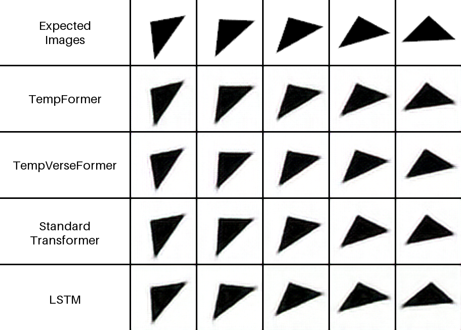

**Figure 2.12 - Predictions under accelerated rotation.** The complete published comparison is
reused unchanged. Source: Kulyk, published Figure 9 [135].

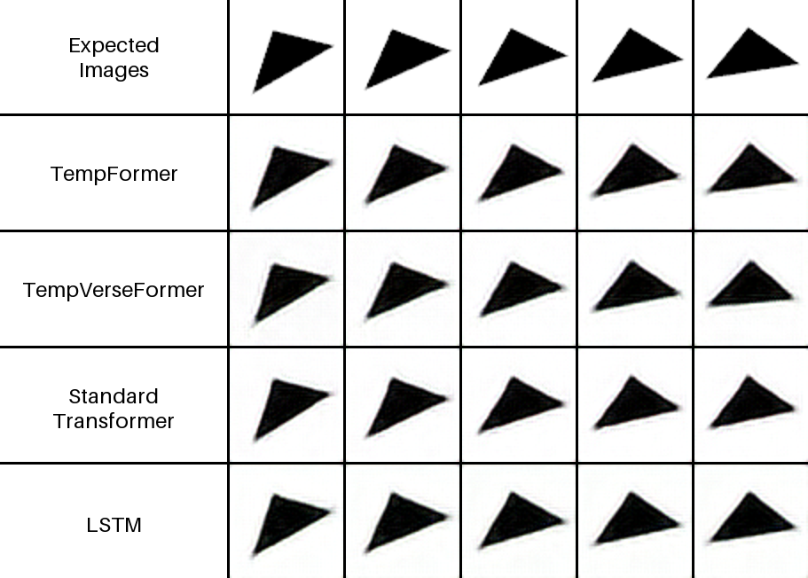

**Figure 2.13 - Predictions under decelerated rotation.** The complete published comparison is
reused unchanged. Source: Kulyk, published Figure 10 [135].

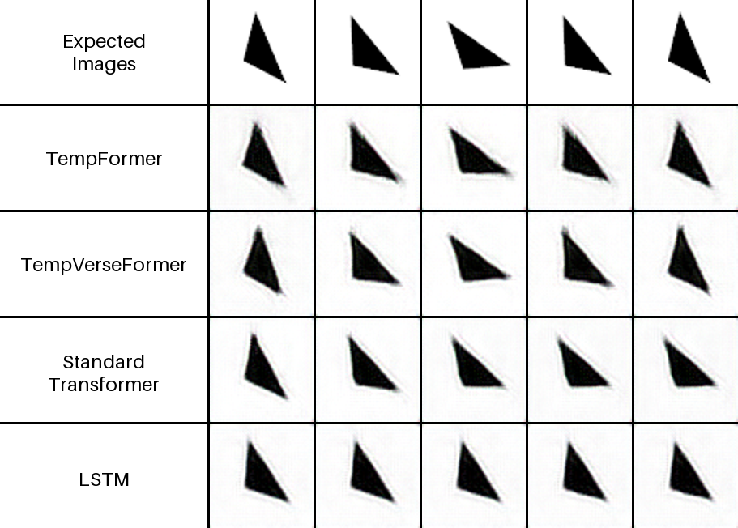

**Figure 2.14 - Predictions under oscillating rotation.** The complete published comparison is
reused unchanged. Source: Kulyk, published Figure 11 [135].

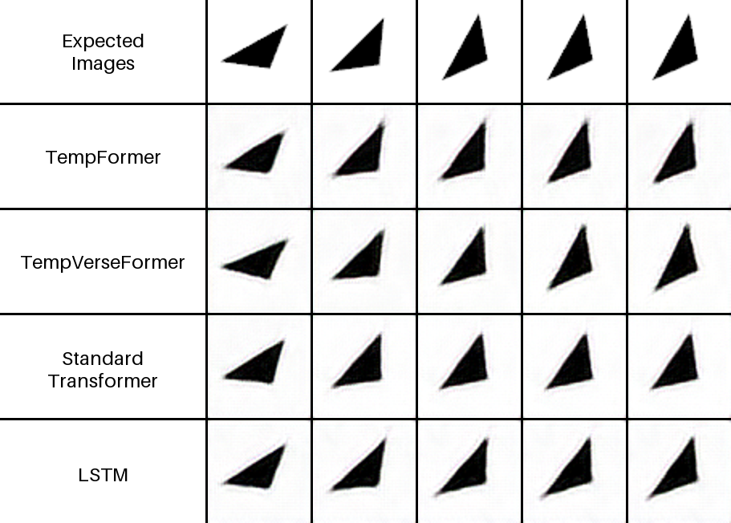

**Figure 2.15 - Predictions under interrupted rotation.** The complete published comparison is
reused unchanged. Source: Kulyk, published Figure 12 [135].

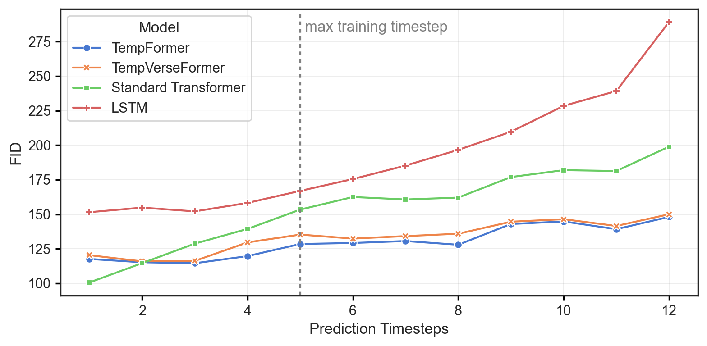

**Figure 2.16 - FID over prediction depth for combined temporal patterns.** The chained
transformers remain close, with TempFormer slightly better in the aggregate reported FID; the
standard transformer and LSTM deteriorate more strongly. Source: Kulyk, published Figure 13,
unchanged [135].

The publication reports one point estimate per configuration and documents one fixed
sequence-generator seed; it does not establish how many independent training runs were attempted.
No across-training-seed interval or clip-cluster inference is supplied. FID at 2,000 sequences
is also a finite-sample point estimate. Consequently, small differences such as 119 versus 123 are
descriptive. The robust conclusion is narrower: the reversible model remains competitive across
the tested dynamics while supporting a different activation-memory regime. It is not the best
predictor under every temporal pattern or endpoint.

Metric disagreement is scientifically informative here. FID compares distributions in a feature
space and can favour a set of diverse samples even when corresponding frames are not close to their
targets [94]. MSE rewards pixel alignment and penalizes a small angular displacement sharply.
SSIM emphasizes local luminance, contrast, and structure [94, 127–129]. An LSTM
can therefore obtain the lowest reported FID for acceleration while having substantially worse MSE
and SSIM. Calling that row the overall winner would conceal the prediction task's paired nature.

The regimes stress different state transitions as well. Constant velocity is well described by a
stationary shift in orientation; acceleration and deceleration require an evolving velocity state;
oscillation requires direction reversal; interruption inserts a temporary zero-velocity phase.
The combined setting changes among several rules. TempVerseFormer performs strongly on stationary,
oscillatory, and interrupted cases but does not dominate the smooth acceleration cases. One
plausible reading is that temporal chaining represents repeated transitions well, whereas
reversibility alone supplies no special inductive bias for estimating angular acceleration. The
data support the pattern, not that causal explanation; a targeted state-probe experiment would be
needed to establish it.

### 2.2.6 External OpenSTL validation

Controlled rotation cannot establish competence on textured scenes or real motion. The temporal
model was therefore integrated into OpenSTL and evaluated under its prescribed splits and metrics
on Moving MNIST, Moving MNIST-CIFAR, KTH Action, and TaxiBJ [1, 124, 126, 154]. The reported comparison spans recurrent ConvLSTM and PredRNN++ [137, 152], together with recurrent-free
ViT and Uniformer baselines.

**Table 2.4 - Published OpenSTL comparisons**

| Dataset | Model | SSIM $\uparrow$ | MSE $\downarrow$ | Best reported point in this comparison |
|---|---|---:|---:|---|
| Moving MNIST | ConvLSTM | 0.929 | 29.80 |  |
|  | **PredRNN++** | **0.951** | **22.06** | SSIM and MSE |
|  | TempVerseFormer | 0.932 | 26.08 |  |
|  | ViT | 0.914 | 35.15 |  |
|  | Uniformer | 0.931 | 30.38 |  |
| Moving MNIST-CIFAR | ConvLSTM | 0.920 | 73.31 |  |
|  | **PredRNN++** | **0.957** | **44.19** | SSIM and MSE |
|  | TempVerseFormer | 0.950 | 50.37 |  |
|  | ViT | 0.936 | 64.94 |  |
|  | Uniformer | 0.944 | 56.96 |  |
| KTH Action | ConvLSTM | 0.898 | 47.65 |  |
|  | **PredRNN++** | **0.912** | **39.84** | SSIM and MSE |
|  | TempVerseFormer | 0.898 | 48.97 |  |
|  | ViT | 0.895 | 56.57 |  |
|  | Uniformer | 0.906 | 44.71 |  |
| TaxiBJ | ConvLSTM | 0.9836 | 0.34 |  |
|  | PredRNN++ | 0.9834 | 0.33 |  |
|  | TempVerseFormer | 0.9835 | **0.31** | MSE |
|  | ViT | 0.9841 | 0.32 |  |
|  | **Uniformer** | **0.9844** | 0.34 | SSIM |

TempVerseFormer is competitive among the reported methods, but its rank changes by dataset.
PredRNN++ leads both endpoints on Moving MNIST, Moving MNIST-CIFAR, and KTH, while Uniformer also
exceeds TempVerseFormer in KTH SSIM and MSE. TaxiBJ is the one case where TempVerseFormer reports
the lowest MSE, $0.31$; Uniformer reports the highest SSIM.

This comparison closes an important but limited gap in the controlled-rotation evidence. It shows
that the temporal architecture can be trained through OpenSTL interfaces spanning object rasters,
textured composites, human actions and gridded flow fields without a task-specific claim of
dominance. It does not isolate the effect of reversible replay: Table 2.4 contains no matched
non-reversible TempFormer arm on these datasets. Nor do the benchmark protocols make a uniquely
relevant view disappear beyond the available context before it is needed again. The evidence thus
supports portability and predictive competence, while the activation-memory claim continues to
rest on direct reversible/non-reversible measurements and the reach mechanism remains a separate
question. Its broader value is showing that the controlled result was not confined to one renderer.

The four datasets test different kinds of competence. Moving MNIST emphasizes translation,
collision, and preservation of digit shape. Adding CIFAR backgrounds introduces texture that is
not coupled to the foreground motion. KTH replaces synthetic digits with articulated human
actions, while TaxiBJ is a gridded flow field rather than an object-rendering problem. Agreement
across all four would be stronger than success on one rotation generator. The published pattern is
more modest: the architecture remains usable across these interfaces, but its relative position
changes with the data.

OpenSTL standardizes much of the data and evaluation plumbing, reducing one source of comparison
error. Training schedules, parameter counts, checkpoint selection, metric reductions, and the
fidelity of each imported baseline still matter. Table 2.4 is consequently the comparison made in
the source study, not a new leaderboard assembled from unrelated papers. Reproducing the complete
benchmark under current OpenSTL versions would be a separate experiment.

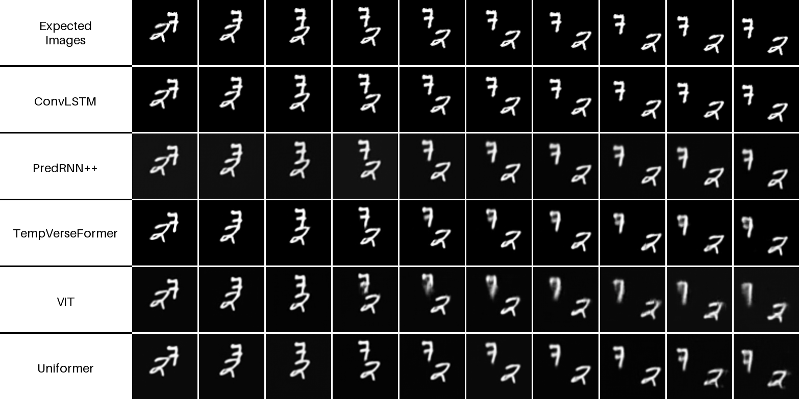

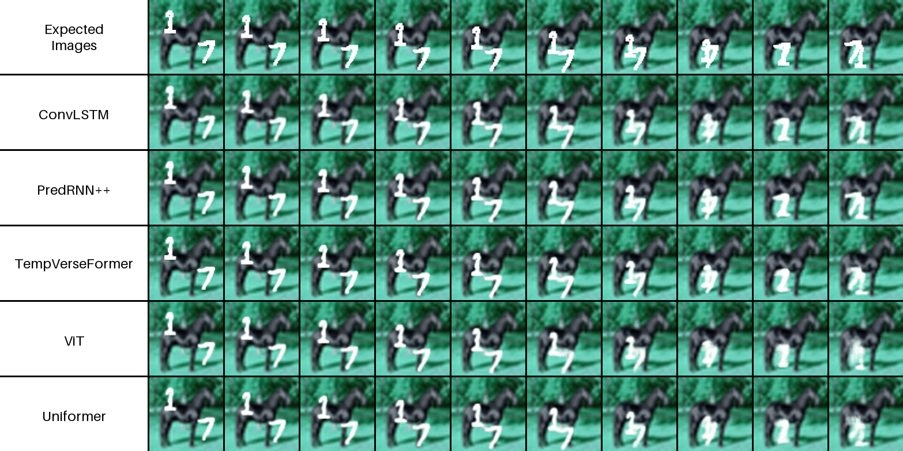

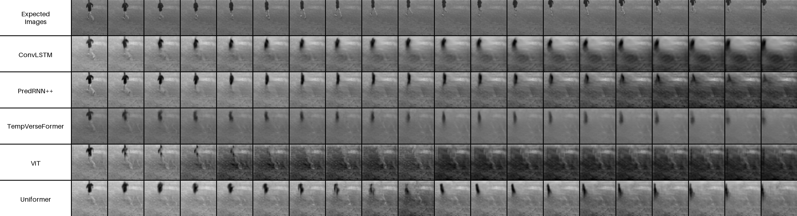

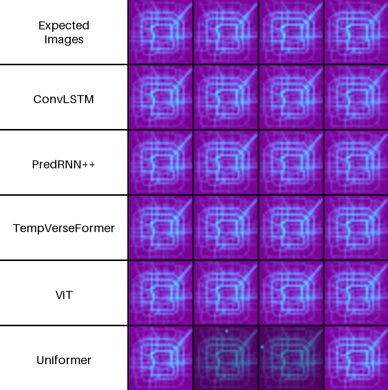

**Figure 2.17 - Qualitative OpenSTL predictions.** Four intact published panels show Moving MNIST,
Moving MNIST-CIFAR, KTH Action, and TaxiBJ. KTH predictions become visibly blurred, whereas the
TaxiBJ flow maps retain clearer structure. Source: Kulyk, published Figures 16-19, assembled without
editing individual panels [135].

The qualitative examples agree with the bounded quantitative interpretation. Digit structure is
generally preserved, though PredRNN++ remains sharper late in the Moving MNIST horizon. KTH motion
is recognizable but blurred. TaxiBJ is visually stronger in the examples shown. The paper supplies
neither a qualitative selection rule nor multiple training seeds or confidence intervals. These
examples establish benchmark competence, not a universal accuracy advantage or evidence for the
context hierarchy studied in Chapters 3 and 4.

None of these datasets makes a distant, temporarily hidden observation the uniquely relevant cause
of a later target. They broaden domain coverage but cannot identify memory reach. That question
requires the purpose-built geometry introduced in Chapter 3.

### 2.2.7 Activation-memory and computation frontier

The primary TempVerseFormer result is the different scaling of temporal-core memory. Published
measurements separate memory attributed to the temporal model from total pipeline allocation,
which also includes the VAE and common components. This separation prevents a constant core curve
from being misreported as zero growth of every device allocation.

**Table 2.5 - Published GPU-memory measurements at the tabulated horizons, batch size 32**

| Prediction steps | Model | Temporal-model memory (GB) | Total pipeline memory (GB) |
|---:|---|---:|---:|
| 1 | TempFormer | 0.85 | 4.11 |
|  | TempVerseFormer | 0.89 | 3.94 |
|  | Standard Transformer | 0.85 | 4.10 |
|  | LSTM | 1.27 | 4.00 |
| 4 | TempFormer | 0.85 | 4.59 |
|  | TempVerseFormer | 0.89 | 3.95 |
|  | Standard Transformer | 0.86 | 4.58 |
|  | LSTM | 1.28 | 4.03 |
| 16 | TempFormer | 2.61 | 6.50 |
|  | TempVerseFormer | 0.89 | 3.98 |
|  | Standard Transformer | 2.60 | 6.51 |
|  | LSTM | 1.28 | 4.13 |

At 16 prediction steps, the reversible temporal core remains at the reported $0.89$ GB, while
the matched TempFormer rises to $2.61$ GB. Total-pipeline memory changes much less dramatically
because the VAE and other common costs remain resident. This is a measured activation-memory
advantage within the reported setup, not a reduction in parameters or optimizer state.

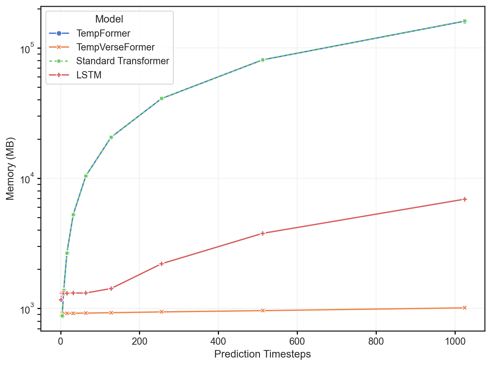

**Figure 2.18 - GPU memory versus prediction depth.** The reversible temporal-model curve remains
near $0.9$ GB over the plotted 1-1,024-step range, while the non-reversible transformer curves
increase. The logarithmic axis and original labels are retained. Source: Kulyk, published Figure
14 in the supplied version, reproduced without modification; author preprint DOI
10.21203/rs.3.rs-6293520/v1 and version-of-record DOI 10.1007/s00521-025-11707-3 [135].

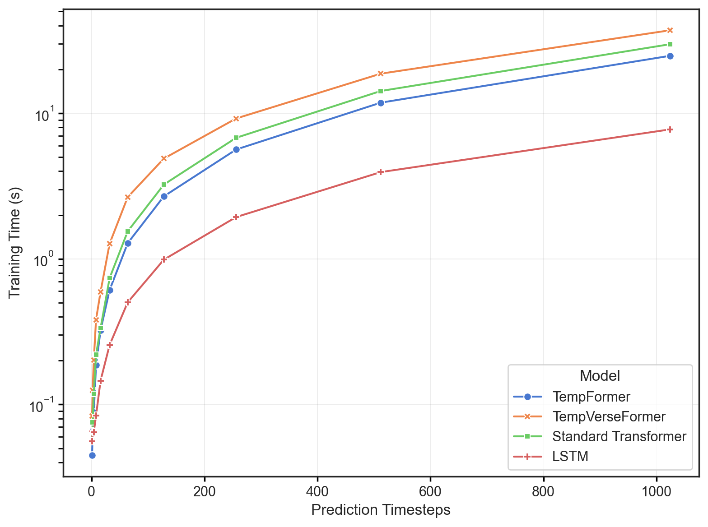

**Figure 2.19 - Training time versus prediction depth.** Reconstructing discarded activations
creates a visible computation premium relative to the matched non-reversible transformer, while all
methods become slower as prediction depth increases. Source: Kulyk, published Figure 15 in the
supplied version, reproduced without modification [135].

The two figures must be read together. Figure 2.18 shows why long temporal differentiation becomes
feasible under a memory ceiling; Figure 2.19 shows its computational price. Reversible replay is a
memory-computation exchange, attractive when the device cannot hold the non-reversible activation
tape and extra arithmetic is acceptable.

Only the 1-, 4-, and 16-step memory points are tabulated with exact numeric values in the paper.
Beyond those tabulated anchors, the published curves extend to 1,024 steps, but the available
article and repository record does not provide the exact high-horizon coordinates or their raw run
artifacts. The dissertation therefore anchors quantitative claims to Table 2.5 and treats the long
curve as published scaling evidence whose pointwise receipts still belong in the author's
experiment ledger.

The tabulated 16-step comparison already demonstrates the operating effect without relying on the
far end of the curve. Relative to TempFormer, TempVerseFormer uses 1.72 GB less reported
temporal-model memory at that point, a reduction of about 66%. At total-pipeline level the
difference is 2.52 GB, or about 39%, because common spatial and training allocations remain. These
two percentages answer different questions and should not be interchanged. The first isolates the
mechanism; the second is closer to the capacity a practitioner observes.

Runtime must be measured on the same footing. A reversible pass performs reconstruction and local
reevaluation, whereas an ordinary pass consumes a stored graph. Wall-clock differences therefore
depend on kernel launch overhead, attention implementation, memory bandwidth, precision, and
device occupancy, not only on asymptotic counts. Figure 2.19 supplies the published empirical
counterweight, but no energy or throughput-normalized comparison was reported.

### 2.2.8 Stochastic replay extension and separate recurrent-core checks

The published temporal model is deterministic inside its reversible stack. Many generative video
transitions are not. They sample a latent innovation, apply stochastic regularization, or receive
a random diffusion state. Discarding that realized input would destroy information required for
reconstruction.

Three dissertation checks address related parts of this problem, but they are not one jointly
executed experiment. A **single reversible convolutional stage** tests store-the-noise
reconstruction over 40 stochastic transitions. Reverse-gradient direction is tested on a
**deterministic multi-level recurrent core**. The memory and runtime frontier in Table 2.6 comes
from a second deterministic three-level training loop. None is part of the published TempVerseFormer
architecture, and none is used to train the Chapter 3 predictor.

For an external-additive stochastic transition,

$$
h_t=F_\theta(h_{t-1})+\sigma\epsilon_t,
\qquad
\epsilon_t\sim\mathcal N(0,I),
\tag{2.16}
$$

knowledge of the realized $\epsilon_t$ is necessary but not sufficient for inversion. If
$F_\theta$ is bijective on the tested state domain, then conditioning on that value gives

$$
h_{t-1}=F_\theta^{-1}(h_t-\sigma\epsilon_t).
\tag{2.17}
$$

The executable single-stage stochastic check injects noise as a conditioning argument inside a
two-branch additive coupling rather than adding it after the complete transition:

$$
y_{1,t}=s_{1,t-1}+F_\theta(s_{2,t-1},\epsilon_t),
\qquad
y_{2,t}=s_{2,t-1}+G_\theta(y_{1,t}),
\tag{2.18}
$$

with conditional inverse

$$
s_{2,t-1}=y_{2,t}-G_\theta(y_{1,t}),
\qquad
s_{1,t-1}=y_{1,t}-F_\theta(s_{2,t-1},\epsilon_t).
\tag{2.19}
$$

The coupling functions need not be invertible; the stored conditioning must merely be replayed
identically. This construction also applies to known actions or level context. A hard forgetting
gate is different: if it overwrites part of a state, the discarded value or sufficient residual
information must be retained. Reversibility cannot recover information that the forward map has
destroyed [110].

Replay memory has three conceptually separate terms:

$$
M_{\mathrm{replay}}(T)
=M_{\mathrm{anchor}}(T)+M_{\mathrm{rng}}(T)+M_{\mathrm{gates}}(T),
\qquad
M_{\mathrm{rng}}(T)=
\begin{cases}
\dfrac{T D_\epsilon b_\epsilon}{8}, & \text{stored innovations},\\[2mm]
\dfrac{T b_{\mathrm{seed}}}{8}, & \text{one independent seed per step},\\[2mm]
M_{\mathrm{counter}}, & \text{fixed counter-based replay state}.
\end{cases}
\tag{2.20}
$$

Here $D_\epsilon$ and $b_\epsilon$ are the number of values in one innovation and their bit width;
$b_{\mathrm{seed}}$ is the stored seed width. These three RNG rows are alternatives, not additive
costs. The measured deterministic frontier has $M_{\mathrm{rng}}=0$, but its replay routine keeps
full-state re-anchors. With spacing $a=\lfloor\sqrt T\rfloor$ and state footprint $D_s$ at
$b_s$ bits,

$$
M_{\mathrm{anchor}}(T)
\approx \left\lceil\frac{T}{a}\right\rceil\frac{D_s b_s}{8}
=O(\sqrt T\,D_s).
\tag{2.20a}
$$

The correct general claim is therefore constant-in-$T$ **transient local activation memory** plus
the declared anchor and replay metadata. It is not constant total memory for every reversible or
stochastic recurrence.

Storing one generator seed per step is sufficient only when the random-number algorithm, draw
order, tensor shape, device semantics, and precision are reproduced. Storing the realized noise is
larger but less sensitive to those hidden dependencies. The choice is another resource trade:
compact seeds improve memory accounting, whereas explicit innovations make the reconstructed
trajectory easier to audit across software changes.

The executable numerical source encodes thresholded checks rather than a common stochastic-core
receipt. Its deterministic single-stage reconstruction thresholds are $10^{-9}$ in fp64 and
$10^{-4}$ for the Lipschitz-constrained fp32 variant. The separate stochastic single-stage check
requires stored-noise drift below $10^{-8}$ and wrong-noise drift above $10^{-2}$. The multi-level
gradient check requires cosine similarity above $0.9999$, but its executed path supplies no
stochastic innovation and is therefore deterministic despite the historical function heading.
Cosine similarity establishes directional agreement; it does not prove bitwise identity or
equality of every gradient component. No standalone frozen output artifact was found for these
source checks, and the first two do not fix a random seed. Exact values from an earlier prose
record are consequently not promoted as immutable numerical receipts.

**Table 2.6 - Measured deterministic multi-level memory and runtime frontier on an RTX 4060 Ti 16 GB**

| Rollout (K) | BPTT peak (MB) | Checkpoint peak (MB) | Reversible peak (MB) | BPTT (ms/step) | Checkpoint (ms/step) | Reversible (ms/step) |
|---:|---:|---:|---:|---:|---:|---:|
| 10 | 3,809 | 1,354 | 1,065 | 549 | 322 | 257 |
| 20 | 6,592 | 1,391 | 1,078 | 399 | 544 | 479 |
| 40 | 12,162 | 1,471 | 1,091 | 740 | 1,028 | 882 |
| 80 | 23,305* | 1,637 | 1,125 | 43,797* | 3,131 | 2,556 |
| 120 | OOM | 1,801 | 1,152 | - | 3,960 | 2,760 |
| 160 | OOM | 1,967 | 1,176 | - | 4,066 | 3,362 |

*The $K=80$ BPTT run exceeded physical GPU memory and spilled into shared host memory under
WDDM; it completed but no longer represented practical device-resident training.*

The comparison includes encoder, deterministic three-level recurrent core, decoder, Adam state,
batch 32, and $64\times64$ inputs. Vanilla BPTT becomes infeasible before $K=120$. Both
checkpointing and reversible replay reach $K=160$, with the measured replay implementation using
less peak memory and time than the checkpoint implementation at the shown points. Its
$\lfloor\sqrt K\rfloor$ anchor spacing retains approximately $O(\sqrt K\,D_s)$ state rather than
an activation tape linear in $K$; fixed model and training terms dominate the near-flat measured
total over this range. These configuration-specific measurements cannot establish that reversible
replay dominates an optimally scheduled or kernel-tuned checkpointing system.

Algebraic inversion also says nothing about forward stability. The seeded executable diagnostic
free-runs an unconstrained coupling and three spectrally constrained variants for 100 steps and
compares $\lVert\delta_{100}\rVert/\lVert\delta_0\rVert$. Its purpose is to distinguish
algebraic reconstruction from perturbation growth: all variants remain invertible, while the
observed growth becomes controlled only under the smaller tested output scales. Because no frozen
T1--T4 output receipt survives, the particular run ratios are not used as headline numerical
evidence. For a residual map $I+F$, only the general upper bound

$$
\operatorname{Lip}(I+F)\le 1+\operatorname{Lip}(F)
\tag{2.21}
$$

follows from the triangle inequality; cancellation may yield smaller realized amplification.
The empirical result is still decisive for interpretation: reversibility enabled state
reconstruction, whereas dynamic stability depended on the learned transition and its constraint
[111, 112].

### 2.2.9 Applicability relative to BPTT and checkpointing

No single reverse-computation schedule is best for every model. Vanilla BPTT is attractive when
the required horizon fits comfortably, because it avoids reconstruction logic. Truncation is a
legitimate modelling choice when dependencies beyond the truncation boundary are intentionally
excluded. Checkpointing works with arbitrary differentiable modules and offers a tunable
storage-recomputation schedule. Reversible replay requires a carefully delimited invertible state,
stable numerical reconstruction, and exact reproduction of stochastic inputs [30, 32, 91, 110, 113, 116].

**Table 2.7 - Selection of a temporal differentiation strategy by binding constraint**

| Method | Horizon-dependent storage | Extra computation | Architectural condition | Gradient scope | Evidence used here | Suitable operating region |
|---|---|---|---|---|---|---|
| Vanilla BPTT | Full activation tape, typically $O(TLD_s)$ | Baseline | None | Full unroll | Published definitions and measured deterministic recurrent-core frontier | Short or moderate horizons that fit memory |
| Truncated BPTT | Bounded by selected truncation | Baseline over retained segment | None | Omits earlier dependencies | Literature comparator | Tasks where a shorter gradient horizon is intended |
| Gradient checkpointing | Schedule-dependent; sublinear schedules are possible | Recomputes checkpointed segments | None beyond deterministic replay of the segment | Full in exact arithmetic | Theory plus measured recurrent-core comparator | General models when modest recomputation is acceptable |
| Reversible replay | One local graph plus terminal/boundary state; measured implementation retains $O(\sqrt T\,D_s)$ anchors; RNG metadata is strategy-dependent if stochastic | Reevaluates inverse and local forward functions | Economical, numerically stable inverse over the retained state | Full in exact arithmetic conditional on replay | Published TempVerse study; deterministic multi-level memory frontier and separate deterministic gradient check; separate single-stage stochastic reconstruction check | Long chains where activation history binds and the transition is naturally reversible |

The inner optimization loop provides a useful negative boundary. Differentiation through iterative
diffusion-model objectives has also been used for reward alignment [117, 118]. In a later dissertation
measurement, differentiating through candidate refinement was compared using naive full-graph,
truncated, checkpointed, and reversible variants for $K\in\{4,8,32,128\}$. The checkpointed and
reversible arms both remained near $5.28$ GB. Reversibility saved only 14 MB, or $0.26\%$ of
peak memory, at $K=128$, while taking about twice the wall-clock time. The per-step candidate and
momentum state was only $0.117$ MB, so trajectory storage was not the binding resource. This is a
dissertation experiment, not evidence from the TempVerseFormer paper.

What matters is the fraction of memory that an inverse can remove. Along the published temporal
core and the deterministic multi-level recurrent frontier, repeated activations are large enough for
reconstruction to change feasibility. In the tested inner optimization loop, second-order local
graphs and common model state dominate, so checkpointing is the better practical choice. Chapter 4
returns to this binding-constraint rule without treating reversibility as a universal architectural
preference.

A practical selection can therefore begin with a memory profile rather than an architecture label.
If the activation tape grows with the required horizon and the transition already has a natural
two-stream state, reversible replay deserves implementation work. If arbitrary modules dominate,
checkpointing offers broader compatibility. When the scientific objective tolerates a shorter
dependency, truncation may be the honest model. Otherwise, changing the optimizer, batch size, or
local attention kernel may remove the bottleneck more directly. The intervention should follow the
measured term in the peak-memory decomposition.

Evidence comes from distinct comparisons. TempVerseFormer directly measures reversible and
non-reversible temporal models but has no checkpointing arm. Table 2.6 supplies that comparator on
a separate deterministic multi-level recurrent core; the single-stage store-the-noise check
validates conditional reconstruction, and the inner-loop experiment supplies a negative boundary.
Checkpointing is thus both a literature comparator and a measured dissertation comparator, never a
baseline retroactively inserted into the published temporal study.

## 2.3 Hierarchical spatial representation and entropy estimation

### 2.3.1 Fixed-patch allocation problem

Making a longer temporal chain differentiable solves only the storage schedule. The next bottleneck
is spatial: where should a visual model spend its representation capacity? A conventional video
transformer partitions a clip into a regular grid of spatio-temporal tubes or cubes, embeds every
cell, and processes the resulting sequence [70, 71]. Regular patching is easy to batch and gives
each token a clear geometric support. Its cost, however, depends on the number of patches rather
than on how much unpredictable content each patch contains.

Smaller supports increase the length of the global sequence and preserve finer boundaries; larger
supports shorten that sequence but ask one latent unit to summarize more heterogeneous content.
Temporal extent creates the same tension. A long tube can encode smooth motion compactly, yet it
may mix an occlusion boundary with frames on either side. Fixed patching chooses one compromise for
every clip and location.

For a clip $X\in\{0,\ldots,255\}^{T\times C\times H\times W}$ and non-overlapping patch support
$(\tau,p_h,p_w)$, the nominal patch count is

$$
N_{\mathrm{patch}}
=\left\lceil\frac{T}{\tau}\right\rceil
 \left\lceil\frac{H}{p_h}\right\rceil
 \left\lceil\frac{W}{p_w}\right\rceil.
\tag{2.22}
$$

An identical count is allocated to a static black region and to a moving, newly exposed contour. This
is not automatically inefficient: regularity may be valuable, and the learned encoder can suppress
redundant content. The allocation becomes questionable when the global model is the expensive
component and local information density is highly non-uniform.

Byte Latent Transformer provides the conceptual precedent. It applies lightweight local processing
to elementary bytes, groups them into latent patches, and spends the heavier global computation on
the shorter latent sequence [72]. V-BLT transfers the
local-global-local pattern to raster video. The reported proof of concept does **not**, however,
implement BLT's dynamic entropy-based boundary selection. It uses fixed
$4\times4\times4$ spatio-temporal patches as specified in the paper [134].

**Figure 2.20 - Fixed-patch tensor and local-global-local processing path.** The solid path is the
published proof of concept. The dashed variable-support branch is a proposed extension and is not
part of its experimental results. Source: author's dissertation-native clarification of the V-BLT
method [134].

This hierarchy differs from the retained-context hierarchy of Chapter 3. V-BLT places local models
around a global representation within the current clip. Chapter 3 packages historical frames at
different spatial resolutions so the predictor can access a longer past. Similar words - local,
global, coarse, fine - describe different tensors and different costs. The distinction is maintained
throughout the remaining chapters.

### 2.3.2 V-BLT architecture

V-BLT operates on **uncompressed raster pixel-channel bytes**. A byte target $x_{t,c,y,x}$ is an
integer in $\{0,\ldots,255\}$. This target interface avoids committing the output to a learned
discrete codebook, as a VQ-VAE would [73]. Nevertheless, the hidden representation remains lossy: convolutions,
projections, attention, and finite latent width still form a learned information bottleneck.

The architecture contains a local encoder $E_\alpha$, a global latent transformer $G_\beta$, and
a local decoder $D_\gamma$. Let $\mathcal P_m(X)$ extract the published fixed
$4\times4\times4$ support indexed by $m$. The local encoder maps each support and its surrounding
local features to a latent patch:

$$
u_m=E_\alpha\bigl(\mathcal P_m(X)\bigr),
\qquad m=1,\ldots,N_{\mathrm{patch}}.
\tag{2.23}
$$

The global model exchanges information among the shorter patch sequence under a temporal causal
mask:

$$
g_{1:N_{\mathrm{patch}}}
=G_\beta\bigl(u_{1:N_{\mathrm{patch}}};M_{\mathrm{causal}},R_{\mathrm{ND}}\bigr),
\tag{2.24}
$$

where $R_{\mathrm{ND}}$ denotes the multi-axis rotary position transform described in Section
2.3.4. Finally, the local decoder combines local-resolution features with the relevant global patch
states and returns 256 logits for every predicted raster byte:

$$
\ell_{t,c,y,x}
=D_\gamma\bigl(r_{t,c,y,x},g_{\pi(t,y,x)}\bigr)
\in\mathbb R^{256}.
\tag{2.25}
$$

Here $r_{t,c,y,x}$ is a local decoder feature and $\pi(t,y,x)$ maps a raster coordinate to its
global support. Cross-attention transmits information between local and patch representations. The
global transformer therefore performs the broad spatio-temporal reasoning, while the local stages
retain and restore spatial detail.

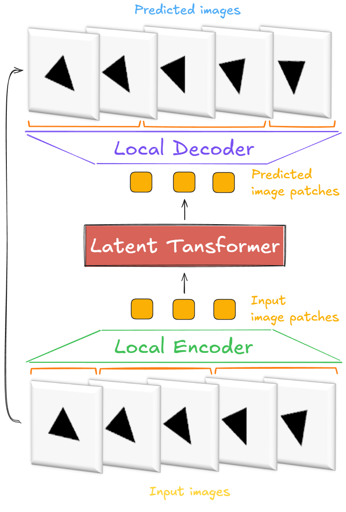

**Figure 2.21 - Published Vision Byte Latent Transformer architecture.** Local encoding and
decoding surround a causal global latent transformer. The figure is reproduced unchanged; the
surrounding text supplies the fixed-patch qualification absent from simplified earlier dissertation
schematics. Source: Kulyk and Mokin, published Figure 3 [134].

The audited public implementation provides a concrete local-global-local path. A convolutional
image encoder reduces spatial resolution, local transformer blocks process raster-level features,
and cross-attention pools information into global patch embeddings. The global transformer applies
its causal mask to those embeddings. A local transformer and transposed-convolutional image decoder
then restore full spatial resolution before the categorical head. This code is valuable for
understanding the interfaces, but it does not supply a complete frozen receipt for the exact
published experiment.

In the inspected source, `patch_ids_from_frames` assigns local positions to global groups; pooling
initializes the global patch queries, and encoder cross-attention updates them from raster-level
features. Decoder cross-attention then returns global information to the local stream before the
image decoder and categorical head. This is not equivalent to replacing each cube by its arithmetic
mean. The local residual stream remains available to the decoder, while the global sequence carries
the broader temporal interaction. Consequently, any compression ratio computed only from the
number of global patches would overstate the information bottleneck: local features also participate
in reconstruction.

That architecture helps interpret the cost result. Heavy global attention is applied after local
aggregation, but local encoding, cross-attention, and decoding still consume computation. A shorter
global sequence can reduce one term without making total cost proportional only to
$N_{\mathrm{patch}}^2$. The published GFLOP comparison is therefore the appropriate empirical
receipt for the complete configured models.

**Table 2.8 - V-BLT component contract and evidence level**

| Component | Input | Output | Function | Status in the published experiment | Evidence level |
|---|---|---|---|---|---|
| Raster interface | $T\times C\times H\times W$ integer bytes | Local feature grid | Preserve a direct categorical byte target | Implemented | Paper and source |
| Fixed patch assignment | Local feature positions grouped by published $4\times4\times4$ support | Patch identifiers | Define global computational units | Reported as implemented | Paper specification; exact run config not archived |
| Local encoder | Raster/local features | Patch embeddings plus residual local features | Aggregate short-range information | Implemented | Paper and source |
| Global latent transformer | Patch sequence | Contextual patch sequence | Model broad spatial and temporal relations | Implemented | Paper and source |
| RoPE-ND | Time, row, column coordinates and Q/K features | Rotated Q/K subspaces | Preserve explicit multi-axis position after flattening | Implemented | Paper equations and source audit |
| Local decoder | Local residuals and global patch states | Full-resolution hidden features | Restore local detail through self- and cross-attention | Implemented | Paper and source |
| Categorical byte head | Hidden feature per byte location | 256 logits | Predict a distribution over byte values | Implemented | Paper and source |
| Entropy map | Categorical logits | Entropy at each byte location | Diagnose predictive dispersion | Measured and visualized | Paper figures and source |
| Dynamic region controller | Entropy map and resource budget | Variable patch support | Allocate future computation by content | Not implemented in the reported study | Proposed only |

The architectural evidence supports a hierarchical representation method. It does not establish
that the model learned semantic patches, that the latent sequence is optimal, or that the same
design scales unchanged to compressed natural video.

### 2.3.3 Causal attention and categorical byte objective

Flattening a clip converts time and space into a single token index, so causal permission must be
defined by frame coordinate rather than by an undifferentiated lower-triangular sequence. If token
$i$ belongs to frame $t_i$ and token $j$ to $t_j$, the global attention mask is

$$
M_{ij}=
\begin{cases}
0, & t_j\le t_i,\\
-\infty, & t_j>t_i.
\end{cases}
\tag{2.26}
$$

Tokens within the same observed frame may attend to one another. Tokens in earlier frames are also
visible, while future-frame tokens are suppressed before softmax. The resulting matrix has dense
diagonal frame blocks and a block-lower-triangular temporal structure. Direct future information
leakage is blocked at the global attention layer; physical plausibility and autoregressive stability
remain learned properties [12].

The block structure is stricter than ordinary bidirectional clip attention and looser than a
pixel-by-pixel raster order. Within-frame exchange is intentional because a frame is treated as one
simultaneously observed spatial field. Across frames, permission follows time. If the input tensor
contains observed and target frames together, the mask must be combined with a loss and data
construction that do not expose target bytes through the local path. The published architecture
diagram and global mask establish the intended causal organization; the absent frozen run receipt
limits a stronger end-to-end leakage audit.

**Figure 2.22 - Causal spatio-temporal attention mask.** Full within-frame and past-frame
connections are permitted, while future-frame connections are masked. Source: Kulyk and Mokin,
published Figure 4, unchanged [134].

For each raster pixel-channel byte $i=(t,c,y,x)$, the head produces logits
$\ell_i\in\mathbb R^{256}$. The categorical distribution is

$$
p_\Theta(x_i=k\mid X_{<t})
=\frac{\exp(\ell_{i,k})}
{\sum_{r=0}^{255}\exp(\ell_{i,r})},
\qquad k\in\{0,\ldots,255\}.
\tag{2.27}
$$

Training minimizes pixel-channel cross-entropy over the supervised positions:

$$
\mathcal L_{\mathrm{byte}}(\Theta)
=-\frac{1}{|\mathcal I|}
\sum_{i\in\mathcal I}
\log p_\Theta(x_i=x_i^{\star}\mid X_{<t_i}),
\tag{2.28}
$$

where $\mathcal I$ contains the target byte locations and $x_i^{\star}$ is the ground-truth
integer. Unlike a scalar MSE head, this interface can represent several plausible byte values at
one location. That modelling flexibility does not guarantee that the probabilities are calibrated,
and it does not remove spatial dependence between neighbouring bytes that are predicted through a
factorized output head.

Equation (2.28) is a sum of conditional marginal byte losses at the supervised locations. Shared
hidden features couple those predictions statistically through the network, but the output head
does not define an explicit joint distribution over all RGB channels and neighbouring pixels at
one future frame. Sampling each byte independently can therefore produce combinations that were
not frequent in the data. An autoregressive local decoder would model those dependencies more
directly at greater sequential cost. V-BLT instead keeps the categorical interface parallel and
uses local attention to coordinate its hidden representation.

The byte objective also fixes the maximum class entropy and avoids a learned-codec confound in the
target. A wrong value can be one intensity level away or 200 levels away, yet cross-entropy
penalizes it according to assigned probability rather than numeric distance. MSE and PSNR are
therefore still needed at evaluation time to describe the geometry of raster error.

Channel semantics require care. The audited training path reshapes the entropy result back to
$[B,T,C,H,W]$; it does not reduce RGB channels to a single map before that point. Single-channel
runs therefore yield one displayed entropy plane directly. A multi-channel visualization would need
an explicitly declared mean, maximum, or other aggregation. The published paper does not document
such a reduction, and the exact run configuration was not recovered, so the dissertation avoids
inventing one.

### 2.3.4 Multidimensional rotary positional encoding

Self-attention is permutation-equivariant before positional information is introduced. Once a
spatio-temporal grid is flattened, a token's order alone does not reveal whether a neighbour lies
one column away, one row away, or one frame away. Absolute embeddings can label each index, while
relative biases can parameterize pairwise displacement [12, 71, 106]. Rotary positional embedding takes
a different route: it rotates query and key feature pairs by a position-dependent phase so their
inner product depends on relative displacement [107].

For one real feature pair $(v_{2j},v_{2j+1})$, define the complex coordinate
$\widetilde v_j=v_{2j}+\mathrm i v_{2j+1}$. At scalar position $p$, one-dimensional RoPE applies

$$
\rho_p(\widetilde v_j)
=\widetilde v_j\exp(\mathrm i p\omega_j),
\qquad
\omega_j=\beta^{-j/K},\quad j=0,\ldots,K-1,
\tag{2.29}
$$

where $\beta$ is conventionally $10{,}000$ and $K$ is the number of complex pairs in the
assigned subspace. For a query at $p$ and key at $q$,

$$
\rho_p(\widetilde q_j)
\overline{\rho_q(\widetilde k_j)}
=\widetilde q_j\overline{\widetilde k_j}
 \exp\bigl(\mathrm i(p-q)\omega_j\bigr).
\tag{2.30}
$$

The content term remains learned, but its positional phase depends on $p-q$, not on either
coordinate independently.

The same operation can be written without complex notation. For frequency $\omega_j$, one feature
pair is multiplied by

$$
\mathbf R_j(p)=
\begin{bmatrix}
\cos(p\omega_j) & -\sin(p\omega_j)\\
\sin(p\omega_j) & \cos(p\omega_j)
\end{bmatrix},
\qquad
\mathbf R_j(p)^\top\mathbf R_j(q)=\mathbf R_j(q-p).
\tag{2.30a}
$$

Orthogonality preserves the norm of each query or key pair. The second identity is the reason a
dot product can express displacement while the content projection remains position dependent.
It is also why coordinate units matter: doubling every spatial index doubles the applied phase at
the same learned frequency.

RoPE-ND allocates disjoint query/key subspaces to the physical axes. For one attention head of real
dimension $d_h$, let $\mathcal A=\{t,y,x\}$, assume $d_h$ is divisible by six, and define
$d_a=d_h/3$. Each axis receives $d_a/2$ complex pairs. If
$q=q_t\|q_y\|q_x$ and $p=(p_t,p_y,p_x)$, then

$$
R_{\mathrm{ND}}(p)q
=R_t(p_t)q_t\;\|\;R_y(p_y)q_y\;\|\;R_x(p_x)q_x.
\tag{2.31}
$$

The implementation audit confirms this disjoint-axis construction. Its frequency precomputation
sets $K=d_h/(2|\mathcal A|)$, creates a meshgrid over time, latent height, and latent width, and
concatenates one phase vector per axis. Token construction then indexes the flattened meshgrid
consistently with frame-major, row-major order. This is the verified interpretation; it replaces
the ambiguous frequency-index ranges in the compact paper derivation.

The equal-axis mathematical construction requires divisibility by six: three axes each consume
pairs of real channels. With head dimension 96, the published configuration satisfies that
requirement. In the inspected source, integer division derives the per-axis pair count and
constructs three equal phase banks, but its present assertion is not algebraically equivalent to
checking $d_h\bmod 6=0$ for every possible head width. Future configurations should enforce the
six-channel condition directly rather than treating the current source check as a general proof.

The corresponding attention logit decomposes into axis-specific terms:

$$
s(q,k;p,r)
=\frac{1}{\sqrt{d_h}}
\sum_{a\in\{t,y,x\}}
q_a^{\top}R_a(r_a-p_a)k_a.
\tag{2.32}
$$

Equation (2.32) shows relative-coordinate dependence along all three axes. Relative phase alone
cannot make the network attend to the same object or recover Euclidean geometry; those behaviours
remain learned and would require targeted ablation or localization evidence.

Disjoint subspaces avoid a subtler ambiguity. If time, row, and column rotations were all applied
to the same feature pair, their phases would add, and different displacement triples could produce
the same total angle. Separate banks allow the attention score to retain one contribution per
axis. The sum in Equation (2.32) can still trade those contributions through learned query and key
content, but the coordinate encoding itself does not collapse them.

Axis allocation also defines a frequency trade-off. If the head width $d_h$ is fixed, adding more
coordinate axes reduces the number of rotary frequency pairs assigned to each one. The three-axis
construction uses $K=d_h/6$ complex pairs per axis. Unequal partitions could reserve more capacity
for time or space, and unused channels could remain unrotated, but those are alternative designs,
not properties evaluated in the paper. The implemented equal split is simple and keeps the axes
disjoint.

For multiresolution tokens, integer row and column indices from two grids should not be compared
without a coordinate convention. A coarse token at index one may cover the same physical region as
several fine indices. One can rotate both levels using normalized coordinates or a shared base-grid
origin. V-BLT uses one latent geometry, so this mapping is not tested there. The issue becomes
relevant to hierarchical context, but the final predictor resolves it through explicit learned
level and frame embeddings rather than importing RoPE-ND.

**Figure 2.23 - Disjoint coordinate subspaces in RoPE-ND.** Time, vertical position, and
horizontal position rotate separate feature pairs; their relative phases enter the attention
score independently. Source: author's verified implementation schematic after the V-BLT equations
and RoFormer [107, 134].

RoPE-ND costs linear arithmetic in feature width per token and avoids materializing a learned dense
pairwise position table. Its use in V-BLT is a representation result. The Chapter 3 predictor uses
learned level, role, and frame embeddings instead; its reach-fidelity effects cannot be attributed
to RoPE-ND.

### 2.3.5 Predictive entropy as a spatial-complexity signal

A categorical byte head yields a complete distribution rather than only a point prediction. Its
dispersion can be summarized locally with Shannon entropy. In bits,

$$
H_i^{(2)}
=-\sum_{k=0}^{255}p_{i,k}\log_2 p_{i,k},
\qquad 0\le H_i^{(2)}\le 8.
\tag{2.33}
$$

A point mass attains the lower bound, whereas a uniform 256-way distribution attains the upper one.
The audited visualization code uses the natural logarithm, producing entropy in nats:

$$
H_i^{(e)}=-\sum_{k=0}^{255}p_{i,k}\ln p_{i,k}
=(\ln2)H_i^{(2)}.
\tag{2.34}
$$

Changing the logarithm base does not alter the ordering of locations, but it changes numeric units and
thresholds. The implementation clamps the visualization at 6 nats, reverses the grayscale so high
entropy appears dark, and scales the result to 0-255. Any quantitative threshold used by a future
controller must therefore specify its log base and preprocessing rather than reading a value from
the rendered image.

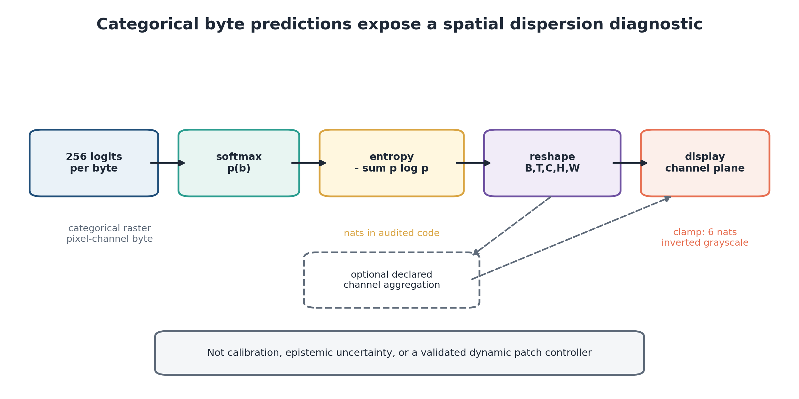

**Figure 2.24 - From categorical logits to a spatial entropy map.** Entropy is computed at each
pixel-channel byte, reshaped to raster coordinates, and only then visualized. The map represents
predictive dispersion; it is not a calibrated probability of error. Source: author's schematic of
the audited V-BLT evaluation path [9, 134].

High predictive entropy may arise because several pixel values are plausible, because the model is
poorly trained, because the input lacks context, or because the example differs from the training
distribution. Without calibration tests and a decomposition of epistemic and aleatoric effects,
the map should not be called calibrated uncertainty [44, 45]. Its defensible role here is a model-internal measure of categorical
dispersion and a candidate proxy for local information demand.

A controller would need more than a visually structured map. Calibration could be checked by
binning predicted byte probabilities or entropy values and measuring realized error; spatial
utility would require comparing allocations induced by entropy with random, motion-based, and
oracle policies at the same token budget. Temporal smoothing might also be necessary, because a
patch boundary that changes every frame introduces overhead and unstable token identities. None of
these controller tests is part of the fixed-patch study.

Channel reduction is a separate modelling decision. Taking the mean of RGB entropies emphasizes
broad ambiguity, while the maximum reacts to one uncertain channel and a luminance transform
changes the target space. The current evidence leaves byte-channel planes explicit. Any later
regioning experiment should declare its reduction before results are observed.

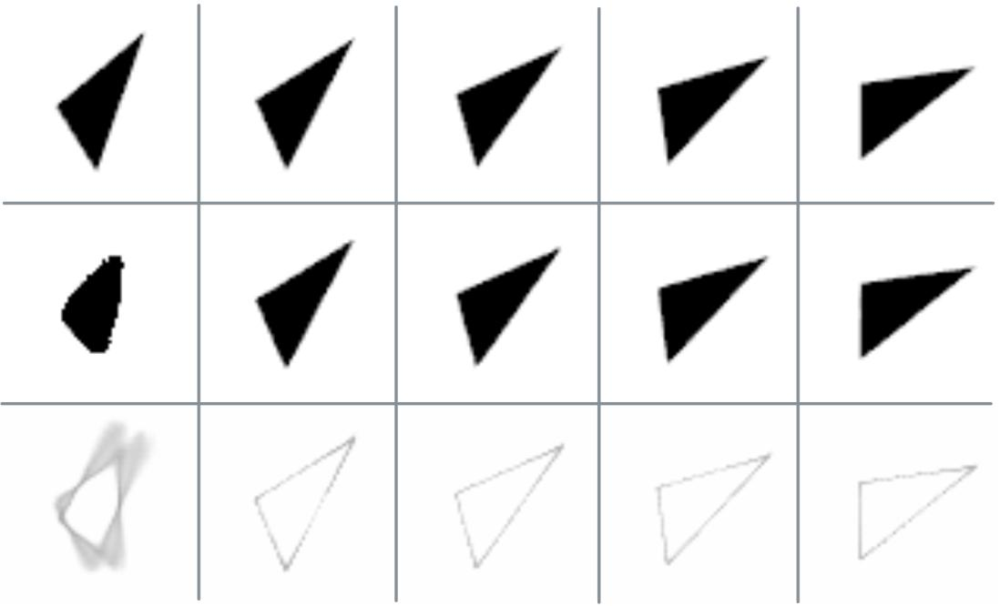

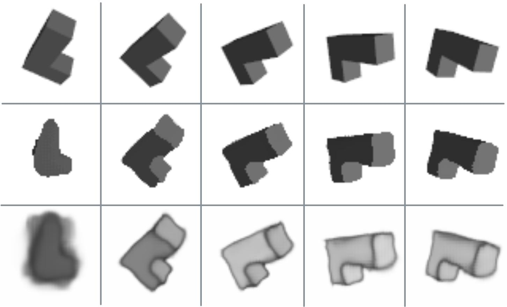

**Figure 2.25 - V-BLT predictions and entropy maps for two-dimensional and three-dimensional
rotation.** Each intact published panel contains ground truth, model predictions, and corresponding
entropy images. Darker regions concentrate around changing contours and newly exposed surfaces;
the first low-context predictions are also visibly weak. Source: Kulyk and Mokin, published Figures
7 and 8, reproduced without pixel modification [134].

The qualitative pattern supports a useful hypothesis. Static backgrounds are easy for the model,
while moving boundaries, occlusion transitions, and early predictions with insufficient context
produce more dispersed byte distributions. Yet the paper reports no quantitative correlation
between entropy and motion magnitude, prediction error, or an oracle allocation. Figure 2.25 is
therefore evidence that meaningful structure appears in the diagnostic, not evidence that an
entropy-driven controller improves compute-quality trade-offs.

### 2.3.6 Experimental results on two-dimensional and three-dimensional rotations

The fixed-patch V-BLT study compared V-BLT with ViViT and UNet-3D on the two procedural rotation
datasets. Model size and GFLOPs describe the reported computational configuration. MSE, SSIM, and
PSNR summarize prediction quality. All are point estimates; the paper gives neither training-seed
variation nor confidence intervals.

**Table 2.9 - Published V-BLT cost and quality point estimates**

| Evidence group | Dataset | Model | Model size (MB) | GFLOPs | MSE $\downarrow$ | SSIM $\uparrow$ | PSNR dB $\uparrow$ |
|---|---|---|---:|---:|---:|---:|---:|
| Computational | - | V-BLT | 6.5 | 51.2 | - | - | - |
|  | - | ViViT | 6.5 | 59.3 | - | - | - |
|  | - | UNet-3D | 24.0 | 70.4 | - | - | - |
| Quality | 2-D shapes | **V-BLT** | - | - | **0.039** | **0.98** | **32.3** |
|  | 2-D shapes | ViViT | - | - | 0.181 | 0.87 | 20.7 |
|  | 2-D shapes | UNet-3D | - | - | 0.125 | 0.88 | 21.8 |
| Quality | 3-D polycubes | V-BLT | - | - | **0.11** | **0.91** | 23.4 |
|  | 3-D polycubes | ViViT | - | - | 0.19 | 0.83 | **24.8** |
|  | 3-D polycubes | UNet-3D | - | - | 0.20 | 0.75 | 20.3 |

V-BLT uses $13.7\%$ fewer reported GFLOPs than ViViT and $27.3\%$ fewer than UNet-3D. The two
6.5 MB entries are equal reported model-size figures. The paper does not state enough about
serialization format or precision to infer identical parameter counts from them. GFLOPs likewise
do not measure latency, throughput, activation memory, or energy on a specific device.

The quality metrics ask different questions. For normalized rasters, frame MSE is commonly
$(CHW)^{-1}\sum_{c,y,x}(\widehat x-x)^2$, while PSNR is
$10\log_{10}(L^2/\mathrm{MSE})$ at peak value $L$. SSIM compares local means, variances, and
cross-covariance rather than only pointwise residuals [94, 127–129]. Values are
comparable across models only when normalization, spatial reduction, channel handling, and
frame/clip aggregation are identical. The paper gives final values but not the complete estimator
receipt.

On the two-dimensional data, V-BLT leads all three reported quality metrics. For the polycubes, it
has the lowest MSE and highest SSIM, while ViViT has the best PSNR, $24.8$ dB versus $23.4$ dB.
The PSNR inversion must remain visible. Because PSNR is ordinarily a monotone transformation of
per-image MSE at fixed dynamic range, a different ordering suggests that the published MSE and PSNR
may use different aggregation or normalization. The available evaluation source computes MSE by
averaging over batch and time and then summing spatial values unless a normalization flag is set,
whereas PSNR is averaged per frame. Without the exact run arguments, one should report the table as
published and avoid combining its metrics into a new scalar ranking.

What the comparison establishes is the viability of the complete V-BLT configuration, not causal
credit for one component. Relative to the baselines, local-global processing, the categorical byte
objective, RoPE-ND and other training details change together. Lower reported GFLOPs and favourable
two-dimensional metrics therefore support the system as tested; they do not isolate the positional
encoding or the byte interface. The mixed three-dimensional ranking is useful precisely because it
prevents configuration-level evidence from being recast as uniform metric dominance.

**Figure 2.26 - Published V-BLT cost and quality point estimates (derived).** The chart makes the
3-D ViViT PSNR lead visible and does not imply uncertainty that the source did not report.
Numeric source: published Tables 1 and 2 [134].

Qualitative evidence adds context to the averages. Both V-BLT sequences show a weak first
prediction, especially for the polycube, when the model has limited previous context. Later frames
recover the coarse object and concentrate entropy near changing boundaries. This behaviour is
directly relevant to the dissertation's larger argument: local representation can be efficient,
but no spatial encoder can recover temporal evidence that was never supplied. Chapter 3 isolates
that missing-history problem.

Experimental completeness is limited. The study reports no repeated training seeds, statistical
inference, real-video validation, component ablation, patch-size sweep, scaling law, entropy
calibration, measured entropy-error correlation, or declared qualitative selection rule. A further
configuration distinction emerged during source inspection. The paper specifies fixed
$4\times4\times4$ spatio-temporal patches, while the available public default configuration records
`tile_height: 4`, `tile_width: 4`, and a separate `model.patch_size: 5.0`; no tracked configuration
identifying the published temporal extent of four was located in that default. The public visionBLT
repository provides the implementation and executable configuration surface for reproduction
[173]. The dissertation therefore treats $4\times4\times4$ as the published experimental
specification and requires a reproducing run to override and archive that temporal extent explicitly;
the current default is not substituted for the reported setting.

### 2.3.7 Measured method versus proposed dynamic regioning

The fixed-patch study supports a clear set of claims. V-BLT demonstrates a hierarchical
local-global-local architecture over direct byte targets, fixed spatio-temporal patching, causal
global attention, RoPE-ND, categorical prediction, and spatially structured entropy maps. Each
item was either implemented or reported in that experiment.

Dynamic regioning is a next step. One possible policy would choose a partition
$\Pi_t=\{R_{t,1},\ldots,R_{t,m_t}\}$ under a token budget $B_t$ by minimizing expected predictive
loss plus computation:

$$
\Pi_t^{\star}
\in\arg\min_{\Pi_t:\,|\Pi_t|\le B_t}
\mathbb E\!\left[\mathcal L_{t+1}(\Pi_t)\right]
+\lambda C(\Pi_t),
\tag{2.35}
$$

with entropy used as one input to the policy. The experiment did not instantiate this optimization,
train a boundary predictor, vary patch sizes online, or measure its effect on speed and quality.
Equation (2.35) is consequently a design proposal, not the objective optimized by the reported
model.

**Figure 2.27 - Implemented V-BLT method and proposed adaptive extension.** The measured entropy
diagnostic motivates, but does not validate, variable patch allocation. Source: author's scope
clarification based on the published study and implementation audit.

The result is a measured diagnostic, not an adaptive controller. Direct categorical byte prediction
exposes a spatially resolved dispersion signal inside a hierarchical predictor, and that signal
suggests a testable allocation mechanism. Calibration, policy stability, allocation overhead, and
a controlled compute-quality benefit must be established before dynamic entropy regioning can be
treated as an operating system component.
An operational allocator must also preserve causal token identities as regions split or merge,
define comparable coordinates across region sizes, and count the controller itself in the resource
budget. These are experimental conditions, not incidental implementation details: each can change
the prediction problem or erase an apparent saving. They belong in the acceptance criteria of a
future adaptive-regioning study.

The first decisive experiment would be small: hold the global token budget, backbone, training
schedule, and evaluation clips fixed; compare regular support with one predeclared entropy policy
and a non-learned allocation baseline. Report both predictive metrics and measured runtime. Until
that comparison exists, adaptive regioning belongs in the design space rather than the list of
validated contributions.

## 2.4 Design implications for the hierarchical-context model

### 2.4.1 Results that transfer conceptually

The temporal and spatial methods do not form a serial architecture, yet three lessons carry into
the final model design. First, resource allocation should be expressed against the information the
task requires. TempVerseFormer removes a long activation tape only because the preceding state can
be reconstructed. V-BLT reduces the burden on a global processor by surrounding it with local
transformations, and its entropy maps show that predictive difficulty is spatially uneven in the
controlled examples. Both methods ask which values require expensive persistent representation.

Second, training memory and inference memory are different system variables. Reversible replay
acts on $M_{\mathrm{activations}}$ during differentiation. It does not enlarge the context available
to a deployed predictor. Conversely, retaining more historical states may improve reach at
inference without changing how a single training window is differentiated. For the complete memory
decomposition introduced in Chapter 1,

$$
M_{\mathrm{total}}
=M_{\mathrm{parameters}}+M_{\mathrm{optimizer}}
+M_{\mathrm{activations}}+M_{\mathrm{context/state}}+M_{\mathrm{transient}},
\tag{2.36}
$$

the reversible method targets the third term, while Chapter 3 will intervene in the fourth. This
is the coarse dissertation-level partition used in Chapter 1: parameter-associated training state
includes parameter gradients, while transient memory includes input batches and allocator or
kernel workspace. Equation (2.5a) exposes those grouped quantities separately when profiling an
actual training run. The measured savings are therefore complementary in principle but separately
established. They cannot be multiplied into an end-to-end saving without a joint implementation
and measurement.

Coordinate structure supplies the third lesson. V-BLT shows why time, row, and column should not be
silently collapsed into one index when token geometry changes. Chapter 3 does not adopt RoPE-ND,
but it makes level, frame, role, and anchor geometry explicit through its own embeddings and stream
construction. The transferred principle is explicit geometry, not a claim of shared weights or an
inherited positional module.

One possible future architecture could combine the interfaces: entropy-informed spatial regions
would produce variable visual tokens, a hierarchical context manager would decide which tokens
remain available across time, and reversible blocks could support differentiation through a longer
self-fed rollout. Such a design is coherent, but it would be a new model. It would need common
datasets, matched budgets, ablations of each interface, and an end-to-end resource audit. None of
those joint results is inferred here.

The transfer test used in this dissertation has three questions. Does a result identify a general
constraint, or only a source architecture? Is the receiving model's interface actually compatible
with the method? Has the transferred component been executed and measured under the receiving
model's objective? Activation/context separation and explicit coordinate semantics pass the first
question as design principles. TempVerseFormer blocks and V-BLT tokens do not pass the third for
the Chapter 3 predictor. This simple test prevents conceptual continuity from being mistaken for
experimental integration.

### 2.4.2 Components not executed in Chapter 3

Table 2.10 records the integration status once so later chapters can describe the final predictor
directly. "Possible interface" indicates an engineering location, not a demonstrated benefit.

**Table 2.10 - Validated methods, possible interfaces, and integration status**

| Method or result | Bottleneck addressed | Validated result | Possible interface to a future integrated system | Status in the Chapter 3 predictor |
|---|---|---|---|---|
| Reversible transformer coupling | Layer and temporal-core activation storage | Algebraic state reconstruction; published near-constant temporal-core memory | Replace a deep transition whose activation history binds | Not used |
| Time-agnostic reverse replay | Long differentiated temporal chain | Full reverse-mode traversal with local graph rebuilding; separate deterministic multi-level gradient-direction and memory/runtime checks | Train through a longer self-fed recurrence | Not used; Chapter 3 trains clean individual windows |
| Stochastic store-the-noise extension | Replay of stochastic recurrent transitions | Single-stage, 40-step reconstruction check with correct versus wrong conditioning; explicit metadata accounting; no stochastic multi-level gradient or memory frontier | Replay stochastic latent innovations during long-rollout training | Not used |
| V-BLT local-global-local representation | Uniform expensive processing of raster bytes | Competitive fixed-patch prediction and lower reported GFLOPs in controlled rotations | Produce compact local/global visual tokens before context storage | Not used; Chapter 3 has a separate frozen two-level codec |
| RoPE-ND | Loss of explicit multi-axis coordinates after flattening | Verified axis-disjoint positional transform | Encode physical coordinates for variable-resolution tokens | Not used; learned level/role/frame embeddings are used |
| Predictive byte entropy | Lack of a local model-internal complexity signal | Structured entropy maps in controlled sequences | Input to a future spatial allocation controller | Entropy controller not implemented |
| Dynamic entropy regioning | Content-adaptive spatial computation | No end-to-end result in the reported study | Select variable patch support under a budget | Proposed future work only |

This table also explains why adding familiar module names to the Chapter 3 architecture would make
the dissertation weaker rather than stronger. It would turn separately measured methods into an
unmeasured composite and obscure which experiment supports which claim.

### 2.4.3 Chapter conclusions and transition

The first method in this chapter addresses the activation cost of temporal learning. A reversible
transformer block uses triangular additive coupling, so its two input streams can be recovered from
its outputs without inverting either attention or the MLP. When the block stack is repeated through
time, reverse replay reconstructs one preceding state, rebuilds one local differentiation graph,
accumulates its gradient, and releases the graph. Under the stated deterministic conditions, the
transient recurrent-core activation term is $O(1)$ in temporal depth rather than $O(T)$.

Implementation inspection narrows that result to the correct state. TempVerseFormer's VAE, input
projection, stream duplication, output fusion, and image loss are not jointly invertible. The
repeated doubled transformer state is. This boundary is sufficient to explain the published memory
curve: temporal-model memory remains near $0.89$ GB at the tabulated 1-, 4-, and 16-step points,
while the matched non-reversible transformer reaches $2.61$ GB at 16 steps. Runtime rises because
reconstruction repeats computation. Predictive results are also mixed. TempVerseFormer leads all
reported metrics for constant and interrupted rotations and remains competitive elsewhere, but
TempFormer or LSTM leads several variable-motion endpoints. OpenSTL provides competence evidence,
including the lowest reported TaxiBJ MSE in that comparison, not a universal benchmark win.

The dissertation extensions make two replay requirements explicit without conflating their
receipts. A single-stage stochastic check reconstructs a 40-step trajectory only when the realized
conditioning is retained or reproducibly regenerated. Separately, a deterministic multi-level
check establishes reverse-gradient directional agreement with BPTT, and the deterministic
recurrent-core memory experiment reaches $K=160$ at approximately $1.18$ GB where vanilla BPTT
fails at $K=120$, while checkpointing also remains feasible. A separate inner-loop experiment
shows the other side of the decision:
when trajectory states constitute only $0.28\%$ of peak memory, reversibility saves almost nothing
and costs time. Invertibility is therefore an enabling storage property, not a general stability or
speed guarantee.

The second method addresses visual representation. V-BLT processes raster pixel-channel bytes
through a local encoder, a causal global latent transformer, and a local decoder with a 256-way
categorical output. RoPE-ND assigns disjoint feature subspaces to time, row, and column coordinates,
making relative displacement explicit after flattening. The fixed-patch experiments report lower
GFLOPs than the selected ViViT and UNet-3D baselines and strong MSE/SSIM results on controlled
rotations. ViViT retains the best three-dimensional PSNR, and the absence of seed uncertainty,
ablation, scaling, and exact run receipts limits the strength of model-ranking claims.

Per-byte entropy is the most useful bridge from that experiment to resource allocation. It
concentrates around changing contours, occlusions, and low-context predictions in the published
examples. Still, entropy maps were observed, not used to drive variable patch sizes. The measured
model used the paper's fixed $4\times4\times4$ specification; dynamic entropy-guided regioning
remains a proposal whose computational and predictive benefit has not been tested.

Chapter 2 therefore contributes two independent resource-aware capabilities and their operating
boundaries. One reconstructs intermediate computation to control activation storage. The other
organizes local and global visual processing and exposes a candidate spatial-complexity signal.
Neither capability answers the remaining question: after training is complete and predictions feed
back into the model, which past observations are still accessible when an object or event returns?
Chapter 3 isolates that retained-context problem and constructs competing flat, temporally sampled,
and spatially hierarchical memory packages under fixed budgets.
