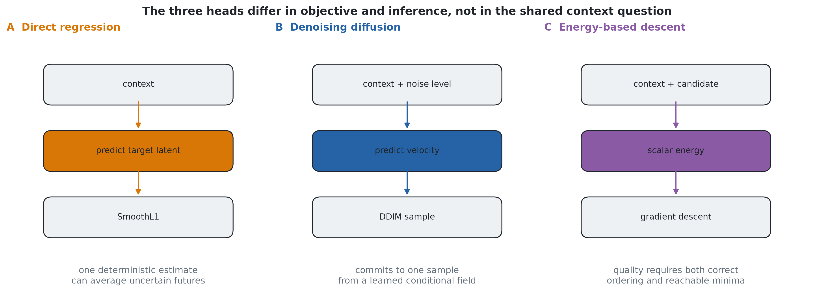
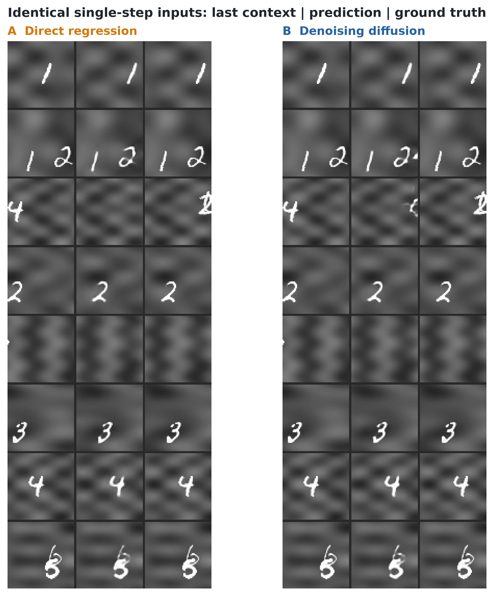
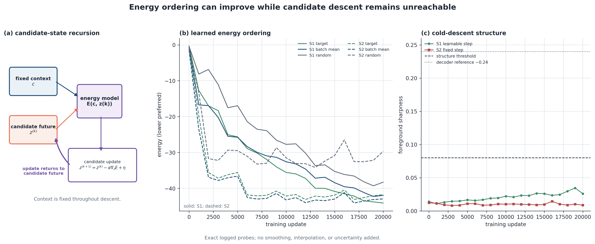
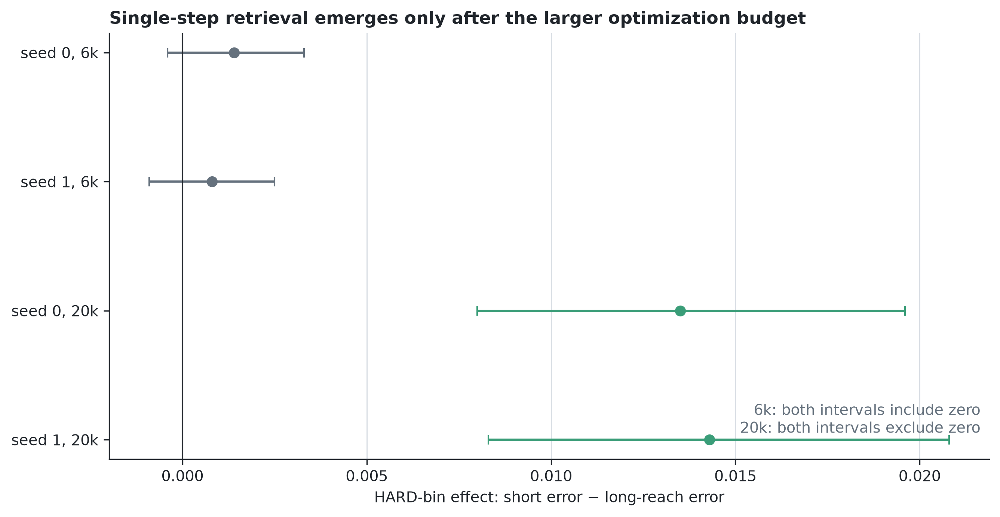
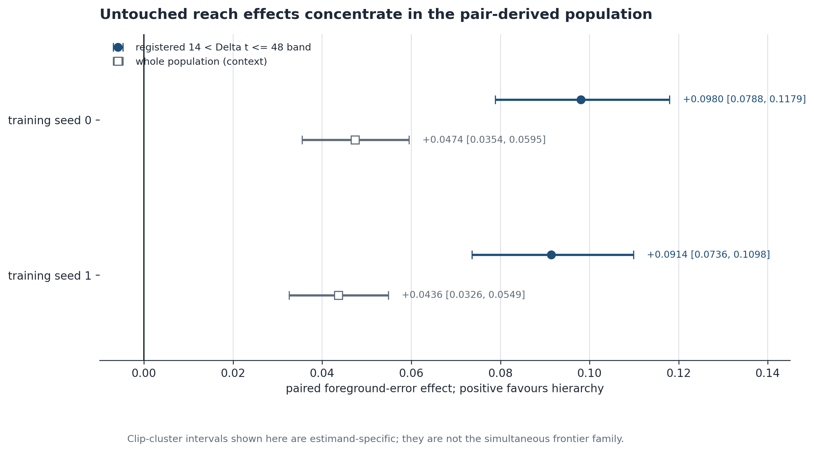
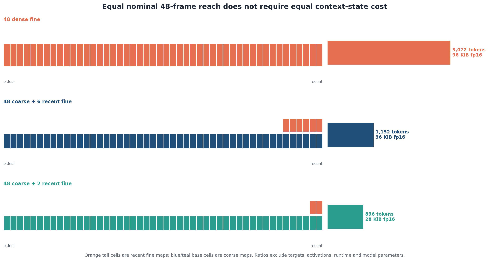
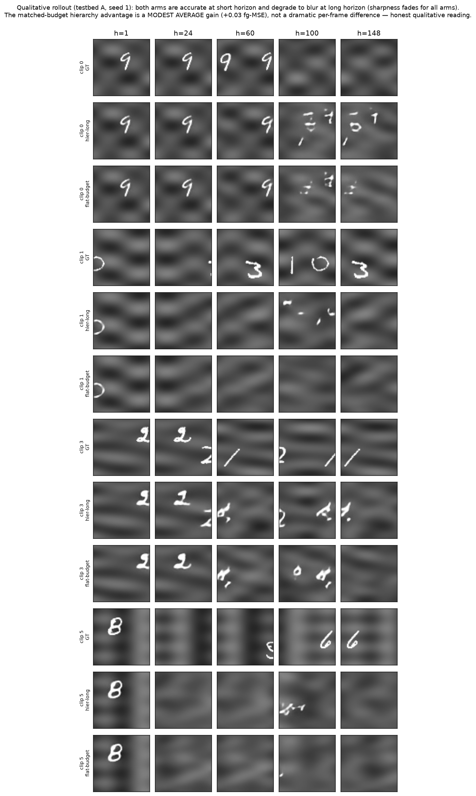
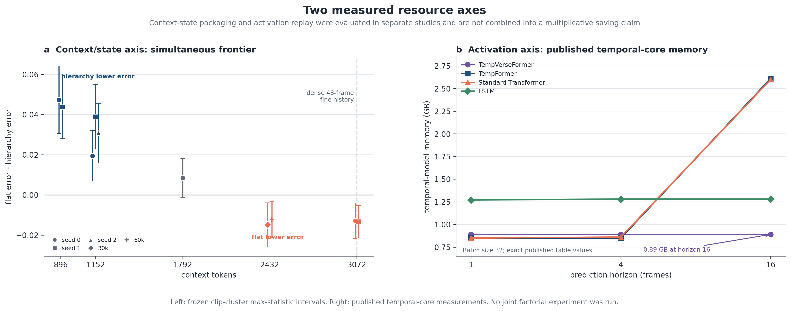
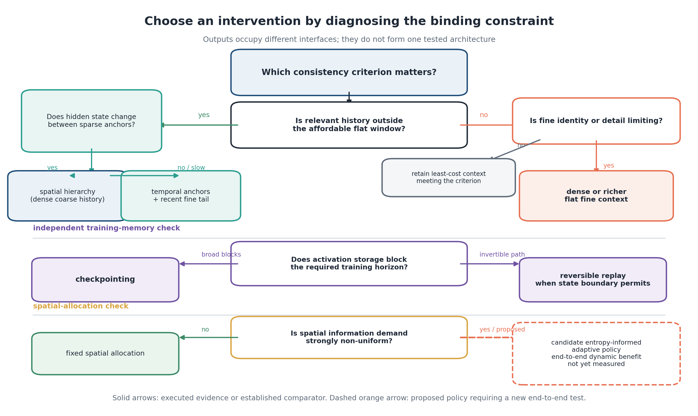

# Chapter 4 — Experimental Validation and Operating-Region Decisions

The model developed in Chapter 3 makes a concrete choice unavoidable. Under a finite context
budget, some observations can be retained at full spatial resolution, some can be compressed, and
some must be discarded. The resulting packages differ in more than size. They expose different
parts of the past, preserve different kinds of detail, and may interact differently with the
prediction head. Consequently, the experiments in this chapter are organised around decisions:
which generation mechanism to use, when longer addressable history is valuable, where spatial
detail becomes the limiting factor, and how robust those conclusions remain when another source
of variation is introduced.

The central evidence comes from LoopMom, whose viewport geometry identifies when information
needed at re-entry was previously visible. A protected persistent-object Moving-MNIST study then
tests a different question: whether the same package distinction separates spatial continuity from
object identity. Short Moving-MNIST and TaxiBJ play narrower roles as competence boundaries. They
are useful precisely because neither reproduces the main re-entry mechanism.

Results are reported in four evidence classes. Development studies select mechanisms and expose
candidate regularities. Untouched confirmation evaluates frozen checkpoints and comparisons once
on a hash-pinned holdout. Robustness studies change the sampler or latent representation without
redefining the primary result. Boundary studies change the task, information interface, or rollout
regime to establish where the interpretation stops. Keeping those roles separate prevents a long
experimental programme from turning into a single undifferentiated collection of scores.

The principal conclusion can be stated in one sentence, but it requires the full chapter to
justify it: hierarchy buys reach when relevant history would otherwise be absent; flat context
buys fidelity when the required span is already available. The statement describes measured
operating regions, not an architectural ranking.

## 4.1 Experimental map and comparison logic

### 4.1.1 Research questions, datasets, and evidence levels

Four questions determine the experimental sequence. First, does the stochastic diffusion head
offer a useful benefit over direct regression, and is an energy-based alternative reachable at
the available scale? Second, for packages with equal or explicitly near-equal context budgets,
does extending the addressable history improve prediction specifically on records that require
that history? Third, after the flat window approaches the same span, does retaining full-resolution
detail reverse the ordering? The last question concerns scope: do the main directions persist
across training seeds, sampling choices, an independently trained codec, and a persistent-object
task?

LoopMom is the mechanism-identification instrument for the middle two questions. A
$64\times64$ viewport traverses a $192\times64$ toroidal world containing texture and digit
sprites. Two thirds of the world are outside the viewport at a given instant, and relevant content
re-enters after approximately 48 frames at the principal operating point. Saved viewport
positions allow the evaluator to locate the last observation of each visible world column. This
is exact geometric observability. Information-theoretic necessity remains unestablished because
the digit prior can make unobserved content partly predictable.

Persistent-object long Moving-MNIST changes both scene semantics and the evaluation target. Its
48-frame ground-truth warm-up is followed by 300 self-fed predictions. Generator-provided object
IDs, glyph classes, boxes, and trajectories support one-to-one Hungarian assignment [125],
explicit misses and extras, trajectory penalties, identity accuracy with a fixed ground-truth
denominator, and coverage. The study is an external synthetic boundary. It cannot be treated as a
replication of LoopMom's world-coordinate geometry.

Canonical OpenSTL Moving-MNIST 10-to-10 and TaxiBJ 4-to-4 answer smaller questions. Moving-MNIST
checks whether the general predictor functions on a standard short-horizon sequence benchmark
[124, 141]. TaxiBJ checks whether the unchanged stack can process
real spatio-temporal flow grids under the benchmark protocol. Neither task contains the long
off-screen re-entry event needed to confirm the reach mechanism.

**Table 4.1 — Research-question and evidence map.** Training seeds are distinguished from sampler
seeds and codec interventions. “Terminal role” states how a result is used in the argument; it is
not a quality label.

| Study | Question | Dataset and population | Intervention | Seeds or variants | Evidence class | Terminal role |
|---|---|---|---|---|---|---|
| Mechanism study | Which generation rule is useful under each inference regime? | LoopMom development pool | regression versus diffusion at closely matched capacity; official-code energy model tested separately | one regression model, one diffusion model, two energy recipes; diffusion NFE 4/8/16 | development | diffusion selected for stochastic coverage; regression retained as deterministic control; energy descent characterised as negative at the tested scale |
| E2 | Does hierarchy retrieve content beyond a shorter flat window, and where does flat fidelity recover? | hash-pinned untouched LoopMom holdout | registered flat–hierarchical pairs over the tested budget frontier | pair-specific training seeds 0–2 | untouched confirmation | hierarchy confirmed at 896 and 1,152; 1,792 unresolved; flat confirmed at 2,432 and 3,072 |
| B1 within E2 | Does the complete 512-token stride-2 configuration outperform a short flat configuration? | same protected holdout | context and target interface change together | training seeds 0–1 | untouched whole-configuration comparison | configuration confirmed; no pure stride estimate |
| E4b | Does package preference survive prediction-head and seed changes? | adaptively used LoopMom development pool | temporal full-resolution anchors versus spatially coarse history, crossed with diffusion and regression | training seeds 0–4 | development factorial | stable temporal-package direction under diffusion; heterogeneous regression and interaction |
| E5a | Does the seed-0 late self-fed inversion replicate? | registered long-loop population | same long-reach pair at two new seeds | training seeds 0–2 | registered replication | early benefit repeats; late inversion does not replicate |
| E7c | Are the central directions sensitive to sampling allocation? | purpose-locked LoopMom robustness set | NFE 8/16/32 and sampler seeds 0–2 on frozen seed-0 checkpoints | five sampler/NFE variants | robustness | all directions retained; upper inversion loses family-wise precision under two sampler seeds |
| E7a | Do the directions survive another latent representation? | purpose-locked LoopMom robustness set | new codec, new normalization, and retrained predictors | predictor seed 0; one alternate codec | robustness | codec-directionally robust; upper inversion unresolved for the alternate codec |
| E8a | What remains when historical access is explicit? | purpose-locked LoopMom reference set | raw warm-up mosaic queried with exact future pose | deterministic spans K6/K14/K38/K48 | privileged reference | separates storage and addressability from learned self-fed reuse |
| E6 | Does package form separate support from identity on persistent objects? | protected long Moving-MNIST, 100 clips | matched 1,152-token flat and hierarchical packages | training seeds 0–2 | external boundary | hierarchy favours support/continuity; flat favours identity; absolute task remains difficult |
| Competence studies | Does the stack operate outside the main instrument? | Moving-MNIST 10-to-10 and TaxiBJ 4-to-4 | dataset and protocol change | one reported training seed per arm | descriptive boundary | competence and negative-control evidence only |

**Figure 4.1 — Experimental coverage and evidence roles.** Blue entries are untouched
confirmations, neutral entries are development, robustness, replication, or boundary studies, and
red-tinted entries are explicitly non-executed cells. A blank cell is not a zero effect. This is a
compact visual index of coverage; Table 4.2 is the authoritative readable registry for interfaces,
seeds, and evidence status. Neither display implies results for unexecuted Cartesian combinations.
*Source and status: author-generated evidence-synthesis matrix from the frozen configuration/evidence
registry and terminal programme reports; generated by `scripts/make_dissertation_foundation_figures.py`.*

The complete programme contains many model files, evaluation jobs, and endpoint arrays. They do
not all belong in the main argument. Table 4.2 therefore groups executions that share the same
scientific interface; run identifiers, secondary metric cells, checksums, and access receipts are
reserved for the configuration-and-evidence appendix. The table has the function served by a
component matrix in an ablation study: it shows which combinations were actually observed and,
equally important, which tempting Cartesian comparisons do not exist.

**Table 4.2 — Executed component and configuration matrix.** “C/F” gives coarse/fine context
slots. A number after `s` is context stride; `d` means dense. The original codec is denoted C0 and
the independently trained codec C1. DDIM-16 with sampler seed 0 is the default unless the sampler
column states otherwise. Rows marked **not executed** support no empirical claim.

| Study or arm group | Codec | Package; C/F; stride; reach | Context / target / total tokens | Head | Target interface | Sampler / work | Dataset | Training seeds | Evidence level and status |
|---|---|---|---:|---|---|---|---|---|---|
| `hier-short` / `flat-short` | C0 | 6C+6F, d, R6 / 8F, d, R8 | 480/320/800 vs 512/320/832 | diffusion | four dense targets | DDIM-16 | LoopMom | 0–1 | near-matched lower diagnostic; seed 1 favours flat |
| B1 `hier-s2-min` / `flat-short` | C0 | 24C+2F, s2, R48 / 8F, d, R8 | 512/288/800 vs 512/320/832 | diffusion; regression at seed 0 in development | B1 uses stride-2 targets and auxiliary interface | DDIM-16; one-pass regression | LoopMom | diffusion 0–1; regression 0 | whole-configuration effect confirmed under diffusion |
| `spat18` / `flat-budget` | C0 | 18C+6F, d, R18 / 18F, d, R18 | 672/320/992 vs 1,152/320/1,472 | diffusion and regression | four dense targets | DDIM-16 / one pass | LoopMom | 0 | fixed-span abstraction diagnostic |
| `hier-min` / `flat-min` | C0 | 48C+2F, d, R48 / 14F, d, R14 | 896/320/1,216 both | diffusion | four dense targets | DDIM-16 | LoopMom | 0–1 | untouched lower reach confirmation |
| `hier-long` / `flat-budget` | C0 | 48C+6F, d, R48 / 18F, d, R18 | 1,152/320/1,472 both | diffusion; regression control | four dense targets | DDIM-16 / one pass | LoopMom | diffusion 0–4 for hierarchy, 0–2 flat; regression 0–4 hierarchy, 0–1 flat | untouched interior confirmation plus development controls |
| `strided-flat` / `hier-long` | C0 | 11 stride-4 F anchors+6F, R48 / 48C+6F, d, R48 | 1,088/320/1,408 vs 1,152/320/1,472 | diffusion and regression | four dense targets | DDIM-16 / one pass | LoopMom | 0–4 | five-seed near-matched head × package factorial |
| `hier3` / `hier-long` | C0 | 48 top+24C+9F / 48C+6F; R48 | 1,152/336/1,488 vs 1,152/320/1,472 | diffusion | three-level target allocation differs | DDIM-16 | LoopMom | 0 | depth-plus-objective/allocation diagnostic; three-level arm worse |
| `hier-c1` / `flat-c1` | C0 | 48C+16F, R48 / 28F, R28 | 1,792/320/2,112 both | diffusion | four dense targets | DDIM-16 | LoopMom | 0 | untouched point unresolved |
| `hier-c2` / `flat-c2` | C0 | 48C+26F, R48 / 38F, R38 | 2,432/320/2,752 both | diffusion | four dense targets | DDIM-16 | LoopMom | 0 in B16×30k and B8×60k | flat confirmed in both optimizer regimes |
| `hier-rich` / `flat-long` | C0 | 48C+36F, R48 / 48F, R48 | 3,072/320/3,392 both | diffusion | four dense targets | DDIM-16 | LoopMom | 0–1, B8×60k | flat confirmed at equal nominal reach |
| E5a long-loop pair | C0 | long-reach hierarchy / dense comparator; registered R224 contrast | registered pair | diffusion | long-loop rollout | registered sampler | long-loop LoopMom | 0–2 | early benefit replicated; late inversion not replicated |
| E7c sampler family | C0 | four registered contrasts spanning 896–2,432 | as above | diffusion | unchanged | NFE 8/16/32, sampler seeds 0–2 | protected LoopMom | predictor seed 0 | 20-effect robustness family; directionally robust |
| E7a codec family | C1, with C0 controls | seven predictors forming four registered contrasts | as above | diffusion | unchanged | DDIM-16 | protected LoopMom | predictor seed 0 | eight-effect whole-codec family; directionally robust |
| E8a raw reference | raw pixels and C0 neural references | pose-indexed mosaic K6/K14/K38/K48 | not token matched | raw lookup plus diffusion references | exact future pose supplied | direct lookup / DDIM-16 | protected LoopMom | deterministic / neural seed 0 | privileged reference, not a model ablation |
| E6 flat / hierarchy | C0 | 18F, R18 / 48C+6F, R48 | 1,152 context tokens each | diffusion | 300 self-fed targets after 48 warm-up frames | registered sampler | persistent long Moving-MNIST | 0–2 | external mixed boundary |
| `mm-flat` / `mm-hier` | fresh benchmark codec | 10F / 10C+6F | 640 vs 544 context tokens | diffusion | OpenSTL 10→10 | best-of-1 | Moving-MNIST | 0 | descriptive short-horizon negative control |
| TaxiBJ four-arm cell | fresh two-channel codec | 4F / 4C+1F equivalent | 256 vs 128 context tokens | diffusion and regression | OpenSTL 4→4 | DDIM / one pass | TaxiBJ | 0 | descriptive real-data competence boundary |
| B1 fixed-target control | — | stride-2 versus short flat at fixed target interface | — | — | would isolate target co-change | — | LoopMom | — | **not executed; unnecessary under retained configuration-level wording** |
| `flat-320`, `hier-s4-min`, `hier3-reg` | — | proposed grid-completion cells | — | — | — | — | LoopMom | — | **not executed / out of scope** |
| E5b and E9 | — | post-failure localisation / counterfactual extension | — | — | — | — | proposed extensions | — | **not authorised; E9 terminally skipped after programme freeze** |

The matrix exposes three facts that a chronology can hide. The primary frontier uses one frozen
two-level representation and one diffusion head, restricting it to a package sweep. Broader
seed coverage is strongest for the package-shape factorial, whereas codec robustness deliberately
uses one predictor seed. Finally, the red rows are structural gaps created by the chosen scope.
They must not be interpreted as missing negative results.

### 4.1.2 Budget vocabulary and comparison rules

An experimental pair is *matched* only with respect to resources named in advance. For the main
frontier, matched means equal context-token count, equal target interface, equal total sequence
length, the same frozen codec, the same predictor family, and paired evaluation records. A
near-matched pair differs in a disclosed direction: `strided-flat` uses 1,088 context tokens while
`hier-long` uses 1,152, so the 64-token deficit favours the temporal-package control. A
whole-configuration comparison allows several interfaces to change together. B1 falls into this
last category because its context stride, target stride, number of target slots, auxiliary loss,
sequence length, and optimisation load are coupled.

Training expenditure also needs a name. B16×30k and B8×60k each process approximately 480,000
examples, but their numbers of optimiser updates, minibatch grouping, gradient noise, and
effective exponential-moving-average horizons differ. The 60,000-update result is therefore a
separate optimiser-regime control, not “twice the data” or a closer estimate of asymptotic
performance. Likewise, a diffusion candidate produced with 16 DDIM evaluations costs more
inference work than one regression pass.

For a metric $m$, all displayed effects are oriented so that a positive value favours the
registered candidate:

$$
\Delta_m=
\begin{cases}
\bar m_{\mathrm{comparator}}-\bar m_{\mathrm{candidate}}, & m\text{ is lower-is-better},\\[2mm]
\bar m_{\mathrm{candidate}}-\bar m_{\mathrm{comparator}}, & m\text{ is higher-is-better}.
\end{cases}
\tag{4.1}
$$

The orientation makes heterogeneous endpoint panels readable, while the metrics remain
incommensurate. A difference of 0.01 in union-mask MSE is not directly comparable to a difference of
0.01 in identity accuracy. For the upper frontier, the registered candidate is the flat package,
so positive robustness effects there favour flat even though the primary E2 table is written as
flat loss minus hierarchical loss.

Paired effects are computed from aligned clip and horizon records. Confidence intervals resample
clips and retain every eligible frame inside a sampled clip, preserving the dependence created by
self-fed rollout. Intervals for one trained model therefore quantify data uncertainty conditional
on that model. Training seeds form another level of uncertainty and are shown separately; where a
seed summary is reported, seeds rather than frames or clips are the units. Registered families use
a studentized maximum statistic, so their simultaneous intervals protect the family rather than a
sequence of marginal claims. An interval crossing zero is called unresolved. It is not evidence
of equivalence.

These rules constrain the prose that follows. A matched pair can support a package comparison; a
near-match carries a directional resource qualification; a whole-configuration pair supports
only the joint intervention. No conclusion is transferred from one licence to another merely
because the arm names look similar.

## 4.2 Selection of the generation mechanism

### 4.2.1 Regression and diffusion under controlled capacity

The context study needs a prediction head, yet selecting one by habit would build an unnecessary
assumption into every later comparison. Regression and diffusion were therefore evaluated on the
same single-step conditioning problem before the package frontier was interpreted. Both use a
transformer of width 256 with six blocks and eight attention heads. Their parameter counts are
7.27 and 7.53 million, respectively; context contains six frames at both latent levels, and the
target occurs four actions after the last context frame. Per-channel and per-level latent
standardisation is shared. Without it, unit-scale diffusion noise overwhelms the smaller raw
latent scale and changes the apparent ordering for reasons unrelated to temporal modelling.

**Figure 4.2 — Generation objectives under the shared context question.** Regression maps the
package directly to clean target latents. Diffusion predicts the velocity of a noisy target and
uses a declared DDIM schedule. The energy-based head scores a candidate and updates that candidate
by gradient descent. The diagram compares interfaces; total inference work differs.
*Source and status: author-generated implementation-informed schematic from the audited regression,
diffusion, and EBT interfaces in `hvp_rev`; generated by `scripts/make_dissertation_missing_figures.py`.*

Best-of-$N$ is used only as an oracle coverage diagnostic. For each record, the decoded sample
with the smallest foreground MSE against ground truth is selected. One regression candidate costs
one stochastic MC-dropout network evaluation, whereas a diffusion candidate costs the declared
number of DDIM evaluations. Best-of-eight at 16 NFE therefore uses eight regression evaluations
and 128 diffusion evaluations. In general, the network-evaluation counts are

$$
W_{\mathrm{reg}}(N)=N,
\qquad
W_{\mathrm{diff}}(N,K)=NK,
\tag{4.2}
$$

where $K$ is the number of DDIM evaluations per candidate. The models are closely matched in capacity and conditioning, but
not in total work. That distinction matters more than the label “matched mechanism study.”

**Table 4.3 — Generation-mechanism decision evidence.** Foreground MSE is lower-is-better and
foreground sharpness is higher-is-better. The NFE sensitivity values come from a smaller frozen
evaluation receipt and are not pooled with the six-batch main row.

| Regime | Regression | Diffusion | Persistence or reference | Licensed reading |
|---|---:|---:|---:|---|
| Single step, best-of-8 foreground MSE, all | 0.0664 | **0.0512** | persistence 0.2367 | diffusion has better oracle coverage at the reported unequal total work |
| Single step, easy subset | 0.0232 | **0.0120** | — | both learn the conditioned motion; diffusion remains lower |
| Single step, hard novel-strip subset | 0.1808 | **0.1549** | — | the larger separation occurs where a committed hypothesis is required |
| Mean over eight candidates | 0.0714 | **0.0640** | — | diffusion also improves the sample mean in this study |
| Single step, foreground sharpness | 0.1591 | **0.1886** | persistence 0.0515 | diffusion samples are sharper in the coverage regime |
| Best-of-8 foreground MSE, 4 NFE per diffusion candidate | 0.0680 | **0.0546** | — | diffusion direction persists at the smallest tested diffusion allocation |
| Best-of-8 foreground MSE, 8 NFE | 0.0680 | **0.0514** | — | sensitivity, not an equal-work comparison |
| Best-of-8 foreground MSE, 16 NFE | 0.0680 | **0.0503** | — | more denoising work gives a modest additional gain |
| Self-fed best-of-1, matched hierarchical package | **0.1682** | 0.1848 | paired diffusion-minus-regression interval [0.0110, 0.0227] | direct regression is better in deterministic rollout |
| Self-fed best-of-1, matched flat package | **0.2015** | 0.2038 | — | the rollout reversal is not confined to the hierarchical arm |

The single-step result is coherent with the usual distinction between conditional mean prediction
and stochastic hypothesis coverage in video prediction [130, 131]. No general diffusion-accuracy ranking follows. Once a single sampled output is
fed back for 152 frames, the ranking reverses. `reg-long` records foreground MSE 0.1682 compared
with 0.1848 for the diffusion `hier-long` model, while their foreground sharpness values are nearly
equal at 0.0741 and 0.0729. At the flat package the numerical gap is smaller, but regression again
has lower error.

**Figure 4.3 — Single-step predictions on identical inputs.** The rows illustrate the registered
single-step setting; they are not selected to establish the ranking. The aggregate results in
Table 4.3 determine the decision. In particular, these examples must not be extrapolated to the
later self-fed regime, where regression performs better. *Source and status: artifact-derived composite;
image sources:
`logs_rhcp/step1_mech_clean_reg.png` and `logs_rhcp/step1_mech_clean_diff.png`; composite generated
without selective frame replacement by `scripts/make_dissertation_missing_figures.py`.*

The apparent contradiction is a useful boundary. Best-of-eight asks whether at least one sampled
future covers the observed outcome when an oracle can inspect ground truth. Best-of-one rollout
asks whether one committed prediction remains stable after repeated feedback. Those are different
estimands. Diffusion is retained for the fixed-budget frontier because the primary scientific
question includes stochastic coverage, while regression remains the deterministic control and is
reported wherever the inference regime changes.

### 4.2.2 Energy-based descent as a characterised negative

An energy-based transformer offers another route to generation: learn a scalar energy rather than a normalized probability [84, 85],
$E_\phi(c,z)$ for context $c$ and candidate future $z$, then update the candidate according
to

$$
z^{(k+1)}=z^{(k)}-\alpha_k\nabla_zE_\phi(c,z^{(k)})+\eta_k,
\tag{4.3}
$$

where $\eta_k$ is the registered Langevin term when that recipe uses noise [89, 90]. Score matching connects related energy gradients to data-density gradients [86, 87]. The attraction is
conceptual as well as computational. Extra descent steps could, in principle, spend more
inference work on a difficult re-entry. Yet two capabilities must both hold. The energy must order meaningful
candidates correctly, and descent from the prescribed initialisation must reach the structured
region of the landscape.
At a 14.66-million-parameter scale, the study adapted the official Energy-Based Transformer
implementation [88] and evaluated two published recipe families. The S2 recipe
converges to a loss near 0.597 but places the batch-mean candidate below the target on every one of
21 recorded probes. S1 changes the ordering: from updates 6,000 through 20,000, the target has the
lowest energy on fifteen consecutive probes, with a target-below-mean gap between 0.22 and 3.09.
Ordering can therefore be learned at this scale.

Generation still fails. S1 cold-descent foreground sharpness reaches at most 0.0345, while its
paper-style best-of-four probes remain between 0.0102 and 0.0154. Both lie below the predeclared
approximately 0.08 threshold for visible structure and far below the roughly 0.24 decoded-target
reference. More descent steps and the publication-style sampler do not restore a structured
future. The negative result is two-sided: S2 fails ordering and reachability; S1 repairs ordering
without repairing reachability.

**Figure 4.4 — Energy ordering and descent reachability.** Panel (a) shows the corrected
candidate-state recursion. Panel (b) separates the recipe that learns target-below-mean ordering
from the one that does not. Panel (c) shows that correct ordering is insufficient: cold descent
remains below the registered structure threshold. The figure supports a capability diagnosis, not
an impossibility theorem. *Source and status: artifact-derived diagnostic; numeric source:
`logs_rhcp/ebt_scaled_s1.log` and
`logs_rhcp/ebt_scaled_s2.log`; these are hash-listed legacy receipts, not E2--E8 RunSpec
artifacts.*

Scale prevents a stronger conclusion. The tested runs use fewer updates and a smaller effective
batch than the reference large-video configuration, and S1 sharpness rises slightly during
training. The evidence therefore says that energy descent did not produce structured video at the
reachable scale, even after the ordering criterion succeeded. Energy-based generation at larger
scales remains an open case, and the result does not challenge studies using larger pretrained
representations and hardware.

### 4.2.3 Mechanism decision

The three mechanisms leave two viable heads. Diffusion is used for the untouched package
frontier because it gives the strongest stochastic single-step coverage in the controlled study.
Regression remains a necessary control because it is better in deterministic self-fed best-of-one
rollout. Energy-based descent is closed as a characterised negative for this programme: pursuing
it would test scale rather than answer the context-packaging question.

No universal head ranking follows from these studies. The relevant decision is conditional on how
predictions will be sampled and reused.

That decision also fixes the licence of every later result. The frontier measures package effects
for diffusion with declared denoising work; regression cells ask whether a direction survives a
deterministic one-pass head. They are complementary tests, not interchangeable replications.
Keeping both visible prevents stochastic coverage from being attributed to context geometry and
prevents a stable regression rollout from being mistaken for evidence against diffusion in its
intended sampling regime.

## 4.3 Hierarchical reach under a fixed context budget

### 4.3.1 Untouched reach-differential confirmation

The development pool had already influenced model selection and the reach hypothesis. A valid
confirmation therefore required new data rather than another analysis of the same clips. The E2
holdout, `loopmom-confirmation_holdout-20260712-e033abee6e04`, was generated and hash-pinned after
the checkpoints, package pairs, reach bands, endpoints, table layouts, and interpretation rules
had been frozen, applying a protected-holdout principle to prevent adaptive reuse [167]. Training and monitoring loaders reject the protected split, and its opening is
recorded through a purpose-specific access log.

For `hier-min` and `flat-min`, context, target, and total token counts are exactly matched. The
flat package stores 14 contiguous fine frames; the hierarchical package stores 48 coarse frames
and two recent fine frames. The primary reach population contains non-empty, answerable records
whose relevant novel content was last visible at lag

$$
14<\Delta t_i\le48.
\tag{4.4}
$$

Operationally, eligibility also requires a finite lag, at least 0.5 observed foreground fraction,
and non-empty ground-truth foreground. Let

$$
e_{ci}=\mathbf 1\!\left(
14<\Delta t_{ci}\le48,\;
\mathrm{seen}_{ci}\ge0.5,\;
\mathrm{fg}_{ci}\ne\varnothing,\;
\Delta t_{ci}\text{ finite}
\right).
\tag{4.5}
$$

If $d_{ci}=m_{ci}^{\mathrm{flat}}-m_{ci}^{\mathrm{hier}}$ is the foreground-error difference
for frame record $i$ of clip $c$, the paired reach estimand is

$$
\widehat{\Delta}_{\mathrm{reach}}=
\frac{\sum_c\sum_{i\in c}e_{ci}\,d_{ci}}
{\sum_c\sum_{i\in c}e_{ci}}.
\tag{4.6}
$$

Frames remain inside their clips during resampling. This matters because a later frame inherits
errors and generated state from earlier predictions; treating 1,006 eligible records as
independent would overstate precision.

The seed-0 effect is +0.0980 with a 95% clip-cluster interval [0.0788, 0.1179]. Seed 1 gives
+0.0914 [0.0736, 0.1098]. Both estimates are substantially larger than their whole-population
effects, +0.0474 [0.0354, 0.0595] and +0.0436 [0.0326, 0.0549]. The effect is therefore not merely
positive on average. It concentrates in the population for which the relevant history is
available only to the longer package.

The optional optimisation-stage diagnostic clarifies why an earlier small study could have missed
the mechanism. At 6,000 updates, hard-bin single-step effects are unresolved on both training
seeds; at 20,000 updates they are +0.0135 and +0.0143 with intervals excluding zero. Each budget
is a separate fully annealed training schedule, so the observation concerns sufficient
optimisation, not a checkpoint trajectory within one run.

**Figure 4.5 — Conditional development diagnostic for optimisation sufficiency.** Retrieval is
not resolved in the two 6,000-update runs and is positive in both 20,000-update runs. This figure
is development evidence and remains outside the untouched E2 family. *Source and status:
artifact-derived development diagnostic; numeric sources: the four
frozen `logs_rhcp/mem_gate_full_s0*.log` and `logs_rhcp/mem_gate_full_s1*.log` records at 6,000 and
20,000 updates.*

**Figure 4.6 — Untouched pair-specific reach effects.** The primary marks show the registered
$14<\Delta t\le48$ population; lighter marks show the whole-population effect for context. The
figure makes the different estimands visible rather than presenting four intervals as one
inferential family. *Source and status: artifact-derived untouched result; numeric source: frozen
`artifacts/confirmation_e2/results.json` and the E2
results record.*

The B1 pair provides a second, qualified confirmation. Its registered population is
$8<\Delta t_i\le48$, and the two seed effects are +0.0692 [0.0543, 0.0845] and +0.0743
[0.0588, 0.0899]. Whole-population effects are +0.0340 and +0.0381. B1 changes more than context
reach, however. Its stride-2 target interface, target-token count, auxiliary loss, and training
load differ from `flat-short`. The result confirms the complete configuration. It cannot be used
as an isolated causal estimate of temporal stride.

### 4.3.2 Whole-population and endpoint support

Foreground-only error could conceal a model that predicts the object at the correct location but
also creates false objects elsewhere. The untouched pair was therefore evaluated with the
complete metric suite defined in Chapter 3. Table 4.4 reports the registered reach band rather
than selecting favourable endpoints after inspection. The sign convention is harmonised so that
positive values favour `hier-min`; for missed and extra components, the reported value is the
number avoided by the hierarchical package.

**Table 4.4 — Complete endpoint support in the untouched $14<\Delta t\le48$ population.** Each
row contains 1,006 frame records from 96 clips. Intervals are paired clip-cluster intervals for the
named trained model; the two seed columns are not pooled.

| Endpoint | Seed 0 effect [95% CI] | Seed 1 effect [95% CI] | What the endpoint rules out |
|---|---:|---:|---|
| Non-empty GT-foreground MSE | +0.0980 [0.0788, 0.1179] | +0.0914 [0.0736, 0.1098] | failure on the re-entering object itself |
| Union-mask MSE | +0.0808 [0.0632, 0.0987] | +0.0773 [0.0613, 0.0940] | improvement obtained only by ignoring hallucinated support |
| Full-frame MSE | +0.0045 [0.0033, 0.0058] | +0.0042 [0.0032, 0.0052] | contradiction with aggregate image error |
| GT-background MSE | +0.0013 [0.0006, 0.0019] | +0.0012 [0.0006, 0.0017] | a foreground gain purchased by worse background reconstruction |
| Foreground precision | +0.1550 [0.1027, 0.2066] | +0.0691 [0.0051, 0.1317] | uncontrolled false-positive area |
| Foreground recall | +0.2708 [0.2180, 0.3238] | +0.2539 [0.2060, 0.3029] | an apparently sharp result that omits much of the object |
| Foreground F1 | +0.2458 [0.1975, 0.2954] | +0.2342 [0.1893, 0.2801] | precision–recall imbalance |
| Missed components avoided | +0.4911 [0.3686, 0.6102] | +0.5527 [0.4315, 0.6699] | lower pixel error caused by deleting difficult instances |
| Extra components avoided | +0.3231 [0.1530, 0.4915] | +0.1968 [0.0334, 0.3701] | benefit accompanied by duplicate objects |
| Component coverage | +0.2622 [0.1968, 0.3264] | +0.2992 [0.2370, 0.3605] | selective scoring of easy surviving components |

Agreement across union, background, recall, misses, extras, and coverage makes the reach result
stronger than a foreground-MSE difference alone. It also narrows the interpretation. The package
improves more than blur inside a supplied mask; it more often reconstructs a coherent object
where a shorter window has lost the relevant scene content.

### 4.3.3 Interpretation of reach

The pair-derived band is the decisive feature of the experiment. A generic late-horizon analysis
would mix events whose required evidence is present in both packages, absent from both, or
available only to one. LoopMom's saved geometry removes that mixture. The larger band-specific
effect, repeated across two training seeds and supported by false-positive-sensitive metrics,
matches the mechanism predicted in Chapter 3.

What stands out is the locality of the claim. Exact geometry says that a world column was visible
within one package's nominal reach. Geometry alone cannot show lossless encoding, exclude
reconstruction from a learned prior, or establish the same causal relationship in natural
video. Those stronger statements would require counterfactual worlds that share the short visible
context but differ in hidden re-entry content. The present evidence is sufficient for a tested
reach mechanism, not for information-theoretic necessity.

The same logic suggests a requirement for future benchmarks. A late frame is informative only if
the evaluator can establish when its relevant content was last observed and which packages could
still address that observation. Without that record, a horizon-conditioned effect mixes reach,
fidelity, scene difficulty, and accumulated rollout error. LoopMom solves the identification
problem analytically; natural-video studies will need logged camera geometry, annotated
disappearance and re-entry events, or counterfactual sequences that provide an equally auditable
population.

That requirement is methodological, not tied to the LoopMom generator itself; the estimand can be
carried to any task whose observation history is recorded with sufficient precision.

## 4.4 Reach–fidelity frontier and memory efficiency

### 4.4.1 Simultaneous tested frontier

Reach is valuable only while it changes which relevant observations are available. Once the flat
package can retain most or all of the needed span, its full-resolution history may become more
useful than a compressed stream. The untouched E2 family tests this proposition at discrete
budgets. Every listed interval is produced by one studentized max-statistic clip-cluster family
with critical value 2.741; therefore the decisions do not arise from choosing separate marginal
tests after seeing the outcome.

**Table 4.5 — Untouched tested frontier and equal-reach context-state accounting.** Panel A
contains the complete simultaneous decision family. Panel B, introduced in Section 4.4.2, reports
the exact storage arithmetic used to interpret its lower-budget points.

**Panel A: simultaneous tested frontier**

| Context budget | Flat package / nominal reach | Hierarchical package / nominal reach | Seed and optimiser regime | Flat loss − hierarchical loss | Simultaneous 95% CI | Decision |
|---:|---|---|---|---:|---:|---|
| 480 vs 512 | `flat-short` / 8 | `hier-short` / 6 | seed 0, B16×30k | −0.0038 | [−0.0081, +0.0005] | unresolved near-match |
| 480 vs 512 | `flat-short` / 8 | `hier-short` / 6 | seed 1, B16×30k | −0.0060 | [−0.0105, −0.0015] | flat favoured; near-match |
| 896 | `flat-min` / 14 | `hier-min` / 48 | seed 0, B16×30k | +0.0474 | [+0.0305, +0.0642] | hierarchy confirmed |
| 896 | `flat-min` / 14 | `hier-min` / 48 | seed 1, B16×30k | +0.0436 | [+0.0280, +0.0592] | hierarchy confirmed |
| 1,152 | `flat-budget` / 18 | `hier-long` / 48 | seed 0, B16×30k | +0.0195 | [+0.0070, +0.0320] | hierarchy confirmed |
| 1,152 | `flat-budget` / 18 | `hier-long` / 48 | seed 1, B16×30k | +0.0389 | [+0.0228, +0.0549] | hierarchy confirmed |
| 1,152 | `flat-budget` / 18 | `hier-long` / 48 | seed 2, B16×30k | +0.0307 | [+0.0159, +0.0455] | hierarchy confirmed |
| 1,792 | `flat-c1` / 28 | `hier-c1` / 48 | seed 0, B16×30k | +0.0084 | [−0.0013, +0.0181] | unresolved |
| 2,432 | `flat-c2` / 38 | `hier-c2` / 48 | seed 0, B16×30k | −0.0150 | [−0.0260, −0.0039] | flat confirmed |
| 2,432 | `flat-c2` / 38 | `hier-c2` / 48 | seed 0, B8×60k | −0.0122 | [−0.0213, −0.0032] | flat confirmed in separate optimiser regime |
| 3,072 | `flat-long` / 48 | `hier-rich` / 48 | seed 0, B8×60k | −0.0129 | [−0.0217, −0.0041] | flat confirmed |
| 3,072 | `flat-long` / 48 | `hier-rich` / 48 | seed 1, B8×60k | −0.0134 | [−0.0215, −0.0053] | flat confirmed |

The two lower near-match rows compare 480 and 512 tokens and cannot define an exact-budget edge.
Among exact-budget pairs, 1,152 is the largest
tested family-wise-confirmed hierarchy-favouring budget, while 2,432 is the smallest tested
family-wise-confirmed flat-favouring budget. The 1,792 point remains unresolved.

**Figure 4.7 — Untouched reach–fidelity frontier.** Positive effects favour hierarchy. The figure
shows per-seed estimates and simultaneous intervals at tested budgets only. No line joins the
points, no shaded winning band includes 1,792, and the explanatory reach annotation is not a
fitted crossing.
*Source and status: artifact-derived untouched result from
`artifacts/confirmation_e2/results.json`; rendered by `scripts/make_rft_result_figures.py`.*

A sentence such as “the switch occurs between 1,792 and 2,432” would overstate the design.
An unresolved interval leaves the true effect open, and the experiment provides no monotonicity
constraint. The defensible bracket is coarser: the largest confirmed hierarchy point is 1,152 and
the smallest confirmed flat point is 2,432. Anything about the curve between them remains unknown.

### 4.4.2 Exact token and payload arithmetic

The frontier is meaningful because its context cost is explicit. With the frozen codec, a fine
frame contains $8\times8=64$ tokens and a coarse frame contains $4\times4=16$. For package
$\mathcal P$, the context-token reduction relative to dense fine storage at the same nominal
span is

$$
G_{\mathrm{ctx}}(\mathcal P)=
\frac{48q_{\mathrm f}}
{n_{\mathrm c}q_{\mathrm c}+n_{\mathrm f}q_{\mathrm f}},
\qquad q_{\mathrm f}=64,\quad q_{\mathrm c}=16.
\tag{4.7}
$$

**Panel B: context-state cost at equal nominal 48-frame reach.** Each token carries 16 codec
coefficients. Payload columns are contiguous array sizes for one example and one context package;
the batch dimension is excluded. They also exclude target tokens, attention and MLP intermediates,
parameters, optimiser state, allocator overhead, and training activations.

| Package | Token arithmetic | Context tokens | Latent payload fp32 | Latent payload fp16/bf16 | Materialised width-384 embeddings, bf16 | Relative context cost |
|---|---:|---:|---:|---:|---:|---:|
| 48 dense fine frames | $48\times64$ | 3,072 | 192 KiB | 96 KiB | 2.250 MiB | 1.00× |
| 48 coarse + 6 recent fine | $48\times16+6\times64$ | 1,152 | 72 KiB | 36 KiB | 0.844 MiB | 2.67× fewer |
| 48 coarse + 2 recent fine | $48\times16+2\times64$ | 896 | 56 KiB | 28 KiB | 0.656 MiB | 3.43× fewer |

**Figure 4.8 — Equal-reach context-state arithmetic.** All three packages address a nominal
48-frame span, but they do not retain equal information. The ratios describe context tokens and
their direct payloads, not end-to-end memory or speed.
*Source and status: author-generated exact-arithmetic diagram derived from frozen package geometry
and Table 4.5; generated by `scripts/make_restructured_ch2_ch4_figures.py`.*

The arithmetic supports two distinct claims. First, hierarchy makes 48-frame addressability
possible at budgets where a flat fine-only window reaches only 14 or 18 frames. Second, the same
addressable span requires 2.67 to 3.43 times fewer context tokens than 48 fine frames. Equal
performance with fewer tokens remains untested. Prediction quality depends on which details the
task needs, as the upper frontier and E6 later demonstrate.

Token and payload ratios also should not be read as measured runtime ratios. Materialised context
state grows linearly with the number of tokens, whereas attention work depends on the complete
context-plus-target sequence and its implementation. Batch size, precision, kernels, and temporary
buffers can further change peak memory. The value of Table 4.5 is narrower and more durable: it
makes the retained-state economy exact, auditable, and independent of a particular GPU trace.

### 4.4.3 Reach and fidelity as an operating-region interpretation

At 896 and 1,152 tokens, the flat window excludes relevant re-entry history that the coarse stream
retains. Compression trades some spatial detail for access, and access is the binding constraint.
The pair-specific result in Section 4.3 makes that mechanism observable rather than merely
plausible. At 3,072 tokens, both packages reach 48 frames. Extra coarse redundancy no longer buys
an exclusive part of the past, while the flat package preserves every retained frame at fine
resolution. The abstraction cost becomes visible.
The 2,432-token result belongs between those clean cases. Flat reaches 38 frames and hierarchy
reaches 48, yet flat is confirmed in the primary E2 family. On this static world, an old fine
observation can preserve digit appearance and exact texture better than a denser coarse history.
No general 38-frame sufficiency threshold follows. The sampler and codec studies will
show that the upper effect is smaller and less precise than the lower reach effects.

Task priorities change the decision. A navigation or occupancy predictor may value whether an
object continues to occupy the right region even when its fine identity is imperfect. A
digit-preserving generator can fail if it places a moving object correctly but changes which
digit it is. The first objective can tolerate spatial abstraction after long history; the second
may prefer dense fine storage once the needed span fits. Reach and fidelity are therefore two
questions asked in sequence, not two scalar terms whose weights can be inferred from this one
frontier.

**Figure 4.9 — Fixed-index qualitative rollouts.** The plotting script hard-codes clip indices
0, 1, 3, and 5 and horizon indices 1, 24, 60, 100, and 148. The strip illustrates the modest
average advantage in the reach-limited region and also shows late blur in both arms. Because the
source lacks a registered representative-quantile rule for choosing those indices, the panel is
descriptive only. Paired endpoint analysis determines the comparison. *Source and status:
artifact-derived fixed-index gallery from
frozen LoopMom arrays, the frozen hierarchical codec, and seed-1 30,000-step `hier-long` and
`flat-budget` checkpoints; rendered by `scripts/make_samples.py`.*

No continuous line should be fitted through the budget points. Such a line would quietly assume
monotonicity, comparable seed precision, and a single transition that the experiment did not
establish. The result is a set of operating-region decisions: hierarchy at the tested lower and
interior budgets, unresolved evidence at 1,792, and flat recovery at the tested upper budgets.

## 4.5 Context-package shape and model interaction

### 4.5.1 Spatial hierarchy versus temporal subsampling

The matched frontier establishes that cheap coarse tokens can buy useful reach. Whether spatial
coarsening is the best use of a fixed number of tokens remains a separate question. A
full-resolution temporal anchor also reaches into the past, but leaves intervals between stored
frames. Comparing those packages separates two kinds of loss: spatial compression discards detail
at every old time step; temporal subsampling preserves the selected frames but discards
intermediate dynamics.

The central package-shape pair uses `strided-flat`, with eleven stride-4 fine anchors plus six
recent fine frames, and `hier-long`, with 48 dense coarse frames plus the same six-frame fine tail.
Both have nominal reach 48. Their budgets are close but not identical: 1,088 and 1,152 context
tokens. Since the temporal package receives fewer tokens, the imbalance favours the temporal
control rather than the spatial hierarchy.

Seed-resolved results make the prediction head impossible to ignore. Under diffusion, every one
of five training seeds favours the temporally sparse full-resolution package. Under regression,
the direction changes across seeds. Table 4.6 keeps those levels of uncertainty separate.

**Table 4.6 — Five-seed head × package factorial.** Positive package effects favour temporal
full-resolution anchors over spatially coarse dense history. Clip intervals condition on one
trained model; the final three rows use training seeds as units.

| Training seed or summary | Diffusion package effect [clip 95% CI] | Regression package effect [clip 95% CI] | Head × package interaction [clip 95% CI] |
|---:|---:|---:|---:|
| 0 | +0.0197 [+0.0143, +0.0252] | +0.0107 [+0.0062, +0.0158] | −0.0089 [−0.0151, −0.0025] |
| 1 | +0.0046 [+0.0007, +0.0084] | −0.0104 [−0.0146, −0.0062] | −0.0150 [−0.0199, −0.0104] |
| 2 | +0.0111 [+0.0070, +0.0151] | −0.0208 [−0.0270, −0.0150] | −0.0319 [−0.0401, −0.0245] |
| 3 | +0.0075 [+0.0037, +0.0114] | +0.0248 [+0.0181, +0.0323] | +0.0173 [+0.0106, +0.0245] |
| 4 | +0.0060 [+0.0027, +0.0092] | −0.0166 [−0.0229, −0.0108] | −0.0226 [−0.0297, −0.0160] |
| Across-seed mean | +0.0098 | −0.0024 | −0.0122 |
| Across-seed SD | 0.0060 | 0.0195 | 0.0186 |
| Across-seed t95 interval | [+0.0023, +0.0173] | [−0.0266, +0.0217] | [−0.0353, +0.0109] |

**Figure 4.10 — Package effects across prediction heads and training seeds.** Per-seed bars are
clip-cluster intervals. Shaded summaries use five training seeds, which are a different
uncertainty level. Diffusion consistently favours temporal anchors; regression and the interaction
change sign.
*Source and status: artifact-derived robustness result from
`artifacts/e4b_head_package/results.json`; rendered by `scripts/make_rft_result_figures.py`.*

The stable diffusion direction is informative but specific. LoopMom's hidden world is static
between observations, making stride-4 anchors unusually safe: nothing moves while the viewport is
elsewhere. On a process whose hidden state changes between anchors, temporal subsampling can alias
the motion that a dense coarse stream would retain. The experiment therefore locates an operating
point. Evidence from this static instrument is insufficient to rank temporal and spatial
compression across video tasks.

The fixed-span spatial probe provides another useful control. At an 18-frame window, replacing
older fine history with coarse history reduces context tokens from 1,152 to 672. Under diffusion,
the coarse package has an error cost of 0.0082, with full-minus-coarse effect −0.0082
[−0.0115, −0.0050]. Under regression the effect is +0.0008 [−0.0013, +0.0029], unresolved. This
provides no intrinsic “coarse abstraction is better” claim. Spatial abstraction is lossy;
its value is economic when the saved tokens can be used to extend the window.

**Table 4.7 — Context-form evidence map and comparison licences.** Rows answer different causal
questions and must not be treated as one fully crossed factorial.

| Question | Executed comparison | What is held fixed or isolated | Remaining co-change | Licence and evidence level | Supported conclusion |
|---|---|---|---|---|---|
| Reach beyond a flat window | `hier-min` versus `flat-min` | context, target and total tokens; codec, head, clips; pair-derived reach band | nominal reach and old-history resolution change together | **MATCHED**, untouched E2 | benefit concentrates where only hierarchy addresses the relevant past |
| Fixed-span spatial abstraction | `spat18` versus `flat-budget`, separately by head | 18-frame span, recent fine tail, codec and evaluation records | coarse package uses 672 rather than 1,152 tokens | **DEVELOPMENT DIAGNOSTIC** | coarse history has a small cost under diffusion and is unresolved under regression; no intrinsic abstraction win |
| Temporal versus spatial compression | `strided-flat` versus `hier-long` | nominal 48-frame reach, six-frame fine tail, backbone, codec, training protocol | temporal sparsity versus spatial coarsening; 1,088 versus 1,152 tokens | **NEAR-MATCHED DEVELOPMENT FACTORIAL**, five seeds | temporal anchors are stable under diffusion; regression and cross-head interaction are heterogeneous |
| Spatial × temporal stride-2 package | `hier-s2-min` versus `flat-short` | 512 context tokens and paired records | target stride, target slots/tokens, auxiliary loss, total sequence length, optimisation load | **WHOLE CONFIGURATION**, untouched E2 | complete B1 configuration wins; pure context-stride effect is unidentified |
| Added representational depth | `hier3` versus `hier-long` | 1,152 context tokens, nominal reach, diffusion backbone | target allocation, objective load, fine/coarse allocation, top-level information floor | **DEVELOPMENT DIAGNOSTIC**, seed 0 | three-level probe is worse by −0.0196 [−0.0248, −0.0146]; no general depth law |
| Stream contribution | coarse/fine blinding and `hier3` top blinding | trained model and rollout records | zeroing a stream is out of distribution | **DEVELOPMENT DIAGNOSTIC** | coarse removal harms re-entry; fine removal causes rendering collapse; tested top stream adds little; magnitudes are not information accounting |
| Budget allocation | E2 frontier | codec, head, endpoint family and discrete package pairs | seed coverage varies by budget; no continuous dose response | **UNTOUCHED SIMULTANEOUS FAMILY** | spend tokens on reach while history is absent; preserve fine detail after reach is available |

Two comparisons in the table are easily misread. The third-level arm keeps the context budget at
1,152 but changes loss allocation and target tokens as well as depth. Its poorer result is evidence
against that complete probe, not against hierarchical depth as a concept. Stream blinding is even
more local: a zeroed input lies outside the trained distribution. It can show that removing a
stream destroys a capability, but it cannot assign an information value to the stream.

### 4.5.2 Prediction-head interaction

The regression column shows heterogeneity, not a tie. Two seeds materially favour temporal anchors and
three favour spatial hierarchy; the across-seed interval is wide because the direction changes.
Calling that pattern equivalent would require a prespecified smallest effect of interest and an
interval wholly contained inside it. Neither condition holds. The correct term is training-seed
heterogeneity.
The interaction behaves similarly. Four per-seed estimates are negative and one is positive, but
the seed-level t interval [−0.0353, +0.0109] crosses zero. An early hypothesis that regression
would produce a stable shift toward spatial coarsening therefore fails. Package utilisation is not
only a property of stored tokens; it depends on the objective, sampling rule, and optimisation
trajectory that teach the model to use them.

Under diffusion, the result is much cleaner. All five effects are positive and the seed-level
interval excludes zero. On this static-world instrument, a sparse set of old fine anchors carries
more useful detail than a dense old coarse stream at nearly the same budget. The finding does not
weaken the main hierarchy result. `strided-flat` is itself multirate: it combines old stride-4
anchors with a dense recent tail. The main hierarchy result remains intact. What changes is the form of hierarchy—from multiple spatial
resolutions to multiple temporal rates.

Two features may explain why the head changes the package ordering, although the factorial cannot
separate them. Diffusion learns to denoise targets across a distribution of noise levels and spends
multiple evaluations on each prediction; regression maps the same conditioning state directly to
one estimate. Either training objective or inference path may alter how strongly the model relies
on sparse old anchors. The observed interaction establishes that package utility is conditional on
the head, while the mechanism causing that dependence remains unidentified.

For model selection, the diffusion result licenses temporal anchors on this controlled static
world, while the heterogeneous regression result calls for seed-resolved validation before that
choice is transferred. A moving hidden world would be the decisive extension: if meaningful state
changes occur between stride-4 anchors, temporal sparsity should lose information that a dense
coarse stream retains. Such a crossed dynamic test would distinguish an instrument-specific
advantage from a broader package principle without changing the confirmed spatial-hierarchy
frontier.

Until then, package shape should be selected jointly with the prediction head and validated across
training seeds, not chosen as an isolated preprocessing decision.

## 4.6 Robustness of the principal directions

### 4.6.1 Sampler allocation and randomness

The untouched frontier uses deterministic DDIM-16 with one registered sampling seed. A result
caused by that one denoising allocation would be fragile even if its clip interval were narrow.
E7c therefore freezes four seed-0 predictor contrasts before opening a new purpose-locked set: the
896-token reach effect, the 1,152-token interior effect, the 1,088-versus-1,152 package-shape
effect, and the 2,432-token flat-fidelity inversion. Each is evaluated at NFE 8, 16, and 32 with
sampler seed 0, and at NFE 16 with sampler seeds 1 and 2.
All 20 point estimates retain the registered direction. For the first three contrasts, every
simultaneous lower bound is above zero. The 2,432-token inversion is positive and family-wise
resolved for all three NFE allocations at sampler seed 0, but its intervals include zero at
sampler seed 1 (+0.0098 [−0.0001, +0.0196]) and seed 2 (+0.0077 [−0.0013, +0.0167]). Eighteen of
the twenty family-wise intervals are therefore clean.

**Figure 4.11 — Robustness to denoising work and sampler randomness.** Every point estimate keeps
its registered direction. Open points identify the two upper-inversion intervals that include
zero. The result is directional robustness, not sampler invariance.
*Source and status: artifact-derived robustness result from
`artifacts/e7c_sampler_nfe/results.json`; rendered by `scripts/make_rft_result_figures.py`.*

Changing NFE from 8 to 32 barely changes the reach contrast: estimates remain between +0.0465 and
+0.0478. The upper effect is smaller, between +0.0077 and +0.0122, which explains why modest
sampling variation changes its family-wise decision. Full-frame, background, union-mask, recall,
and F1 directions agree across all variants, while component-count diagnostics do not improve in
every cell. Robustness belongs to the principal directions, not to every endpoint.

The intervention is deliberately conditional on the trained predictors. It tests whether the
reported direction is an artefact of one sampler seed or one denoising budget; it cannot replace
replication across training seeds. Its most useful result is the contrast in scale. The large lower
reach effect is effectively unchanged across the NFE range, whereas the smaller upper inversion
sits close enough to zero for sampler randomness to alter the simultaneous verdict. Robustness is
therefore strongest precisely where the mechanism-identification evidence is strongest.

This justifies retaining the registered sampler for the main estimate while reporting the upper
decision as the less stable part of the frontier.

That distinction matters for interpretation: sampler robustness narrows an inference-time concern,
whereas training-seed replication tests a separate source of uncertainty.

### 4.6.2 Independently trained codec

E7a intervenes earlier in the pipeline. A second codec is trained independently, new latent
normalisation is computed, and seven seed-0 predictors are retrained. Reconstruction error,
coordinate geometry, scale, and predictor optimisation all change together. The experiment is
therefore a whole-codec robustness study; one cannot attribute any numerical difference to a
single property of the latent space.

**Table 4.8 — Direction and simultaneous status across sampler and codec interventions.** Positive
effects favour the registered candidate; for the 2,432 contrast that candidate is flat context.

| Intervention | 896 reach | 1,152 interior | 1,088 temporal vs 1,152 spatial | 2,432 flat inversion | Registered reading |
|---|---:|---:|---:|---:|---|
| DDIM NFE 8, sampler 0 | +0.0478 [0.0323, 0.0634] | +0.0152 [0.0045, 0.0259] | +0.0276 [0.0171, 0.0381] | +0.0115 [0.0016, 0.0214] | all family-wise resolved |
| DDIM NFE 16, sampler 0 | +0.0465 [0.0310, 0.0621] | +0.0146 [0.0041, 0.0251] | +0.0283 [0.0172, 0.0394] | +0.0117 [0.0018, 0.0217] | all family-wise resolved |
| DDIM NFE 32, sampler 0 | +0.0471 [0.0317, 0.0625] | +0.0140 [0.0036, 0.0245] | +0.0292 [0.0182, 0.0403] | +0.0122 [0.0022, 0.0221] | all family-wise resolved |
| DDIM NFE 16, sampler 1 | +0.0482 [0.0325, 0.0638] | +0.0201 [0.0086, 0.0315] | +0.0251 [0.0160, 0.0342] | +0.0098 [−0.0001, 0.0196] | upper effect unresolved |
| DDIM NFE 16, sampler 2 | +0.0466 [0.0314, 0.0618] | +0.0200 [0.0087, 0.0313] | +0.0221 [0.0133, 0.0309] | +0.0077 [−0.0013, 0.0167] | upper effect unresolved |
| Original-codec controls on E7a set | +0.0494 [0.0339, 0.0649] | +0.0283 [0.0169, 0.0397] | +0.0253 [0.0163, 0.0343] | +0.0150 [0.0065, 0.0235] | all family-wise resolved |
| Independently trained codec | +0.0521 [0.0374, 0.0669] | +0.0439 [0.0310, 0.0569] | +0.0112 [0.0039, 0.0184] | +0.0079 [−0.0006, 0.0165] | upper effect unresolved |

**Figure 4.12 — Original- and alternate-codec effects.** Seven of eight simultaneous intervals
exclude zero. The alternate codec preserves the upper point-estimate direction with lower
precision.
*Source and status: artifact-derived robustness result from
`artifacts/e7a_codec_robustness/results.json`; rendered by `scripts/make_rft_result_figures.py`.*

The alternate codec strengthens the lower and interior reach effects descriptively, while the
package-shape and upper effects shrink. Codec seed is not an inferential replicate, so these
changes should not be averaged or explained post hoc. The licensed conclusion is narrower: four
principal directions survive a complete replacement of one continuous latent interface at the
point-estimate level, and three remain family-wise clean. The upper flat-fidelity inversion is the
consistent precision boundary in both robustness programmes.

## 4.7 Boundary and negative evidence

### 4.7.1 Failed self-fed trust-boundary replication

Addressable history can be present yet fail during long self-fed generation. A seed-0 long-loop
study appeared to show exactly such a boundary: hierarchy helped early, then became worse after
approximately 24 frames. Because that pattern could easily become an attractive narrative after
inspection, E5a registered its required direction before training two additional seeds. The test
did not ask whether any late difference existed. It asked whether the early-positive,
late-negative pattern repeated.
At horizons 1–24, hierarchy is positive at every seed: +0.0204 [0.0133, 0.0279], +0.0082
[0.0035, 0.0133], and +0.0230 [0.0150, 0.0315]. At horizons 61–256, seed 0 is negative at −0.0064
[−0.0095, −0.0032]. The two new seeds instead favour hierarchy, +0.0074 [0.0038, 0.0112] and
+0.0087 [0.0035, 0.0139]. The required late direction fails twice.

**Figure 4.13 — Registered early and late long-loop effects.** The early benefit repeats across
three training seeds. The late inversion appears only at seed 0 and reverses at both replication
seeds. Verdict text is placed outside the intervals so that it cannot be mistaken for another
estimate.
*Source and status: artifact-derived registered replication result from
`artifacts/e5a_trust_replication/results.json`; rendered by `scripts/make_rft_result_figures.py`.*

Accordingly, the terminal verdict is **NOT REPLICATED**. No stable approximately-24-frame trust boundary is
established, and the gated localisation study was not authorised. A conceptual distinction still
survives: storing an observation and reusing it reliably after repeated prediction are different
problems. What failed is the proposed numerical law, not the possibility of self-fed degradation.
Turning the two positive replication effects into a replacement theory would repeat the same
post-hoc mistake in the other direction.

The failure changes the dissertation’s recommendation. Early self-fed benefit may be reported as
replicated, but rollout age cannot be used as a calibrated switch from hierarchical to flat memory.
Nor is seed 0 evidence for a universal decay time. Localising why that run differs would require a
new registered question, additional seeds, and diagnostics chosen before their outcomes were seen.
Because the confirmed frontier and external boundary already answer the dissertation’s design
questions, opening that branch would add exploratory explanation rather than necessary evidence.

Stopping at the failed registered prediction also protects the distinction between a useful
negative result and an unconstrained search for a replacement pattern.

The original boundary is therefore retired. Its early component survives as evidence, while its
fixed late switch is excluded from the design rule.

### 4.7.2 Privileged raw-memory reference

The learned models mix at least three difficulties: compressing a past frame, addressing the
right stored content, and propagating predictions without drift. E8a removes most of the first two.
A world-coordinate mosaic stores raw warm-up pixels and is queried using the exact saved future
viewport pose. Its K6, K14, K38, and K48 variants differ only in how much warm-up history
contributes to the mosaic. K6 supplies descriptive storage and coverage context; the registered
simultaneous reach contrasts compare K14 and K38 with K48 alongside the four neural references.

**Figure 4.14 — Explicit pose-indexed storage and access.** The left panel reports stored-world
and future-crop coverage by history span. The right panel compares raw K48 with shorter raw spans
and four learned references under one simultaneous family. The mosaic is visually separated from
the matched-budget frontier because it receives raw pixels and exact future pose.
*Source and status: artifact-derived privileged-access reference from
`artifacts/e8a_pose_mosaic/results.json`; rendered by `scripts/make_rft_result_figures.py`.*

K48 reaches foreground MSE 0.0494, full-frame MSE 0.0027, and foreground recall 0.8438. The four
neural references have foreground MSE between 0.1628 and 0.1862. Neural-minus-K48 effects are
+0.1219 for `hier-min`, +0.1368 for `hier-long`, +0.1134 for `strided-flat`, and +0.1310 for
`flat-c2`; all simultaneous lower bounds exceed zero. Increasing raw storage also matters:
K14-minus-K48 is +0.0723 [0.0548, 0.0898], and K38-minus-K48 is +0.0210 [0.0096, 0.0325]. Median
stored world coverage rises from 80 columns at K6 to 154 at K48, while mean observed future-crop
coverage rises from 0.454 to 0.809.

This is not a competitive baseline. The mosaic has no token constraint, receives future pose,
stores lossless observed pixels, avoids a learned decoder, and has no self-fed hidden state. Its
value is diagnostic. Even when a neural package has nominal geometric reach, a large gap remains
between potential access and learned reuse.

K6 is retained for descriptive coverage context, not as a member of the registered simultaneous
contrast family. That separation keeps the reference honest: longer raw storage improves access,
while the neural gap shows how much remains after storage alone is solved.

### 4.7.3 Persistent-object support–identity boundary

LoopMom makes reach measurable, but its static world and viewport coordinates do not test whether
an object retains its identity through collision and long self-fed motion. E6 changes that. Three
flat and three hierarchical predictors are trained with the same codec, head, 1,152-token context
budget, and 48-frame warm-up. Evaluation covers 300 generated frames on 100 protected clips. The
generator uses the official train/test glyph split and exposes persistent object metadata only to
the evaluator.
All detections are assigned one-to-one to visible ground-truth objects using the frozen Hungarian
cost. A missed object is a failure in the identity denominator and receives a trajectory penalty;
extras remain explicit. Consequently, a model cannot improve identity accuracy by producing only
easy survivors. The fifteen co-primary effects—five endpoints over three seeds—form one
simultaneous max-statistic family.

**Table 4.9 — E6 relative effects and absolute performance.** Positive effects favour hierarchy
for every endpoint after sign harmonisation. Absolute cells are flat / hierarchy. Identity and
coverage are proportions; trajectory error is measured in pixels.

**Panel A: simultaneous paired effects**

| Seed | Foreground MSE | Union-mask MSE | Trajectory error | Identity accuracy | Object coverage |
|---:|---:|---:|---:|---:|---:|
| 0 | +0.0036 [−0.0074, +0.0146] | +0.0102 [+0.0019, +0.0185] | +2.4786 [+0.2130, +4.7443] | −0.0762 [−0.1106, −0.0418] | +0.0304 [+0.0016, +0.0591] |
| 1 | −0.0031 [−0.0127, +0.0065] | +0.0122 [+0.0052, +0.0192] | +1.4223 [−1.0646, +3.9092] | −0.0561 [−0.0934, −0.0188] | +0.0159 [−0.0163, +0.0482] |
| 2 | −0.0024 [−0.0131, +0.0083] | +0.0169 [+0.0093, +0.0245] | +4.1325 [+1.5271, +6.7380] | −0.0647 [−0.0955, −0.0338] | +0.0498 [+0.0161, +0.0834] |

**Panel B: absolute endpoint values**

| Seed | Union-mask MSE, flat / hierarchy | Trajectory error, flat / hierarchy | Identity accuracy, flat / hierarchy | Coverage, flat / hierarchy |
|---:|---:|---:|---:|---:|
| 0 | 0.6861 / 0.6759 | 42.19 / 39.71 | 0.214 / 0.138 | 0.619 / 0.650 |
| 1 | 0.6901 / 0.6779 | 40.20 / 38.77 | 0.244 / 0.188 | 0.646 / 0.662 |
| 2 | 0.6931 / 0.6763 | 43.79 / 39.65 | 0.222 / 0.158 | 0.599 / 0.649 |

**Figure 4.15 — Support/continuity versus identity in persistent-object long Moving-MNIST.**
Positive effects favour hierarchy. Union-mask error is lower for hierarchy at every seed;
trajectory and coverage are clean at seeds 0 and 2 and directionally positive but unresolved at
seed 1. Identity favours flat context on all three seeds.
*Source and status: artifact-derived registered external-boundary result from
`artifacts/phasec_v2/results.json`; rendered by `scripts/make_rft_result_figures.py`.*

The registered verdict is **MIXED BOUNDARY**. Hierarchy preserves spatial support more reliably:
where an object is, whether it remains represented, and how its trajectory continues. Flat
context preserves digit identity better. Foreground-only MSE is unresolved and changes sign,
which confirms why one masked pixel score could not have carried the conclusion.

Absolute values change the tone of the result. Identity ranges only from about 0.14 to 0.24,
coverage from about 0.60 to 0.66, and trajectory error remains close to forty pixels. Neither arm
solves the 300-frame task. The relative division of labour is meaningful because it is consistent
across endpoints and seeds; it should not be mistaken for high absolute capability.

This combination of relative and absolute evidence is essential for method selection. A system
that values occupancy may rationally choose the hierarchical package despite weak identity, while
an identity-critical application would reject both arms until absolute performance improves. E6
therefore supplies a boundary to the reach result, not a claim that either representation is ready
for persistent-object deployment.

### 4.7.4 Short-horizon and real-data competence boundaries

Canonical Moving-MNIST 10-to-10 contains no off-screen re-entry. The flat diffusion arm uses ten
fine frames and 640 context tokens; the hierarchical arm uses ten coarse and six fine frames for
544 tokens. Their OpenSTL-convention MSE values are 180.91 and 181.29, with SSIM 0.7625 and
0.7607. Both beat persistence, which records MSE 286.28 and SSIM 0.6528, but both remain far behind
specialised deterministic OpenSTL predictors whose quoted MSE values lie around 22–30. The result
is a competence check and a negative control: with no re-entry demand, the extra hierarchical span
has little reason to help.

TaxiBJ supplies real data but not long memory. Under the standard four-input/four-output protocol,
the flat regression arm records MSE 0.3642, MAE 14.96, SSIM 0.9781, and PSNR 39.83. The
hierarchical regression arm uses half as many context tokens—128 instead of 256—but has MSE 0.4170.
Diffusion is weaker in best-of-one evaluation for both packages, with MSE 0.4986 and 0.5152. The
flat regression model falls within the quoted benchmark band on some metrics, but one training
seed and an unchanged general-purpose architecture are not grounds for a leaderboard claim.

Together, the two studies place a useful lower boundary around the main result. A hierarchy
designed to buy temporal reach may add no quality when the required history is already present in
a short window. Token economy remains measurable, but economy and accuracy are different outcomes.
Moving-MNIST and TaxiBJ therefore support neither natural-video generalisation nor a universal
hierarchy benefit. They show that the stack runs beyond LoopMom and that unnecessary abstraction
can cost fidelity.

Neither comparison is an exact replica of the LoopMom frontier. The Moving-MNIST packages use 640
and 544 context tokens, and the TaxiBJ hierarchical arm uses half the flat arm’s context budget;
dataset, horizon, and task semantics also change. These are intentionally descriptive competence
checks. Their role is to catch gross failure of the shared implementation and to show that token
economy can coexist with a small or negative quality change when long reach is unnecessary. A
natural-video hierarchy claim would require a purpose-built long-memory population, matched
interfaces, and the same cluster-aware inferential discipline used for LoopMom.

Their numerical scores therefore remain in their own descriptive rows instead of being pooled
with the matched frontier or assigned inferential weight there.

## 4.8 System-level method-selection rule

### 4.8.1 Diagnose the binding constraint

The results do not identify one model that should replace all others. They identify a sequence of
questions that should precede architecture selection. The first question is about the task, not
the model: which failure is costly? A system that must maintain occupancy, geometry, or trajectory
can tolerate different losses from one that must preserve a person's face, a digit class, or fine
texture. That criterion determines whether support or identity is the relevant notion of
consistency.

Next, test whether the necessary past is present. If re-entry evidence lies outside the current
flat window, increasing local fidelity cannot recover it. A spatially coarse dense history or a
temporally sparse set of fine anchors can buy reach, and the choice between them depends on how
the hidden state evolves. Dense coarse history is safer when motion between anchors matters;
sparse fine anchors are effective when old states remain stable and precise appearance is useful.

Once both packages cover the relevant span, the diagnosis changes. Upper-budget LoopMom results
and E6 identity accuracy show that additional abstraction can discard what the task values. At
that point a flat or richer fine-resolution package is preferable, provided its context-state
cost fits. The model should not continue compressing merely because hierarchy helped at a smaller
budget.

A separate question arises during training: does differentiation through the desired temporal
process exceed the activation-memory budget? If the final predictor is trained on bounded windows,
as in Chapter 3, a reversible temporal chain is unnecessary. If long temporal differentiation is
required, checkpointing and reversible replay become candidate interventions. They operate on
activations, not on the context state measured in this chapter.

**Figure 4.16 — Two independently measured resource axes.** Panel A summarises the context-state
frontier established in this chapter. Panel B reproduces the activation-memory scaling evidence
from the reversible temporal study. The panels are not a joint factorial, their savings are not
added or multiplied, and reversible replay is not part of the Chapter 3 predictor.
*Source and status: author-generated evidence synthesis. Panel A redraws frozen E2 frontier values;
Panel B redraws exact published TempVerseFormer table values [135]. No published figure pixels are reused.*

Spatial allocation adds a final, prospective branch. Predictive entropy from the fixed-patch V-BLT
study can mark where the model is uncertain or locally complex, but the published evidence does
not validate a dynamic controller. Entropy-informed variable regioning should therefore enter the
decision tree as a candidate adaptive policy whose end-to-end compute–quality benefit remains to
be measured.

**Figure 4.17 — Binding-constraint decision flow.** The flow converts measured boundaries into a
method-selection procedure. Context hierarchy, dense context, checkpointing, reversibility, and
entropy-informed allocation occupy different system interfaces; no leaf is a universal winner.
*Source and status: author-generated conceptual decision flow from the operating-region evidence
and scope boundaries in Chapters 2--4; generated by `scripts/make_restructured_ch2_ch4_figures.py`.*

### 4.8.2 Package applicability matrix

**Table 4.10 — Applicability of the developed and comparator interventions.** Evidence level
distinguishes measured methods from design candidates. “Cost” names the principal trade-off, not
an exhaustive implementation budget.

| Intervention | Controlled resource or interface | Principal benefit | Cost or failure mode | Evidence level in this dissertation | Suitable operating region |
|---|---|---|---|---|---|
| Dense flat context | context/state memory | preserves full spatial identity and texture at every retained time | reach grows linearly with fine-token cost | executed comparator; confirmed at the tested upper frontier and favoured for E6 identity | relevant span fits and fine identity/detail is limiting |
| Spatial hierarchical context | context/state memory | dense long history at one quarter of the per-frame token cost in the frozen codec | old detail is compressed; abstraction costs appear after reach saturates | executed and untouched-confirmed at 896/1,152; external support/continuity boundary | important past lies outside the affordable fine window; support or trajectory matters |
| Temporal subsampling with recent fine tail | context/state memory | retains old full-resolution anchor frames efficiently | aliases changes between anchors and gives no dense decodable old stream | five-seed diffusion-stable development result on a static world | hidden state changes slowly between anchors and appearance at selected times matters |
| Spatio-temporal stride-2 package | context and target configuration | cheapest tested complete configuration with nominal 48-frame reach | context and target interfaces co-change; pure stride effect unidentified | untouched whole-configuration confirmation | use only as the measured complete interface, not as evidence for stride alone |
| Entropy-informed adaptive spatial representation | candidate representation allocator | could direct fine capacity toward locally complex regions | policy overhead, calibration, routing stability, and end-to-end gain unmeasured | predictive entropy maps measured under fixed patches; dynamic allocation proposed | future systems with strongly non-uniform spatial demand |
| Gradient checkpointing | activation memory | broadly applicable recomputation without invertible layers | recomputation schedule and residual stored activations | established comparator; no direct Chapter 3 factorial | activation storage binds and arbitrary non-invertible blocks must be retained |
| Reversible temporal replay | activation memory | reconstructs intermediate temporal states instead of storing the full activation tape | invertibility and numerical constraints, replay computation, deterministic re-anchors, and strategy-dependent RNG metadata | published deterministic TempVerse result; deterministic multi-level memory frontier and separate gradient check; separate single-stage stochastic reconstruction check; not in Chapter 3 | long temporal differentiation is required and reversible state boundaries can be enforced |
| Privileged explicit memory | storage/addressing interface | shows the potential of lossless history and exact querying | raw storage, exact pose, and non-deployable information advantage | executed diagnostic reference | mechanism analysis or an upper access reference, not a fair model comparison |

The matrix prevents two common category errors. A context package cannot solve activation growth
through a long training graph, and reversible replay cannot make a missing observation available
at inference. Similarly, only an executed policy with a measured computation–quality trade-off can
turn an entropy map into a validated dynamic allocator.

### 4.8.3 Relationship among the developed methods

The methods occupy adjacent interfaces in one systems methodology. Consistency criteria define
what must be preserved. Reversible temporal computation reduces the activation cost when the loss
must differentiate through a long process. V-BLT and RoPE-ND investigate hierarchical visual
representation, coordinate structure, and predictive dispersion. The final predictor manipulates
which historical latent observations remain addressable under an explicit context budget. Chapter
4 turns the last design space into empirical operating regions and uses the earlier results only
where their resource terms genuinely meet.

They have not been executed as one jointly trained architecture. In particular, the final
hierarchical predictor contains neither TempVerseFormer nor V-BLT/RoPE-ND, and no experiment shows
that reversible activation savings multiply with hierarchical context savings. A future integrated
system is technically plausible; it is not needed to make the present dissertation coherent.

Composition would create new questions rather than merely add known gains. A joint system would
need to hold prediction quality, total computation, replay metadata, and context payload fixed
while testing whether each component still contributes at its intended interface. Until such a
factorial exists, the defensible output is a modular selection rule: combine methods only after
their separate bottlenecks are observed in the target workload.

## 4.9 Software toolkit and practical application

### 4.9.1 Software architecture

The software follows the same separation as the scientific argument. The supported `hvp` package
provides side-effect-free interfaces for context descriptions and geometric reach, complete frame
and persistent-object evaluation, clip-cluster and simultaneous statistics, content-addressed
provenance, and outcome-independent experiment authorisation. Package import is side-effect-free:
it loads no dataset, initialises no CUDA context, contacts no experiment service, and starts no run. The public command-line
surface in version 0.3.0 is deliberately read-only: it reports the package version and checks an
experiment gate. Training and evaluation remain controlled research workflows rather than an
advertised stable CLI.

The frozen `hvp_rev` namespace contains the implementation that produced the registered evidence.
It retains historical trainers and compatibility paths because reorganising them could alter
batch construction, random-number consumption, optimiser trajectories, diffusion sampling, or
checkpoint readability. Public adapters and parity tests expose only the stable concepts. This is
less elegant than replacing the old code wholesale, but it protects the evidentiary link between
the manuscript and the computations that generated it.

Experiment controllers and figure scripts live under `scripts/`; frozen scientific configurations
and the fail-closed authorisation ledger live under `experiments/`. A `RunSpec` binds study, arm,
seed, data, codec, source revision, and relevant hyperparameters to a content-derived identity.
Accepted new runs write immutable artifacts atomically and preserve model, optimiser, EMA, and RNG
state. Protected data require a matching purpose string and append-only access record. W&B acts as
a cloud mirror and health trace; the local NPZ/JSON evidence is the source of truth.

Reproducibility checks operate at several levels. Interface validators reject incompatible package
comparisons. Metric tests cover empty masks, false positives, persistent-object assignment, misses,
extras, and coverage. Scientific configuration checks fail closed for terminal, skipped,
unregistered, or unattested studies. At the recorded release gate, ten scientific configurations
passed authorisation validation, 83 CPU tests passed, Python compilation succeeded, and the
versioned wheel built and installed in an isolated target. Those checks support auditability. They
do not make large local datasets and checkpoints publicly downloadable; external availability
requires archive URLs, licences, hashes, and tested download instructions.

A complete public reproduction would therefore add an archival layer to the existing scientific
one: stable artifact URLs, licence and size metadata, checksum-verifying download commands, and a
clean-clone figure build. The current toolkit can validate identities and comparison rules once
those assets are present. It should not be described as independently reproducible from the public
repository until that retrieval path has also been tested.

### 4.9.2 Implementation and educational use

The toolkit is useful in two ways. For research, it provides reusable generators, package
interfaces, rollout evaluators, and statistical routines that keep mechanism tests distinct from
benchmark scoring. A new package can be added only after its anchor geometry, context/target token
counts, comparison licence, and evaluation population are explicit. That discipline is a practical
result of the dissertation, not merely administrative support for it.

For teaching, the code separates concepts that are often collapsed in demonstrations: a long
window versus a compressed memory, stochastic coverage versus deterministic rollout, clip-level
uncertainty versus training-seed variation, and positive evidence versus a failed replication.
Small procedural datasets make those distinctions observable without a large hardware cluster.

Documented implementation acts report use at ORNETIKA LLC and in the educational process of
Vinnytsia National Technical University, dated 14 October 2025 and 19 September 2025. Their
approved scope concerns the reversible-transformer and entropy-tokenisation methods. They should
not be rewritten as deployment validation of the Chapter 3 predictor. Final administrative
appendices must reproduce the signed wording and scans supplied by the author.

For practical transfer, this distinction sets a useful standard. The software demonstrates how to
define packages, enforce evidence roles, and audit endpoints; the signed acts establish only the
uses they name. Any later claim of operational adoption of the hierarchical predictor should add a
separate implementation record describing the deployed configuration, data, hardware, and
evaluation criterion. Educational use can proceed with the controlled generators because their
purpose is methodological visibility, not domain performance.

## 4.10 Limitations and threats to validity

### 4.10.1 Internal and construct validity

The strongest internal-validity feature is the pair-specific observability instrument. It tests
whether the package benefit grows on records whose relevant past is available only to the longer
package. Still, spatial resolution and nominal reach change together in the central matched pair.
The reach band makes reach the best-supported explanation, but the package comparison still changes
more than time alone. Counterfactual hidden worlds would be needed
to distinguish observed history from a strong prior that guesses the same content.
B1 has a sharper confound. Its target stride, target slots, auxiliary objective, sequence length,
and optimisation load change with context stride. The whole configuration is valid and confirmed,
but any sentence assigning its effect solely to stride would exceed the design. The depth probe
has an analogous boundary because representational depth, target allocation, and training load are
not separated.

Metric construction can also change the answer. Sparse scenes make full-frame MSE and SSIM
background dominated, while ground-truth-foreground MSE ignores hallucinated objects outside the
mask. The complete endpoint suite mitigates these blind spots but cannot define task value
universally. Thresholded components depend on a segmentation threshold and minimum size. E6 adds
classifier and assignment assumptions even though its one-to-one matching, fixed denominator, and
coverage endpoint prevent the most serious survivor bias. The persistence of difficult absolute
values is a warning against reading clean relative intervals as solved prediction.

Qualitative evidence is intentionally secondary. A fixed-index gallery makes the displayed sample
reproducible, but selection uncertainty remains without a registered representative-quantile rule;
in any case, a small gallery cannot represent the joint distribution of
errors. Likewise, the raw mosaic is informative because it removes learned addressing, but its
privileged future pose and lossless storage exclude it from the model ranking.

The energy result has a different provenance limitation. Its plots come from hash-listed legacy
logs rather than the content-addressed schema used by E2–E8, and its feasible scale remains below
the reference large-video training configuration. It is sufficient to close that branch for the
current programme, not to establish a general failure of energy-based modelling.

### 4.10.2 Statistical and external validity

Training-seed coverage is uneven by design. The primary 896-token result has two seeds; the
1,152-token result has three; the package-shape factorial has five; middle and upper points have
one or two. Clip-cluster intervals quantify uncertainty over clips conditional on each trained
model and cannot substitute for seed replication. The unresolved 1,792 point and the reduced
precision of upper robustness effects should therefore remain visible wherever the frontier is
summarised.
Sampler robustness uses frozen seed-0 checkpoints. Codec robustness uses one independently trained
codec and predictor seed 0. These studies reject simple explanations based on one DDIM allocation
or one latent-codec initialisation, but they do not establish invariance across model families,
larger seed panels, discrete tokenisers, or different spatial scales. Nor does the experiment
identify which change inside the alternate codec caused the smaller upper effect.

External validity is the largest scientific limitation. LoopMom is synthetic and static; it was
built to make the reach mechanism observable, not to mimic natural video. Persistent long
Moving-MNIST adds object identity, collision, and long self-fed motion, but remains a digit
generator. TaxiBJ is real data, although its four-frame horizon lacks a re-entry-memory demand.
No natural-video disappearance/reappearance benchmark is used to confirm the main claim.

The budget frontier is discrete. It supports confirmed tested points and a family-wise bracket,
not a unique crossing, monotonic curve, or asymptotic law. Context-token ratios quantify direct
state storage and materialised embeddings, not wall time, attention FLOPs, total GPU memory, or
equal performance. No equivalence test was registered, so an unresolved interval must never be
translated into “the methods are the same.”

Finally, the dissertation-level resource synthesis joins conclusions, not experiments. Reversible
replay was not inserted into the hierarchical predictor, and adaptive entropy-driven regioning was
not implemented there. Their joint benefit and any multiplicative memory saving remain future
questions. The current result is stronger for stating that separation plainly.

### 4.10.3 Chapter conclusions

The experiment programme yields a decision framework rather than a winning architecture. Under a
controlled single-step oracle-coverage regime, diffusion covers the target distribution better
than the closely matched regression head at the reported, unequal total inference work. During
deterministic self-fed best-of-one rollout, regression is better. Energy-based descent fails to
reach structured targets at the tested scale even when one recipe learns the desired energy
ordering. Generation mechanism must therefore be selected with the inference regime attached.

Untouched LoopMom evidence supports the proposed reach mechanism. Hierarchical packages are most
useful on records whose relevant re-entry evidence lies outside the flat window and inside the
longer package. Complete foreground, union, background, component, and coverage endpoints agree
with that direction, making a background or false-positive artefact unlikely.

The tested budget frontier has two distinct regions. Hierarchy is confirmed at 896 and 1,152
context tokens; the 1,792-token comparison is unresolved; flat context is confirmed at 2,432 and
3,072. At equal nominal 48-frame reach, the two confirmed hierarchical packages use 2.67 and 3.43
times fewer context tokens than dense fine history. These are reach-efficiency ratios. They do not
state equal performance, information, compute, or total memory.

Package form also matters. Sparse full-resolution anchors are stable across five diffusion seeds
on the static LoopMom world, whereas regression package effects and the head interaction change
direction. Spatial and temporal compression are not interchangeable. The most economical
representation depends on what can happen between stored anchors and which prediction objective
learns to use the package.

Robustness and boundary studies narrow the claim without overturning it. The principal directions
survive the registered sampler/NFE grid and one independently trained codec at the point-estimate
level, although the upper flat-fidelity inversion loses family-wise precision in several variants.
The proposed late self-fed trust boundary fails to replicate. Privileged raw access reveals a
large remaining addressing-and-reuse gap. On persistent objects, hierarchy improves spatial
support and continuity while flat context preserves identity; neither system performs well enough
to call the task solved.

Short Moving-MNIST and TaxiBJ results add competence evidence, not confirmation of long-range
memory. Their limited horizons and unmatched context budgets keep them outside the central causal
claim. Natural-video disappearance and re-entry, broader codec and seed panels, and a registered
test near 1,792 tokens remain the most direct routes to a wider operating-region conclusion.

The resulting design rule is practical. Establish the task-relevant consistency criterion. Buy
reach when the needed past is missing; preserve fine detail when that past already fits. If the
training tape, rather than retained context, is the binding resource, use checkpointing or
reversible replay as a separate intervention. Entropy-informed dynamic spatial allocation remains
a promising policy, but its end-to-end benefit has not yet been measured.

In short: compress what must remain addressable, retain detail where identity depends on it, and
reconstruct activations only when long temporal differentiation makes storage the constraint.
