# Chapter 1 — Systems Analysis of Hierarchical Video Generation and Its Consistency Criteria

## 1.1 Generative video models as complex control systems

The development of artificial-intelligence and machine-learning methods over the last decade has
produced new classes of mathematical models capable of solving complex problems of data analysis,
prediction, and synthesis. A special place among them is occupied by generative models, which have
transformed from simple statistical tools into extremely complex multi-level information systems.
Modern generative models — in particular those operating on spatio-temporal video data — hold
billions of parameters and demand enormous computational resources [REF: survey of large-scale
generative video models]. Yet despite impressive visual results, the control of the generation
process in such models remains insufficiently formalized. For the most part these models are
treated as "black-box" deep-learning algorithms, which complicates guaranteeing the stability of
their operation, the predictability of their results, and their resource efficiency [REF:
black-box critique / interpretability of deep generative models].

To address these problems it is necessary to change the paradigm of perceiving generative
algorithms and to consider them as open complex dynamic systems. In this formulation the process
of video data generation is not merely a mathematical transformation of information but a
purposeful process of changing the state of a complex system under control actions and the
influence of the external environment. Iterative generative models — diffusion models [REF: DDPM,
Ho et al.], autoregressive systems, and energy-based models employing Markov chain Monte Carlo —
fall squarely under the definition of a complex dynamic control system.

A complex system controlling the process of video data generation is characterized by input
actions, a state space, and output data. The input actions of such a system are the initial noise
distribution, which plays the role of an entropy source, and a set of conditioning vectors (for
example, textual descriptions, semantic masks, previous frames of the video sequence, or recorded
control/action tracks), which play the role of control signals. The state space is the
multidimensional latent or pixel space in which the system resides at every discrete moment of
time. The output data is the final generated object, which must satisfy the specified criteria of
quality and consistency. The scheme of a modern generative video model as an example of an open
complex dynamic control system is shown in Fig. 1.1.

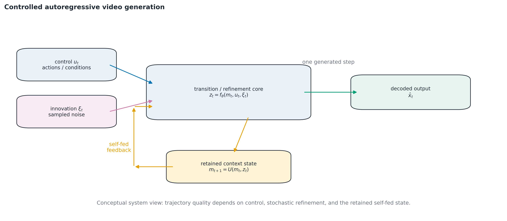

**Figure 1.1 — Video generation as an open dynamic control system.** Noise acts as an entropy
source, previous frames and actions as control signals, and autoregressive feedback makes output
quality a property of the complete self-fed trajectory. Source: author’s schematic.

In accordance with classical systems theory [REF: classical systems theory textbook], the object
under study is characterized by a large number of interrelated elements, nonlinear interactions,
emergence, and a hierarchical structure. In the context of computer vision the elements of the
system are individual pixels or latent features (tokens). Their interaction is provided by
attention mechanisms and convolutional operations, which model spatio-temporal correlations.
Nonlinearity is achieved through nonlinear activation functions in the artificial neural networks
that form the core of the system.

An important characteristic of such a system is the iterative nature of its state transitions.
Unlike generative adversarial networks (GAN) [REF: GAN, Goodfellow et al.] or variational
autoencoders (VAE) [REF: VAE, Kingma & Welling], which attempt to map an input noise vector to an
output image in a single computation step, iterative models such as denoising diffusion
probabilistic models (DDPM) [REF: DDPM] decompose this process into a multitude of discrete steps.
This approach fundamentally changes the mathematical nature of the system: the state evolves in
time (or in the pseudo-time of optimization steps), and every next state depends on the previous
one, the current parameters, and the control action.

Mathematically, the evolution of the state of such a system is described by a recurrent equation
of Markov type:

$$x_t = f(x_{t-1}, u_t, \theta, \xi_t) \tag{1.1}$$

where $x_t$ is the system state (a multidimensional tensor of video data or its latent
representations) at step $t$; $u_t$ is the vector of control actions (generation conditions);
$\theta$ is the parameter matrix of the system (the neural network weights); $\xi_t$ is the
stochastic component (the random number generator); and $f$ is the nonlinear transition function
describing the law of state change.

The presence of the stochastic component $\xi_t$ indicates that the system operates under
uncertainty. Every generation step is a probabilistic process, and the system produces not a
deterministic result but a sample from a specified multidimensional probability distribution.
According to research on complex systems under risk and uncertainty [REF: systems-under-risk
methodology; REF: system methodology monograph], such operating conditions make the system
extremely sensitive to initial conditions and create the threat of anomalous states. In
generative models this manifests as artifacts in images or violations of physical logic in video.

A complex system always possesses a hierarchical structure [REF: hierarchical systems theory],
where every level describes the object with a certain degree of detail or abstraction. In video
models this hierarchy is expressed with particular clarity. At the **macro level — the highest
level of abstraction** — the system operates with semantic concepts (global style, the mutual
arrangement of objects, scene composition). At the **meso level**, structural contours and
geometry are determined. At the **micro level — the lowest level of abstraction, the highest
level of detail** — high-frequency textures, lighting, and individual pixels are formed.

It is the hierarchical structure that gives rise to such a systemic property as emergence: a
meaningful image arises only thanks to complex spatial and temporal correlations between elements
at different levels of the hierarchy. If the system controlling the generation process cannot
ensure coherence between these levels, the emergent property is destroyed (for example, an object
receives a correct texture imposed on a distorted global shape). Hence the task of ensuring
stable generation reduces to the task of ensuring the stability of a complex hierarchical system.

### 1.1.1 Generation as an optimal-control problem

Traditional deep-learning approaches attempt to solve the stability problem extensively, by
increasing the number of parameters $\theta$ and the volume of the training sample. This path,
however, has physical limits and leads to exponential growth of computational complexity. A need
therefore arises for mathematical methods of optimal control of the generation trajectory.

Consider the generation process as an optimal-control problem. At the initial moment $t = 0$ the
system state $x_0$ is fully chaotic (a pure-noise distribution), corresponding to the state of
maximal informational uncertainty. At the final moment $t = T$ the system must arrive at a state
$x_T$ belonging to the target distribution of real video data (a state of high internal
structural organization).

The formalization of this process requires a systemic criteria apparatus. In the present research
the quality of the terminal state and of the trajectory leading to it is described by a
**consistency criterion functional** $J(x, u)$, which quantitatively expresses the degree of
non-correspondence between the current state $x$ and the target concept under conditions $u$.
Generation then becomes a constrained optimization problem over the state space:

$$x^{*} = \arg\min_{x} J(x, u) \tag{1.2}$$

subject to the state-transition law (1.1). The smaller the value of the criterion, the more
consistent and realistic the generated object.

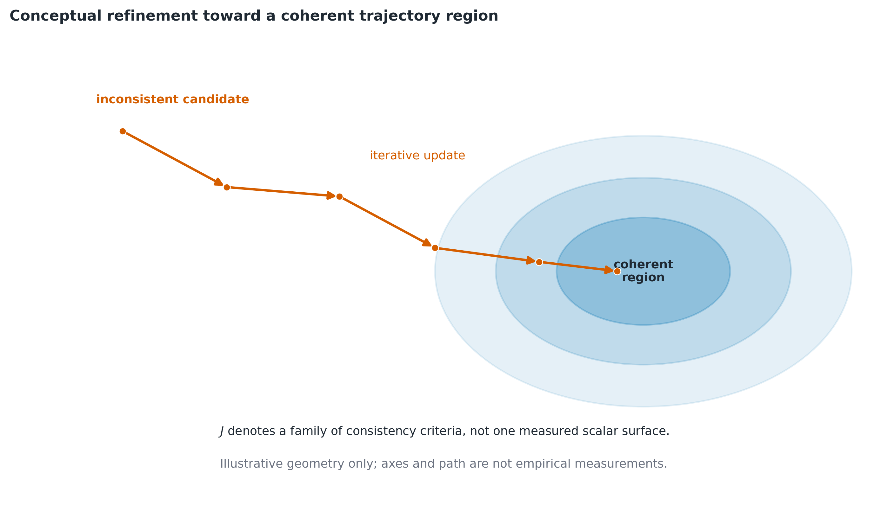

**Figure 1.2 — Conceptual multi-step generation on the landscape of a consistency criterion
$J(x,u)$.** The trajectory moves from a high-criterion noise state toward a structured
low-criterion region. This is a systems-level abstraction; only energy-based models instantiate
the landscape as an explicit learned scalar energy. Source: author’s schematic.

In the context of the intelligent information technology being developed, it is important to
clearly delimit the roles of two fundamental system concepts: the **global consistency criterion**
and **entropy**. The global criterion (1.2) is trajectory-level: it is a functional the modeling
system strives to minimize along the entire multi-step generation trajectory in order to reach
integral consistency of the object; in this dissertation it is operationalized not by a learned
scalar energy but by the measurable consistency criteria of §1.4 — in particular the
re-entry-stratified rollout metrics of §1.4.5, which the hierarchical model of Chapter 3 is built
to optimize. Entropy, by contrast, acts as a **local diagnostic indicator**: it quantifies the
level of structural informational uncertainty at specific spatio-temporal coordinates of the
data. Entropy maps allow the system to "understand" where complex moving contours are located and
where there is static background, and accordingly to adaptively redistribute limited
computational resources (this apparatus is realized in the V-BLT subsystem in Chapter 2).
Together these two system concepts form a closed loop of analysis and control.

Controlling this system runs into **computational uncertainty** on two fronts. First, at the
stage of parameter identification (training): since the transition function is realized by a deep
neural network, identifying the system parameters along a long chain of iterations requires
storing all intermediate states (activations) in operating memory, so the memory of
backpropagation through time grows linearly with the trajectory length. This creates a resource
barrier that rules out long control trajectories on practically available computing systems.
Second, at the stage of operation (inference): extending the temporal context of a flat attention
mechanism inflates its key–value memory linearly and its computation quadratically with context
length (analyzed quantitatively in §1.3.1). Overcoming the first front requires special methods
of structural optimization — in particular the introduction of reversible transformations that
reduce the memory-consumption complexity (developed in Chapter 2); overcoming the second requires
hierarchical decomposition of the state space with a compact long-memory level (developed in
Chapter 3).

### 1.1.2 Applied domains

Beyond its theoretical significance, understanding generative video models as complex control
systems has enormous practical importance for various applied fields. The tasks solved by such
systems intertwine closely with the objects of study of the specialty "System Analysis".

The first important application domain is medical imaging and the development of intelligent
systems for supporting clinical decision-making. Complex multidimensional spatial data (MRI, CT)
often require reconstruction, super-resolution, or cross-modal generation to minimize the
radiation load on the patient. In this domain any generation anomaly (a "hallucination" in the
form of non-existent tumors, or the loss of real anatomical structures) has fatal consequences,
so the requirement of absolute structural consistency is critical.

The second domain is ecological and technical monitoring using remote sensing data. Satellite
data often contain gaps due to cloud cover or technical failures. Generative systems are used for
spatial or temporal interpolation of missing data and for predicting the development of
ecological catastrophes (for example, the spread of forest fires). In this case the generated
intermediate states must strictly obey the laws of physics, thermodynamics, and the topology of
the terrain.

The third domain is the creation of educational and training simulators (for example, for
autonomous vehicle control systems). Training robots requires millions of hours of synthetic
video data with diverse scenarios (including extreme ones). The requirement imposed on the
generative system is long-term temporal coherence: objects cannot suddenly disappear, deform over
time, or violate the logic of physical interactions. In particular, an object that leaves the
camera's field of view must reappear in a consistent state and position when the camera returns
to it — a requirement that, as will be shown in §1.3.1 and §1.4.5, directly demands a long memory
horizon from the modeling system.

The analysis of the listed practical domains shows that modern generative systems are subject to
the following strict systemic requirements:

1. High visual quality and detail of the target data distribution;
2. Controllability of the system and the ability to respond to control actions;
3. Hierarchical representations without loss of coupling between levels;
4. Absence of spatial, temporal, and logical anomalies — including over long horizons, when
   content leaves and re-enters the field of view;
5. Resource efficiency under constraints of computational memory;
6. Interpretability of the process.

Summarizing, it can be stated that generative video models have reached the stage of evolution at
which their further development by empirical architecture search exhausts its potential. What is
required is the treatment of these algorithms as complex systems controlling dynamic processes,
which demands the development of a corresponding mathematical apparatus: methods of
decomposition, identification of uncertainty types, introduction of new consistency criteria, and
creation of algorithms for optimal resource control. The following subsections of this research
are devoted precisely to these questions.

## 1.2 Decomposition of the video generation system

The principal instrument of systems analysis in the study of complex systems is the method of
decomposition — the division of an integral system into interrelated subsystems, elements, and
couplings, with the aim of simplifying analysis and revealing deep properties and sources of
uncertainty. For the multidimensional system controlling the process of video data generation it
is expedient to apply several orthogonal kinds of decomposition: structural (functional),
hierarchical (semantic), and temporal.

### 1.2.1 Structural decomposition

Structural (functional) decomposition treats the generative system as a set of functional
information-processing blocks. In most modern architectures, irrespective of their mathematical
basis, three basic macro-subsystems are distinguished [REF: encoder–generator–decoder
architecture survey].

The first subsystem is the **Encoder** — the block of condition preprocessing and encoding. Its
function is to transform "raw" control signals (for example, a textual description, semantic
masks, or the pixels of context video frames) into a formalized multidimensional feature space.

The second subsystem, the **Iterative Generator / Denoiser**, is the central block of iterative
transformation. It is the mathematical core of the system, directly executing the
state-transition equation and performing optimization or denoising steps in the feature space.
This subsystem is responsible for eliminating the entropy of the initial state and forming a
consistent structure.

The third subsystem, the **Decoder**, is the block of decoding and reconstruction, which
translates the optimized latent state of the system back into the space of human perception (the
pixel space of an image or video stream).

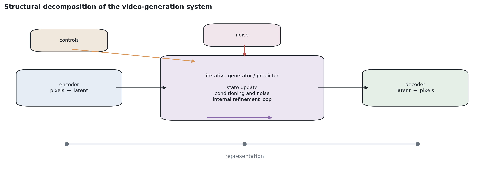

**Figure 1.3 — Structural decomposition of the video-generation system.** The encoder and
decoder define the representation interface; the central predictor carries the controlled
state transition and iterative refinement. Source: author’s schematic.

Of greatest interest for systems analysis is the central subsystem, since it is where the
state-control process takes place and the principal work of overcoming uncertainty is
concentrated. Its detailed study requires the deeper kinds of decomposition that follow.

### 1.2.2 Hierarchical decomposition of the state space

Complex systems have a pronounced hierarchical nature [REF: hierarchical systems theory].
Accordingly, the state space of the central generation subsystem cannot be "flat" — it must be
decomposed into macro, meso, and micro levels.

At the **macro level** (the level of highest abstraction) the system operates with semantic
vectors of low spatial resolution but high semantic saturation. Here the questions of conceptual
composition are decided: the presence of objects, their mutual arrangement, and correspondence to
the specified condition.

At the **meso level** of abstraction (medium resolution) the system forms structural contours,
geometry, and the spatial relations of object parts.

At the **micro level** (high resolution) the questions of local pixel organization are decided:
the coherence of textures, lighting, and micro-details.

The problem of many modern generative systems — for example, standard diffusion models built over
variational autoencoders [REF: LDM/VAE latent-space diffusion] — is that they operate in a
single-level latent space, ignoring the necessity of explicit hierarchical decomposition [REF:
critique of flat latent spaces]. This produces an internal control conflict in which macro- and
micro-decisions are taken simultaneously. The mixing of levels is a direct source of generation
anomalies: a correct object texture may be imposed on a distorted global shape.

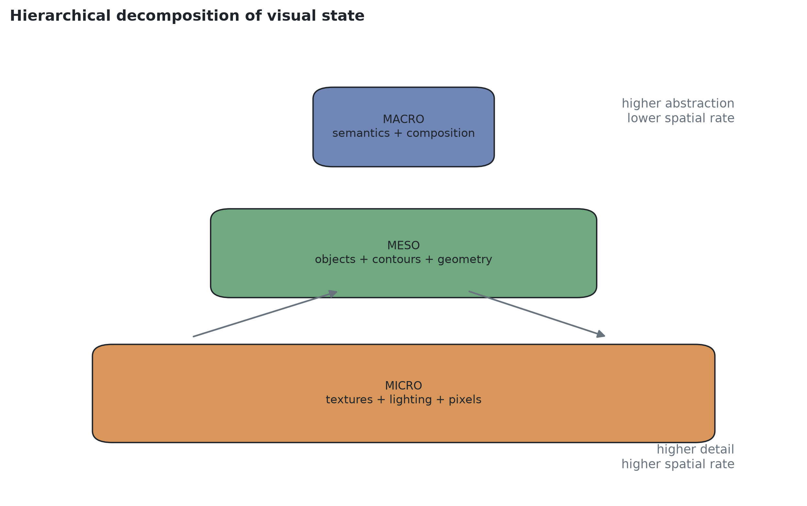

**Figure 1.4 — Hierarchical decomposition of visual state.** Macro denotes the highest
abstraction and lowest spatial rate; micro denotes the pixel-proximal level and highest detail.
Source: author’s schematic.

The systems approach requires the development of mathematical models of explicit hierarchical
decomposition with mechanisms of strict coherence between these orthogonal levels of
representation. This decomposition is the core of the present dissertation's topic. Moreover — a
property central to the direction developed in Chapters 2–4 — an explicitly decomposed hierarchy
allows the levels to run at *different temporal rates and context lengths*: a compact upper
(coarse) level with a low information rate can afford to retain a long temporal context at the
same memory budget for which a flat single-level representation affords only a short one, and can
therefore serve as the carrier of the system's long-range temporal memory (quantified in §1.3.1
and developed in Chapter 3).

### 1.2.3 Temporal decomposition

The third necessary kind of stratification is temporal decomposition. When modeling systems that
generate video data, time must be considered in two entirely different, orthogonal dimensions,
which creates the so-called "two-dimensional temporal grid".

The first dimension concerns the internal **pseudo-time** of the generation process — the
partition of the continuous process of state change into discrete refinement steps
$k = 1, \dots, K$ *per generated frame*: the steps of the reverse diffusion process, the token
steps of an autoregressive decoder, or the descent steps of an energy-based sampler. Every such
step is a micro-transition of the system in phase space, during which the total entropy of the
state decreases and its consistency increases.

The second dimension is introduced upon the transition to processing video sequences and reflects
the **physical time axis** $t = 1, \dots, T$, where every discrete slice is a separate frame. The
complexity of system control lies in the fact that the generative model must simultaneously
ensure stability in both temporal dimensions: the system state must evolve correctly along the
optimization axis $k$ for every individual frame, and at the same time all generated frames must
be spatio-temporally coherent along the physical axis $t$, forming smooth motion kinematics.

The physical axis, in turn, gives rise to the key quantitative characteristic of this
dissertation: the **memory horizon** — the maximal temporal distance $\Delta t$ at which
information about the past state of the modeled process can still influence the generated present
state. For a system whose central subsystem attends to a flat context window of $w$ frames, the
memory horizon is bounded by $w$; events separated by more than $w$ frames (for example, content
that left the field of view and returns later) are informationally inaccessible to it.

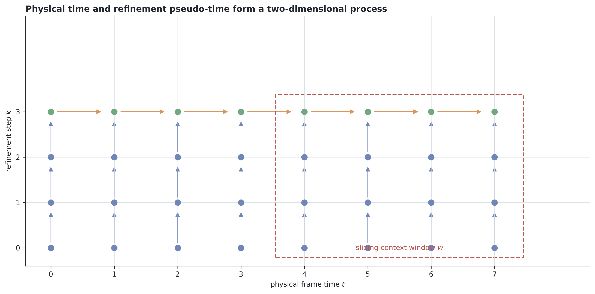

**Figure 1.5 — Two-dimensional temporal decomposition of video generation.** Horizontal
transitions advance physical frame time, vertical transitions refine each predicted state, and
the sliding context window bounds directly addressable history. Source: author’s schematic.

### 1.2.4 Classification of uncertainty types

The performed decomposition of the complex system permits a classification of the kinds of
uncertainty arising in it. In accordance with the theory of systems analysis of complex systems
under risk [REF: systems-under-risk methodology] and system methodology [REF: system methodology
monograph], uncertainties are classified by source and nature. In the video generation system
under study, four principal kinds of uncertainty are distinguished: informational,
structural-algorithmic, computational, and target uncertainty.

**Informational uncertainty** is conditioned by the very nature of the iterative generative
process, which begins from a state of pure noise (the state of maximal entropy). Moreover,
informational uncertainty is inevitably present in the control actions. For example, the textual
description "a car drives along a road" or a coarse semantic mask is always incomplete: it
specifies only boundary macro-conditions, leaving a multitude of micro-details (the shape of the
headlights, the texture of the asphalt, the lighting) undescribed. The task of the complex system
is the correct and plausible resolution of this uncertainty during generation. If the system
completes the missing information incorrectly, "hallucinations" and anomalies arise, rendering
the result inconsistent [REF: hallucination phenomenology in generative models].

**Structural-algorithmic uncertainty** is connected with the rigid limitations of the
mathematical apparatus itself (the neural network). Models always have finite capacity and use
architectural inductive biases. A separate and extremely destructive manifestation of this
uncertainty is the problem of spatio-temporal tokenization. Standard transformer architectures
(ViT, ViViT) partition the image into a regular grid of fixed-size patches, ignoring the fact
that the visual signal has non-uniform information density.

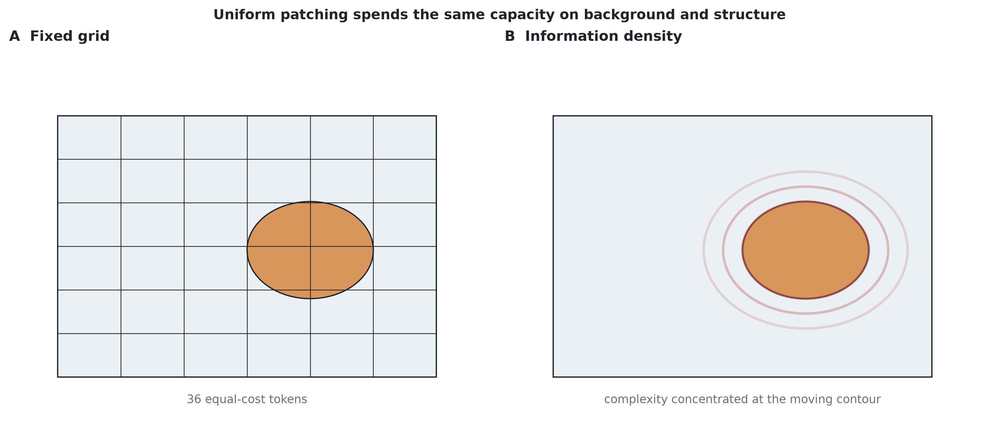

**Figure 1.6 — Fixed-grid tokenization under non-uniform information density.** Equal-size
patches assign equal token cost to static background and to high-information moving contours.
Source: author’s schematic.

As follows from the principle of optimal control, a uniform distribution of resources across
monotonous background and complex moving objects is suboptimal. This gives rise to structural
uncertainty: computational resources are lacking where they are genuinely needed and are wasted
where there are no objects or dynamics. Solving this problem requires the creation of adaptive
tokenization systems based on the measurement of local entropy (developed in Chapter 2).

**Computational uncertainty** is the most critical for iterative multi-step models. It arises on
two fronts, corresponding to the two temporal axes of §1.2.3. On the training front (the
identification of model parameters), the backpropagation-through-time algorithm (BPTT) requires
storing in operating memory all intermediate states for every step of the modeled process; since
the state space of visual data is enormous, the linear growth $O(N \cdot K)$ of memory
requirements quickly exceeds the physical limits of the hardware. The easiest "solution" — cutting
the optimization trajectories down to a few steps — renders the system incapable of modeling
long-term dynamics. On the operation front, the flat attention context over the physical time
axis inflates the key–value memory linearly and the computation quadratically with the number of
context tokens (§1.3.1, eq. (1.7)), so the memory horizon of a flat system is capped by the
hardware precisely in the regimes where a long horizon is required. The task of radically
reducing memory consumption — for gradient computation along deep trajectories and for context
retention along long horizons — is a critically necessary condition for the viability of
multi-step generative systems.

**Target uncertainty** arises when the criterion optimized by the model during training does not
coincide with the global goal during generation. For example, diffusion models optimize the local
error of noise prediction at one isolated step, but during generation these steps are chained
into a long sequence in which errors accumulate. The absence of a single global objective
functional of the form (1.2) makes the control process "blind" to the final result.

The performed multidimensional decomposition of the video generation control system and the
classification of the identified kinds of uncertainty form a clear methodological basis for the
further research. Systems analysis shows incontrovertibly that to ensure high generation
consistency and to solve the anomaly problem it is insufficient to improve individual
architectural elements empirically.

What is required is a comprehensive mathematical approach comprising: methods of adaptive
entropy-based state estimation for resolving spatial uncertainty; resource-saving algorithms
based on reversible computation for overcoming computational uncertainty; and the creation of a
new **hierarchical control apparatus over compact continuous hierarchical latent state spaces**
for eliminating structural and target uncertainty.

The next subsection conducts a detailed critical analysis of existing approaches to the
mathematical modeling of visual data — diffusion, hierarchical latent and autoregressive, and
energy-based models — with the aim of identifying their strengths and their fundamental systemic
limitations in the context of the requirements formulated above.

## 1.3 Analysis of existing approaches

To solve the posed problems of systems analysis and to construct an intelligent information
technology of video data generation, a thorough critical review of the existing mathematical
approaches to modeling complex multimodal spatio-temporal distributions is necessary. The modern
scientific landscape offers several competing paradigms, each with its own architectural
features, advantages, and fundamental systemic limitations. This subsection reviews three classes
of models **in the order dictated by the argument of this dissertation**: (i) diffusion models —
the state of the art in generation quality, whose systemic limitation is the monolithic flat
long-context attention; (ii) hierarchical latent and autoregressive approaches — the remedy
direction, within which the choice between discrete and continuous latent spaces is examined;
(iii) energy-based models — reviewed as literature together with the resource-efficiency methods
they motivated. The focus criteria are systemic consistency and resource control.

### 1.3.1 Diffusion models: generation quality and the flat long-context barrier

Denoising diffusion probabilistic models (DDPM) [REF: DDPM] and their non-Markovian
generalizations (DDIM) [REF: DDIM] are today the dominant standard in high-quality image and
video generation. Unlike traditional generative approaches such as GAN [REF: GAN], which attempt
to map random noise directly onto the data, diffusion models implement a more effective and
mathematically grounded iterative strategy.

The mathematical basis of the diffusion approach rests on concepts of non-equilibrium
thermodynamics. The modeling process is decomposed into two mutually inverse processes: forward
and reverse diffusion.

The forward diffusion stage is fixed and consists in the gradual addition of Gaussian noise to
the original "clean" data sample $x_0$, progressively driving it to the state of random noise
$x_T$. The process is modeled as a Markov chain:

$$q(x_t \mid x_{t-1}) = \mathcal{N}\!\left(x_t;\; \sqrt{1-\beta_t}\, x_{t-1},\; \beta_t \mathbf{I}\right) \tag{1.3}$$

where $\beta_t$ is a predetermined deterministic schedule of noise variance at step $t$. A
mathematical advantage of this construction is the closed-form availability of the noised state
at an arbitrary step directly from the original state:

$$q(x_t \mid x_0) = \mathcal{N}\!\left(x_t;\; \sqrt{\bar\alpha_t}\, x_0,\; (1-\bar\alpha_t)\mathbf{I}\right) \tag{1.4}$$

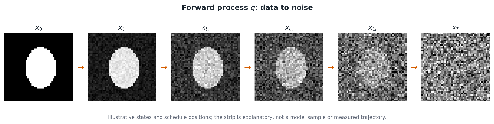

**Figure 1.7 — Forward diffusion.** Progressive Gaussian corruption destroys the information
structure of a sample from $x_0$ toward $x_T$. Source: author’s schematic.

At the reverse diffusion stage the system learns to invert this process, denoising the corrupted
sample and restoring the data. Unlike forward diffusion, the reverse process constitutes a
complex computational problem solved by deep neural networks:

$$p_\theta(x_{t-1} \mid x_t) = \mathcal{N}\!\left(x_{t-1};\; \mu_\theta(x_t, t),\; \Sigma_\theta(x_t, t)\right) \tag{1.5}$$

In practice the model is optimized to predict the added noise $\epsilon$ via the simplified loss:

$$L_{\text{simple}} = \mathbb{E}_{x_0, \epsilon, t}\left[\,\bigl\|\epsilon - \epsilon_\theta\bigl(\sqrt{\bar\alpha_t}\,x_0 + \sqrt{1-\bar\alpha_t}\,\epsilon,\; t\bigr)\bigr\|^2\,\right] \tag{1.6}$$

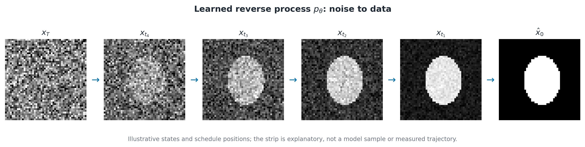

**Figure 1.8 — Reverse diffusion.** A learned denoising field iteratively restores structure from
noise. The sequence is conceptual and does not depict an experimental sample. Source: author’s
schematic.

This "forward–reverse" paradigm makes it possible to generate images of extremely high quality:
the decomposition of denoising into steps naturally decomposes the learning problem and
simplifies the model's acquisition of features. Classical pixel-space diffusion models, however,
face colossal memory deficits, which led to latent diffusion models (LDM) [REF: LDM] operating in
the compressed space of a variational autoencoder. The architectural evolution then displayed a
stable trend away from convolutional U-Nets toward transformers: Diffusion Transformers (DiT)
[REF: DiT] demonstrated that processing noised images as sequences of patches scales better, and
in the video domain this approach evolved into systems of the Sora class [REF: Sora technical
report], operating on spatio-temporal latent patches and generating video up to a minute long.

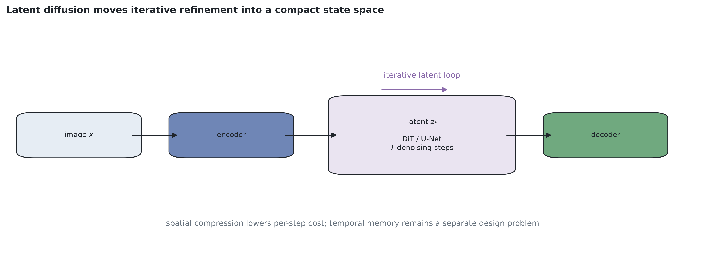

**Figure 1.9 — Latent-space diffusion.** Spatial compression reduces the per-step denoising cost,
but it does not by itself solve the temporal-memory allocation problem. Source: author’s
schematic.

Despite their dominant generation quality, modern diffusion video systems possess systemic
limitations that are the direct object of this dissertation's analysis. **The paradigm-level
strengths of iterative refinement are not in question here** — on the contrary, Chapter 4's
matched-capacity, matched-NFE mechanism study confirms empirically that an iterative refinement (diffusion)
core commits to sharp, correctly located content where a regression core averages over futures;
the per-frame generation core of the model developed in Chapter 3 is itself a diffusion core,
selected by exactly that controlled analysis. The limitations lie elsewhere — in *how the
temporal context is represented and scaled*.

The first limitation is the **flat, single-level latent space**. The latent space of the
underlying autoencoder is single-level; the system is forced to solve macro-problems (global
composition) and micro-problems (textures) simultaneously within one tensor, which precludes
independent control of abstraction levels and, per §1.2.2, is a direct source of hierarchical
inconsistency.

The second limitation is the **resource blow-up of flat long-context attention**. To lengthen the
memory horizon, a flat video transformer must lengthen its spatio-temporal token context. For a
context of $T_w$ frames tokenized at $N_s$ spatial tokens per frame, the attention context length
is $L = T_w \cdot N_s$, and the principal costs of the attention mechanism scale as

$$C_{\text{compute}} = O(L^2 \cdot D) = O(T_w^2 N_s^2 D), \qquad
M_{\text{KV}} = O(L \cdot D) = O(T_w N_s D) \tag{1.7}$$

where $D$ is the model width: computation grows quadratically and key–value cache memory linearly
with the context length. Doubling the memory horizon of a flat system quadruples its attention
computation and doubles its inference memory — the resource cost is paid *at every generation
step, for every frame*, precisely at the horizons where long memory is most needed. This is the
central resource contradiction of flat long-context modeling.

The third limitation is the **degradation of long-horizon temporal consistency** even where a
long flat context is affordable. Empirical evaluations of long-video generators and world models
show that content which leaves the field of view is not restored consistently upon its return,
and that consistency metrics degrade with the distance to the relevant past [REF: long-term
spatial-memory benchmarks for video world models; REF: memory-augmented world-model evaluation;
REF: geometry-grounded long-video consistency probes]. In systems-analysis terms, the flat
context window imposes a hard memory horizon (§1.2.3): information older than the window is not
merely expensive — it is absent from the system state. Related to this is **target uncertainty**:
during training the model optimizes the local error of one isolated step, while during generation
errors accumulate along the whole autoregressive chain — the phenomenon of exposure bias [REF:
exposure bias in sequence generation].

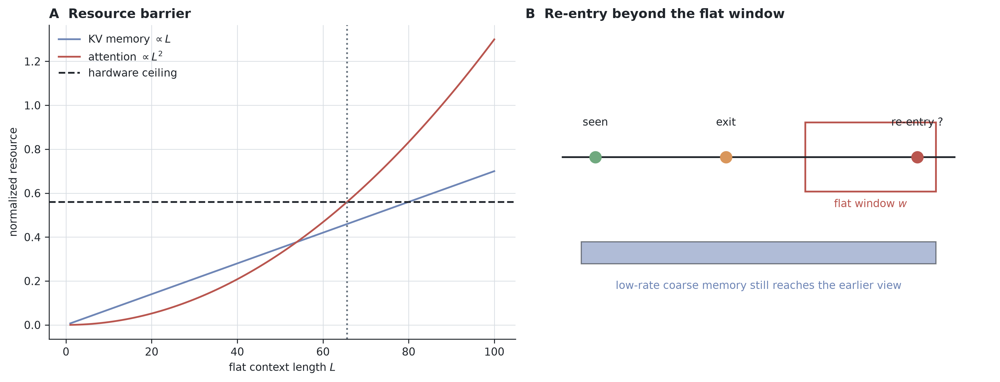

**Figure 1.10 — Flat long-context resource and re-entry barrier.** Panel A is schematic rather
than a hardware benchmark: key–value memory grows linearly and attention work quadratically with
sequence length. Panel B shows why a low-rate long-memory stream can remain addressable after the
relevant content has left a short flat window. Source: author’s schematic.
Source: NEW (draw)

### 1.3.2 Hierarchical latent approaches and autoregressive prediction

The remedy direction for the contradictions of §1.3.1 is formed by approaches that (i) treat
video prediction autoregressively along the physical time axis and (ii) decompose the latent
state space instead of flattening it. This subsection reviews the components of that direction:
patch-based autoregressive transformers, discrete-token models, and hierarchical latent models —
and motivates, by the author's own measurements, the choice of *continuous* hierarchical latent
spaces made in this work.

**Patch-based autoregressive transformers.** This line of work originates in the transfer of
natural-language-processing principles to computer vision. The standard approach, popularized by
the Vision Transformer (ViT) [REF: ViT] and its video adaptations ViViT [REF: ViViT] and Video
Swin Transformer [REF: Video Swin], partitions the video into a grid of non-overlapping
spatio-temporal patches that are linearized and fed to a transformer. The principal advantage of
transformer models is their capacity to model long-range dependencies between distant regions of
the video; their principal cost is exactly the quadratic attention complexity (1.7). Although
Video Swin partially mitigates it with local attention windows, the fundamental limitation —
a single-level latent space with fixed patching — remains. Fixed-grid tokenization is a form of
rigid, content-blind discretization: static low-information background and dynamic scene regions
receive equal computational budgets, which §1.2.4 identified as a source of
structural-algorithmic uncertainty. An analogous problem in language modeling was resolved by the
Byte Latent Transformer (BLT) [REF: BLT], which groups bytes into latent patches of variable size
governed by information density (entropy). Transferring this paradigm to the visual modality
resolves the rigid-tokenization component of structural uncertainty; the V-BLT architecture
developed in this dissertation realizes that transfer and is presented in Chapter 2. *(Preserved
from old §1.3.2.)*

**Discrete-token autoregressive models.** A prominent branch of autoregressive video modeling
operates over *discrete* latent spaces: a vector-quantized autoencoder (VQ-VAE) [REF: VQ-VAE, van
den Oord et al.] compresses frames into grids of codebook indices, over which an autoregressive
transformer learns the video distribution — the VideoGPT line [REF: VideoGPT] and its successors,
including long-video architectures with compressed memory [REF: TECO / long-video discrete-token
models]. The attraction of this paradigm is genuine: discrete tokens give a clean autoregressive
likelihood, natural compatibility with language-model tooling, and strong compression.

Discrete bottlenecks also introduce specific optimization risks—straight-through assignment,
codebook underutilization, dead codes and level collapse—that are documented in the VQ
literature [REF: VQ optimization/codebook collapse]. The implemented fourth-article system
therefore uses **compact continuous hierarchical latent state spaces**, in which both levels are
end-to-end differentiable and independently decodable. This is an implementation choice, not an
empirical conclusion that continuous representations are universally superior: the present
repository contains no controlled hierarchical-VQ-versus-continuous comparison and makes no such
claim. Representation sensitivity is instead tested within the continuous-codec family by the
pre-registered alternate-codec-seed study in Chapter 4.

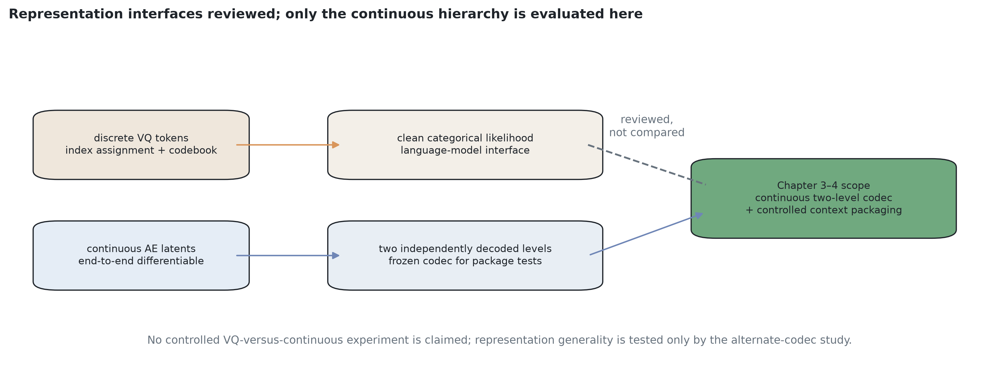

**Figure 1.11 — Representation interfaces and the evidence boundary of this dissertation.**
Discrete VQ models are reviewed as an important autoregressive family; the controlled experiments
use a continuous two-level codec. The dashed path denotes a comparison not performed here.
Source: author’s schematic.

**Hierarchical latent video models.** The direct remedy for the flat-latent limitation is the
class of models whose latent state space is explicitly multi-level, with distinct temporal or
spatial rates per level. Early representatives use multi-rate recurrent latents — clockwork
variational hierarchies [REF: Clockwork VAE] — where upper levels tick more slowly and thereby
retain longer temporal context. The modern form of this idea in the diffusion family is the
hierarchical latent video diffusion model of the MilliVid class [REF: MilliVid-class hierarchical
latent video diffusion]: a compact hierarchy of continuous latents (a low-rate *coarse* level and
a high-rate *fine* level, each independently decodable to pixels), a diffusion core that denoises
the levels jointly with cross-level attention, and autoregressive rollout along physical time.
The systemic significance of this spatial construction follows directly from eq. (1.7): because the
coarse level carries far fewer tokens per frame than the fine level, a *heterogeneous* context —
long in coarse tokens, short in fine tokens — covers a memory horizon many times longer than a
flat context of the same total token budget. The hierarchy converts the quadratic cost of horizon
extension into a near-linear one along the cheap level, making the coarse level one economical
carrier of long-range temporal memory. Temporal subsampling provides a distinct route to the same
span and is compared directly in Chapter 4. *(Chapter 3 develops the spatial form with a two-level
continuous latent interface and unidirectional context transfer; Chapter 4 treats it as one point
in the broader context-packaging design space.)*

**Figure 1.12 — Context packages allocate equal capacity differently across reach and
fidelity.** Flat contiguous, spatially hierarchical and temporally strided packages feed the same
predictor family; the exact experimental token counts and target interfaces are reported in
Chapters 3–4. Source: author’s schematic.
Formally, the hierarchical factorization of the video distribution replaces the flat conditional
$p_\theta(x_t \mid x_{t-w:t-1})$ with a level-decomposed conditional of the form

$$p_\theta\!\left(z^{c}_{t}, z^{f}_{t} \,\middle|\, z^{c}_{t-w_c:t-1},\; z^{f}_{t-w_f:t-1},\; u_t\right), \qquad w_c \gg w_f \tag{1.8}$$

where $z^{c}$ and $z^{f}$ are the coarse- and fine-level latent states, $w_c$ and $w_f$ their
context windows, and $u_t$ the control signals; the asymmetry $w_c \gg w_f$ at a matched token
budget $w_c N_s^{c} + w_f N_s^{f} \approx \mathrm{const}$ is what extends the memory horizon
without the flat blow-up (1.7).

**Methodology for comparing hierarchical configurations.** The canonical comparison methodology
of this class is the Clockwork-VAE benchmark
[REF: CW-VAE]: one configuration table over several datasets and metrics, quality-retention
curves over long open-loop rollouts, and level-content probes (an upper level following its
prior while lower levels see the context). The dissertation adopts this *format* in §4.4 while
tightening three controls the original lacks — a systems-analysis point in its own right. First,
capacity: the compared CW-VAE-class models differ in parameter count (their RSSM baseline 5M vs
CW-VAE 12M; only the NoTmpAbs ablation is matched), whereas in the token-stream architecture of
Chapter 3 depth adds tokens to a shared backbone with only per-level I/O heads (+1.4%
parameters, disclosed) — the depth axis is backbone-capacity neutral. Second, context cost: a recurrent state has no token-budget axis, so
hierarchy-versus-flat comparisons in the recurrent family cannot hold context cost fixed; the
token interface makes every configuration's cost an exact count, enabling matched-budget
comparison. Third, metrics: the CW-VAE evaluation aggregates SSIM/PSNR over full frames, and the
author's own measurement (§3.4.3) shows a constant all-black frame outperforming a trained
CW-VAE on such aggregates on sparse-foreground video — hence the foreground-masked,
re-entry-stratified protocol of §3.4. It is also noted that the CW-VAE paper's depth evidence is
an information-allocation (KL-per-level) analysis rather than a prediction-quality dose–response;
the quality-per-depth cells are measured directly in §4.4.5. The temporal-abstraction relatives —
VTA [REF: VTA / Variational Temporal Abstraction] (whose lower level resets when the upper level ticks) and the clockwork recurrent
lineage [REF: Clockwork RNN, Koutník et al. 2014] — complete the review of hierarchy *shapes*:
spatial and temporal abstraction, depth and budget allocation are four axes of the design space.
Which form of hierarchy pays and where is therefore a measurement question (§4.4), not a
postulate.

Summarizing the hierarchical-latent review: this paradigm inherits the generation quality of the
diffusion core (§1.3.1) while remedying its two systemic limitations — the flat latent space and
the flat context window — and, per the author's measured finding, its *continuous* form is the
one trainable at practically reachable scale. It is therefore adopted as the base paradigm of
this dissertation.

### 1.3.3 Energy-based models and resource efficiency

The third class of the review is that of energy-based models (EBM). The EBM paradigm originates
in statistical physics [REF: statistical-physics foundations of EBM; REF: Boltzmann-distribution
modeling]. Its basic principle is that the probability of a data configuration $x$ is defined by
the Gibbs/Boltzmann distribution:

$$p_\theta(x) = \frac{\exp\left(-E_\theta(x)\right)}{Z(\theta)} \tag{1.9}$$

where $E_\theta(x)$ is a scalar energy function parameterized by a neural network and $Z(\theta)$
is the partition function. The lower the energy, the higher the probability of the state and the
more consistent it is deemed.

An important theoretical bridge connects EBM to diffusion models through score matching [REF:
score matching]: the score function approximated by a diffusion model is the negative gradient of
an (implicit) energy,

$$\nabla_x \log p(x) = -\nabla_x E(x) \tag{1.10}$$

From the standpoint of systems analysis the attraction of this paradigm is evident: the energy is
a single explicit optimization criterion; the system always moves toward equilibrium; and the
energy value serves as a universal indicator of anomalies in a generated frame — if an artifact
is generated, the local energy grows. Transformer-parameterized realizations of this idea —
Energy-Based Transformers (EBT) [REF: Energy-Based Transformers] — extend it to autoregressive
video modeling and add a systemically appealing property: the number of descent steps (1.11) is a
natural "think-longer" control knob, allowing the system to spend more computation on harder
predictions.

However, the broad application of EBM is critically limited by computational uncertainty. To
train such a model, backpropagation must be threaded through $K$ MCMC iterations of the forward
pass; BPTT memory grows as $O(K \cdot L)$, where $L$ is the network depth, and since every MCMC
iteration requires a gradient with respect to the input (double backward), memory overflow occurs
rapidly [REF: EBM training-cost analyses], precluding deep optimization trajectories for
high-quality video data.

Approaches to this barrier constitute the resource-efficiency toolbox of multi-step systems.
Gradient checkpointing [REF: gradient checkpointing] trades computation for memory by storing
only a subset of activations and recomputing the rest, reducing memory to the order of the square
root of the trajectory length. Neural ODEs [REF: Neural ODE] offer constant memory through
adjoint integration of differential equations but suffer from numerical instability. The most
promising direction is discrete reversible neural networks — RevNet [REF: RevNet] and its
transformer form RevViT [REF: RevViT] — which restore activations mathematically instead of
caching them. It is this apparatus of reversible computation, applied to removing the resource
constraints of long-horizon *temporal* modeling, that forms the core of the TempVerseFormer
method presented in Chapter 2 and underlies the constant-memory autoregressive rollout of the
hierarchical model of Chapter 3.

An honest forward reference completes this review. In the present research the energy-based
mechanism was not adopted a priori but *examined experimentally* under matched conditions: the
matched-capacity, matched-NFE mechanism study of Chapter 4 (§4.2) includes a two-sided
capability study of Energy-Based Transformers, run with the official published implementation and
both published training recipes at the largest scale reachable on the available hardware. Its
outcome is a **characterized negative** at that scale: one published recipe converges to a stably
*mis-ordered* energy landscape (the mean of the data attains lower energy than the true target);
the other recipe repairs the ordering — the true target becomes the energy minimum among probed
candidates — yet gradient descent from the prescribed initialization still does not reach
structured outputs, and inference-time computation does not buy the capability back; meanwhile a
diffusion core of roughly half the parameter count, on the same latents and protocol, commits to
sharp and correctly located predictions. The study is scoped explicitly: it tests a capability
the EBT publication does not claim at a scale it did not run, and contradicts none of the
published claims. For this dissertation its systemic significance is that the choice of the
per-frame generation core in Chapter 3 is made *by controlled measurement, not by paradigm
preference* — and the measurement selects diffusion.

Summarizing the critical analysis of existing approaches: diffusion models deliver the highest
generation quality, but their monolithic flat realization runs into the long-context resource
blow-up (1.7) and the memory-horizon consistency degradation; patch-based transformer models
capture global context well but require entropy-based adaptation of their rigid tokenization;
hierarchical latent models remedy the flat-latent and flat-context limitations, and in their
continuous form are trainable at reachable scale (whereas the author's experiments found
hierarchical VQ configurations unstable); energy-based models offer an attractive explicit
criterion but are resource-barred in training, and their descent mechanism is experimentally
characterized as a negative at this work's reachable scale (Chapter 4). The synthesis defining
this dissertation is therefore: **a hierarchical continuous-latent video model with a diffusion
refinement core, whose coarse level carries the long memory horizon (Chapter 3), supported by
entropy-adaptive decomposition (Chapter 2), reversible-computation resource optimization
(Chapter 2), and a criterion-driven measurement instrument (Chapters 3–4)**.

## 1.4 Consistency criteria and methods

In the theory of complex systems one of the fundamental notions is the stability of a system
[REF: stability of complex systems] — its capacity to maintain a specified state or target
trajectory under external disturbances and internal stochasticity. In the context of generative
video models the notion of stability is most closely tied to the term "consistency" (coherence,
non-contradiction). Traditionally, the evaluation of generation results in machine learning
reduces to the subjective criterion of visual attractiveness or to statistical metrics of
proximity to the training sample, such as FID [REF: FID]. From the standpoint of systems
analysis such an approach is severely limited.

Systems analysis requires the transition from abstract aesthetic evaluation to a formalized
criteria apparatus. The generative model is treated as a system transforming the input
information signal of the condition $u$ into the output state $x$. If the state $x$ contains
internal logical, spatial, or physical contradictions, it is classified as anomalous.
Accordingly, **consistency is the criterion of the absence of anomalies in the generated state of
the complex system**; ensuring consistency becomes synonymous with ensuring the reliability and
stability of the information technology of generation.

Since video data have a deep multidimensional structure, consistency cannot be described by one
scalar parameter. It is a complex systemic phenomenon requiring an extended taxonomy. This
subsection analyzes the classical kinds of consistency — spatial, object, and temporal —
integrates the notion of conceptual consistency, and formalizes hierarchical and trajectory
consistency, which are critically important for hierarchical multi-step generative systems.
### 1.4.1 Spatial and object consistency

The basic level of coherence for any visual signal is **spatial consistency**. This criterion
determines the structural integrity of the generated frame at the level of geometry and the
mutual arrangement of elements. Spatial consistency guarantees that objects in the image have
correct proportions, that boundaries are sharp, and that perspective and lighting obey uniform
physical laws across the whole scene.

The next level is **object consistency**. In many practical tasks the system must generate a
series of states of one and the same object (from different viewpoints, under different
lighting), preserving its unique identifying features. Modern generative algorithms approach this
task in several ways.

The simplest method of achieving object consistency in diffusion models is generation by the
image-to-image approach [REF: image-to-image diffusion]: an existing reference image is used as
the starting point to steer the generation toward a specified result. The diffusion model
transfers the information of the image into its latent space, subtly influencing the direction of
the process.

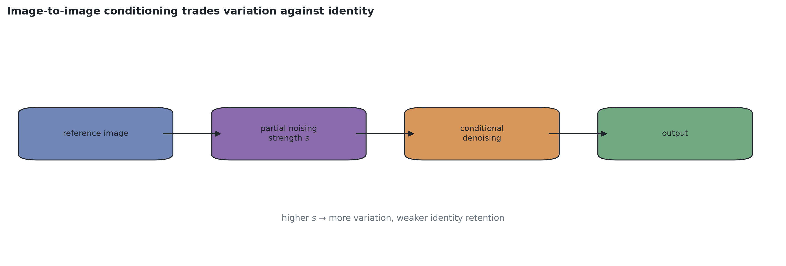

**Figure 1.13 — Image-to-image conditioning.** Increasing noising strength expands variation but
weakens direct preservation of the reference identity. Source: author’s schematic.

This approach, however, has rigid systemic limitations — the difficulty of precise control: a
higher degree of noising of the reference increases variability and loses the consistency of fine
details (textures, scratches).

A deeper method is fine-tuning of the model itself by approaches of the DreamBooth family [REF:
DreamBooth] and its low-rank variation LoRA [REF: LoRA]. This method uses a set of reference
images of a specific object to adjust the internal representation (the weight coefficients
$\theta$) of the model. Although DreamBooth can secure the consistency of specific features (for
example, facial features or the texture of a particular object), it is computationally heavy and
works exclusively within the "learned" object.

For enforcing strict spatial consistency of shape there exists the ControlNet architecture [REF:
ControlNet], which injects a special control signal (depth maps, contours, segmentation masks)
into the reverse diffusion process. Methods of the ControlNet type perform the function of hard
boundary control of the admissible state space: the input image acts as a guiding form
constraining the evolution of the system.

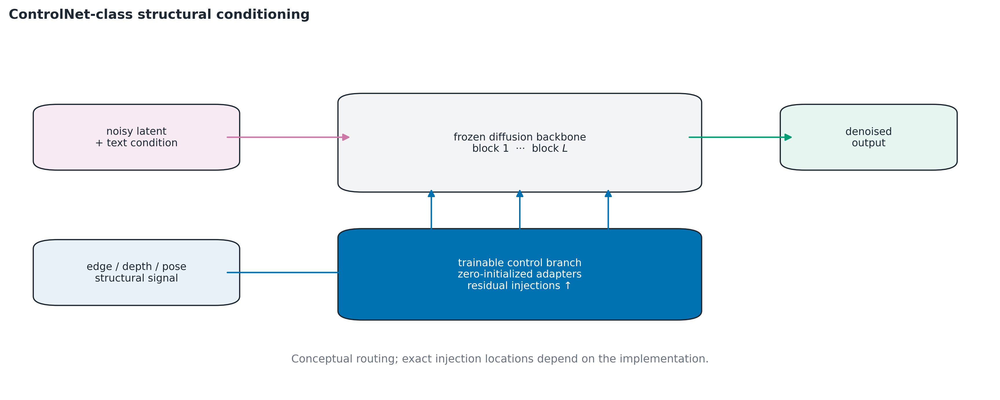

**Figure 1.14 — Structural control with a ControlNet-class branch.** A trainable branch maps
edges, depth or segmentation into residual constraints for a frozen diffusion backbone. Source:
author’s schematic after the ControlNet architecture [REF: ControlNet].

Despite the effectiveness of ControlNet, it is not a complete solution for object consistency,
since it focuses only on the form ("how") and not on the properties ("what"). A fully autonomous
system must be able to maintain object identity through internal control mechanisms, without
mandatory external structural prompts. *(This requirement — identity maintenance by internal
memory rather than external prompts — is exactly the long-memory requirement that the coarse
level of the Chapter 3 model serves.)*

### 1.4.2 Temporal consistency

Upon the transition from static images to video data the key criterion becomes **temporal
consistency**. It requires that the sequence of generated states $x_1, x_2, \dots, x_T$ form a
logical and smooth video stream. Anomalies of temporal consistency manifest as flicker, sudden
background color changes, or deformation of objects during motion.

The mathematically strict local requirement of temporal consistency is formalized through
optical flow or a warping function $W$: if the vector field of motion between frames $t-1$ and
$t$ is known, the generated state $x_t$ must maximally correspond to the warped previous state
$W(x_{t-1})$. The local temporal-consistency error is defined as:

$$L_{\text{temp}} = \left\|\left(x_t - W(x_{t-1})\right)\right\|^2 \odot M \tag{1.12}$$

where $M$ is a binary mask excluding occlusion regions.

It must be emphasized, however, that the warp criterion (1.12) is **local**: it couples only
adjacent frames and therefore certifies only short-range temporal consistency. It is entirely
blind to the long-range regime identified in §1.3.1: content that leaves the field of view exits
the domain of the mask $M$, and its consistent restoration upon re-entry many frames later is not
constrained by any chain of local warp terms — it is constrained only by the memory of the
generating system. Long-range temporal consistency is therefore operationalized separately, as
part of trajectory consistency (§1.4.5), through metrics stratified by re-entry hardness. For
ensuring temporal consistency in the developed information technology, the following mechanisms
are used: multidimensional positional encoding 3D-RoPE, block-causal attention masks, and
temporal chaining mechanisms (Chapter 2), together with the coarse-level long memory of the
hierarchical model (Chapter 3).

### 1.4.3 Style and conceptual consistency

Besides object consistency, complex systems must maintain a unified **stylistic** appearance of a
series of generated data. Modern approaches such as StyleAligned [REF: StyleAligned] solve this
problem through intervention in the attention mechanism (shared attention): target images receive
information about the reference image during generation, copying its global stylistic
characteristics (color palettes, brushwork) without interfering with spatial geometry.

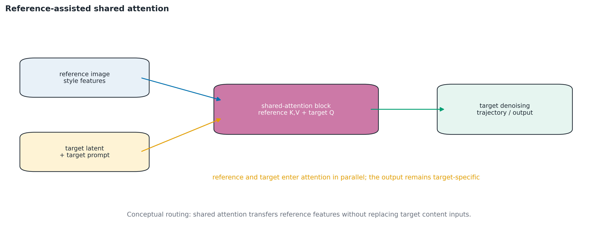

**Figure 1.15 — Style consistency through shared attention.** Reference attention features are
shared across distinct target trajectories while their content conditions remain separate.
Source: author’s schematic after StyleAligned [REF: StyleAligned].

For a more thorough and qualitative analysis of generative models, within this dissertation
research — published in **[A3]** (the consistency-criteria article) — the notion of **conceptual
consistency** was formalized.

Marr's multi-stage account of visual representation — progressing from image evidence toward
structured descriptions of the scene [REF: multi-stage visual representation (image evidence
toward a 3-D description)] — motivates a broad engineering analogy, but does not itself prescribe
the taxonomy used here. The dissertation's narrower claim is that the traditional division into
style and object alone is incomplete. Conceptual consistency is the capacity of the generative system for
compositionality and extrapolation. It evaluates the ability of the model not merely to reproduce
existing objects but to generate entirely new visual ideas (out-of-distribution), never
encountered during training, while strictly observing the logic of the control conditions $u$.

For example, generating the image "a skyscraper built of skyscrapers" requires the system to
perfectly disentangle the vectors of "shape" and "material". An anomaly of conceptual consistency
is the loss of compositionality — when the system ignores part of the textual condition or
generates objects side by side instead of combining them.

As the metric for evaluating conceptual consistency, the cosine similarity between the semantic
vectors of the generated image and the textual condition in the joint space of a contrastive
model (CLIP score) [REF: CLIP] is proposed. Let $E_I$ be the visual encoder and $E_T$ the textual
encoder; then the measure of conceptual consistency is defined as:

$$C_{\text{concept}}(x, u) = \frac{E_I(x) \cdot E_T(u)}{\left\|E_I(x)\right\| \left\|E_T(u)\right\|} \tag{1.13}$$

High values of this indicator testify that the system has successfully resolved the target
uncertainty and learned the deep causal relations of the visual space.

### 1.4.4 Hierarchical consistency

For the transition to systems of a higher order of complexity — multi-level generative models —
this research introduces the notion of **hierarchical consistency**, developed within the
construction of the hierarchical generation model of Chapter 3. This criterion follows directly
from the principles of systems analysis of multi-level objects.

Hierarchical consistency is defined as the strict informational and structural coherence between
the representations of one and the same visual object at different levels of abstraction: the
macro level (semantics), the meso level (structure), and the micro level (pixels or textures). An
anomaly of hierarchical consistency is a situation of internal system conflict: for example, the
macro signal forms the contour of a brick building while at the micro level the system generates
organic wood patterns.

Ensuring this property requires the introduction of an inter-level coherence operator. From the
standpoint of system control, the essential requirement is that the junior (fine/detailed) level
must not be able to contradict the senior (coarse/abstract) level's decisions at long range. In
the Chapter 3 model this requirement is satisfied by two complementary mechanisms (§3.1.2–3.1.3).
First, by **information-design asymmetry**: within a prediction step both levels are denoised
jointly in one shared attention pass, but only the coarse level's history extends over the full
memory horizon — long-range structure can therefore *originate only from the coarse channel*,
and the fine level physically lacks the inputs to contradict it at long range; the control is
unidirectional in the information-theoretic sense (coarse → fine for long-horizon signals), not
in the scheduling sense. Second, by **gradient detachment at the system boundaries** where it is
exact and load-bearing: between the frozen representation subsystem and the prediction core (the
state coordinate system is a constant of the control problem), and between past and future along
the autoregressive rollout (previously generated context enters as a constant, excluding
destructive gradient interference between successive windows).

### 1.4.5 Trajectory consistency

The last — and, for multi-step generative systems, fundamental — criterion is **trajectory
consistency**: the stability of the generation process itself as a trajectory of the complex
system. In the original, single-frame reading it concerned the stability of the iterative
refinement process in pseudo-time $k$; in the present research it is generalized and
operationalized on the physical time axis, where the dominant practical instability of video
generation lives: the degradation of **autoregressive rollout**, in which the system consumes its
own outputs as context and errors compound along $t$ (the realization of the target uncertainty
of §1.2.4 and the exposure bias of §1.3.1).

A trajectory-consistent system must satisfy two requirements. First, **bounded degradation**: the
prediction error along an autoregressive rollout must grow in a controlled manner, without
divergence or collapse of the generated content. Second — the requirement that separates a
long-memory system from a flat one — **consistent re-entry**: content that left the field of view
must be restored correctly when it returns, at any temporal distance within the modeled process.

The operationalization of this criterion, developed in Chapters 3–4, stratifies rollout error by
an exactly computable hardness label. For a generated frame $x_t$ with context window $C$, let
the **novel-foreground fraction** $\nu_t(C) \in [0, 1]$ be the fraction of the frame's foreground
content that was informationally inaccessible from $C$ (in the purpose-built testbed of Chapter 3
this quantity is computed *exactly* from the recorded control-action track, rather than
estimated). Trajectory consistency is then measured as the family of stratified degradation
curves

$$\mathcal{E}_{b}(h) = \mathbb{E}\!\left[\, e\!\left(x_{t+h},\, \hat{x}_{t+h}\right) \,\middle|\, \nu_{t+h} \in b \,\right] \tag{1.14}$$

— the expected prediction error $e$ at rollout horizon $h$ within each hardness bin $b$ (easy:
$\nu = 0$; medium: small $\nu$; hard re-entry: substantial $\nu$) — rather than as a single
aggregate number. This stratification is what makes the criterion *diagnostic*: a flat-context
system and a long-memory hierarchical system can be indistinguishable on aggregate error while
differing qualitatively on the hard re-entry bin beyond the flat window's horizon; conversely, an
anomaly of trajectory consistency (divergence, mean-collapse, identity loss at re-entry)
localizes to specific bins and horizons.

For energy-based mechanisms the trajectory criterion has a specialized classical diagnostic in
pseudo-time: the divergence of the sampling chain (1.11) is monitored by the **energy gap**
between the initial and final states of the descent,

$$\Delta E = \frac{E(x_0) - E(x_K)}{E(x_0)} \tag{1.15}$$

which must be strictly positive, and by the ordering of the trained landscape (whether the true
target attains lower energy than degenerate candidates). Finally, the practical attainability of long
consistent trajectories depends on resolving the computational uncertainty of §1.2.4: removing
the memory limits on trajectory depth by the time-agnostic backpropagation developed in **[A2]**
and Chapter 2.

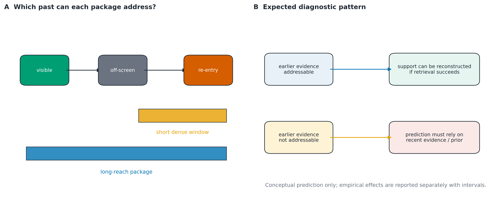

**Figure 1.16 — Conceptual operationalization of trajectory consistency.** The schematic predicts
separation specifically on memory-relevant re-entry records beyond a short window; Chapter 4
tests this prediction with exact generator-derived observability labels and paired rollouts.
Source: author’s schematic; curves are illustrative, not measured.

Systems analysis shows that none of the kinds of consistency can be considered in isolation:
they form an interdependent hierarchy of criteria. For example, without trajectory consistency it
is impossible to attain high spatial and temporal consistency of a long generated sequence; and
without hierarchical consistency, the macro-level memory that trajectory consistency relies on at
re-entry cannot be trusted by the lower levels.

Classical approaches — adding a ControlNet or a LoRA — attempt to solve these problems locally,
by patching individual criteria with external mechanisms. The systems approach instead requires
an architecture in which the observance of the consistency criteria follows from the structure of
the process itself: **an explicit multi-stream decomposition of context across temporal rate and
spatial resolution with unidirectional context transfer** — so that hierarchical consistency is enforced by
construction (stop-gradient control, §1.4.4), long-range temporal and trajectory consistency are
supplied with the memory they informationally require (§§1.3.1–1.3.2), and the whole is trainable
within realistic resource constraints thanks to reversible computation (Chapter 2). Constructing
and validating exactly such an architecture is the subject of Chapters 3 and 4.

## 1.5 Conclusions and statement of the research tasks

In the first chapter of the dissertation a thorough systems analysis of the processes of
hierarchical video data generation has been carried out. On the basis of complex-systems theory,
generative video models have been characterized as open dynamic multi-level control systems
operating under substantial structural, informational, computational, and target uncertainty.

The decomposition of the generation system revealed the key problems of contemporary approaches.
The analysis of diffusion models showed that, while they define the state of the art in
generation quality, their monolithic realization suffers from two systemic defects: a
single-level (flat) latent space that mixes abstraction levels and loses hierarchical control,
and a flat spatio-temporal attention context whose computation grows quadratically and whose
memory grows linearly with context length — so that extending the memory horizon of a flat system
is resource-prohibitive precisely where it is most needed, and the temporal consistency of long
sequences degrades: content leaving the field of view is not restored consistently upon
re-entry. In addition, the divergence between the local training objective and the long
autoregressive generation trajectory (exposure bias) undermines long-horizon stability.

The review of patch-based transformer architectures demonstrated their advantages in capturing
global contextual dependencies but revealed the critical problem of irrational computational
resource allocation due to fixed spatio-temporal tokenization, which substantiates the necessity
of methods for adaptive decomposition of visual data based on measuring their local entropy
(developed in Chapter 2).

The study of hierarchical latent approaches established the remedy direction: an explicitly
multi-level latent state space in which a compact upper (coarse) level, carrying few tokens per
frame, can retain a long temporal context at a fixed token budget and thereby serve as the
carrier of the long-range memory of the process. Discrete-token hierarchies remain an important
reviewed alternative with codebook-specific optimization risks. The implemented and evaluated
scope of this dissertation is a **compact continuous hierarchical latent state space**; because
no controlled VQ-versus-continuous receipts are present, representation-family superiority is
not claimed.

The examination of energy-based models (EBM) recorded their systemic attraction — an explicit
scalar optimization criterion doubling as an anomaly indicator — alongside their fundamental
computational barrier: gradient identification through long MCMC trajectories with linear memory
growth. In this dissertation the energy-based mechanism is treated as reviewed literature whose
capability boundary at reachable scale is characterized experimentally in Chapter 4; the survey
of resource-efficiency methods it motivated (checkpointing, Neural ODE, reversible networks)
identified reversible transformations as the most promising apparatus, which Chapter 2 develops
into the time-agnostic backpropagation method and its extension to stochastic multi-level
recurrences.

Furthermore, the chapter extended and improved the criteria apparatus for evaluating the results
of generative models. The notion of consistency was reconceived as the systemic property of the
absence of anomalies and the stability of the generation trajectory. To the classical criteria
(spatial, object, temporal consistency) new kinds were added: conceptual, hierarchical, and
trajectory consistency — the last operationalized through autoregressive-rollout degradation
metrics stratified by an exactly computable re-entry hardness label, which converts a previously
declarative criterion into a measurable instrument of systems analysis.

The identified systemic contradiction — between the necessity of ensuring multi-level consistency
of video data over long time horizons (which requires long memory horizons and deep hierarchies)
and the strict resource constraints of modern computing systems (the attention-memory blow-up of
flat contexts and the linear growth of training memory with horizon length) — determines the
relevance of this dissertation research and forms its purpose.

**The purpose of the dissertation research** is to improve the efficiency and the temporal and
spatial consistency of hierarchical video data generation processes through the development of
systems analysis methods, mathematical models, and intelligent information technologies.

To achieve this purpose and to resolve the identified systemic contradictions, the following
research tasks must be solved:

1. Analyze the state and problems of generative video-data models as complex systems; classify
   the types of uncertainty and identify the systemic causes of anomalies (inconsistencies) in
   the generation process, including the resource and consistency limitations of flat
   long-context modeling *(performed in Chapter 1)*.

2. Improve the criteria apparatus of systems analysis of generative processes by extending the
   taxonomy of consistency types (conceptual, hierarchical, trajectory) and operationalizing
   trajectory consistency through measurable rollout metrics stratified by re-entry hardness
   *(the taxonomy is constructed in Chapter 1; the operational metrics and their measurement
   instrument are developed in Chapters 3–4)*.

3. Develop a method for estimating the state of uncertainty of spatio-temporal data through their
   adaptive decomposition using entropy metrics and the mathematical apparatus of
   multidimensional rotary positional embedding.

4. Develop a method for optimizing the computational resources of multi-step iterative models
   that ensures constant, process-length-independent consumption of memory on the basis of
   reversible mathematical transformations; extend it to stochastic multi-level recurrences and
   delimit its domain of applicability.

5. Develop a mathematical model of multi-stream video data generation in compact hierarchical
   latent state spaces, supporting context streams at different temporal rates and spatial
   resolutions over a shared attention backbone, with unidirectional context-signal transfer
   and a per-frame iterative-refinement generation core selected by controlled mechanism analysis.

6. Create an intelligent information technology and a software complex for the systems analysis
   of hierarchical video generation processes, integrating the developed methods of adaptive
   tokenization, resource optimization, and hierarchical generation, together with a
   purpose-built memory-horizon testbed and re-entry-stratified evaluation protocol as its
   measurement instrument.

7. Conduct comprehensive experimental studies and approbation of the developed methods and
   technology on synthetic and open datasets — including a matched-capacity, matched-NFE
   comparison of prediction mechanisms — and compare their efficiency and consistency with
   modern analogues.

The solution of tasks 3–7 is the subject of the following chapters of the dissertation. Chapter 2
presents the mathematical apparatus of adaptive data tokenization and computational-resource
optimization; Chapter 3 develops the hierarchical mathematical model with long-range coarse-level
memory and the memory-horizon measurement instrument; Chapter 4 presents the experimental
research and practical application.

The results of this chapter are published in the author's work [A3] and in the conference
publications to be identified in the final author-supplied publication list.

---
